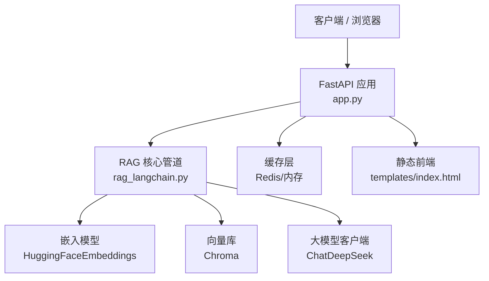
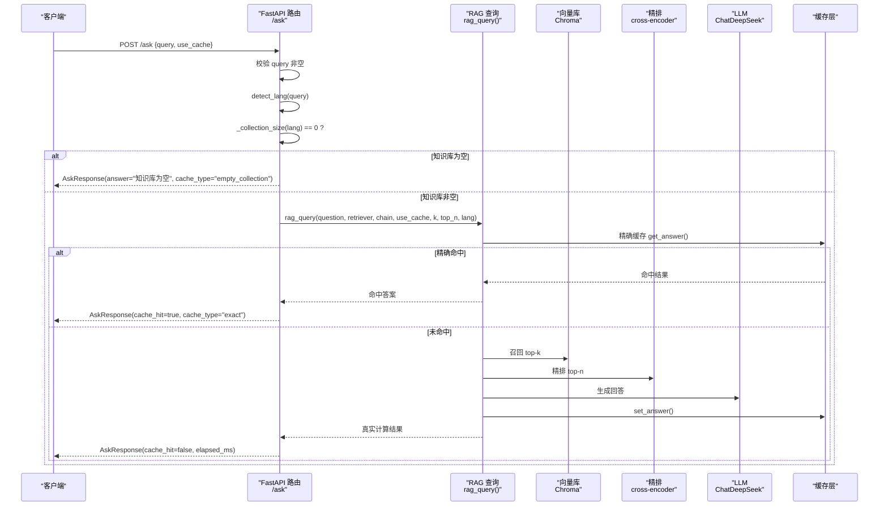

# API 参考文档

<cite>
**本文引用的文件**   
- [app.py](file://app.py)
- [rag_langchain.py](file://rag_langchain.py)
- [requirements.txt](file://requirements.txt)
- [index.html](file://templates/index.html)
</cite>

## 目录
1. [简介](#简介)
2. [项目结构](#项目结构)
3. [核心组件](#核心组件)
4. [架构总览](#架构总览)
5. [接口详细定义](#接口详细定义)
6. [依赖与运行时配置](#依赖与运行时配置)
7. [性能与缓存特性](#性能与缓存特性)
8. [安全、认证与速率限制](#安全认证与速率限制)
9. [错误处理策略](#错误处理策略)
10. [客户端实现指南](#客户端实现指南)
11. [调试与监控](#调试与监控)
12. [版本与兼容性说明](#版本与兼容性说明)
13. [常见问题排查](#常见问题排查)
14. [结论](#结论)

## 简介
本 RAG Web 服务基于 FastAPI，提供面向 PDF/Markdown 文档的知识库上传、按语种路由的检索问答、缓存管理与健康检查等 RESTful 能力。系统采用“中文/英文双向量库”设计：不同 embedding 模型产生的向量属于不同空间，因此必须分库存储与检索；同时通过三层缓存（问答、向量、精排分数）显著降低重复计算成本。默认监听 `0.0.0.0:8000`，内置前端页面用于演示交互。

## 项目结构
- `app.py`：FastAPI 应用入口，定义所有 HTTP 端点、请求/响应模型、全局单例与懒加载逻辑。
- `rag_langchain.py`：RAG 核心管道，包括语种判断、嵌入模型、Chroma 向量库、召回与精排、生成链、语义缓存、评测工具等。
- `templates/index.html`：浏览器端演示界面，调用 `/upload`、`/ask`、`/cache/stats`、`/cache/clear`。
- `requirements.txt`：Python 依赖清单，包含 FastAPI、LangChain、ChromaDB、HuggingFace、DeepSeek 客户端及 Redis 客户端。



**图示来源**
- [app.py:53-302](file://app.py#L53-L302)
- [rag_langchain.py:39-47](file://rag_langchain.py#L39-L47)
- [rag_langchain.py:185-254](file://rag_langchain.py#L185-L254)
- [rag_langchain.py:363-372](file://rag_langchain.py#L363-L372)
- [rag_langchain.py:471-475](file://rag_langchain.py#L471-L475)

**章节来源**
- [app.py:1-53](file://app.py#L1-L53)
- [rag_langchain.py:1-50](file://rag_langchain.py#L1-L50)
- [requirements.txt:1-19](file://requirements.txt#L1-L19)
- [index.html:1-100](file://templates/index.html#L1-L100)

## 核心组件
- FastAPI 应用对象与路由：定义 `/upload`、`/ask`、`/cache/stats`、`/cache/clear`、`/health`、`/`。
- 请求/响应 Pydantic 模型：`AskRequest`、`AskResponse`、`UploadResponse`、`CacheClearRequest`。
- 全局单例与懒加载：按语种维护 `_stores`、`_retrievers`、`_chains`，避免重复构造 embedding 与 retriever。
- 语种路由：根据问题或文档内容判定为中文或英文，分别走对应 collection 与 embedding 模型。
- 缓存层：问答缓存、向量缓存、精排分数缓存，支持 TTL、命中率统计与手动清理。

**章节来源**
- [app.py:129-153](file://app.py#L129-L153)
- [app.py:70-92](file://app.py#L70-L92)
- [app.py:155-228](file://app.py#L155-L228)
- [app.py:231-260](file://app.py#L231-L260)
- [app.py:263-284](file://app.py#L263-L284)

## 架构总览
下图展示一次典型问答请求的处理流程：客户端提交问题后，服务端先做空值校验与语种判定，再检查目标语种知识库是否为空；若为空则直接返回提示；否则进入 RAG 链路（召回 → 精排 → 生成），并优先尝试命中缓存。



**图示来源**
- [app.py:231-260](file://app.py#L231-L260)
- [rag_langchain.py:579-631](file://rag_langchain.py#L579-L631)
- [rag_langchain.py:452-467](file://rag_langchain.py#L452-L467)
- [rag_langchain.py:471-475](file://rag_langchain.py#L471-L475)

## 接口详细定义

### 通用约定
- 基础地址：`http://localhost:8000`
- 内容类型：JSON（除文件上传使用 `multipart/form-data`）
- 字符编码：UTF-8
- 认证：当前未启用认证机制
- 版本：当前无显式路径版本前缀（如 `/v1`）
- 速率限制：当前未启用限流中间件

### POST /upload —— 上传文档并构建索引
- 方法：POST
- URL：`/upload`
- 认证：无
- 请求体：`multipart/form-data`，字段名 `file`，支持 `.pdf`、`.md`、`.markdown`、`.txt`
- 成功响应：`UploadResponse`
- 失败响应：仍返回 `UploadResponse`，`success=false`，`message` 描述错误原因

| 字段 | 类型 | 说明 |
| --- | --- | --- |
| success | boolean | 是否成功 |
| message | string | 人类可读消息 |
| chunk_count | integer | 切块数量 |
| cache_invalidated | boolean | 是否已失效旧缓存 |
| lang | string | 文档判定的语种（`zh` 或 `en`） |

示例请求（curl）
```bash
curl -X POST http://localhost:8000/upload \
  -F "file=@./doc.pdf"
```

示例响应（成功）
```json
{
  "success": true,
  "message": "成功解析文件 doc.pdf，判定为中文，共 N 个文本块进入 rag_zh 库...",
  "chunk_count": 120,
  "cache_invalidated": true,
  "lang": "zh"
}
```

注意事项
- 上传会清空该语种的 collection 原有块并以 index 0 起重新入库。
- 上传后会失效问答与精排缓存，并尝试更新对应语种的 `chunks_preview_{lang}.md`。
- 不支持的文件类型将返回 `success=false` 与明确错误信息。

**章节来源**
- [app.py:155-228](file://app.py#L155-L228)
- [rag_langchain.py:375-405](file://rag_langchain.py#L375-L405)

### POST /ask —— 检索问答
- 方法：POST
- URL：`/ask`
- 认证：无
- 请求体：JSON
- 成功响应：`AskResponse`

| 字段 | 类型 | 必填 | 默认值 | 说明 |
| --- | --- | --- | --- | --- |
| query | string | 是 | — | 用户问题 |
| use_cache | boolean | 否 | `true` | 是否允许命中缓存；设为 `false` 强制走完整链路 |

| 字段 | 类型 | 说明 |
| --- | --- | --- |
| answer | string | 模型生成的回答 |
| sources | array of string | 引用片段列表 |
| cache_hit | boolean | 是否命中缓存 |
| cache_type | string | 命中类型：`exact`、`semantic(...)`、`miss`、`empty`、`empty_collection` |
| elapsed_ms | number | 本次请求耗时（毫秒） |
| lang | string | 问题判定的语种（`zh` 或 `en`） |

示例请求（curl）
```bash
curl -X POST http://localhost:8000/ask \
  -H "Content-Type: application/json" \
  -d '{"query":"系统在硬件层面由哪两个主要节点构成？","use_cache":true}'
```

示例响应（命中缓存）
```json
{
  "answer": "...",
  "sources": ["..."],
  "cache_hit": true,
  "cache_type": "exact",
  "elapsed_ms": 12.3,
  "lang": "zh"
}
```

行为说明
- 若 `query` 为空，返回 `cache_type="empty"` 与提示性回答。
- 若目标语种知识库为空，返回 `cache_type="empty_collection"` 并提示先上传对应语种文档。
- 若 `use_cache=false`，跳过缓存直接走召回→精排→生成链路。

**章节来源**
- [app.py:129-141](file://app.py#L129-L141)
- [app.py:231-260](file://app.py#L231-L260)
- [rag_langchain.py:579-631](file://rag_langchain.py#L579-L631)

### GET /cache/stats —— 查看缓存状态
- 方法：GET
- URL：`/cache/stats`
- 认证：无
- 响应体：JSON

| 字段 | 类型 | 说明 |
| --- | --- | --- |
| backend | string | 缓存后端名称（如 Redis 或内存） |
| healthy | boolean | 缓存后端是否健康 |
| version | number | 缓存版本号（文档变更后递增） |
| collections | object | 各语种 collection 的块数，键为 `zh`/`en` |
| ttl_seconds | object | 各类缓存的 TTL（秒）：`answer`、`embedding`、`rerank` |
| stats | object | 缓存统计指标（命中/未命中/命中率等） |

示例响应
```json
{
  "backend": "redis",
  "healthy": true,
  "version": 3,
  "collections": {"zh": 120, "en": 0},
  "ttl_seconds": {"answer": 86400, "embedding": 86400, "rerank": 86400},
  "stats": {
    "qa_hit": 10,
    "qa_miss": 5,
    "qa_hit_rate": 0.6667,
    "embed_hit": 20,
    "embed_miss": 5,
    "embed_hit_rate": 0.8,
    "rerank_hit": 15,
    "rerank_miss": 5,
    "rerank_hit_rate": 0.75,
    "asked_pipeline_saved": 10
  }
}
```

**章节来源**
- [app.py:263-277](file://app.py#L263-L277)

### POST /cache/clear —— 清空缓存
- 方法：POST
- URL：`/cache/clear`
- 认证：无
- 请求体：JSON，可选字段 `kinds`

| 字段 | 类型 | 默认值 | 说明 |
| --- | --- | --- | --- |
| kinds | array of string | `["qa","embed","rerank"]` | 指定要清空的缓存类型；为空表示全部清空 |

响应体
```json
{
  "success": true,
  "deleted": 15,
  "kinds": ["qa","embed","rerank"]
}
```

**章节来源**
- [app.py:151-153](file://app.py#L151-L153)
- [app.py:280-284](file://app.py#L280-L284)

### GET /health —— 健康检查
- 方法：GET
- URL：`/health`
- 认证：无
- 响应体：JSON

| 字段 | 类型 | 说明 |
| --- | --- | --- |
| status | string | 固定为 `ok` |
| cache_backend | string | 缓存后端名称 |
| cache_healthy | boolean | 缓存后端是否健康 |
| collections | object | 各语种 collection 的块数 |

示例响应
```json
{
  "status": "ok",
  "cache_backend": "redis",
  "cache_healthy": true,
  "collections": {"zh": 120, "en": 0}
}
```

**章节来源**
- [app.py:287-290](file://app.py#L287-L290)

### GET / —— 前端页面
- 方法：GET
- URL：`/`
- 认证：无
- 响应体：HTML 页面，用于演示上传、提问、查看缓存状态与清空缓存。

**章节来源**
- [app.py:293-297](file://app.py#L293-L297)
- [index.html:1-100](file://templates/index.html#L1-L100)

## 依赖与运行时配置
- FastAPI + Uvicorn：Web 框架与 ASGI 服务器。
- LangChain 生态：`langchain`、`langchain-community`、`langchain-chroma`、`langchain-huggingface`、`langchain-deepseek`、`langchain-core`。
- 向量与嵌入：`sentence-transformers`、`chromadb`、`pymupdf`。
- 环境变量：
  - `BGE_QUERY_PREFIX`：覆盖 bge 系列模型的查询前缀。
  - `CHUNK_TOKENS`、`CHUNK_OVERLAP_TOKENS`：控制切块大小与重叠。
  - `SEMANTIC_CACHE`、`SEMANTIC_THRESHOLD`：开启语义缓存及其相似度阈值。
  - `REDIS_*`（由缓存层使用）：连接 Redis 时所需的环境变量（具体键名取决于缓存实现）。
- 默认端口：`8000`，绑定 `0.0.0.0`。

**章节来源**
- [requirements.txt:1-19](file://requirements.txt#L1-L19)
- [rag_langchain.py:86-115](file://rag_langchain.py#L86-L115)
- [app.py:300-302](file://app.py#L300-L302)

## 性能与缓存特性
- 三层缓存：
  - 问答缓存：相同问题原文命中，直接返回答案与来源。
  - 向量缓存：相同文本不重复计算 embedding。
  - 精排分数缓存：`(question, document)` 对不重复计算 cross-encoder 分数。
- 语义缓存（可选）：基于向量余弦相似度近似匹配不同问法，默认关闭以避免误命中。
- 懒加载与单例：embedding 模型、tokenizer、cross-encoder、Chroma client 均懒加载并按语种隔离，避免重复加载与内存浪费。
- 并发保护：关键单例初始化使用双检锁，防止首次并发请求重复构造重型对象。
- 空库保护：目标语种 collection 为空时直接返回提示，避免模型“凭印象作答”。

优化建议
- 合理设置 `CHUNK_TOKENS` 与 `CHUNK_OVERLAP_TOKENS`，平衡召回质量与上下文长度。
- 在稳定期开启语义缓存并谨慎调整阈值，观察命中率与准确率变化。
- 使用 Redis 作为缓存后端以获得持久化与跨进程共享能力。
- 监控 `/cache/stats` 与 `/health`，结合业务日志分析热点问答与瓶颈环节。

**章节来源**
- [rag_langchain.py:147-182](file://rag_langchain.py#L147-L182)
- [rag_langchain.py:428-449](file://rag_langchain.py#L428-L449)
- [rag_langchain.py:514-576](file://rag_langchain.py#L514-L576)
- [rag_langchain.py:579-631](file://rag_langchain.py#L579-L631)
- [app.py:70-92](file://app.py#L70-L92)
- [app.py:231-260](file://app.py#L231-L260)

## 安全、认证与速率限制
- 认证：当前未启用任何身份验证或授权机制。生产环境建议引入 API Key、JWT 或 OAuth2。
- 输入校验：`/ask` 对空问题进行快速返回；`/upload` 对文件类型与内容进行基本校验。
- 输出安全：前端对回答进行 HTML 转义，避免 XSS。
- 速率限制：当前未启用限流；生产环境建议使用反向代理（Nginx、Cloudflare）或 FastAPI 中间件实现 IP/用户级限流。
- 敏感配置：API Key、Redis 连接串应通过环境变量注入，不要硬编码到代码中。

**章节来源**
- [index.html:183-187](file://templates/index.html#L183-L187)
- [app.py:155-176](file://app.py#L155-L176)
- [app.py:231-236](file://app.py#L231-L236)

## 错误处理策略
- 上传失败：返回 `UploadResponse(success=false, message=...)`，包含具体错误原因（如不支持的文件类型、内容为空、异常堆栈摘要）。
- 问答为空：返回 `AskResponse(answer="问题不能为空", cache_type="empty")`。
- 知识库为空：返回 `AskResponse(answer="xxx知识库为空...", cache_type="empty_collection")`。
- 缓存异常：缓存层采用 fail-open 策略，读不到缓存即视为未命中，继续走真实链路，保证答案正确性优先于性能。
- 预览文件更新失败：不影响上传主流程，仅在消息中附加失败提示。

**章节来源**
- [app.py:173-179](file://app.py#L173-L179)
- [app.py:227-228](file://app.py#L227-L228)
- [app.py:234-249](file://app.py#L234-L249)
- [app.py:210-215](file://app.py#L210-L215)

## 客户端实现指南
- 语言与库：推荐使用任意支持 HTTP 的 SDK（Python requests/httpx、Node axios/fetch、Go net/http 等）。
- 上传：
  - 使用 `multipart/form-data` 发送 `file` 字段。
  - 仅支持 `.pdf`、`.md`、`.markdown`、`.txt`。
- 问答：
  - JSON 请求体包含 `query` 与可选 `use_cache`。
  - 关注 `cache_hit`、`cache_type`、`elapsed_ms`、`lang` 以优化用户体验与诊断性能。
- 缓存管理：
  - 定期轮询 `/cache/stats` 获取命中率与 TTL。
  - 在文档更新后调用 `/cache/clear` 清空相关缓存。
- 前端集成：
  - 可复用 `templates/index.html` 中的 fetch 调用模式。
  - 注意对回答文本进行 HTML 转义，避免 XSS。

**章节来源**
- [index.html:110-140](file://templates/index.html#L110-L140)
- [index.html:142-181](file://templates/index.html#L142-L181)
- [index.html:189-231](file://templates/index.html#L189-L231)

## 调试与监控
- 本地启动：运行 `python app.py`，默认监听 `0.0.0.0:8000`。
- 健康检查：`GET /health` 快速确认服务与缓存后端状态。
- 缓存统计：`GET /cache/stats` 查看后端类型、TTL、命中率与集合块数。
- 前端调试：访问 `GET /` 打开演示页面，勾选“跳过缓存”对比真实计算耗时。
- 日志与指标：
  - 建议在 FastAPI 中间件中记录请求 ID、方法、路径、状态码、耗时。
  - 暴露 Prometheus 指标（如请求计数、延迟直方图、缓存命中率）。
- 网络与依赖：
  - 确认 Redis 可达（若启用）；不可达时自动降级为内存缓存。
  - 确认 HuggingFace 模型路径可用（本地路径需存在）。

**章节来源**
- [app.py:300-302](file://app.py#L300-L302)
- [app.py:263-290](file://app.py#L263-L290)
- [index.html:189-231](file://templates/index.html#L189-L231)

## 版本与兼容性说明
- 当前无显式 API 版本前缀（如 `/v1`）。如需演进，建议引入路径版本并在路由注释中标明弃用计划。
- 向后兼容：
  - `/ask` 新增 `use_cache` 字段并提供默认值，旧客户端仍可省略该字段。
  - `/cache/clear` 的 `kinds` 字段为可选，空值表示清空全部。
- 弃用迁移：
  - 若未来移除 `use_cache`，可在过渡期保留字段但忽略其值，并通过响应头 `Deprecation` 通知客户端。
  - 若引入版本前缀，可通过反向代理将旧路径重定向到新路径，并逐步下线。

**章节来源**
- [app.py:129-153](file://app.py#L129-L153)
- [app.py:280-284](file://app.py#L280-L284)

## 常见问题排查
- 上传后回答仍基于旧文档：
  - 确认已调用 `/cache/clear` 或等待 TTL 过期；上传逻辑会自动失效问答与精排缓存。
- 问答返回“知识库为空”：
  - 先上传对应语种的文档；系统会根据问题语种选择对应 collection。
- 响应耗时较长：
  - 检查是否命中缓存（`cache_hit=false` 且 `elapsed_ms` 较大）；必要时开启语义缓存并调优阈值。
  - 确认 Redis 可用；不可用时降级为内存缓存，可能影响跨进程共享与持久化。
- 向量维度或模型不一致：
  - 确保同一 collection 始终使用同一 embedding 模型；本项目已按语种隔离 collection 与模型。
- 预览文件未更新：
  - 上传成功后会尝试更新 `chunks_preview_{lang}.md`；若失败会在消息中附带错误提示，但不影响主流程。

**章节来源**
- [app.py:204-215](file://app.py#L204-L215)
- [app.py:231-249](file://app.py#L231-L249)
- [rag_langchain.py:54-80](file://rag_langchain.py#L54-L80)

## 结论
本 RAG Web 服务提供了完整的文档上传、语种路由检索问答、缓存管理与健康检查能力。通过三层缓存与懒加载单例，系统在保持答案正确性的前提下显著提升了吞吐与响应速度。生产部署时应补充认证、鉴权、限流与可观测性，并根据业务场景调优切块参数、缓存 TTL 与语义缓存阈值。