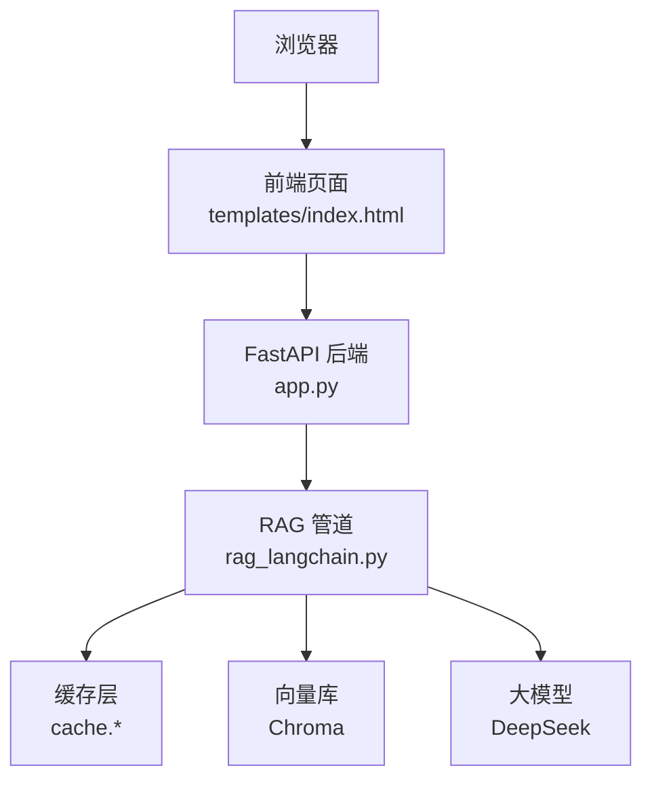
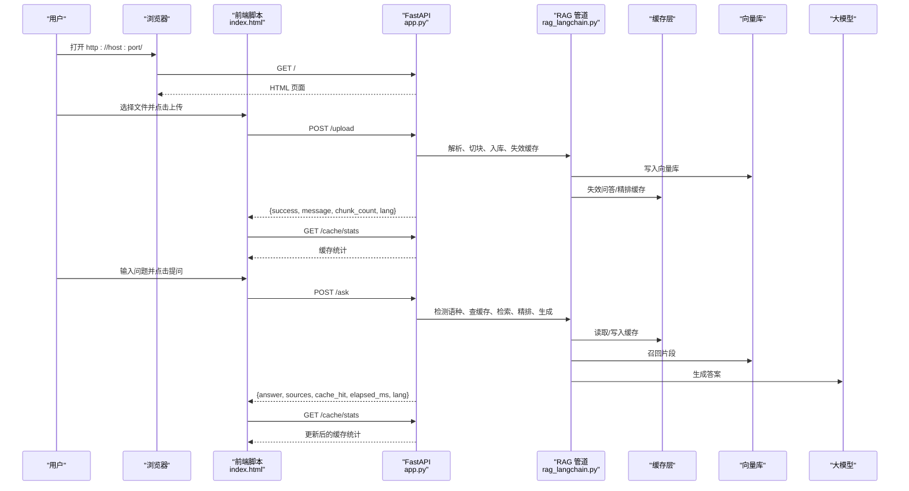
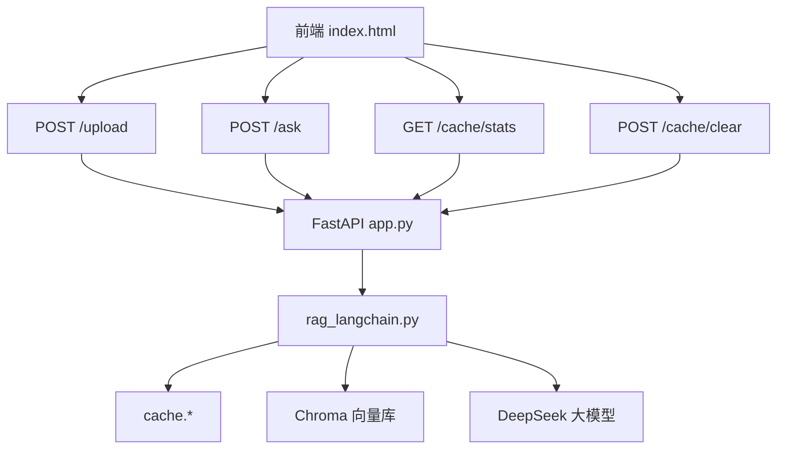

# 前端界面接口

<cite>
**本文引用的文件**   
- [app.py](file://app.py)
- [templates/index.html](file://templates/index.html)
- [rag_langchain.py](file://rag_langchain.py)
- [requirements.txt](file://requirements.txt)
</cite>

## 目录
1. [简介](#简介)
2. [项目结构](#项目结构)
3. [核心组件](#核心组件)
4. [架构总览](#架构总览)
5. [详细组件分析](#详细组件分析)
6. [依赖关系分析](#依赖关系分析)
7. [性能与缓存说明](#性能与缓存说明)
8. [故障排查指南](#故障排查指南)
9. [部署与定制指南](#部署与定制指南)
10. [结论](#结论)

## 简介
本文件面向“RAG Web 服务”的前端界面，重点说明 GET / 返回的页面功能、用户交互流程、实时状态展示和错误提示机制。同时解释前端与后端的交互模式、数据绑定方式、异步请求处理，以及前端组件的功能说明、操作指南、界面定制选项、部署配置和自定义开发建议。

该前端是一个单页 HTML，由后端 FastAPI 直接返回；页面内通过原生 JavaScript 调用后端 REST 接口完成文档上传、问题提问、缓存状态查看与清空等操作。后端在 /ask 中按问题语种路由到中文或英文知识库，并结合向量检索、精排与大模型生成答案；/upload 则按文档语种更新对应知识库并失效相关缓存。

## 项目结构
与本前端相关的代码主要分布在以下位置：
- 后端服务入口与路由：[app.py](file://app.py)
- 前端页面模板：[templates/index.html](file://templates/index.html)
- RAG 管道与缓存逻辑（被后端调用）：[rag_langchain.py](file://rag_langchain.py)
- Python 依赖声明：[requirements.txt](file://requirements.txt)

**图表来源**
- [app.py:293-297](file://app.py#L293-L297)
- [templates/index.html:101-233](file://templates/index.html#L101-L233)
- [rag_langchain.py:579-631](file://rag_langchain.py#L579-L631)

**章节来源**
- [app.py:293-297](file://app.py#L293-L297)
- [templates/index.html:1-237](file://templates/index.html#L1-237)

## 核心组件
本节从前端视角梳理关键 UI 组件及其职责：

| 组件 | 作用 | 主要交互 | 数据来源 |
|---|---|---|---|
| 标题区 | 显示应用名称与版本标识 | 无 | 静态文本 |
| 上传区域 | 选择 PDF/Markdown/TXT 文件并上传 | 选择文件、点击“上传并向量化” | 后端 POST /upload |
| 提问区域 | 输入问题并提交 | 点击“提问”、勾选“跳过缓存” | 后端 POST /ask |
| 答案展示区 | 显示回答、缓存徽标、耗时、语种库标签 | 自动渲染 | POST /ask 响应 |
| 引用来源区 | 列出召回片段 | 自动渲染 | POST /ask 响应的 sources |
| 缓存状态面板 | 展示缓存后端、健康状态、命中率、TTL、知识库块数 | 刷新、清空缓存 | GET /cache/stats、POST /cache/clear |

这些组件全部位于 [templates/index.html](file://templates/index.html)，使用内联 CSS 布局，并通过原生 fetch 发起异步请求。

**章节来源**
- [templates/index.html:69-99](file://templates/index.html#L69-L99)
- [templates/index.html:101-233](file://templates/index.html#L101-L233)

## 架构总览
前端与后端的数据流如下：

**图表来源**
- [app.py:155-228](file://app.py#L155-L228)
- [app.py:231-260](file://app.py#L231-L260)
- [app.py:263-290](file://app.py#L263-L290)
- [app.py:293-297](file://app.py#L293-L297)
- [templates/index.html:110-140](file://templates/index.html#L110-L140)
- [templates/index.html:142-181](file://templates/index.html#L142-L181)
- [templates/index.html:189-231](file://templates/index.html#L189-L231)
- [rag_langchain.py:579-631](file://rag_langchain.py#L579-L631)

## 详细组件分析

### 前端页面结构与布局
- 页面采用简洁的单栏布局，最大宽度约 800px，居中显示。
- 顶部为标题区，随后是上传区域、分割线、提问区、答案区、引用来源区和缓存状态面板。
- 样式使用内联 CSS，包含基础排版、按钮、答案卡片、引用项、徽章徽标和统计表格样式。

可定制点包括：
- 页面标题、副标题文案
- 上传区域边框、颜色、圆角
- 答案卡片背景色、边距、换行策略
- 引用来源列表样式
- 缓存状态面板的表格样式与间距
- 整体字体、字号、最大宽度等

**章节来源**
- [templates/index.html:7-66](file://templates/index.html#L7-L66)
- [templates/index.html:69-99](file://templates/index.html#L69-L99)

### 上传文档组件
功能说明：
- 支持选择 .pdf、.md、.markdown、.txt 文件。
- 选择文件后启用“上传并向量化”按钮。
- 点击上传后，前端构造 FormData 并 POST 到 /upload。
- 根据后端返回的 success 字段显示成功或失败消息，并刷新缓存状态。

用户操作流程：
1. 点击“选择文件”，选择一个 PDF 或 Markdown/TXT 文件。
2. 点击“上传并向量化”。
3. 等待后端解析、切块、向量化、入库并失效相关缓存。
4. 页面显示上传结果，并自动刷新缓存统计。

错误提示机制：
- 如果后端返回 success=false，前端将显示红色失败消息。
- 如果网络请求异常，前端捕获错误并显示“请求失败”。

异步处理：
- 使用 async/await 与 fetch 发起上传请求。
- 上传完成后重置 selectedFile 并清空 input 值，避免重复上传。

**章节来源**
- [templates/index.html:71-76](file://templates/index.html#L71-L76)
- [templates/index.html:104-140](file://templates/index.html#L104-L140)
- [app.py:155-228](file://app.py#L155-L228)

### 提问组件
功能说明：
- 提供多行文本框用于输入问题。
- 提供“跳过缓存（强制重新生成）”复选框，勾选后 use_cache=false。
- 点击“提问”后，前端 POST /ask，携带 query 与 use_cache。

用户操作流程：
1. 在文本框中输入问题。
2. 可选勾选“跳过缓存”。
3. 点击“提问”。
4. 页面显示“思考中...”，随后渲染答案、缓存徽标、耗时与语种库标签。
5. 显示引用来源列表。
6. 自动刷新缓存状态。

错误提示机制：
- 如果问题为空，前端弹出 alert 提示。
- 如果网络请求异常，前端捕获错误并在答案区显示失败信息。

异步处理：
- 使用 async/await 与 fetch 发起提问请求。
- 根据 response.json() 中的 cache_hit、elapsed_ms、lang 动态渲染徽标与标签。

**章节来源**
- [templates/index.html:80-93](file://templates/index.html#L80-L93)
- [templates/index.html:142-181](file://templates/index.html#L142-L181)
- [app.py:231-260](file://app.py#L231-L260)

### 缓存状态面板
功能说明：
- 显示缓存后端类型、健康状态、版本号、各语种知识库块数。
- 展示问答缓存、向量缓存、精排分数缓存的命中/未命中数量与命中率。
- 显示 TTL 与已节省的大模型调用次数。
- 提供“刷新”和“清空缓存”按钮。

用户操作流程：
1. 页面加载时自动调用 GET /cache/stats 并渲染统计。
2. 点击“刷新”再次拉取最新统计。
3. 点击“清空缓存”，确认后 POST /cache/clear，然后刷新统计。

错误提示机制：
- 获取缓存状态失败时，显示“获取缓存状态失败”及错误信息。

异步处理：
- 使用 fetch 异步拉取 /cache/stats。
- 清空缓存后再次调用 loadStats 更新界面。

**章节来源**
- [templates/index.html:94-99](file://templates/index.html#L94-L99)
- [templates/index.html:189-231](file://templates/index.html#L189-L231)
- [app.py:263-284](file://app.py#L263-L284)

### 答案与引用来源渲染
- 答案区会先显示“思考中...”，请求成功后替换为缓存徽标与答案正文。
- 缓存徽标区分“缓存命中”和“真实计算”，并显示耗时与语种库标签。
- 引用来源区动态创建多个 source-item 节点，显示序号与片段内容。
- 答案正文通过 escapeHtml 转义，防止 XSS。

**章节来源**
- [templates/index.html:142-187](file://templates/index.html#L142-L187)

### 后端路由与前端映射
| 前端动作 | 后端接口 | 方法 | 用途 | 前端行为 |
|---|---|---|---|---|
| 打开页面 | GET / | GET | 返回前端 HTML | 渲染页面 |
| 上传文件 | POST /upload | POST | 解析、切块、入库、失效缓存 | 显示上传结果并刷新统计 |
| 提问 | POST /ask | POST | 检测语种、查缓存、检索、精排、生成 | 显示答案、来源、缓存徽标、耗时 |
| 查看缓存状态 | GET /cache/stats | GET | 返回缓存后端、健康、版本、统计 | 渲染统计表 |
| 清空缓存 | POST /cache/clear | POST | 清空指定或全部缓存 | 确认后刷新统计 |

**章节来源**
- [app.py:155-228](file://app.py#L155-L228)
- [app.py:231-260](file://app.py#L231-L260)
- [app.py:263-290](file://app.py#L263-L290)
- [app.py:293-297](file://app.py#L293-L297)
- [templates/index.html:110-140](file://templates/index.html#L110-L140)
- [templates/index.html:142-181](file://templates/index.html#L142-L181)
- [templates/index.html:189-231](file://templates/index.html#L189-L231)

## 依赖关系分析
前端依赖的后端接口与 RAG 管道如下：

**图表来源**
- [templates/index.html:110-140](file://templates/index.html#L110-L140)
- [templates/index.html:142-181](file://templates/index.html#L142-L181)
- [templates/index.html:189-231](file://templates/index.html#L189-L231)
- [app.py:155-228](file://app.py#L155-L228)
- [app.py:231-260](file://app.py#L231-L260)
- [app.py:263-290](file://app.py#L263-L290)
- [rag_langchain.py:579-631](file://rag_langchain.py#L579-L631)

**章节来源**
- [app.py:155-290](file://app.py#L155-L290)
- [rag_langchain.py:579-631](file://rag_langchain.py#L579-L631)

## 性能与缓存说明
前端通过 POST /ask 的响应字段直观展示性能与缓存情况：
- cache_hit：是否命中缓存。
- cache_type：缓存类型，如 exact、semantic、miss、empty_collection。
- elapsed_ms：本次请求耗时（毫秒）。
- lang：问题判定语种，决定查询中文或英文知识库。

当勾选“跳过缓存”时，use_cache=false，前端会强制走完整链路，便于对比缓存命中与真实计算的耗时差异。

后端在 /ask 中会：
- 检测问题语种。
- 若目标语种知识库为空，直接返回空库提示。
- 否则进入 RAG 管道：先查缓存，未命中则召回、精排、生成，并回写缓存。

**章节来源**
- [templates/index.html:142-181](file://templates/index.html#L142-L181)
- [app.py:231-260](file://app.py#L231-L260)
- [rag_langchain.py:579-631](file://rag_langchain.py#L579-L631)

## 故障排查指南
常见问题与定位建议：

| 现象 | 可能原因 | 前端表现 | 排查建议 |
|---|---|---|---|
| 上传失败 | 文件类型不支持、内容为空、解析异常 | 显示红色失败消息 | 检查文件格式、文件大小、内容是否为空 |
| 提问为空 | 未输入问题 | 弹出 alert | 确保文本框非空 |
| 请求失败 | 后端不可用、网络异常、跨域限制 | 显示“请求失败” | 检查服务是否启动、端口是否正确、是否有 CORS 限制 |
| 知识库为空 | 尚未上传对应语种文档 | 答案区显示空库提示 | 先上传对应语种文档再提问 |
| 缓存状态加载失败 | /cache/stats 不可用 | 显示“获取缓存状态失败” | 检查后端健康状态与缓存后端连接 |
| 清空缓存无效 | 未确认或后端返回异常 | 统计未更新 | 确认弹窗、检查 /cache/clear 响应 |

**章节来源**
- [templates/index.html:104-140](file://templates/index.html#L104-L140)
- [templates/index.html:142-181](file://templates/index.html#L142-L181)
- [templates/index.html:189-231](file://templates/index.html#L189-L231)
- [app.py:155-228](file://app.py#L155-L228)
- [app.py:231-260](file://app.py#L231-L260)

## 部署与定制指南

### 部署配置
- 服务启动：默认监听 0.0.0.0:8000。
- 前端页面：由 GET / 返回 templates/index.html。
- 依赖安装：参考 requirements.txt，包含 FastAPI、Uvicorn、LangChain、Chroma、PyMuPDF、Redis 客户端等。
- 环境变量：可通过 .env 配置模型地址、检索参数、语义缓存开关等（见 rag_langchain.py 的环境变量读取）。

建议：
- 生产环境建议使用反向代理（如 Nginx）暴露 80/443 端口。
- 如需跨域访问，可在 FastAPI 中添加 CORS 中间件。
- 如需持久化向量库，确保 chroma_db 目录存在且可写。

**章节来源**
- [app.py:300-302](file://app.py#L300-L302)
- [app.py:293-297](file://app.py#L293-L297)
- [requirements.txt:1-19](file://requirements.txt#L1-L19)
- [rag_langchain.py:50-115](file://rag_langchain.py#L50-L115)

### 自定义开发指南
前端定制建议：
- 修改页面标题、文案：编辑 templates/index.html 的标题与静态文本。
- 调整样式：修改 <style> 区块中的 CSS，包括 body、textarea、button、answer、sources、badge、stats 等。
- 扩展功能：在前端脚本中新增函数，调用后端新接口；在后端 app.py 中新增路由。
- 安全加固：对用户上传内容进行校验，对输出进行转义（当前答案已做 escapeHtml）。

后端扩展建议：
- 新增接口：在 app.py 中使用 FastAPI 装饰器定义新路由。
- 扩展 RAG 管道：在 rag_langchain.py 中调整检索参数、精排模型、Prompt 或 LLM。
- 缓存策略：通过 cache.* 接口扩展缓存类型、TTL、命中率统计。

**章节来源**
- [templates/index.html:1-237](file://templates/index.html#L1-L237)
- [app.py:155-290](file://app.py#L155-L290)
- [rag_langchain.py:471-508](file://rag_langchain.py#L471-L508)

## 结论
本前端界面以简洁的单页 HTML 实现 RAG 助手的核心交互：上传文档、提问、查看缓存状态。页面通过原生 JavaScript 与后端 FastAPI 接口通信，结合 RAG 管道的语种路由、向量检索、精排与大模型生成能力，提供直观的缓存命中徽标、耗时与语种库标签。用户可通过界面完成完整的知识问答流程，开发者也可基于现有结构进行样式定制、功能扩展与部署优化。