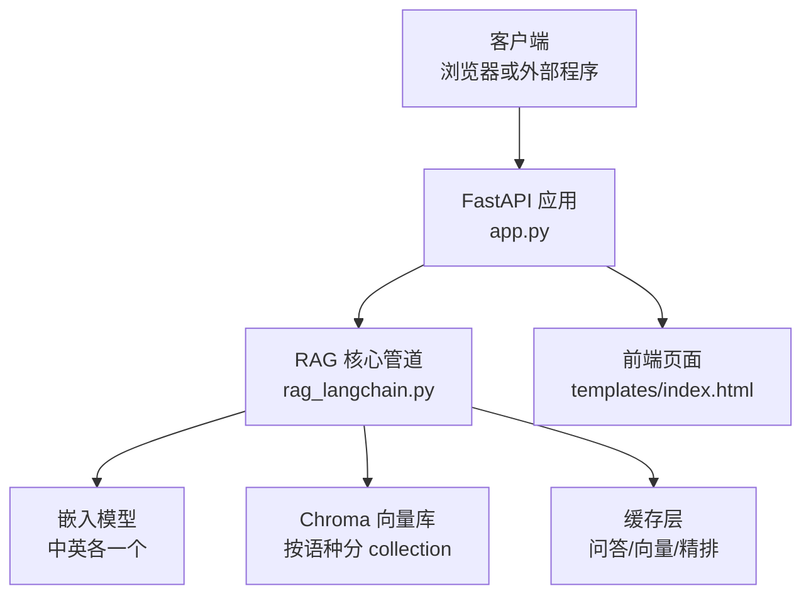
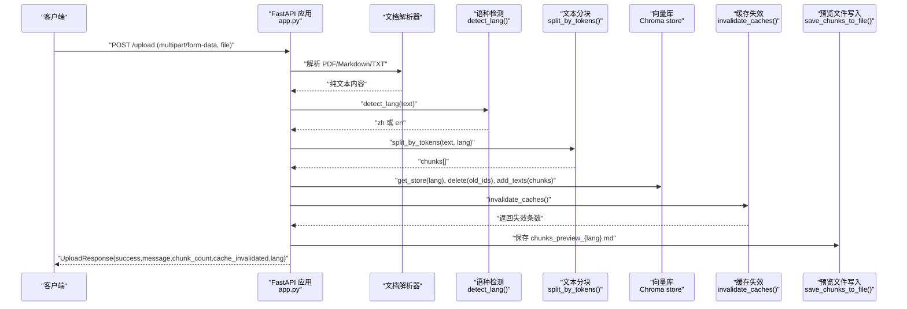
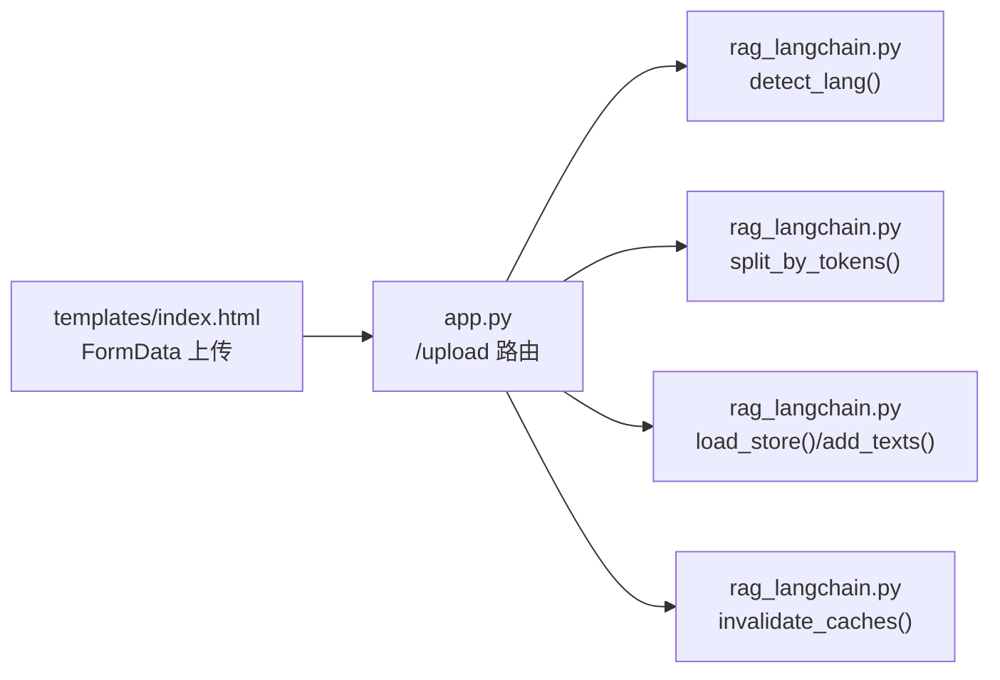

# 文档上传接口

<cite>
**本文引用的文件**   
- [app.py](file://app.py)
- [rag_langchain.py](file://rag_langchain.py)
- [index.html](file://templates/index.html)
</cite>

## 目录
1. [简介](#简介)
2. [项目结构](#项目结构)
3. [核心组件](#核心组件)
4. [架构总览](#架构总览)
5. [详细组件分析](#详细组件分析)
6. [依赖关系分析](#依赖关系分析)
7. [性能考虑](#性能考虑)
8. [故障排查指南](#故障排查指南)
9. [结论](#结论)
10. [附录：客户端实现与示例](#附录客户端实现与示例)

## 简介
本文档为“文档上传”API 的完整技术说明，聚焦以下目标：
- 明确 POST /upload 接口的 HTTP 方法、URL、请求参数、响应结构与错误处理。
- 说明支持的文档格式（PDF、Markdown、TXT）、文件大小限制、语种自动检测机制。
- 解释文本分块算法、向量入库流程、缓存失效机制与知识库更新过程。
- 提供请求/响应示例、错误码定义、常见问题解决方案、客户端实现指南与性能优化建议。

该接口属于 RAG（检索增强生成）服务的一部分：上传文档后，系统会按语种路由到对应向量库，切块、向量化并入库；同时使问答、精排等缓存失效，保证后续提问不会命中旧答案。

## 项目结构
与本接口直接相关的代码主要位于两个文件：
- app.py：FastAPI 应用入口，定义 /upload、/ask、/cache/stats、/health 等接口。
- rag_langchain.py：RAG 核心管道，包含语种检测、嵌入模型、切块、Chroma 向量库、检索与重排、缓存失效等逻辑。
- templates/index.html：前端页面，演示如何通过浏览器调用 /upload 与 /ask。

图示来源
- [app.py:155-228](file://app.py#L155-L228)
- [rag_langchain.py:118-143](file://rag_langchain.py#L118-L143)
- [rag_langchain.py:324-359](file://rag_langchain.py#L324-L359)
- [rag_langchain.py:363-405](file://rag_langchain.py#L363-L405)
- [rag_langchain.py:634-644](file://rag_langchain.py#L634-L644)

章节来源
- [app.py:1-53](file://app.py#L1-L53)
- [rag_langchain.py:1-24](file://rag_langchain.py#L1-L24)
- [index.html:71-76](file://templates/index.html#L71-L76)

## 核心组件
- FastAPI 路由与请求/响应模型：定义 /upload 端点及 UploadResponse。
- 文档解析器：PDF 使用 PyMuPDFLoader；Markdown/TXT 直接读取 UTF-8 文本。
- 语种检测：基于汉字占比阈值判断中文或英文。
- 文本分块：按 token 切块，支持重叠，避免跨语言信息量不一致。
- 向量入库：按语种选择 embedding 模型与 Chroma collection，批量 add_texts。
- 缓存失效：上传成功后清空问答与精排缓存，提升版本号，刷新预览文件。

章节来源
- [app.py:143-149](file://app.py#L143-L149)
- [app.py:155-228](file://app.py#L155-L228)
- [rag_langchain.py:118-143](file://rag_langchain.py#L118-L143)
- [rag_langchain.py:324-359](file://rag_langchain.py#L324-L359)
- [rag_langchain.py:363-405](file://rag_langchain.py#L363-L405)
- [rag_langchain.py:634-644](file://rag_langchain.py#L634-L644)

## 架构总览
POST /upload 的整体流程如下：

图示来源
- [app.py:155-228](file://app.py#L155-L228)
- [rag_langchain.py:118-143](file://rag_langchain.py#L118-L143)
- [rag_langchain.py:324-359](file://rag_langchain.py#L324-L359)
- [rag_langchain.py:363-405](file://rag_langchain.py#L363-L405)
- [rag_langchain.py:634-644](file://rag_langchain.py#L634-L644)

## 详细组件分析

### 接口定义与约束
- 方法：POST
- URL：/upload
- Content-Type：multipart/form-data
- 表单字段：
  - file：必填，二进制文件
- 支持的文件扩展名：
  - .pdf
  - .md
  - .markdown
  - .txt
- 编码要求：
  - Markdown/TXT 必须为 UTF-8 可解码文本
- 文件大小限制：
  - 代码未显式设置最大文件大小限制；实际受运行时内存与临时文件策略影响
- 响应模型：UploadResponse
  - success：布尔值，表示是否成功
  - message：人类可读消息
  - chunk_count：本次入库的文本块数量
  - cache_invalidated：是否已失效缓存
  - lang：文档判定语种（zh 或 en）

章节来源
- [app.py:143-149](file://app.py#L143-L149)
- [app.py:155-176](file://app.py#L155-L176)

### 请求参数与校验规则
- 必填字段：file
- 不支持的文件类型：返回 success=false，message 提示不支持的类型
- 空内容：若解析后文本为空，返回 success=false，message 提示内容为空
- 分块结果为空：返回 success=false，message 提示分块后无内容

章节来源
- [app.py:158-187](file://app.py#L158-L187)

### 语种自动检测机制
- 检测函数：detect_lang(text)
- 判据：统计非空白字符中汉字占比，≥5% 判定为中文，否则为英文
- 默认语种：DEFAULT_LANG = "zh"
- 设计原因：中英文在字符层面即可区分，无需引入重型模型；低阈值给中文侧留余量

章节来源
- [rag_langchain.py:118-143](file://rag_langchain.py#L118-L143)

### 文本分块算法
- 函数：split_by_tokens(text, lang, chunk_size=CHUNK_TOKENS, overlap=CHUNK_OVERLAP_TOKENS)
- 切块单位：token（而非字符），避免中英信息量差异
- 默认参数：
  - CHUNK_TOKENS：256（模型上限 512 的一半，留余量）
  - CHUNK_OVERLAP_TOKENS：40（约 16% 重叠）
- 实现要点：
  - 使用对应语种的 tokenizer 计算 offset_mapping
  - 按 offset 切原文，保证每个块是原文子串
  - step = max(chunk_size - overlap, 1)，防止原地打转

章节来源
- [rag_langchain.py:107-111](file://rag_langchain.py#L107-L111)
- [rag_langchain.py:324-359](file://rag_langchain.py#L324-L359)

### 向量入库流程
- 步骤：
  1. 根据语种获取 store：get_store(lang)
  2. 删除旧块：store.get()["ids"] -> store.delete(ids=old_ids)
  3. 批量入库：store.add_texts(chunks, metadatas=[{"index": i, "source": filename}])
- 注意：
  - 只替换该语种的 collection，不 drop collection，保持 Chroma 实例与 retriever 有效
  - 嵌入过程走向量缓存，重复内容不会重复计算

章节来源
- [app.py:189-202](file://app.py#L189-L202)
- [rag_langchain.py:363-405](file://rag_langchain.py#L363-L405)

### 缓存失效与知识库更新
- 失效范围：
  - 问答缓存（qa）
  - 精排分数缓存（rerank）
  - 语义缓存（按语种清空）
- 版本号：bump_version()
- 预览文件：
  - 生成 chunks_preview_{lang}.md，用于评测脚本基准
  - 失败不影响上传本身（fail-open）

章节来源
- [app.py:204-215](file://app.py#L204-L215)
- [rag_langchain.py:634-644](file://rag_langchain.py#L634-L644)
- [rag_langchain.py:692-705](file://rag_langchain.py#L692-L705)

### 错误处理
- 不支持的文件类型：success=false，message 包含具体扩展名
- 文件内容为空：success=false，message 提示内容为空
- 分块后无内容：success=false，message 提示分块结果为空
- 其他异常：统一捕获，返回 success=false，message 包含异常信息

章节来源
- [app.py:173-187](file://app.py#L173-L187)
- [app.py:227-228](file://app.py#L227-L228)

## 依赖关系分析
- FastAPI 负责路由与请求解析
- rag_langchain.py 提供：
  - detect_lang：语种检测
  - split_by_tokens：文本分块
  - load_store/get_embedding_model：向量库与嵌入模型
  - invalidate_caches：缓存失效
- 前端 index.html 演示了通过 FormData 调用 /upload

图示来源
- [app.py:155-228](file://app.py#L155-L228)
- [rag_langchain.py:118-143](file://rag_langchain.py#L118-L143)
- [rag_langchain.py:324-359](file://rag_langchain.py#L324-L359)
- [rag_langchain.py:363-405](file://rag_langchain.py#L363-L405)
- [rag_langchain.py:634-644](file://rag_langchain.py#L634-L644)
- [index.html:110-140](file://templates/index.html#L110-L140)

章节来源
- [app.py:155-228](file://app.py#L155-L228)
- [rag_langchain.py:118-143](file://rag_langchain.py#L118-L143)
- [rag_langchain.py:324-359](file://rag_langchain.py#L324-L359)
- [rag_langchain.py:363-405](file://rag_langchain.py#L363-L405)
- [rag_langchain.py:634-644](file://rag_langchain.py#L634-L644)
- [index.html:110-140](file://templates/index.html#L110-L140)

## 性能考虑
- 向量缓存：重复文本不会重复计算嵌入，减少模型前向开销
- 精排缓存：(问题, 片段) 的 cross-encoder 打分结果被缓存，避免重复慢路径
- 懒加载模型：embedding 模型与 cross-encoder 按需加载，降低启动与冷启动成本
- 双检锁：并发首次请求时避免重复加载大模型
- 切块大小：默认 256 token，兼顾召回质量与上下文长度安全余量
- 检索参数：RETRIEVE_K=20，RERANK_TOP_N=5，平衡召回与精排成本

章节来源
- [rag_langchain.py:147-182](file://rag_langchain.py#L147-L182)
- [rag_langchain.py:228-254](file://rag_langchain.py#L228-L254)
- [rag_langchain.py:428-449](file://rag_langchain.py#L428-L449)
- [rag_langchain.py:104-111](file://rag_langchain.py#L104-L111)

## 故障排查指南
- 上传后仍命中旧答案：
  - 确认是否调用了 invalidate_caches()；上传流程会自动失效 qa/rerank 缓存并 bump 版本
  - 检查缓存后端健康状态与 TTL 配置
- 预览文件未更新：
  - save_chunks_to_file 失败不影响上传，但会影响评测脚本；检查文件权限与路径
- 语种判定异常：
  - 混写文本可能被判定为 zh；可通过响应中的 lang 字段确认路由结果
- 分块结果为空：
  - 检查文件是否为空或仅含空白字符；确保 UTF-8 可解码
- 不支持的文件类型：
  - 仅支持 .pdf/.md/.markdown/.txt；其他扩展名会被拒绝

章节来源
- [app.py:204-215](file://app.py#L204-L215)
- [app.py:173-187](file://app.py#L173-L187)
- [rag_langchain.py:634-644](file://rag_langchain.py#L634-L644)

## 结论
POST /upload 是一个面向 RAG 系统的文档入库接口，具备以下特性：
- 多格式支持：PDF、Markdown、TXT
- 语种自动路由：中文/英文分别进入不同向量库
- Token 级分块：中英一致的信息承载量
- 向量与精排缓存：显著降低重复计算成本
- 缓存一致性：文档变更后自动失效相关缓存，避免陈旧答案
- 可扩展性：通过环境变量调整切块大小、检索参数与缓存开关

## 附录：客户端实现与示例

### 请求规范
- 方法：POST
- URL：/upload
- Content-Type：multipart/form-data
- 表单字段：
  - file：二进制文件

章节来源
- [app.py:155-176](file://app.py#L155-L176)

### 响应模型
- UploadResponse：
  - success：布尔值
  - message：字符串
  - chunk_count：整数
  - cache_invalidated：布尔值
  - lang：字符串（zh 或 en）

章节来源
- [app.py:143-149](file://app.py#L143-L149)

### 请求示例
- 使用浏览器前端：
  - 选择文件（accept=".pdf,.md,.markdown,.txt"）
  - 点击“上传并向量化”，前端通过 FormData 发送 file 字段
- 使用 cURL：
  - curl -X POST http://localhost:8000/upload -F "file=@path/to/document.pdf"

章节来源
- [index.html:71-76](file://templates/index.html#L71-L76)
- [index.html:110-140](file://templates/index.html#L110-L140)

### 响应示例
- 成功：
  - {
      "success": true,
      "message": "成功解析文件 ...",
      "chunk_count": 120,
      "cache_invalidated": true,
      "lang": "zh"
    }
- 失败（不支持的文件类型）：
  - {
      "success": false,
      "message": "不支持的文件类型: .docx，请上传 PDF 或 Markdown 文件",
      "chunk_count": 0,
      "cache_invalidated": false,
      "lang": ""
    }

章节来源
- [app.py:173-176](file://app.py#L173-L176)
- [app.py:217-226](file://app.py#L217-L226)

### 常见错误与解决
- 错误：不支持的文件类型
  - 原因：扩展名不在允许列表
  - 解决：转换为 .pdf/.md/.markdown/.txt
- 错误：文件内容为空
  - 原因：PDF 解析失败或文本为空
  - 解决：检查 PDF 是否可解析、文件是否损坏
- 错误：分块后无内容
  - 原因：文本过短或仅含空白
  - 解决：上传有效文档内容
- 错误：上传失败（通用异常）
  - 原因：内部异常（如 IO、模型加载、缓存异常）
  - 解决：查看日志与缓存后端状态

章节来源
- [app.py:173-187](file://app.py#L173-L187)
- [app.py:227-228](file://app.py#L227-L228)

### 客户端实现指南
- 前端（JavaScript）：
  - 使用 FormData 追加 file 字段
  - 调用 fetch('/upload', { method: 'POST', body: formData })
  - 根据 response.success 显示成功或失败消息
- 后端集成：
  - 上传成功后刷新缓存统计（/cache/stats）
  - 根据 lang 字段展示知识库状态

章节来源
- [index.html:110-140](file://templates/index.html#L110-L140)
- [index.html:189-221](file://templates/index.html#L189-L221)

### 性能优化建议
- 控制文件大小：在网关或反向代理层限制最大上传大小，避免内存压力
- 复用连接：客户端使用持久连接，减少握手开销
- 批量操作：如需多次上传，尽量合并为一次会话，减少往返
- 观察缓存命中率：通过 /cache/stats 监控问答、向量、精排缓存命中率
- 合理切块：根据业务场景调整 CHUNK_TOKENS 与 CHUNK_OVERLAP_TOKENS

章节来源
- [rag_langchain.py:107-111](file://rag_langchain.py#L107-L111)
- [app.py:263-277](file://app.py#L263-L277)