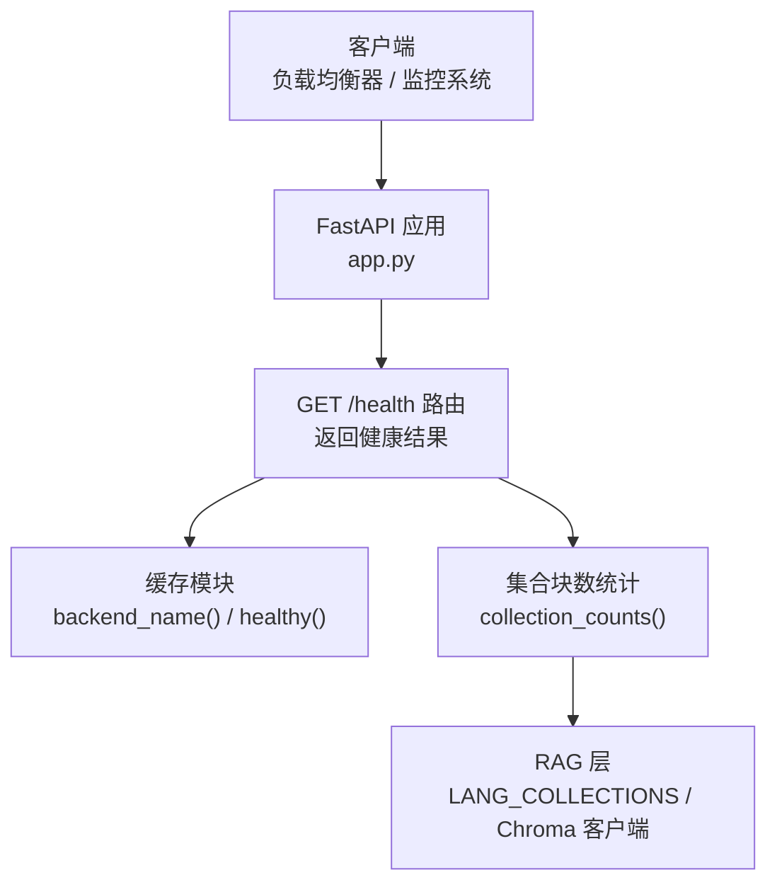
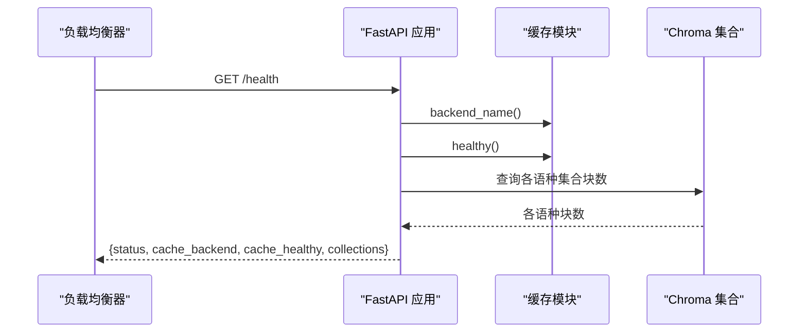

# 系统健康检查接口

<cite>
**本文引用的文件**   
- [app.py](file://app.py)
- [rag_langchain.py](file://rag_langchain.py)
</cite>

## 目录
1. [简介](#简介)
2. [项目结构与健康检查入口](#项目结构与健康检查入口)
3. [核心组件与职责](#核心组件与职责)
4. [架构总览](#架构总览)
5. [详细接口说明：GET /health](#详细接口说明get-health)
6. [依赖关系分析](#依赖关系分析)
7. [性能与可观测性](#性能与可观测性)
8. [负载均衡与服务发现中的使用方式](#负载均衡与服务发现中的使用方式)
9. [监控集成方案](#监控集成方案)
10. [最佳实践与告警建议](#最佳实践与告警建议)
11. [故障排查](#故障排查)
12. [结论](#结论)

## 简介
本文件为 RAG Web 服务的“系统健康检查”接口文档，聚焦 `GET /health`。该端点提供轻量级服务健康探测能力，用于：
- 快速判断服务进程是否存活；
- 观察缓存后端类型与健康状态；
- 查看各语种知识库的文本块数量；
- 作为负载均衡探针、容器就绪/存活探针以及外部监控系统采集的基础指标来源。

需要特别说明的是：当前实现中，“缓存健康检查”仅返回缓存后端的名称和布尔健康标志；“各语种知识库状态”以集合中文本块数量体现，并不执行完整的检索或生成链路。

## 项目结构与健康检查入口
健康检查逻辑位于 FastAPI 应用主模块中，通过路由装饰器暴露 `GET /health`。其返回值由三个部分组成：
- 服务整体状态；
- 缓存后端信息；
- 各语种知识库的块数统计。



**图表来源**  
- [app.py:287-290](file://app.py#L287-L290)  
- [app.py:120-122](file://app.py#L120-L122)  
- [rag_langchain.py:78-81](file://rag_langchain.py#L78-L81)

**章节来源**  
- [app.py:11-18](file://app.py#L11-L18)  
- [app.py:287-290](file://app.py#L287-L290)

## 核心组件与职责
| 组件 | 职责 | 对健康检查的影响 |
|---|---|---|
| FastAPI 应用 | 定义 HTTP 路由、请求解析与响应序列化 | 暴露 `/health` 端点 |
| 健康检查路由 | 组装并返回健康状态对象 | 直接决定 `/health` 输出 |
| 缓存模块 | 提供缓存后端名称、健康标志、版本、统计等能力 | 决定 `cache_backend` 与 `cache_healthy` |
| 集合块数统计函数 | 查询各语种 Chroma collection 的文本块数量 | 决定 `collections` 字段内容 |
| RAG 层常量 | 定义中英文集合名、默认语言等 | 决定健康检查覆盖的语言范围 |

**章节来源**  
- [app.py:287-290](file://app.py#L287-L290)  
- [app.py:120-122](file://app.py#L120-L122)  
- [rag_langchain.py:59-81](file://rag_langchain.py#L59-L81)

## 架构总览
健康检查属于“轻量级探测”，不触发完整 RAG 流程。它只读取：
- 缓存模块提供的后端信息与健康标志；
- 向量库集合的计数信息。



**图表来源**  
- [app.py:287-290](file://app.py#L287-L290)  
- [app.py:120-122](file://app.py#L120-L122)  
- [rag_langchain.py:78-81](file://rag_langchain.py#L78-L81)

## 详细接口说明：GET /health

### 基本信息
- **方法**：`GET`
- **路径**：`/health`
- **认证**：无
- **用途**：服务存活探测、缓存后端健康探测、知识库容量探测
- **典型调用方**：Kubernetes 探针、Nginx/HAProxy 健康检查、Prometheus 抓取脚本、业务侧自监控

### 请求示例
```text
GET /health
Host: rag-service.example.com
```

### 响应数据结构
| 字段 | 类型 | 含义 | 取值说明 |
|---|---|---|---|
| `status` | 字符串 | 服务整体健康状态 | 当前固定为 `ok` |
| `cache_backend` | 字符串 | 当前使用的缓存后端名称 | 例如内存缓存、Redis 等；具体值由缓存模块返回 |
| `cache_healthy` | 布尔值 | 缓存后端是否健康 | `true` 表示健康，`false` 表示异常或不可用 |
| `collections` | 对象 | 各语种知识库的文本块数量 | 键为语言代码，值为对应集合中的块数 |

#### `collections` 字段说明
- 键：语言代码
  - `zh`：中文知识库
  - `en`：英文知识库
- 值：整数，表示该语言集合中的文本块数量
- 语义：
  - 值为 `0`：表示该语言知识库尚未上传文档或为空；
  - 值大于 `0`：表示已存在若干文本块；
  - 若底层集合不可访问，实现会降级返回 `0`，避免健康检查失败。

### 响应示例
以下为健康检查成功时的典型响应结构示意：
```json
{
  "status": "ok",
  "cache_backend": "memory",
  "cache_healthy": true,
  "collections": {
    "zh": 187,
    "en": 120
  }
}
```

如果缓存后端不可用，可能得到：
```json
{
  "status": "ok",
  "cache_backend": "redis",
  "cache_healthy": false,
  "collections": {
    "zh": 187,
    "en": 120
  }
}
```

如果某个语言知识库尚未初始化，可能得到：
```json
{
  "status": "ok",
  "cache_backend": "memory",
  "cache_healthy": true,
  "collections": {
    "zh": 0,
    "en": 0
  }
}
```

### 字段行为与边界情况
- `status` 始终返回 `ok`，因此该端点主要用于“服务进程可达 + 缓存后端基础健康 + 知识库容量快照”。
- 如果集合计数发生异常，实现会捕获异常并返回 `0`，保证健康检查本身尽量稳定。
- 健康检查不会触发模型加载、向量计算、跨编码器精排或大模型生成，因此延迟很低。

**章节来源**  
- [app.py:287-290](file://app.py#L287-L290)  
- [app.py:95-122](file://app.py#L95-L122)  
- [rag_langchain.py:78-81](file://rag_langchain.py#L78-L81)

## 依赖关系分析
健康检查涉及以下依赖链：

```mermaid
classDiagram
class FastAPIApp {
"+GET /health()"
}
class HealthRoute {
"+返回 status"
"+返回 cache_backend"
"+返回 cache_healthy"
"+返回 collections"
}
class CacheModule {
"+backend_name()"
"+healthy()"
}
class CollectionCounter {
"+collection_counts()"
+"_collection_size(lang)"
}
class LangChainLayer {
"+LANG_COLLECTIONS"
"+_get_chroma_client()"
}
FastAPIApp --> HealthRoute : "定义路由"
HealthRoute --> CacheModule : "读取缓存后端信息"
HealthRoute --> CollectionCounter : "读取集合块数"
CollectionCounter --> LangChainLayer : "查询 Chroma 集合"
```

**图表来源**  
- [app.py:287-290](file://app.py#L287-L290)  
- [app.py:95-122](file://app.py#L95-L122)  
- [rag_langchain.py:78-81](file://rag_langchain.py#L78-L81)

**章节来源**  
- [app.py:287-290](file://app.py#L287-L290)  
- [app.py:95-122](file://app.py#L95-L122)  
- [rag_langchain.py:78-81](file://rag_langchain.py#L78-L81)

## 性能与可观测性
- **延迟特征**：健康检查是轻量操作，主要开销来自：
  - 调用缓存模块获取后端名称与健康标志；
  - 查询 Chroma 集合的计数；
  - JSON 序列化响应。
- **资源占用**：不会加载嵌入模型、跨编码器或大模型；也不会执行完整检索链路。
- **可观测性建议**：
  - 将 `cache_healthy` 作为布尔指标暴露给监控系统；
  - 将 `collections.zh` 与 `collections.en` 作为数值指标跟踪知识库规模变化；
  - 记录 `/health` 的响应时间，用于评估服务健康探测的性能稳定性。

[本节为通用指导，不直接分析具体代码行]

## 负载均衡与服务发现中的使用方式
健康检查在基础设施层通常承担两类角色：

| 场景 | 使用方式 | 建议阈值 |
|---|---|---|
| 负载均衡健康检查 | Nginx、HAProxy、云负载均衡器等周期性请求 `/health` | 超时建议 1~2 秒；失败次数达到阈值后摘除实例 |
| 容器编排探针 | Kubernetes livenessProbe 与 readinessProbe | liveness 失败重启；readiness 失败暂停流量 |
| 服务注册中心 | Consul、Eureka、Nacos 等心跳或健康检查 | 结合 `cache_healthy` 做更细粒度下线策略 |

### 推荐配置思路
- **livenessProbe**：只要 `/health` 能返回 `200`，就认为进程存活；适合检测进程崩溃、严重阻塞。
- **readinessProbe**：可结合业务侧更严格的健康规则；当前实现中，如果希望“缓存不可用时不参与读流量”，可在上层网关或代理层根据 `cache_healthy` 做决策。
- **灰度发布**：先让新实例通过 `/health`，再逐步放量；旧实例在流量切走后下线。

[本节为通用指导，不直接分析具体代码行]

## 监控集成方案

### Prometheus 指标映射建议
可以将 `/health` 响应映射为如下指标：
| 指标名 | 类型 | 标签 | 含义 |
|---|---|---|---|
| `rag_health_status` | gauge | `service=rag` | 服务状态，固定为 `1`（表示 ok） |
| `rag_cache_backend` | info/gauge | `backend=memory|redis|...` | 当前缓存后端类型 |
| `rag_cache_healthy` | gauge | — | 缓存后端健康标志 |
| `rag_collection_chunks_zh` | gauge | — | 中文知识库块数 |
| `rag_collection_chunks_en` | gauge | — | 英文知识库块数 |

### 抓取频率
- 健康检查建议每 5~15 秒抓取一次；
- 生产环境建议开启连接复用，减少频繁建连成本；
- 如果缓存后端为 Redis，应确保抓取请求不会因网络抖动导致误报，可配合重试与熔断。

### 日志与追踪
- 建议在网关或代理层记录 `/health` 的请求时间、状态码；
- 当 `cache_healthy` 为 `false` 时，可追加一条警告日志，便于定位缓存后端问题。

[本节为通用指导，不直接分析具体代码行]

## 最佳实践与告警建议

### 健康检查设计原则
1. **保持轻量**：不要在执行健康检查时触发耗时链路。
2. **fail-open 优先**：健康检查应尽量返回可用状态，除非确实不可恢复。
3. **分层健康**：
   - 进程级健康：服务是否存活；
   - 依赖级健康：缓存、数据库、向量库是否可用；
   - 业务级健康：知识库是否为空、命中率是否过低。

### 针对当前实现的建议
- 如果希望把“知识库为空”视为不健康，可以在上层网关或监控层增加规则：
  - 当 `collections.zh == 0` 且 `collections.en == 0` 时，标记服务为“未就绪”；
  - 或者分别维护中文、英文两个就绪维度。
- 如果缓存后端降级到内存模式，应在监控中标记并告警，因为线上通常期望使用 Redis 等持久化缓存。

### 告警规则建议
| 条件 | 级别 | 说明 |
|---|---|---|
| `/health` 连续多次返回非 `200` | 紧急 | 服务不可用 |
| `cache_healthy` 为 `false` 持续一段时间 | 重要 | 缓存后端异常 |
| `collections.zh` 或 `collections.en` 突然变为 `0` | 重要 | 知识库可能被清空或重建 |
| `/health` 响应时间超过阈值 | 警告 | 健康检查变慢，可能影响负载均衡判定 |

[本节为通用指导，不直接分析具体代码行]

## 故障排查

### 常见问题
| 现象 | 可能原因 | 处理建议 |
|---|---|---|
| `/health` 返回 `cache_healthy: false` | 缓存后端不可用、网络异常、权限不足 | 检查缓存后端连接、凭据、防火墙、代理配置 |
| `collections.zh` 与 `collections.en` 都为 `0` | 尚未上传文档，或集合被清空 | 先上传对应语种的文档，再验证 `/ask` |
| 健康检查延迟较高 | 向量库计数较慢、缓存后端响应慢 | 检查 Chroma 存储状态、Redis 延迟、磁盘 IO |
| 健康检查不稳定 | 缓存后端偶发抖动 | 增加重试、退避、熔断，并在监控中记录抖动 |

### 排查步骤
1. 直接调用 `/health`，确认返回结构是否符合预期；
2. 检查 `cache_backend` 是否与部署配置一致；
3. 检查 `cache_healthy` 是否为 `true`；
4. 检查 `collections` 中各语言块数是否符合预期；
5. 如果仍无法定位，结合 `/cache/stats` 与缓存后端日志进一步分析。

**章节来源**  
- [app.py:287-290](file://app.py#L287-L290)  
- [app.py:263-277](file://app.py#L263-L277)

## 结论
`GET /health` 是一个面向基础设施和业务监控的轻量健康检查接口。它不执行完整 RAG 流程，而是快速返回服务状态、缓存后端信息和各语种知识库块数。在生产环境中，建议将其纳入负载均衡探针、容器编排探针和监控系统，并结合缓存健康、知识库容量、响应延迟等维度制定告警策略。对于更严格的业务健康要求，可在网关或监控层扩展规则，例如将“知识库为空”或“缓存不可用”视为不就绪状态。