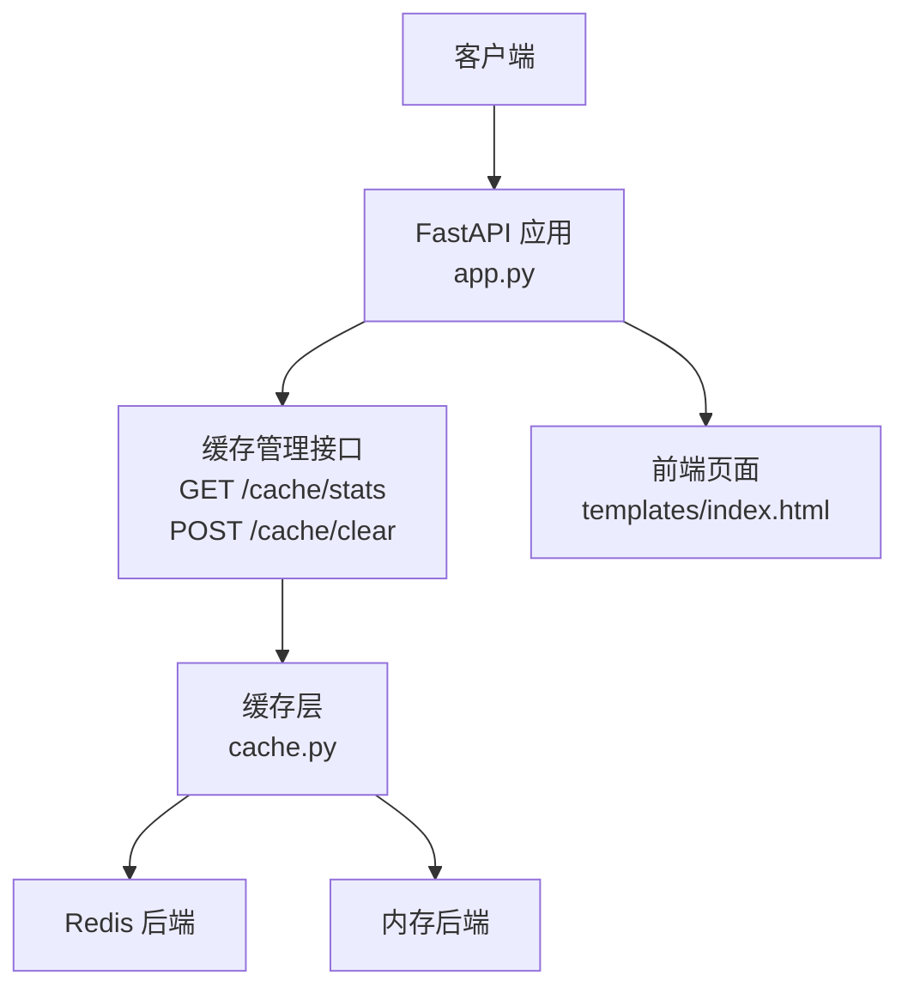
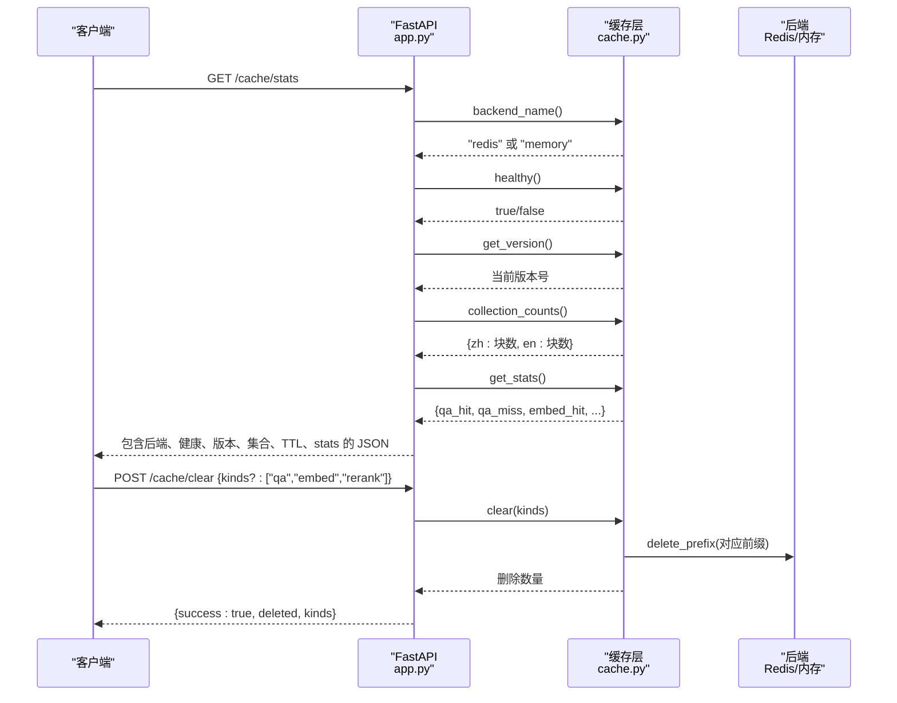
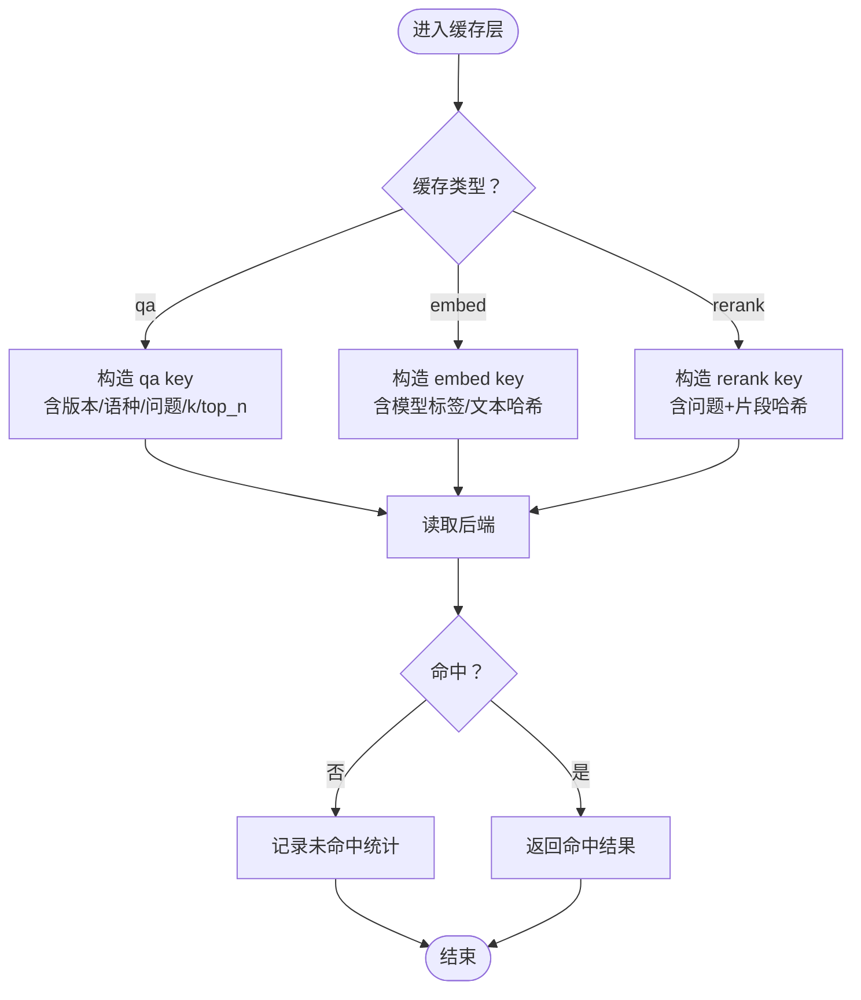
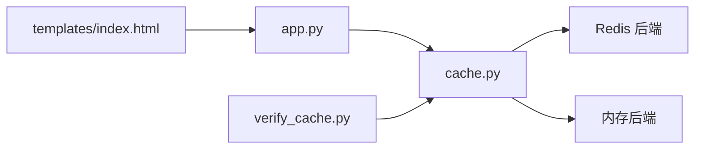

# 缓存管理接口

<cite>
**本文引用的文件**   
- [app.py](file://app.py)
- [cache.py](file://cache.py)
- [templates/index.html](file://templates/index.html)
- [verify_cache.py](file://verify_cache.py)
</cite>

## 目录
1. [简介](#简介)
2. [项目结构](#项目结构)
3. [核心组件](#核心组件)
4. [架构总览](#架构总览)
5. [详细组件分析](#详细组件分析)
6. [依赖关系分析](#依赖关系分析)
7. [性能与容量特性](#性能与容量特性)
8. [监控最佳实践](#监控最佳实践)
9. [故障排除指南](#故障排除指南)
10. [结论](#结论)

## 简介
本文面向运维、后端与前端同学，系统化说明 RAG Web 服务中的“缓存管理”能力，重点覆盖以下两个 API：
- GET /cache/stats：查看缓存后端类型、健康状态、命中率统计、缓存版本、知识库集合大小与 TTL 配置。
- POST /cache/clear：按类型清理缓存，支持 qa（问答）、embed（向量）、rerank（重排序）三类过滤。

同时解释缓存的三层架构：问答缓存、向量缓存、重排序缓存，并给出请求/响应示例、数据格式说明、监控建议与常见问题排查方法。

## 项目结构
本仓库中与缓存管理直接相关的代码主要位于：
- app.py：FastAPI 路由层，暴露 /cache/stats 与 /cache/clear。
- cache.py：缓存实现层，提供后端选择、TTL、版本号、统计、清理等能力。
- templates/index.html：前端页面，调用 /cache/stats 展示命中率、TTL、后端与健康状态。
- verify_cache.py：缓存层验证脚本，覆盖读写、TTL、清理、统计、健康与降级路径。

图表来源
- [app.py:263-284](file://app.py#L263-L284)
- [cache.py:176-213](file://cache.py#L176-L213)
- [templates/index.html:189-231](file://templates/index.html#L189-L231)

章节来源
- [app.py:1-53](file://app.py#L1-L53)
- [cache.py:1-49](file://cache.py#L1-L49)
- [templates/index.html:189-231](file://templates/index.html#L189-L231)

## 核心组件
- 缓存后端选择：优先 Redis，失败时自动降级到进程内内存；可通过环境变量强制指定。
- 三层缓存：
  - 问答缓存：问题原文 + 检索参数 + 语种 + 缓存版本，命中后直接返回答案与引用片段。
  - 向量缓存：文本哈希 + 模型标签，命中后跳过 embedding 计算。
  - 重排序缓存：问题 + 片段哈希，命中后跳过 cross-encoder 打分。
- 失效策略：
  - TTL：默认问答 1 小时、向量 24 小时、重排序 1 小时。
  - 版本号：文档上传后版本号递增，旧答案立即失效。
- 统计：进程内计数器，记录每类缓存的命中/未命中次数与命中率，以及节省的 LLM 调用次数。

章节来源
- [cache.py:1-49](file://cache.py#L1-L49)
- [cache.py:216-233](file://cache.py#L216-L233)
- [cache.py:271-367](file://cache.py#L271-L367)
- [cache.py:370-390](file://cache.py#L370-L390)

## 架构总览
缓存管理接口由 FastAPI 路由转发到缓存层，缓存层根据配置选择 Redis 或内存后端，并提供统一的 get/set/clear/get_stats 等能力。

图表来源
- [app.py:263-284](file://app.py#L263-L284)
- [cache.py:202-213](file://cache.py#L202-L213)
- [cache.py:216-233](file://cache.py#L216-L233)
- [cache.py:370-390](file://cache.py#L370-L390)

## 详细组件分析

### GET /cache/stats
功能
- 返回缓存后端类型、健康状态、当前缓存版本、各语种知识库集合大小、TTL 配置与命中率统计。

请求
- 方法：GET
- URL：/cache/stats
- 请求体：无
- 认证：无

响应字段
- backend：字符串，后端名称，可能为 redis、memory 或 unavailable。
- healthy：布尔值，后端是否可用。
- version：整数，当前缓存版本号。
- collections：对象，键为语种 zh/en，值为该语种知识库的块数。
- ttl_seconds：对象，包含 answer、embedding、rerank 三个整数字段，单位为秒。
- stats：对象，包含：
  - qa_hit、qa_miss：问答缓存命中/未命中计数。
  - embed_hit、embed_miss：向量缓存命中/未命中计数。
  - rerank_hit、rerank_miss：重排序缓存命中/未命中计数。
  - qa_hit_rate、embed_hit_rate、rerank_hit_rate：命中率，范围 0~1。
  - backend：重复上报后端名称。
  - asked_pipeline_saved：节省的完整链路调用次数，等于 qa_hit。

响应示例
- 成功（JSON）：
{
  "backend": "redis",
  "healthy": true,
  "version": 3,
  "collections": {"zh": 120, "en": 85},
  "ttl_seconds": {
    "answer": 3600,
    "embedding": 86400,
    "rerank": 3600
  },
  "stats": {
    "qa_hit": 120,
    "qa_miss": 30,
    "embed_hit": 450,
    "embed_miss": 50,
    "rerank_hit": 300,
    "rerank_miss": 20,
    "qa_hit_rate": 0.8,
    "embed_hit_rate": 0.9,
    "rerank_hit_rate": 0.9333,
    "backend": "redis",
    "asked_pipeline_saved": 120
  }
}

错误处理
- 该接口本身不抛业务异常；若后端不可用，backend 可能为 unavailable，healthy 为 false。

章节来源
- [app.py:263-277](file://app.py#L263-L277)
- [cache.py:63-72](file://cache.py#L63-L72)
- [cache.py:202-213](file://cache.py#L202-L213)
- [cache.py:216-233](file://cache.py#L216-L233)

### POST /cache/clear
功能
- 手动清空缓存。kinds 为空表示全部清理；传入 ["qa"]、["embed"]、["rerank"] 可定向清理。

请求
- 方法：POST
- URL：/cache/clear
- Content-Type：application/json
- 请求体：
{
  "kinds": ["qa", "embed", "rerank"]
}
- kinds 可选，省略或传空数组等价于全部清理。

响应字段
- success：布尔值，固定为 true。
- deleted：整数，被删除的 key 数量。
- kinds：本次实际清理的类型列表，若请求未传则回显 ["qa", "embed", "rerank"]。

请求示例
- 清空全部：
POST /cache/clear
Content-Type: application/json
{}

- 仅清空问答缓存：
POST /cache/clear
Content-Type: application/json
{"kinds": ["qa"]}

- 仅清空向量缓存：
POST /cache/clear
Content-Type: application/json
{"kinds": ["embed"]}

- 仅清空重排序缓存：
POST /cache/clear
Content-Type: application/json
{"kinds": ["rerank"]}

响应示例
- 成功（JSON）：
{
  "success": true,
  "deleted": 150,
  "kinds": ["qa", "embed", "rerank"]
}

清理逻辑要点
- 问答与重排序缓存的 key 带版本号，清理时使用通配前缀删除所有历史版本，避免垃圾数据残留。
- 向量缓存 key 不含版本号，因为向量只取决于文本与模型，不应因文档更新而误删。
- 清理后会重置统计计数器。

章节来源
- [app.py:280-284](file://app.py#L280-L284)
- [cache.py:370-390](file://cache.py#L370-L390)

### 缓存三层架构与管理方式
- 问答缓存（qa）
  - 存储内容：问题 -> (答案, 引用片段)。
  - Key 组成：缓存版本 + 类型 qa + 语种 + 问题原文 + 检索参数 k/top_n。
  - 典型收益：跳过召回、精排与大模型生成，秒级返回。
  - TTL：默认 3600 秒。
- 向量缓存（embed）
  - 存储内容：文本哈希 -> 向量。
  - Key 组成：rag:embed:{model_tag}:{text_hash}，model_tag 用于区分不同 embedding 模型。
  - 典型收益：跳过 embedding 模型前向，节省 CPU/GPU。
  - TTL：默认 86400 秒。
- 重排序缓存（rerank）
  - 存储内容：(问题, 片段) -> 分数。
  - Key 组成：rag:rerank:{hash(question||doc)}。
  - 典型收益：跳过 cross-encoder 打分。
  - TTL：默认 3600 秒。

图表来源
- [cache.py:264-268](file://cache.py#L264-L268)
- [cache.py:271-300](file://cache.py#L271-L300)
- [cache.py:303-346](file://cache.py#L303-L346)
- [cache.py:349-367](file://cache.py#L349-L367)

章节来源
- [cache.py:10-29](file://cache.py#L10-L29)
- [cache.py:264-367](file://cache.py#L264-L367)

## 依赖关系分析
- app.py 通过 import cache 调用缓存层函数，暴露 /cache/stats 与 /cache/clear。
- cache.py 内部维护 _get_backend() 单例，按 CACHE_BACKEND 选择 Redis 或内存后端。
- 前端 templates/index.html 调用 /cache/stats 渲染命中率、TTL、后端与健康状态。
- verify_cache.py 对缓存层进行端到端验证，包括基础读写、TTL、QA/embed/rerank 行为、版本号失效、清理与统计、健康与降级。

图表来源
- [app.py:43-51](file://app.py#L43-L51)
- [app.py:263-284](file://app.py#L263-L284)
- [cache.py:176-213](file://cache.py#L176-L213)
- [templates/index.html:189-231](file://templates/index.html#L189-L231)
- [verify_cache.py:29-30](file://verify_cache.py#L29-L30)

章节来源
- [app.py:43-51](file://app.py#L43-L51)
- [app.py:263-284](file://app.py#L263-L284)
- [cache.py:176-213](file://cache.py#L176-L213)
- [templates/index.html:189-231](file://templates/index.html#L189-L231)
- [verify_cache.py:29-30](file://verify_cache.py#L29-L30)

## 性能与容量特性
- 后端选择
  - auto：能连上 Redis 就用 Redis，否则降级到内存。
  - redis：强制 Redis，连接失败会抛出异常，适合生产环境避免静默降级。
  - memory：仅本地内存，适合单机开发演示。
- 并发与锁
  - 统计计数器使用线程锁保护。
  - 后端初始化使用双检锁，避免重复构造。
- 过期策略
  - 惰性过期：读时检查 TTL，过期即丢弃。
  - 版本号：文档上传后版本号递增，旧答案立即失效。
- 清理效率
  - Redis 后端使用 SCAN 遍历删除，避免 KEYS 阻塞实例。
  - 内存后端使用 fnmatch 匹配前缀批量删除。

章节来源
- [cache.py:37-42](file://cache.py#L37-L42)
- [cache.py:45-72](file://cache.py#L45-L72)
- [cache.py:75-121](file://cache.py#L75-L121)
- [cache.py:123-148](file://cache.py#L123-L148)
- [cache.py:176-199](file://cache.py#L176-L199)
- [cache.py:370-390](file://cache.py#L370-L390)

## 监控最佳实践
- 定期轮询 /cache/stats
  - 关注 backend 是否为预期值（生产应为 redis）。
  - 关注 healthy 是否为 true。
  - 观察 qa_hit_rate、embed_hit_rate、rerank_hit_rate 趋势，判断缓存有效性。
  - 关注 asked_pipeline_saved，评估节省的大模型调用次数。
- 结合 /health 做轻量探针
  - 快速判断服务与缓存后端可用性。
- 清理操作审计
  - 记录每次 /cache/clear 的请求参数 kinds 与返回 deleted 数量。
  - 清理后观察命中率短暂下降，随后逐步恢复。
- 前端可视化
  - 使用 templates/index.html 中已有的统计面板，展示后端、健康、版本、集合大小、命中率与 TTL。

章节来源
- [app.py:263-290](file://app.py#L263-L290)
- [templates/index.html:189-231](file://templates/index.html#L189-L231)

## 故障排除指南
- 后端显示 unavailable 或 healthy 为 false
  - 检查 REDIS_URL 是否正确。
  - 确认 Redis 服务可达，网络与端口正常。
  - 若使用 redis 模式但连接失败，应检查是否设置了 CACHE_BACKEND=redis 且 Redis 不可用。
- 命中率持续偏低
  - 检查是否频繁调用 /cache/clear 全量清理。
  - 检查文档上传流程是否频繁 bump_version，导致问答缓存频繁失效。
  - 检查问题是否频繁变化或检索参数 k/top_n 不稳定，导致 qa key 不一致。
- 清理后统计归零
  - 这是预期行为：clear() 会 reset_stats()。
- 向量缓存未生效
  - 确认 model_tag 一致，不同模型向量不能互相复用。
  - 检查是否误清了 embed 类型缓存。
- 重排序缓存未命中
  - 确认问题与片段顺序一致，key 基于 question||doc。
- 前端无法加载统计
  - 检查 /cache/stats 是否返回 JSON，注意跨域与网关拦截。
  - 参考前端 loadStats 的错误分支提示。

章节来源
- [cache.py:154-173](file://cache.py#L154-L173)
- [cache.py:176-199](file://cache.py#L176-L199)
- [cache.py:370-390](file://cache.py#L370-L390)
- [templates/index.html:189-231](file://templates/index.html#L189-L231)
- [verify_cache.py:179-184](file://verify_cache.py#L179-L184)

## 结论
- GET /cache/stats 提供了完整的缓存运行视图，涵盖后端类型、健康、版本、集合大小、TTL 与命中率统计，便于日常监控与容量规划。
- POST /cache/clear 支持按 qa、embed、rerank 三类精准清理，配合版本号机制确保文档更新后旧答案及时失效。
- 缓存层采用 Redis 优先、内存降级的设计，兼顾生产稳定性与本地开发体验。
- 建议将 /cache/stats 纳入定时监控，并结合前端面板观察命中率与 TTL 配置，及时发现异常与优化空间。