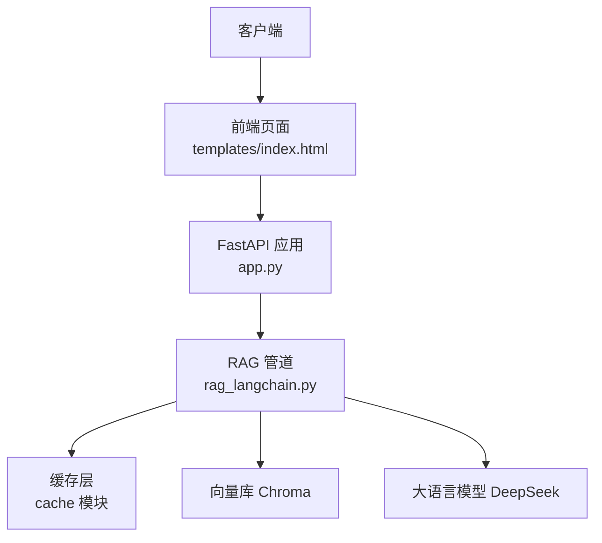
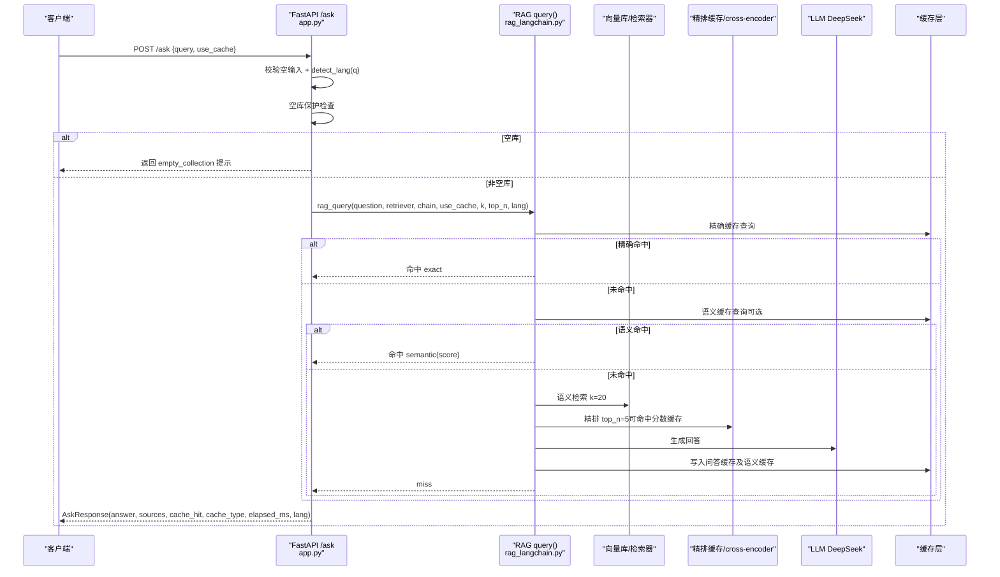
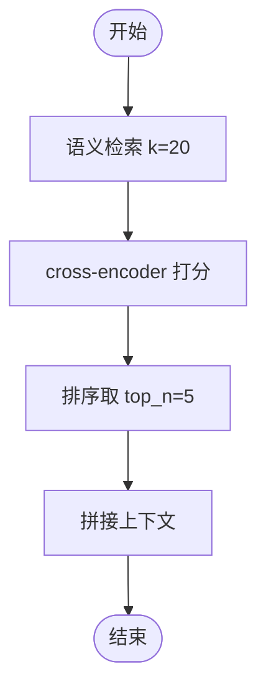
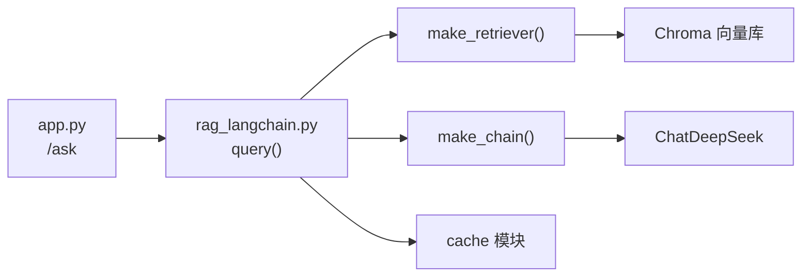

# 问答接口

<cite>
**本文引用的文件**   
- [app.py](file://app.py)
- [rag_langchain.py](file://rag_langchain.py)
- [index.html](file://templates/index.html)
</cite>

## 目录
1. [简介](#简介)
2. [项目结构](#项目结构)
3. [核心组件](#核心组件)
4. [架构总览](#架构总览)
5. [详细组件分析](#详细组件分析)
6. [依赖关系分析](#依赖关系分析)
7. [性能与缓存特性](#性能与缓存特性)
8. [使用示例](#使用示例)
9. [错误处理与调试](#错误处理与调试)
10. [结论](#结论)

## 简介
本接口文档聚焦于 RAG 问答服务的 POST /ask 端点，说明其 HTTP 方法、URL 模式、请求参数、响应字段、语言路由机制，以及“语义检索 → 交叉编码器重排序 → 大语言模型生成”的完整流程。同时覆盖缓存命中检测、性能指标 elapsed_ms、来源引用展示、空库保护、多语言支持、错误处理策略与调试技巧。

该服务采用 FastAPI 作为 Web 框架，LangChain 生态实现检索与生成，Chroma 作为向量库，DeepSeek 作为大语言模型后端，并通过自定义缓存层加速问答、嵌入与精排计算。

## 项目结构
与本接口直接相关的代码主要分布在以下文件中：
- app.py：FastAPI 应用、/ask 路由、请求/响应模型、语种路由、空库保护、健康检查等。
- rag_langchain.py：RAG 管道（检索、精排、生成）、缓存入口 query()、语种判断、嵌入与向量库管理、精排缓存等。
- templates/index.html：前端调用 /ask 并渲染 cache_hit、cache_type、elapsed_ms、lang 与 sources。

图表来源
- [app.py:231-260](file://app.py#L231-L260)
- [rag_langchain.py:452-508](file://rag_langchain.py#L452-L508)
- [rag_langchain.py:579-631](file://rag_langchain.py#L579-L631)
- [index.html:151-177](file://templates/index.html#L151-L177)

章节来源
- [app.py:1-53](file://app.py#L1-L53)
- [rag_langchain.py:1-24](file://rag_langchain.py#L1-L24)
- [index.html:151-177](file://templates/index.html#L151-L177)

## 核心组件
- FastAPI 路由与数据模型
  - POST /ask：接收问题文本与缓存开关，返回答案、来源、缓存状态、耗时与判定语种。
  - AskRequest：包含 query 与 use_cache。
  - AskResponse：包含 answer、sources、cache_hit、cache_type、elapsed_ms、lang。
- RAG 管道
  - 语义检索：按 k=20 召回相关片段。
  - 交叉编码器重排序：对召回结果打分并取 top_n=5。
  - 大语言模型生成：基于 prompt 与上下文生成回答。
- 缓存体系
  - 问答缓存：同一问题原文命中时直接返回答案与来源。
  - 向量缓存：重复文本不重复计算嵌入。
  - 精排缓存：(问题, 片段) 分数命中时跳过 cross-encoder。
  - 语义缓存（可选）：语义相近问题近似命中。
- 语言路由
  - detect_lang：按汉字占比判断 zh/en。
  - 中文与英文分别使用不同 embedding 模型与 Chroma collection，互不影响。

章节来源
- [app.py:129-149](file://app.py#L129-L149)
- [app.py:231-260](file://app.py#L231-L260)
- [rag_langchain.py:118-143](file://rag_langchain.py#L118-L143)
- [rag_langchain.py:452-508](file://rag_langchain.py#L452-L508)
- [rag_langchain.py:579-631](file://rag_langchain.py#L579-L631)

## 架构总览
POST /ask 的请求在 FastAPI 中进入 ask_endpoint，先进行空输入校验与语种判定，再根据目标语种的 collection 是否为空决定是否走真实链路；随后调用 rag_query 完成“精确缓存 → 语义缓存 → 检索 → 精排 → 生成 → 写回缓存”的流程，最终封装为 AskResponse。

图表来源
- [app.py:231-260](file://app.py#L231-L260)
- [rag_langchain.py:579-631](file://rag_langchain.py#L579-L631)
- [rag_langchain.py:452-508](file://rag_langchain.py#L452-L508)

## 详细组件分析

### POST /ask 接口规范
- 方法：POST
- URL：/ask
- 请求体（JSON）
  - query：字符串，必填，用户问题文本。
  - use_cache：布尔值，默认 true；设为 false 可强制走真实链路用于对比耗时。
- 响应体（JSON）
  - answer：字符串，模型生成的回答。
  - sources：字符串数组，被采用的相关片段内容。
  - cache_hit：布尔值，是否命中缓存。
  - cache_type：字符串，命中类型，可能值为：
    - exact：精确缓存命中。
    - semantic(x.xxx)：语义缓存命中，括号内为相似度分数。
    - miss：未命中，走真实链路。
    - empty：问题为空。
    - empty_collection：目标语种知识库为空。
  - elapsed_ms：浮点数，本次请求耗时（毫秒）。
  - lang：字符串，问题判定的语种，zh 或 en。

章节来源
- [app.py:129-149](file://app.py#L129-L149)
- [app.py:231-260](file://app.py#L231-L260)

### 语言路由机制
- detect_lang(text) 通过统计汉字占非空白字符的比例是否 ≥ 5% 来判断 zh 或 en。
- 中文与英文分别映射到不同的 embedding 模型与 Chroma collection：
  - zh：text2vec-base-chinese，collection rag_zh。
  - en：bge-base-en-v1.5，collection rag_en。
- 这样避免不同模型的向量空间混用导致相似度噪声与静默错误。

章节来源
- [rag_langchain.py:118-143](file://rag_langchain.py#L118-L143)
- [rag_langchain.py:59-81](file://rag_langchain.py#L59-L81)

### 语义检索与交叉编码器重排序
- 语义检索：store.as_retriever(k=20)，从对应语种的 Chroma 集合召回 20 个片段。
- 交叉编码器重排序：HuggingFaceCrossEncoder.score 对 (问题, 片段) 成对打分，保留 top_n=5。
- 精排分数缓存：rerank_cached 将 (问题, 片段) 的分数缓存，减少 cross-encoder 调用次数。

图表来源
- [rag_langchain.py:452-467](file://rag_langchain.py#L452-L467)
- [rag_langchain.py:428-449](file://rag_langchain.py#L428-L449)

章节来源
- [rag_langchain.py:452-467](file://rag_langchain.py#L452-L467)
- [rag_langchain.py:428-449](file://rag_langchain.py#L428-L449)

### 大语言模型生成回答
- PromptTemplate 定义知识助手指令，要求基于上下文作答且不编造信息。
- ChatDeepSeek(model="deepseek-chat", temperature=0.7) 负责生成自然语言回答。
- make_chain 构建 LCEL 链：若传入 dict（含 question 与 context），则跳过再次检索，直接使用给定上下文。

章节来源
- [rag_langchain.py:471-508](file://rag_langchain.py#L471-L508)

### 缓存命中检测与性能指标
- 精确缓存：get_answer(question, top_n, k, lang) 命中时返回 exact。
- 语义缓存（可选）：当 SEMANTIC_CACHE_ENABLED 为真时，比较问题向量与历史问题的余弦相似度，超过阈值返回 semantic(score)。
- 性能指标：elapsed_ms 由 time.perf_counter() 计算，四舍五入到小数点后一位。
- 前端展示：templates/index.html 根据 cache_hit 显示徽标，并渲染 cache_type 与 elapsed_ms。

章节来源
- [rag_langchain.py:579-631](file://rag_langchain.py#L579-L631)
- [index.html:151-177](file://templates/index.html#L151-L177)

### 空库保护机制
- 在 ask_endpoint 中，若目标语种的 collection 块数为 0，直接返回 empty_collection 提示，不调用检索与 LLM，避免模型“凭印象作答”。

章节来源
- [app.py:241-249](file://app.py#L241-L249)

### 来源引用展示
- 接口返回 sources 数组，包含被采用的片段正文。
- 前端遍历 sources 并逐项渲染为引用列表。

章节来源
- [app.py:134-141](file://app.py#L134-L141)
- [index.html:167-175](file://templates/index.html#L167-L175)

## 依赖关系分析
- FastAPI 路由依赖：
  - app.py 中的 ask_endpoint 调用 rag_langchain.query。
  - rag_langchain.query 依赖 retriever、chain、cache 模块。
- 外部依赖：
  - Chroma 向量库。
  - HuggingFaceEmbeddings 与 HuggingFaceCrossEncoder。
  - ChatDeepSeek 大语言模型。
  - PyMuPDFLoader 文档解析。

图表来源
- [app.py:231-260](file://app.py#L231-L260)
- [rag_langchain.py:452-508](file://rag_langchain.py#L452-L508)
- [rag_langchain.py:579-631](file://rag_langchain.py#L579-L631)

章节来源
- [app.py:231-260](file://app.py#L231-L260)
- [rag_langchain.py:452-508](file://rag_langchain.py#L452-L508)
- [rag_langchain.py:579-631](file://rag_langchain.py#L579-L631)

## 性能与缓存特性
- 三层缓存：
  - 问答缓存：避免重复走完整链路，显著降低 LLM 调用与等待时间。
  - 向量缓存：避免重复计算嵌入，提升上传与重复提问的性能。
  - 精排缓存：避免重复 cross-encoder 打分，缓解最慢环节。
- 语义缓存（可选）：
  - 通过向量相似度近似匹配不同问法的问题，提高命中率。
  - 默认关闭，防止误命中导致答非所问。
- 性能指标：
  - elapsed_ms 反映单次请求的整体耗时，可用于评估缓存命中效果与链路性能。

章节来源
- [rag_langchain.py:1-24](file://rag_langchain.py#L1-L24)
- [rag_langchain.py:147-182](file://rag_langchain.py#L147-L182)
- [rag_langchain.py:428-449](file://rag_langchain.py#L428-L449)
- [rag_langchain.py:511-576](file://rag_langchain.py#L511-L576)
- [rag_langchain.py:579-631](file://rag_langchain.py#L579-L631)

## 使用示例

### 基础请求
- 方法：POST
- URL：/ask
- 请求体：
  - query：任意问题文本。
  - use_cache：true（默认）。

预期响应（命中缓存）：
- cache_hit：true
- cache_type：exact 或 semantic(x.xxx)
- elapsed_ms：较小数值
- lang：zh 或 en
- sources：若干片段文本
- answer：模型回答

预期响应（未命中缓存）：
- cache_hit：false
- cache_type：miss
- elapsed_ms：较大数值（包含检索、精排、LLM 生成）
- lang：zh 或 en
- sources：若干片段文本
- answer：模型回答

章节来源
- [app.py:129-149](file://app.py#L129-L149)
- [app.py:231-260](file://app.py#L231-L260)
- [rag_langchain.py:579-631](file://rag_langchain.py#L579-L631)

### 强制走真实链路
- 设置 use_cache=false，可绕过问答缓存与语义缓存，便于对比耗时与验证链路稳定性。

章节来源
- [app.py:129-132](file://app.py#L129-L132)
- [rag_langchain.py:579-631](file://rag_langchain.py#L579-L631)

### 空库场景
- 当目标语种知识库为空时，返回 cache_type=empty_collection，answer 给出引导提示，sources 为空。

章节来源
- [app.py:241-249](file://app.py#L241-L249)

### 空问题场景
- 当 query 为空时，返回 cache_type=empty，answer 提示问题不能为空，sources 为空。

章节来源
- [app.py:234-236](file://app.py#L234-L236)

## 错误处理与调试
- 空输入保护：
  - 若 query 为空，直接返回 empty 类型缓存标记与提示信息。
- 空库保护：
  - 若目标语种 collection 为空，返回 empty_collection 类型缓存标记与引导提示，不调用检索与 LLM。
- 缓存异常 fail-open：
  - 缓存层任何异常都视为未命中，继续走真实链路，保证系统可用性与答案正确性。
- 健康检查与缓存统计：
  - GET /health：返回服务状态、缓存后端与健康情况、各语种库块数。
  - GET /cache/stats：返回缓存后端、健康状态、版本号、TTL、统计信息与集合块数。
  - POST /cache/clear：手动清空缓存，可按类型清理 qa/embed/rerank。
- 前端调试：
  - templates/index.html 根据 cache_hit 显示徽标，并展示 cache_type、elapsed_ms、lang 与 sources，便于直观判断命中与耗时。

章节来源
- [app.py:231-260](file://app.py#L231-L260)
- [app.py:263-290](file://app.py#L263-L290)
- [index.html:151-177](file://templates/index.html#L151-L177)

## 结论
POST /ask 接口以 FastAPI 暴露简洁的问答能力，结合 LangChain 的检索、精排与生成管线，并通过多层缓存显著提升性能。语言路由确保中英文向量空间隔离，空库保护避免无依据回答。接口返回丰富的元数据（cache_hit、cache_type、elapsed_ms、lang、sources），便于前端展示与运维监控。建议在生产环境中开启必要的缓存配置，并结合 /health 与 /cache/stats 进行健康与性能观测。