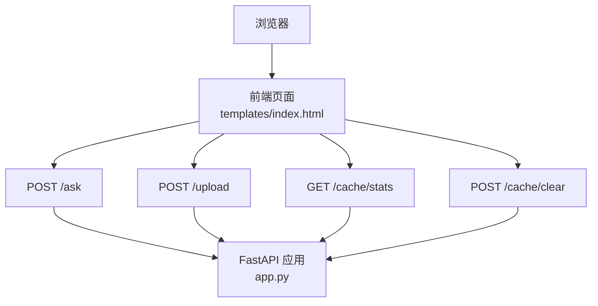
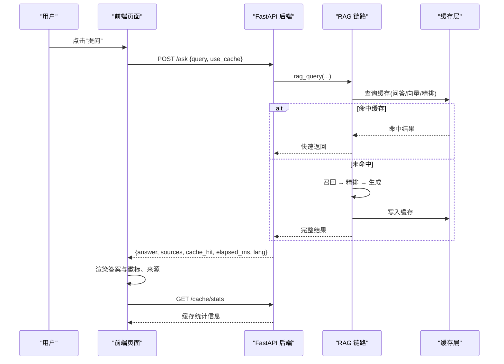
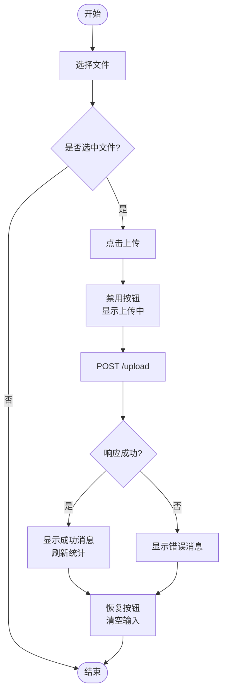
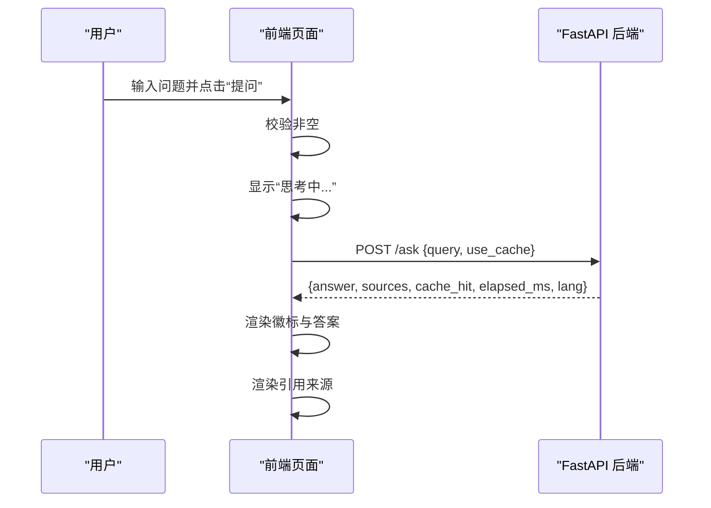
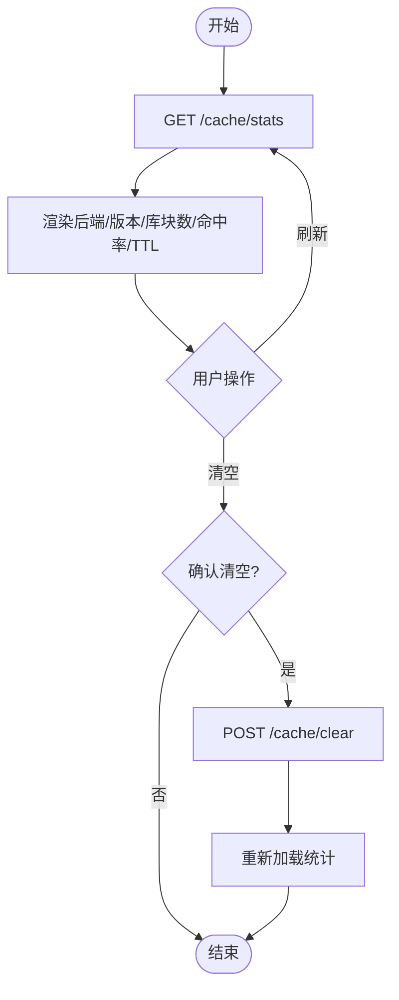
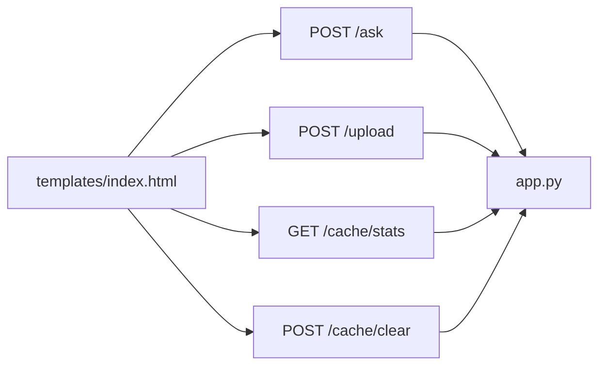

# 前端界面

<cite>
**本文引用的文件**   
- [templates/index.html](file://templates/index.html)
- [app.py](file://app.py)
</cite>

## 目录
1. [简介](#简介)
2. [项目结构](#项目结构)
3. [核心组件](#核心组件)
4. [架构总览](#架构总览)
5. [详细组件分析](#详细组件分析)
6. [依赖关系分析](#依赖关系分析)
7. [性能与可访问性](#性能与可访问性)
8. [故障排查指南](#故障排查指南)
9. [结论](#结论)
10. [附录：API 与使用示例](#附录api-与使用示例)

## 简介
本页面是 RAG 系统的前端交互入口，提供文档上传、问题提问、结果展示、引用来源展示以及缓存状态查看与管理能力。界面采用原生 HTML/CSS/JavaScript 实现，通过 REST API 与后端 FastAPI 服务通信，支持中文与英文双知识库、问答缓存、向量缓存与精排缓存，并提供“强制真实计算”开关用于对比缓存命中与真实链路耗时。

## 项目结构
前端由一个单页模板构成，所有样式与脚本内联在 HTML 中；后端通过 FastAPI 路由返回该页面并暴露若干接口。

**图表来源**
- [templates/index.html:101-233](file://templates/index.html#L101-L233)
- [app.py:155-297](file://app.py#L155-L297)

**章节来源**
- [templates/index.html:1-237](file://templates/index.html#L1-L237)
- [app.py:53-67](file://app.py#L53-L67)

## 核心组件
- 文档上传区：支持 PDF、Markdown、TXT 选择与上传，显示上传状态与错误提示。
- 提问区：输入框、提交按钮、“跳过缓存”复选框。
- 答案区：展示回答文本与缓存状态徽标（命中/未命中）、耗时与语种库标签。
- 引用来源区：动态渲染后端返回的 sources 列表。
- 缓存状态面板：展示后端类型、健康状态、缓存版本、各语种库块数、命中率统计、TTL 与节省调用次数；支持刷新与清空缓存。

**章节来源**
- [templates/index.html:68-99](file://templates/index.html#L68-L99)
- [templates/index.html:101-233](file://templates/index.html#L101-L233)

## 架构总览
前端通过 fetch 发起请求，后端根据问题或文档语种路由到对应知识库，并在必要时走检索→精排→生成的完整链路。缓存层对问答、向量嵌入与精排分数进行加速。

**图表来源**
- [templates/index.html:142-181](file://templates/index.html#L142-L181)
- [app.py:231-260](file://app.py#L231-L260)
- [app.py:263-277](file://app.py#L263-L277)

## 详细组件分析

### 文档上传组件
- 视觉外观
  - 虚线边框容器包裹标题、文件选择器与上传按钮。
  - 上传状态文本位于按钮下方，成功为绿色，失败为红色。
- 行为与交互
  - 选择文件后启用“上传并向量化”按钮。
  - 点击上传后禁用按钮并显示“上传中”，完成后恢复。
  - 成功后自动刷新缓存统计。
- 属性与事件
  - 文件输入接受 .pdf/.md/.markdown/.txt。
  - 触发 onFileSelected 与 uploadFile。
- 错误处理
  - 捕获网络异常并显示错误消息。
  - 清理临时状态与输入值。

**图表来源**
- [templates/index.html:104-140](file://templates/index.html#L104-L140)

**章节来源**
- [templates/index.html:71-76](file://templates/index.html#L71-L76)
- [templates/index.html:104-140](file://templates/index.html#L104-L140)

### 提问组件
- 视觉外观
  - 多行文本输入框与“提问”按钮并列。
  - “跳过缓存”复选框用于强制真实计算。
- 行为与交互
  - 空输入时弹出提示。
  - 提交前显示“思考中...”。
  - 根据后端返回的 cache_hit 与 lang 渲染徽标与语种标签。
  - 动态渲染 sources 列表。
- 属性与事件
  - 提交触发 askQuestion。
  - 复选框控制 use_cache 参数。
- 错误处理
  - 捕获网络异常并显示错误消息。

**图表来源**
- [templates/index.html:142-181](file://templates/index.html#L142-L181)

**章节来源**
- [templates/index.html:80-92](file://templates/index.html#L80-L92)
- [templates/index.html:142-181](file://templates/index.html#L142-L181)

### 缓存状态面板
- 视觉外观
  - 卡片式布局，包含后端信息、知识库块数、命中率表格与 TTL 说明。
  - 提供“刷新”和“清空缓存”按钮。
- 行为与交互
  - 页面加载时自动拉取统计。
  - 点击“刷新”重新获取数据。
  - 点击“清空缓存”二次确认后调用后端清空接口并刷新统计。
- 属性与事件
  - 触发 loadStats 与 clearCache。
- 错误处理
  - 拉取失败时显示错误消息。

**图表来源**
- [templates/index.html:189-231](file://templates/index.html#L189-L231)
- [app.py:263-284](file://app.py#L263-L284)

**章节来源**
- [templates/index.html:94-99](file://templates/index.html#L94-L99)
- [templates/index.html:189-231](file://templates/index.html#L189-L231)
- [app.py:263-284](file://app.py#L263-L284)

### 样式与主题
- 基础样式
  - 主体最大宽度 800px，居中布局。
  - 文本区域与按钮统一字体大小与内边距。
  - 答案区浅灰背景、圆角与预格式化换行。
  - 引用来源项左侧色条与浅灰背景。
  - 徽标区分命中（绿色系）与未命中（橙色系）。
  - 统计面板带边框、表格分隔线与浅色背景。
- 主题扩展建议
  - 将颜色变量提取为 CSS 自定义属性，便于切换明暗主题。
  - 徽标与状态色可通过类名扩展更多语义（如加载中、警告等）。

**章节来源**
- [templates/index.html:7-66](file://templates/index.html#L7-L66)

### 响应式设计
- 当前设计以固定最大宽度为主，在小屏设备上通过百分比宽度的文本区域与自适应内边距保持可用性。
- 建议在移动端优化：
  - 增大触控目标尺寸（按钮与复选框）。
  - 调整字号与行高提升可读性。
  - 统计表格在小屏下改为横向滚动或卡片化展示。

[本节为通用指导，不直接分析具体文件]

### 可访问性合规
- 建议增强点
  - 为关键控件添加 aria-label 与 role（如 button、checkbox、status）。
  - 为状态文本区域设置 aria-live="polite"，以便屏幕阅读器播报更新。
  - 确保颜色对比度符合 WCAG 标准，徽标文字与背景对比足够。
  - 键盘可达性与焦点顺序合理（Tab 导航）。
  - 为图片与图标提供替代文本（如有）。

[本节为通用指导，不直接分析具体文件]

### 动画与过渡
- 当前无显式动画或过渡效果。
- 建议增加：
  - 答案区淡入显示。
  - 徽标出现时的轻微缩放或滑入。
  - 状态文本的颜色变化过渡。

[本节为通用指导，不直接分析具体文件]

### 跨浏览器兼容性
- 使用现代 Web API（fetch、FormData、async/await），主流浏览器均支持。
- 注意：
  - 旧版 IE 不支持 fetch，需 polyfill。
  - 表单 accept 属性在不同浏览器表现略有差异，建议同时提供 JS 校验。

[本节为通用指导，不直接分析具体文件]

## 依赖关系分析
前端页面依赖后端提供的四个主要接口：上传、提问、缓存统计、清空缓存。后端在 app.py 中定义这些路由，并通过 templates/index.html 提供页面内容。

**图表来源**
- [templates/index.html:101-233](file://templates/index.html#L101-L233)
- [app.py:155-297](file://app.py#L155-L297)

**章节来源**
- [templates/index.html:101-233](file://templates/index.html#L101-L233)
- [app.py:155-297](file://app.py#L155-L297)

## 性能与可访问性
- 性能
  - 前端仅做轻量 DOM 操作与 JSON 解析，避免重绘重排。
  - 建议对频繁更新的统计区域使用局部更新而非整表替换。
  - 大段答案渲染建议使用惰性加载或分页。
- 可访问性
  - 为交互元素提供语义化标签与 ARIA 属性。
  - 状态变更通过 aria-live 通知辅助技术。
  - 颜色与图标不应作为唯一信息载体，辅以文本说明。

[本节为通用指导，不直接分析具体文件]

## 故障排查指南
- 上传失败
  - 检查文件格式与内容是否为空。
  - 查看控制台网络面板中的 /upload 响应。
- 提问失败
  - 检查 /ask 请求体是否正确（query、use_cache）。
  - 若知识库为空，后端会返回明确提示，请先上传对应语种文档。
- 缓存统计异常
  - 检查 /cache/stats 返回的后端健康状态与版本。
  - 如需重置，使用 /cache/clear 清空缓存后刷新。

**章节来源**
- [templates/index.html:121-140](file://templates/index.html#L121-L140)
- [templates/index.html:151-181](file://templates/index.html#L151-L181)
- [templates/index.html:189-231](file://templates/index.html#L189-L231)
- [app.py:155-228](file://app.py#L155-L228)
- [app.py:231-260](file://app.py#L231-L260)
- [app.py:263-284](file://app.py#L263-L284)

## 结论
该前端界面简洁直观，覆盖 RAG 系统的核心交互流程：文档上传、问题提问、结果与来源展示、缓存状态管理。通过“跳过缓存”开关便于对比缓存命中与真实链路耗时。建议在可访问性、响应式与动画方面进一步增强，以提升用户体验与易用性。

[本节为总结性内容，不直接分析具体文件]

## 附录：API 与使用示例

### 接口概览
- POST /upload
  - 用途：上传 PDF/Markdown/TXT 文档，按文档语种入库并失效相关缓存。
  - 请求体：multipart/form-data，字段 file。
  - 响应：success、message、chunk_count、cache_invalidated、lang。
- POST /ask
  - 用途：提交问题，按问题语种路由，优先查缓存，否则走完整链路。
  - 请求体：{ query: string, use_cache: boolean }。
  - 响应：answer、sources、cache_hit、cache_type、elapsed_ms、lang。
- GET /cache/stats
  - 用途：查看缓存后端、健康状态、版本、各语种库块数、命中率与 TTL。
  - 响应：backend、healthy、version、collections、ttl_seconds、stats。
- POST /cache/clear
  - 用途：手动清空缓存，可按类型清空。
  - 请求体：{ kinds?: ["qa","embed","rerank"] }。
  - 响应：success、deleted、kinds。

**章节来源**
- [app.py:155-228](file://app.py#L155-L228)
- [app.py:231-260](file://app.py#L231-L260)
- [app.py:263-284](file://app.py#L263-L284)

### 使用示例（步骤）
- 上传文档
  - 打开页面，点击“选择文件”，选择 PDF/Markdown/TXT。
  - 点击“上传并向量化”，等待状态提示成功。
- 提问
  - 在输入框中输入问题，可选择“跳过缓存”以强制真实计算。
  - 点击“提问”，查看答案、徽标与引用来源。
- 查看与清理缓存
  - 在“缓存状态”面板查看命中率与 TTL。
  - 点击“清空缓存”并确认，观察统计归零与重新计算。

**章节来源**
- [templates/index.html:71-99](file://templates/index.html#L71-L99)
- [templates/index.html:104-140](file://templates/index.html#L104-L140)
- [templates/index.html:142-181](file://templates/index.html#L142-L181)
- [templates/index.html:189-231](file://templates/index.html#L189-L231)