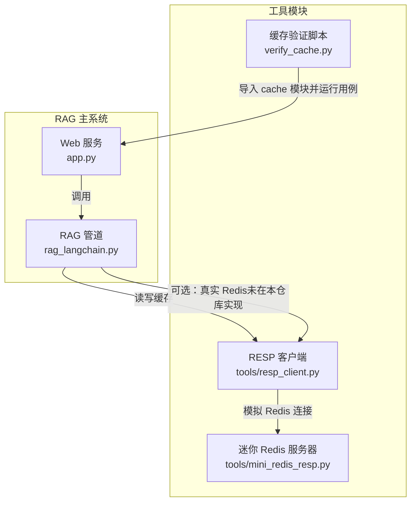
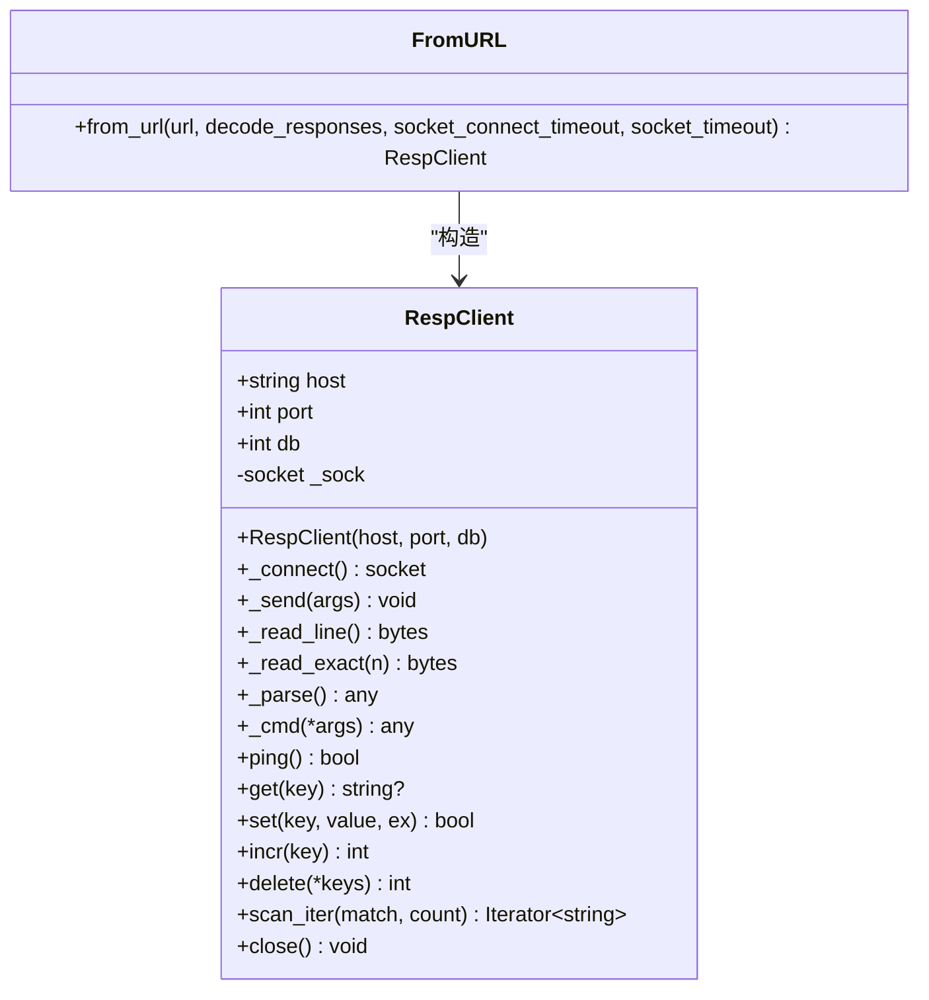
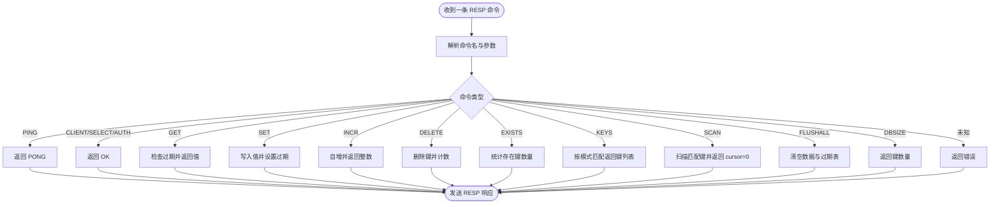
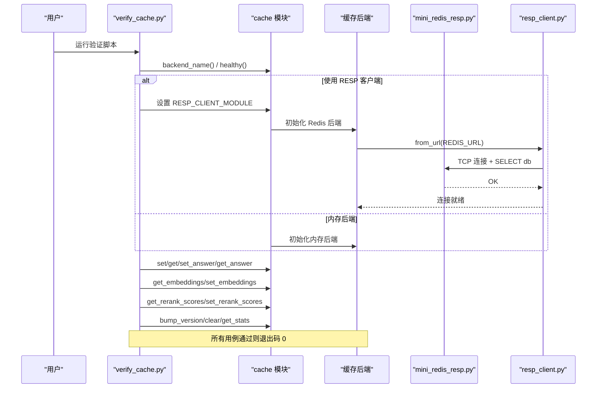
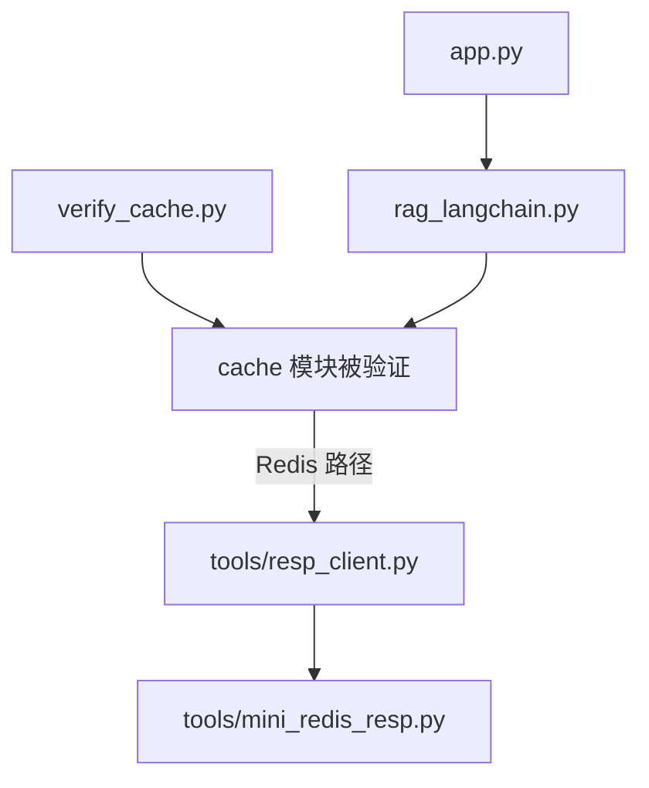
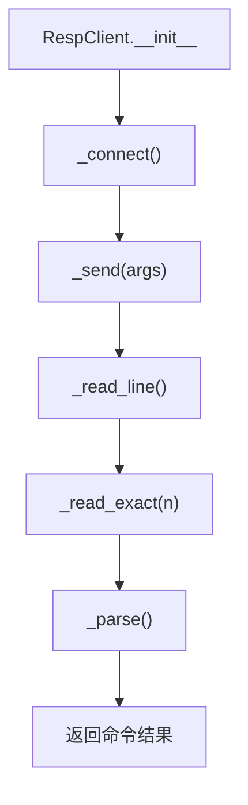
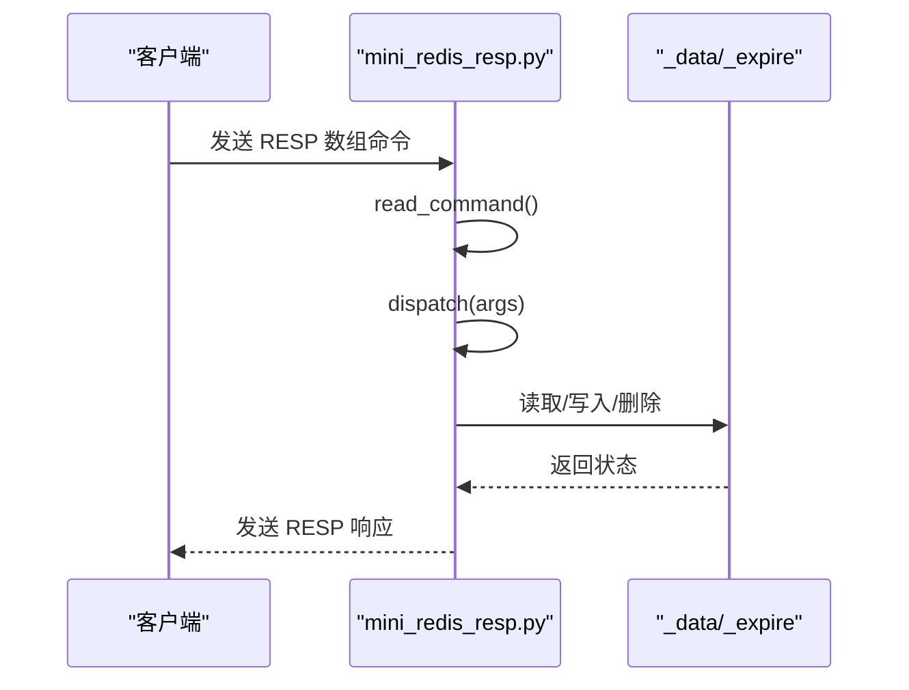
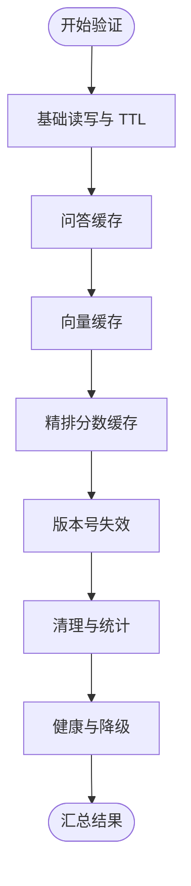
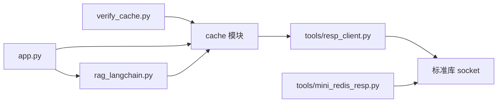

# 工具模块

<cite>
**本文引用的文件**   
- [tools/resp_client.py](file://tools/resp_client.py)
- [tools/mini_redis_resp.py](file://tools/mini_redis_resp.py)
- [verify_cache.py](file://verify_cache.py)
- [app.py](file://app.py)
- [rag_langchain.py](file://rag_langchain.py)
</cite>

## 目录
1. [引言](#引言)
2. [项目结构](#项目结构)
3. [核心组件](#核心组件)
4. [架构总览](#架构总览)
5. [详细组件分析](#详细组件分析)
6. [依赖关系分析](#依赖关系分析)
7. [性能与行为特征](#性能与行为特征)
8. [配置、参数与返回值](#配置参数与返回值)
9. [故障排查指南](#故障排查指南)
10. [结论](#结论)

## 引言
本章节面向 RAG 系统的辅助工具模块，聚焦三个关键实现：
- RESP 协议客户端：在不依赖第三方 `redis` 包的情况下，用标准库 socket 实现最小可用 Redis 客户端。
- 迷你 Redis 服务器：同样基于标准库 socket，实现 RESP 子集，用于验证缓存层是否走 Redis 路径以及命令是否符合预期。
- 缓存验证脚本：独立于模型加载的轻量测试，覆盖问答缓存、向量缓存、精排分数缓存、TTL、版本号失效、清理与统计等场景。

这些工具共同保证：RAG 主链路在“有 Redis”和“无 Redis（降级到内存）”两条路径下都能被可靠验证，同时避免引入重型依赖。

## 项目结构
工具模块位于仓库根目录下的 `tools/` 与根级 `verify_cache.py`：
- `tools/resp_client.py`：RESP 客户端实现。
- `tools/mini_redis_resp.py`：迷你 RESP 服务器实现。
- `verify_cache.py`：缓存层验证入口。
- `app.py`：FastAPI Web 服务，消费缓存层并暴露接口。
- `rag_langchain.py`：RAG 管道，调用缓存层进行问答、向量嵌入与精排打分缓存。

**图表来源**
- [tools/resp_client.py:19-131](file://tools/resp_client.py#L19-L131)
- [tools/mini_redis_resp.py:78-157](file://tools/mini_redis_resp.py#L78-L157)
- [verify_cache.py:61-197](file://verify_cache.py#L61-L197)
- [app.py:231-284](file://app.py#L231-L284)
- [rag_langchain.py:579-644](file://rag_langchain.py#L579-L644)

**章节来源**
- [tools/resp_client.py:1-132](file://tools/resp_client.py#L1-L132)
- [tools/mini_redis_resp.py:1-222](file://tools/mini_redis_resp.py#L1-L222)
- [verify_cache.py:1-202](file://verify_cache.py#L1-L202)
- [app.py:1-303](file://app.py#L1-L303)
- [rag_langchain.py:1-779](file://rag_langchain.py#L1-L779)

## 核心组件
本节从领域模型、接口契约与调用关系角度，解释工具模块如何支撑缓存层验证。

### RESP 协议客户端
- 目标：提供一个接口尽量模仿 `redis-py` 的最小客户端，仅实现缓存层 `_RedisBackend` 实际使用的命令。
- 关键能力：
  - 使用标准库 socket 建立 TCP 连接。
  - 按 RESP 格式发送数组命令。
  - 解析 RESP 响应类型：简单字符串、错误、整数、批量数据、数组。
  - 提供 `ping/get/set/incr/delete/scan_iter/close/from_url` 等方法。
- 设计要点：
  - `from_url` 支持 `redis://host:port/db` URL，便于通过环境变量注入。
  - `db` 参数在连接后自动执行 `SELECT db`。
  - `scan_iter` 以 cursor 归零作为遍历结束条件。

**图表来源**
- [tools/resp_client.py:19-131](file://tools/resp_client.py#L19-L131)

**章节来源**
- [tools/resp_client.py:19-131](file://tools/resp_client.py#L19-L131)

### 迷你 Redis 服务器
- 目标：实现 RESP 子集，让缓存层的 Redis 代码路径可被真实驱动，而不需要安装 `redis` 包或启动真实 Redis。
- 支持的命令：PING、GET、SET(EX/PX)、INCR、DELETE、EXISTS、KEYS、SCAN(COUNT/MATCH)、FLUSHALL、DBSIZE，以及连接初始化时的 CLIENT/SELECT/AUTH（返回 OK）。
- 内部状态：
  - `_data`：键值存储（简化为字符串）。
  - `_expire`：过期时间戳。
  - `_commands`：记录收到的命令序列，供测试断言。
  - `_lock`：线程安全锁。
- 关键流程：
  - 监听端口，接受连接，每个连接一个线程处理。
  - 读取 RESP 数组命令，分派到对应命令处理器。
  - 对 SET 支持 EX/PX TTL；对 GET/EXISTS/SCAN 做过期检查。
  - SCAN 简化为一次性返回匹配 key，cursor 固定为 0。

**图表来源**
- [tools/mini_redis_resp.py:78-157](file://tools/mini_redis_resp.py#L78-L157)

**章节来源**
- [tools/mini_redis_resp.py:1-222](file://tools/mini_redis_resp.py#L1-L222)

### 缓存验证脚本
- 目标：不加载任何模型，快速验证缓存层逻辑是否正确，包括基础读写、TTL、问答缓存、向量缓存、精排分数缓存、版本号失效、清理与统计、健康与降级。
- 运行方式：
  - 默认：自动选择后端。
  - `CACHE_BACKEND=memory`：强制内存后端。
  - `CACHE_BACKEND=redis`：尝试 Redis 后端；若不可用会降级并给出警告。
  - `RESP_CLIENT_MODULE=tools.resp_client`：用 RESP 客户端替代 `redis` 包，从而驱动 Redis 代码路径。
- 输出：控制台日志与可选 UTF-8 日志文件（通过 `VERIFY_LOG` 环境变量控制），退出码 0 表示全部通过，非 0 表示失败。

**图表来源**
- [verify_cache.py:61-197](file://verify_cache.py#L61-L197)
- [tools/resp_client.py:123-131](file://tools/resp_client.py#L123-L131)
- [tools/mini_redis_resp.py:200-217](file://tools/mini_redis_resp.py#L200-L217)

**章节来源**
- [verify_cache.py:1-202](file://verify_cache.py#L1-L202)

## 架构总览
工具模块与 RAG 主系统的协作关系如下：
- `verify_cache.py` 是缓存层的“单元测试+集成测试”入口，直接调用 `cache` 模块（由仓库其他文件提供，本仓库中未列出具体实现，但被验证脚本引用）。
- `app.py` 是 FastAPI Web 服务，对外暴露上传、提问、缓存统计、清理与健康检查接口，内部调用 `rag_langchain.py` 的 RAG 管道。
- `rag_langchain.py` 的问答入口 `query()` 先查缓存，未命中再走检索、精排、生成，并把结果写回缓存。
- 当 `CACHE_BACKEND=redis` 且 `RESP_CLIENT_MODULE=tools.resp_client` 时，缓存层的 Redis 路径会通过 `resp_client.py` 连接到 `mini_redis_resp.py`，从而在无真实 Redis 环境下验证 Redis 代码路径。

**图表来源**
- [verify_cache.py:29-27](file://verify_cache.py#L29-L27)
- [app.py:43-51](file://app.py#L43-L51)
- [rag_langchain.py:48-48](file://rag_langchain.py#L48-L48)
- [tools/resp_client.py:19-131](file://tools/resp_client.py#L19-L131)
- [tools/mini_redis_resp.py:78-157](file://tools/mini_redis_resp.py#L78-L157)

## 详细组件分析

### RESP 客户端实现细节
- 连接管理：
  - `_connect` 懒创建 socket，并在 `db != 0` 时发送 `SELECT db`。
  - `_send` 将 Python 参数序列化为 RESP 数组字节流。
- 响应解析：
  - `_read_line` 逐字节读取直到 `\r\n`。
  - `_read_exact` 精确读取指定长度。
  - `_parse` 根据首字符区分响应类型：`+` 简单字符串、`-` 错误、`:` 整数、`$` 批量数据、`*` 数组。
- 命令封装：
  - `ping/get/set/incr/delete/scan_iter/close` 与 `_RedisBackend` 所需方法一一对应。
  - `from_url` 解析 `redis://host:port/db`，默认端口 6379，默认 db 0。

**图表来源**
- [tools/resp_client.py:29-86](file://tools/resp_client.py#L29-L86)

**章节来源**
- [tools/resp_client.py:29-86](file://tools/resp_client.py#L29-L86)

### 迷你 Redis 服务器实现细节
- 命令分发：
  - `dispatch` 根据命令名路由到对应逻辑。
  - 对 SET 支持 EX/PX 过期参数。
  - 对 GET/EXISTS/SCAN 在执行前检查过期。
  - KEYS 与 SCAN 都支持模式匹配，但 SCAN 返回 cursor 为 0，表示一次遍历结束。
- 并发与安全：
  - 每个连接一个线程处理。
  - 共享数据使用 `_lock` 保护。
- 命令记录：
  - 每次命令进入 `_commands` 列表，进程退出时写入 `mini_redis_commands.log`。

**图表来源**
- [tools/mini_redis_resp.py:160-197](file://tools/mini_redis_resp.py#L160-L197)
- [tools/mini_redis_resp.py:78-157](file://tools/mini_redis_resp.py#L78-L157)

**章节来源**
- [tools/mini_redis_resp.py:78-157](file://tools/mini_redis_resp.py#L78-L157)
- [tools/mini_redis_resp.py:160-197](file://tools/mini_redis_resp.py#L160-L197)

### 缓存验证用例映射
验证脚本覆盖了以下关键场景：
- 基础读写与 TTL：写入后可读，不存在 key 返回 None，TTL 过期后读不到。
- 问答缓存：首次查询未命中，写入后命中，问题 strip 不影响命中，不同 top_n/k 不应误命中。
- 向量缓存：批量查询命中、未命中、key 一致性。
- 精排分数缓存：按片段下标对应分数，换问题不应复用。
- 版本号失效：bump_version 后旧答案失效，新答案可写入。
- 清理与统计：定向清理、全量清理、统计归零。
- 健康与降级：backend_name 取值、healthy 返回 True。

**图表来源**
- [verify_cache.py:73-184](file://verify_cache.py#L73-L184)

**章节来源**
- [verify_cache.py:73-184](file://verify_cache.py#L73-L184)

## 依赖关系分析
工具模块与主系统的依赖关系如下：
- `verify_cache.py` 依赖 `cache` 模块（仓库内未列出具体实现，但被脚本引用）。
- `app.py` 依赖 `cache` 与 `rag_langchain.py`。
- `rag_langchain.py` 依赖 `cache` 以及 LangChain、Chroma、HuggingFace 等外部库。
- `tools/resp_client.py` 仅依赖标准库 socket、re、typing。
- `tools/mini_redis_resp.py` 仅依赖标准库 socket、fnmatch、threading、time、sys。

**图表来源**
- [verify_cache.py:29-27](file://verify_cache.py#L29-L27)
- [app.py:43-51](file://app.py#L43-L51)
- [rag_langchain.py:48-48](file://rag_langchain.py#L48-L48)
- [tools/resp_client.py:14-16](file://tools/resp_client.py#L14-L16)
- [tools/mini_redis_resp.py:19-24](file://tools/mini_redis_resp.py#L19-L24)

**章节来源**
- [verify_cache.py:29-27](file://verify_cache.py#L29-L27)
- [app.py:43-51](file://app.py#L43-L51)
- [rag_langchain.py:48-48](file://rag_langchain.py#L48-L48)
- [tools/resp_client.py:14-16](file://tools/resp_client.py#L14-L16)
- [tools/mini_redis_resp.py:19-24](file://tools/mini_redis_resp.py#L19-L24)

## 性能与行为特征
- RESP 客户端：
  - 每次命令都会经过 socket 发送与 RESP 解析，适合验证路径，不适合高吞吐生产环境。
  - `scan_iter` 以 cursor 归零作为结束条件，符合 Redis SCAN 语义。
- 迷你 Redis 服务器：
  - 内存存储，无持久化；过期检查在访问时触发。
  - SCAN 简化实现，一次性返回匹配 key，cursor 固定为 0，适合测试但不具备 Redis 的增量迭代特性。
- 缓存验证脚本：
  - 秒级完成，不加载模型，适合 CI 或本地快速回归。
  - 支持日志输出到 UTF-8 文件，避免 Windows 控制台编码问题。

[本节为通用性能讨论，不直接分析具体文件]

## 配置、参数与返回值

### RESP 客户端
- 构造函数参数：
  - `host`：字符串，默认 `127.0.0.1`。
  - `port`：整数，默认 `6379`。
  - `db`：整数，默认 `0`。
- `from_url` 参数：
  - `url`：`redis://host:port/db` 形式。
  - `decode_responses`：布尔值，默认 `True`（当前实现未使用该参数，但保留接口兼容）。
  - `socket_connect_timeout`：浮点数，默认 `3`（当前实现未使用该参数，但保留接口兼容）。
  - `socket_timeout`：浮点数，默认 `3`（当前实现未使用该参数，但保留接口兼容）。
- 主要方法返回值：
  - `ping()`：布尔值。
  - `get(key)`：字符串或 None。
  - `set(key, value, ex)`：布尔值。
  - `incr(key)`：整数。
  - `delete(*keys)`：整数。
  - `scan_iter(match, count)`：迭代器，yield 字符串 key。
  - `close()`：无返回值。

**章节来源**
- [tools/resp_client.py:22-131](file://tools/resp_client.py#L22-L131)

### 迷你 Redis 服务器
- 启动参数：
  - 命令行参数：端口号，默认 `6399`。
- 内部状态：
  - `_data`：字典，键为字符串，值为字符串。
  - `_expire`：字典，键为字符串，值为浮点数时间戳。
  - `_commands`：列表，记录收到的命令字符串。
- 命令返回值：
  - PING：`PONG`。
  - GET：字符串或 None。
  - SET：`OK`。
  - INCR：整数。
  - DELETE：整数。
  - EXISTS：整数。
  - KEYS：数组。
  - SCAN：数组，包含 cursor 与键列表。
  - FLUSHALL：`OK`。
  - DBSIZE：整数。

**章节来源**
- [tools/mini_redis_resp.py:26-32](file://tools/mini_redis_resp.py#L26-L32)
- [tools/mini_redis_resp.py:78-157](file://tools/mini_redis_resp.py#L78-L157)

### 缓存验证脚本
- 环境变量：
  - `CACHE_BACKEND`：`memory` 或 `redis`。
  - `RESP_CLIENT_MODULE`：Python 模块路径，如 `tools.resp_client`。
  - `VERIFY_LOG`：UTF-8 日志文件路径。
- 主要用例分组：
  - 基础读写与 TTL。
  - 问答缓存。
  - 向量缓存。
  - 精排分数缓存。
  - 版本号失效。
  - 清理与统计。
  - 健康与降级。

**章节来源**
- [verify_cache.py:31-35](file://verify_cache.py#L31-L35)
- [verify_cache.py:73-184](file://verify_cache.py#L73-L184)

## 故障排查指南
- Redis 连接失败：
  - 现象：`CACHE_BACKEND=redis` 但后端不是 redis，验证脚本发出警告。
  - 原因：无法连接到 Redis 服务或未正确配置 `REDIS_URL`。
  - 解决：确保 `mini_redis_resp.py` 已启动并监听指定端口，或通过真实 Redis 服务连接。
- RESP 客户端解析错误：
  - 现象：抛出运行时异常，提示无法解析响应类型。
  - 原因：服务端返回了非标准 RESP 格式。
  - 解决：检查迷你 Redis 服务器的命令实现，确保返回正确的 RESP 类型。
- SCAN 行为差异：
  - 现象：SCAN 一次性返回所有匹配 key，cursor 始终为 0。
  - 原因：迷你 Redis 服务器为简化实现，不具备 Redis 的增量迭代特性。
  - 解决：测试用例应容忍该行为，不要假设多次 SCAN 返回不同批次。
- 过期键访问：
  - 现象：GET/EXISTS/SCAN 访问已过期键返回空或不命中。
  - 原因：迷你 Redis 服务器在访问时检查过期时间。
  - 解决：验证 TTL 逻辑时注意时间差，避免竞态条件。

**章节来源**
- [verify_cache.py:68-71](file://verify_cache.py#L68-L71)
- [tools/resp_client.py:62-82](file://tools/resp_client.py#L62-L82)
- [tools/mini_redis_resp.py:65-71](file://tools/mini_redis_resp.py#L65-L71)
- [tools/mini_redis_resp.py:137-147](file://tools/mini_redis_resp.py#L137-L147)

## 结论
工具模块通过 RESP 客户端与迷你 Redis 服务器，为 RAG 系统的缓存层提供了轻量、可验证的基础设施。缓存验证脚本覆盖了关键业务场景，确保在“有 Redis”和“无 Redis”两种路径下都能稳定运行。对于初学者，这些工具帮助理解缓存层的工作原理；对于有经验的开发者，它们提供了可插拔的测试环境与清晰的接口契约，便于扩展与维护。

[本节为总结性内容，不直接分析具体文件]