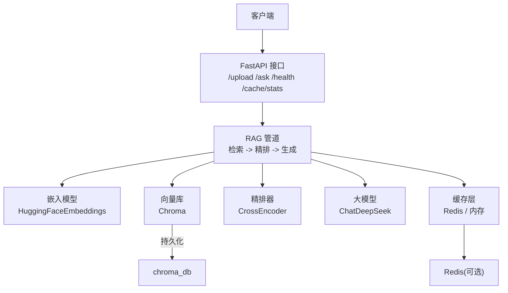
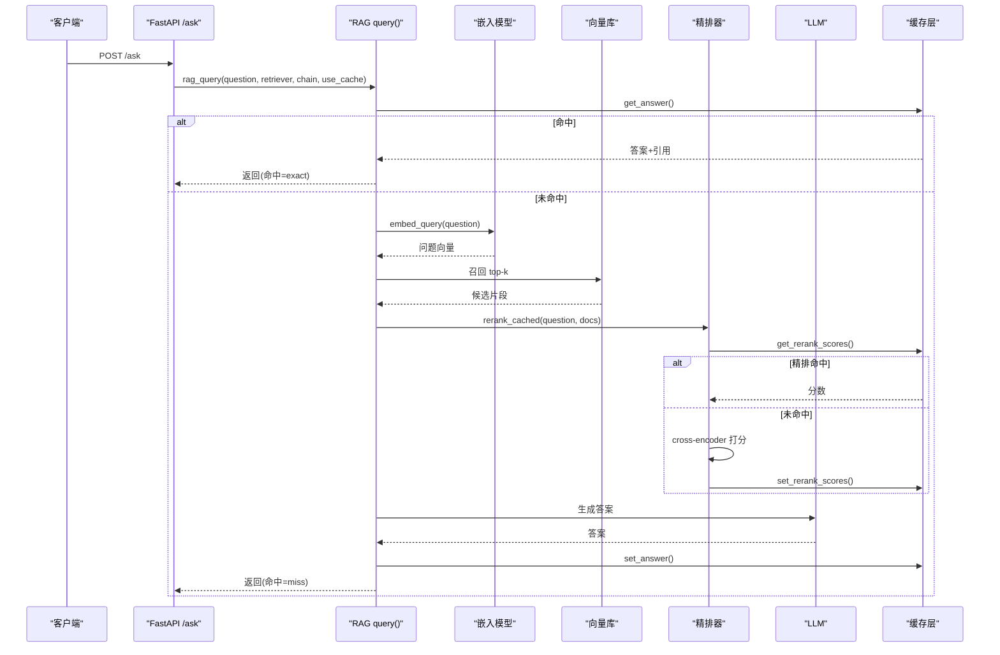
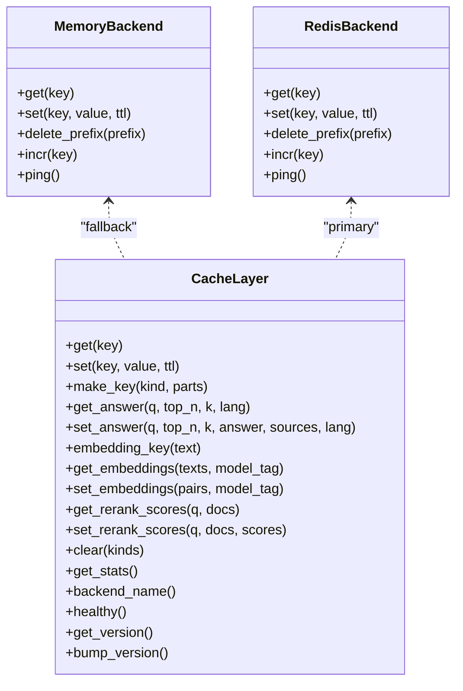
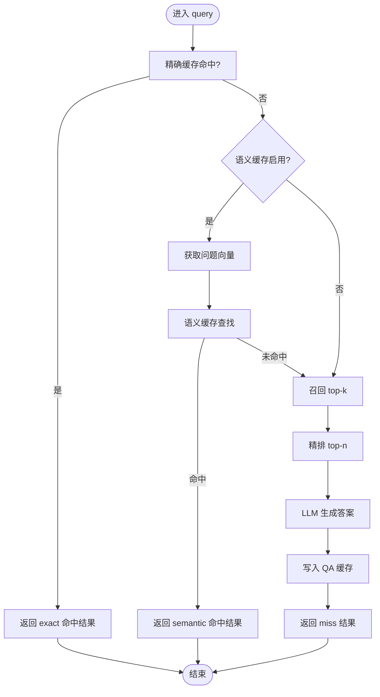
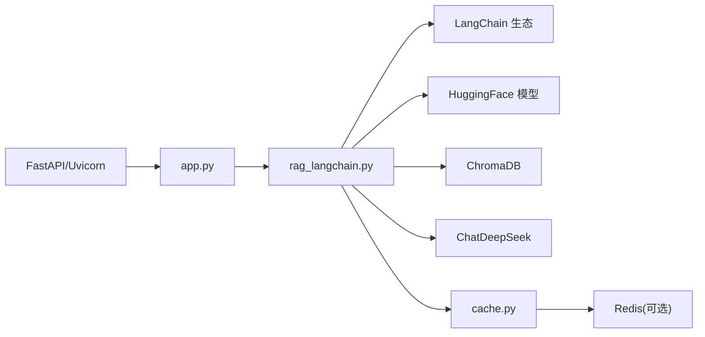

# 性能优化

<cite>
**本文引用的文件**   
- [app.py](file://app.py)
- [rag_langchain.py](file://rag_langchain.py)
- [cache.py](file://cache.py)
- [requirements.txt](file://requirements.txt)
- [verify_cache.py](file://verify_cache.py)
</cite>

## 目录
1. [引言](#引言)
2. [项目结构](#项目结构)
3. [核心组件](#核心组件)
4. [架构总览](#架构总览)
5. [详细组件分析](#详细组件分析)
6. [依赖关系分析](#依赖关系分析)
7. [性能考虑与调优建议](#性能考虑与调优建议)
8. [监控指标与瓶颈识别](#监控指标与瓶颈识别)
9. [基准测试与对比分析](#基准测试与对比分析)
10. [故障排查指南](#故障排查指南)
11. [结论](#结论)

## 引言
本文件面向 RAG 系统的性能优化，重点覆盖缓存策略、配置项、监控指标、瓶颈定位方法、内存与并发最佳实践，以及不同负载下的扩展性建议。系统采用 FastAPI 作为 Web 服务入口，LangChain 构建检索与生成链路，Chroma 作为向量库，DeepSeek 作为大模型后端，Redis（或进程内内存）作为缓存后端，并通过“问答缓存 + 向量缓存 + 精排分数缓存”三层缓存显著降低重复计算与外部调用成本。

## 项目结构
仓库以应用层、RAG 管道层、缓存层为主干：
- 应用层：FastAPI 接口、请求路由、前端页面、上传与查询流程。
- RAG 管道层：语种判断、嵌入模型、切块、向量库、召回与重排、Prompt 与 LLM 链、语义缓存。
- 缓存层：Redis/内存双后端、TTL、版本号失效、统计计数、业务封装。

图表来源
- [app.py:53-303](file://app.py#L53-L303)
- [rag_langchain.py:39-47](file://rag_langchain.py#L39-L47)
- [cache.py:1-29](file://cache.py#L1-L29)

章节来源
- [app.py:1-303](file://app.py#L1-L303)
- [rag_langchain.py:1-779](file://rag_langchain.py#L1-L779)
- [cache.py:1-391](file://cache.py#L1-L391)

## 核心组件
- 缓存层 cache.py：提供 QA 缓存、embedding 缓存、rerank 分数缓存；支持 Redis 与内存两种后端；带 TTL、版本号失效、统计计数与健康检查。
- RAG 管道 rag_langchain.py：实现语种判断、嵌入模型懒加载、按 token 切块、Chroma 向量库、召回与 cross-encoder 精排、LCEL 链、语义缓存、评测工具。
- Web 服务 app.py：暴露上传、提问、健康检查、缓存统计与清理接口；对单例对象使用双检锁；空库保护避免无依据回答。

章节来源
- [cache.py:1-391](file://cache.py#L1-L391)
- [rag_langchain.py:1-779](file://rag_langchain.py#L1-L779)
- [app.py:1-303](file://app.py#L1-L303)

## 架构总览
RAG 请求在缓存层进行多级命中判定，未命中时走真实链路并回写缓存。

图表来源
- [app.py:231-260](file://app.py#L231-L260)
- [rag_langchain.py:580-631](file://rag_langchain.py#L580-L631)
- [rag_langchain.py:428-467](file://rag_langchain.py#L428-L467)
- [cache.py:271-367](file://cache.py#L271-L367)

## 详细组件分析

### 缓存层 cache.py
- 后端选择：auto/redis/memory，自动降级到内存；生产环境可强制 redis。
- TTL：ANSWER_TTL、EMBEDDING_TTL、RERANK_TTL，默认分别为 1h、24h、1h。
- 版本号失效：bump_version 提升版本，所有旧答案立即失效，防止文档更新后仍命中旧答案。
- 统计：qa_hit/miss、embed_hit/miss、rerank_hit/miss，并提供命中率与 saved pipeline 次数。
- Key 设计：
  - QA key：包含 lang、question.strip()、k、top_n、版本号，避免跨库/跨参数误命中。
  - Embedding key：文本 hash + model_tag（含语种、模型路径、max_seq_length），避免不同模型向量互相覆盖。
  - Rerank key：(question||doc) 的哈希，避免换问题复用错误分数。

图表来源
- [cache.py:76-148](file://cache.py#L76-L148)
- [cache.py:236-391](file://cache.py#L236-L391)

章节来源
- [cache.py:1-391](file://cache.py#L1-L391)

### RAG 管道 rag_langchain.py
- 语种判断 detect_lang：基于汉字占比阈值区分 zh/en，轻量且稳定。
- 嵌入模型 CachedHuggingFaceEmbeddings：覆写 embed_documents/embed_query，接入向量缓存；支持 bge 查询前缀；显式设置 max_seq_length 避免静默截断。
- 切块 split_by_tokens：按 tokenizer 的 offset 对齐切原文，中英统一 token 粒度，避免英文块过薄。
- 向量库 load_store/build_index：按语种分 collection，共享 PersistentClient；重建时只删块不 drop collection，保持实例有效。
- 召回与精排 make_retriever/rerank_cached：先召回 top-k，再用 cross-encoder 精排 top-n；分数写入 rerank 缓存。
- LCEL 链 make_chain：支持字符串输入（内部召回）与 dict 输入（跳过召回），避免重复检索与类型错误。
- 语义缓存 SemanticCache：可选开启，按余弦相似度近似匹配，默认关闭以避免误命中。
- 入口函数 query：精确缓存优先，其次语义缓存，最后真实链路并回写缓存。

图表来源
- [rag_langchain.py:580-631](file://rag_langchain.py#L580-L631)
- [rag_langchain.py:428-467](file://rag_langchain.py#L428-L467)
- [rag_langchain.py:185-254](file://rag_langchain.py#L185-L254)

章节来源
- [rag_langchain.py:1-779](file://rag_langchain.py#L1-L779)

### Web 服务 app.py
- 单例管理：_stores/_retrievers/_chains 按语种懒加载，双检锁避免并发重复构造。
- 空库保护：目标语种 collection 为空时直接提示，不走检索，避免模型“凭印象作答”。
- 上传流程：解析 PDF/Markdown，按文档语种切块入库，替换该语种 collection，失效缓存，更新 chunks_preview。
- 查询流程：按问题语种路由，调用 rag_query，返回 cache_hit/cache_type/elapsed_ms/lang。
- 运维接口：/cache/stats 返回后端类型、健康状态、版本号、collection 块数、TTL 与统计；/cache/clear 支持定向清理。

章节来源
- [app.py:1-303](file://app.py#L1-L303)

## 依赖关系分析
- FastAPI 与 Uvicorn：Web 框架与 ASGI 服务器。
- LangChain 生态：langchain-core、langchain-community、langchain-chroma、langchain-huggingface、langchain-deepseek。
- 模型与嵌入：sentence-transformers、HuggingFaceEmbeddings、HuggingFaceCrossEncoder。
- 向量库：chromadb（PersistentClient）。
- 缓存后端：redis（可选），否则降级为内存。

图表来源
- [requirements.txt:1-19](file://requirements.txt#L1-L19)
- [app.py:36-51](file://app.py#L36-L51)
- [rag_langchain.py:39-47](file://rag_langchain.py#L39-L47)
- [cache.py:150-199](file://cache.py#L150-L199)

章节来源
- [requirements.txt:1-19](file://requirements.txt#L1-L19)
- [app.py:36-51](file://app.py#L36-L51)
- [rag_langchain.py:39-47](file://rag_langchain.py#L39-L47)
- [cache.py:150-199](file://cache.py#L150-L199)

## 性能考虑与调优建议

### 缓存策略与配置
- 三层缓存分工：
  - QA 缓存：命中则跳过整条链路，节省 LLM 调用与等待时间。
  - 向量缓存：命中则跳过 embedding 前向，节省 CPU/GPU。
  - 精排缓存：命中则跳过 cross-encoder 打分，这是最慢的一环。
- 关键环境变量：
  - CACHE_BACKEND：auto/redis/memory，推荐生产用 redis，开发可用 auto 或 memory。
  - REDIS_URL：Redis 连接地址。
  - CACHE_ANSWER_TTL/CACHE_EMBEDDING_TTL/CACHE_RERANK_TTL：调整 TTL 平衡命中率与一致性。
  - CHUNK_TOKENS/CHUNK_OVERLAP_TOKENS：控制切块大小与重叠，影响召回质量与上下文长度。
  - SEMANTIC_CACHE/SEMANTIC_THRESHOLD：可选开启语义缓存，谨慎调低阈值以防误命中。
  - BGE_QUERY_PREFIX：是否给 bge 查询加指令前缀，可做 A/B 对比。
- 失效策略：
  - 上传文档后 bump_version，使旧答案立即失效。
  - clear(kinds) 支持定向清理 qa/embed/rerank，避免误伤向量缓存。

章节来源
- [cache.py:37-43](file://cache.py#L37-L43)
- [cache.py:216-233](file://cache.py#L216-L233)
- [cache.py:371-391](file://cache.py#L371-L391)
- [rag_langchain.py:110-115](file://rag_langchain.py#L110-L115)
- [rag_langchain.py:113-115](file://rag_langchain.py#L113-L115)
- [rag_langchain.py:86-89](file://rag_langchain.py#L86-L89)

### 内存管理与资源利用
- 模型懒加载：embedding 模型、cross-encoder、tokenizer 均按需加载，避免启动即占满内存。
- 共享客户端：Chroma PersistentClient 全局共享，避免多实例导致句柄与索引冲突。
- 切块策略：按 token 切块，避免英文块过薄；chunk_size 取模型上限一半留余量，减少静默截断风险。
- 向量空间隔离：不同语种的 embedding 模型与 collection 严格分离，避免跨模型相似度噪声。

章节来源
- [rag_langchain.py:228-254](file://rag_langchain.py#L228-L254)
- [rag_langchain.py:257-277](file://rag_langchain.py#L257-L277)
- [rag_langchain.py:324-359](file://rag_langchain.py#L324-L359)
- [rag_langchain.py:53-81](file://rag_langchain.py#L53-L81)

### 并发处理
- 双检锁：单例对象（stores/retrievers/chains/embeddings/tokenizers/chroma_client）使用双检锁，避免首次并发重复构造。
- 线程安全统计：stats 计数器使用 RLock 保护。
- FastAPI 线程池：同步接口被丢入线程池，需确保缓存与模型初始化线程安全。

章节来源
- [app.py:60-92](file://app.py#L60-L92)
- [rag_langchain.py:224-254](file://rag_langchain.py#L224-L254)
- [cache.py:45-72](file://cache.py#L45-L72)

## 监控指标与瓶颈识别
- 缓存统计：
  - qa_hit/miss、embed_hit/miss、rerank_hit/miss 及其命中率。
  - asked_pipeline_saved：省下的 LLM 调用次数。
  - backend：当前缓存后端（redis/memory）。
- 健康检查：
  - /health 返回缓存后端与健康状态、各语种 collection 块数。
  - /cache/stats 返回更详细的 TTL、版本号、集合统计。
- 瓶颈识别：
  - 若 qa_miss 高但 embed_hit/rerank_hit 也高：说明问题重复度不高，但向量与精排缓存有效。
  - 若 rerank_miss 高：cross-encoder 成为瓶颈，考虑增大 RERANK_TTL 或优化召回质量以减少重复打分。
  - 若 embed_miss 高：重复文本少或模型变更频繁，关注 model_tag 与缓存键设计。
  - 若 asked_pipeline_saved 低：QA 缓存命中率低，检查 question.strip()、k/top_n、lang 是否一致。

章节来源
- [cache.py:45-72](file://cache.py#L45-L72)
- [app.py:263-290](file://app.py#L263-L290)

## 基准测试与对比分析
- 内置评测脚本 rag_langchain.py 的主流程展示了两次检索+精排的耗时对比：第一次全部未命中，第二次精排分数命中缓存，体现缓存收益。
- verify_cache.py 提供缓存层独立验证，无需加载模型，快速验证读写、TTL、失效、统计等逻辑。
- 建议的基准步骤：
  - 准备固定测试集（questions + true_indices），记录 Hit Rate/MRR。
  - 分别运行一次“冷缓存”与“热缓存”，对比 elapsed_ms 与缓存命中率。
  - 调整 CHUNK_TOKENS、RETRIEVE_K、RERANK_TOP_N，观察召回质量与延迟变化。
  - 切换 CACHE_BACKEND=redis vs memory，评估网络开销与吞吐差异。

章节来源
- [rag_langchain.py:748-779](file://rag_langchain.py#L748-L779)
- [verify_cache.py:1-202](file://verify_cache.py#L1-L202)

## 故障排查指南
- 缓存不可用：
  - 检查 REDIS_URL 与网络连通性；若使用 RESP_CLIENT_MODULE，确认自定义客户端兼容协议。
  - 查看 backend_name() 与 healthy()，确认是否降级为 memory。
- 答案不一致：
  - 确认上传后是否调用 invalidate_caches()/bump_version()。
  - 检查 QA key 是否包含正确的 lang/k/top_n，避免跨库或跨参数误命中。
- 向量污染：
  - 确认 model_tag 包含语种、模型路径、max_seq_length，避免不同模型向量互相覆盖。
- 空库误答：
  - 使用 _collection_size(lang) 做空库保护，避免模型“凭印象作答”。

章节来源
- [cache.py:154-199](file://cache.py#L154-L199)
- [cache.py:271-300](file://cache.py#L271-L300)
- [cache.py:309-346](file://cache.py#L309-L346)
- [app.py:95-122](file://app.py#L95-L122)
- [app.py:241-249](file://app.py#L241-L249)

## 结论
本 RAG 系统通过三层缓存、语种隔离、懒加载与共享客户端等设计，在保证正确性的前提下显著提升性能。生产环境建议使用 Redis 作为缓存后端，合理配置 TTL 与切块参数，结合监控指标持续优化命中率与延迟。通过基准测试与故障排查，可稳定支撑不同负载场景，具备良好的扩展性与可维护性。