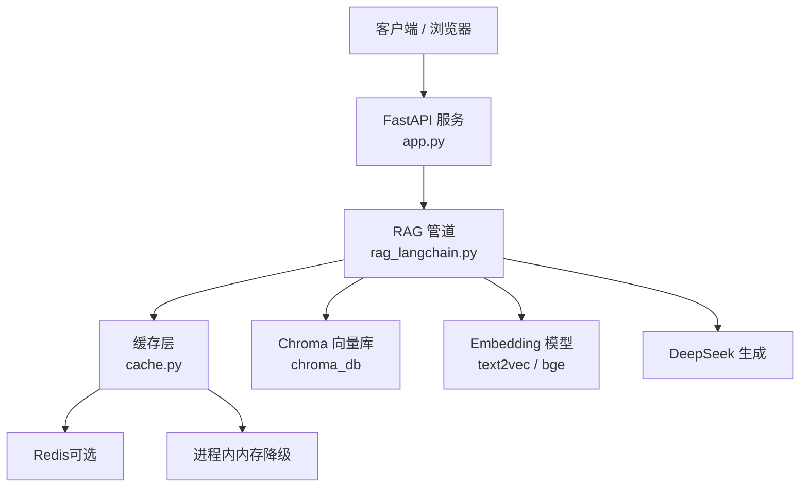
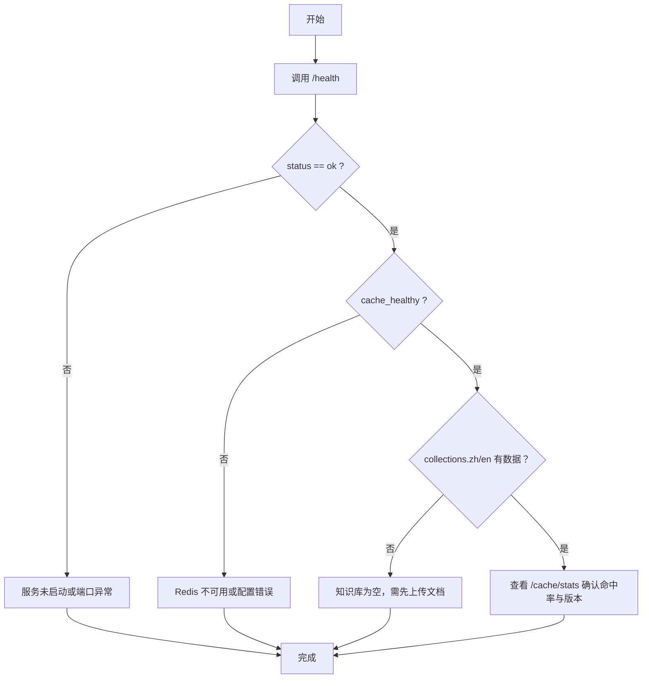

# 故障排除指南

<cite>
**本文引用的文件**   
- [app.py](file://app.py)
- [rag_langchain.py](file://rag_langchain.py)
- [cache.py](file://cache.py)
- [requirements.txt](file://requirements.txt)
- [verify_cache.py](file://verify_cache.py)
- [tools/resp_client.py](file://tools/resp_client.py)
- [tools/mini_redis_resp.py](file://tools/mini_redis_resp.py)
</cite>

## 目录
1. [引言](#引言)
2. [项目结构与排查范围](#项目结构与排查范围)
3. [系统健康检查](#系统健康检查)
4. [常见问题与解决方案](#常见问题与解决方案)
5. [性能问题定位](#性能问题定位)
6. [配置错误排查](#配置错误排查)
7. [调试工具与日志分析技巧](#调试工具与日志分析技巧)
8. [已知问题与临时方案](#已知问题与临时方案)
9. [社区支持与获取帮助](#社区支持与获取帮助)
10. [结论](#结论)

## 引言
本指南面向 RAG Web 服务使用者与运维人员，目标是快速定位“上传失败、问答异常、缓存不生效、性能退化、配置错误”等问题，并给出可操作的诊断步骤、日志分析方法、临时修复方案和长期改进建议。

该 RAG 系统由以下关键部分组成：
- FastAPI Web 服务：暴露上传、提问、缓存管理、健康检查等接口。
- LangChain RAG 管道：按语种路由到不同向量库，执行召回、精排和生成。
- 三层缓存：问答缓存、向量缓存、精排分数缓存，后端优先 Redis，自动降级内存。
- 本地模型与向量库：中英双 embedding 模型、Chroma 持久化库、cross-encoder 精排模型。

**图表来源**
- [app.py:53-67](file://app.py#L53-L67)
- [rag_langchain.py:39-47](file://rag_langchain.py#L39-L47)
- [cache.py:1-29](file://cache.py#L1-L29)

**章节来源**
- [app.py:1-26](file://app.py#L1-L26)
- [rag_langchain.py:1-24](file://rag_langchain.py#L1-L24)
- [cache.py:1-29](file://cache.py#L1-L29)

## 项目结构与排查范围
| 模块 | 主要职责 | 常见故障点 | 相关入口或函数 |
|---|---|---|---|
| Web 服务 | 上传文档、回答问题、查看缓存状态、健康检查 | 端口占用、前端模板缺失、空库保护误报、并发单例构造异常 | `/upload`、`/ask`、`/cache/stats`、`/health` |
| RAG 管道 | 语种判断、切块、嵌入、召回、精排、生成、语义缓存 | 模型路径错误、token 截断、检索参数不一致、跨模型混用 | `detect_lang`、`split_by_tokens`、`make_retriever`、`query` |
| 缓存层 | 问答/向量/精排缓存、TTL、版本号失效、统计 | Redis 连接失败、降级未提示、版本未提升、清理范围不对 | `get_answer`、`set_embeddings`、`bump_version`、`clear` |
| 依赖与环境 | Python 包、环境变量、本地模型目录 | 依赖缺失、`.env` 未加载、Redis URL 错误 | `requirements.txt`、`.env` |

**章节来源**
- [app.py:155-290](file://app.py#L155-L290)
- [rag_langchain.py:118-143](file://rag_langchain.py#L118-L143)
- [rag_langchain.py:324-359](file://rag_langchain.py#L324-L359)
- [rag_langchain.py:452-467](file://rag_langchain.py#L452-L467)
- [rag_langchain.py:580-631](file://rag_langchain.py#L580-L631)
- [cache.py:37-43](file://cache.py#L37-L43)
- [cache.py:271-300](file://cache.py#L271-L300)
- [cache.py:370-390](file://cache.py#L370-L390)

## 系统健康检查
### 使用健康接口
- 访问 `GET /health`，返回服务状态、缓存后端类型、缓存是否健康、各语种向量库块数。
- 若 `status` 不是 `ok`，优先检查 FastAPI 进程是否正常运行、端口是否被占用。
- 若 `cache_healthy` 为 `false`，说明缓存后端不可用；在 `auto` 模式下可能已降级为内存缓存。

### 使用缓存统计接口
- 访问 `GET /cache/stats`，查看：
  - `backend`：当前使用的缓存后端。
  - `healthy`：后端是否健康。
  - `version`：缓存版本号，上传文档后应递增。
  - `collections`：中文/英文 collection 的文本块数量。
  - `ttl_seconds`：问答、向量、精排的 TTL。
  - `stats`：命中/未命中计数与命中率。

### 健康检查流程

**图表来源**
- [app.py:287-290](file://app.py#L287-L290)
- [app.py:263-277](file://app.py#L263-L277)
- [cache.py:202-213](file://cache.py#L202-L213)

**章节来源**
- [app.py:263-290](file://app.py#L263-L290)
- [cache.py:202-213](file://cache.py#L202-L213)

## 常见问题与解决方案
### 1. 上传 PDF 或 Markdown 失败
**现象**
- `/upload` 返回 `success=false`，消息包含“不支持的文件类型”“文件内容为空”“分块后无内容”“上传失败”。

**诊断步骤**
1. 确认文件扩展名是否为 `.pdf`、`.md`、`.markdown`、`.txt`。
2. 确认文件内容非空且可解码为 UTF-8。
3. 检查语种判定结果：中文文档进入中文库，英文文档进入英文库。
4. 检查切块是否成功：如果 tokenizer 无法识别文本，可能返回空块。
5. 检查 Chroma 写入是否成功：旧 ID 删除与新文本入库是否抛出异常。

**常见原因**
- 文件类型不被支持。
- 文件内容为空或编码错误。
- 文档语种判定异常导致进入错误库。
- 向量库维度或集合状态异常。

**解决方案**
- 更换为标准 PDF 或 Markdown 文件。
- 确保文件编码为 UTF-8。
- 重新上传对应语种的文档。
- 如集合维度异常，停止服务后清理 `chroma_db` 并重建索引。

**章节来源**
- [app.py:155-228](file://app.py#L155-L228)
- [rag_langchain.py:293-307](file://rag_langchain.py#L293-L307)
- [rag_langchain.py:375-405](file://rag_langchain.py#L375-L405)

### 2. 问答返回“知识库为空”
**现象**
- `/ask` 返回答案提示目标语种知识库为空，并要求先上传对应语种文档。

**诊断步骤**
1. 查看 `/health` 中 `collections.zh` 与 `collections.en` 的块数。
2. 确认上传的是目标语种文档。
3. 确认没有误删 collection 或清空向量库。

**常见原因**
- 尚未上传任何文档。
- 上传了错误语种的文档。
- 向量库被手动清理或损坏。

**解决方案**
- 上传对应语种文档。
- 检查 `/cache/stats` 中的 `collections` 字段。
- 如需重建，停止服务后清理 `chroma_db` 并重新构建索引。

**章节来源**
- [app.py:231-260](file://app.py#L231-L260)
- [app.py:95-122](file://app.py#L95-L122)

### 3. 缓存不生效或命中率低
**现象**
- `/cache/stats` 显示 `qa_hit_rate` 很低，或重复提问仍走完整链路。

**诊断步骤**
1. 检查 `backend` 是否为 `redis` 或 `memory`。
2. 检查 `healthy` 是否为 `true`。
3. 检查 `version` 是否频繁变化。
4. 检查 `stats.qa_hit` 与 `stats.qa_miss`。
5. 检查是否传入了 `use_cache=false`。

**常见原因**
- Redis 不可用，自动降级为内存缓存。
- 每次上传文档都提升版本，导致旧答案失效。
- 问题文本有空格差异但未被统一处理。
- 检索参数 `k` 或精排参数 `top_n` 发生变化。

**解决方案**
- 若生产环境要求 Redis，设置 `CACHE_BACKEND=redis` 并修复 Redis 连接。
- 避免频繁上传文档。
- 保持问题文本稳定，或使用相同预处理。
- 固定 `RETRIEVE_K` 与 `RERANK_TOP_N`。

**章节来源**
- [cache.py:37-43](file://cache.py#L37-L43)
- [cache.py:176-199](file://cache.py#L176-L199)
- [cache.py:271-300](file://cache.py#L271-L300)
- [app.py:231-260](file://app.py#L231-L260)

### 4. 向量缓存或精排缓存未命中
**现象**
- 重复上传相同文件或重复提问时，仍计算 embedding 或 cross-encoder。

**诊断步骤**
1. 检查 `stats.embed_hit` 与 `stats.rerank_hit`。
2. 检查是否使用了正确的 `model_tag`。
3. 检查是否修改了 embedding 模型或 `max_seq_length`。
4. 检查是否清除了全部缓存。

**常见原因**
- 两个语种使用不同 embedding 模型，key 必须区分模型。
- 修改了模型路径或最大序列长度，但未提升缓存版本。
- 向量缓存 key 未包含模型标签。

**解决方案**
- 保持每个语种使用独立 embedding 模型。
- 修改模型配置后重建向量库并提升缓存版本。
- 使用 `POST /cache/clear` 定向清理。

**章节来源**
- [rag_langchain.py:147-182](file://rag_langchain.py#L147-L182)
- [rag_langchain.py:228-254](file://rag_langchain.py#L228-L254)
- [cache.py:303-346](file://cache.py#L303-L346)
- [cache.py:349-367](file://cache.py#L349-L367)

### 5. 答案错误或“凭印象作答”
**现象**
- 回答看起来正常，但没有依据，或来自错误语种库。

**诊断步骤**
1. 检查响应中的 `lang` 字段。
2. 检查目标语种 collection 是否有数据。
3. 检查是否启用了语义缓存且阈值过低。
4. 检查是否混用了不同模型的向量。

**常见原因**
- 目标语种库为空，系统直接返回提示而非检索。
- 语义缓存阈值过低，命中相似但不准确的问题。
- 将不同 embedding 模型的向量放入同一 collection。

**解决方案**
- 确保目标语种库非空。
- 关闭或提高语义缓存阈值。
- 严格保持中英双库分离。

**章节来源**
- [app.py:238-249](file://app.py#L238-L249)
- [rag_langchain.py:511-576](file://rag_langchain.py#L511-L576)
- [rag_langchain.py:54-80](file://rag_langchain.py#L54-L80)

## 性能问题定位
### 性能瓶颈分布
- **DeepSeek 生成**：最慢环节，问答缓存命中后可跳过。
- **cross-encoder 精排**：对每条召回片段打分，精排缓存可显著加速。
- **embedding 前向**：上传重复内容或重复提问时可复用向量缓存。
- **Chroma 检索**：通常较快，但召回条数过大也会增加后续精排成本。

### 定位方法
1. 查看 `/ask` 返回的 `elapsed_ms`。
2. 查看 `/cache/stats` 中的 `stats.asked_pipeline_saved`，即节省的 DeepSeek 调用次数。
3. 对比 `cache_type`：
   - `exact`：精确问答缓存命中。
   - `semantic(...)`：语义缓存命中。
   - `miss`：走了真实链路。
4. 观察 `collections` 大小：块数过多会增加检索与精排开销。

### 优化建议
- 启用问答缓存与精排缓存。
- 合理设置 `RETRIEVE_K` 与 `RERANK_TOP_N`。
- 控制 chunk 大小，避免过长导致截断或上下文过大。
- 使用 Redis 作为缓存后端，避免多进程下内存缓存不共享。

**章节来源**
- [rag_langchain.py:103-115](file://rag_langchain.py#L103-L115)
- [rag_langchain.py:428-449](file://rag_langchain.py#L428-L449)
- [rag_langchain.py:580-631](file://rag_langchain.py#L580-L631)
- [cache.py:45-72](file://cache.py#L45-L72)

## 配置错误排查
### 环境变量与依赖
| 配置项 | 默认值 | 作用 | 错误表现 | 修复方式 |
|---|---:|---|---|---|
| `REDIS_URL` | `redis://127.0.0.1:6379/0` | Redis 连接地址 | Redis 连接失败 | 检查 Redis 是否运行、URL 是否正确 |
| `CACHE_BACKEND` | `auto` | 缓存后端选择 | 静默降级或强制报错 | 设置为 `redis`、`memory` 或 `auto` |
| `CACHE_ANSWER_TTL` | `3600` | 问答缓存 TTL | 旧答案过早失效 | 调整 TTL |
| `CACHE_EMBEDDING_TTL` | `86400` | 向量缓存 TTL | 向量重复计算 | 调整 TTL |
| `CACHE_RERANK_TTL` | `3600` | 精排缓存 TTL | 精排重复计算 | 调整 TTL |
| `BGE_QUERY_PREFIX` | 官方查询指令 | BGE 模型 query 前缀 | 英文检索质量下降 | 检查环境变量 |
| `CHUNK_TOKENS` | `256` | 切块 token 数 | 切块过细或过粗 | 调整切块策略 |
| `CHUNK_OVERLAP_TOKENS` | `40` | 重叠 token 数 | 信息丢失或冗余 | 调整重叠比例 |
| `SEMANTIC_CACHE` | `0` | 语义缓存开关 | 语义命中不准确 | 关闭或调高阈值 |
| `SEMANTIC_THRESHOLD` | `0.95` | 语义相似度阈值 | 误命中或漏命中 | 调整阈值 |

### 依赖安装问题
- 缺少 `redis` 包不会阻止服务运行，但会降级为内存缓存。
- 若生产环境要求 Redis，请安装 `redis>=5.0` 并确保 Redis 服务可用。
- 本地模型目录需存在：`text2vec-base-chinese`、`bge-base-en-v1.5`、`mmarco-mMiniLMv2-L12-H384-v1`。

**章节来源**
- [cache.py:37-43](file://cache.py#L37-L43)
- [cache.py:154-173](file://cache.py#L154-L173)
- [rag_langchain.py:59-91](file://rag_langchain.py#L59-L91)
- [requirements.txt:1-19](file://requirements.txt#L1-L19)

## 调试工具与日志分析技巧
### verify_cache.py
用于单独验证缓存层，无需加载模型或调用 DeepSeek。

**常用用法**
- 默认模式：`python verify_cache.py`
- 强制内存缓存：`CACHE_BACKEND=memory python verify_cache.py`
- 强制 Redis 模式：`CACHE_BACKEND=redis python verify_cache.py`
- 输出 UTF-8 日志：`set VERIFY_LOG=verify_memory.log && python verify_cache.py`

**关注点**
- 基础读写与 TTL。
- 问答缓存命中与未命中计数。
- 向量缓存 key 一致性。
- 精排分数缓存按片段下标对应。
- 版本号提升后旧答案失效。
- 定向清理与全量清理。
- 后端健康与降级行为。

**章节来源**
- [verify_cache.py:1-19](file://verify_cache.py#L1-L19)
- [verify_cache.py:61-197](file://verify_cache.py#L61-L197)

### tools/resp_client.py 与 tools/mini_redis_resp.py
用于在没有 `redis` 包的情况下验证 Redis 代码路径。

**用法**
1. 启动简易 RESP 服务器：`python tools/mini_redis_resp.py 6399`
2. 使用自定义客户端运行验证：  
   `CACHE_BACKEND=redis REDIS_URL=redis://127.0.0.1:6399/0 RESP_CLIENT_MODULE=tools.resp_client python verify_cache.py`

**关注点**
- `RespClient` 实现 `ping`、`get`、`set`、`incr`、`delete`、`scan_iter`。
- `mini_redis_resp.py` 记录收到的命令，可用于断言是否使用 `SCAN` 而非阻塞的 `KEYS`。
- 连接超时、协议解析错误、RESP 响应类型异常。

**章节来源**
- [tools/resp_client.py:1-132](file://tools/resp_client.py#L1-L132)
- [tools/mini_redis_resp.py:1-222](file://tools/mini_redis_resp.py#L1-L222)

### 日志分析技巧
- 查看 `[cache]` 开头的日志，确认 Redis 连接、降级、版本号提升。
- 查看 RAG 管道打印的文档语种、模型路径、索引块数。
- 通过 `/cache/stats` 的 `stats` 字段分析命中/未命中趋势。
- 通过 `/ask` 的 `elapsed_ms` 与 `cache_type` 判断是否命中缓存。

**章节来源**
- [cache.py:187-198](file://cache.py#L187-L198)
- [cache.py:225-233](file://cache.py#L225-L233)
- [rag_langchain.py:375-405](file://rag_langchain.py#L375-L405)
- [rag_langchain.py:711-779](file://rag_langchain.py#L711-L779)

## 已知问题与临时方案
### 1. langchain-community 弃用警告
**现象**
- 导入时报 DeprecationWarning。

**影响**
- 功能不受影响，仅产生噪音日志。

**临时方案**
- 代码已屏蔽该警告。
- 长期计划：迁移到独立包。

**章节来源**
- [app.py:33-34](file://app.py#L33-L34)
- [rag_langchain.py:35-37](file://rag_langchain.py#L35-L37)

### 2. 向量静默截断
**现象**
- 超长文本被 sentence-transformers 静默截断，导致召回质量下降。

**影响**
- 向量不完整，检索结果变差。

**临时方案**
- 显式设置 `LANG_MAX_SEQ`。
- 使用按 token 切块，并保留重叠。
- 控制 `CHUNK_TOKENS` 不超过模型上限的一半。

**长期修复**
- 升级模型或替换为支持更长上下文的 embedding 模型。
- 增加输入长度校验与告警。

**章节来源**
- [rag_langchain.py:64-77](file://rag_langchain.py#L64-L77)
- [rag_langchain.py:324-359](file://rag_langchain.py#L324-L359)

### 3. 不同模型向量混用
**现象**
- 将不同 embedding 模型的向量放入同一 collection，相似度变成噪声。

**影响**
- 检索静默出错，不报错但答案质量下降。

**临时方案**
- 严格保持中英双库分离。
- 使用 `LANG_COLLECTIONS` 与 `LANG_MODELS`。

**长期修复**
- 在入库与检索处增加模型一致性校验。
- 禁止跨模型写入同一 collection。

**章节来源**
- [rag_langchain.py:54-80](file://rag_langchain.py#L54-L80)
- [cache.py:309-319](file://cache.py#L309-L319)

### 4. Redis 协议兼容问题
**现象**
- Redis 6 以下或 Windows 版 redis 5.0.x 不认识 HELLO 命令，导致 Redis 后端失效。

**影响**
- `auto` 模式降级为内存缓存；`redis` 模式抛错。

**临时方案**
- 使用 `protocol=2` 强制 RESP2。
- 使用 `tools/mini_redis_resp.py` 与 `tools/resp_client.py` 验证代码路径。

**长期修复**
- 升级 Redis 版本。
- 在连接失败时提供更明确的错误提示。

**章节来源**
- [cache.py:154-173](file://cache.py#L154-L173)
- [tools/resp_client.py:1-132](file://tools/resp_client.py#L1-L132)
- [tools/mini_redis_resp.py:1-222](file://tools/mini_redis_resp.py#L1-L222)

### 5. 版本号提升失败
**现象**
- 上传文档后缓存版本未提升，旧答案可能继续命中。

**影响**
- 用户拿到基于旧文档的答案。

**临时方案**
- 手动调用 `POST /cache/clear` 清空问答与精排缓存。
- 重启服务以重置内存缓存版本。

**长期修复**
- 提升版本号逻辑的健壮性。
- 增加版本号写入失败的告警。

**章节来源**
- [cache.py:216-233](file://cache.py#L216-L233)
- [rag_langchain.py:634-644](file://rag_langchain.py#L634-L644)

## 社区支持与获取帮助
- 查看项目根目录的 README 与 ReAct.pdf，了解项目背景与评测方式。
- 使用 `verify_cache.py` 进行缓存层自检。
- 使用 `tools/mini_redis_resp.py` 与 `tools/resp_client.py` 在无 Redis 环境下验证缓存代码路径。
- 通过 `/health` 与 `/cache/stats` 获取运行时状态。
- 如遇 LangChain、Chroma、HuggingFace、DeepSeek 相关问题，参考对应官方文档与 Issue 列表。

**章节来源**
- [verify_cache.py:1-19](file://verify_cache.py#L1-L19)
- [tools/mini_redis_resp.py:1-18](file://tools/mini_redis_resp.py#L1-L18)
- [tools/resp_client.py:1-13](file://tools/resp_client.py#L1-L13)
- [app.py:287-290](file://app.py#L287-L290)
- [app.py:263-277](file://app.py#L263-L277)

## 结论
本故障排除指南围绕 RAG 系统的健康检查、常见问题、性能定位、配置排查、调试工具和已知问题展开。核心原则是：
- 缓存是加速层，不是数据源；缓存异常应 fail-open。
- 中英双库必须分离，不能混用不同 embedding 模型。
- 上传文档后必须提升缓存版本，避免旧答案污染。
- 通过 `/health`、`/cache/stats`、`verify_cache.py` 和日志快速定位问题。
- 生产环境建议使用 Redis 作为缓存后端，并监控命中率与延迟。