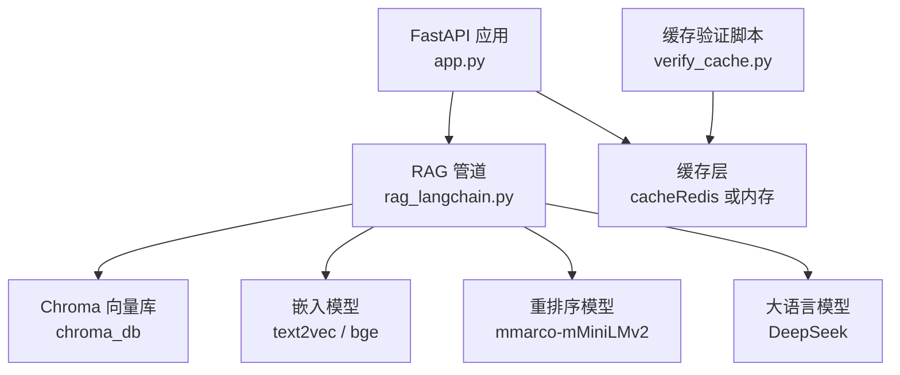
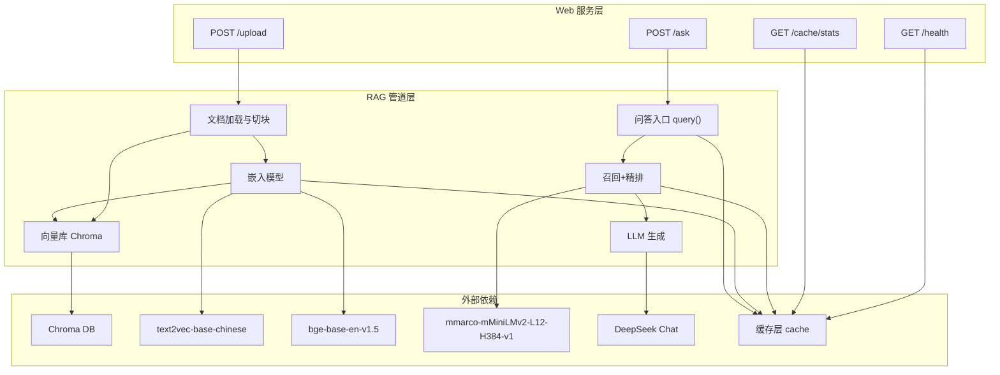
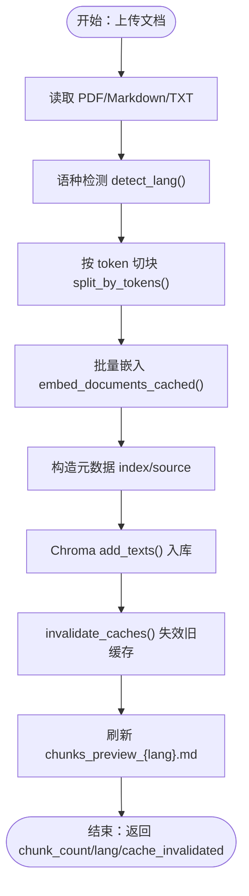
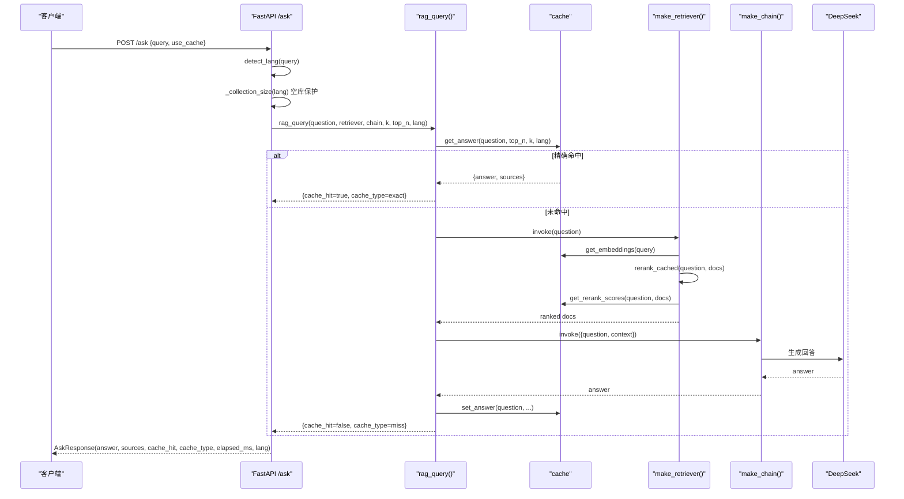
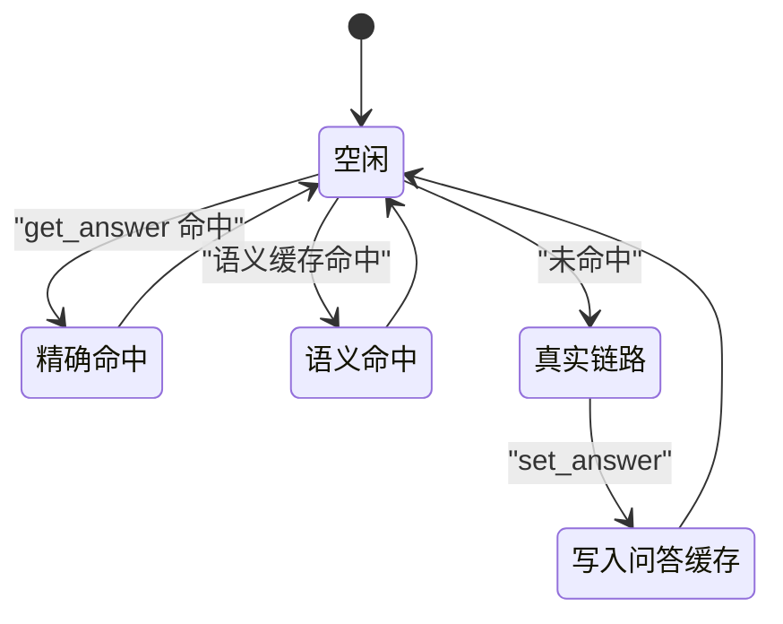
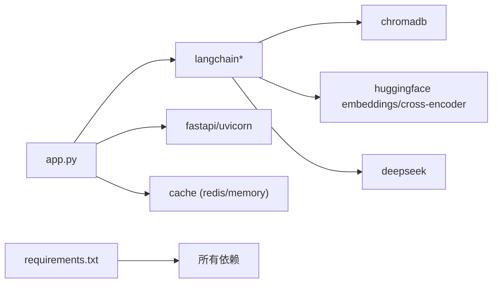

# 数据流设计

<cite>
**本文引用的文件**   
- [app.py](file://app.py)
- [rag_langchain.py](file://rag_langchain.py)
- [requirements.txt](file://requirements.txt)
- [verify_cache.py](file://verify_cache.py)
</cite>

## 目录
1. [引言](#引言)
2. [项目结构](#项目结构)
3. [核心组件](#核心组件)
4. [架构总览](#架构总览)
5. [详细组件分析](#详细组件分析)
6. [依赖关系分析](#依赖关系分析)
7. [性能与缓存特性](#性能与缓存特性)
8. [故障排查指南](#故障排查指南)
9. [结论](#结论)

## 引言
本文件面向 RAG 系统的数据流设计，重点描述两条核心数据流：
- 文档处理流程：原始文档 → 语种检测 → 文本分块 → 向量嵌入 → 向量库存储。
- 查询处理流程：用户问题 → 语种检测 → 缓存查询 → 向量检索 → 重排序 → LLM 生成 → 缓存写入。

文档同时说明各阶段的数据转换（文本编码、向量化、元数据处理）、缓存失效策略、数据一致性保证机制，并给出数据流图与状态转换图，帮助读者从“端到端”视角理解系统如何工作。

## 项目结构
仓库采用“Web 服务 + RAG 管道 + 缓存验证脚本”的轻量组织方式：
- `app.py`：FastAPI Web 服务，暴露上传、提问、缓存统计等接口，负责路由、参数校验、健康检查与前端页面返回。
- `rag_langchain.py`：RAG 核心管道，包含语种判断、嵌入模型、Chroma 向量库、召回与精排、LLM 生成、语义缓存、问答入口函数等。
- `requirements.txt`：声明 LangChain、ChromaDB、HuggingFace、DeepSeek、FastAPI、Redis 客户端等依赖。
- `verify_cache.py`：不加载模型的缓存层验证脚本，覆盖读写、TTL、问答/向量/精排缓存、版本号失效、清理与统计、后端降级等用例。

**图表来源**
- [app.py:155-260](file://app.py#L155-L260)
- [rag_langchain.py:118-143](file://rag_langchain.py#L118-L143)
- [rag_langchain.py:363-405](file://rag_langchain.py#L363-L405)
- [rag_langchain.py:428-467](file://rag_langchain.py#L428-L467)
- [rag_langchain.py:471-508](file://rag_langchain.py#L471-L508)
- [rag_langchain.py:580-644](file://rag_langchain.py#L580-L644)
- [verify_cache.py:61-197](file://verify_cache.py#L61-L197)

**章节来源**
- [app.py:1-53](file://app.py#L1-L53)
- [rag_langchain.py:1-24](file://rag_langchain.py#L1-L24)
- [requirements.txt:1-19](file://requirements.txt#L1-L19)
- [verify_cache.py:1-19](file://verify_cache.py#L1-L19)

## 核心组件
- 语种检测：按汉字占比快速判定中文或英文，决定后续使用哪个 embedding 模型与 Chroma collection。
- 文本分块：按 token 切块，避免中英文信息量差异导致的检索偏差；保留原文子串，便于评测比对。
- 向量嵌入：按语种懒加载 embedding 模型，支持批量与单条查询嵌入，带向量缓存。
- 向量库：每个语种一个 Chroma collection，持久化到本地路径，避免跨模型向量混用导致相似度噪声。
- 召回与重排序：先向量召回 top-k，再用 cross-encoder 精排到 top-n，精排分数可缓存。
- LLM 生成：LangChain LCEL 链将检索结果拼入 prompt，调用 DeepSeek 生成回答。
- 缓存层：三类缓存——问答缓存、向量缓存、精排分数缓存；可选语义缓存；支持 TTL、版本号失效、定向清理与统计。

**章节来源**
- [rag_langchain.py:118-143](file://rag_langchain.py#L118-L143)
- [rag_langchain.py:324-359](file://rag_langchain.py#L324-L359)
- [rag_langchain.py:147-254](file://rag_langchain.py#L147-L254)
- [rag_langchain.py:363-405](file://rag_langchain.py#L363-L405)
- [rag_langchain.py:428-467](file://rag_langchain.py#L428-L467)
- [rag_langchain.py:471-508](file://rag_langchain.py#L471-L508)
- [rag_langchain.py:511-576](file://rag_langchain.py#L511-L576)
- [rag_langchain.py:580-644](file://rag_langchain.py#L580-L644)

## 架构总览
RAG 系统由 Web 服务层、RAG 管道层、外部模型与向量库组成。缓存层贯穿上传与问答两个流程，提供加速与一致性保障。

**图表来源**
- [app.py:155-260](file://app.py#L155-L260)
- [rag_langchain.py:292-405](file://rag_langchain.py#L292-L405)
- [rag_langchain.py:428-508](file://rag_langchain.py#L428-L508)
- [rag_langchain.py:580-644](file://rag_langchain.py#L580-L644)

## 详细组件分析

### 文档处理流程
文档处理流程负责把原始文档变成可检索的向量片段，并写入对应语种的向量库。

**图表来源**
- [app.py:155-228](file://app.py#L155-L228)
- [rag_langchain.py:118-143](file://rag_langchain.py#L118-L143)
- [rag_langchain.py:324-359](file://rag_langchain.py#L324-L359)
- [rag_langchain.py:147-170](file://rag_langchain.py#L147-L170)
- [rag_langchain.py:363-405](file://rag_langchain.py#L363-L405)
- [rag_langchain.py:634-644](file://rag_langchain.py#L634-L644)

关键步骤说明：
- 文档读取：PDF 通过 PyMuPDFLoader 提取纯文本；Markdown/TXT 直接解码为字符串。
- 语种检测：基于汉字占比阈值判定中文或英文，决定后续模型与 collection。
- 文本分块：按 tokenizer 的 offset 对齐切出原文子串，避免 decode 失真；默认按 token 计数，留余量防止静默截断。
- 向量嵌入：批量走 `_embed_documents_cached()`，命中向量缓存则跳过模型前向；未命中则计算后写回缓存。
- 元数据处理：每个块附带 `index` 与 `source`，用于还原入库顺序与溯源。
- 入库：`store.add_texts()` 一次完成嵌入与持久化；若集合已有内容，先清空再重建，保持 index 从 0 起。
- 缓存失效：文档变更后调用 `invalidate_caches()`，清问答与精排缓存、清语义缓存、提升版本号，避免旧答案被复用。
- 预览更新：按 metadata['index'] 排序输出 chunks 预览文件，供评测与人工标注使用。

**章节来源**
- [app.py:155-228](file://app.py#L155-L228)
- [rag_langchain.py:292-359](file://rag_langchain.py#L292-L359)
- [rag_langchain.py:363-405](file://rag_langchain.py#L363-L405)
- [rag_langchain.py:634-644](file://rag_langchain.py#L634-L644)

### 查询处理流程
查询处理流程负责对用户问题进行缓存命中、向量检索、重排序与 LLM 生成，并将结果写回缓存。

**图表来源**
- [app.py:231-260](file://app.py#L231-L260)
- [rag_langchain.py:580-631](file://rag_langchain.py#L580-L631)
- [rag_langchain.py:452-467](file://rag_langchain.py#L452-L467)
- [rag_langchain.py:428-449](file://rag_langchain.py#L428-L449)
- [rag_langchain.py:173-182](file://rag_langchain.py#L173-L182)
- [rag_langchain.py:471-508](file://rag_langchain.py#L471-L508)

关键步骤说明：
- 请求入口：`/ask` 接收问题，strip 后判空；按问题语种选择 retriever 与 chain。
- 空库保护：目标语种 collection 为空时直接返回提示，不走检索，避免模型“凭印象作答”。
- 精确缓存：优先查 `cache.get_answer()`，命中则秒回，标记 `cache_type=exact`。
- 语义缓存（可选）：开启后对问题向量做近似匹配，超过阈值复用历史答案，标记 `cache_type=semantic(...)`。
- 真实链路：调用 retriever 召回 top-k，内部走向量缓存与精排缓存；然后传入 chain 生成回答。
- 结果回写：成功后调用 `cache.set_answer()` 写入问答缓存；若开启语义缓存，也记录问题向量与 payload。
- 响应字段：包含 answer、sources、cache_hit、cache_type、elapsed_ms、lang，便于前端展示与评测。

**章节来源**
- [app.py:231-260](file://app.py#L231-L260)
- [rag_langchain.py:580-631](file://rag_langchain.py#L580-L631)
- [rag_langchain.py:452-467](file://rag_langchain.py#L452-L467)
- [rag_langchain.py:428-449](file://rag_langchain.py#L428-L449)
- [rag_langchain.py:471-508](file://rag_langchain.py#L471-L508)

### 缓存与一致性
缓存层是 RAG 系统的“加速层”，不是“数据源”。其职责包括：
- 问答缓存：同一问题不重复走完整链路，节省 LLM 调用与等待时间。
- 向量缓存：同一段文本不重复做模型前向，减少 embedding 计算。
- 精排缓存：(问题, 片段) 的 cross-encoder 分数不重复计算，降低最慢环节开销。
- 语义缓存（可选）：近似语义问题命中，提高命中率但存在误命中风险，默认关闭。
- 失效策略：文档上传后调用 `invalidate_caches()`，清问答与精排缓存、清语义缓存、提升版本号；版本号提升使旧答案立即失效。
- 降级与健康：Redis 不可用时自动降级为内存缓存；提供 `backend_name()`、`healthy()`、`get_stats()` 等监控能力。

**图表来源**
- [rag_langchain.py:580-631](file://rag_langchain.py#L580-L631)
- [rag_langchain.py:634-644](file://rag_langchain.py#L634-L644)
- [verify_cache.py:85-164](file://verify_cache.py#L85-L164)

**章节来源**
- [rag_langchain.py:511-576](file://rag_langchain.py#L511-L576)
- [rag_langchain.py:580-644](file://rag_langchain.py#L580-L644)
- [verify_cache.py:61-197](file://verify_cache.py#L61-L197)

## 依赖关系分析
- FastAPI 与 uvicorn：提供 Web 服务与 HTTP 接口。
- LangChain 生态：Chroma、HuggingFaceEmbeddings、ChatDeepSeek、PromptTemplate、StrOutputParser、CrossEncoder。
- ChromaDB：本地持久化向量数据库，按语种分 collection。
- Redis 客户端：可选缓存后端；不可用时自动降级为内存缓存。
- Python-dotenv：加载环境变量，控制模型路径、检索参数、缓存开关等。

**图表来源**
- [requirements.txt:1-19](file://requirements.txt#L1-L19)
- [app.py:36-51](file://app.py#L36-L51)
- [rag_langchain.py:39-48](file://rag_langchain.py#L39-L48)

**章节来源**
- [requirements.txt:1-19](file://requirements.txt#L1-L19)
- [app.py:36-51](file://app.py#L36-L51)
- [rag_langchain.py:39-48](file://rag_langchain.py#L39-L48)

## 性能与缓存特性
- 模型懒加载：embedding 模型、cross-encoder、tokenizer 均按需加载，避免启动时占用过多内存。
- 双检锁：并发首次请求时通过双检锁避免重复加载模型与连接。
- 向量缓存：批量与单条嵌入均走缓存，重复上传或重复提问收益明显。
- 精排缓存：cross-encoder 打分最慢，缓存 (问题, 片段) 分数显著降低延迟。
- 问答缓存：命中后秒回，避免 LLM 调用与长等待。
- 语义缓存（可选）：近似语义命中，默认关闭以避免答非所问；可通过环境变量开启并调整阈值。
- 空库保护：目标语种库为空时直接返回提示，避免无依据回答。
- 健康与统计：提供 `/cache/stats` 与 `/health` 接口，查看后端类型、命中率、版本与各语种库块数。

[本节为通用性能讨论，不直接分析具体代码行]

## 故障排查指南
- 上传失败：检查文件类型是否受支持（PDF/Markdown/TXT），文件是否为空，解析是否成功。
- 分块后无内容：可能因文本全为空白或 tokenizer 无法切出有效块；检查输入文本与语种判定。
- 向量库为空：确认已上传对应语种文档；若仍为空，检查 collection 是否存在与 count 是否正常。
- 缓存异常：遵循 fail-open 原则，读不到缓存就当未命中，照常走真实链路；通过 `/cache/stats` 查看后端健康与命中率。
- 缓存不一致：文档上传后会失效旧缓存并提升版本号；若仍出现旧答案，检查是否调用了 `invalidate_caches()` 或手动清理缓存。
- 模型加载缓慢：确认环境变量与模型路径正确；首次并发请求会触发懒加载，注意进程内模型单例。
- Redis 不可用：自动降级为内存缓存；如需验证 Redis 路径，可使用 `verify_cache.py` 指定 `RESP_CLIENT_MODULE`。

**章节来源**
- [app.py:155-228](file://app.py#L155-L228)
- [app.py:231-260](file://app.py#L231-L260)
- [app.py:263-290](file://app.py#L263-L290)
- [rag_langchain.py:634-644](file://rag_langchain.py#L634-L644)
- [verify_cache.py:61-197](file://verify_cache.py#L61-L197)

## 结论
该 RAG 系统以“双库 + 三层缓存”为核心设计，确保中英双语场景下的检索质量与一致性。文档处理流程通过语种检测、token 级分块、向量嵌入与持久化入库，构建可检索的知识库；查询处理流程通过精确与语义缓存、向量检索、精排与 LLM 生成，提供低延迟、高可用的问答体验。缓存失效策略与版本号机制保证了文档更新后的数据一致性，而健康检查与统计接口便于运维监控与故障定位。整体架构简洁清晰，适合在资源受限环境下部署与扩展。