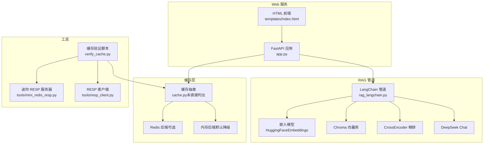
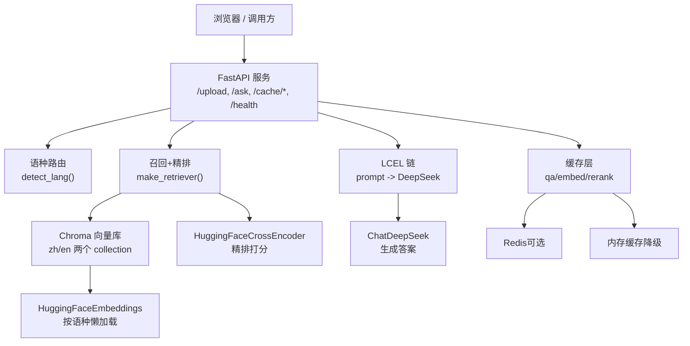
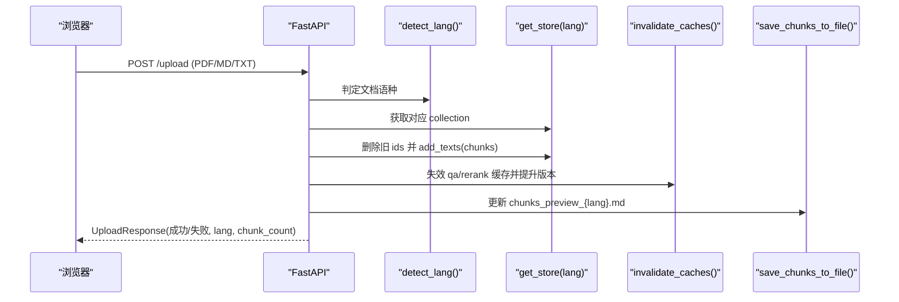
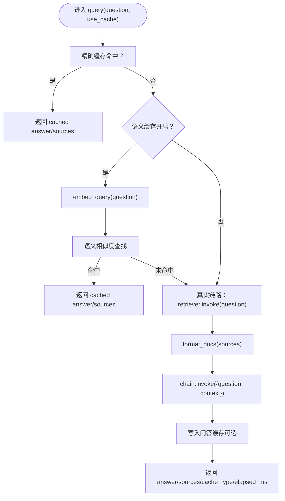
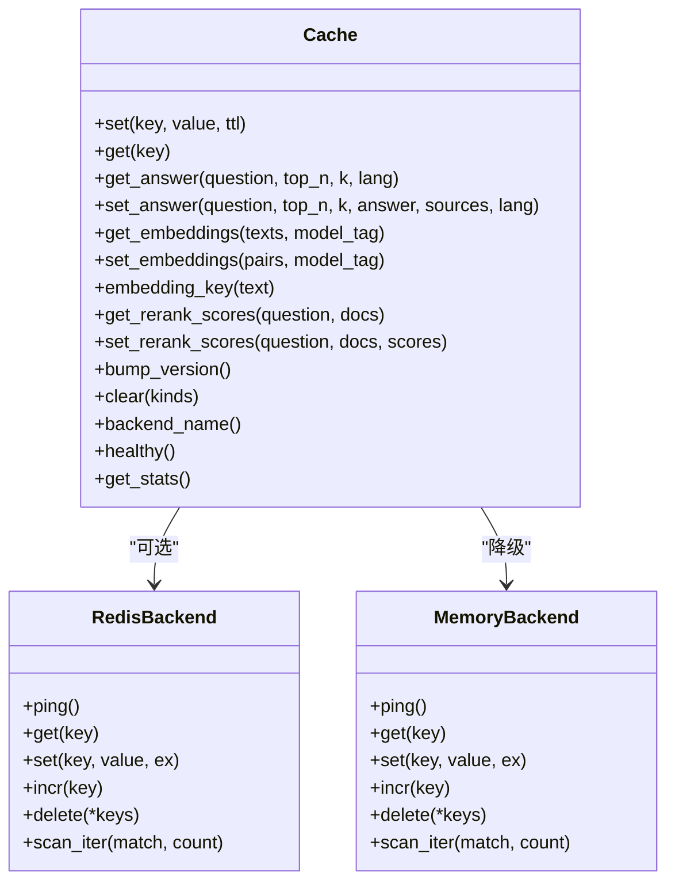

# 架构设计

<cite>
**本文引用的文件**   
- [app.py](file://app.py)
- [rag_langchain.py](file://rag_langchain.py)
- [requirements.txt](file://requirements.txt)
- [templates/index.html](file://templates/index.html)
- [tools/mini_redis_resp.py](file://tools/mini_redis_resp.py)
- [tools/resp_client.py](file://tools/resp_client.py)
- [verify_cache.py](file://verify_cache.py)
</cite>

## 目录
1. [引言](#引言)
2. [项目结构](#项目结构)
3. [核心组件](#核心组件)
4. [架构总览](#架构总览)
5. [详细组件分析](#详细组件分析)
6. [依赖与集成分析](#依赖与集成分析)
7. [性能与可扩展性](#性能与可扩展性)
8. [安全、监控与灾难恢复](#安全监控与灾难恢复)
9. [部署拓扑与环境要求](#部署拓扑与环境要求)
10. [故障排查指南](#故障排查指南)
11. [结论](#结论)

## 引言
本仓库实现了一个基于 LangChain 的检索增强生成系统，支持中英文双语知识库、三层缓存（问答、向量、精排分数）、可选语义近似匹配、以及面向用户的 Web 前端。系统以 FastAPI 作为 HTTP 入口，通过 Chroma 持久化向量库，使用 HuggingFaceEmbeddings 做向量化，用 cross-encoder 做精排，最终调用 DeepSeek 模型生成回答。缓存层可运行在 Redis 或进程内内存中，并在 Redis 不可用时自动降级。

该文档从高层设计、架构模式、组件交互、数据流、技术决策、约束条件、基础设施需求、可扩展性、部署拓扑、横切关注点、技术栈与兼容性等角度进行系统化说明，并给出架构图、类图、时序图和流程图，帮助不同背景的读者理解系统。

## 项目结构
仓库采用“服务 + 管道 + 工具”的分层组织方式：
- 服务层：FastAPI 应用提供上传、提问、缓存管理、健康检查等接口，并承载静态前端页面。
- 管道层：LangChain 驱动的 RAG 流程，包括语种判断、嵌入、分块、向量库、召回、精排、提示词与 LLM 生成。
- 工具层：用于验证缓存层的 RESP 协议迷你服务器和轻量客户端；以及独立运行的缓存测试脚本。
- 模板层：浏览器端 UI，展示上传、提问、缓存统计与清空操作。
- 配置与依赖：requirements.txt 声明 Python 依赖；环境变量通过 dotenv 加载。

**图表来源**
- [app.py:36-53](file://app.py#L36-L53)
- [rag_langchain.py:39-48](file://rag_langchain.py#L39-L48)
- [templates/index.html:68-99](file://templates/index.html#L68-L99)
- [tools/mini_redis_resp.py:1-18](file://tools/mini_redis_resp.py#L1-L18)
- [tools/resp_client.py:1-13](file://tools/resp_client.py#L1-L13)
- [verify_cache.py:1-19](file://verify_cache.py#L1-L19)

**章节来源**
- [app.py:1-53](file://app.py#L1-L53)
- [rag_langchain.py:1-48](file://rag_langchain.py#L1-L48)
- [templates/index.html:1-99](file://templates/index.html#L1-L99)
- [tools/mini_redis_resp.py:1-18](file://tools/mini_redis_resp.py#L1-L18)
- [tools/resp_client.py:1-13](file://tools/resp_client.py#L1-L13)
- [verify_cache.py:1-19](file://verify_cache.py#L1-L19)

## 核心组件
- FastAPI 服务：定义上传、提问、缓存统计与清理、健康检查、前端页面路由。
- RAG 管道：按语种选择 embedding 模型与 collection，执行分块、召回、精排、LLM 生成，并提供带缓存的问答入口。
- 缓存层：统一抽象问答、向量、精排分数三类缓存，支持 Redis 与内存后端，具备 TTL、版本号失效、统计与健康检查。
- 向量库：Chroma 持久化存储，中英各一个 collection，共享底层 PersistentClient。
- 嵌入与精排：HuggingFaceEmbeddings 与 HuggingFaceCrossEncoder，分别负责向量化与片段重排打分。
- LLM：ChatDeepSeek 作为生成器。
- 前端：提供上传、提问、缓存状态可视化与手动控制。
- 工具：迷你 Redis 服务器与 RESP 客户端用于验证缓存路径；独立缓存验证脚本覆盖读写、TTL、失效、清理、统计、降级等场景。

**章节来源**
- [app.py:53-303](file://app.py#L53-L303)
- [rag_langchain.py:118-779](file://rag_langchain.py#L118-L779)
- [templates/index.html:68-237](file://templates/index.html#L68-L237)
- [tools/mini_redis_resp.py:1-222](file://tools/mini_redis_resp.py#L1-L222)
- [tools/resp_client.py:1-132](file://tools/resp_client.py#L1-L132)
- [verify_cache.py:1-202](file://verify_cache.py#L1-L202)

## 架构总览
系统采用分层与管道化架构：
- 接入层：FastAPI 暴露 REST 接口，同时托管静态 HTML。
- 业务层：按问题语种路由到对应 retriever 与 chain，先查缓存再走真实链路。
- 数据层：Chroma 向量库持久化文本块；缓存层加速问答、向量与精排计算。
- 外部依赖：DeepSeek API、HuggingFace 本地模型、可选 Redis。

**图表来源**
- [app.py:155-260](file://app.py#L155-L260)
- [rag_langchain.py:118-143](file://rag_langchain.py#L118-L143)
- [rag_langchain.py:452-467](file://rag_langchain.py#L452-L467)
- [rag_langchain.py:471-508](file://rag_langchain.py#L471-L508)
- [rag_langchain.py:580-631](file://rag_langchain.py#L580-L631)
- [rag_langchain.py:363-372](file://rag_langchain.py#L363-L372)
- [rag_langchain.py:185-254](file://rag_langchain.py#L185-L254)
- [rag_langchain.py:420-449](file://rag_langchain.py#L420-L449)

## 详细组件分析

### FastAPI 服务层
职责：
- 提供上传接口：解析 PDF/Markdown/TXT，按文档语种分块、入库、失效缓存、更新预览文件。
- 提供提问接口：按问题语种路由，空库保护，调用 rag_query 返回答案、来源、缓存命中信息与时延。
- 提供缓存管理与健康检查：查看后端类型、命中率、版本、集合大小；支持按类型清理。
- 托管前端页面：返回 templates/index.html。

关键设计要点：
- 全局对象懒加载：store/retriever/chain 按语种单例构造，避免重复加载模型与连接。
- 并发安全：双检锁保证首次并发请求只构造一次。
- 空库保护：目标 collection 为空时直接返回提示，避免模型“凭印象作答”。
- 上传替换策略：删除旧 ids 后重新 add_texts，保持 collection 维度不变，避免句柄失效。

**图表来源**
- [app.py:155-228](file://app.py#L155-L228)
- [rag_langchain.py:634-644](file://rag_langchain.py#L634-L644)
- [rag_langchain.py:692-705](file://rag_langchain.py#L692-L705)

**章节来源**
- [app.py:53-303](file://app.py#L53-L303)

### RAG 管道层
职责：
- 语种判断：基于汉字占比阈值区分中文与英文。
- 嵌入模型：按语种懒加载 HuggingFaceEmbeddings，支持查询前缀与最大序列长度设置，封装向量缓存。
- 分块：按 token 切块，使用对应语种的 tokenizer，offset 对齐保留原文子串。
- 向量库：每个语种一个 Chroma collection，共享 PersistentClient。
- 召回与精排：as_retriever(k=20)，cross-encoder 打分 top_n=5，分数缓存。
- 生成：PromptTemplate + StrOutputParser + ChatDeepSeek，LCEL 链支持传入 context 跳过重复召回。
- 语义缓存：可选，按语种维护历史问题向量与 LRU 淘汰。
- 问答入口：query() 先精确命中，再语义命中，最后真实链路并回写缓存。

**图表来源**
- [rag_langchain.py:118-143](file://rag_langchain.py#L118-L143)
- [rag_langchain.py:185-254](file://rag_langchain.py#L185-L254)
- [rag_langchain.py:324-359](file://rag_langchain.py#L324-L359)
- [rag_langchain.py:452-467](file://rag_langchain.py#L452-L467)
- [rag_langchain.py:471-508](file://rag_langchain.py#L471-L508)
- [rag_langchain.py:514-576](file://rag_langchain.py#L514-L576)
- [rag_langchain.py:580-631](file://rag_langchain.py#L580-L631)

**章节来源**
- [rag_langchain.py:118-779](file://rag_langchain.py#L118-L779)

### 缓存层
职责：
- 统一抽象三种缓存：问答、向量、精排分数。
- 支持 Redis 与内存后端，自动降级。
- 提供 TTL、版本号失效、统计与健康检查。
- 提供键生成方法，确保不同缓存类型与模型参数隔离。

关键行为：
- 问答缓存 key 包含 question、top_n、k、lang，避免参数漂移导致误命中。
- 向量缓存 key 为文本哈希，model_tag 区分语种与模型配置。
- 精排缓存 key 为 (question, doc_index) 映射分数。
- 版本号提升使旧答案失效，配合上传流程保证一致性。

**图表来源**
- [verify_cache.py:73-184](file://verify_cache.py#L73-L184)
- [tools/resp_client.py:19-132](file://tools/resp_client.py#L19-L132)

**章节来源**
- [verify_cache.py:1-202](file://verify_cache.py#L1-L202)
- [tools/resp_client.py:1-132](file://tools/resp_client.py#L1-L132)

### 前端界面
职责：
- 上传文件并显示状态。
- 提交问题，支持勾选“跳过缓存”对比真实耗时。
- 展示答案、引用来源、缓存命中徽标与耗时。
- 刷新缓存统计、清空缓存。

交互要点：
- 上传成功后自动刷新统计。
- 提问后根据 cache_hit 与 elapsed_ms 显示徽章。
- 统计面板展示后端类型、健康状态、版本、集合块数、命中率与 TTL。

**章节来源**
- [templates/index.html:68-237](file://templates/index.html#L68-L237)

### 工具与验证
- mini_redis_resp.py：实现 RESP 协议的迷你服务器，仅支持测试所需命令，便于在不安装 redis-py 的情况下验证缓存后端代码路径。
- resp_client.py：纯标准库实现的 RESP 客户端，模拟 redis-py 接口，供 verify_cache.py 在无 redis 包环境下验证 _RedisBackend。
- verify_cache.py：独立运行，不加载模型，覆盖基础读写、TTL、问答缓存、向量缓存、精排缓存、版本号失效、清理与统计、健康与降级等用例。

**章节来源**
- [tools/mini_redis_resp.py:1-222](file://tools/mini_redis_resp.py#L1-L222)
- [tools/resp_client.py:1-132](file://tools/resp_client.py#L1-L132)
- [verify_cache.py:1-202](file://verify_cache.py#L1-L202)

## 依赖与集成分析
技术栈与第三方依赖：
- FastAPI、Uvicorn：HTTP 服务与 ASGI 服务器。
- LangChain 生态：langchain、langchain-community、langchain-chroma、langchain-huggingface、langchain-deepseek、langchain-core。
- 模型与嵌入：sentence-transformers、chromadb、pymupdf。
- 配置：python-dotenv。
- 缓存：redis（可选），否则自动降级为内存缓存。

版本与兼容性：
- langchain>=1.0，langchain-chroma>=1.0。
- chromadb 使用 PersistentClient 共享底层系统，避免多实例冲突。
- langchain-community 被标记 sunset，但当前功能不受影响，代码屏蔽相关警告。
- HuggingFaceEmbeddings 改为子类覆写 embed_documents/embed_query，兼容 pydantic BaseModel 限制。
- Chroma 新旧版本兼容：优先使用 client= 参数，否则回退到 path/persist_directory。

集成点：
- FastAPI 与 LangChain：通过 get_store/get_retriever/get_chain 复用对象，减少重复初始化。
- Chroma 与 Embedding：collection 与 embedding_function 绑定，按语种分离。
- CrossEncoder 与 Rerank：score 结果缓存，避免重复跨编码器计算。
- DeepSeek：通过 ChatDeepSeek 调用，temperature 可调。
- Redis/Memory：缓存后端可切换，verify_cache.py 覆盖两种路径。

**章节来源**
- [requirements.txt:1-19](file://requirements.txt#L1-L19)
- [rag_langchain.py:39-48](file://rag_langchain.py#L39-L48)
- [rag_langchain.py:185-254](file://rag_langchain.py#L185-L254)
- [rag_langchain.py:261-289](file://rag_langchain.py#L261-L289)
- [rag_langchain.py:420-449](file://rag_langchain.py#L420-L449)
- [rag_langchain.py:471-508](file://rag_langchain.py#L471-L508)

## 性能与可扩展性
性能优化：
- 三层缓存：问答、向量、精排分数分别缓存，显著降低重复计算与 LLM 调用次数。
- 懒加载：embedding 模型、cross-encoder、tokenizer、Chroma client 均按需加载，避免启动开销。
- 并发安全：双检锁防止重复加载模型与连接。
- 空库保护：避免无依据生成答案，减少无效 LLM 调用。
- 分块策略：按 token 切块，避免静默截断，提高召回质量。

可扩展性考虑：
- 语种扩展：新增语种需添加 LANG_MODELS、LANG_COLLECTIONS、LANG_MAX_SEQ、LANG_QUERY_PREFIX，并确保 collection 命名符合 Chroma 约束。
- 缓存后端：可在 Redis 与内存之间切换，未来可扩展更多后端（如 Memcached）。
- 模型替换：embedding 与 reranker 可通过环境变量或配置替换，注意 cache_tag 与 max_seq_length 同步更新。
- 水平扩展：FastAPI 可多进程部署，Chroma 与 Redis 作为共享后端；注意 Chroma 客户端共享与句柄管理。

权衡与约束：
- 中英分库：不同 embedding 模型的向量空间不同，混入同一 collection 会导致相似度噪声与静默错误。
- 显式 max_seq_length：避免 sentence-transformers 静默截断，代价是必须维护模型上限。
- 语义缓存默认关闭：近似匹配存在误命中风险，宁可慢也不答错。
- Chroma 客户端共享：不能对共享 client 调 close()，否则会影响其他持有者。

**章节来源**
- [rag_langchain.py:55-81](file://rag_langchain.py#L55-L81)
- [rag_langchain.py:103-116](file://rag_langchain.py#L103-L116)
- [rag_langchain.py:228-254](file://rag_langchain.py#L228-L254)
- [rag_langchain.py:261-289](file://rag_langchain.py#L261-L289)
- [rag_langchain.py:514-576](file://rag_langchain.py#L514-L576)

## 安全、监控与灾难恢复
安全性：
- 输入校验：上传文件类型限制为 PDF/Markdown/TXT；空内容拒绝处理。
- 输出转义：前端对答案进行 HTML 转义，防止 XSS。
- 环境变量敏感信息：通过 python-dotenv 加载，避免硬编码密钥。
- 外部依赖最小化：语义缓存默认关闭，避免近似匹配带来的安全风险。

监控：
- /health 接口返回服务状态、缓存后端与健康情况、集合块数。
- /cache/stats 返回后端类型、健康状态、版本号、TTL、命中率统计。
- 前端统计面板直观展示缓存命中与未命中比率，便于运维观察。

灾难恢复：
- 缓存异常 fail-open：读不到缓存视为未命中，继续真实链路，保证可用性。
- 版本号失效：文档变更后提升版本，旧答案立即失效，避免脏数据。
- 降级机制：Redis 不可用时自动降级为内存缓存，服务仍可运行。
- 向量库重建：build_index 支持 force 模式，删除旧 ids 而非 drop collection，避免句柄失效。

**章节来源**
- [app.py:155-228](file://app.py#L155-L228)
- [app.py:263-290](file://app.py#L263-L290)
- [templates/index.html:183-187](file://templates/index.html#L183-L187)
- [rag_langchain.py:634-644](file://rag_langchain.py#L634-L644)
- [rag_langchain.py:375-405](file://rag_langchain.py#L375-L405)

## 部署拓扑与环境要求
部署拓扑建议：
- 单节点开发：FastAPI + Uvicorn 本地运行，Chroma 本地持久化，Redis 可选。
- 生产环境：
  - Web 层：多个 FastAPI 进程（Gunicorn/Uvicorn worker），负载均衡。
  - 数据层：Chroma 持久化目录挂载到共享存储或本地磁盘；Redis 作为缓存后端。
  - 模型层：GPU/CPU 资源充足以加载 embedding 与 reranker；DeepSeek API 网络可达。
  - 前端：静态文件由 Nginx/Apache 托管或直接由 FastAPI 托管。

环境要求：
- Python 环境与 requirements.txt 依赖。
- 环境变量：DEEPSEEK_API_KEY（通过 ChatDeepSeek）、BGE_QUERY_PREFIX（可选）、CHUNK_TOKENS、CHUNK_OVERLAP_TOKENS、SEMANTIC_CACHE、SEMANTIC_THRESHOLD、CACHE_BACKEND、REDIS_URL。
- 磁盘空间：Chroma 数据库目录、模型权重目录（text2vec-base-chinese、bge-base-en-v1.5、mmarco-mMiniLMv2-L12-H384-v1）。
- 网络：DeepSeek API 可达；Redis 可选。

**章节来源**
- [requirements.txt:1-19](file://requirements.txt#L1-L19)
- [rag_langchain.py:50-116](file://rag_langchain.py#L50-L116)
- [rag_langchain.py:91-97](file://rag_langchain.py#L91-L97)
- [app.py:300-303](file://app.py#L300-L303)

## 故障排查指南
常见问题与定位：
- 上传失败：检查文件类型、内容是否为空、临时文件是否成功创建与删除。
- 空库提示：确认已上传对应语种文档；若仍为空，检查 collection 是否存在与 count 是否正常。
- 缓存未生效：检查 CACHE_BACKEND 与 REDIS_URL；使用 verify_cache.py 验证缓存路径；查看 /cache/stats 命中率。
- 模型加载慢：确认懒加载逻辑；检查是否并发首次请求导致重复加载；查看线程锁使用情况。
- 向量截断：检查 LANG_MAX_SEQ 与 CHUNK_TOKENS；确保分块不超过模型上限。
- Chroma 客户端冲突：确保共享 _get_chroma_client()，不要对共享 client 调 close()。
- 前端显示异常：检查答案 HTML 转义；确认 /cache/stats 返回字段完整。

调试工具：
- verify_cache.py：快速验证缓存层逻辑，无需加载模型。
- tools/mini_redis_resp.py 与 tools/resp_client.py：在无 redis-py 环境下验证 Redis 代码路径。
- /health 与 /cache/stats：在线查看服务与缓存状态。

**章节来源**
- [app.py:155-228](file://app.py#L155-L228)
- [app.py:263-290](file://app.py#L263-L290)
- [rag_langchain.py:261-289](file://rag_langchain.py#L261-L289)
- [rag_langchain.py:324-359](file://rag_langchain.py#L324-L359)
- [verify_cache.py:1-202](file://verify_cache.py#L1-L202)
- [tools/mini_redis_resp.py:1-222](file://tools/mini_redis_resp.py#L1-L222)
- [tools/resp_client.py:1-132](file://tools/resp_client.py#L1-L132)

## 结论
本 RAG 系统通过 FastAPI 服务层、LangChain 管道层、Chroma 向量库与多层缓存实现了高效、稳定、可扩展的中英双语检索增强生成能力。系统设计强调：
- 语种隔离以避免向量空间污染。
- 三层缓存提升性能与稳定性。
- 懒加载与并发安全优化资源占用。
- 空库保护与 fail-open 策略保障用户体验。
- 可观测性与可运维性通过健康检查与统计接口体现。
- 工具链支持离线验证与降级路径测试。

在生产环境中，建议结合负载均衡、共享存储、Redis 缓存与 GPU/CPU 资源规划，持续监控命中率与延迟，并根据业务需求调整分块策略、召回条数与精排阈值。