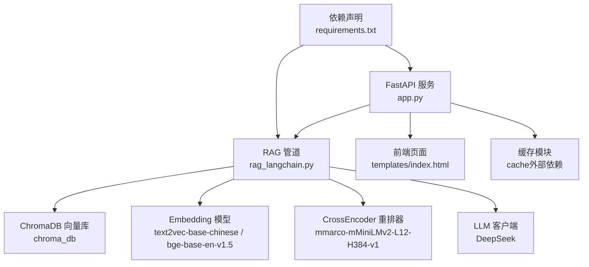
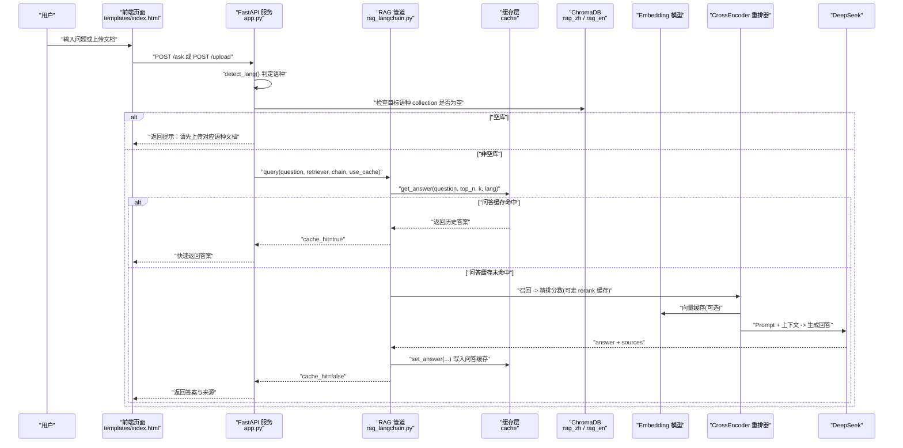
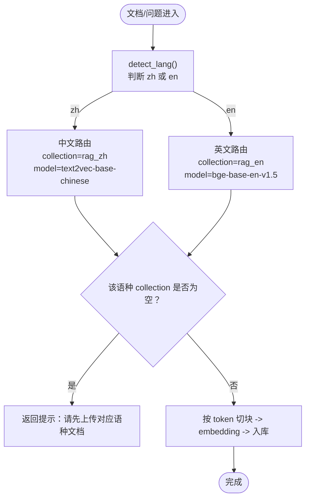
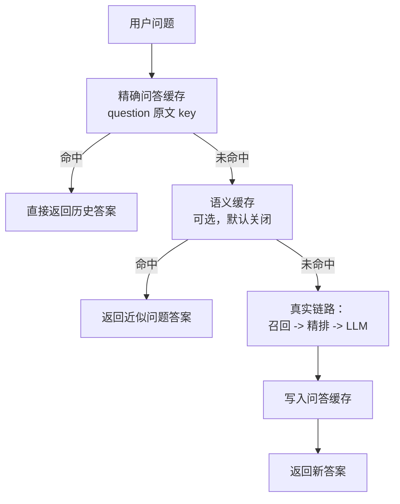
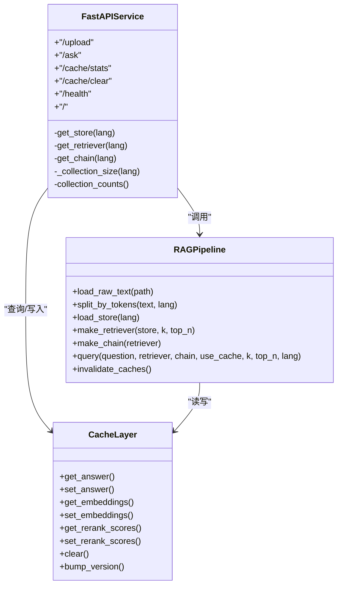
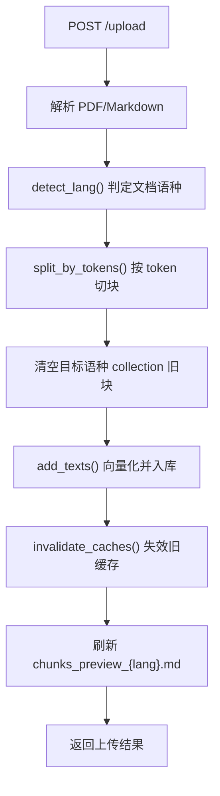
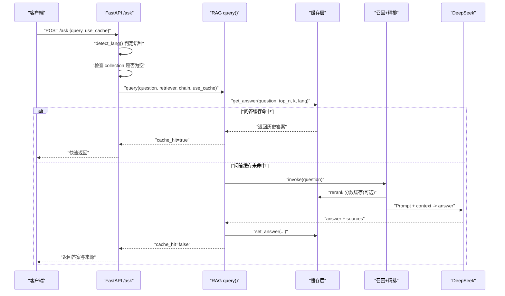
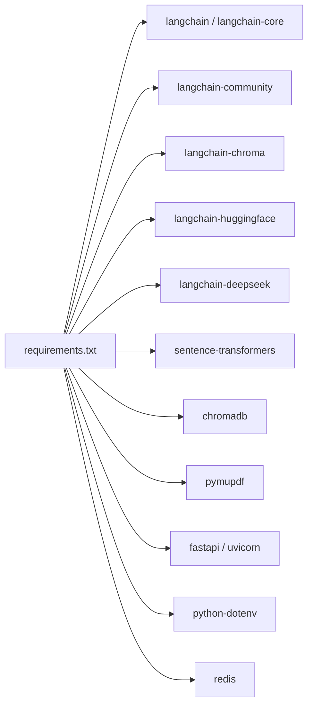

# 系统概览

<cite>
**本文引用的文件**   
- [app.py](file://app.py)
- [rag_langchain.py](file://rag_langchain.py)
- [requirements.txt](file://requirements.txt)
- [index.html](file://templates/index.html)
</cite>

## 目录
1. [引言](#引言)
2. [项目结构](#项目结构)
3. [核心组件](#核心组件)
4. [架构总览](#架构总览)
5. [详细组件分析](#详细组件分析)
6. [依赖关系分析](#依赖关系分析)
7. [性能与缓存特性](#性能与缓存特性)
8. [故障排查指南](#故障排查指南)
9. [结论](#结论)

## 引言
本 RAG 系统是一个面向中英文双语文档的检索增强生成服务。它提供 Web 接口，支持上传 PDF/Markdown 文档、按语种自动路由到对应向量库、通过三层缓存加速问答，并最终调用大模型生成带来源的回答。系统同时暴露健康检查、缓存统计和手动清理等运维接口，并附带一个轻量前端页面用于演示交互。

整体设计围绕三个关键目标：
- 中英双库隔离：避免不同 embedding 模型的向量空间混用导致检索噪声。
- 三层缓存优先：问答缓存、向量缓存、精排分数缓存分别覆盖 LLM 调用、嵌入计算和交叉编码器打分。
- FastAPI 服务层稳定可靠：缓存异常 fail-open，空库保护，懒加载单例，保证“缓存只加速、不改变答案”。

## 项目结构
仓库采用“Web 服务 + RAG 管道 + 依赖声明 + 前端模板”的扁平组织方式：

**图表来源**
- [app.py:1-53](file://app.py#L1-L53)
- [rag_langchain.py:39-47](file://rag_langchain.py#L39-L47)
- [requirements.txt:1-18](file://requirements.txt#L1-L18)

**章节来源**
- [app.py:1-53](file://app.py#L1-L53)
- [rag_langchain.py:1-50](file://rag_langchain.py#L1-L50)
- [requirements.txt:1-18](file://requirements.txt#L1-L18)

## 核心组件
- **FastAPI Web 服务层**：定义 `/upload`、`/ask`、`/cache/stats`、`/cache/clear`、`/health`、`/` 等接口，负责请求解析、语种判定、空库保护、懒加载 store/retriever/chain，以及把 RAG 结果包装成统一响应。
- **RAG 管道层**：封装文档加载、按 token 切块、embedding、ChromaDB 入库、召回、cross-encoder 精排、Prompt 拼接、LLM 生成，以及语义缓存开关。
- **双层知识库**：中文 collection `rag_zh` 使用中文 embedding 模型，英文 collection `rag_en` 使用英文 embedding 模型；两者共享同一个 Chroma PersistentClient，但数据完全隔离。
- **三层缓存**：问答缓存、向量缓存、精排分数缓存，配合版本号机制，在文档更新后失效旧答案，避免“文档变了、答案还是旧的”。
- **前端页面**：展示上传状态、问题输入、回答与引用来源、缓存命中率与 TTL 信息，并提供“跳过缓存”选项用于对比真实链路耗时。

**章节来源**
- [app.py:11-25](file://app.py#L11-L25)
- [app.py:129-149](file://app.py#L129-L149)
- [rag_langchain.py:52-115](file://rag_langchain.py#L52-L115)
- [rag_langchain.py:579-644](file://rag_langchain.py#L579-L644)
- [index.html:68-99](file://templates/index.html#L68-L99)

## 架构总览
下图展示从用户提问到最终回答的系统上下文与主要组件交互：

**图表来源**
- [app.py:155-260](file://app.py#L155-L260)
- [rag_langchain.py:452-508](file://rag_langchain.py#L452-L508)
- [rag_langchain.py:579-631](file://rag_langchain.py#L579-L631)

## 详细组件分析

### 双层知识库设计（中英文分离）
系统为中文和英文各维护一个 Chroma collection，并绑定各自独立的 embedding 模型。这样做的核心原因是：不同 embedding 模型产生的向量属于不同的向量空间，即使维度相同，跨模型计算相似度也会退化为噪声，导致检索静默出错。因此，代码中明确禁止混用两个模型的向量，并通过 `LANG_MODELS`、`LANG_COLLECTIONS`、`LANG_MAX_SEQ` 等常量约束入库与检索必须使用同一模型。

**图表来源**
- [rag_langchain.py:52-81](file://rag_langchain.py#L52-L81)
- [rag_langchain.py:118-143](file://rag_langchain.py#L118-L143)
- [rag_langchain.py:363-372](file://rag_langchain.py#L363-L372)
- [app.py:181-202](file://app.py#L181-L202)

**章节来源**
- [rag_langchain.py:52-81](file://rag_langchain.py#L52-L81)
- [rag_langchain.py:118-143](file://rag_langchain.py#L118-L143)
- [app.py:181-202](file://app.py#L181-L202)

### 三层缓存架构
系统实现三类缓存，分别解决不同瓶颈：
- **问答缓存**：以问题原文为主键，命中时直接返回历史答案，避免重复调用 LLM。
- **向量缓存**：对文本做 embedding 的结果进行缓存，避免重复前向计算。
- **精排分数缓存**：对 `(问题, 片段)` 的 cross-encoder 打分结果缓存，避免重复昂贵打分。

此外，系统还提供一个可选的**语义缓存**：基于问题向量余弦相似度近似匹配，默认关闭，因为误命中比慢一点更危险。

**图表来源**
- [rag_langchain.py:428-449](file://rag_langchain.py#L428-L449)
- [rag_langchain.py:514-576](file://rag_langchain.py#L514-L576)
- [rag_langchain.py:579-631](file://rag_langchain.py#L579-L631)

**章节来源**
- [rag_langchain.py:428-449](file://rag_langchain.py#L428-L449)
- [rag_langchain.py:514-576](file://rag_langchain.py#L514-L576)
- [rag_langchain.py:579-631](file://rag_langchain.py#L579-L631)

### FastAPI Web 服务层职责
FastAPI 层承担以下职责：
- 接收 `/upload` 请求，解析 PDF/Markdown，按文档语种切块并替换对应 collection。
- 接收 `/ask` 请求，按问题语种路由，先查空库保护，再调用 RAG 管道。
- 暴露 `/cache/stats`、`/cache/clear`、`/health` 等运维接口。
- 懒加载 store、retriever、chain，并使用双检锁避免并发下重复构造。
- 将 RAG 返回结果包装为统一响应，包含 `cache_hit`、`cache_type`、`elapsed_ms`、`lang` 等字段。

**图表来源**
- [app.py:70-92](file://app.py#L70-L92)
- [app.py:155-260](file://app.py#L155-L260)
- [rag_langchain.py:293-307](file://rag_langchain.py#L293-L307)
- [rag_langchain.py:324-359](file://rag_langchain.py#L324-L359)
- [rag_langchain.py:363-372](file://rag_langchain.py#L363-L372)
- [rag_langchain.py:452-508](file://rag_langchain.py#L452-L508)
- [rag_langchain.py:579-644](file://rag_langchain.py#L579-L644)

**章节来源**
- [app.py:70-92](file://app.py#L70-L92)
- [app.py:155-260](file://app.py#L155-L260)
- [rag_langchain.py:293-307](file://rag_langchain.py#L293-L307)
- [rag_langchain.py:324-359](file://rag_langchain.py#L324-L359)
- [rag_langchain.py:363-372](file://rag_langchain.py#L363-L372)
- [rag_langchain.py:452-508](file://rag_langchain.py#L452-L508)
- [rag_langchain.py:579-644](file://rag_langchain.py#L579-L644)

### 数据流向：从文档上传到向量入库
上传流程的关键步骤如下：
1. 接收文件，根据扩展名选择 PDF 解析或直接读取文本。
2. 使用 `detect_lang()` 判定文档语种。
3. 按该语种的 tokenizer 进行按 token 切块。
4. 清空目标语种 collection 中的旧块，再以 index 0 起重新编号入库。
5. 调用 `invalidate_caches()` 使问答与精排缓存失效，并提升缓存版本。
6. 尝试刷新对应语种的 `chunks_preview_{lang}.md`，失败不影响上传主流程。

**图表来源**
- [app.py:155-228](file://app.py#L155-L228)
- [rag_langchain.py:324-359](file://rag_langchain.py#L324-L359)
- [rag_langchain.py:634-644](file://rag_langchain.py#L634-L644)

**章节来源**
- [app.py:155-228](file://app.py#L155-L228)
- [rag_langchain.py:324-359](file://rag_langchain.py#L324-L359)
- [rag_langchain.py:634-644](file://rag_langchain.py#L634-L644)

### 数据流向：从用户提问到缓存查询再到 LLM 生成回答
提问流程的关键步骤如下：
1. 接收 `/ask` 请求，判定问题语种。
2. 检查目标语种 collection 是否为空，为空则直接返回提示。
3. 调用 RAG 管道的 `query()`，先查问答缓存。
4. 若启用语义缓存且命中，则返回近似问题答案。
5. 否则走真实链路：召回 top-k，cross-encoder 精排 top-n，拼接 Prompt 并调用 DeepSeek。
6. 将结果写入问答缓存，并返回 `cache_hit=false` 的真实链路结果。

**图表来源**
- [app.py:231-260](file://app.py#L231-L260)
- [rag_langchain.py:452-508](file://rag_langchain.py#L452-L508)
- [rag_langchain.py:579-631](file://rag_langchain.py#L579-L631)

**章节来源**
- [app.py:231-260](file://app.py#L231-L260)
- [rag_langchain.py:452-508](file://rag_langchain.py#L452-L508)
- [rag_langchain.py:579-631](file://rag_langchain.py#L579-L631)

## 依赖关系分析
系统依赖主要由 `requirements.txt` 声明，分为 RAG 基础依赖与缓存层依赖两类：
- RAG 基础依赖：LangChain 生态、ChromaDB、HuggingFace Embeddings、DeepSeek 客户端、PDF 解析、FastAPI/Uvicorn、环境变量管理。
- 缓存层依赖：Redis 客户端；若未安装或连接失败，系统会降级为进程内内存缓存。

**图表来源**
- [requirements.txt:1-18](file://requirements.txt#L1-L18)

**章节来源**
- [requirements.txt:1-18](file://requirements.txt#L1-L18)

## 性能与缓存特性
- **问答缓存**：避免重复 LLM 调用，显著降低延迟与成本。
- **向量缓存**：避免重复 embedding 前向，尤其对重复上传或重复提问收益明显。
- **精排分数缓存**：避免重复 cross-encoder 打分，这是本地 CPU 上最慢的一环。
- **语义缓存**：可选开启，基于向量相似度近似匹配，默认关闭以避免误命中。
- **懒加载与单例**：embedding 模型、Chroma 客户端、retriever、chain 均懒加载并用锁保护，避免并发重复构造。
- **TTL 与版本控制**：问答、向量、精排缓存各有 TTL；文档更新后 bump 版本号，确保旧答案失效。

**章节来源**
- [rag_langchain.py:145-183](file://rag_langchain.py#L145-L183)
- [rag_langchain.py:224-254](file://rag_langchain.py#L224-L254)
- [rag_langchain.py:257-277](file://rag_langchain.py#L257-L277)
- [rag_langchain.py:428-449](file://rag_langchain.py#L428-L449)
- [rag_langchain.py:514-576](file://rag_langchain.py#L514-L576)
- [rag_langchain.py:634-644](file://rag_langchain.py#L634-L644)

## 故障排查指南
- **空库保护**：当目标语种 collection 为空时，系统直接返回提示，不会让 LLM “凭印象作答”。
- **缓存异常 fail-open**：任何缓存读不到都视为未命中，照常走真实链路，保证答案正确性优先于速度。
- **文档更新后答案陈旧**：上传文档会清空旧块、重新入库、失效问答与精排缓存并提升版本号，避免旧答案继续命中。
- **预览文件更新失败**：`chunks_preview_{lang}.md` 更新失败不影响上传主流程，但会影响评测脚本基准一致性。
- **前端显示缓存状态**：可通过 `/cache/stats` 查看后端类型、健康状态、命中率、TTL 与各语种库块数。

**章节来源**
- [app.py:20-25](file://app.py#L20-L25)
- [app.py:241-249](file://app.py#L241-L249)
- [app.py:204-222](file://app.py#L204-L222)
- [app.py:263-290](file://app.py#L263-L290)
- [index.html:189-231](file://templates/index.html#L189-L231)

## 结论
本 RAG 系统通过“中英双库隔离 + 三层缓存 + FastAPI 服务层”的组合，实现了稳定、可观测、可扩展的检索增强生成服务。技术选型上：
- **ChromaDB**：提供持久化向量库与集合操作，适合本地部署与简单运维。
- **LangChain**：统一编排检索、Prompt、LLM 调用，便于构建 LCEL 链。
- **FastAPI**：异步友好、类型安全、易于暴露 REST 接口，适合 Web 服务层。
- **Redis（可选）**：作为分布式缓存后端，未安装时自动降级为内存缓存，保证可用性。

系统设计强调“缓存只加速、不改变答案”，并通过空库保护、fail-open、版本控制等机制保障正确性与可维护性。对于后续演进，可考虑引入更多评估指标、优化切块策略、扩展多语言支持，并在生产环境部署 Redis 以获得更好的缓存命中率与横向扩展能力。