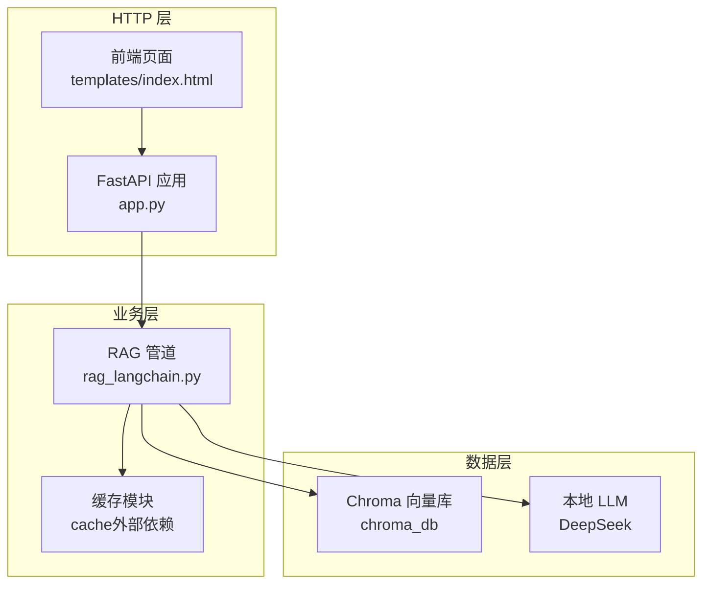
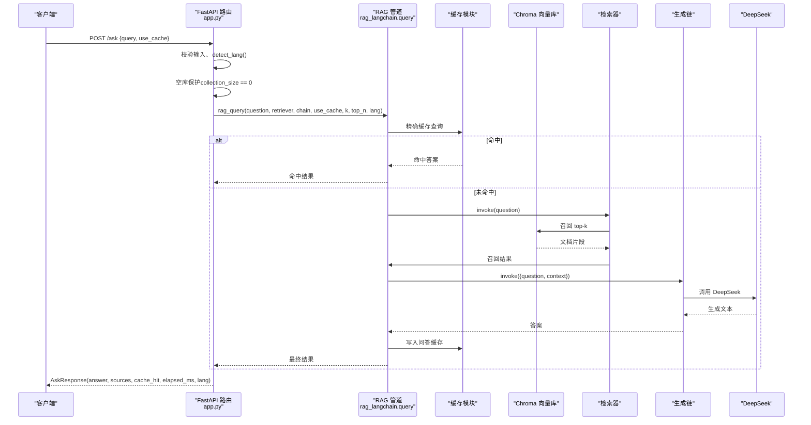
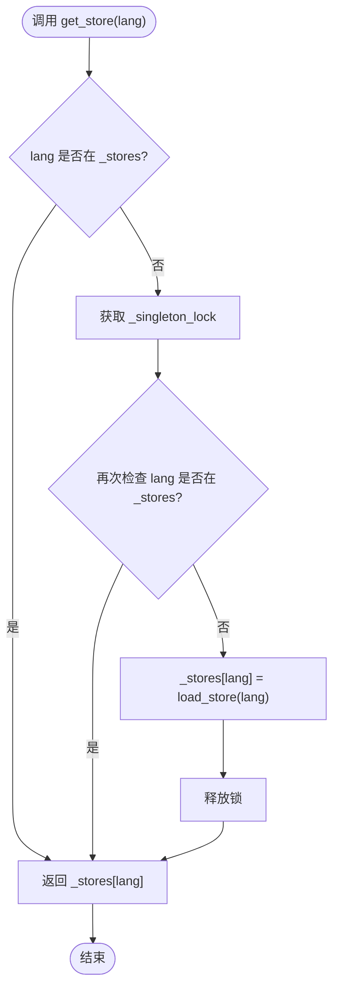
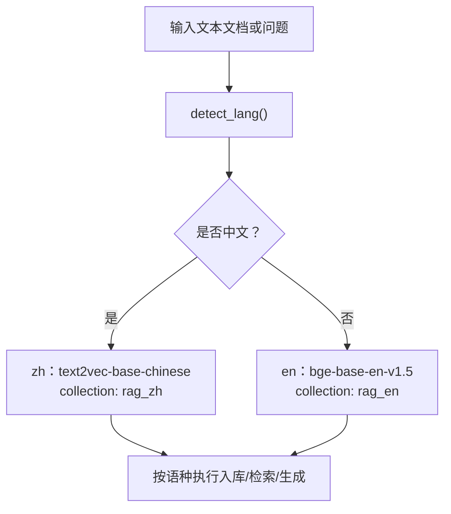
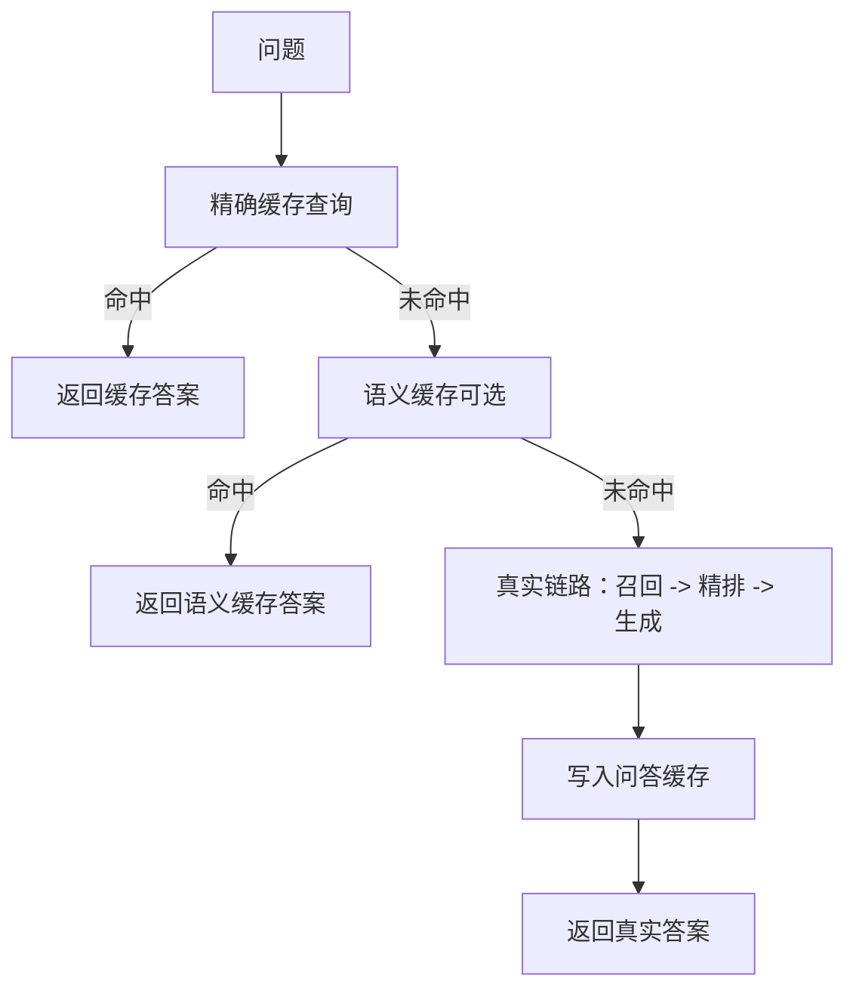
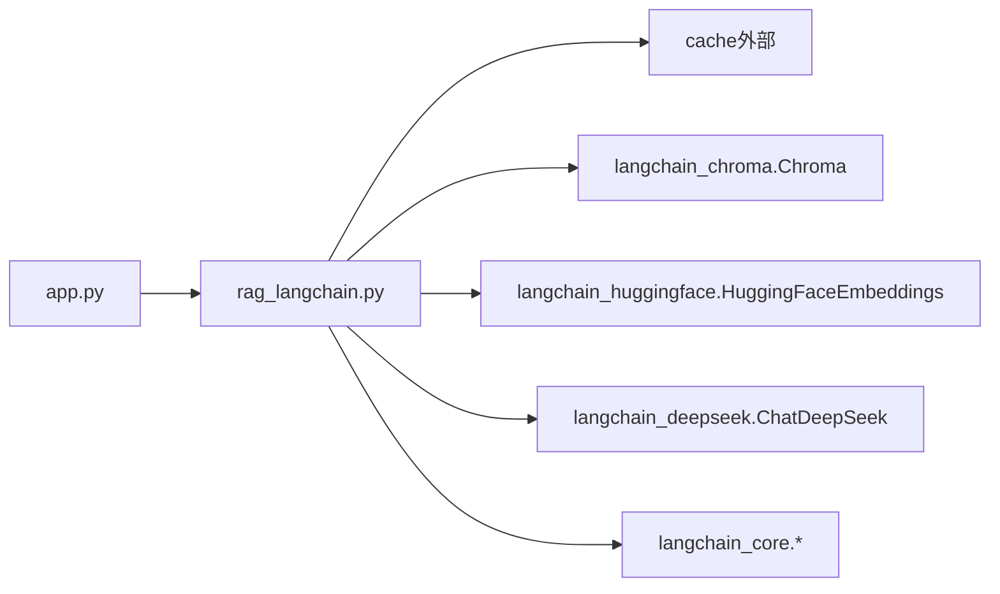

# FastAPI 应用层

<cite>
**本文引用的文件**   
- [app.py](file://app.py)
- [rag_langchain.py](file://rag_langchain.py)
- [index.html](file://templates/index.html)
</cite>

## 目录
1. [引言](#引言)
2. [项目结构](#项目结构)
3. [核心组件](#核心组件)
4. [架构总览](#架构总览)
5. [详细组件分析](#详细组件分析)
6. [依赖关系分析](#依赖关系分析)
7. [性能考量](#性能考量)
8. [故障排查指南](#故障排查指南)
9. [结论](#结论)

## 引言
本文件聚焦于 FastAPI 应用层的架构与实现，目标是帮助读者理解：
- FastAPI 应用的初始化与路由设计模式
- 请求处理从 HTTP 到业务逻辑的完整时序
- 全局对象懒加载机制（_stores、_retrievers、_chains）及其线程安全实现
- 语种路由机制：如何根据问题语种自动选择向量库和处理管道
- 异常处理与错误恢复策略，尤其是 fail-open 设计原则
- 缓存层在 RAG 链路中的位置与作用

该文档既适合快速上手，也适合深入阅读源码时对照参考。

## 项目结构
本项目是一个基于 FastAPI + LangChain 的检索增强生成（RAG）Web 服务，核心由两个模块组成：
- app.py：FastAPI 应用入口、HTTP 路由、全局单例懒加载、前端页面托管
- rag_langchain.py：LangChain 管道、语种模型与集合管理、嵌入/召回/精排/生成、缓存集成

此外，templates/index.html 提供轻量前端，用于上传文档、提问、查看缓存状态与健康检查。

图表来源
- [app.py:53-67](file://app.py#L53-L67)
- [rag_langchain.py:39-49](file://rag_langchain.py#L39-L49)
- [rag_langchain.py:91-96](file://rag_langchain.py#L91-L96)

章节来源
- [app.py:1-67](file://app.py#L1-L67)
- [rag_langchain.py:1-50](file://rag_langchain.py#L1-L50)

## 核心组件
- FastAPI 应用实例与路由
  - 定义 /upload、/ask、/cache/stats、/cache/clear、/health、/ 等接口
  - 使用 Pydantic 模型规范请求与响应体
- 全局对象懒加载
  - _stores：按语种缓存 Chroma 向量库实例
  - _retrievers：按语种缓存检索器（召回+精排）
  - _chains：按语种缓存 LCEL 生成链
  - 通过双检锁保证并发安全
- 语种路由
  - detect_lang 判断中文或英文
  - 不同语种对应不同 embedding 模型与 Chroma collection
- RAG 管道
  - 嵌入缓存、召回、精排缓存、LLM 生成
  - 问答缓存、语义缓存（可选）
- 健康检查与缓存管理
  - 暴露后端类型、健康状态、命中率、TTL、各语种块数等

章节来源
- [app.py:53-153](file://app.py#L53-L153)
- [rag_langchain.py:118-143](file://rag_langchain.py#L118-L143)
- [rag_langchain.py:145-254](file://rag_langchain.py#L145-L254)
- [rag_langchain.py:416-508](file://rag_langchain.py#L416-L508)
- [rag_langchain.py:579-644](file://rag_langchain.py#L579-L644)

## 架构总览
下图展示一次典型“提问”请求的处理流程：从 HTTP 进入 FastAPI，进行语种判定、空库保护、缓存命中检测，再到检索、精排、生成，最后回写缓存并返回结果。

图表来源
- [app.py:231-260](file://app.py#L231-L260)
- [rag_langchain.py:579-631](file://rag_langchain.py#L579-L631)
- [rag_langchain.py:452-467](file://rag_langchain.py#L452-L467)
- [rag_langchain.py:482-508](file://rag_langchain.py#L482-L508)

## 详细组件分析

### FastAPI 应用初始化与路由设计
- 应用初始化
  - 创建 FastAPI 实例，设置标题
  - 导入 Pydantic 模型与 LangChain 相关组件
  - 屏蔽第三方库弃用警告，避免日志噪音
- 路由设计模式
  - 使用 Pydantic BaseModel 统一描述请求与响应结构
  - 同步路由函数（如 /ask）由 FastAPI 内部线程池执行，因此需要线程安全的懒加载
  - 异步路由函数（如 /upload）直接 await I/O 操作
- 关键路由
  - POST /upload：解析 PDF/Markdown，按文档语种切块、入库、失效缓存、更新预览文件
  - POST /ask：按问题语种路由，先查缓存再走真实链路
  - GET /cache/stats：返回缓存后端、健康状态、版本、TTL、统计与各语种块数
  - POST /cache/clear：按类型清空缓存
  - GET /health：轻量健康检查
  - GET /：返回前端页面

章节来源
- [app.py:36-53](file://app.py#L36-L53)
- [app.py:129-153](file://app.py#L129-L153)
- [app.py:155-229](file://app.py#L155-L229)
- [app.py:231-297](file://app.py#L231-L297)

### 全局对象懒加载与线程安全
- 目标
  - 避免重复加载本地模型与连接，减少内存占用与启动开销
  - 按语种隔离：中文与英文各自维护独立的 store/retriever/chain
- 实现要点
  - 三个字典：_stores、_retrievers、_chains
  - 一个全局锁 _singleton_lock
  - get_store/get_retriever/get_chain 均使用双检锁模式：
    - 无锁快路径：若已存在则直接返回
    - 加锁后再次检查：防止并发构造多个实例
- 为什么必须双检锁
  - FastAPI 将同步路由丢进线程池，首次并发请求可能同时到达懒加载点
  - 不加锁会导致同一语种多次构造 embedding 模型、retriever、chain，浪费资源且可能引发竞争条件

图表来源
- [app.py:60-75](file://app.py#L60-L75)

章节来源
- [app.py:55-92](file://app.py#L55-L92)

### 语种路由机制
- 语种判断
  - detect_lang 基于汉字占比阈值（>=5%）判断为中文，否则为英文
  - 简单高效，不引入额外依赖
- 语种隔离
  - LANG_MODELS：中文与英文分别指向不同的 embedding 模型
  - LANG_COLLECTIONS：中文与英文分别使用不同的 Chroma collection
  - 不同模型的向量属于不同空间，混用会导致相似度噪声与静默错误
- 路由决策
  - 上传文档：按文档语种决定入库哪个 collection
  - 提问：按问题语种选择对应的 retriever 与 chain
  - 空库保护：目标语种 collection 为空时直接提示，不走检索，避免模型“凭印象作答”

图表来源
- [rag_langchain.py:59-81](file://rag_langchain.py#L59-L81)
- [rag_langchain.py:118-143](file://rag_langchain.py#L118-L143)
- [app.py:181-192](file://app.py#L181-L192)
- [app.py:238-249](file://app.py#L238-L249)

章节来源
- [rag_langchain.py:59-81](file://rag_langchain.py#L59-L81)
- [rag_langchain.py:118-143](file://rag_langchain.py#L118-L143)
- [app.py:181-192](file://app.py#L181-L192)
- [app.py:238-249](file://app.py#L238-L249)

### 请求处理时序与缓存策略
- 精确缓存
  - 以问题原文为 key，命中则直接返回答案与来源
- 语义缓存（可选）
  - 对问题做嵌入，与历史问题向量比较余弦相似度，超过阈值则复用旧答案
  - 默认关闭，避免误命中导致答非所问
- 向量缓存
  - 对文本做嵌入时命中缓存，跳过模型前向计算
- 精排缓存
  - 对 (问题, 片段) 打分命中缓存，避免重复 cross-encoder 计算
- 问答缓存
  - 真实链路完成后写入，供后续相同问题复用

图表来源
- [rag_langchain.py:579-631](file://rag_langchain.py#L579-L631)
- [rag_langchain.py:147-182](file://rag_langchain.py#L147-L182)
- [rag_langchain.py:428-449](file://rag_langchain.py#L428-L449)

章节来源
- [rag_langchain.py:579-631](file://rag_langchain.py#L579-L631)

### 异常处理与错误恢复（fail-open）
- 缓存层 fail-open
  - 任何缓存异常都视为未命中，继续走真实链路
  - 确保系统可用性优先于性能；缓存只加速，不改变正确答案
- 空库保护
  - 目标语种 collection 为空时直接返回可读提示，不走检索
  - 避免模型在没有依据的情况下生成看似合理的答案
- 上传失败处理
  - 不支持的文件类型、内容为空、分块后无内容等场景返回明确错误信息
  - 更新 chunks_preview 失败不影响上传主流程（fail-open）
- 健康检查
  - 暴露缓存后端名称与健康状态，便于监控与告警

章节来源
- [app.py:20-25](file://app.py#L20-L25)
- [app.py:175-187](file://app.py#L175-L187)
- [app.py:204-216](file://app.py#L204-L216)
- [app.py:241-249](file://app.py#L241-L249)
- [app.py:287-290](file://app.py#L287-L290)

### 前端交互与可视化
- 前端页面提供：
  - 文件上传（PDF/Markdown）
  - 提问（支持强制走真实链路对比耗时）
  - 缓存状态刷新与清空
  - 回答与引用来源展示
- 前端通过 fetch 调用后端接口，并根据返回字段显示缓存命中状态与语种标签

章节来源
- [templates/index.html:91-187](file://templates/index.html#L91-L187)

## 依赖关系分析
- FastAPI 应用依赖
  - Pydantic：请求/响应模型
  - LangChain 生态：Chroma、HuggingFaceEmbeddings、ChatDeepSeek、PromptTemplate、StrOutputParser
  - 自定义缓存模块 cache（外部依赖）
- 模块内依赖
  - app.py 依赖 rag_langchain.py 提供的 load_store、make_retriever、make_chain、query、invalidate_caches 等
  - rag_langchain.py 依赖 chromadb、transformers、dotenv 等

图表来源
- [app.py:36-51](file://app.py#L36-L51)
- [rag_langchain.py:39-49](file://rag_langchain.py#L39-L49)

章节来源
- [app.py:36-51](file://app.py#L36-L51)
- [rag_langchain.py:39-49](file://rag_langchain.py#L39-L49)

## 性能考量
- 懒加载与单例
  - 模型与连接仅在首次使用时加载，避免启动时全量占用内存
  - 双检锁避免并发重复构造，降低峰值内存与 CPU 抖动
- 缓存分层
  - 向量缓存与精排缓存显著减少模型前向次数
  - 问答缓存避免重复走完整链路，尤其节省 LLM 调用时间
- 切块策略
  - 按 token 切块，中英口径一致，避免英文块过薄影响检索质量
  - chunk_size 取模型上限的一半留有余量，降低静默截断风险
- 检索参数
  - RETRIEVE_K 与 RERANK_TOP_N 可配置，平衡召回数量与精排成本

章节来源
- [rag_langchain.py:103-115](file://rag_langchain.py#L103-L115)
- [rag_langchain.py:324-359](file://rag_langchain.py#L324-L359)
- [rag_langchain.py:428-449](file://rag_langchain.py#L428-L449)

## 故障排查指南
- 常见问题
  - 缓存未命中但答案异常：检查语义缓存阈值与启用开关
  - 向量维度不一致：确认上传与检索使用同一 embedding 模型
  - 空库导致“凭印象作答”：先上传对应语种文档
  - 并发下模型加载慢：确认双检锁生效，避免重复构造
- 诊断接口
  - GET /cache/stats：查看缓存后端、命中率、版本、TTL、各语种块数
  - GET /health：快速检查服务健康与缓存状态
- 手动清理
  - POST /cache/clear：可按类型清空缓存（qa/embed/rerank）

章节来源
- [app.py:263-290](file://app.py#L263-L290)
- [rag_langchain.py:634-644](file://rag_langchain.py#L634-L644)

## 结论
FastAPI 应用层通过清晰的路由设计与严格的语种隔离，实现了稳定可靠的 RAG 服务。全局对象的懒加载与双检锁保证了高并发下的资源复用与线程安全；多层缓存体系在保证正确性的前提下显著提升性能；fail-open 的设计原则确保系统在异常情况下仍能提供可用服务。结合健康检查与缓存管理接口，运维与调试更加直观便捷。