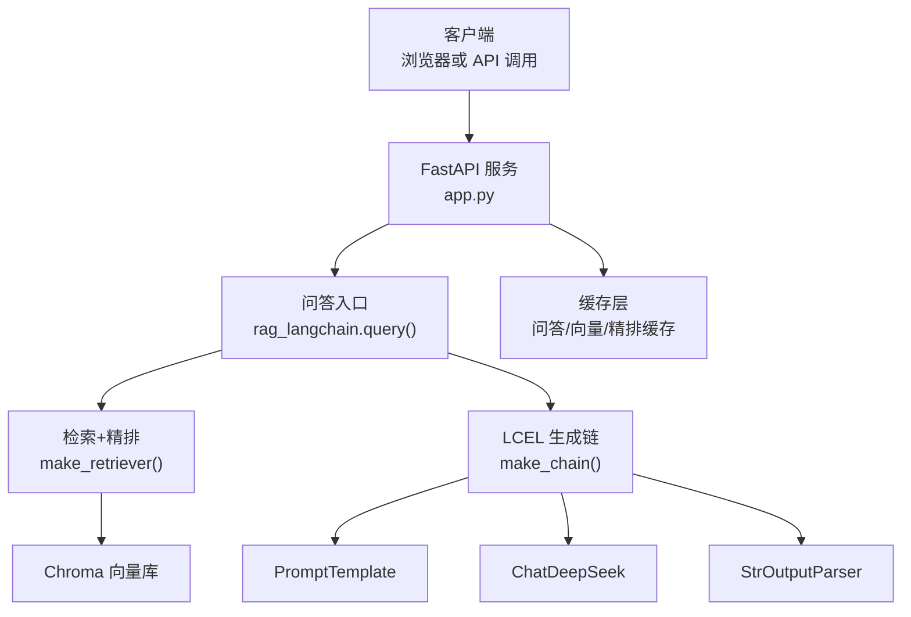
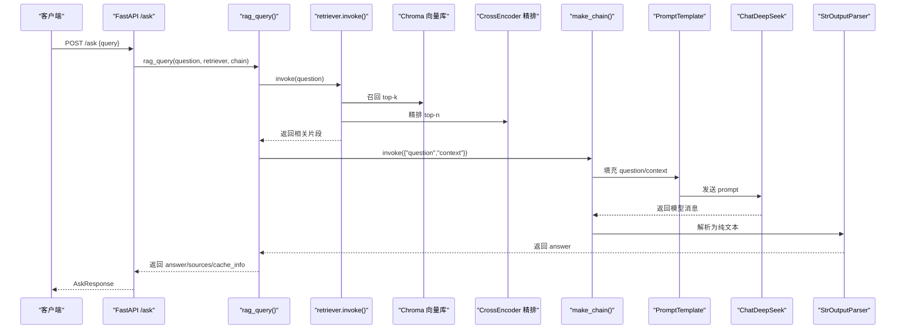
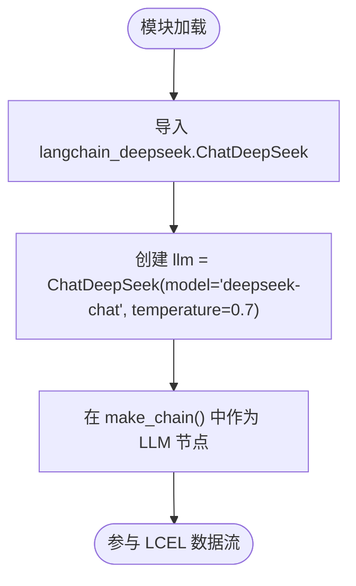
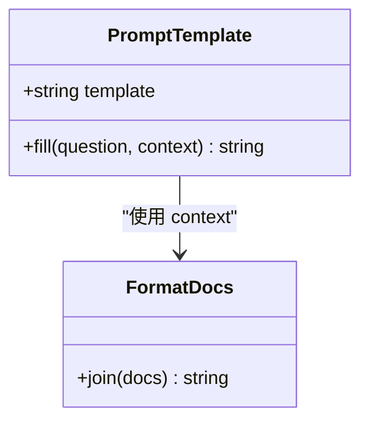
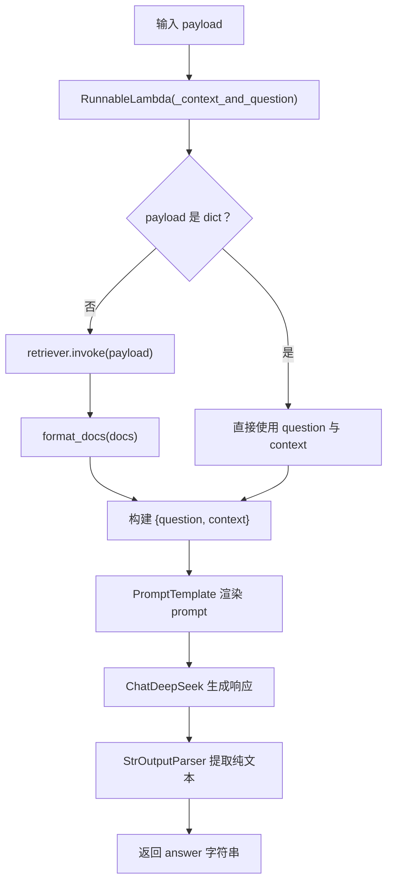
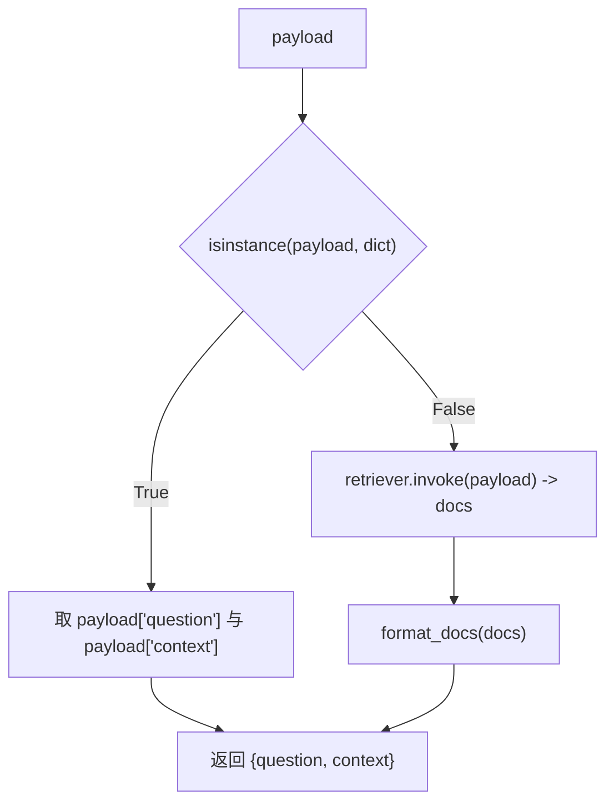
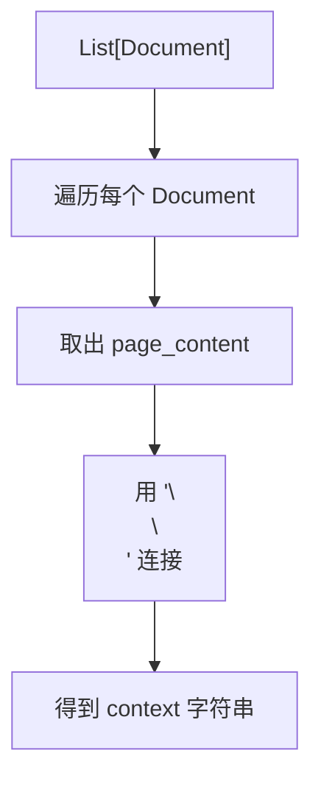
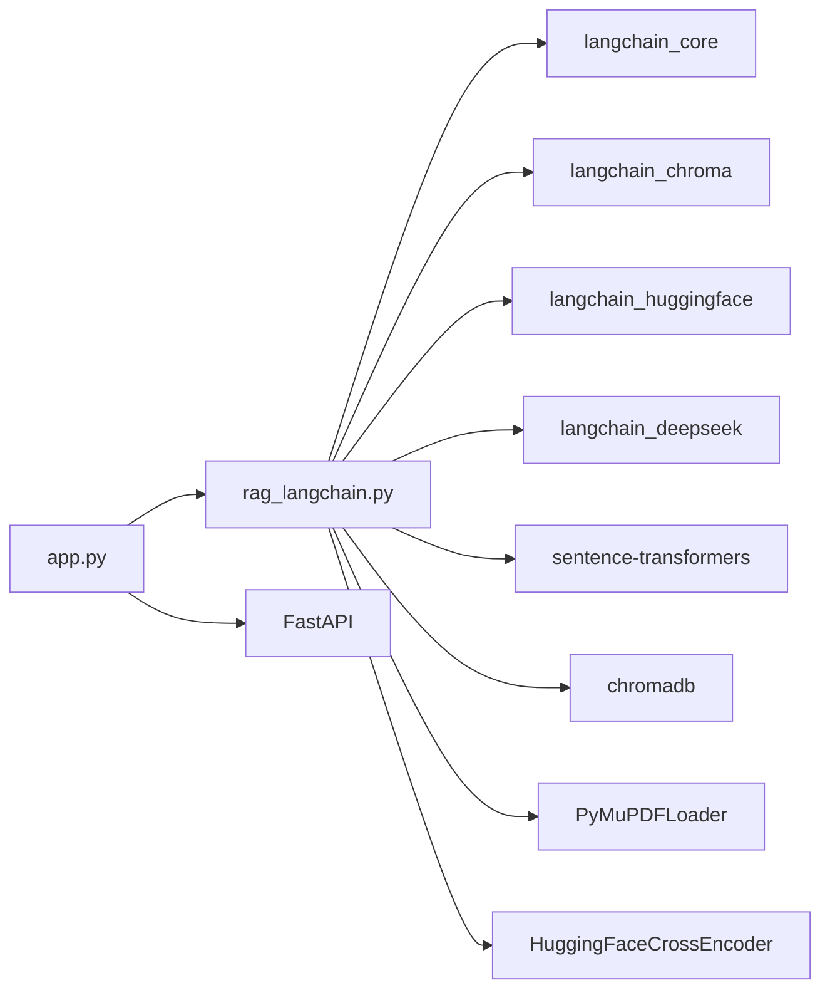
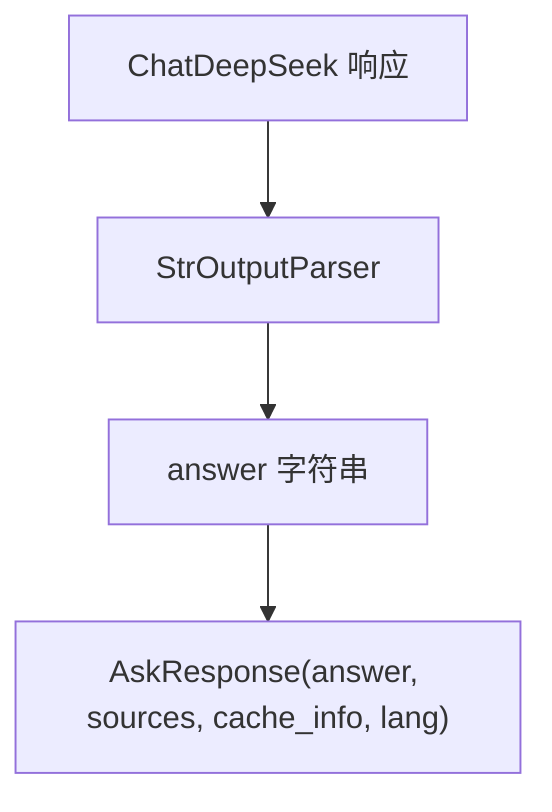

# LLM 生成管道

<cite>
**本文引用的文件**   
- [rag_langchain.py](file://rag_langchain.py)
- [app.py](file://app.py)
- [requirements.txt](file://requirements.txt)
</cite>

## 目录
1. [简介](#简介)
2. [项目结构](#项目结构)
3. [核心组件](#核心组件)
4. [架构总览](#架构总览)
5. [详细组件分析](#详细组件分析)
6. [依赖关系分析](#依赖关系分析)
7. [性能与温度参数说明](#性能与温度参数说明)
8. [提示词工程最佳实践](#提示词工程最佳实践)
9. [响应格式控制](#响应格式控制)
10. [错误处理机制](#错误处理机制)
11. [故障排查指南](#故障排查指南)
12. [结论](#结论)

## 简介
本文件面向“基于 LangChain 的 RAG 生成管道”，重点解释以下目标：
- ChatDeepSeek 的集成方式与配置位置。
- PromptTemplate 的设计思路。
- `make_chain()` 中 LCEL（LangChain Expression Language）链式调用：`RunnableLambda → PromptTemplate → LLM → StrOutputParser` 的数据流。
- 上下文注入机制：字符串输入自动检索、字典输入直接使用上下文的两种模式。
- `format_docs()` 的上下文格式化策略。
- 温度参数 `temperature=0.7` 的选择理由。
- 提示词工程最佳实践、响应格式控制与错误处理机制。

该管道整体流程为：用户问题 → 语种判断 → 向量召回 → CrossEncoder 精排 → 构造 Prompt → 调用 DeepSeek → 输出纯文本答案，并在 Web 层提供上传、提问、缓存统计等接口。

**章节来源**
- [rag_langchain.py:1-24](file://rag_langchain.py#L1-L24)
- [app.py:1-26](file://app.py#L1-L26)

## 项目结构
仓库中与 LLM 生成管道直接相关的代码集中在两个文件：
- `rag_langchain.py`：RAG 核心管道，包含嵌入、向量库、检索、精排、Prompt、LLM、链式调用、缓存入口等。
- `app.py`：FastAPI Web 服务，封装 `/upload`、`/ask`、`/cache/stats`、`/health` 等接口，并复用 `rag_langchain.py` 中的对象。

**图表来源**
- [app.py:155-260](file://app.py#L155-L260)
- [rag_langchain.py:452-508](file://rag_langchain.py#L452-L508)

**章节来源**
- [rag_langchain.py:39-48](file://rag_langchain.py#L39-L48)
- [app.py:36-51](file://app.py#L36-L51)

## 核心组件
- **语种路由**：根据中文汉字占比判断语言，决定使用哪个 embedding 模型和 Chroma collection。
- **嵌入与向量缓存**：`CachedHuggingFaceEmbeddings` 对文档和查询向量做缓存，避免重复计算。
- **向量库**：按语种维护独立 Chroma collection，避免不同模型的向量空间混用。
- **检索与精排**：先召回 top-k，再用 cross-encoder 精排到 top_n，精排分数可缓存。
- **PromptTemplate**：将用户问题和相关片段拼接成结构化 prompt。
- **LLM**：通过 `ChatDeepSeek` 接入 DeepSeek 模型。
- **LCEL 链**：`make_chain()` 把上下文注入、prompt、LLM、解析器串成一条链。
- **Web 接口**：FastAPI 暴露上传、提问、缓存管理、健康检查等接口。

**章节来源**
- [rag_langchain.py:118-142](file://rag_langchain.py#L118-L142)
- [rag_langchain.py:185-254](file://rag_langchain.py#L185-L254)
- [rag_langchain.py:363-405](file://rag_langchain.py#L363-L405)
- [rag_langchain.py:420-467](file://rag_langchain.py#L420-L467)
- [rag_langchain.py:471-508](file://rag_langchain.py#L471-L508)
- [app.py:155-260](file://app.py#L155-L260)

## 架构总览
下图展示一次 `/ask` 请求在系统中的完整流转：

**图表来源**
- [app.py:231-260](file://app.py#L231-L260)
- [rag_langchain.py:580-631](file://rag_langchain.py#L580-L631)
- [rag_langchain.py:452-508](file://rag_langchain.py#L452-L508)

## 详细组件分析

### ChatDeepSeek 集成配置
- 集成位置：模块级实例化，作为 LCEL 链中的 LLM 节点。
- 关键配置：
  - `model="deepseek-chat"`：指定使用的 DeepSeek 模型名称。
  - `temperature=0.7`：控制生成随机性，见后文“性能与温度参数说明”。
- 依赖声明：`requirements.txt` 引入 `langchain-deepseek`，确保 `ChatDeepSeek` 可用。

**图表来源**
- [rag_langchain.py:41-42](file://rag_langchain.py#L41-L42)
- [rag_langchain.py:475](file://rag_langchain.py#L475)
- [requirements.txt:7](file://requirements.txt#L7)

**章节来源**
- [rag_langchain.py:41-42](file://rag_langchain.py#L41-L42)
- [rag_langchain.py:475](file://rag_langchain.py#L475)
- [requirements.txt:7](file://requirements.txt#L7)

### PromptTemplate 设计
- 模板字段：
  - `{question}`：用户问题。
  - `{context}`：由 `format_docs()` 拼接的相关片段。
- 设计要点：
  - 明确角色：“知识助手”。
  - 强调依据：“请基于上述内容作答，不要编造信息”。
  - 结构清晰：先给出问题，再列出相关片段，便于模型区分指令与参考材料。

**图表来源**
- [rag_langchain.py:471-474](file://rag_langchain.py#L471-L474)
- [rag_langchain.py:478-479](file://rag_langchain.py#L478-L479)

**章节来源**
- [rag_langchain.py:471-474](file://rag_langchain.py#L471-L474)
- [rag_langchain.py:478-479](file://rag_langchain.py#L478-L479)

### make_chain() 的 LCEL 链式调用
`make_chain()` 返回一个 LCEL 表达式，顺序执行如下步骤：
1. `RunnableLambda(_context_and_question)`：上下文注入逻辑。
2. `PromptTemplate`：将 `{question}` 与 `{context}` 渲染为最终 prompt。
3. `llm`：调用 `ChatDeepSeek` 生成模型响应。
4. `StrOutputParser()`：从模型响应中提取纯文本答案。

**图表来源**
- [rag_langchain.py:482-508](file://rag_langchain.py#L482-L508)

**章节来源**
- [rag_langchain.py:482-508](file://rag_langchain.py#L482-L508)

### 上下文注入机制
`_context_and_question` 支持两种输入模式：
- **字符串输入**：视为原始问题，链内自动调用 `retriever.invoke(payload)` 进行检索，再通过 `format_docs()` 拼接上下文。
- **字典输入**：期望包含 `question` 与 `context`，直接跳过检索，使用传入的上下文。

这种设计避免了重复检索，也防止将字典误当作 query 传给 embedding 导致类型错误。

**图表来源**
- [rag_langchain.py:497-501](file://rag_langchain.py#L497-L501)

**章节来源**
- [rag_langchain.py:497-501](file://rag_langchain.py#L497-L501)

### format_docs() 的上下文格式化策略
- 实现：将多个 `Document.page_content` 用双换行符 `\n\n` 连接成一个长字符串。
- 目的：
  - 保持段落分隔，便于模型理解不同片段之间的边界。
  - 简化下游处理，使 PromptTemplate 只需接收一个 `context` 字段。
- 影响：
  - 片段越多，prompt 越长；需关注模型 token 上限与成本。
  - 当前精排保留 top_n=5，控制上下文长度。

**图表来源**
- [rag_langchain.py:478-479](file://rag_langchain.py#L478-L479)

**章节来源**
- [rag_langchain.py:478-479](file://rag_langchain.py#L478-L479)

### 温度参数 temperature=0.7 的选择理由
- 代码中显式设置 `temperature=0.7`。
- 选择理由可从 RAG 场景角度理解：
  - RAG 的目标是“基于给定上下文生成准确回答”，需要一定创造性但不应过度发散。
  - `temperature=0.7` 在“准确性”和“表达多样性”之间取得平衡，适合知识问答。
  - 若追求更严格的答案一致性，可降低温度；若希望更多样化的表述，可提高温度。
- 注意：该值属于模型侧超参，会影响每次生成的随机性。

**章节来源**
- [rag_langchain.py:475](file://rag_langchain.py#L475)

## 依赖关系分析
- Python 依赖：
  - `langchain`、`langchain-core`：提供 LCEL、PromptTemplate、输出解析器等基础能力。
  - `langchain-chroma`：对接 Chroma 向量库。
  - `langchain-huggingface`：提供 HuggingFaceEmbeddings。
  - `langchain-deepseek`：提供 ChatDeepSeek。
  - `sentence-transformers`、`chromadb`、`pymupdf`、`fastapi`、`uvicorn`、`python-dotenv`、`redis`。
- 运行时依赖：
  - 本地 embedding 模型路径：`./text2vec-base-chinese`、`./bge-base-en-v1.5`。
  - 本地 rerank 模型路径：`./mmarco-mMiniLMv2-L12-H384-v1`。
  - Chroma 持久化目录：`chroma_db`。

**图表来源**
- [rag_langchain.py:39-46](file://rag_langchain.py#L39-L46)
- [app.py:36-51](file://app.py#L36-L51)
- [requirements.txt:3-18](file://requirements.txt#L3-L18)

**章节来源**
- [rag_langchain.py:39-46](file://rag_langchain.py#L39-L46)
- [app.py:36-51](file://app.py#L36-L51)
- [requirements.txt:3-18](file://requirements.txt#L3-L18)

## 性能与温度参数说明
- 缓存分层：
  - 问答缓存：命中则直接返回答案，避免重复调用 DeepSeek。
  - 向量缓存：同一段文本不重复计算 embedding。
  - 精排缓存：`(问题, 片段)` 的 cross-encoder 分数不重复计算。
- 并发与懒加载：
  - embedding 模型、cross-encoder、Chroma client 均采用懒加载与双检锁，避免首次并发请求重复加载。
- 温度参数：
  - `temperature=0.7` 用于控制生成随机性，适合 RAG 问答场景。
  - 若业务要求更强的一致性，可降低；若需要更多样化表达，可提高。

**章节来源**
- [rag_langchain.py:1-13](file://rag_langchain.py#L1-L13)
- [rag_langchain.py:228-254](file://rag_langchain.py#L228-L254)
- [rag_langchain.py:420-449](file://rag_langchain.py#L420-L449)
- [rag_langchain.py:475](file://rag_langchain.py#L475)

## 提示词工程最佳实践
结合本项目 PromptTemplate 的实现，可总结以下实践：
- 明确角色与任务：让模型知道自己是“知识助手”，任务是“根据上下文回答问题”。
- 分离指令与材料：先给问题，再给相关片段，帮助模型区分“要做什么”和“用什么做”。
- 约束行为：明确要求“基于上述内容作答，不要编造信息”，降低幻觉风险。
- 控制上下文长度：通过精排保留 top_n，避免过长 prompt 导致成本上升或截断。
- 可观测性：在 Web 层返回 sources，便于回溯模型依据。

**章节来源**
- [rag_langchain.py:471-474](file://rag_langchain.py#L471-L474)
- [rag_langchain.py:452-467](file://rag_langchain.py#L452-L467)
- [app.py:129-141](file://app.py#L129-L141)

## 响应格式控制
- 生成阶段：
  - `StrOutputParser()` 将模型响应转为纯文本字符串，便于前端直接展示。
- Web 层：
  - `AskResponse` 统一返回 `answer`、`sources`、`cache_hit`、`cache_type`、`elapsed_ms`、`lang`。
- 语义与稳定性：
  - 如果希望模型输出结构化 JSON，可在 PromptTemplate 中增加格式约束，并在后端加解析校验；当前实现以纯文本为主，简单稳定。

**图表来源**
- [rag_langchain.py:503-508](file://rag_langchain.py#L503-L508)
- [app.py:134-141](file://app.py#L134-L141)

**章节来源**
- [rag_langchain.py:503-508](file://rag_langchain.py#L503-L508)
- [app.py:134-141](file://app.py#L134-L141)

## 错误处理机制
- 空问题：`/ask` 直接返回“问题不能为空”。
- 空知识库：目标语种 collection 块数为 0 时，返回明确提示，不进入检索，避免模型“凭印象作答”。
- 文件上传：
  - 不支持的文件类型返回失败消息。
  - 内容为空或切块后无内容返回失败消息。
- 缓存异常：注释强调缓存异常应 fail-open，读不到缓存就继续走真实链路，保证系统可用性。
- 路径与文件：
  - 默认文档不存在时抛出可读性更强的 `FileNotFoundError`，提示当前工作目录与默认路径。

**章节来源**
- [app.py:231-260](file://app.py#L231-L260)
- [app.py:155-228](file://app.py#L155-L228)
- [rag_langchain.py:293-307](file://rag_langchain.py#L293-L307)
- [app.py:20-25](file://app.py#L20-L25)

## 故障排查指南
- 现象：调用链报 `'dict' object has no attribute 'encode'`
  - 原因：向 `make_chain()` 传入了整个 dict，而 retriever 把 dict 当 query 去 embed。
  - 解决：确保传入的是字符串；或在外部已准备好 context 时，传 `{"question", "context"}` 给 chain，而不是给 retriever。
- 现象：检索结果异常但无报错
  - 可能原因：不同 embedding 模型的向量混入同一个 collection，相似度变成噪声。
  - 解决：按语种分库，确保入库与检索使用同一模型。
- 现象：上传后答案仍基于旧文档
  - 可能原因：未失效缓存或未更新 chunks_preview。
  - 解决：调用 `invalidate_caches()`，并确保 `chunks_preview_{lang}.md` 同步更新。
- 现象：性能波动大
  - 可能原因：缓存未命中、跨 encoder 重算、模型首次加载。
  - 解决：查看 `/cache/stats`，确认缓存后端与健康状态；必要时调整 chunk 大小与 overlap。

**章节来源**
- [rag_langchain.py:482-508](file://rag_langchain.py#L482-L508)
- [rag_langchain.py:53-80](file://rag_langchain.py#L53-L80)
- [rag_langchain.py:634-644](file://rag_langchain.py#L634-L644)
- [app.py:263-277](file://app.py#L263-L277)

## 结论
本项目的 LLM 生成管道以 LangChain 为核心，通过 `make_chain()` 将上下文注入、PromptTemplate、ChatDeepSeek 与 StrOutputParser 串联成一条清晰的 LCEL 数据流。其关键优势包括：
- 明确的上下文注入机制，支持字符串自动检索与字典直接使用上下文两种模式。
- 稳定的 PromptTemplate 设计，强调依据与防幻觉。
- 多层缓存提升性能，同时保持 fail-open 的健壮性。
- 按语种分库避免向量空间污染。
- 温度参数 `temperature=0.7` 在准确性与多样性之间取得平衡。

在实际使用中，建议：
- 根据业务需求微调 PromptTemplate，强化格式约束与事实依据。
- 根据延迟与成本权衡调整 `RETRIEVE_K`、`RERANK_TOP_N`、`temperature`。
- 监控缓存命中率与 `/health`、`/cache/stats`，及时定位性能瓶颈。
- 在需要结构化输出时，扩展 PromptTemplate 与后端解析逻辑。