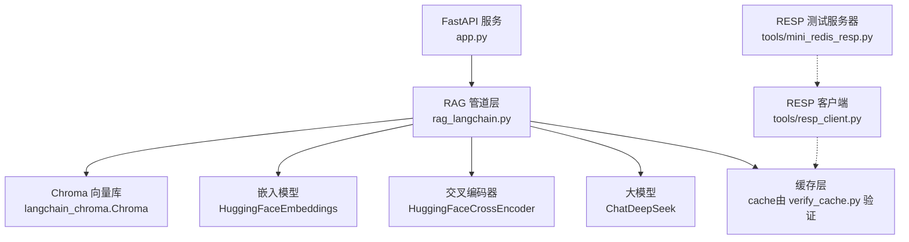
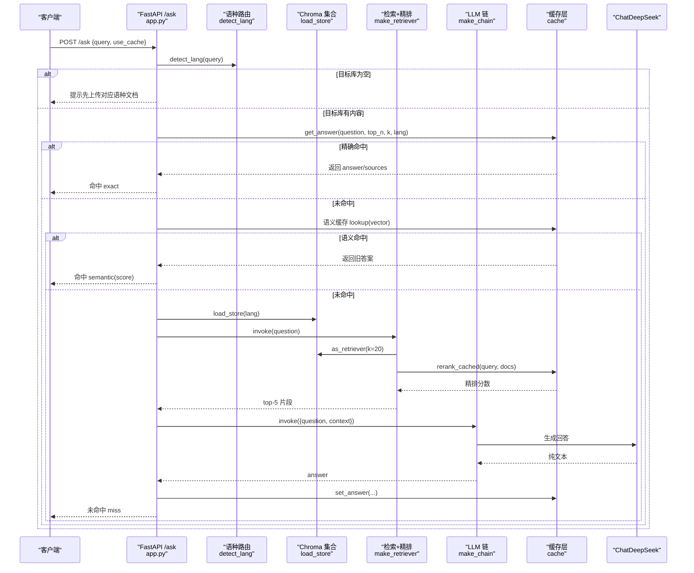
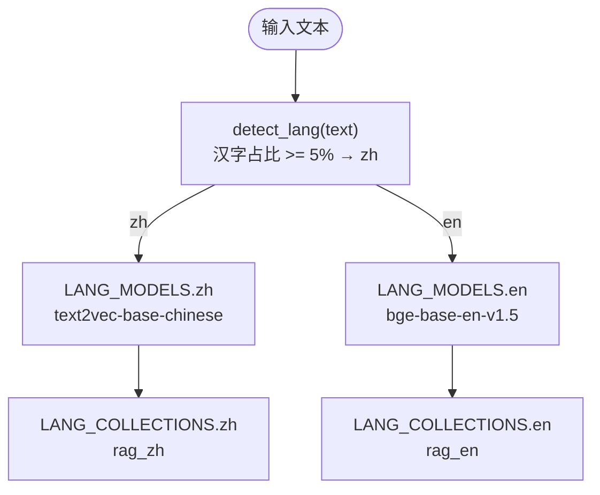
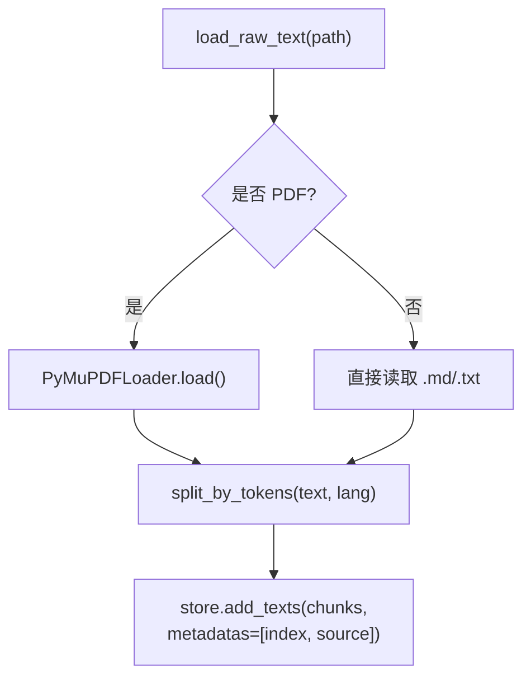
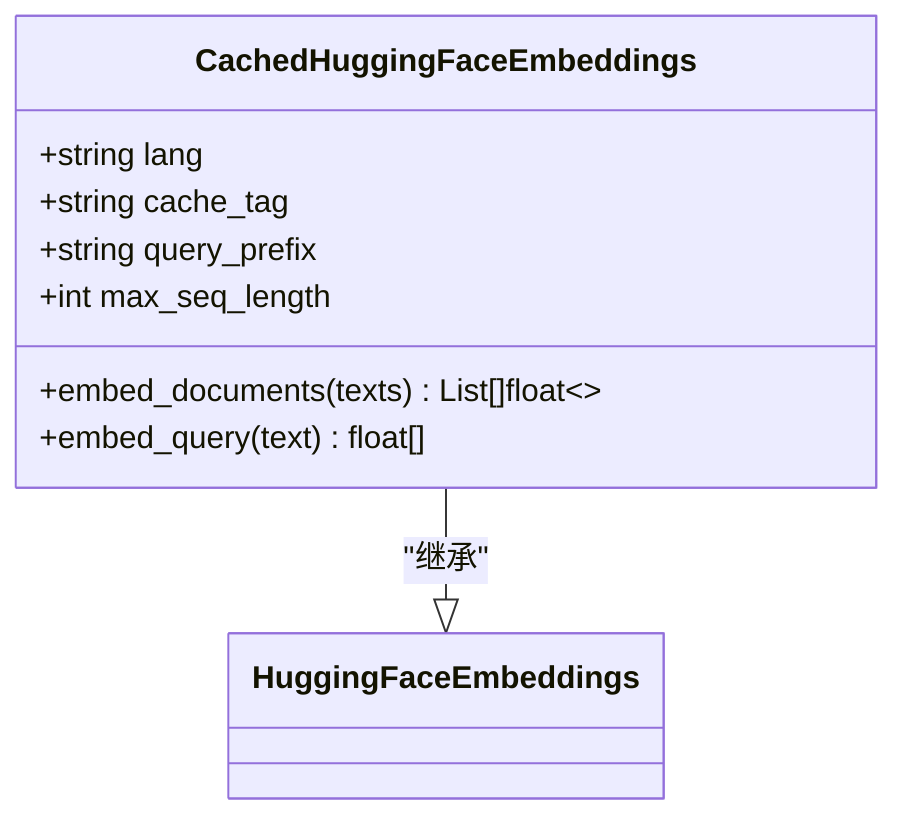
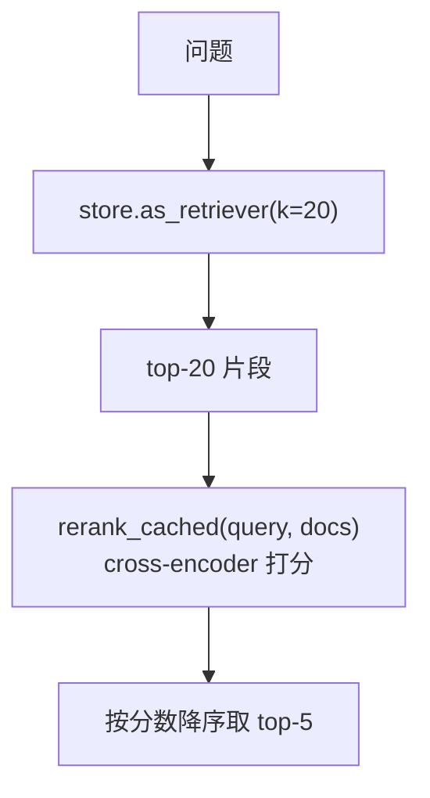
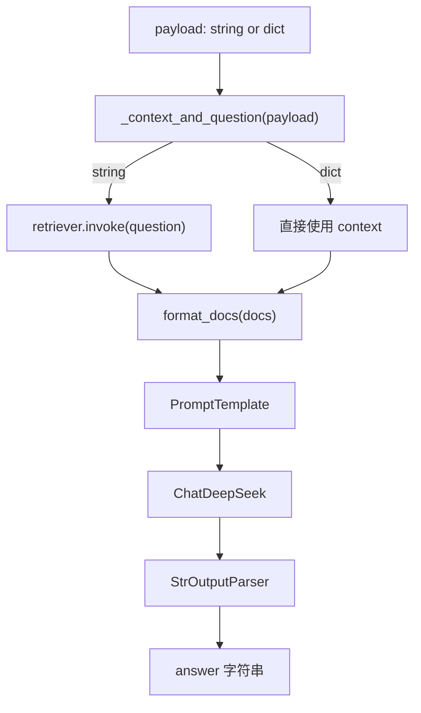
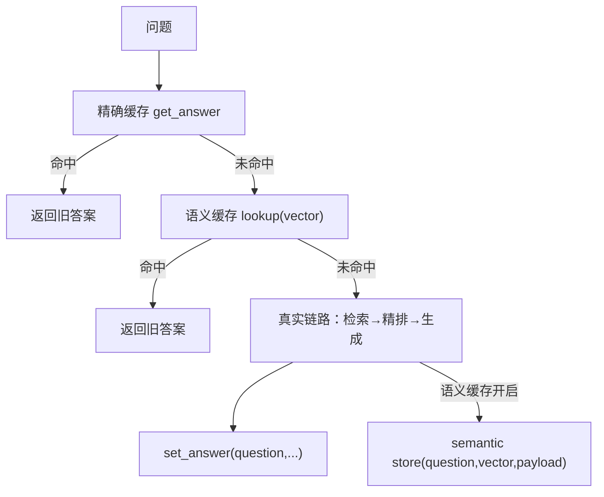
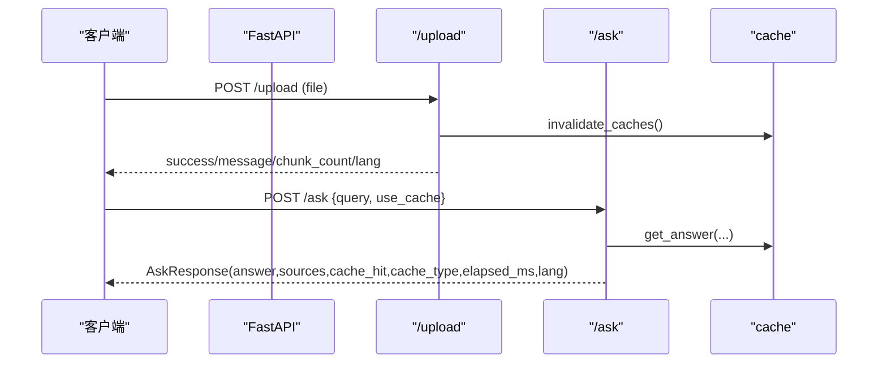
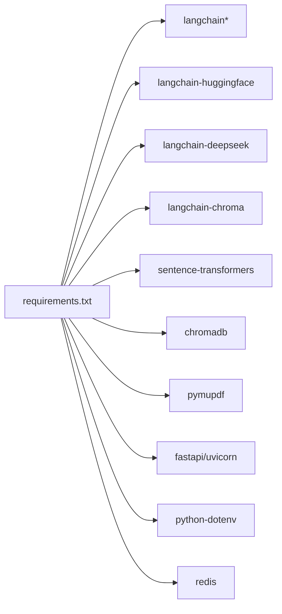

# RAG 管道层

<cite>
**本文引用的文件**   
- [rag_langchain.py](file://rag_langchain.py)
- [app.py](file://app.py)
- [requirements.txt](file://requirements.txt)
- [verify_cache.py](file://verify_cache.py)
- [mini_redis_resp.py](file://tools/mini_redis_resp.py)
- [resp_client.py](file://tools/resp_client.py)
</cite>

## 目录
1. [引言](#引言)
2. [项目结构](#项目结构)
3. [核心组件](#核心组件)
4. [架构总览](#架构总览)
5. [详细组件分析](#详细组件分析)
6. [依赖关系分析](#依赖关系分析)
7. [性能与缓存特性](#性能与缓存特性)
8. [故障排查指南](#故障排查指南)
9. [结论](#结论)

## 引言
本文件面向“RAG 管道层”的架构文档，聚焦以下目标：
- 说明 LangChain 框架在本项目中的集成方式，包括文档加载器、文本分块器、嵌入模型和检索器的配置。
- 解释双语支持架构：中英文独立的 collection 设计与模型隔离机制。
- 描述检索增强生成的完整流程：语义检索 → 交叉编码器重排序 → LLM 回答生成。
- 说明缓存集成点：问答缓存、向量缓存、精排分数缓存、语义缓存在管道各阶段的插入位置与读写逻辑。
- 给出数据流图，展示从原始文档到最终回答的完整转换过程。

## 项目结构
仓库以“Web 服务 + RAG 管道 + 缓存验证工具”的方式组织：
- `app.py`：FastAPI Web 服务，暴露上传、提问、缓存统计与健康检查接口，负责语种路由、空库保护、懒加载单例。
- `rag_langchain.py`：LangChain 版 RAG 管道，包含语种判断、嵌入模型、Chroma 向量库、切块、检索+重排、LLM 链、语义缓存与带缓存的问答入口。
- `verify_cache.py`：不加载模型的缓存层验证脚本，覆盖基础读写、TTL、问答/向量/精排缓存、版本号失效、清理与统计、健康降级等用例。
- `tools/mini_redis_resp.py`：极简 RESP 测试服务器，用于在不安装 redis 包时验证 Redis 代码路径。
- `tools/resp_client.py`：极简 RESP 客户端，模拟 redis-py 接口，配合 mini_redis_resp.py 完成端到端缓存路径验证。
- `requirements.txt`：声明 LangChain 生态、Chroma、HuggingFace、DeepSeek、FastAPI、Redis 客户端等依赖。

**图表来源**
- [app.py:1-53](file://app.py#L1-L53)
- [rag_langchain.py:39-49](file://rag_langchain.py#L39-L49)
- [verify_cache.py:1-19](file://verify_cache.py#L1-L19)
- [mini_redis_resp.py:1-18](file://tools/mini_redis_resp.py#L1-L18)
- [resp_client.py:1-13](file://tools/resp_client.py#L1-L13)

**章节来源**
- [app.py:1-53](file://app.py#L1-L53)
- [rag_langchain.py:1-50](file://rag_langchain.py#L1-L50)
- [requirements.txt:1-19](file://requirements.txt#L1-L19)

## 核心组件
- 语种检测与路由：按汉字占比判断中文或英文，决定使用哪个 embedding 模型与 Chroma collection。
- 嵌入模型与缓存：基于 HuggingFaceEmbeddings 的子类 CachedHuggingFaceEmbeddings，封装 embed_documents/embed_query，并接入向量缓存；同时支持 bge 查询前缀与最大序列长度控制。
- 向量库：每个语种一个 Chroma collection，共享 PersistentClient，避免多实例导致的数据不一致。
- 文档加载与切块：PyMuPDFLoader 读取 PDF，Markdown/TXT 直接读文本；按 token 切块，使用对应语种的 tokenizer，保证中英块信息量一致。
- 检索与重排：Chroma 召回 top-k，再用 cross-encoder 打分精排到 top-n；精排分数走 rerank_cached 缓存。
- LLM 生成：PromptTemplate + ChatDeepSeek + StrOutputParser 组成 LCEL 链；支持传入 context 跳过重复召回。
- 语义缓存：可选开启，按语种维护历史问题向量与答案，相似度超过阈值命中旧答案。
- 带缓存问答入口：精确问答缓存 → 语义缓存 → 真实链路 → 回写问答缓存与语义缓存。

**章节来源**
- [rag_langchain.py:118-143](file://rag_langchain.py#L118-L143)
- [rag_langchain.py:145-254](file://rag_langchain.py#L145-L254)
- [rag_langchain.py:292-359](file://rag_langchain.py#L292-L359)
- [rag_langchain.py:362-405](file://rag_langchain.py#L362-L405)
- [rag_langchain.py:416-467](file://rag_langchain.py#L416-L467)
- [rag_langchain.py:470-508](file://rag_langchain.py#L470-L508)
- [rag_langchain.py:511-576](file://rag_langchain.py#L511-L576)
- [rag_langchain.py:579-631](file://rag_langchain.py#L579-L631)

## 架构总览
RAG 管道层采用“LangChain 编排 + 本地模型 + 持久化向量库 + 多层缓存”的架构。Web 服务只负责请求路由、参数校验与结果包装；真正的检索、重排、生成逻辑集中在 rag_langchain.py。

**图表来源**
- [app.py:231-260](file://app.py#L231-L260)
- [rag_langchain.py:118-143](file://rag_langchain.py#L118-L143)
- [rag_langchain.py:362-372](file://rag_langchain.py#L362-L372)
- [rag_langchain.py:452-467](file://rag_langchain.py#L452-L467)
- [rag_langchain.py:482-508](file://rag_langchain.py#L482-L508)
- [rag_langchain.py:579-631](file://rag_langchain.py#L579-L631)

## 详细组件分析

### 双语支持与模型隔离
- 语种判断：通过汉字字符比例判定中文或英文，阈值低且稳定，适合混写场景。
- 模型隔离：不同语种使用不同的 embedding 模型与 collection，避免跨模型向量空间导致的静默错误。
- Collection 命名：遵循 Chroma 约束，使用固定名称区分中英文库。
- 查询前缀：bge 系列建议对 query 加指令，passage 不加；可通过环境变量开关。

**图表来源**
- [rag_langchain.py:59-81](file://rag_langchain.py#L59-L81)
- [rag_langchain.py:118-143](file://rag_langchain.py#L118-L143)

**章节来源**
- [rag_langchain.py:59-81](file://rag_langchain.py#L59-L81)
- [rag_langchain.py:118-143](file://rag_langchain.py#L118-L143)

### 文档加载与文本分块
- 文档加载：优先 PyMuPDFLoader 解析 PDF，否则直接读取 Markdown/TXT；对不存在路径给出可读错误。
- Token 切块：使用对应语种的 tokenizer，按 offset 对齐原文子串，避免 decode 失真；默认 chunk_size 为模型上限的一半，留足余量防止静默截断。
- 入库元数据：记录 index 与 source，便于还原顺序与溯源。

**图表来源**
- [rag_langchain.py:292-307](file://rag_langchain.py#L292-L307)
- [rag_langchain.py:324-359](file://rag_langchain.py#L324-L359)
- [rag_langchain.py:397-405](file://rag_langchain.py#L397-L405)

**章节来源**
- [rag_langchain.py:292-307](file://rag_langchain.py#L292-L307)
- [rag_langchain.py:324-359](file://rag_langchain.py#L324-L359)
- [rag_langchain.py:397-405](file://rag_langchain.py#L397-L405)

### 嵌入模型与向量缓存
- 子类覆写：CachedHuggingFaceEmbeddings 覆写 embed_documents/embed_query，注入向量缓存与查询前缀。
- 模型懒加载：按语种懒加载，双检锁避免并发重复加载；max_seq_length 显式设置，避免静默截断。
- 缓存键：embedding_key 基于文本哈希，model_tag 包含语种、模型名与 max_seq_length，确保不同模型/配置不会互相污染。

**图表来源**
- [rag_langchain.py:185-222](file://rag_langchain.py#L185-L222)
- [rag_langchain.py:228-254](file://rag_langchain.py#L228-L254)

**章节来源**
- [rag_langchain.py:145-254](file://rag_langchain.py#L145-L254)

### 向量库与检索器
- Chroma 客户端：共享 PersistentClient，避免多实例冲突；兼容新旧版本 client/persist_directory/path。
- Collection：每语种一个 collection，load_store 根据 lang 选择；build_index 支持重建或追加。
- 检索器：as_retriever(k=20) 召回后，用 cross-encoder 精排到 top-5；retriever.invoke 返回 Document 列表。

**图表来源**
- [rag_langchain.py:261-289](file://rag_langchain.py#L261-L289)
- [rag_langchain.py:362-405](file://rag_langchain.py#L362-L405)
- [rag_langchain.py:428-467](file://rag_langchain.py#L428-L467)

**章节来源**
- [rag_langchain.py:261-289](file://rag_langchain.py#L261-L289)
- [rag_langchain.py:362-405](file://rag_langchain.py#L362-L405)
- [rag_langchain.py:428-467](file://rag_langchain.py#L428-L467)

### LLM 生成链
- PromptTemplate：固定模板，要求基于上下文作答，不编造。
- ChatDeepSeek：作为 LLM 后端，temperature=0.7。
- LCEL 链：RunnableLambda → PromptTemplate → LLM → StrOutputParser；支持传入 {"question","context"} 跳过重复召回。

**图表来源**
- [rag_langchain.py:470-508](file://rag_langchain.py#L470-L508)

**章节来源**
- [rag_langchain.py:470-508](file://rag_langchain.py#L470-L508)

### 缓存集成点
- 精确问答缓存：get_answer/set_answer，签名包含 question/top_n/k/lang，避免参数口径变化误命中。
- 向量缓存：get_embeddings/set_embeddings，按文本 hash 与 model_tag 存储向量，避免重复前向计算。
- 精排分数缓存：get_rerank_scores/set_rerank_scores，按 (query, doc[i]) 下标映射分数，避免重复 cross-encoder 打分。
- 语义缓存：SemanticCache 按语种维护历史问题向量与答案，相似度超阈值命中旧答案；默认关闭。
- 版本号失效：invalidate_caches 提升版本号，使旧答案失效；上传文档后自动调用。

**图表来源**
- [rag_langchain.py:579-631](file://rag_langchain.py#L579-L631)
- [rag_langchain.py:511-576](file://rag_langchain.py#L511-L576)

**章节来源**
- [rag_langchain.py:511-576](file://rag_langchain.py#L511-L576)
- [rag_langchain.py:579-631](file://rag_langchain.py#L579-L631)

### Web 服务与接口
- /upload：解析 PDF/Markdown/TXT，按文档语种切块入库，清空该语种 collection 原有块，失效缓存，更新 chunks_preview。
- /ask：按问题语种路由，空库保护，调用 rag_query 并返回 answer/sources/cache_hit/cache_type/elapsed_ms/lang。
- /cache/stats 与 /cache/clear：查看缓存后端状态、命中率、版本号、collection 块数；手动清理指定类型缓存。
- /health：轻量健康检查，含缓存后端与 collection 块数。

**图表来源**
- [app.py:155-228](file://app.py#L155-L228)
- [app.py:231-260](file://app.py#L231-L260)
- [app.py:263-290](file://app.py#L263-L290)

**章节来源**
- [app.py:155-228](file://app.py#L155-L228)
- [app.py:231-260](file://app.py#L231-L260)
- [app.py:263-290](file://app.py#L263-L290)

## 依赖关系分析
- LangChain 生态：langchain、langchain-community、langchain-chroma、langchain-huggingface、langchain-deepseek、langchain-core。
- 模型与向量库：sentence-transformers、chromadb、pymupdf。
- Web 框架：fastapi、uvicorn。
- 配置与环境：python-dotenv。
- 缓存后端：redis（可选），连不上时自动降级为内存缓存。

**图表来源**
- [requirements.txt:1-19](file://requirements.txt#L1-L19)

**章节来源**
- [requirements.txt:1-19](file://requirements.txt#L1-L19)

## 性能与缓存特性
- 三层缓存分别解决不同瓶颈：
  - 问答缓存：避免重复走完整链路，节省 LLM 调用与等待时间。
  - 向量缓存：避免重复模型前向，减少 CPU/GPU 负载。
  - 精排分数缓存：避免重复 cross-encoder 打分，显著降低最慢环节耗时。
- 语义缓存：可选开启，近似匹配相似问法，但默认关闭以避免答错风险。
- 懒加载与单例：embedding 模型、cross-encoder、Chroma 客户端均懒加载，避免启动时全量加载；并发首次请求双检锁避免重复加载。
- 切块策略：按 token 切块，chunk_size 为模型上限一半，留足余量防止静默截断；重叠保留上下文连贯性。

[本节为通用性能讨论，不直接分析具体文件]

## 故障排查指南
- 文档路径错误：load_raw_text 对不存在路径给出可读提示，确认默认 doc.pdf 是否存在或使用绝对路径。
- 空库保护：/ask 在目标语种库为空时直接提示上传文档，避免模型“凭印象作答”。
- 缓存异常 fail-open：读不到缓存就当未命中，照常走真实链路，保证系统可用性。
- 缓存验证：使用 verify_cache.py 快速验证缓存读写、TTL、版本号失效、清理与统计；必要时启动 tools/mini_redis_resp.py 并用 tools/resp_client.py 替换 redis 包进行端到端验证。
- 向量截断：显式设置 max_seq_length，避免 sentence-transformers 静默截断导致召回质量下降。
- Collection 维度变更：若更换不同维度模型，需停服后手动删除 chroma_db 再重建，因为仅删块无法改变 collection 维度。

**章节来源**
- [rag_langchain.py:292-307](file://rag_langchain.py#L292-L307)
- [app.py:231-260](file://app.py#L231-L260)
- [verify_cache.py:1-19](file://verify_cache.py#L1-L19)
- [verify_cache.py:73-197](file://verify_cache.py#L73-L197)
- [mini_redis_resp.py:1-18](file://tools/mini_redis_resp.py#L1-L18)
- [resp_client.py:1-13](file://tools/resp_client.py#L1-L13)

## 结论
本项目以 LangChain 为核心编排 RAG 管道，结合 Chroma 向量库、HuggingFace 嵌入模型与交叉编码器、以及 ChatDeepSeek 生成模型，构建了完整的双语检索增强生成流程。通过精确问答缓存、向量缓存、精排分数缓存与可选语义缓存，系统在保持正确性的前提下显著提升响应速度。Web 服务提供清晰的上传、提问与缓存管理接口，并通过空库保护与 fail-open 策略保障用户体验与系统健壮性。未来可在语义缓存阈值调优、缓存后端扩展与评估指标自动化方面继续演进。