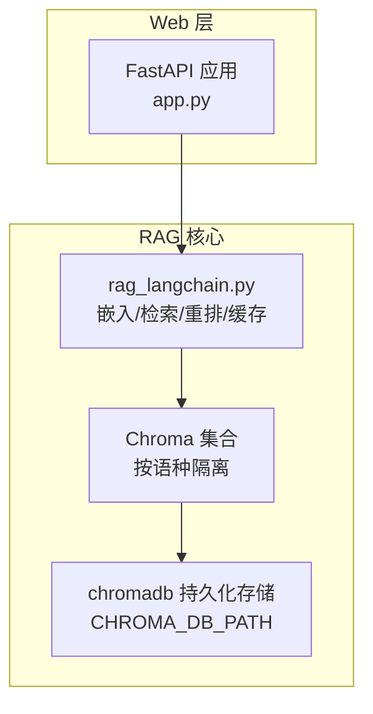
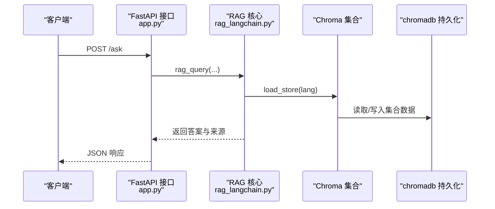
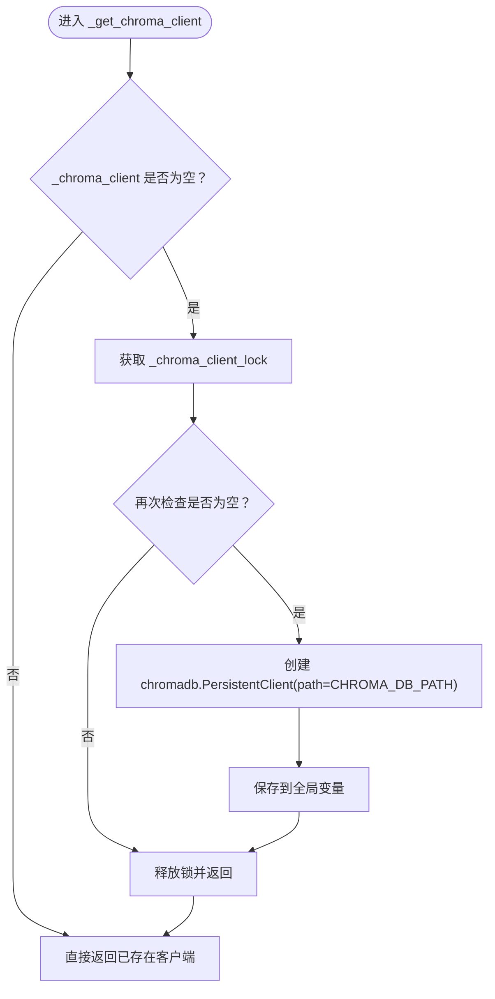
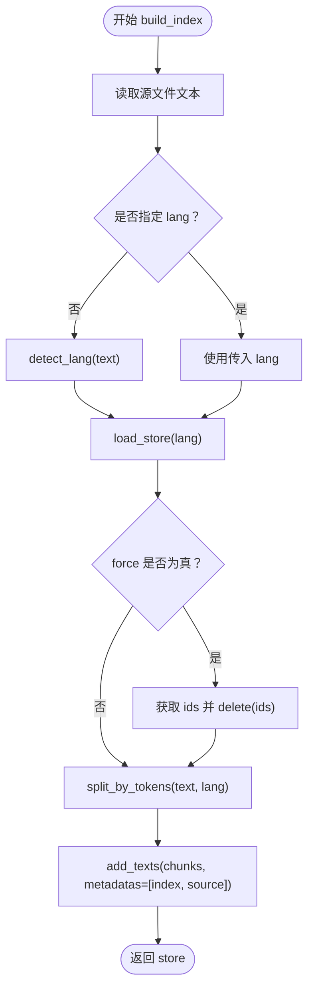
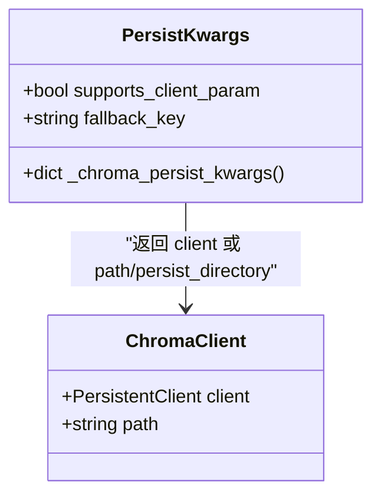
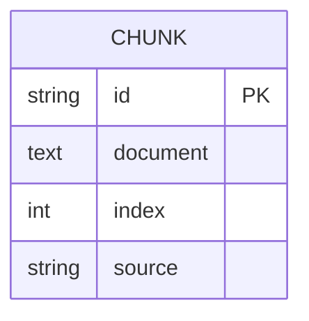
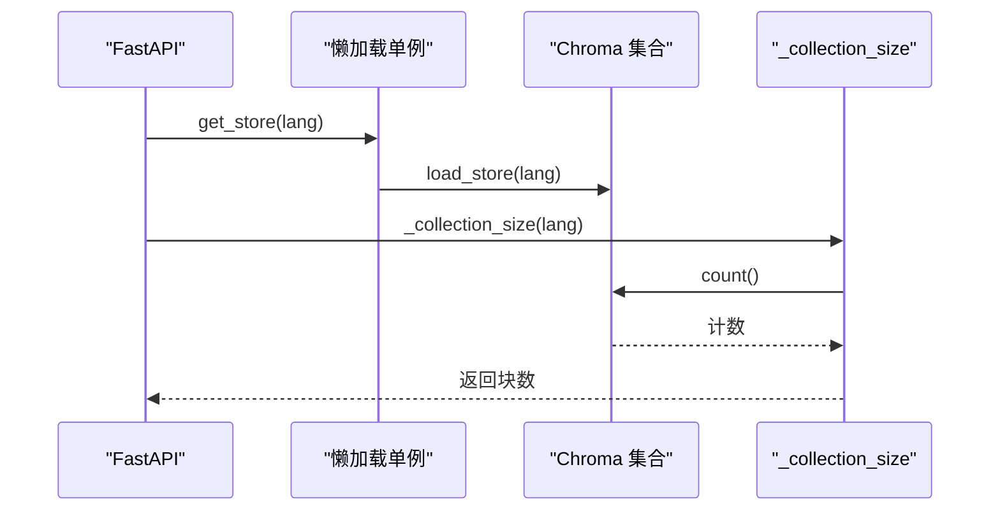
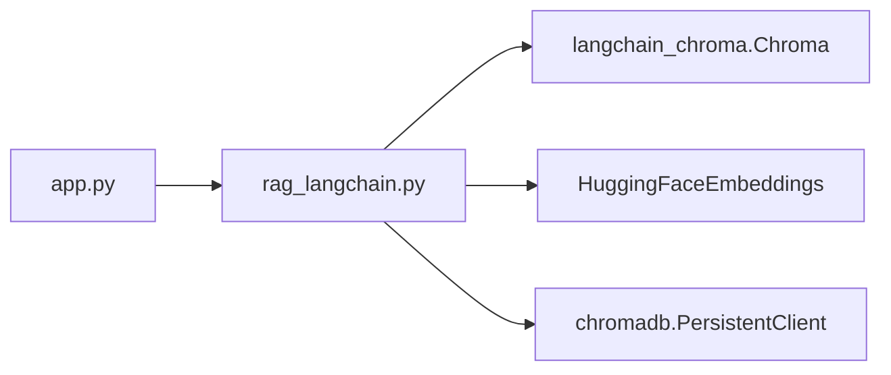

# 向量库管理

<cite>
**本文引用的文件**   
- [app.py](file://app.py)
- [rag_langchain.py](file://rag_langchain.py)
</cite>

## 目录
1. [引言](#引言)
2. [项目结构](#项目结构)
3. [核心组件](#核心组件)
4. [架构总览](#架构总览)
5. [详细组件分析](#详细组件分析)
6. [依赖关系分析](#依赖关系分析)
7. [性能与容量规划](#性能与容量规划)
8. [故障排查指南](#故障排查指南)
9. [结论](#结论)
10. [附录：配置项与运维清单](#附录配置项与运维清单)

## 引言
本模块面向 RAG 系统的“向量库管理”部分，重点说明 Chroma 客户端的单例共享机制、按语种隔离的集合管理、索引构建流程、持久化路径与版本兼容处理，以及元数据设计。文档同时给出数据库维护、备份恢复和性能调优的实践建议，帮助读者在本地或生产环境中稳定运行中英双库 RAG 服务。

## 项目结构
本项目采用 FastAPI 作为 Web 入口，RAG 核心逻辑集中在 rag_langchain.py；app.py 负责接口路由、懒加载单例、健康检查与缓存联动。向量库相关能力由 rag_langchain.py 提供，包括 Chroma 客户端获取、集合加载、索引构建、检索与重排等。

图表来源
- [app.py:44-51](file://app.py#L44-L51)
- [rag_langchain.py:39-46](file://rag_langchain.py#L39-L46)
- [rag_langchain.py:92-96](file://rag_langchain.py#L92-L96)

章节来源
- [app.py:1-66](file://app.py#L1-L66)
- [rag_langchain.py:1-116](file://rag_langchain.py#L1-L116)

## 核心组件
- Chroma 客户端单例：_get_chroma_client() 通过全局变量与线程锁实现进程内单例，避免重复打开底层系统连接。
- 集合加载：load_store(lang) 按语种创建独立 collection，并绑定对应 embedding 模型。
- 索引构建：build_index(source_file, lang=None, force=False) 支持重建（force=True）与追加入库，自动切块、向量化、写入 metadata。
- 持久化路径：CHROMA_DB_PATH 使用绝对路径，确保 chromadb SharedSystemClient 正确复用同一份 SQLite/HNSW 实例。
- 元数据设计：每条记录携带 index（入库顺序）与 source（来源文件名），用于排序与溯源。

章节来源
- [rag_langchain.py:257-289](file://rag_langchain.py#L257-L289)
- [rag_langchain.py:363-405](file://rag_langchain.py#L363-L405)
- [rag_langchain.py:92-96](file://rag_langchain.py#L92-L96)
- [rag_langchain.py:408-413](file://rag_langchain.py#L408-L413)

## 架构总览
下图展示从 Web 请求到向量库访问的关键调用链，突出 Chroma 客户端共享与按语种路由。

图表来源
- [app.py:231-260](file://app.py#L231-L260)
- [rag_langchain.py:363-372](file://rag_langchain.py#L363-L372)
- [rag_langchain.py:261-277](file://rag_langchain.py#L261-L277)

## 详细组件分析

### Chroma 客户端单例：_get_chroma_client()
- 目标：进程内共享一个 PersistentClient，避免多实例导致的句柄冲突与数据不一致。
- 线程安全：使用全局 _chroma_client 与 _chroma_client_lock，双重检查锁定保证并发下仅初始化一次。
- 注意事项：不要对共享 client 调用 close()，否则会影响所有持有者。

图表来源
- [rag_langchain.py:257-277](file://rag_langchain.py#L257-L277)

章节来源
- [rag_langchain.py:257-277](file://rag_langchain.py#L257-L277)

### 集合管理：load_store() 与 build_index()
- load_store(lang)
  - 行为：按 LANG_COLLECTIONS[lang] 选择集合名，绑定 get_embedding_model(lang)，并通过 _chroma_persist_kwargs() 传入共享 client 或 path/persist_directory。
  - 结果：每个语种拥有独立的 Chroma 集合，互不干扰。
- build_index(source_file, lang=None, force=False)
  - 流程：读取文本 -> 判断语种 -> 加载集合 -> 可选清空已有块 -> 切块 -> 批量 add_texts（含 index/source 元数据）。
  - force 参数：当为 True 时，先删除该集合中已有 id 列表，再重建；不会 drop 集合，从而保持现有 store/retriever/chain 引用有效。

图表来源
- [rag_langchain.py:375-405](file://rag_langchain.py#L375-L405)
- [rag_langchain.py:324-359](file://rag_langchain.py#L324-L359)

章节来源
- [rag_langchain.py:363-405](file://rag_langchain.py#L363-L405)
- [rag_langchain.py:324-359](file://rag_langchain.py#L324-L359)

### 持久化存储配置：CHROMA_DB_PATH 与版本兼容
- CHROMA_DB_PATH
  - 使用绝对路径，避免相对路径在不同工作目录下被识别为不同实例，导致 SQLite/HNSW 叠加与数据不一致。
- 版本兼容：_chroma_persist_kwargs() 检测 langchain-chroma 的 Chroma.__init__ 签名，优先使用 client= 参数以共享同一个 PersistentClient；若不支持则回退到 path/persist_directory。

图表来源
- [rag_langchain.py:92-96](file://rag_langchain.py#L92-L96)
- [rag_langchain.py:280-289](file://rag_langchain.py#L280-L289)

章节来源
- [rag_langchain.py:92-96](file://rag_langchain.py#L92-L96)
- [rag_langchain.py:280-289](file://rag_langchain.py#L280-L289)

### 元数据管理：index 与 source
- index：记录每条 chunk 的入库序号，配合 get_all_chunks_in_order() 按 index 排序还原入库顺序。
- source：记录来源文件名，便于溯源与审计。
- 上传接口也遵循同样策略：先清空旧 ids，再以 index 0 起重新编号入库，保证预览与评测一致性。

图表来源
- [rag_langchain.py:408-413](file://rag_langchain.py#L408-L413)
- [app.py:189-202](file://app.py#L189-L202)

章节来源
- [rag_langchain.py:408-413](file://rag_langchain.py#L408-L413)
- [app.py:189-202](file://app.py#L189-L202)

### 与 Web 层的协作：懒加载与空库保护
- app.py 中的 get_store/get_retriever/get_chain 使用双检锁懒加载，避免重复构造 embedding 与 retriever。
- _collection_size(lang) 直接查询 Chroma count，避免触发 embedding_function 加载，降低健康检查开销。
- 空库保护：当目标语种集合为空时，直接返回提示，不走检索链路，防止模型“凭印象作答”。

图表来源
- [app.py:70-92](file://app.py#L70-L92)
- [app.py:95-122](file://app.py#L95-L122)

章节来源
- [app.py:70-92](file://app.py#L70-L92)
- [app.py:95-122](file://app.py#L95-L122)

## 依赖关系分析
- app.py 依赖 rag_langchain.py 提供的 load_store、make_retriever、make_chain、_get_chroma_client 等函数。
- rag_langchain.py 依赖 langchain_chroma.Chroma、HuggingFaceEmbeddings、chromadb.PersistentClient 等外部库。
- 关键常量：LANG_MODELS、LANG_COLLECTIONS、CHROMA_DB_PATH、RETRIEVE_K、RERANK_TOP_N、CHUNK_TOKENS、CHUNK_OVERLAP_TOKENS。

图表来源
- [app.py:44-51](file://app.py#L44-L51)
- [rag_langchain.py:39-46](file://rag_langchain.py#L39-L46)
- [rag_langchain.py:59-81](file://rag_langchain.py#L59-L81)
- [rag_langchain.py:92-96](file://rag_langchain.py#L92-L96)

章节来源
- [app.py:44-51](file://app.py#L44-L51)
- [rag_langchain.py:39-46](file://rag_langchain.py#L39-L46)
- [rag_langchain.py:59-81](file://rag_langchain.py#L59-L81)
- [rag_langchain.py:92-96](file://rag_langchain.py#L92-L96)

## 性能与容量规划
- 嵌入模型懒加载：按语种延迟加载 HuggingFaceEmbeddings，减少启动内存占用与重复加载。
- 向量缓存：_embed_documents_cached/_embed_query_cached 将文本哈希映射到向量，避免重复计算。
- 精排缓存：rerank_cached 缓存 (问题, 片段) 分数，显著降低 cross-encoder 调用次数。
- 切块策略：按 token 切分，默认 256，重叠 40，避免超长输入被静默截断。
- 检索参数：RETRIEVE_K=20，RERANK_TOP_N=5，参与缓存 key，变更需刷新缓存。
- 容量规划：根据文档规模预估 chunks 数量与向量维度（本项目 768），评估磁盘与内存占用；注意两个语种各自一份集合与模型。

章节来源
- [rag_langchain.py:147-182](file://rag_langchain.py#L147-L182)
- [rag_langchain.py:224-254](file://rag_langchain.py#L224-L254)
- [rag_langchain.py:324-359](file://rag_langchain.py#L324-L359)
- [rag_langchain.py:428-449](file://rag_langchain.py#L428-L449)
- [rag_langchain.py:103-111](file://rag_langchain.py#L103-L111)

## 故障排查指南
- 客户端关闭错误：不要对共享 client 调用 close()，否则会停掉底层 system，影响其他持有者。
- 集合维度不一致：更换 embedding 模型后，若维度变化，需要停止服务并手动清理 chroma_db 目录后重建。
- 路径不一致：CHROMA_DB_PATH 必须使用绝对路径，避免不同 CWD 下被识别为多个实例。
- 空库误用：目标语种集合为空时，应直接提示用户先上传文档，避免检索噪声。
- 缓存污染：修改检索参数或模型配置后，应失效缓存（invalidate_caches）或提升版本号，避免命中旧口径。

章节来源
- [rag_langchain.py:261-277](file://rag_langchain.py#L261-L277)
- [rag_langchain.py:383-396](file://rag_langchain.py#L383-L396)
- [rag_langchain.py:92-96](file://rag_langchain.py#L92-L96)
- [app.py:241-249](file://app.py#L241-L249)
- [rag_langchain.py:634-644](file://rag_langchain.py#L634-L644)

## 结论
本模块通过 Chroma 客户端单例与按语种隔离的集合设计，实现了稳定、可维护的中英双库 RAG 方案。结合向量缓存与精排缓存，显著提升吞吐与稳定性；通过 index/source 元数据保障可追溯性与评测一致性。在生产环境中，建议严格遵循绝对路径、空库保护与缓存失效策略，并结合业务规模进行容量与性能调优。

## 附录：配置项与运维清单
- 环境变量
  - BGE_QUERY_PREFIX：控制 bge 系列 query 前缀开关。
  - SEMANTIC_CACHE/SEMANTIC_THRESHOLD：开启语义缓存及相似度阈值。
  - CHUNK_TOKENS/CHUNK_OVERLAP_TOKENS：调整切块大小与重叠。
- 关键常量
  - LANG_MODELS：中英文 embedding 模型路径。
  - LANG_COLLECTIONS：集合名（rag_zh/rag_en）。
  - CHROMA_DB_PATH：持久化目录（绝对路径）。
  - RETRIEVE_K/RERANK_TOP_N：召回与精排条数。
- 运维建议
  - 定期备份 chroma_db 目录。
  - 更新文档后调用 invalidate_caches() 并刷新预览文件。
  - 监控各语种集合块数与健康状态（/health、/cache/stats）。
  - 遇到维度不一致或索引异常，停止服务后清理 chroma_db 并重建。

章节来源
- [rag_langchain.py:83-96](file://rag_langchain.py#L83-L96)
- [rag_langchain.py:103-116](file://rag_langchain.py#L103-L116)
- [app.py:263-290](file://app.py#L263-L290)
- [rag_langchain.py:634-644](file://rag_langchain.py#L634-L644)