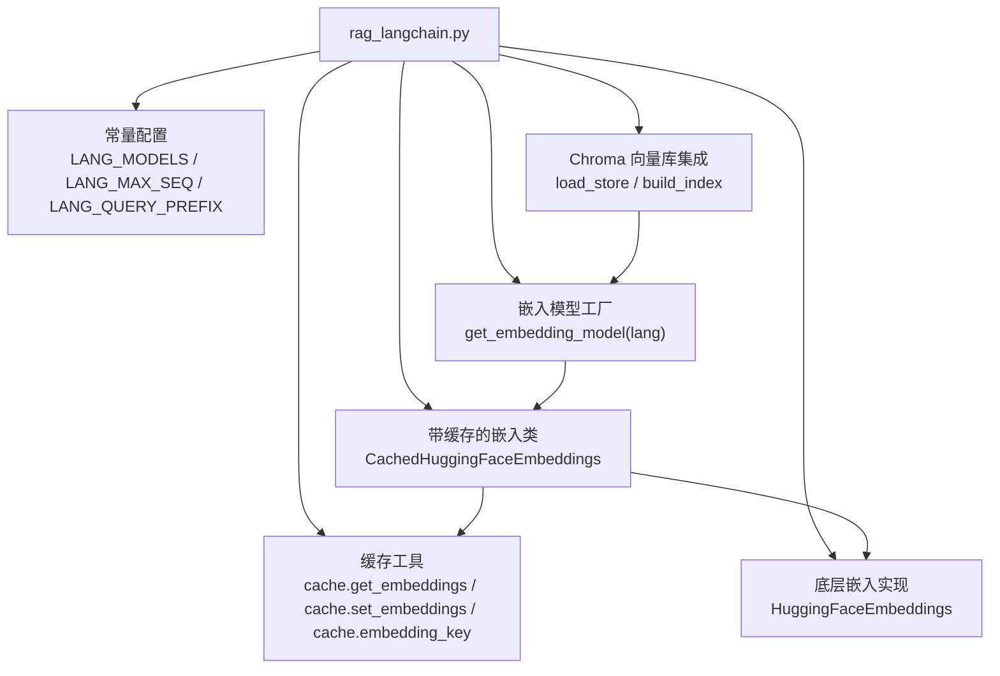
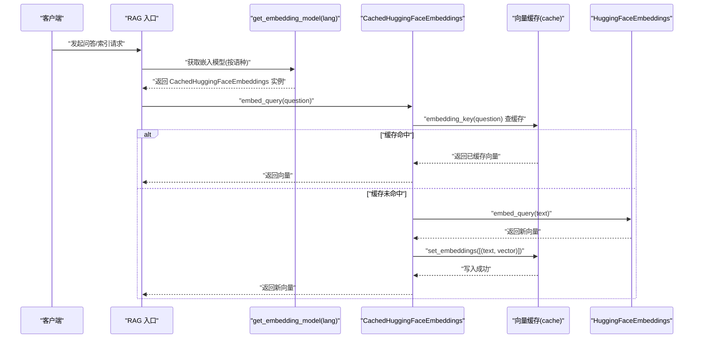
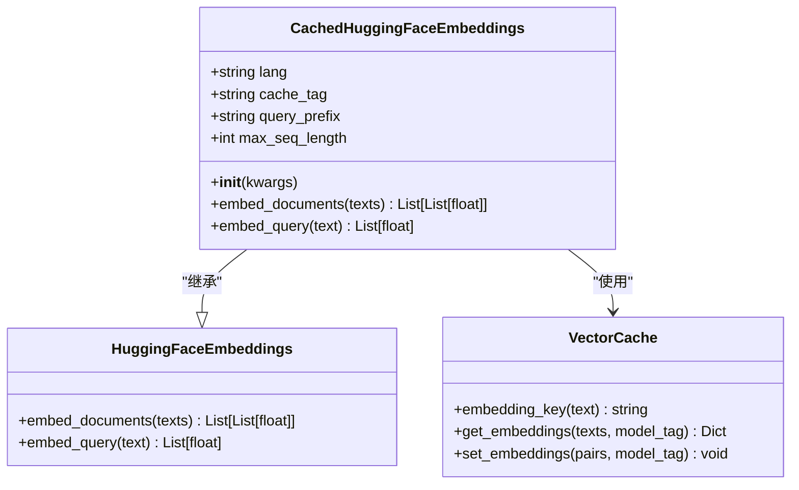
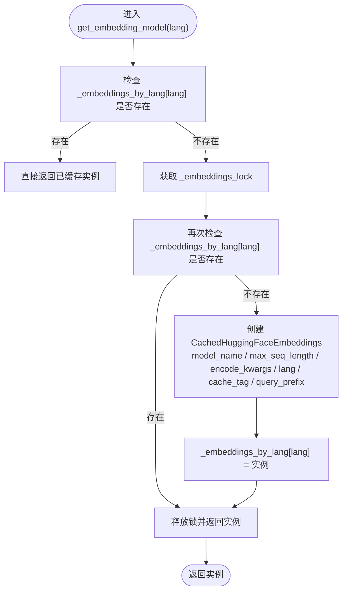
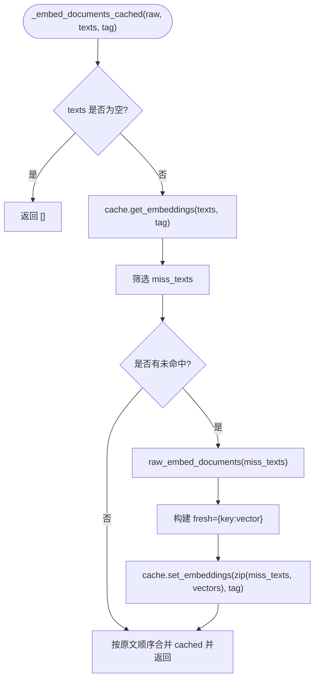
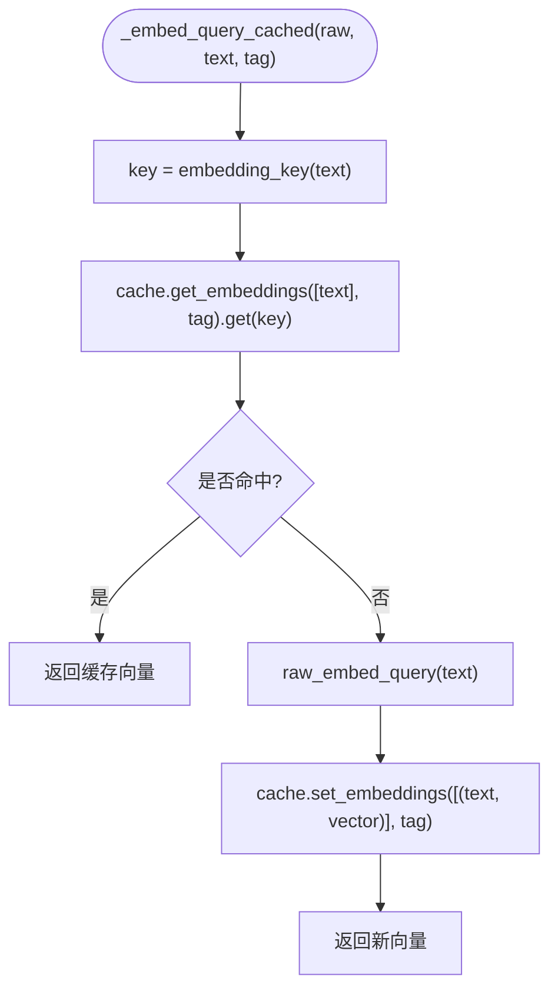
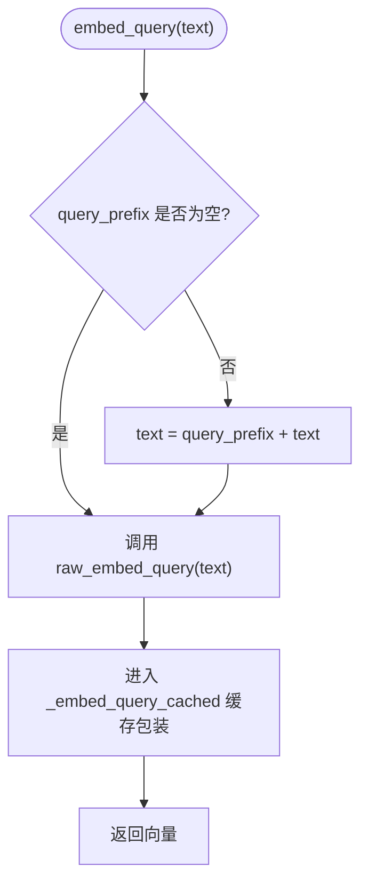
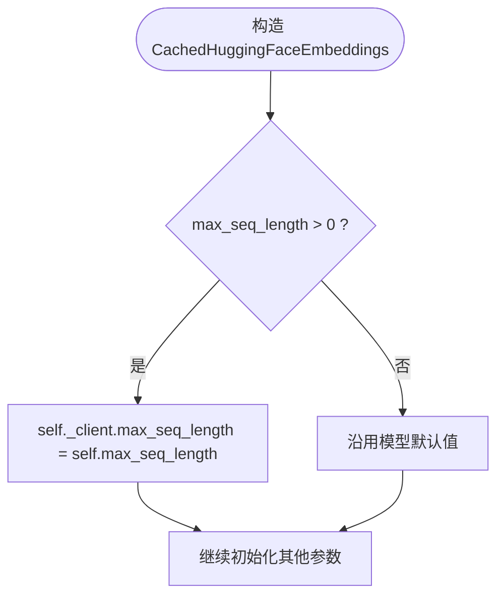
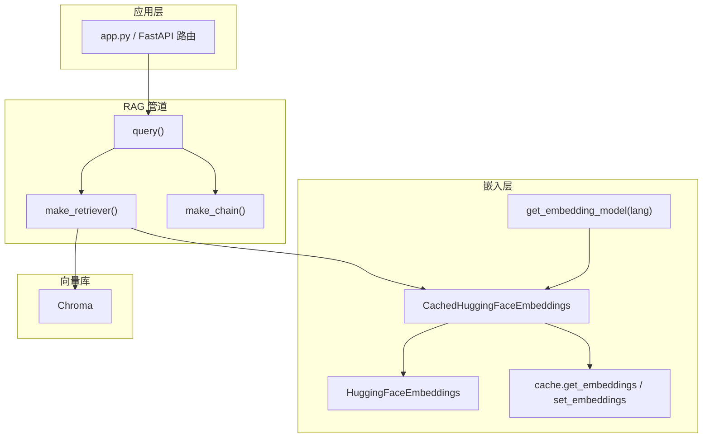

# 嵌入模型管理

<cite>
**本文引用的文件**   
- [rag_langchain.py](file://rag_langchain.py)
</cite>

## 目录
1. [引言](#引言)
2. [项目结构](#项目结构)
3. [核心组件](#核心组件)
4. [架构总览](#架构总览)
5. [详细组件分析](#详细组件分析)
6. [依赖关系分析](#依赖关系分析)
7. [性能与内存管理](#性能与内存管理)
8. [故障排查指南](#故障排查指南)
9. [结论](#结论)

## 引言
本文件聚焦于“嵌入模型管理模块”，重点说明 `CachedHuggingFaceEmbeddings` 类的实现思路、对 `HuggingFaceEmbeddings` 的继承与覆写机制，以及围绕该类的懒加载、向量缓存、查询前缀、最大序列长度等关键设计。目标是帮助读者理解：如何在高并发 RAG 服务中安全、高效地复用嵌入模型，并通过缓存显著降低重复计算成本。

## 项目结构
嵌入模型相关逻辑集中在一个核心文件中，采用“模块级单例 + 线程锁”的方式管理模型实例，同时通过子类化外部 Embedding 类来注入缓存行为。

**图表来源**  
- [rag_langchain.py:52-90](file://rag_langchain.py#L52-L90)  
- [rag_langchain.py:147-254](file://rag_langchain.py#L147-L254)  
- [rag_langchain.py:363-405](file://rag_langchain.py#L363-L405)

**章节来源**  
- [rag_langchain.py:52-90](file://rag_langchain.py#L52-L90)  
- [rag_langchain.py:147-254](file://rag_langchain.py#L147-L254)  
- [rag_langchain.py:363-405](file://rag_langchain.py#L363-L405)

## 核心组件
- `CachedHuggingFaceEmbeddings`：继承 `HuggingFaceEmbeddings`，覆写文档嵌入和查询嵌入方法，接入向量缓存，并支持 bge 模型的查询前缀与最大序列长度配置。
- `_embed_documents_cached`：批量文本向量化时的缓存包装器，命中则直接返回，未命中才调用底层模型。
- `_embed_query_cached`：单条查询向量化时的缓存包装器，避免重复提问或重复入库时重复计算。
- `get_embedding_model`：按语种懒加载嵌入模型，使用双检锁保证并发安全，避免重复加载大模型。
- 模块级常量：`LANG_MODELS`、`LANG_MAX_SEQ`、`LANG_QUERY_PREFIX`，决定不同语种的模型路径、最大输入长度与查询指令前缀。

**章节来源**  
- [rag_langchain.py:59-89](file://rag_langchain.py#L59-L89)  
- [rag_langchain.py:147-221](file://rag_langchain.py#L147-L221)  
- [rag_langchain.py:224-254](file://rag_langchain.py#L224-L254)

## 架构总览
下图展示一次典型问答流程中嵌入模型与缓存的协作方式：

**图表来源**  
- [rag_langchain.py:173-221](file://rag_langchain.py#L173-L221)  
- [rag_langchain.py:228-254](file://rag_langchain.py#L228-L254)

## 详细组件分析

### 1. 带缓存的嵌入类：`CachedHuggingFaceEmbeddings`
该类继承自 `HuggingFaceEmbeddings`，主要职责包括：
- 覆写 `embed_documents` 与 `embed_query`，将底层嵌入结果接入向量缓存。
- 在查询侧可选地拼接 bge 官方建议的查询前缀，以提升检索质量。
- 支持显式设置 `max_seq_length`，避免 sentence-transformers 静默截断超长文本。

**图表来源**  
- [rag_langchain.py:185-221](file://rag_langchain.py#L185-L221)

关键点：
- 为什么用子类覆写而不是 monkey patch？因为新版 `HuggingFaceEmbeddings` 基于 pydantic BaseModel，直接给实例动态赋值属性会被拦截；子类覆写能稳定兼容 Chroma 与 retriever 的调用约定。
- `query_prefix` 仅作用于查询侧，passage 侧不加前缀，符合 bge 系列模型的官方建议。
- `max_seq_length` 在构造后设置到内部 `_client`，以适配 sentence-transformers 5.x 的变化。

**章节来源**  
- [rag_langchain.py:185-221](file://rag_langchain.py#L185-L221)

### 2. 懒加载模型工厂：`get_embedding_model`
该函数负责按语种懒加载嵌入模型，并使用双检锁避免并发重复加载。

**图表来源**  
- [rag_langchain.py:224-254](file://rag_langchain.py#L224-L254)

要点：
- 不在模块导入时构造模型，避免启动阶段同时加载多个大模型导致内存峰值升高。
- 加锁是必要的：FastAPI 同步接口可能在线程池中并发执行，首次请求会同时走到这里；双检锁确保只加载一次。
- `cache_tag` 必须包含所有影响向量取值的因素（语种、模型路径、最大序列长度），否则换模型或改配置后旧向量仍可能命中。

**章节来源**  
- [rag_langchain.py:224-254](file://rag_langchain.py#L224-L254)

### 3. 向量缓存集成：`_embed_documents_cached` 与 `_embed_query_cached`
这两个函数是“缓存层”的核心，分别处理批量文档嵌入与单条查询嵌入。

#### 批量文档嵌入缓存
- 先通过 `cache.get_embeddings` 获取已有向量映射。
- 过滤出未命中的文本，调用底层 `raw_embed_documents` 计算。
- 将新计算的向量写回缓存，并按原始顺序合并返回。

**图表来源**  
- [rag_langchain.py:147-170](file://rag_langchain.py#L147-L170)

#### 单条查询嵌入缓存
- 使用 `cache.embedding_key(text)` 生成键。
- 若命中则直接返回；否则调用底层 `raw_embed_query` 计算并写入缓存。

**图表来源**  
- [rag_langchain.py:173-182](file://rag_langchain.py#L173-L182)

缓存键生成与命中率优化：
- 键由 `cache.embedding_key(text)` 生成，保证相同文本在不同模型下不会互相覆盖。
- 批量场景优先命中缓存，减少模型前向次数；单条查询也走缓存，提升重复提问或重复入库的性能。
- `model_tag`（即 `cache_tag`）区分不同模型与配置，避免中英文模型或不同 `max_seq_length` 的向量互相污染。

**章节来源**  
- [rag_langchain.py:147-182](file://rag_langchain.py#L147-L182)

### 4. bge 模型的查询前缀机制
bge 系列模型在检索时建议为 query 添加指令前缀，passage 侧不加。本项目通过 `LANG_QUERY_PREFIX` 提供英文查询前缀，并在 `CachedHuggingFaceEmbeddings.embed_query` 中自动拼接。

**图表来源**  
- [rag_langchain.py:83-89](file://rag_langchain.py#L83-L89)  
- [rag_langchain.py:217-221](file://rag_langchain.py#L217-L221)

注意：
- 前缀仅在查询侧生效，passage 侧不拼接，符合官方最佳实践。
- 可通过环境变量关闭或调整前缀内容，便于 A/B 测试。

**章节来源**  
- [rag_langchain.py:83-89](file://rag_langchain.py#L83-L89)  
- [rag_langchain.py:217-221](file://rag_langchain.py#L217-L221)

### 5. `max_seq_length` 配置的重要性
sentence-transformers 会对超长输入进行静默截断，这会导致召回质量下降且难以察觉。本项目显式设置 `LANG_MAX_SEQ`，并在构造后应用到内部 `_client.max_seq_length`。

**图表来源**  
- [rag_langchain.py:64-77](file://rag_langchain.py#L64-L77)  
- [rag_langchain.py:205-212](file://rag_langchain.py#L205-L212)

重要性：
- 避免静默截断导致的召回质量损失。
- `max_seq_length` 参与 `cache_tag`，确保配置变更后旧向量不会继续被错误命中。

**章节来源**  
- [rag_langchain.py:64-77](file://rag_langchain.py#L64-L77)  
- [rag_langchain.py:205-212](file://rag_langchain.py#L205-L212)

## 依赖关系分析
嵌入模型管理与缓存、LangChain 组件之间的关系如下：

**图表来源**  
- [rag_langchain.py:363-405](file://rag_langchain.py#L363-L405)  
- [rag_langchain.py:452-467](file://rag_langchain.py#L452-L467)  
- [rag_langchain.py:580-631](file://rag_langchain.py#L580-L631)  
- [rag_langchain.py:185-254](file://rag_langchain.py#L185-L254)

耦合与内聚：
- `CachedHuggingFaceEmbeddings` 对内聚了缓存逻辑，对外暴露与父类一致的接口，保持与 Chroma 和 retriever 的兼容性。
- `get_embedding_model` 作为工厂，集中管理模型生命周期与并发安全。
- 缓存工具 `cache` 被多处复用，形成稳定的数据访问边界。

潜在循环依赖：
- 当前实现未见明显循环依赖；嵌入层依赖缓存工具，但不反向依赖上层 RAG 管道。

外部依赖：
- `langchain_huggingface.HuggingFaceEmbeddings`
- `langchain_chroma.Chroma`
- 第三方缓存后端（由 `cache` 模块抽象）

**章节来源**  
- [rag_langchain.py:363-405](file://rag_langchain.py#L363-L405)  
- [rag_langchain.py:452-467](file://rag_langchain.py#L452-L467)  
- [rag_langchain.py:580-631](file://rag_langchain.py#L580-L631)  
- [rag_langchain.py:185-254](file://rag_langchain.py#L185-L254)

## 性能与内存管理
- 懒加载模型：只在首次使用时加载，避免启动阶段同时加载多模型导致内存峰值翻倍。
- 双检锁：在高并发场景下确保每个语种只加载一次模型，防止重复分配 400MB+ 权重。
- 向量缓存：批量与单条嵌入均走缓存，命中时跳过模型前向，显著降低 CPU/GPU 压力。
- 查询前缀：仅在查询侧拼接，避免 passage 侧向量空间偏移，提升检索精度。
- 最大序列长度：显式配置避免静默截断，保障召回质量；同时参与缓存键，避免配置变更后的脏命中。
- 归一化嵌入：通过 `encode_kwargs={"normalize_embeddings": True}` 启用归一化，有助于余弦相似度检索稳定性。

最佳实践建议：
- 在生产环境中监控缓存命中率与模型加载耗时，评估缓存策略有效性。
- 合理设置 `CHUNK_TOKENS` 与 `CHUNK_OVERLAP_TOKENS`，使块大小接近但小于 `max_seq_length`，减少截断风险。
- 定期清理过期缓存或版本升级后调用失效接口，避免脏数据长期驻留。

[本节为通用指导，不直接分析具体代码文件]

## 故障排查指南
常见问题与定位思路：
- 并发重复加载模型：检查是否正确使用 `get_embedding_model` 的双检锁；确认 FastAPI 线程池配置未绕过该工厂。
- 向量缓存未命中：检查 `cache_tag` 是否包含语种、模型路径与 `max_seq_length`；确认不同模型或配置变更后缓存键已变化。
- 查询前缀未生效：确认 `LANG_QUERY_PREFIX` 配置正确，且 `CachedHuggingFaceEmbeddings.query_prefix` 非空。
- 超长文本被截断：检查 `LANG_MAX_SEQ` 与 `max_seq_length` 设置；确认 `split_by_tokens` 的块大小不超过上限。
- 中文/英文向量混用：确认 `lang` 与 `cache_tag` 正确区分，避免两个语种的向量互相覆盖。

可参考的实现位置：
- 双检锁与模型懒加载：[rag_langchain.py:224-254](file://rag_langchain.py#L224-L254)
- 向量缓存包装器：[rag_langchain.py:147-182](file://rag_langchain.py#L147-L182)
- 查询前缀与最大序列长度：[rag_langchain.py:83-89](file://rag_langchain.py#L83-L89)、[rag_langchain.py:64-77](file://rag_langchain.py#L64-L77)、[rag_langchain.py:205-212](file://rag_langchain.py#L205-L212)

**章节来源**  
- [rag_langchain.py:147-182](file://rag_langchain.py#L147-L182)  
- [rag_langchain.py:205-254](file://rag_langchain.py#L205-L254)  
- [rag_langchain.py:64-89](file://rag_langchain.py#L64-L89)

## 结论
`CachedHuggingFaceEmbeddings` 通过对 `HuggingFaceEmbeddings` 的子类化与覆写，将向量缓存、查询前缀与最大序列长度控制整合进统一的嵌入接口。配合 `get_embedding_model` 的懒加载与双检锁，系统在并发环境下既能节省内存，又能避免重复模型加载。向量缓存进一步减少了重复计算，显著提升吞吐与响应速度。合理配置 `max_seq_length` 与查询前缀，能在保证召回质量的同时最大化性能收益。

[本节为总结性内容，不直接分析具体代码文件]