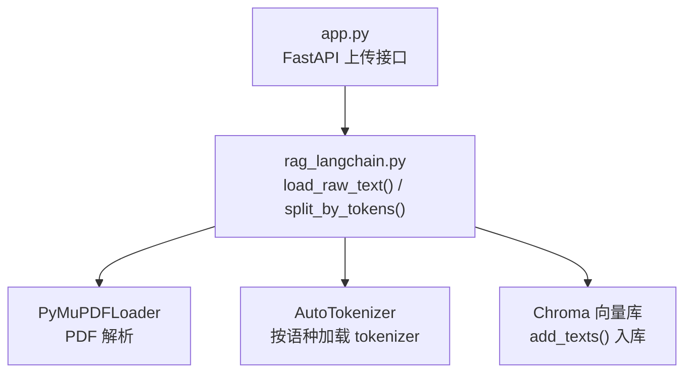
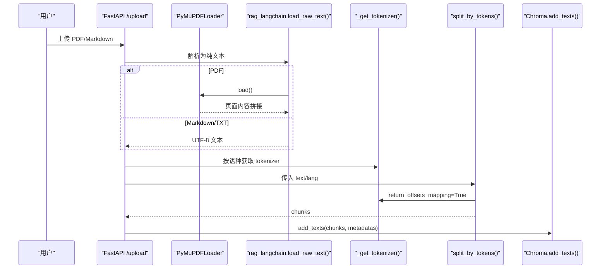
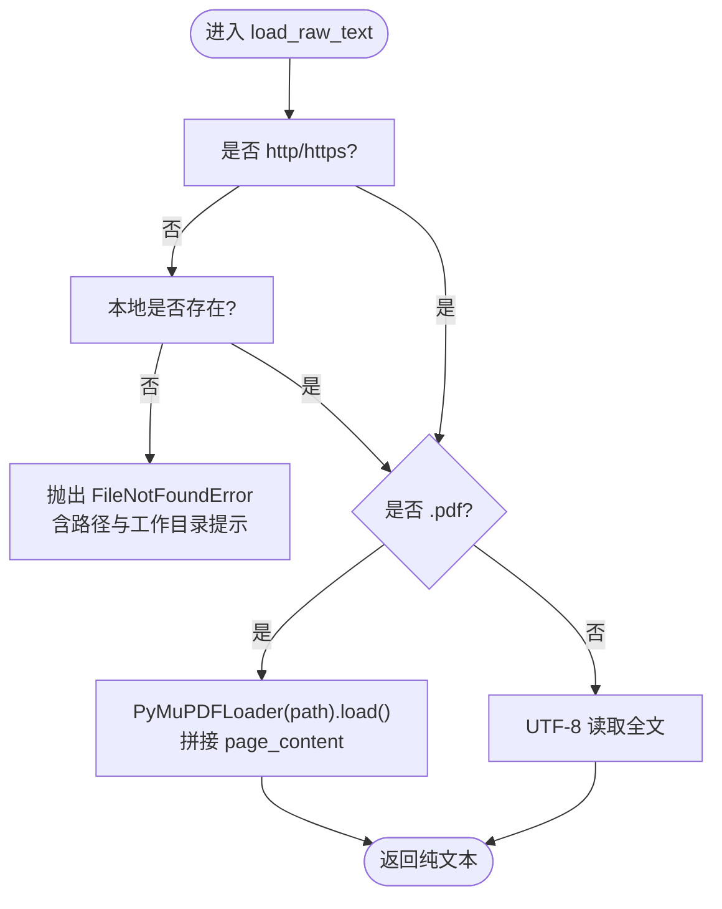
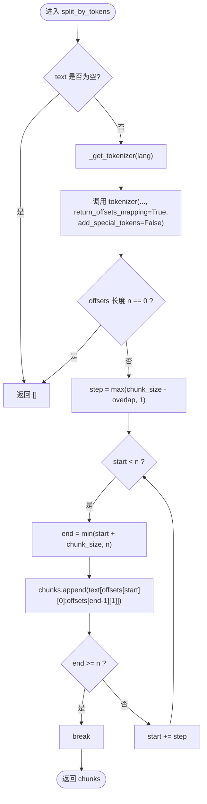
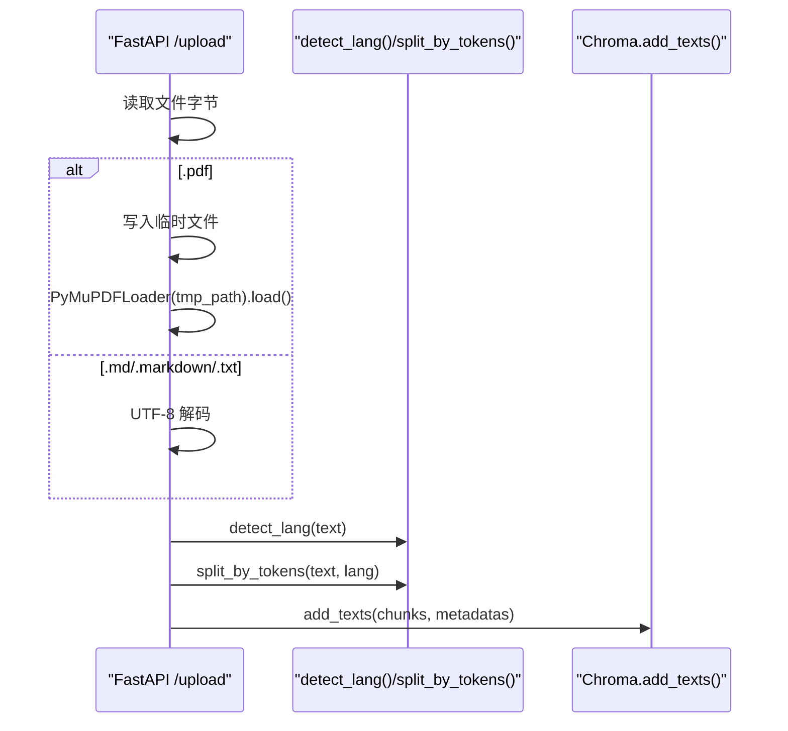
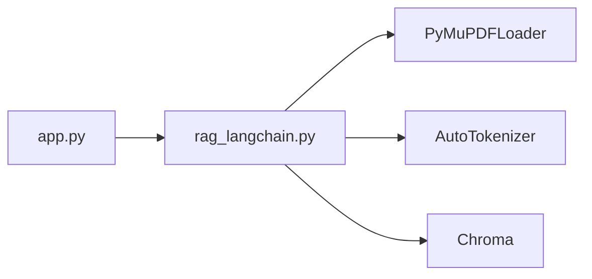
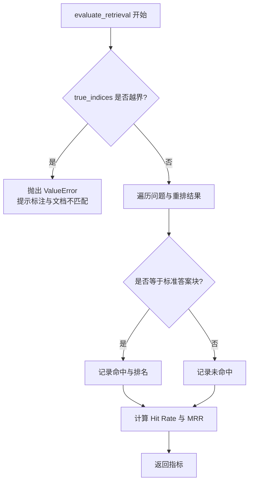

# 文档处理与分块

<cite>
**本文引用的文件**   
- [rag_langchain.py](file://rag_langchain.py)
- [app.py](file://app.py)
</cite>

## 目录
1. [引言](#引言)
2. [项目结构](#项目结构)
3. [核心组件](#核心组件)
4. [架构总览](#架构总览)
5. [详细组件分析](#详细组件分析)
6. [依赖关系分析](#依赖关系分析)
7. [性能与调优](#性能与调优)
8. [故障排查指南](#故障排查指南)
9. [结论](#结论)

## 引言
本章节聚焦“文档处理与分块”模块，围绕两个关键函数展开：
- load_raw_text()：负责 PDF 与 Markdown/TXT 的原始文本读取，统一输出纯文本。
- split_by_tokens()：基于 tokenizer 的 token 级别分块算法，使用 offset 对齐保证原文可还原，并以中英文统一的 token 计数标准构建检索库。

同时说明 CHUNK_TOKENS 与 CHUNK_OVERLAP_TOKENS 参数的含义、调优策略，以及与模型最大输入长度的关系；并给出分块质量评估、边界情况处理和性能优化的实践经验。

## 项目结构
本项目中，文档加载与分块逻辑集中在 rag_langchain.py，Web 服务入口 app.py 在上传流程中也直接调用 PyMuPDFLoader 与 split_by_tokens()。

**图示来源**
- [app.py:155-228](file://app.py#L155-L228)
- [rag_langchain.py:293-307](file://rag_langchain.py#L293-L307)
- [rag_langchain.py:314-359](file://rag_langchain.py#L314-L359)
- [rag_langchain.py:375-405](file://rag_langchain.py#L375-L405)

**章节来源**
- [app.py:155-228](file://app.py#L155-L228)
- [rag_langchain.py:293-405](file://rag_langchain.py#L293-L405)

## 核心组件
- 文档加载：load_raw_text(path)
  - 支持 .pdf（通过 PyMuPDFLoader）与 .md/.markdown/.txt（UTF-8 直接读取）。
  - 对本地路径不存在时抛出更友好的 FileNotFoundError，避免 PyMuPDFLoader 的模糊错误。
- Tokenizer 管理：_get_tokenizer(lang)
  - 按语种懒加载 AutoTokenizer，仅加载词表，不加载模型权重，开销小。
- 分块算法：split_by_tokens(text, lang, chunk_size, overlap)
  - 使用对应语种的 embedding 模型的 tokenizer，返回 offsets 映射。
  - 以 offset 为字符边界切原文，保证每个块是原文的子串，便于评测脚本做逐字节比对。
  - 步长 step = max(chunk_size - overlap, 1)，防止 overlap >= chunk_size 导致原地打转。
- 参数常量：CHUNK_TOKENS、CHUNK_OVERLAP_TOKENS
  - 默认值分别为 256 和 40，可通过环境变量覆盖，便于 A/B 对比。

**章节来源**
- [rag_langchain.py:293-307](file://rag_langchain.py#L293-L307)
- [rag_langchain.py:314-359](file://rag_langchain.py#L314-L359)
- [rag_langchain.py:107-111](file://rag_langchain.py#L107-L111)

## 架构总览
下图展示从 Web 上传到分块入库的关键调用链，体现 PDF/Markdown 解析、tokenizer 选择、offset 对齐分块以及入库流程。

**图示来源**
- [app.py:155-228](file://app.py#L155-L228)
- [rag_langchain.py:293-307](file://rag_langchain.py#L293-L307)
- [rag_langchain.py:314-359](file://rag_langchain.py#L314-L359)

## 详细组件分析

### load_raw_text()：PDF 与 Markdown 解析与错误处理
- 功能要点
  - 若 path 不是 http(s) 且本地不存在，立即抛出包含当前工作目录与默认 doc.pdf 提示的 FileNotFoundError，提升可诊断性。
  - 若后缀为 .pdf，则使用 PyMuPDFLoader(path).load() 将各页 page_content 拼接为整篇纯文本。
  - 否则以 UTF-8 打开并读取整个文件，适用于 .md/.markdown/.txt。
- 设计动机
  - PyMuPDFLoader 对无效路径的错误信息不够友好，提前拦截能更快定位问题。
  - 统一返回纯文本，屏蔽下游对 PDF/Markdown 的差异。

**图示来源**
- [rag_langchain.py:293-307](file://rag_langchain.py#L293-L307)

**章节来源**
- [rag_langchain.py:293-307](file://rag_langchain.py#L293-L307)

### split_by_tokens()：token 级别分块与 offset 对齐
- 核心思路
  - 使用对应语种的 embedding 模型的 tokenizer，调用时设置 return_offsets_mapping=True 与 add_special_tokens=False，得到每个 token 在原字符串中的起止偏移。
  - 以 offsets[start] 与 offsets[end-1] 的字符边界切取原文子串，确保每个块都是原文的精确片段，便于评测脚本进行逐字节比对。
  - 步长 step = max(chunk_size - overlap, 1)，避免 overlap >= chunk_size 时的死循环。
- 为什么用 offset 而不是 decode
  - tok.decode(ids) 不能稳定还原原文：中文会被规整、英文可能丢字符。因此只借助 tokenizer 计算 token 边界，再切原文。
- 为什么按 token 而非字符
  - 同样 300 字符，中文约 250 token、英文约 52 token，差异近 5 倍。按字符切会导致英文块信息量过少，影响检索精度与 LLM 上下文质量。按 token 切，中英两侧“一个块”的信息量可比。
- 复杂度
  - 时间复杂度 O(n)，n 为 token 数量；空间复杂度 O(n) 用于存储 offsets 与结果列表。
- 边界情况
  - 空文本或无 token 直接返回空列表。
  - overlap >= chunk_size 时，step 被钳制为 1，保证至少前进一个 token。
  - 最后一个块可能不足 chunk_size，算法自然截断至末尾。

**图示来源**
- [rag_langchain.py:324-359](file://rag_langchain.py#L324-L359)

**章节来源**
- [rag_langchain.py:314-359](file://rag_langchain.py#L314-L359)

### 与 Web 上传流程的集成
- FastAPI 的 /upload 接口在处理 PDF 时，也直接使用 PyMuPDFLoader 写入临时文件后解析，随后调用 detect_lang() 判定语种，再用 split_by_tokens(text, lang) 分块入库。
- 该流程与离线 build_index() 的分块逻辑一致，保证线上与离线产出的 chunks 口径相同。

**图示来源**
- [app.py:155-228](file://app.py#L155-L228)

**章节来源**
- [app.py:155-228](file://app.py#L155-L228)

## 依赖关系分析
- 外部依赖
  - langchain_community.document_loaders.PyMuPDFLoader：PDF 解析。
  - transformers.AutoTokenizer：按语种加载 tokenizer，仅加载词表。
  - Chroma：向量库持久化与批量入库。
- 内部耦合
  - app.py 依赖 rag_langchain.py 提供的 load_raw_text、split_by_tokens、detect_lang 等能力。
  - split_by_tokens 依赖 _get_tokenizer(lang)，后者依赖 LANG_MODELS[lang] 指向的 embedding 模型路径。

**图示来源**
- [app.py:40-51](file://app.py#L40-L51)
- [rag_langchain.py:39-46](file://rag_langchain.py#L39-L46)
- [rag_langchain.py:314-321](file://rag_langchain.py#L314-L321)

**章节来源**
- [app.py:40-51](file://app.py#L40-L51)
- [rag_langchain.py:39-46](file://rag_langchain.py#L39-L46)
- [rag_langchain.py:314-321](file://rag_langchain.py#L314-L321)

## 性能与调优

### CHUNK_TOKENS 与 CHUNK_OVERLAP_TOKENS 调优策略
- 默认值
  - CHUNK_TOKENS=256，CHUNK_OVERLAP_TOKENS=40，重叠率约 16%。
  - 256 是模型上限 512 的一半，留足余量，避免换模型或改配置时再次触发静默截断。
- 可调方式
  - 通过环境变量 CHUNK_TOKENS 与 CHUNK_OVERLAP_TOKENS 覆盖默认值，便于 A/B 对比。
- 与模型最大输入长度的关系
  - LANG_MAX_SEQ 显式设置为 512，避免 sentence-transformers 静默截断。
  - 若增大 CHUNK_TOKENS，需同步评估 LANG_MAX_SEQ 是否足够；若减小，可降低内存占用但可能增加块数与检索噪声。
- 重叠的作用
  - 适当重叠有助于跨块语义连贯，减少边界信息丢失；过大重叠会增加冗余与计算成本。

**章节来源**
- [rag_langchain.py:64-77](file://rag_langchain.py#L64-L77)
- [rag_langchain.py:107-111](file://rag_langchain.py#L107-L111)
- [rag_langchain.py:324-359](file://rag_langchain.py#L324-L359)

### 分块质量评估
- 指标
  - Hit Rate：标准答案块是否在召回精排结果中出现。
  - MRR：命中位置的倒数平均，衡量排序质量。
- 评估流程
  - 使用 evaluate_retrieval(questions, true_indices, chunks, reranked_results)。
  - 若 true_indices 越界，会抛出 ValueError 并提示标注与文档不匹配，避免静默错误。
- 注意事项
  - true_indices 是针对特定文档的块号，更换文档后必须重新标注。
  - chunks_preview_{lang}.md 由 save_chunks_to_file() 生成，作为人工标注与评测基准。

**图示来源**
- [rag_langchain.py:647-689](file://rag_langchain.py#L647-L689)

**章节来源**
- [rag_langchain.py:647-689](file://rag_langchain.py#L647-L689)

### 边界情况处理
- 空文本或无 token：split_by_tokens 返回空列表，避免后续入库异常。
- overlap >= chunk_size：step 被钳制为 1，保证至少前进一个 token，避免原地打转。
- 最后一个块不足 chunk_size：算法自然截断至末尾，不会越界。
- 文件不存在：load_raw_text 提前抛出 FileNotFoundError，附带工作目录与默认路径提示。
- 空库保护：/ask 接口在目标语种库为空时直接返回提示，避免模型“凭印象作答”。

**章节来源**
- [rag_langchain.py:324-359](file://rag_langchain.py#L324-L359)
- [rag_langchain.py:293-307](file://rag_langchain.py#L293-L307)
- [app.py:231-260](file://app.py#L231-L260)

### 性能优化实践
- Tokenizer 懒加载与线程安全
  - _get_tokenizer 使用双检锁，避免并发重复加载词表。
- 嵌入缓存
  - CachedHuggingFaceEmbeddings 对 embed_documents 与 embed_query 加缓存，命中即跳过模型前向。
- 精排分数缓存
  - rerank_cached 对 (query, doc) 打分结果缓存，显著降低 cross-encoder 调用次数。
- 向量库客户端共享
  - _get_chroma_client 共享 PersistentClient，避免多实例导致的句柄与索引冲突。
- 批量入库
  - store.add_texts 一次完成嵌入与入库，减少往返与重复计算。

**章节来源**
- [rag_langchain.py:185-254](file://rag_langchain.py#L185-L254)
- [rag_langchain.py:420-449](file://rag_langchain.py#L420-L449)
- [rag_langchain.py:261-289](file://rag_langchain.py#L261-L289)
- [rag_langchain.py:375-405](file://rag_langchain.py#L375-L405)

## 故障排查指南
- 上传失败
  - 检查文件类型是否受支持（.pdf/.md/.markdown/.txt）。
  - 确认文件内容非空；空内容会返回“文件内容为空”。
- 分块后无内容
  - 可能是文本全为空白或 tokenizer 无法切出有效 token；检查源文本编码与内容。
- 检索结果为空或答非所问
  - 检查目标语种库是否为空；/ask 接口会在空库时直接提示。
  - 确认 chunks_preview_{lang}.md 是否与当前向量库一致；不一致可能导致评测误判。
- 缓存相关问题
  - 文档变更后调用 invalidate_caches() 清空问答/精排缓存与语义缓存，并提升版本号。
  - 若启用语义缓存，注意阈值 SEMANTIC_THRESHOLD 过高收益有限、过低可能误命中。

**章节来源**
- [app.py:155-228](file://app.py#L155-L228)
- [app.py:231-260](file://app.py#L231-L260)
- [rag_langchain.py:634-644](file://rag_langchain.py#L634-L644)

## 结论
- load_raw_text() 统一了 PDF 与 Markdown/TXT 的读取路径，并通过前置路径校验提升错误可诊断性。
- split_by_tokens() 采用 tokenizer 的 offset 对齐技术，保证分块为原文子串，实现中英文统一的 token 计数标准，兼顾检索精度与 LLM 上下文质量。
- CHUNK_TOKENS 与 CHUNK_OVERLAP_TOKENS 的默认值与模型最大输入长度协同设计，既避免静默截断，又保留调优空间。
- 结合嵌入缓存、精排缓存与向量库客户端共享，整体链路在性能与稳定性上取得平衡。
- 建议在生产环境中根据业务数据分布与模型能力，持续评估 Hit Rate/MRR，并据此微调分块参数与重叠比例。