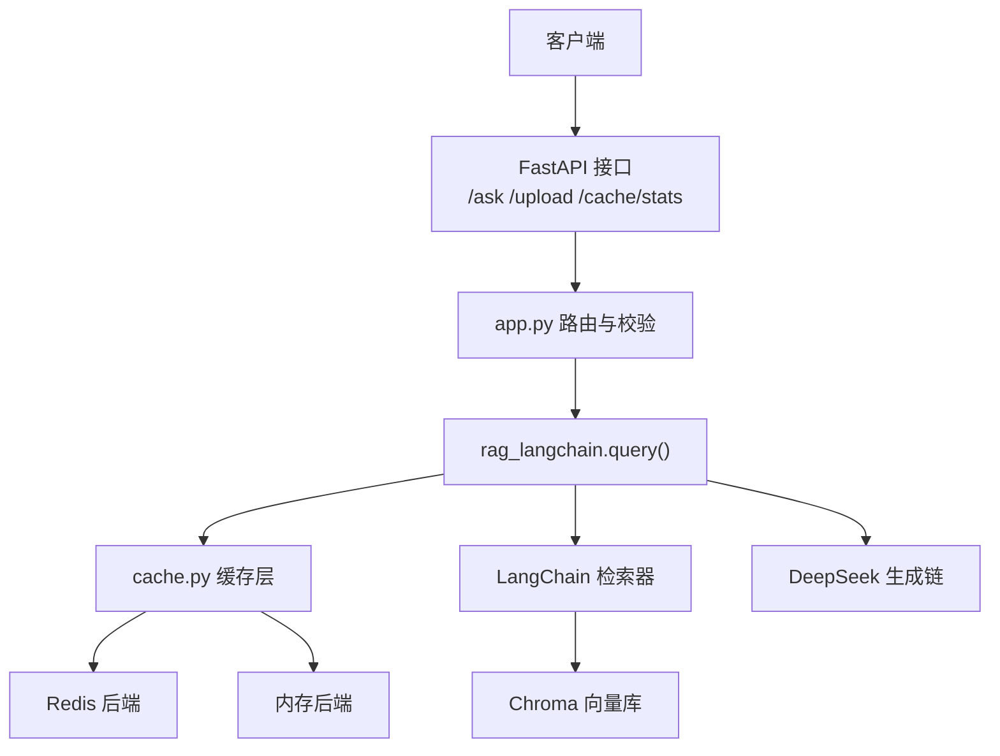
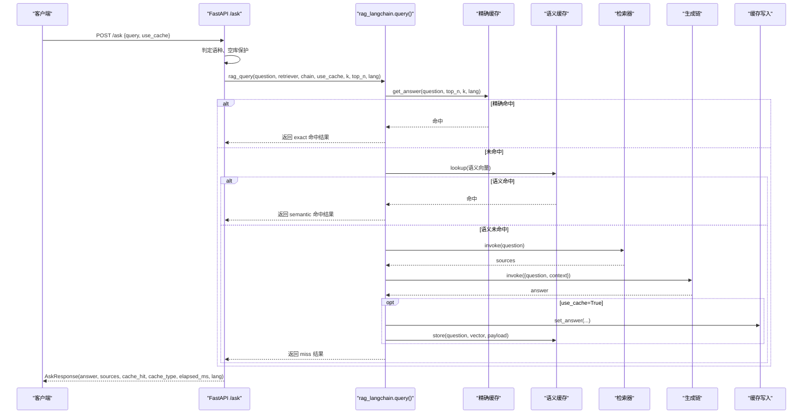
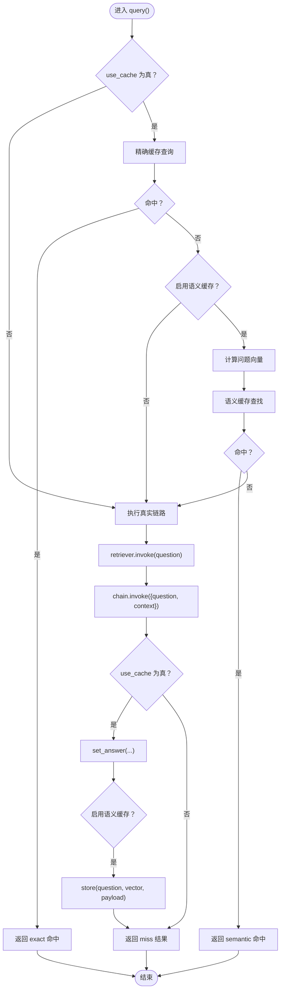
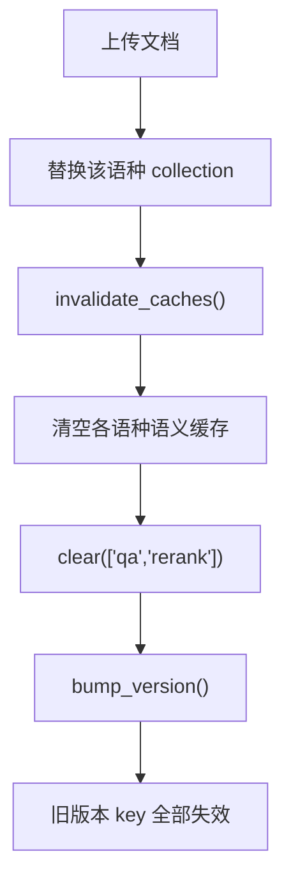
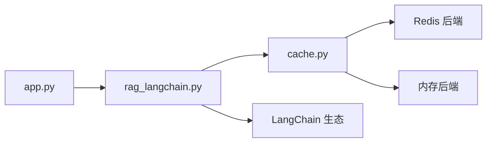

# 查询编排与缓存集成

<cite>
**本文引用的文件**   
- [app.py](file://app.py)
- [rag_langchain.py](file://rag_langchain.py)
- [cache.py](file://cache.py)
- [verify_cache.py](file://verify_cache.py)
</cite>

## 目录
1. [引言](#引言)
2. [项目结构](#项目结构)
3. [核心组件](#核心组件)
4. [架构总览](#架构总览)
5. [详细组件分析](#详细组件分析)
6. [依赖关系分析](#依赖关系分析)
7. [性能与监控](#性能与监控)
8. [故障恢复策略](#故障恢复策略)
9. [结论](#结论)
10. [附录：返回字段规范](#附录返回字段规范)

## 引言
本文围绕“查询编排与缓存集成”展开，重点说明 `query()` 函数的完整处理流程、缓存优先级与失效策略、返回数据的标准化结构、`invalidate_caches()` 的清理机制，以及性能监控指标和故障恢复策略。该系统采用四层处理路径：**精确缓存 → 语义缓存 → 真实链路 → 缓存写入**，并通过三层后端缓存（问答缓存、向量缓存、精排分数缓存）实现加速；同时通过版本号提升保证知识库更新后旧答案立即失效。

## 项目结构
本仓库的核心由三个模块组成：
- `app.py`：FastAPI Web 服务入口，负责请求路由、语种判定、空库保护、调用 `rag_query` 并封装标准响应。
- `rag_langchain.py`：RAG 管道与缓存编排层，包含检索、重排、生成、语义缓存、`query()` 主流程、`invalidate_caches()` 等。
- `cache.py`：统一缓存层，提供 Redis/内存双后端、TTL、版本号、统计计数、问答/向量/精排三类缓存 API。

**图示来源**
- [app.py:231-260](file://app.py#L231-L260)
- [rag_langchain.py:580-631](file://rag_langchain.py#L580-L631)
- [cache.py:176-199](file://cache.py#L176-L199)

**章节来源**
- [app.py:1-53](file://app.py#L1-L53)
- [rag_langchain.py:1-24](file://rag_langchain.py#L1-L24)
- [cache.py:1-29](file://cache.py#L1-L29)

## 核心组件
- **Web 接口层**：`/ask` 接收问题，按语种选择检索器和生成链，调用 `rag_query`，返回标准化结果。
- **查询编排层**：`query()` 实现四阶段处理，控制缓存命中、语义近似匹配、真实链路执行与缓存回写。
- **缓存层**：提供问答、向量、精排三类缓存，支持 TTL、版本号、命中率统计、多后端自动降级。

关键职责划分：
- `app.py` 不关心缓存细节，只负责参数传递与响应封装。
- `rag_langchain.py` 是编排中枢，串联检索、重排、生成与语义缓存。
- `cache.py` 是基础设施，屏蔽 Redis/内存差异，暴露稳定 API。

**章节来源**
- [app.py:129-149](file://app.py#L129-L149)
- [rag_langchain.py:580-644](file://rag_langchain.py#L580-L644)
- [cache.py:271-367](file://cache.py#L271-L367)

## 架构总览
下图展示一次 `/ask` 请求从进入 FastAPI 到最终返回的完整时序，包括缓存优先级的判断、语义缓存可选分支、真实链路执行与缓存写入。

**图示来源**
- [app.py:231-260](file://app.py#L231-L260)
- [rag_langchain.py:580-631](file://rag_langchain.py#L580-L631)
- [cache.py:271-300](file://cache.py#L271-L300)

## 详细组件分析

### query() 四阶段处理流程
`query()` 是一次问答的完整入口，其核心逻辑如下：
1. **精确缓存**：使用 `cache.get_answer(question, top_n, k, lang)` 查找完全相同的问题原文是否已有答案。命中则直接返回，`cache_type="exact"`。
2. **语义缓存**：若启用语义缓存，计算问题向量并与历史语义缓存比对余弦相似度，超过阈值则复用旧答案，`cache_type="semantic(score)"`。
3. **真实链路**：调用注入的 `retriever.invoke(question)` 获取片段，再调用 `chain.invoke({"question": question, "context": format_docs(sources)})` 生成答案。
4. **缓存写入**：若 `use_cache=True`，将答案与片段写入问答缓存；若启用语义缓存，也将问题向量与负载存入语义缓存。

**图示来源**
- [rag_langchain.py:580-631](file://rag_langchain.py#L580-L631)

**章节来源**
- [rag_langchain.py:580-631](file://rag_langchain.py#L580-L631)

### 缓存优先级与失效策略
- **优先级顺序**：精确缓存 > 语义缓存 > 真实链路。一旦上层命中，下层不再执行。
- **何时跳过缓存直接计算**：
  - `use_cache=False`：强制走真实链路，不查也不写缓存。
  - 目标语种向量库为空：在 `/ask` 中提前返回提示，不走检索与生成。
- **何时更新缓存内容**：
  - 真实链路成功后，若 `use_cache=True`，写入问答缓存；若启用语义缓存，也写入语义缓存。
  - 上传文档后调用 `invalidate_caches()`，清空语义缓存、问答与精排缓存，并提升版本号，使旧答案立即失效。

**图示来源**
- [app.py:155-228](file://app.py#L155-L228)
- [rag_langchain.py:634-644](file://rag_langchain.py#L634-L644)
- [cache.py:216-233](file://cache.py#L216-L233)

**章节来源**
- [app.py:155-228](file://app.py#L155-L228)
- [rag_langchain.py:634-644](file://rag_langchain.py#L634-L644)
- [cache.py:216-233](file://cache.py#L216-L233)

### 返回数据标准化结构
`AskResponse` 定义如下字段：
- `answer`：模型生成的回答文本。
- `sources`：召回并精排后的片段正文列表。
- `cache_hit`：布尔值，表示本次请求是否命中缓存。
- `cache_type`：字符串，标识命中类型，可能值为 `"exact"`、`"semantic(...)"` 或 `"miss"`。
- `elapsed_ms`：浮点数，记录本次请求耗时（毫秒）。
- `lang`：问题判定的语种，用于前端展示与调试。

这些字段由 `app.py` 中的 `AskResponse` 模型约束，并由 `rag_langchain.query()` 返回的字典直接填充。

**章节来源**
- [app.py:134-141](file://app.py#L134-L141)
- [rag_langchain.py:580-631](file://rag_langchain.py#L580-L631)

### invalidate_caches() 缓存清理机制
`invalidate_caches()` 在文档变更后调用，执行以下操作：
1. 清空所有语种的语义缓存。
2. 清除问答缓存与精排分数缓存。
3. 提升缓存版本号，使所有带旧版本的 key 失效。

返回值是被删除的缓存条目数量，便于日志与监控。

**章节来源**
- [rag_langchain.py:634-644](file://rag_langchain.py#L634-L644)
- [cache.py:371-390](file://cache.py#L371-L390)

## 依赖关系分析
- `app.py` 依赖 `rag_langchain` 提供的 `query`、`invalidate_caches`、`get_retriever`、`get_chain` 等。
- `rag_langchain.py` 依赖 `cache.py` 提供三类缓存 API，并依赖 LangChain 生态（Chroma、HuggingFaceEmbeddings、ChatDeepSeek）。
- `cache.py` 提供 Redis 与内存双后端，默认自动降级，确保系统可用性。

**图示来源**
- [app.py:43-51](file://app.py#L43-L51)
- [rag_langchain.py:48-49](file://rag_langchain.py#L48-L49)
- [cache.py:176-199](file://cache.py#L176-L199)

**章节来源**
- [app.py:43-51](file://app.py#L43-L51)
- [rag_langchain.py:48-49](file://rag_langchain.py#L48-L49)
- [cache.py:176-199](file://cache.py#L176-L199)

## 性能与监控
- **性能指标**：
  - `elapsed_ms`：每次请求的端到端耗时，可用于观察缓存命中前后的延迟差异。
  - 缓存命中率：通过 `cache.get_stats()` 获取 `qa_hit_rate`、`embed_hit_rate`、`rerank_hit_rate`。
  - 后端健康状态：`cache.backend_name()` 与 `cache.healthy()` 可监控 Redis/内存后端状态。
- **监控接口**：
  - `/cache/stats`：返回后端名称、健康状态、当前版本号、各语种库块数、TTL 配置与统计信息。
  - `/health`：轻量健康检查，含缓存后端与集合大小。
- **优化建议**：
  - 合理设置 `SEMANTIC_CACHE` 与 `SEMANTIC_THRESHOLD`，避免误命中导致答非所问。
  - 调整 `RETRIEVE_K` 与 `RERANK_TOP_N`，平衡召回质量与缓存收益。
  - 生产环境建议使用 Redis 后端，避免进程重启导致缓存丢失。

**章节来源**
- [app.py:263-277](file://app.py#L263-L277)
- [cache.py:45-72](file://cache.py#L45-L72)
- [rag_langchain.py:113-115](file://rag_langchain.py#L113-L115)

## 故障恢复策略
- **fail-open 设计**：任何缓存读取失败都视为未命中，继续走真实链路，保证答案正确性不受缓存异常影响。
- **后端自动降级**：Redis 不可用时自动降级到内存后端，开发环境无需外部依赖。
- **空库保护**：目标语种库为空时直接返回提示，避免模型“凭印象作答”。
- **版本号失效**：文档变更后提升版本号，旧答案立即失效，防止脏数据长期存在。

**章节来源**
- [cache.py:250-261](file://cache.py#L250-L261)
- [cache.py:176-199](file://cache.py#L176-L199)
- [app.py:241-249](file://app.py#L241-L249)
- [cache.py:216-233](file://cache.py#L216-L233)

## 结论
本系统通过 `query()` 的四阶段处理流程实现了高效的查询编排与缓存集成。精确缓存与语义缓存共同提升了响应速度，真实链路保证了答案的正确性与新鲜度，而 `invalidate_caches()` 与版本号机制确保了知识库更新后的缓存一致性。配合 `/cache/stats` 与 `/health` 接口，运维人员可实时监控缓存命中率与后端健康状态，结合 fail-open 与自动降级策略，系统在可用性与正确性之间取得了良好平衡。

## 附录：返回字段规范
| 字段 | 类型 | 含义 | 用途 |
|------|------|------|------|
| `answer` | string | 模型生成的回答 | 用户可见的最终答案 |
| `sources` | list[string] | 召回并精排后的片段正文 | 用于溯源与解释 |
| `cache_hit` | boolean | 是否命中缓存 | 前端展示缓存状态 |
| `cache_type` | string | 命中类型：`exact`、`semantic(...)`、`miss` | 区分精确命中、语义命中或未命中 |
| `elapsed_ms` | float | 请求耗时（毫秒） | 性能监控与对比 |
| `lang` | string | 问题判定语种 | 前端展示与调试 |

**章节来源**
- [app.py:134-141](file://app.py#L134-L141)
- [rag_langchain.py:580-631](file://rag_langchain.py#L580-L631)