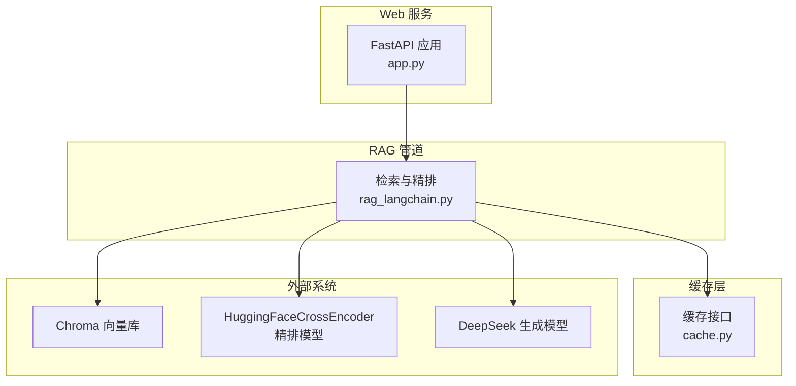
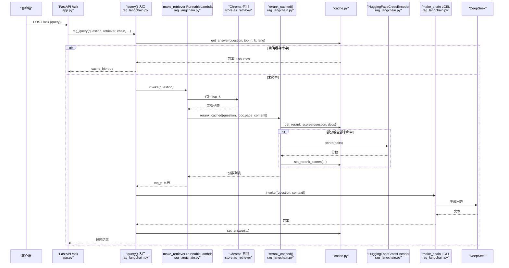
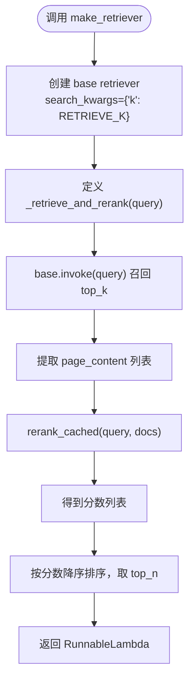
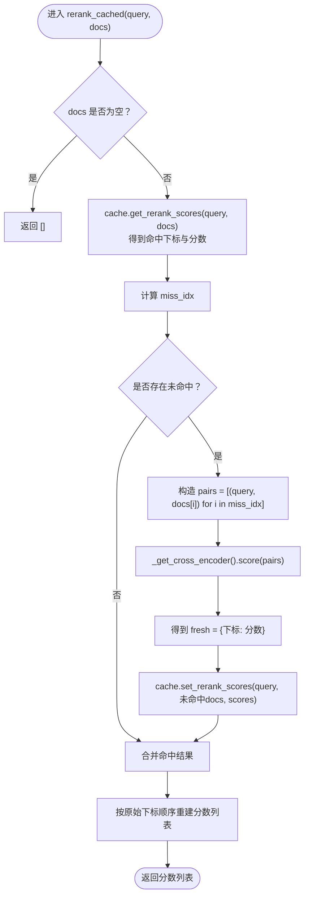
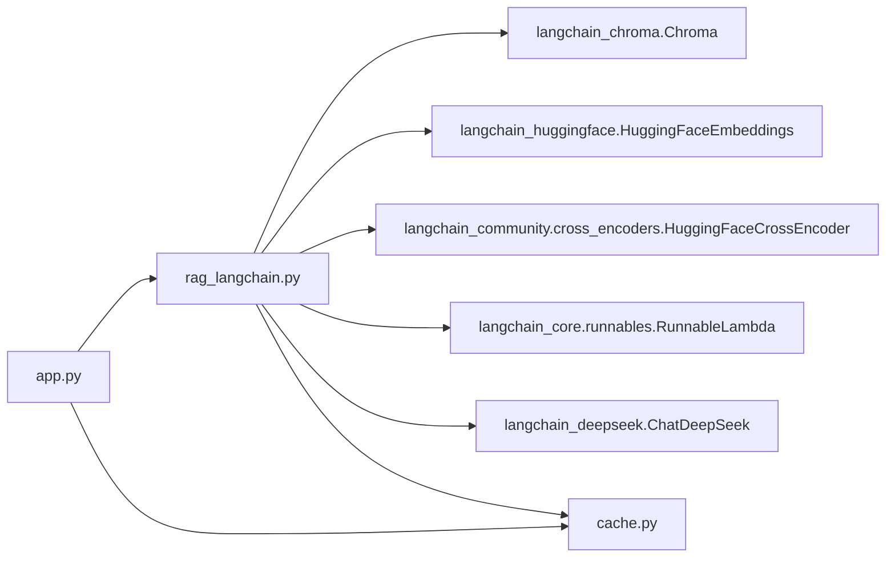
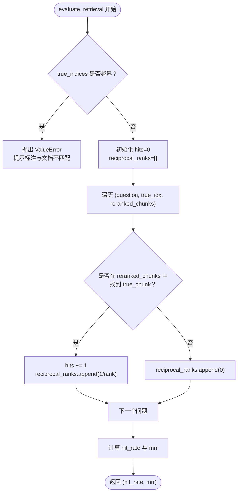

# 检索与重排序

<cite>
**本文引用的文件**   
- [rag_langchain.py](file://rag_langchain.py)
- [app.py](file://app.py)
- [cache.py](file://cache.py)
- [verify_cache.py](file://verify_cache.py)
</cite>

## 目录
1. [引言](#引言)
2. [项目结构](#项目结构)
3. [核心组件](#核心组件)
4. [架构总览](#架构总览)
5. [详细组件分析](#详细组件分析)
6. [依赖关系分析](#依赖关系分析)
7. [性能与调参](#性能与调参)
8. [评估与基准方法](#评估与基准方法)
9. [故障排查](#故障排查)
10. [结论](#结论)

## 引言
本模块聚焦 RAG 系统中的“检索 + 精排”链路，重点说明以下实现：
- `make_retriever()` 如何包装 LangChain retriever，并通过 `RunnableLambda` 把召回与精排串成可复用的检索器。
- `rerank_cached()` 的精排缓存机制：cross-encoder 分数缓存、`(query, doc)` 对的哈希键设计、批量计算优化。
- HuggingFaceCrossEncoder 的懒加载策略与内存管理。
- 检索参数 `RETRIEVE_K` 与 `RERANK_TOP_N` 的调优原则，以及两者对召回质量与性能的影响。
- 检索效果评估、缓存命中率分析与性能基准测试的方法。

## 项目结构
与检索和重排序直接相关的代码分布在三个文件中：
- `rag_langchain.py`：LangChain 版 RAG 管道，包含检索、精排、缓存集成、评测入口等。
- `app.py`：FastAPI Web 服务，按语种路由到对应向量库，并复用 `make_retriever` 构造 retriever 单例。
- `cache.py`：三层缓存（问答、embedding、rerank），提供 Redis/内存后端、TTL、版本号失效与统计。
- `verify_cache.py`：不加载模型的缓存层验证脚本，用于快速检查缓存读写、命中计数与失效逻辑。

**图表来源**
- [app.py:44-51](file://app.py#L44-L51)
- [rag_langchain.py:452-467](file://rag_langchain.py#L452-L467)
- [cache.py:1-29](file://cache.py#L1-L29)

**章节来源**
- [rag_langchain.py:1-24](file://rag_langchain.py#L1-L24)
- [app.py:1-26](file://app.py#L1-L26)

## 核心组件
本节从调用方视角梳理检索与重排序的关键函数与职责：

| 组件 | 主要职责 | 关键行为 |
|---|---|---|
| `make_retriever(store, k, top_n)` | 构建 LangChain retriever，封装召回 + 精排 | 使用 `store.as_retriever(search_kwargs={"k": k})` 做粗排，再用 cross-encoder 精排到 `top_n`，返回 `RunnableLambda` |
| `rerank_cached(query, docs)` | cross-encoder 打分 + 精排分数缓存 | 先查缓存，未命中的 `(query, doc)` 批量送入 `_get_cross_encoder().score()`，再写回缓存 |
| `_get_cross_encoder()` | 懒加载 cross-encoder 模型 | 首次使用时才实例化 `HuggingFaceCrossEncoder`，避免启动时占用约 470MB 内存 |
| `query(question, retriever, chain, ...)` | 带缓存的问答入口 | 精确缓存 → 语义缓存 → 真实链路；记录 `elapsed_ms`、`cache_hit`、`cache_type` |
| `evaluate_retrieval(questions, true_indices, chunks, reranked_results)` | 离线评估 Hit Rate / MRR | 校验标注索引越界，逐题在重排结果中查找标准答案块 |

**章节来源**
- [rag_langchain.py:420-467](file://rag_langchain.py#L420-L467)
- [rag_langchain.py:580-631](file://rag_langchain.py#L580-L631)
- [rag_langchain.py:648-689](file://rag_langchain.py#L648-L689)

## 架构总览
下图展示一次用户提问从 FastAPI 到检索、精排、生成的完整流程，以及缓存在各阶段的作用。

**图表来源**
- [app.py:231-260](file://app.py#L231-L260)
- [rag_langchain.py:452-467](file://rag_langchain.py#L452-L467)
- [rag_langchain.py:428-449](file://rag_langchain.py#L428-L449)
- [rag_langchain.py:580-631](file://rag_langchain.py#L580-L631)
- [cache.py:271-367](file://cache.py#L271-L367)

## 详细组件分析

### `make_retriever()`：LangChain retriever 包装与 `RunnableLambda`
`make_retriever()` 的核心目标是把“向量召回 + cross-encoder 精排”封装成一个 LangChain 可消费的 retriever。它并不直接返回 Chroma retriever，而是返回一个 `RunnableLambda`，从而让上层 LCEL 链可以像调用普通 retriever 一样调用它。

实现要点如下：
- 通过 `store.as_retriever(search_kwargs={"k": k})` 获取基础 retriever，其中 `k` 默认来自模块级常量 `RETRIEVE_K`。
- 定义内部函数 `_retrieve_and_rerank(query)`：
  - 调用 `base.invoke(query)` 得到召回文档。
  - 提取 `page_content` 传给 `rerank_cached(query, docs)` 获得精排分数。
  - 将文档与分数配对后按分数降序排序，取前 `top_n` 条作为最终结果。
- 返回 `RunnableLambda(_retrieve_and_rerank)`，使该逻辑成为 LangChain 可执行单元。

这种设计的优势是：
- 对外暴露统一接口：上层只需调用 `retriever.invoke(question)`，无需关心内部是否做了精排。
- 便于组合：`make_chain(retriever)` 可以把这个 retriever 接入 PromptTemplate、LLM 与输出解析器组成的 LCEL 链。
- 便于缓存：精排分数走 `rerank_cached()`，即使召回结果相同，跨请求也能复用 cross-encoder 分数。

**图表来源**
- [rag_langchain.py:452-467](file://rag_langchain.py#L452-L467)

**章节来源**
- [rag_langchain.py:452-467](file://rag_langchain.py#L452-L467)

### `rerank_cached()`：精排缓存机制与批量优化
`rerank_cached(query, docs)` 是精排阶段的性能关键路径。它的输入是问题与召回文档列表，输出是与文档一一对应的 cross-encoder 分数列表。

#### 缓存键设计
精排缓存的 key 由 `cache.get_rerank_scores()` 和 `cache.set_rerank_scores()` 共同维护。其核心设计是：
- 对每个 `(question, doc)` 拼接为字符串 `"question||doc"`。
- 对该字符串做 SHA-256 哈希，得到固定长度 digest。
- 存储 key 形如 `rag:rerank:{digest}`。

这种设计的含义是：
- 同一问题、同一片段，无论出现在哪次请求中，都能命中同一个缓存 key。
- 换问题或换片段都会改变拼接字符串，从而产生不同 key，避免误命中。
- 由于 key 基于内容哈希，而不是请求下标或对象引用，因此跨进程、跨请求都稳定。

#### 批量计算优化
`rerank_cached()` 不会逐条调用 cross-encoder：
- 先调用 `cache.get_rerank_scores(query, docs)`，拿到已命中的 `{下标: 分数}`。
- 计算未命中下标集合 `miss_idx`。
- 如果存在未命中项，则构造 `pairs = [(query, docs[i]) for i in miss_idx]`。
- 一次性调用 `_get_cross_encoder().score(pairs)`，得到批量分数。
- 将新分数写回缓存，并与命中结果合并，按原始顺序返回。

这样做的收益是：
- 减少 cross-encoder 调用次数：只算未命中的 `(query, doc)` 对。
- 减少模型前向开销：batch 比逐条更高效。
- 保持返回顺序：最终结果按 `range(len(docs))` 重建，保证下游排序正确。

**图表来源**
- [rag_langchain.py:428-449](file://rag_langchain.py#L428-L449)
- [cache.py:349-367](file://cache.py#L349-L367)

**章节来源**
- [rag_langchain.py:428-449](file://rag_langchain.py#L428-L449)
- [cache.py:349-367](file://cache.py#L349-L367)

### HuggingFaceCrossEncoder 的懒加载与内存管理
cross-encoder 模型体积较大，代码注释指出约为 470MB。为避免模块导入或建库时立即加载，`_get_cross_encoder()` 采用全局变量 + 懒加载：

- 模块级变量 `_cross_encoder` 初始为 `None`。
- 首次调用 `_get_cross_encoder()` 时才实例化 `HuggingFaceCrossEncoder(model_name=RERANK_MODEL)`。
- 之后每次调用直接返回已有实例。

这种策略的意义在于：
- 启动更快：不加载 cross-encoder 就不会在进程启动时多占约 470MB。
- 按需加载：只有真正需要精排时才加载模型。
- 单例复用：同一进程内多次精排共享同一个模型实例，避免重复加载权重。

需要注意的是，当前实现没有显式释放模型或限制并发加载锁。在高并发场景下，如果多个线程同时首次进入 `_get_cross_encoder()`，可能短暂出现重复加载。若后续要增强健壮性，可参考 embedding 模型的双检锁写法，给 cross-encoder 也加锁。

**章节来源**
- [rag_langchain.py:417-425](file://rag_langchain.py#L417-L425)

### 检索参数 `RETRIEVE_K` 与 `RERANK_TOP_N` 的调优原则
两个参数分别控制召回数量与精排后保留数量：

| 参数 | 默认值 | 含义 | 调优方向 |
|---|---:|---|---|
| `RETRIEVE_K` | 20 | 向量召回候选数 | 增大可提高召回上限，但会增加精排计算量；过小可能漏掉相关片段 |
| `RERANK_TOP_N` | 5 | 精排后交给 LLM 的上下文片段数 | 增大可增加 LLM 上下文，但增加 prompt 长度与生成成本；过小可能丢失关键信息 |

#### 对召回质量的影响
- `RETRIEVE_K` 越大，召回阶段越不容易漏掉正确答案片段，精排阶段才有更多候选可比较。
- `RERANK_TOP_N` 越大，最终给 LLM 的上下文越多，有助于复杂问题的推理，但也可能引入噪声。

#### 对性能的影响
- `RETRIEVE_K` 直接影响 cross-encoder 的 batch size：召回 20 条就要最多 20 次 `(query, doc)` 打分。
- `RERANK_TOP_N` 影响 LLM 的 prompt 长度，从而影响生成耗时与 token 成本。
- 精排缓存能显著缓解 `RETRIEVE_K` 带来的重复计算压力：同一问题重复提问时，cross-encoder 分数可直接复用。

#### 推荐调优思路
1. 先固定 `RERANK_TOP_N=5`，调整 `RETRIEVE_K`，观察 Hit Rate 与 MRR 是否提升。
2. 当召回质量稳定后，再尝试增大 `RERANK_TOP_N`，观察 LLM 回答质量变化。
3. 结合业务延迟预算：如果线上 P95 延迟过高，优先降低 `RETRIEVE_K`，其次降低 `RERANK_TOP_N`。
4. 利用缓存指标：如果精排命中率很高，可适当提高 `RETRIEVE_K`，因为重复请求的成本很低。

**章节来源**
- [rag_langchain.py:103-105](file://rag_langchain.py#L103-L105)
- [rag_langchain.py:452-467](file://rag_langchain.py#L452-L467)
- [app.py:78-83](file://app.py#L78-L83)

## 依赖关系分析
检索与重排序模块的依赖关系如下：

**图表来源**
- [rag_langchain.py:39-46](file://rag_langchain.py#L39-L46)
- [app.py:44-51](file://app.py#L44-L51)

**章节来源**
- [rag_langchain.py:39-46](file://rag_langchain.py#L39-L46)
- [app.py:44-51](file://app.py#L44-L51)

## 性能与调参

### 精排缓存命中率分析
精排缓存命中率可以通过 `cache.get_stats()` 查看。统计字段包括：
- `rerank_hit`：精排缓存命中次数。
- `rerank_miss`：精排缓存未命中次数。
- `rerank_hit_rate`：命中率，由 hit 与 miss 计算得出。

典型分析方法：
1. 启动服务后，用同一批问题重复提问。
2. 第一次请求会触发 cross-encoder 计算，`rerank_miss` 上升。
3. 第二次及以后请求应命中缓存，`rerank_hit` 上升，`rerank_hit_rate` 接近 1。
4. 上传新文档后，知识库版本提升，旧缓存失效；此时再次提问会重新计算，命中率下降，随后逐步回升。

验证脚本 `verify_cache.py` 中也覆盖了精排缓存的基础用例，包括：
- 首次打分全部未命中。
- 写入后多条全部命中。
- 分数按片段下标对应。
- 换问题不会误命中。
- 精排命中计数正确。

**章节来源**
- [cache.py:45-72](file://cache.py#L45-L72)
- [cache.py:349-367](file://cache.py#L349-L367)
- [verify_cache.py:127-142](file://verify_cache.py#L127-L142)

### 性能基准测试方法
仓库提供了两种基准方式：

#### 离线主流程基准
`rag_langchain.py` 的 `__main__` 中：
- 构建或加载向量库。
- 准备测试问题与标准答案索引。
- 第一次跑 `retriever.invoke(q)`，记录“检索 + 精排”耗时。
- 第二次跑同一批问题，记录“精排分数命中缓存”后的耗时。
- 对比两次耗时，可直观看到精排缓存带来的加速。

#### 在线接口基准
FastAPI 的 `/ask` 接口返回 `elapsed_ms`，可用于：
- 对比 `use_cache=false` 与 `use_cache=true` 的延迟差异。
- 观察同一问题重复提问时延迟下降。
- 结合 `/cache/stats` 的 `stats.rerank_hit_rate` 判断缓存是否生效。

#### 建议的基准步骤
1. 准备一组有代表性的问题集，覆盖简单事实型问题和复杂推理型问题。
2. 先清空缓存，跑一轮 baseline，记录平均延迟与 P95/P99。
3. 开启缓存后重复提问，记录延迟下降幅度。
4. 调整 `RETRIEVE_K` 与 `RERANK_TOP_N`，分别记录延迟与评估指标。
5. 上传新文档后，验证缓存失效与重新预热过程。

**章节来源**
- [rag_langchain.py:711-779](file://rag_langchain.py#L711-L779)
- [app.py:231-260](file://app.py#L231-L260)
- [app.py:263-277](file://app.py#L263-L277)

## 评估与基准方法

### 检索效果评估：Hit Rate 与 MRR
`evaluate_retrieval(questions, true_indices, chunks, reranked_results)` 提供离线评估能力：

- 输入：
  - `questions`：测试问题列表。
  - `true_indices`：每个问题对应的标准答案块索引。
  - `chunks`：按入库顺序的全文块。
  - `reranked_results`：已重排序的结果，与 questions 一一对应。
- 输出：
  - `hit_rate`：有多少问题在重排结果的前 `top_n` 中包含标准答案块。
  - `mrr`：平均倒数排名，衡量标准答案块的排名位置。

重要保护逻辑：
- 如果 `true_indices` 最大值超出当前文档块数，直接抛出 `ValueError`，提示标注与文档不匹配。
- 这避免了“换文档后仍用旧标注”导致的静默错误。

**图表来源**
- [rag_langchain.py:648-689](file://rag_langchain.py#L648-L689)

**章节来源**
- [rag_langchain.py:648-689](file://rag_langchain.py#L648-L689)

### 缓存命中率分析
缓存层提供统一的统计接口：
- `reset_stats()`：重置计数器。
- `get_stats()`：返回 qa/embed/rerank 的 hit、miss、hit_rate，以及 backend 名称。
- `/cache/stats`：FastAPI 暴露的 HTTP 接口，返回后端类型、健康状态、版本号、collection 块数、TTL 配置与统计。

分析建议：
- 关注 `qa_hit_rate`：反映问答缓存是否有效拦截重复请求。
- 关注 `embed_hit_rate`：反映重复文本是否避免重复嵌入。
- 关注 `rerank_hit_rate`：反映 cross-encoder 分数是否被复用。
- 上传文档后观察 `version` 提升，确认旧缓存失效。

**章节来源**
- [cache.py:45-72](file://cache.py#L45-L72)
- [cache.py:216-233](file://cache.py#L216-L233)
- [app.py:263-277](file://app.py#L263-L277)

## 故障排查

### 常见问题与定位方法

| 现象 | 可能原因 | 排查建议 |
|---|---|---|
| 精排分数缓存未命中 | 问题或片段发生变化，导致哈希 key 不同 | 检查 `rerank_hit` 与 `rerank_miss`，确认是否换问题或换文档 |
| 同一问题重复提问仍慢 | 问答缓存未命中，或 `use_cache=false` | 检查 `/cache/stats` 的 `qa_hit_rate`，确认是否命中 exact 缓存 |
| 上传文档后仍拿到旧答案 | 缓存版本未提升或清理不完整 | 调用 `invalidate_caches()` 或 `/cache/clear`，检查 `cache.version` |
| 中文英文混用导致检索异常 | 不同 embedding 模型向量空间不同，混入同一 collection | 确认按语种分库，`LANG_COLLECTIONS` 与 `LANG_MODELS` 一致 |
| 精排结果顺序异常 | 分数与文档顺序不一致 | 检查 `rerank_cached()` 是否按原始下标重建结果 |

### 关键防护点
- 缓存异常 fail-open：读不到缓存就当作未命中，继续走真实链路，保证系统不会因缓存故障而返回错误答案。
- 知识库变更时提升版本号：旧答案立即失效，避免“文档更新但答案仍是旧的”。
- 检索参数参与缓存 key：`k` 与 `top_n` 变化不会命中旧口径结果，防止参数漂移导致的答案污染。

**章节来源**
- [cache.py:1-29](file://cache.py#L1-L29)
- [cache.py:216-233](file://cache.py#L216-L233)
- [cache.py:271-300](file://cache.py#L271-L300)
- [rag_langchain.py:634-644](file://rag_langchain.py#L634-L644)

## 结论
本模块通过 `make_retriever()` 将 LangChain retriever 与 cross-encoder 精排解耦封装，并通过 `RunnableLambda` 使其成为可复用的检索单元；通过 `rerank_cached()` 实现 `(query, doc)` 对的精排分数缓存，显著降低重复请求下的 cross-encoder 计算成本；通过 `_get_cross_encoder()` 实现模型懒加载，避免启动期内存峰值。

在实际工程中，建议：
- 先用 `RETRIEVE_K=20`、`RERANK_TOP_N=5` 作为基线。
- 以 `evaluate_retrieval` 的 Hit Rate 与 MRR 为主要质量指标。
- 以 `/cache/stats` 与 `elapsed_ms` 为主要性能指标。
- 根据业务延迟预算与召回质量目标，逐步调参，并结合缓存命中率判断优化收益。
- 上传文档后务必刷新缓存版本，确保答案与知识库一致。