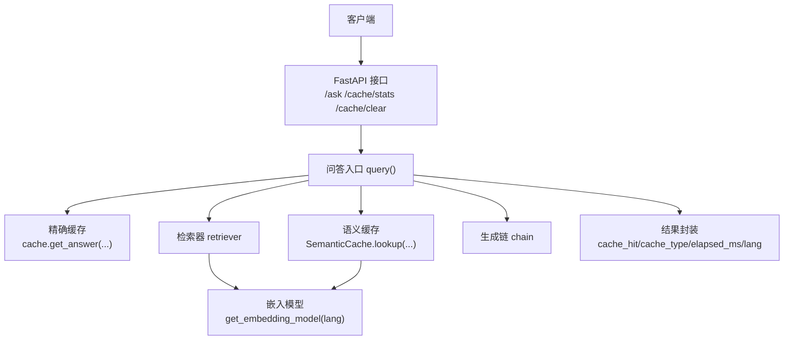
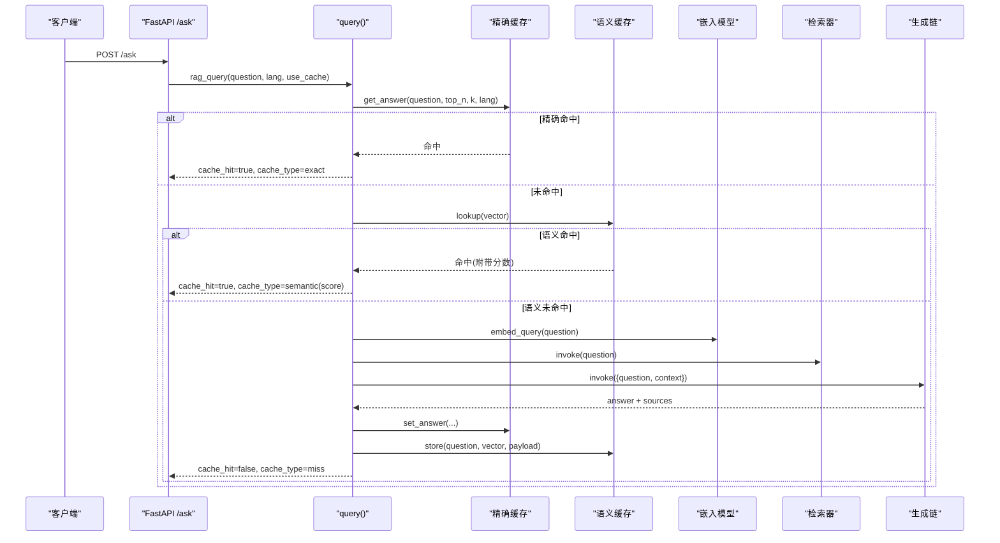
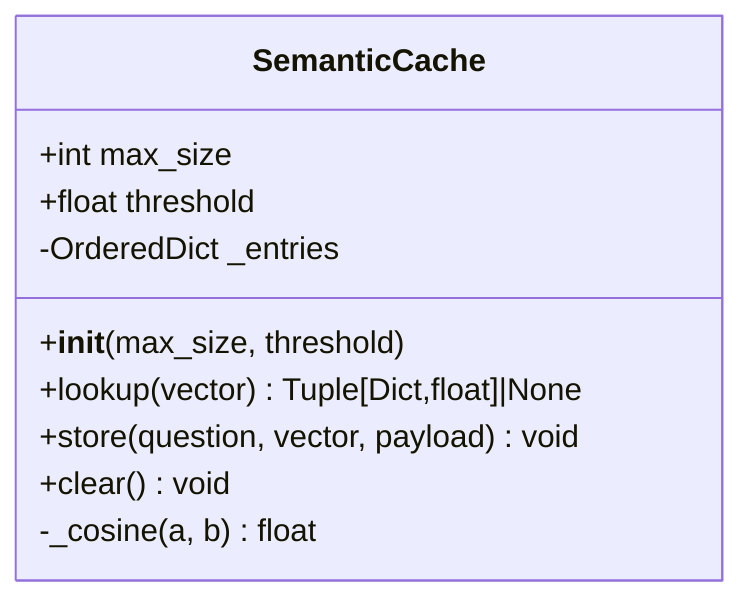
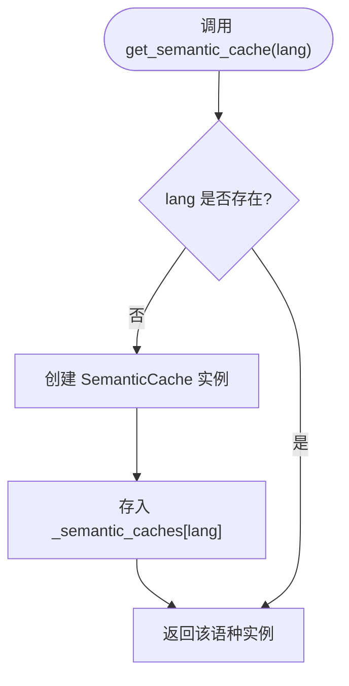
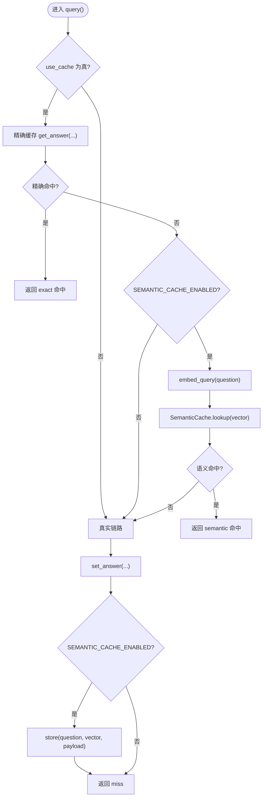
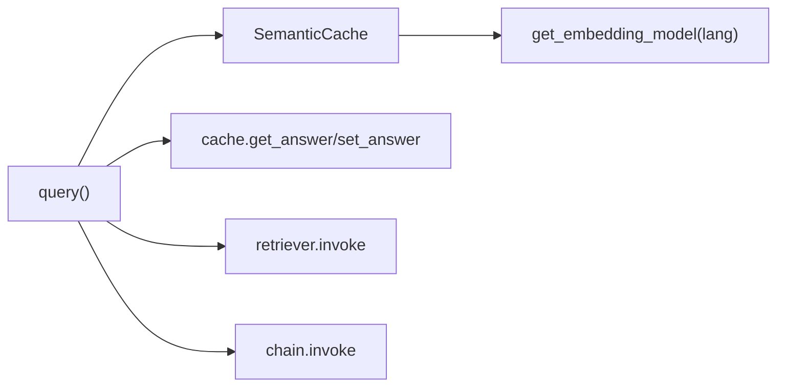

# 语义缓存系统

<cite>
**本文引用的文件**   
- [app.py](file://app.py)
- [rag_langchain.py](file://rag_langchain.py)
</cite>

## 目录
1. [引言](#引言)
2. [项目结构](#项目结构)
3. [核心组件](#核心组件)
4. [架构总览](#架构总览)
5. [详细组件分析](#详细组件分析)
6. [依赖关系分析](#依赖关系分析)
7. [性能与容量特性](#性能与容量特性)
8. [阈值调优与误命中风险评估](#阈值调优与误命中风险评估)
9. [故障排查指南](#故障排查指南)
10. [结论](#结论)

## 引言
本仓库实现了一个面向 RAG 的 Web 服务，并在问答链路中引入了两层缓存：
- **精确缓存**：以问题原文作为键，命中时直接返回历史答案。
- **语义缓存**：基于嵌入向量与余弦相似度进行近似匹配，允许“换说法但意思相同”的问题复用旧答案。

语义缓存默认关闭，通过环境变量控制开关和相似度阈值；同时按语种隔离缓存实例，避免中英文向量空间混用导致噪声。

## 项目结构
从缓存视角看，关键代码集中在两个文件：
- `app.py`：FastAPI 接口层，负责路由、调用 RAG 查询、暴露缓存状态与清理接口。
- `rag_langchain.py`：RAG 主逻辑，包含语义缓存类、按语种懒加载机制、问答入口函数以及缓存失效逻辑。

**图表来源**
- [app.py:231-260](file://app.py#L231-L260)
- [rag_langchain.py:580-631](file://rag_langchain.py#L580-L631)

**章节来源**
- [app.py:1-53](file://app.py#L1-L53)
- [rag_langchain.py:100-116](file://rag_langchain.py#L100-L116)

## 核心组件
- `SemanticCache`：基于 OrderedDict 的内存缓存，使用手写余弦相似度做近似匹配，并实现简单 LRU 淘汰。
- `get_semantic_cache(lang)`：按语种懒加载语义缓存实例，保证中英文向量空间隔离。
- `query()`：问答主流程，先查精确缓存，再查语义缓存，最后走真实 RAG 链路并回写两类缓存。
- 配置项：`SEMANTIC_CACHE_ENABLED`、`SEMANTIC_THRESHOLD`，分别控制是否启用语义缓存及相似度阈值。

**章节来源**
- [rag_langchain.py:514-576](file://rag_langchain.py#L514-L576)
- [rag_langchain.py:580-631](file://rag_langchain.py#L580-L631)
- [rag_langchain.py:114-115](file://rag_langchain.py#L114-L115)

## 架构总览
语义缓存是“加速层”，不是“数据源”。其设计原则包括：
- 缓存异常 fail-open：读不到或计算失败时，继续走真实链路，不改变正确答案。
- 文档更新后失效：上传新文档会清空问答、精排与语义缓存，并提升版本号。
- 按语种隔离：中文与英文各自维护独立的语义缓存实例，避免跨语言向量噪声。

**图表来源**
- [app.py:231-260](file://app.py#L231-L260)
- [rag_langchain.py:580-631](file://rag_langchain.py#L580-L631)

## 详细组件分析

### SemanticCache 类
`SemanticCache` 是一个轻量级内存缓存，核心职责如下：
- 存储历史问题的嵌入向量与对应答案负载。
- 对输入向量遍历所有条目，计算余弦相似度，取最高分并与阈值比较。
- 使用 OrderedDict 维护插入顺序，并通过 popitem(last=False) 实现简单 LRU 淘汰。

**图表来源**
- [rag_langchain.py:514-561](file://rag_langchain.py#L514-L561)

关键点说明：
- 余弦相似度计算为手写实现，时间复杂度 O(d)，d 为向量维度。
- lookup 对所有条目线性扫描，时间复杂度 O(n·d)，n 为缓存条目数。
- store 将新条目追加到末尾并移动至末尾，LRU 淘汰从头部弹出，均摊 O(1)。

**章节来源**
- [rag_langchain.py:514-561](file://rag_langchain.py#L514-L561)

### 按语种隔离的缓存实例管理
语义缓存按语种各维护一份实例，保存在模块级字典 `_semantic_caches` 中。`get_semantic_cache(lang)` 提供懒加载访问：
- 首次访问某语种时创建实例。
- 后续访问直接复用该语种实例。
- 不同语种的向量空间不可混用，否则相似度无意义。

**图表来源**
- [rag_langchain.py:564-576](file://rag_langchain.py#L564-L576)

注意：当前实现没有显式加锁保护 `_semantic_caches` 字典写入，属于单检懒加载。在并发场景下，若多个线程同时首次访问同一语种，可能重复构造实例（Python GIL 下通常安全，但语义上并非严格线程安全）。如需强一致的单例，可参考 embedding 模型懒加载的双检锁模式。

**章节来源**
- [rag_langchain.py:564-576](file://rag_langchain.py#L564-L576)

### 问答入口 query() 的流程
`query()` 是缓存与 RAG 链路的协调者：
1. 如果启用缓存，先查精确缓存。
2. 如果精确未命中且启用语义缓存，则计算问题向量并查找语义命中。
3. 若均未命中，执行真实检索与生成，并将结果写回精确缓存与语义缓存。

**图表来源**
- [rag_langchain.py:580-631](file://rag_langchain.py#L580-L631)

**章节来源**
- [rag_langchain.py:580-631](file://rag_langchain.py#L580-L631)

### 精确缓存与语义缓存的区别
- **精确缓存**：以问题原文作为 key，适合完全重复提问的场景，命中率稳定、零误判风险。
- **语义缓存**：以嵌入向量的余弦相似度判断近似匹配，能覆盖“换说法但意思相同”的情况，但存在阈值调参带来的误命中风险。

两者在 `query()` 中串行尝试：优先精确命中，其次语义命中，最后才走真实链路。

**章节来源**
- [rag_langchain.py:517-529](file://rag_langchain.py#L517-L529)
- [rag_langchain.py:594-627](file://rag_langchain.py#L594-L627)

## 依赖关系分析
语义缓存依赖以下组件：
- 嵌入模型：用于将问题文本转换为向量。
- 缓存后端：精确缓存与向量缓存由外部 `cache` 模块提供。
- 检索器与生成链：真实 RAG 链路的核心。

**图表来源**
- [rag_langchain.py:580-631](file://rag_langchain.py#L580-L631)
- [rag_langchain.py:228-254](file://rag_langchain.py#L228-L254)

**章节来源**
- [rag_langchain.py:228-254](file://rag_langchain.py#L228-L254)
- [rag_langchain.py:580-631](file://rag_langchain.py#L580-L631)

## 性能与容量特性
- 语义缓存查找为线性扫描，时间复杂度 O(n·d)，其中 n 为缓存条目数，d 为向量维度。
- 默认最大条目数为 256，超过时使用 LRU 淘汰最久未使用的条目。
- 语义缓存仅保存问题向量与答案负载，不引入额外向量数据库，保持依赖最小。
- 语义缓存默认关闭，避免在生产环境因阈值不当引发答非所问的风险。

容量与性能建议：
- 在高并发或高吞吐场景，若语义缓存命中率低，应评估是否值得开启。
- 若业务允许一定误命中风险，可适当降低阈值以提升命中率，但需配合评测集验证。
- 可通过 `/cache/stats` 观察后端类型、命中率、版本与各语种库块数，辅助调优。

**章节来源**
- [rag_langchain.py:532-561](file://rag_langchain.py#L532-L561)
- [app.py:263-277](file://app.py#L263-L277)

## 阈值调优与误命中风险评估

### 配置参数
- `SEMANTIC_CACHE_ENABLED`：控制是否启用语义缓存。值为 `"1"` 时启用，否则关闭。
- `SEMANTIC_THRESHOLD`：语义相似度阈值，默认 `0.95`。只有当余弦相似度大于等于该值时才视为命中。

**章节来源**
- [rag_langchain.py:114-115](file://rag_langchain.py#L114-L115)
- [rag_langchain.py:528-534](file://rag_langchain.py#L528-L534)

### 阈值调优指南
- 高阈值（如 0.95+）：更保守，误命中概率低，但命中率可能不足。
- 低阈值（如 0.85~0.90）：更激进，命中率提升，但误命中风险显著增加。
- 建议结合评测集（如 `eval_set_en.json`、`eval_set_zh.json`）进行 A/B 测试，观察命中率与回答质量变化。

### 误命中风险评估
- 语义缓存本质是近似匹配，天然存在误判风险。
- RAG 场景中，“答错”比“慢一点”更严重，因此默认关闭语义缓存。
- 若开启语义缓存，必须确保阈值经过充分验证，并监控线上错误率与用户反馈。

### 性能收益分析
- 精确缓存可快速拦截重复提问，减少检索与生成开销。
- 语义缓存可覆盖“换说法”的重复意图，进一步减少 LLM 调用次数。
- 在知识库稳定、问题表达多样性的场景下，语义缓存的收益更明显。

**章节来源**
- [rag_langchain.py:517-529](file://rag_langchain.py#L517-L529)
- [rag_langchain.py:580-631](file://rag_langchain.py#L580-L631)

## 故障排查指南
常见问题与处理建议：
- 语义缓存未生效：检查 `.env` 中 `SEMANTIC_CACHE=1` 是否正确设置。
- 语义命中异常：调整 `SEMANTIC_THRESHOLD`，并结合评测集验证。
- 文档更新后仍命中旧答案：确认上传流程是否调用 `invalidate_caches()`，该函数会清空语义缓存并提升版本号。
- 并发下语义缓存实例重复构造：当前 `get_semantic_cache` 为单检懒加载，若需强一致单例，可参考 embedding 模型懒加载的双检锁模式。

**章节来源**
- [rag_langchain.py:634-644](file://rag_langchain.py#L634-L644)
- [rag_langchain.py:564-576](file://rag_langchain.py#L564-L576)
- [rag_langchain.py:228-254](file://rag_langchain.py#L228-L254)

## 结论
语义缓存系统在 RAG 链路中提供了“近似问题复用”的能力，能够覆盖换说法但意思相同的场景，从而减少 LLM 调用、提升响应速度。但其近似匹配特性带来误命中风险，因此默认关闭，并通过 `SEMANTIC_CACHE_ENABLED` 与 `SEMANTIC_THRESHOLD` 精细控制。按语种隔离的缓存实例管理避免了跨语言向量噪声，确保相似度计算有意义。生产环境中应结合评测集进行阈值调优，并持续监控命中率与回答质量，确保缓存只加速而不改变正确答案。