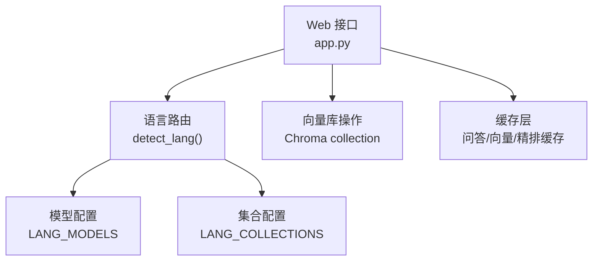
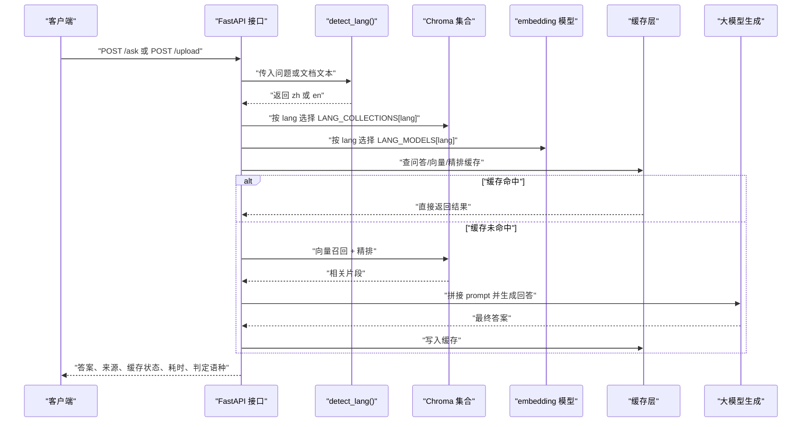
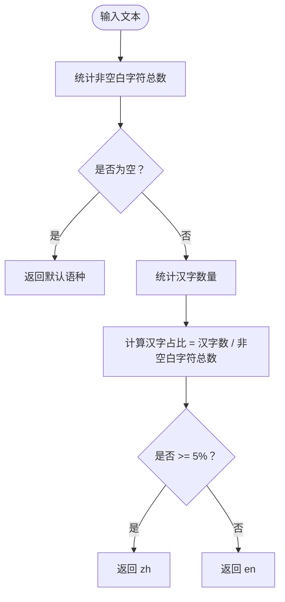
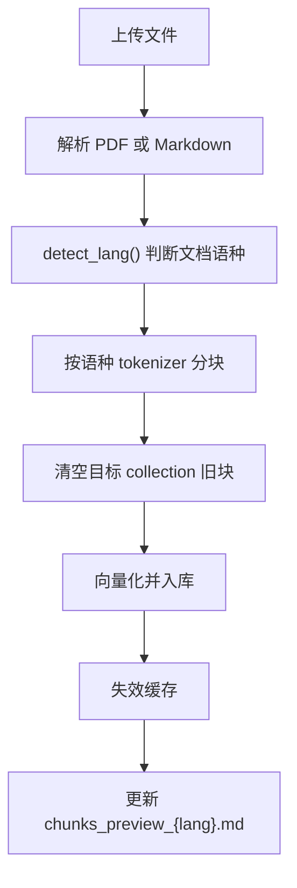
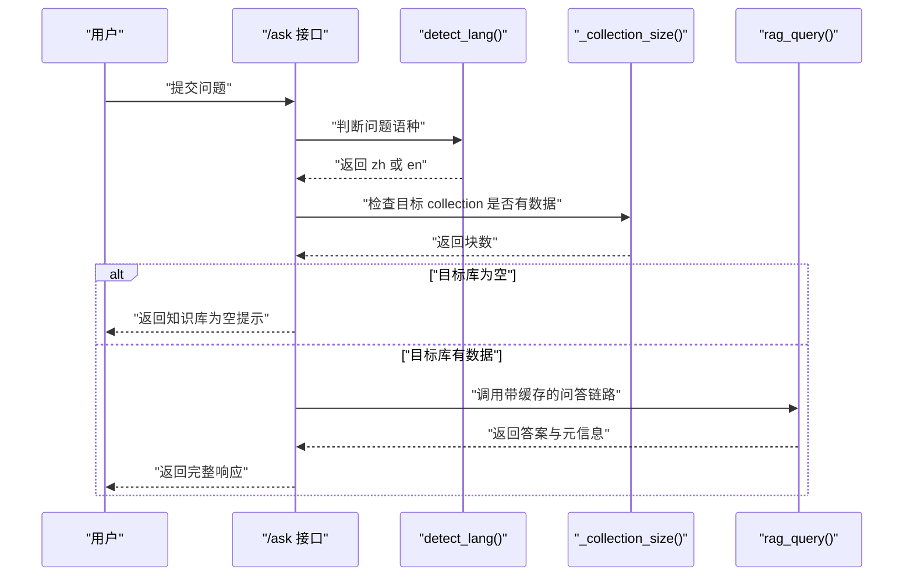
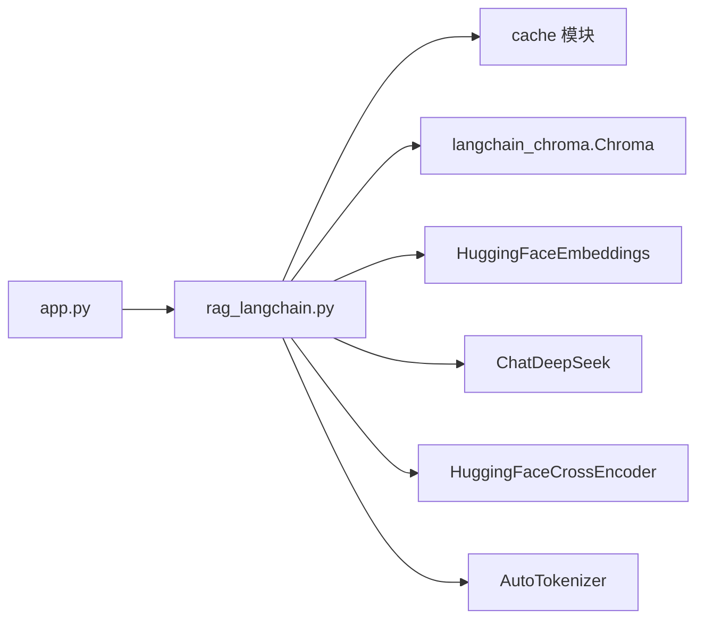

# 语种检测与路由

<cite>
**本文引用的文件**   
- [app.py](file://app.py)
- [rag_langchain.py](file://rag_langchain.py)
</cite>

## 目录
1. [引言](#引言)
2. [项目结构中的相关位置](#项目结构中的相关位置)
3. [核心组件总览](#核心组件总览)
4. [架构总览：从语种检测到模型选择](#架构总览从语种检测到模型选择)
5. [detect_lang() 实现原理详解](#detect_lang-实现原理详解)
6. [中英文独立处理架构](#中英文独立处理架构)
7. [语言路由对后续流程的影响](#语言路由对后续流程的影响)
8. [缓存策略与语种隔离](#缓存策略与语种隔离)
9. [典型场景与边界情况](#典型场景与边界情况)
10. [依赖关系分析](#依赖关系分析)
11. [性能与可维护性建议](#性能与可维护性建议)
12. [故障排查指南](#故障排查指南)
13. [结论](#结论)

## 引言
本模块负责在 RAG 系统中完成“语种检测 → 语言路由 → 模型/向量库选择 → 缓存策略”的完整链路。系统只支持中文和英文两类文档与问题，因此语种判断不需要复杂模型，而是采用基于汉字占比的轻量算法；语言路由则决定使用哪个 embedding 模型、哪个 Chroma collection、哪种 tokenizer，以及走哪一份缓存。

## 项目结构中的相关位置
- 语种检测函数 `detect_lang()` 定义在核心管道文件中，是语言路由的入口。
- Web 接口层根据请求来源（上传文档或提问）调用 `detect_lang()`，并据此选择对应 collection、retriever 和 chain。
- 配置常量 `LANG_MODELS`、`LANG_COLLECTIONS`、`DEFAULT_LANG` 集中管理不同语种的 embedding 模型路径、collection 名称和默认语种。

**图示来源**
- [app.py:44-51](file://app.py#L44-L51)
- [rag_langchain.py:59-81](file://rag_langchain.py#L59-L81)
- [rag_langchain.py:118-142](file://rag_langchain.py#L118-L142)

**章节来源**
- [app.py:1-26](file://app.py#L1-L26)
- [rag_langchain.py:1-24](file://rag_langchain.py#L1-L24)

## 核心组件总览
| 组件 | 职责 | 关键行为 |
|---|---|---|
| `detect_lang()` | 判断文本属于中文还是英文 | 统计非空白字符中汉字占比，超过阈值返回中文，否则返回英文 |
| `LANG_MODELS` | 按语种映射 embedding 模型路径 | 中文用本地中文 embedding，英文用本地英文 embedding |
| `LANG_COLLECTIONS` | 按语种映射 Chroma collection 名称 | 中文库名与英文库名严格分离 |
| `get_embedding_model()` | 懒加载并按语种创建 embedding 模型 | 带向量缓存、最大序列长度、查询前缀等配置 |
| `load_store()` | 打开指定语种的 Chroma 集合 | 使用对应语种的 embedding 模型 |
| `make_retriever()` | 召回 + 精排 retriever | 先向量召回，再 cross-encoder 精排 |
| `query()` | 带缓存的问答入口 | 精确缓存优先，语义缓存可选，未命中走真实链路 |
| `split_by_tokens()` | 按 token 切块 | 使用对应语种的 tokenizer，保证中英块信息量可比 |

**章节来源**
- [rag_langchain.py:59-81](file://rag_langchain.py#L59-L81)
- [rag_langchain.py:118-142](file://rag_langchain.py#L118-L142)
- [rag_langchain.py:228-254](file://rag_langchain.py#L228-L254)
- [rag_langchain.py:363-372](file://rag_langchain.py#L363-L372)
- [rag_langchain.py:452-467](file://rag_langchain.py#L452-L467)
- [rag_langchain.py:580-631](file://rag_langchain.py#L580-L631)
- [rag_langchain.py:324-359](file://rag_langchain.py#L324-L359)

## 架构总览：从语种检测到模型选择
整个流程可以抽象为一条“检测 → 路由 → 检索 → 生成 → 缓存”的流水线。

**图示来源**
- [app.py:155-260](file://app.py#L155-L260)
- [rag_langchain.py:118-142](file://rag_langchain.py#L118-L142)
- [rag_langchain.py:580-631](file://rag_langchain.py#L580-L631)

## detect_lang() 实现原理详解

### 算法步骤
`detect_lang()` 的核心逻辑非常简洁：  
1. 统计文本中所有非空白字符的数量。  
2. 如果没有任何非空白字符，返回默认语种。  
3. 统计汉字数量，这里通过判断字符是否落在一个较大的 CJK 区间内。  
4. 计算汉字占非空白字符的比例。  
5. 如果比例大于等于 5%，返回中文；否则返回英文。

这个设计的关键在于：**不引入词典、词频统计或外部模型，仅靠字符层面的汉字占比就能区分中英文**。

**图示来源**
- [rag_langchain.py:118-142](file://rag_langchain.py#L118-L142)

### 为什么阈值取 5%
代码注释明确解释了 5% 的设计考量：

- 中文文档通常包含大量不翻译的英文术语、会议名、作者名，但整体汉字占比仍然远高于 5%。
- 英文文档偶尔出现少量汉字（例如作者名、被引用的中文术语），但占比远低于 5%。
- 实测表明，在 5%~30% 之间取任意值都能把中文和英文分开；取 5% 是为了给中文一侧留出最大余量，避免中文被误判为英文。
- 已知边界情况是：英文句式中夹入少量中文词时，可能被判为中文。这类混写在真实提问中较少见，而且响应中会返回 `lang` 字段，便于用户观察路由结果。

**章节来源**
- [rag_langchain.py:118-142](file://rag_langchain.py#L118-L142)

### 时间复杂度与空间复杂度
- 时间复杂度：O(n)，其中 n 是文本长度。需要遍历一次文本统计非空白字符和汉字数量。
- 空间复杂度：O(1)，只使用固定数量的计数器，不随输入规模增长。
- 优点：极快、无外部依赖、适合高频调用。
- 缺点：纯字符规则，无法理解语义；对于极端混写文本可能出现边界误判。

**章节来源**
- [rag_langchain.py:118-142](file://rag_langchain.py#L118-L142)

## 中英文独立处理架构

### LANG_MODELS：按语种绑定 embedding 模型
`LANG_MODELS` 将语种映射到具体的 embedding 模型路径：
- 中文：本地中文 embedding 模型。
- 英文：本地英文 embedding 模型。

这两个模型虽然输出维度相同，但向量空间完全不同。如果把两个模型的向量放进同一个 collection，相似度计算会变成噪声，检索会静默出错而不报错。因此必须按语种分开。

**章节来源**
- [rag_langchain.py:53-62](file://rag_langchain.py#L53-L62)

### LANG_COLLECTIONS：按语种绑定 Chroma collection
`LANG_COLLECTIONS` 将语种映射到 Chroma 的 collection 名称：
- 中文：`rag_zh`
- 英文：`rag_en`

collection 名称不能太短，也不能包含非法字符，因此没有直接用 `zh` / `en`。每个 collection 对应一个独立的向量数据库分区，互不影响。

**章节来源**
- [rag_langchain.py:78-81](file://rag_langchain.py#L78-L81)

### DEFAULT_LANG：默认语种
默认语种为中文。当 `detect_lang()` 遇到空文本时，也会回退到默认语种，避免下游流程因未知语种而崩溃。

**章节来源**
- [rag_langchain.py:81](file://rag_langchain.py#L81)

### 为什么不同语种的 embedding 模型必须使用独立的 collection
核心原因有三点：
1. **向量空间不同**：不同 embedding 模型生成的向量不在同一语义空间中，跨模型比较相似度没有意义。
2. **检索静默错误风险**：混用模型可能导致相似度高的是无关内容，系统不会报错，但答案质量会下降。
3. **缓存与 tokenizer 也必须隔离**：embedding 缓存 key、rerank 缓存、tokenizer、甚至语义缓存都按语种隔离，否则会互相污染。

**章节来源**
- [rag_langchain.py:53-62](file://rag_langchain.py#L53-L62)
- [rag_langchain.py:228-254](file://rag_langchain.py#L228-L254)
- [rag_langchain.py:564-576](file://rag_langchain.py#L564-L576)

## 语言路由对后续流程的影响

### 上传文档时的路由
上传流程会先解析文件内容，再用 `detect_lang()` 判断文档语种，然后：
1. 使用该语种的 tokenizer 进行分块。
2. 清空该语种的 collection 原有数据。
3. 向量化并写入对应 collection。
4. 失效受影响的缓存。
5. 更新对应语种的 chunks_preview 文件。

**图示来源**
- [app.py:155-228](file://app.py#L155-L228)
- [rag_langchain.py:324-359](file://rag_langchain.py#L324-L359)
- [rag_langchain.py:375-405](file://rag_langchain.py#L375-L405)

**章节来源**
- [app.py:155-228](file://app.py#L155-L228)

### 提问时的路由
提问流程会先 strip 空格，再调用 `detect_lang()` 判断问题语种，然后：
1. 检查目标 collection 是否为空。
2. 如果为空，直接返回提示，不走检索。
3. 如果不为空，调用 `rag_query()`，传入对应 retriever 和 chain。
4. 最终返回答案、来源、缓存状态、耗时和判定语种。

**图示来源**
- [app.py:231-260](file://app.py#L231-L260)
- [rag_langchain.py:580-631](file://rag_langchain.py#L580-L631)

**章节来源**
- [app.py:231-260](file://app.py#L231-L260)

## 缓存策略与语种隔离

### 三种缓存的作用
| 缓存类型 | 作用 | 影响范围 |
|---|---|---|
| 问答缓存 | 相同问题不再走完整 RAG 链路 | 节省 LLM 调用和等待时间 |
| 向量缓存 | 同一段文本不再重复做 embedding | 节省模型前向计算 |
| 精排缓存 | `(问题, 片段)` 的 cross-encoder 分数不再重复计算 | 节省最慢的精排环节 |

**章节来源**
- [rag_langchain.py:10-13](file://rag_langchain.py#L10-L13)
- [rag_langchain.py:147-182](file://rag_langchain.py#L147-L182)
- [rag_langchain.py:428-449](file://rag_langchain.py#L428-L449)

### 缓存键如何避免跨语种污染
- embedding 缓存使用 `model_tag`，其中包含语种、模型路径和最大序列长度。
- 语义缓存按语种各维护一份，避免不同模型的向量互相比较。
- 问答缓存和 rerank 缓存也参与 `lang`，确保中文问题和英文问题不会互相命中。

**章节来源**
- [rag_langchain.py:147-170](file://rag_langchain.py#L147-L170)
- [rag_langchain.py:241-253](file://rag_langchain.py#L241-L253)
- [rag_langchain.py:564-576](file://rag_langchain.py#L564-L576)
- [rag_langchain.py:594-627](file://rag_langchain.py#L594-L627)

### 缓存失效策略
上传文档后，系统会：
1. 清空目标 collection 的旧块。
2. 重新入库新块。
3. 调用 `invalidate_caches()` 失效问答缓存、精排缓存和语义缓存。
4. 提升缓存版本，避免旧答案继续命中。

**章节来源**
- [app.py:189-225](file://app.py#L189-L225)
- [rag_langchain.py:634-644](file://rag_langchain.py#L634-L644)

## 典型场景与边界情况

### 典型场景一：纯中文文档上传
- 文档中汉字占比高。
- `detect_lang()` 返回中文。
- 分块使用中文 tokenizer。
- 数据进入 `rag_zh` collection。
- 中文 embedding 模型负责向量化。

**章节来源**
- [rag_langchain.py:118-142](file://rag_langchain.py#L118-L142)
- [rag_langchain.py:324-359](file://rag_langchain.py#L324-L359)
- [rag_langchain.py:363-372](file://rag_langchain.py#L363-L372)

### 典型场景二：纯英文文档上传
- 文档中汉字占比极低。
- `detect_lang()` 返回英文。
- 分块使用英文 tokenizer。
- 数据进入 `rag_en` collection。
- 英文 embedding 模型负责向量化。

**章节来源**
- [rag_langchain.py:118-142](file://rag_langchain.py#L118-L142)
- [rag_langchain.py:324-359](file://rag_langchain.py#L324-L359)
- [rag_langchain.py:363-372](file://rag_langchain.py#L363-L372)

### 典型场景三：中文问题查询
- 问题中汉字占比达到阈值。
- 路由到中文库。
- 若中文库为空，直接返回提示。
- 若中文库有数据，走中文 retriever 和 chain。

**章节来源**
- [app.py:231-260](file://app.py#L231-L260)
- [rag_langchain.py:580-631](file://rag_langchain.py#L580-L631)

### 典型场景四：英文问题查询
- 问题中汉字占比低于阈值。
- 路由到英文库。
- 若英文库为空，直接返回提示。
- 若英文库有数据，走英文 retriever 和 chain。

**章节来源**
- [app.py:231-260](file://app.py#L231-L260)
- [rag_langchain.py:580-631](file://rag_langchain.py#L580-L631)

### 边界情况一：空文本
- `detect_lang()` 遇到空文本时返回默认语种。
- `/ask` 接口还会额外判断问题是否为空，直接返回“问题不能为空”。

**章节来源**
- [rag_langchain.py:138-142](file://rag_langchain.py#L138-L142)
- [app.py:234-236](file://app.py#L234-L236)

### 边界情况二：目标 collection 为空
- 即使问题本身不为空，如果目标语种 collection 中没有数据，也不会进入检索。
- 原因是避免模型“凭印象作答”，给出看起来正常但没有依据的回答。

**章节来源**
- [app.py:241-249](file://app.py#L241-L249)

### 边界情况三：英文句式夹少量中文词
- 这类文本可能被误判为中文。
- 代码注释明确指出这是可接受的边界情况，因为真实提问中很少出现，且响应中的 `lang` 字段能暴露路由结果。

**章节来源**
- [rag_langchain.py:131-136](file://rag_langchain.py#L131-L136)

## 依赖关系分析

**图示来源**
- [app.py:44-51](file://app.py#L44-L51)
- [rag_langchain.py:39-48](file://rag_langchain.py#L39-L48)
- [rag_langchain.py:314-321](file://rag_langchain.py#L314-L321)

**章节来源**
- [app.py:44-51](file://app.py#L44-L51)
- [rag_langchain.py:39-48](file://rag_langchain.py#L39-L48)

## 性能与可维护性建议

### 性能特点
- `detect_lang()` 是 O(n) 轻量计算，几乎不成为瓶颈。
- 真正耗时环节集中在 embedding、cross-encoder 精排和大模型生成。
- 三层缓存分别覆盖不同阶段，能有效减少重复计算。
- 模型和 tokenizer 采用懒加载，避免启动时全部加载。

### 可维护性建议
1. 如果未来增加第三种语言，应同时扩展：
   - `detect_lang()` 的判断逻辑。
   - `LANG_MODELS`。
   - `LANG_COLLECTIONS`。
   - tokenizer 缓存。
   - embedding 缓存 tag。
   - 语义缓存。
2. 阈值 5% 目前适用于当前数据集分布；如果业务中文混合比例显著变化，应重新评估阈值。
3. 不要为了“统一 collection”而混用不同 embedding 模型。
4. 修改任何影响向量取值或检索口径的配置时，都应考虑缓存版本和 cache_tag。

**章节来源**
- [rag_langchain.py:53-81](file://rag_langchain.py#L53-L81)
- [rag_langchain.py:118-142](file://rag_langchain.py#L118-L142)
- [rag_langchain.py:228-254](file://rag_langchain.py#L228-L254)
- [rag_langchain.py:564-576](file://rag_langchain.py#L564-L576)

## 故障排查指南

| 现象 | 可能原因 | 排查方向 |
|---|---|---|
| 中文问题走了英文库 | `detect_lang()` 误判 | 检查问题文本中汉字占比，查看响应中的 `lang` 字段 |
| 英文问题走了中文库 | 英文中夹杂较多中文词 | 调整业务侧输入规范，或重新评估阈值 |
| 上传后答案仍是旧的 | 缓存未失效 | 检查上传流程是否调用 `invalidate_caches()` |
| 换模型后命中旧向量 | cache_tag 未覆盖模型差异 | 检查 embedding 缓存 tag 是否包含模型路径和 max_seq_length |
| 中文库为空却得到奇怪答案 | 空库保护未生效 | 检查 `_collection_size()` 和 `/ask` 的空库分支 |
| 中文块被截断 | 模型自带 max_seq_length 小于实际块长度 | 确认显式设置 `LANG_MAX_SEQ` |

**章节来源**
- [rag_langchain.py:64-77](file://rag_langchain.py#L64-L77)
- [rag_langchain.py:241-253](file://rag_langchain.py#L241-L253)
- [app.py:241-249](file://app.py#L241-L249)
- [rag_langchain.py:634-644](file://rag_langchain.py#L634-L644)

## 结论
语种检测与路由模块以极简的汉字占比算法作为入口，配合中英文独立的 embedding 模型、collection、tokenizer 和缓存体系，实现了“简单、高效、可解释、可扩展”的语言分流方案。其核心优势在于：
- 检测速度快、依赖少。
- 语言路由清晰，模型与向量库严格隔离。
- 缓存分层合理，避免跨语种污染。
- 对空库、空文本、混写等边界情况有明确处理。

在实际使用中，应重点关注 `detect_lang()` 的阈值是否仍符合业务数据分布，以及新增语种时是否同步补齐所有隔离点。只要保持“同语种同模型、同模型同 collection、同 collection 同缓存”的一致性，RAG 系统的检索质量和稳定性就能得到保障。