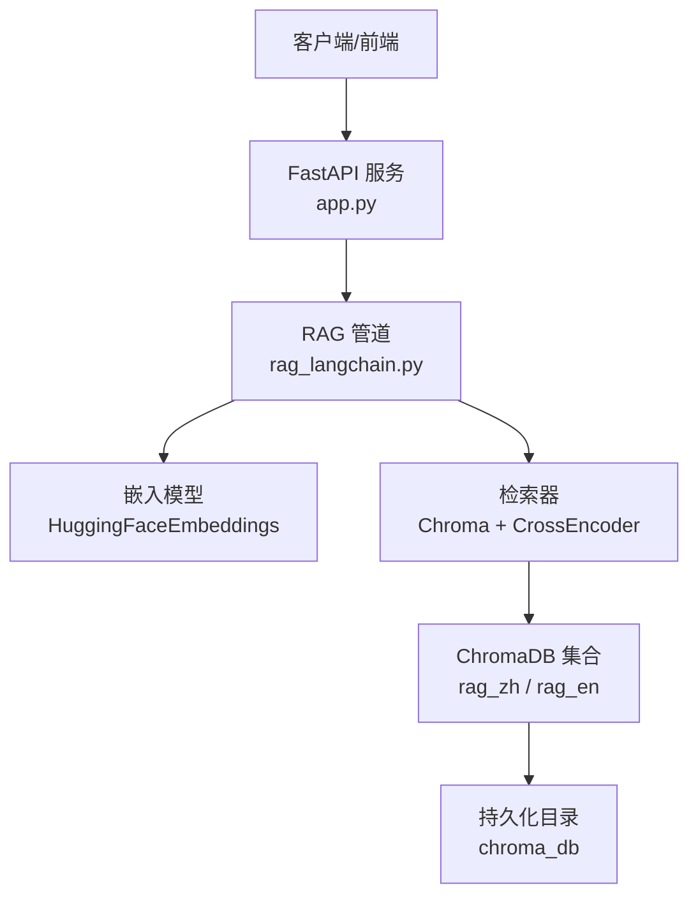
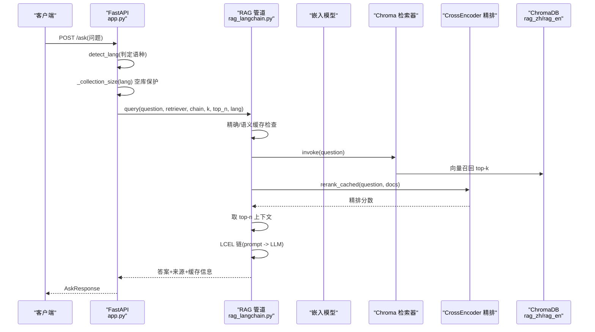
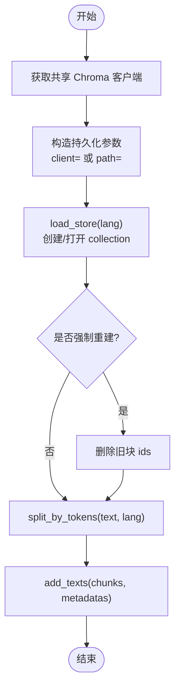
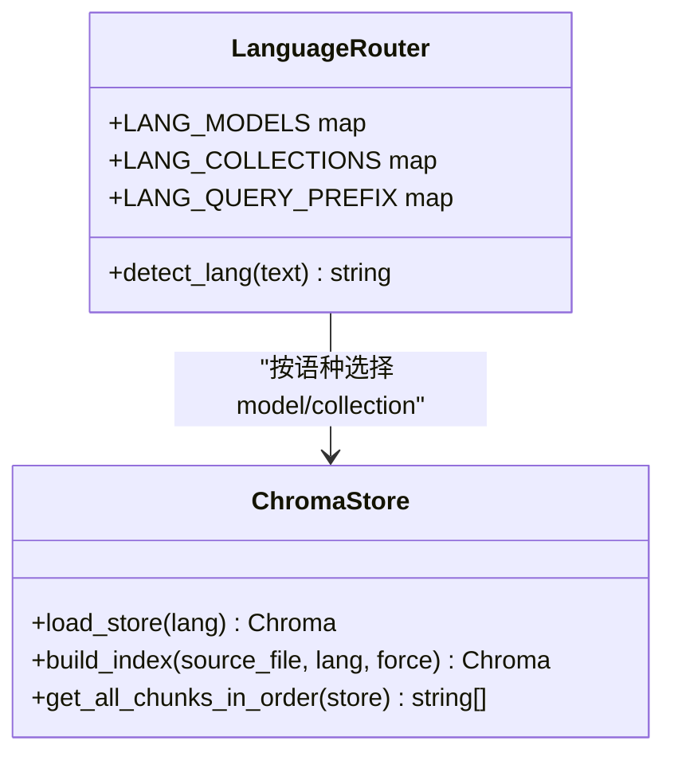
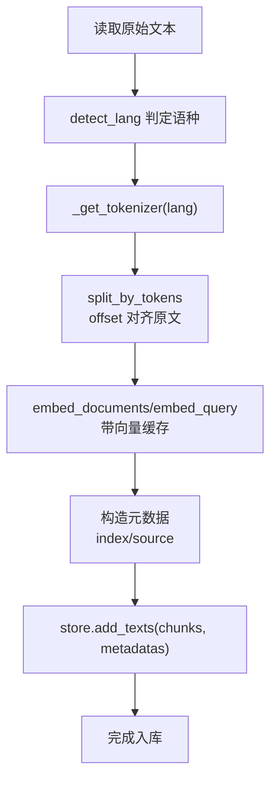
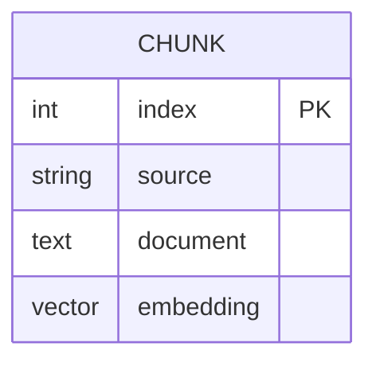
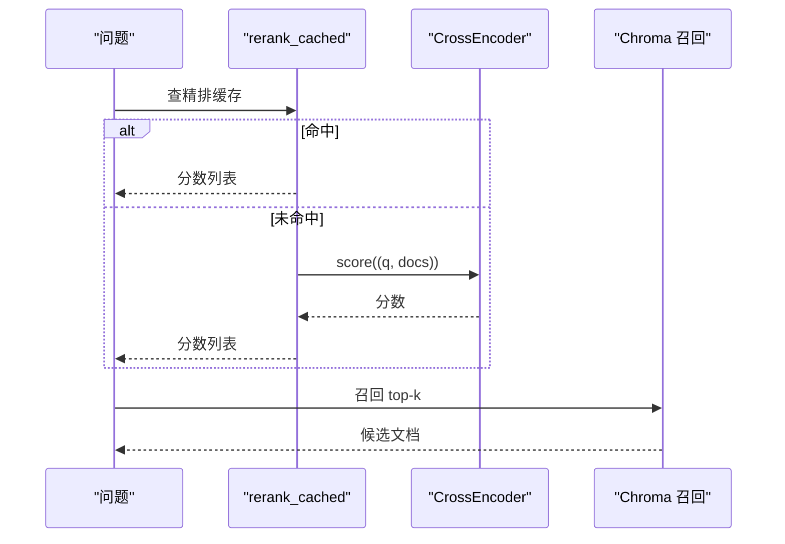
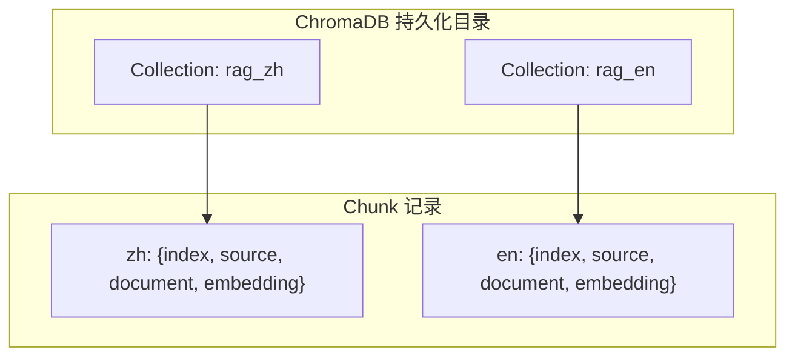
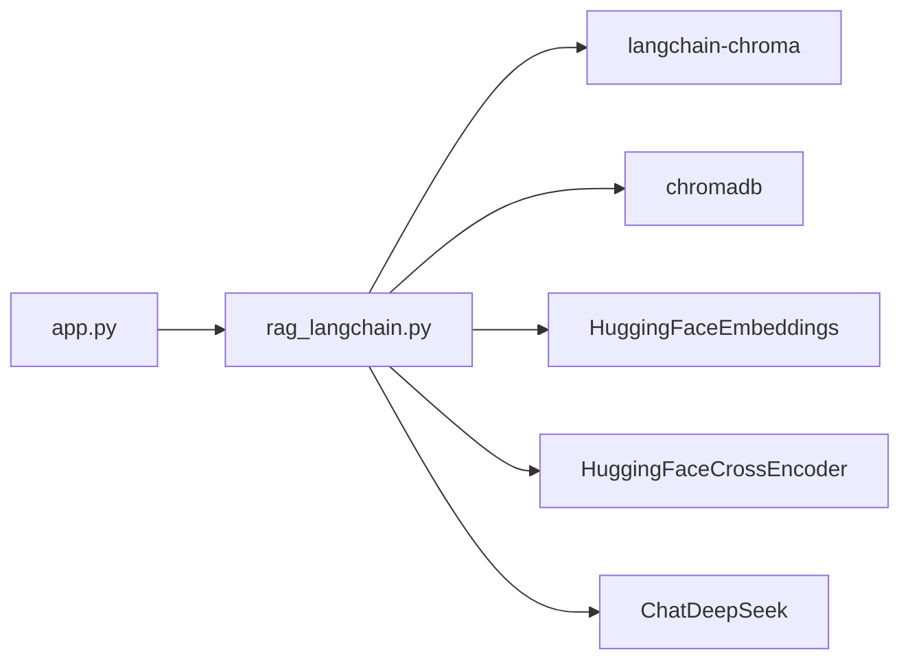

# 向量数据库层

<cite>
**本文引用的文件**   
- [app.py](file://app.py)
- [rag_langchain.py](file://rag_langchain.py)
- [requirements.txt](file://requirements.txt)
</cite>

## 目录
1. [引言](#引言)
2. [项目结构](#项目结构)
3. [核心组件](#核心组件)
4. [架构总览](#架构总览)
5. [详细组件分析](#详细组件分析)
6. [依赖关系分析](#依赖关系分析)
7. [性能与索引策略](#性能与索引策略)
8. [故障排查指南](#故障排查指南)
9. [结论](#结论)

## 引言
本章节面向“向量数据库层”，聚焦 ChromaDB 在本项目中的集成方式、双语独立存储架构、文档向量化流程、元数据管理、索引与查询优化，以及 collection 结构与数据关系。目标是让读者既能理解整体设计，也能定位到具体实现位置，便于二次开发与排障。

## 项目结构
本项目采用 FastAPI 作为 Web 入口，RAG 核心逻辑集中在 LangChain 封装层，ChromaDB 通过 langchain-chroma 接入，持久化路径固定为项目目录下的 chroma_db。关键文件职责如下：
- app.py：Web 接口、语种路由、上传与问答流程、缓存失效与统计。
- rag_langchain.py：嵌入模型、分块、ChromaDB 客户端与 collection 管理、检索与精排、缓存、评测工具。
- requirements.txt：声明 langchain-chroma 与 chromadb 等依赖。

图表来源
- [app.py:53-92](file://app.py#L53-L92)
- [rag_langchain.py:39-46](file://rag_langchain.py#L39-L46)
- [rag_langchain.py:261-289](file://rag_langchain.py#L261-L289)

章节来源
- [app.py:1-53](file://app.py#L1-L53)
- [rag_langchain.py:1-50](file://rag_langchain.py#L1-L50)
- [requirements.txt:5,10:5-10](file://requirements.txt#L5-L10)

## 核心组件
- 双语独立 collection：中文 rag_zh、英文 rag_en，分别绑定不同 embedding 模型，避免跨模型向量空间混用导致相似度噪声。
- 共享 Chroma 客户端：两个 collection 共用一个 PersistentClient，降低句柄与连接开销，保证同一目录下数据一致性。
- 文本切块与向量化：按 token 切块，使用对应语种的 tokenizer 与 embedding 模型；支持向量缓存减少重复计算。
- 检索与精排：先向量召回 top-k，再用 cross-encoder 精排 top-n；精排分数可缓存。
- 元数据管理：每个 chunk 携带 index（入库顺序）与 source（来源文件名），用于还原顺序与溯源。
- 缓存体系：问答缓存、向量缓存、精排分数缓存、可选语义缓存；文档更新时统一失效并提升版本号。

章节来源
- [rag_langchain.py:59-81](file://rag_langchain.py#L59-L81)
- [rag_langchain.py:261-289](file://rag_langchain.py#L261-L289)
- [rag_langchain.py:324-359](file://rag_langchain.py#L324-L359)
- [rag_langchain.py:428-467](file://rag_langchain.py#L428-L467)
- [rag_langchain.py:408-413](file://rag_langchain.py#L408-L413)
- [rag_langchain.py:580-644](file://rag_langchain.py#L580-L644)

## 架构总览
下图展示从请求到 ChromaDB 的完整调用链，包括双语路由、缓存命中、检索与生成。

图表来源
- [app.py:231-260](file://app.py#L231-L260)
- [rag_langchain.py:580-631](file://rag_langchain.py#L580-L631)
- [rag_langchain.py:452-467](file://rag_langchain.py#L452-L467)

## 详细组件分析

### ChromaDB 集成与配置
- 客户端与持久化
  - 使用 chromadb.PersistentClient 创建共享客户端，路径固定为 CHROMA_DB_PATH。
  - 通过 _chroma_persist_kwargs 兼容 langchain-chroma 新旧版本，优先传入 client=，否则回退到 path/persist_directory。
- Collection 命名与隔离
  - LANG_COLLECTIONS 定义 rag_zh 与 rag_en，避免短名触发 Chroma 校验错误。
  - 每个 collection 绑定各自 embedding 模型，确保向量空间一致。
- 加载与重建
  - load_store(lang) 打开或创建指定语种的 Chroma 实例。
  - build_index(source_file, lang, force) 负责读取文档、切块、嵌入、入库；force=True 时仅删除已有块而不 drop collection，保持已持有实例有效。

图表来源
- [rag_langchain.py:261-289](file://rag_langchain.py#L261-L289)
- [rag_langchain.py:363-405](file://rag_langchain.py#L363-L405)

章节来源
- [rag_langchain.py:78-96](file://rag_langchain.py#L78-L96)
- [rag_langchain.py:261-289](file://rag_langchain.py#L261-L289)
- [rag_langchain.py:363-405](file://rag_langchain.py#L363-L405)

### 双语独立存储架构
- 语言检测
  - detect_lang 基于汉字占比阈值判断 zh/en，简单高效且对中英混合场景鲁棒。
- 模型与 collection 绑定
  - LANG_MODELS 为 zh 与 en 分别指向本地 embedding 模型路径。
  - LANG_QUERY_PREFIX 为 bge 系列英文检索提供 query 前缀指令。
- 访问模式
  - 上传：按文档语种只替换该语种的 collection，清空旧块后以 index 0 起重新编号入库。
  - 问答：按问题语种选择 retriever 与 chain；若目标 collection 为空，直接返回提示，不走检索。

图表来源
- [rag_langchain.py:59-89](file://rag_langchain.py#L59-L89)
- [rag_langchain.py:118-142](file://rag_langchain.py#L118-L142)
- [rag_langchain.py:363-413](file://rag_langchain.py#L363-L413)

章节来源
- [rag_langchain.py:59-89](file://rag_langchain.py#L59-L89)
- [rag_langchain.py:118-142](file://rag_langchain.py#L118-L142)
- [app.py:181-226](file://app.py#L181-L226)
- [app.py:231-260](file://app.py#L231-L260)

### 文档向量化流程
- 文本加载
  - load_raw_text 支持 PDF 与 Markdown/文本；对不存在路径给出明确错误提示。
- Token 级切块
  - split_by_tokens 使用对应语种的 tokenizer，按 offset 对齐原文子串，避免 decode 失真；默认 chunk_size=256，overlap=40，留足余量防止静默截断。
- 嵌入与缓存
  - CachedHuggingFaceEmbeddings 覆写 embed_documents/embed_query，走向量缓存；query_prefix 仅在英文检索侧生效。
- 入库
  - add_texts 批量写入，同时写入元数据 index 与 source。

图表来源
- [rag_langchain.py:293-307](file://rag_langchain.py#L293-L307)
- [rag_langchain.py:324-359](file://rag_langchain.py#L324-L359)
- [rag_langchain.py:185-221](file://rag_langchain.py#L185-L221)
- [rag_langchain.py:397-403](file://rag_langchain.py#L397-L403)

章节来源
- [rag_langchain.py:293-307](file://rag_langchain.py#L293-L307)
- [rag_langchain.py:324-359](file://rag_langchain.py#L324-L359)
- [rag_langchain.py:185-221](file://rag_langchain.py#L185-L221)
- [rag_langchain.py:397-403](file://rag_langchain.py#L397-L403)

### 元数据管理
- 字段说明
  - index：chunk 在 collection 中的入库顺序，用于还原顺序与预览输出。
  - source：来源文件名，便于溯源与审计。
- 使用场景
  - get_all_chunks_in_order 按 metadata['index'] 排序，输出纯文本列表，供评测脚本与 chunks_preview 文件使用。
  - 上传接口在 store.add_texts 时附带 metadatas，保证新入库块顺序从 0 开始连续编号。

图表来源
- [rag_langchain.py:408-413](file://rag_langchain.py#L408-L413)
- [rag_langchain.py:397-403](file://rag_langchain.py#L397-L403)

章节来源
- [rag_langchain.py:408-413](file://rag_langchain.py#L408-L413)
- [app.py:197-202](file://app.py#L197-L202)

### 检索与查询优化
- 召回与精排
  - make_retriever 包装 Chroma.as_retriever(k=RETRIEVE_K)，再调用 HuggingFaceCrossEncoder.score 进行精排，保留 top_n。
  - rerank_cached 对 (question, doc) 打分结果做缓存，显著降低 cross-encoder 重复计算。
- 缓存体系
  - 精确问答缓存：相同问题与参数命中即秒回。
  - 向量缓存：同段文本不重复计算嵌入。
  - 精排分数缓存：(问题, 片段) 分数复用。
  - 语义缓存（可选）：基于向量余弦相似度近似匹配相似问法。
- 空库保护
  - 目标 collection 无数据时直接返回提示，避免模型“凭印象作答”。

图表来源
- [rag_langchain.py:428-467](file://rag_langchain.py#L428-L467)
- [rag_langchain.py:580-631](file://rag_langchain.py#L580-L631)

章节来源
- [rag_langchain.py:428-467](file://rag_langchain.py#L428-L467)
- [rag_langchain.py:580-631](file://rag_langchain.py#L580-L631)
- [app.py:241-249](file://app.py#L241-L249)

### 数据库架构图
下图展示 collection 结构与数据关系，强调中英文物理隔离与元数据字段。

图表来源
- [rag_langchain.py:78-81](file://rag_langchain.py#L78-L81)
- [rag_langchain.py:397-403](file://rag_langchain.py#L397-L403)

## 依赖关系分析
- 外部依赖
  - langchain-chroma：封装 Chroma 客户端与 collection 操作。
  - chromadb：底层向量数据库引擎，提供持久化与索引能力。
  - langchain-huggingface：HuggingFaceEmbeddings 与 HuggingFaceCrossEncoder。
  - langchain-deepseek：ChatDeepSeek 作为生成模型。
- 内部耦合
  - app.py 依赖 rag_langchain.py 提供的 load_store、make_retriever、make_chain、query、invalidate_caches 等函数。
  - rag_langchain.py 内嵌缓存模块 cache（由项目其他文件提供），并通过环境变量控制行为。

图表来源
- [requirements.txt:5,10:5-10](file://requirements.txt#L5-L10)
- [rag_langchain.py:39-46](file://rag_langchain.py#L39-L46)
- [app.py:44-51](file://app.py#L44-L51)

章节来源
- [requirements.txt:5,10:5-10](file://requirements.txt#L5-L10)
- [rag_langchain.py:39-46](file://rag_langchain.py#L39-L46)
- [app.py:44-51](file://app.py#L44-L51)

## 性能与索引策略
- 向量缓存
  - 通过 CachedHuggingFaceEmbeddings 将重复文本的向量计算结果缓存，避免重复前向推理。
  - cache_tag 包含语种、模型路径与最大序列长度，确保不同配置下不会误命中旧向量。
- 精排缓存
  - rerank_cached 缓存 (question, doc) 的 cross-encoder 分数，显著降低最慢环节的计算成本。
- 切块策略
  - 按 token 切块，默认 256 token，重叠 40 token，兼顾召回覆盖与上下文冗余。
  - 显式设置 max_seq_length=512，避免 sentence-transformers 静默截断导致的召回质量损失。
- 检索参数
  - RETRIEVE_K=20，RERANK_TOP_N=5，可在环境变量中调整以平衡召回与精度。
- 客户端共享
  - 共享 PersistentClient 减少句柄与连接开销，避免多客户端叠加 SQLite/HNSW 索引带来的不一致风险。

章节来源
- [rag_langchain.py:147-182](file://rag_langchain.py#L147-L182)
- [rag_langchain.py:185-221](file://rag_langchain.py#L185-L221)
- [rag_langchain.py:428-449](file://rag_langchain.py#L428-L449)
- [rag_langchain.py:104-111](file://rag_langchain.py#L104-L111)
- [rag_langchain.py:64-77](file://rag_langchain.py#L64-L77)
- [rag_langchain.py:261-289](file://rag_langchain.py#L261-L289)

## 故障排查指南
- 空库直接回答
  - 现象：提问返回“知识库为空”提示。
  - 原因：目标语种 collection 无数据。
  - 处理：先上传对应语种文档，再提问。
- 跨模型向量混用
  - 现象：检索结果异常但无报错。
  - 原因：不同 embedding 模型的向量处于不同空间，混入同一 collection 会导致相似度噪声。
  - 处理：严格遵循 LANG_COLLECTIONS 与 LANG_MODELS 的双语隔离。
- 超长文本被静默截断
  - 现象：召回质量下降。
  - 原因：sentence-transformers 默认 max_seq_length 过小，超长输入被静默截断。
  - 处理：显式设置 LANG_MAX_SEQ，并确保 CHUNK_TOKENS 不超过上限的一半。
- 客户端关闭导致句柄失效
  - 现象：重启后 collection 不可用或报错。
  - 原因：对共享 client 调 close() 会停止底层 system，影响所有持有者。
  - 处理：不要关闭共享 client；如需重建维度，停服后手动清理 chroma_db 目录。
- 缓存不一致
  - 现象：文档更新后仍返回旧答案。
  - 原因：未调用 invalidate_caches 或未提升缓存版本。
  - 处理：上传成功后自动失效 QA 与 rerank 缓存并 bump version；必要时手动清缓存。

章节来源
- [app.py:241-249](file://app.py#L241-L249)
- [rag_langchain.py:55-58](file://rag_langchain.py#L55-L58)
- [rag_langchain.py:64-77](file://rag_langchain.py#L64-L77)
- [rag_langchain.py:267-269](file://rag_langchain.py#L267-L269)
- [rag_langchain.py:634-644](file://rag_langchain.py#L634-L644)

## 结论
本项目通过 ChromaDB 实现了中英双语独立的向量数据库层，严格区分 embedding 模型与 collection，避免跨模型向量空间混用带来的静默错误。结合 token 级切块、显式序列长度控制、向量与精排缓存、以及空库保护机制，系统在召回质量、响应速度与稳定性之间取得良好平衡。元数据 index 与 source 字段保障了可追溯性与评测一致性。建议在扩展语种或更换模型时，同步更新 LANG_MODELS、LANG_COLLECTIONS、LANG_MAX_SEQ 与缓存 tag，确保向量与索引口径一致。