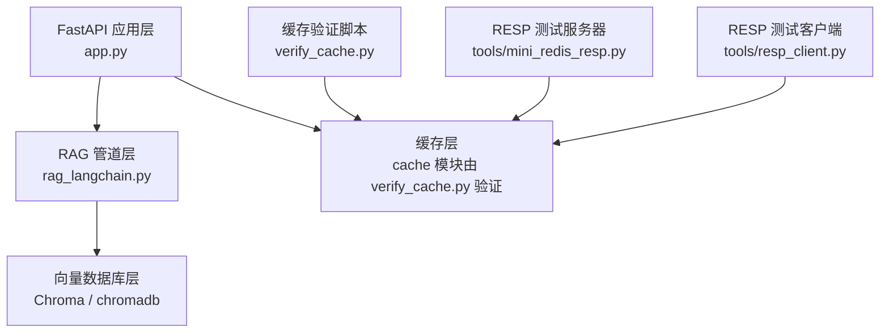
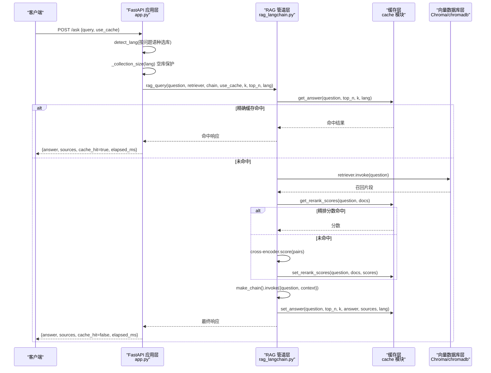
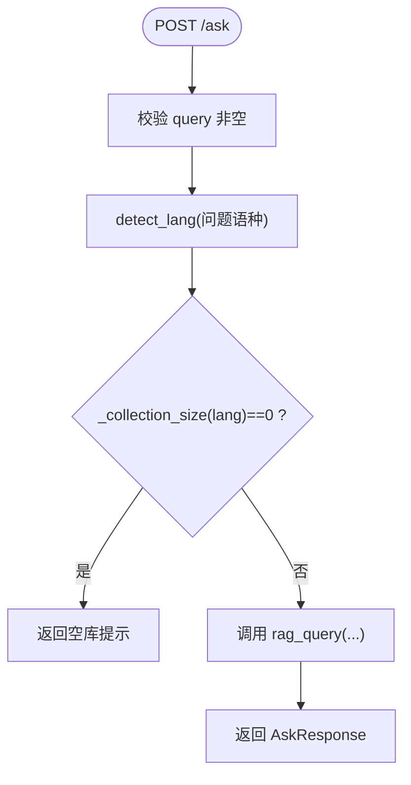
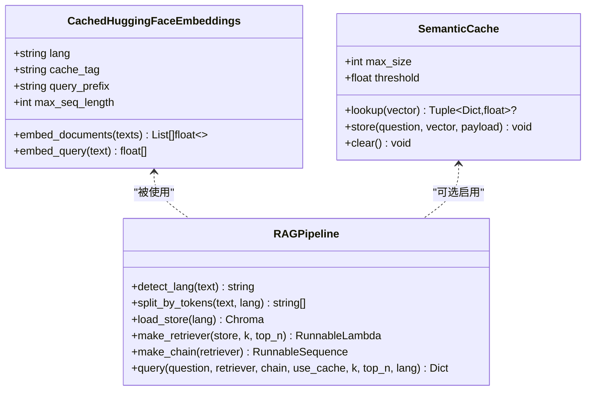
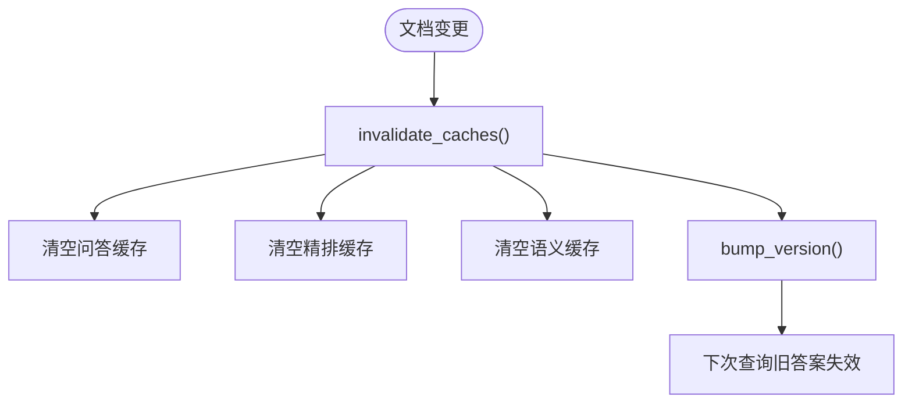
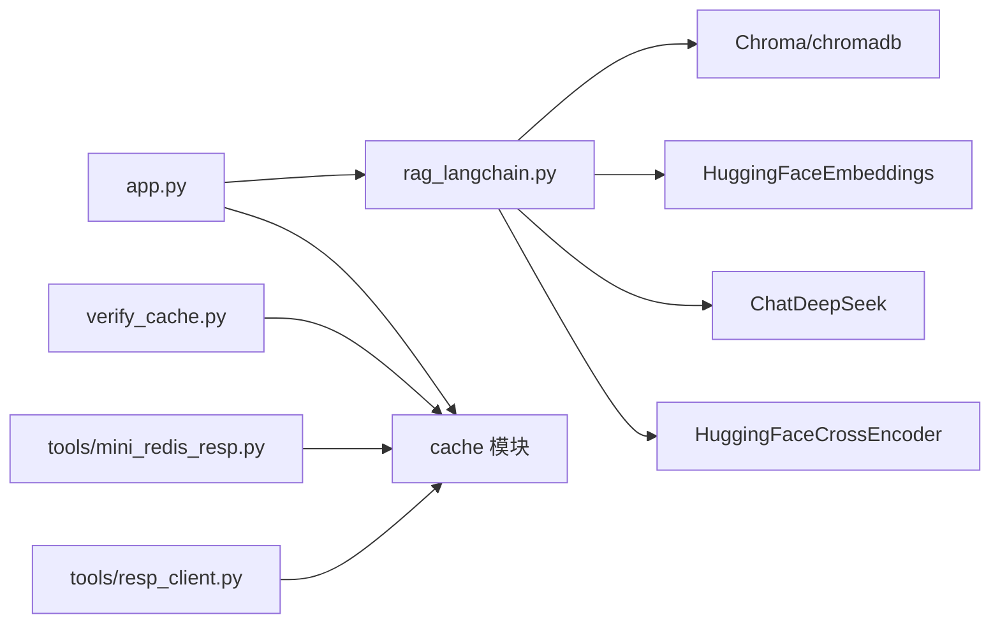

# 组件架构

<cite>
**本文引用的文件**   
- [app.py](file://app.py)
- [rag_langchain.py](file://rag_langchain.py)
- [verify_cache.py](file://verify_cache.py)
- [mini_redis_resp.py](file://tools/mini_redis_resp.py)
- [resp_client.py](file://tools/resp_client.py)
</cite>

## 目录
1. [引言](#引言)
2. [项目结构](#项目结构)
3. [核心组件](#核心组件)
4. [架构总览](#架构总览)
5. [详细组件分析](#详细组件分析)
6. [依赖关系分析](#依赖关系分析)
7. [性能与缓存特性](#性能与缓存特性)
8. [故障排查指南](#故障排查指南)
9. [结论](#结论)

## 引言
本文件面向 RAG（检索增强生成）系统的组件级架构文档，重点说明以下职责边界与协作方式：
- FastAPI 应用层：对外暴露上传、问答、缓存管理、健康检查等接口。
- RAG 管道层：实现语种路由、文本切块、向量检索、精排、提示词组装与大模型生成。
- 缓存层：提供问答结果、嵌入向量、精排分数的多级缓存，以及版本化失效与健康探测。
- 向量数据库层：基于 Chroma 的持久化向量库，按语种隔离 collection，并复用底层客户端。

同时，文档解释单例模式在模型与连接复用中的使用、懒加载机制的实现原理、线程安全设计（双检锁），以及组件间的数据传递格式和请求处理时序。

## 项目结构
仓库采用“应用入口 + 管道逻辑 + 工具脚本”的组织方式：
- app.py：FastAPI 服务入口，定义路由、请求/响应模型、全局对象懒加载与单例。
- rag_langchain.py：RAG 管道核心，包含语种判断、嵌入模型、Chroma 客户端、检索与精排、LCEL 链、语义缓存与评测辅助函数。
- verify_cache.py：缓存层验证脚本，覆盖读写、TTL、命中统计、版本号失效、清理与健康降级等用例。
- tools/mini_redis_resp.py：极简 RESP 服务器，用于在无 Redis 环境下验证 cache 的 Redis 代码路径。
- tools/resp_client.py：极简 RESP 客户端，模拟 redis-py 接口，配合 mini_redis_resp.py 完成端到端测试。

图表来源
- [app.py:53-302](file://app.py#L53-L302)
- [rag_langchain.py:52-116](file://rag_langchain.py#L52-L116)
- [verify_cache.py:1-202](file://verify_cache.py#L1-L202)
- [mini_redis_resp.py:1-32](file://tools/mini_redis_resp.py#L1-L32)
- [resp_client.py:1-34](file://tools/resp_client.py#L1-L34)

章节来源
- [app.py:53-302](file://app.py#L53-L302)
- [rag_langchain.py:52-116](file://rag_langchain.py#L52-L116)
- [verify_cache.py:1-202](file://verify_cache.py#L1-L202)

## 核心组件
- FastAPI 应用层
  - 负责 HTTP 路由、请求校验、响应封装、前端页面返回。
  - 维护按语种的 store/retriever/chain 单例，并通过双检锁保证并发安全。
  - 调用 RAG 管道进行问答，调用缓存层进行命中/失效/统计。
- RAG 管道层
  - 语种判断：根据汉字占比判定中文或英文，决定 embedding 模型与 collection。
  - 文本切块：按 token 切块，避免中英信息量差异导致的召回偏差。
  - 向量检索与精排：先召回 top-k，再用 cross-encoder 精排到 top_n。
  - LCEL 链：将上下文与问题组合后交给大模型生成纯文本答案。
  - 语义缓存（可选）：对相似问法做近似匹配，默认关闭以避免误命中。
- 缓存层
  - 三类缓存：问答缓存、嵌入向量缓存、精排分数缓存。
  - 版本化失效：文档更新后提升版本号，使旧答案失效。
  - 后端可插拔：支持内存与 Redis，Redis 不可用时自动降级为内存。
- 向量数据库层
  - Chroma 持久化客户端按语种共享，collection 按语言隔离。
  - 通过 load_store 创建集合，build_index 重建索引，get_all_chunks_in_order 还原顺序。

章节来源
- [app.py:53-122](file://app.py#L53-L122)
- [rag_langchain.py:118-143](file://rag_langchain.py#L118-L143)
- [rag_langchain.py:324-359](file://rag_langchain.py#L324-L359)
- [rag_langchain.py:452-467](file://rag_langchain.py#L452-L467)
- [rag_langchain.py:471-508](file://rag_langchain.py#L471-L508)
- [rag_langchain.py:514-576](file://rag_langchain.py#L514-L576)
- [rag_langchain.py:362-413](file://rag_langchain.py#L362-L413)

## 架构总览
下图展示一次问答请求从进入 FastAPI 到返回结果的完整生命周期，包括缓存命中分支与真实链路分支。

图表来源
- [app.py:231-260](file://app.py#L231-L260)
- [rag_langchain.py:580-631](file://rag_langchain.py#L580-L631)
- [rag_langchain.py:428-449](file://rag_langchain.py#L428-L449)
- [rag_langchain.py:452-467](file://rag_langchain.py#L452-L467)
- [rag_langchain.py:471-508](file://rag_langchain.py#L471-L508)

## 详细组件分析

### FastAPI 应用层
- 路由与数据模型
  - POST /upload：解析 PDF/Markdown，按文档语种切块入库，清空该语种 collection 的旧块，失效缓存，刷新 chunks_preview_{lang}.md。
  - POST /ask：按问题语种路由，空库保护，调用 rag_query 并返回带缓存信息的响应。
  - GET /cache/stats：返回缓存后端类型、健康状态、版本号、各语种库块数、TTL 与统计。
  - POST /cache/clear：按类型清空缓存。
  - GET /health：轻量健康检查。
  - GET /：返回前端页面。
- 单例与懒加载
  - 全局字典 _stores/_retrievers/_chains 按语种缓存 store/retriever/chain。
  - 所有懒加载均使用双检锁，避免首次并发重复构造。
- 空库保护
  - 直接查询 Chroma 的 count，不触发 embedding_function 加载，避免无谓开销。

图表来源
- [app.py:231-260](file://app.py#L231-L260)
- [app.py:95-122](file://app.py#L95-L122)

章节来源
- [app.py:53-122](file://app.py#L53-L122)
- [app.py:155-228](file://app.py#L155-L228)
- [app.py:231-260](file://app.py#L231-L260)
- [app.py:263-297](file://app.py#L263-L297)

### RAG 管道层
- 语种判断
  - 基于汉字字符占比阈值判定 zh/en，简单高效且稳定。
- 嵌入模型与缓存
  - CachedHuggingFaceEmbeddings 子类覆写 embed_documents/embed_query，接入向量缓存。
  - get_embedding_model 按语种懒加载，带 max_seq_length 显式设置，避免静默截断。
- 向量数据库
  - load_store 按语种创建 Chroma 集合；build_index 支持 force 重建（仅删除块，不 drop collection）。
  - get_all_chunks_in_order 按 metadata.index 排序还原入库顺序。
- 检索与精排
  - make_retriever 封装 as_retriever(k) 与 rerank_cached(top_n)。
  - rerank_cached 对 (question, doc) 成对打分并缓存分数。
- LCEL 链
  - make_chain 支持两种输入：字符串（内部召回）或 dict{question, context}（跳过召回）。
  - 传入 dict 避免重复检索与错误地将 dict 作为 query 送进 embedding。
- 语义缓存（可选）
  - SemanticCache 使用有序字典存储最近问题向量与负载，LRU 淘汰，余弦相似度阈值命中。
  - 默认关闭，避免答错风险。
- 问答入口
  - query 统一入口：精确缓存 -> 语义缓存 -> 真实链路 -> 回写缓存。

图表来源
- [rag_langchain.py:185-222](file://rag_langchain.py#L185-L222)
- [rag_langchain.py:514-576](file://rag_langchain.py#L514-L576)
- [rag_langchain.py:324-359](file://rag_langchain.py#L324-L359)
- [rag_langchain.py:362-413](file://rag_langchain.py#L362-L413)
- [rag_langchain.py:452-467](file://rag_langchain.py#L452-L467)
- [rag_langchain.py:471-508](file://rag_langchain.py#L471-L508)
- [rag_langchain.py:580-631](file://rag_langchain.py#L580-L631)

章节来源
- [rag_langchain.py:118-143](file://rag_langchain.py#L118-L143)
- [rag_langchain.py:145-254](file://rag_langchain.py#L145-L254)
- [rag_langchain.py:324-359](file://rag_langchain.py#L324-L359)
- [rag_langchain.py:362-413](file://rag_langchain.py#L362-L413)
- [rag_langchain.py:417-467](file://rag_langchain.py#L417-L467)
- [rag_langchain.py:471-508](file://rag_langchain.py#L471-L508)
- [rag_langchain.py:514-576](file://rag_langchain.py#L514-L576)
- [rag_langchain.py:580-631](file://rag_langchain.py#L580-L631)

### 缓存层
- 三类缓存
  - 问答缓存：以 question/top_n/k/lang 为签名，命中则直接返回答案与来源。
  - 嵌入向量缓存：以文本哈希为 key，避免重复前向计算。
  - 精排分数缓存：以 (question, doc) 为键，避免重复 cross-encoder 打分。
- 版本化失效
  - invalidate_caches 清问答与精排缓存、语义缓存，并 bump_version。
  - 版本号递增后，旧答案立即失效，防止基于旧文档的答案继续命中。
- 后端与健康
  - backend_name 返回当前后端名称（redis/memory）。
  - healthy 返回后端健康状态；Redis 不可用自动降级为 memory。
- 验证脚本
  - verify_cache.py 覆盖基础读写、TTL、命中统计、版本号失效、定向清理、全量清理与健康降级。

图表来源
- [rag_langchain.py:634-644](file://rag_langchain.py#L634-L644)
- [verify_cache.py:144-177](file://verify_cache.py#L144-L177)

章节来源
- [rag_langchain.py:634-644](file://rag_langchain.py#L634-L644)
- [verify_cache.py:73-177](file://verify_cache.py#L73-L177)

### 向量数据库层
- Chroma 客户端与集合
  - _get_chroma_client 单例共享 PersistentClient，避免多实例导致句柄冲突。
  - load_store 按语种创建 Chroma 集合，embedding_function 使用 CachedHuggingFaceEmbeddings。
  - build_index 支持 force 重建：仅删除已有块，不 drop collection，保持已缓存实例有效。
- 顺序还原
  - get_all_chunks_in_order 按 metadata.index 排序，确保预览与评测一致性。

章节来源
- [rag_langchain.py:257-290](file://rag_langchain.py#L257-L290)
- [rag_langchain.py:362-413](file://rag_langchain.py#L362-L413)

## 依赖关系分析
- FastAPI 应用层依赖
  - rag_langchain：导入 prompt、llm、load_store、make_retriever、make_chain、rag_query、invalidate_caches、split_by_tokens、get_all_chunks_in_order、save_chunks_to_file、detect_lang、LANG_COLLECTIONS、LANG_MODELS、DEFAULT_LANG、_get_chroma_client、RETRIEVE_K、RERANK_TOP_N。
  - cache：backend_name、healthy、get_version、get_stats、ANSWER_TTL、EMBEDDING_TTL、RERANK_TTL、clear。
- RAG 管道层依赖
  - chromadb/langchain-chroma：Chroma 集合操作。
  - langchain-huggingface：HuggingFaceEmbeddings。
  - langchain-deepseek：ChatDeepSeek。
  - langchain-community：PyMuPDFLoader、HuggingFaceCrossEncoder。
  - cache：三类缓存读写与统计。
- 工具脚本依赖
  - verify_cache.py：直接 import cache，验证后端行为。
  - tools/mini_redis_resp.py：RESP 协议服务器，记录命令用于断言。
  - tools/resp_client.py：RESP 客户端，模拟 redis-py 接口。

图表来源
- [app.py:43-51](file://app.py#L43-L51)
- [rag_langchain.py:39-46](file://rag_langchain.py#L39-L46)
- [verify_cache.py:29-71](file://verify_cache.py#L29-L71)
- [mini_redis_resp.py:1-32](file://tools/mini_redis_resp.py#L1-L32)
- [resp_client.py:1-34](file://tools/resp_client.py#L1-L34)

章节来源
- [app.py:43-51](file://app.py#L43-L51)
- [rag_langchain.py:39-46](file://rag_langchain.py#L39-L46)
- [verify_cache.py:29-71](file://verify_cache.py#L29-L71)

## 性能与缓存特性
- 单例与懒加载
  - 模型与连接复用：embedding 模型、cross-encoder、Chroma client、tokenizer 均懒加载，避免启动时全部加载造成内存峰值。
  - 双检锁：在 app.py 的 get_store/get_retriever/get_chain 与 rag_langchain.py 的 get_embedding_model/_get_chroma_client/_get_tokenizer 中均使用双检锁，保证首次并发安全。
- 缓存收益
  - 问答缓存：避免重复走完整链路，显著降低 LLM 调用与等待时间。
  - 向量缓存：避免重复前向计算，尤其在重复上传或重复提问时收益明显。
  - 精排缓存：避免重复 cross-encoder 打分，这是最慢的一环。
- 语义缓存（可选）
  - 对相似问法近似匹配，默认关闭以避免误命中风险。
- 空库保护
  - 目标语种库为空时直接返回提示，不走检索，避免模型“凭印象作答”。

章节来源
- [app.py:55-92](file://app.py#L55-L92)
- [rag_langchain.py:224-254](file://rag_langchain.py#L224-L254)
- [rag_langchain.py:257-290](file://rag_langchain.py#L257-L290)
- [rag_langchain.py:310-321](file://rag_langchain.py#L310-L321)
- [rag_langchain.py:428-449](file://rag_langchain.py#L428-L449)
- [rag_langchain.py:514-576](file://rag_langchain.py#L514-L576)
- [app.py:241-249](file://app.py#L241-L249)

## 故障排查指南
- 上传失败
  - 不支持的文件类型：仅支持 PDF/Markdown/TXT。
  - 文件内容为空：解析后无内容会返回失败。
  - 分块后无内容：切块结果为空时返回失败。
- 问答异常
  - 空问题：返回“问题不能为空”。
  - 空库：返回“知识库为空”，需先上传对应语种文档。
- 缓存问题
  - 命中率异常：检查是否修改了 k/top_n/lang，这些参数参与缓存签名。
  - 版本失效：文档变更后需调用 invalidate_caches，否则旧答案可能继续命中。
  - Redis 不可用：自动降级为 memory，verify_cache.py 会输出警告。
- 向量库问题
  - 重建索引时使用 force=True 仅删除块，不 drop collection，避免已缓存实例失效。
  - 若更换不同维度的 embedding 模型，需停服后手动删除 chroma_db 再重建。

章节来源
- [app.py:155-228](file://app.py#L155-L228)
- [app.py:231-260](file://app.py#L231-L260)
- [rag_langchain.py:375-405](file://rag_langchain.py#L375-L405)
- [verify_cache.py:73-177](file://verify_cache.py#L73-L177)

## 结论
本 RAG 系统通过 FastAPI 应用层、RAG 管道层、缓存层与向量数据库层的清晰分工，实现了高可用、高性能的检索增强生成服务。关键设计要点包括：
- 按语种隔离模型与 collection，避免向量空间混用导致静默错误。
- 单例与懒加载结合双检锁，确保模型与连接复用且并发安全。
- 多级缓存（问答、向量、精排）显著提升性能，版本化失效保证数据一致性。
- 空库保护与 fail-open 策略提升鲁棒性，缓存异常不会改变正确答案。
- 工具脚本与 RESP 测试环境便于独立验证缓存后端行为。