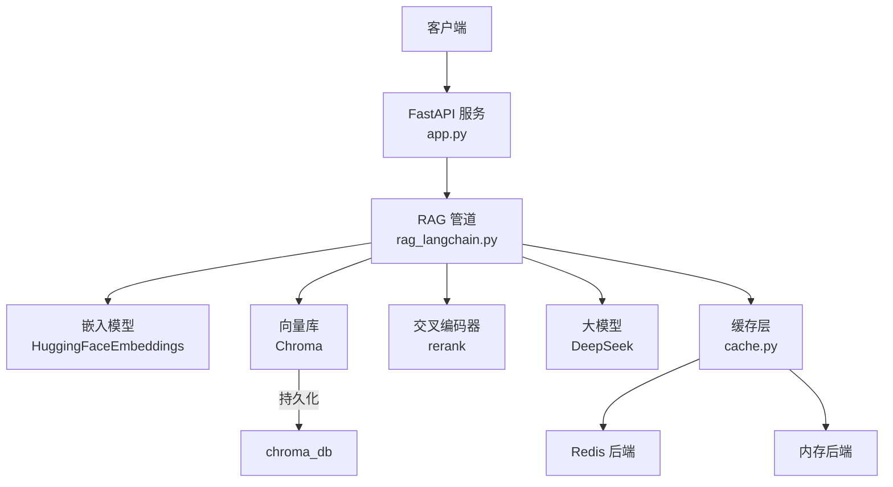
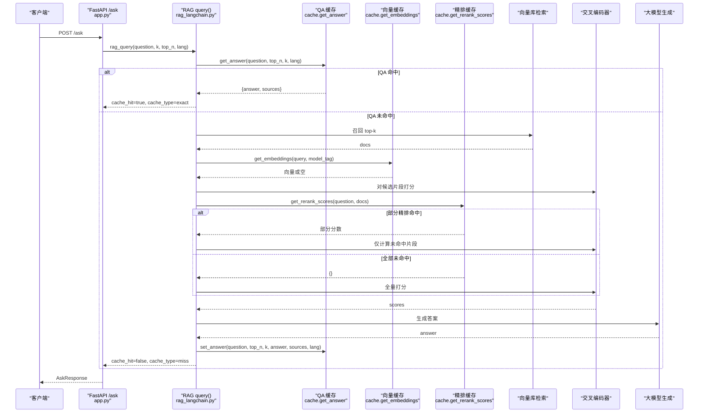
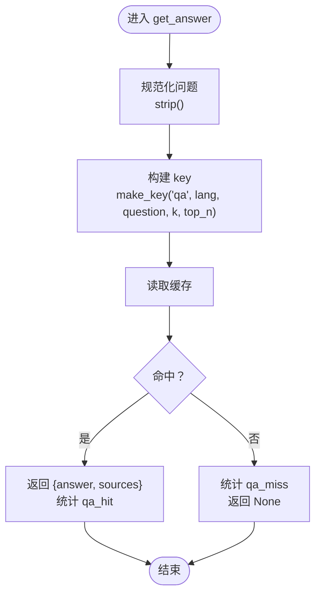
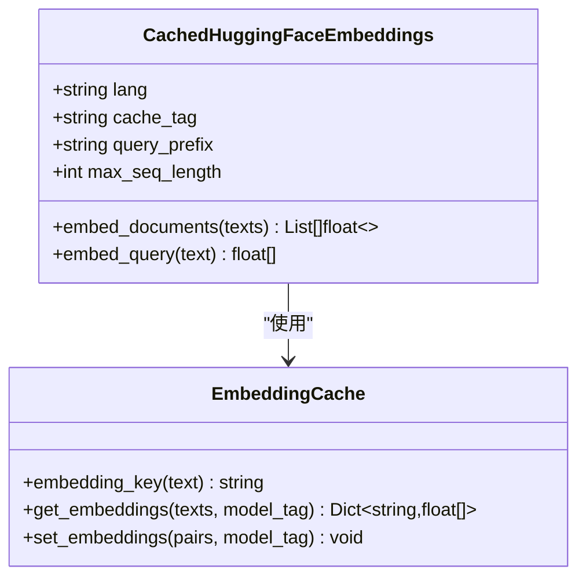
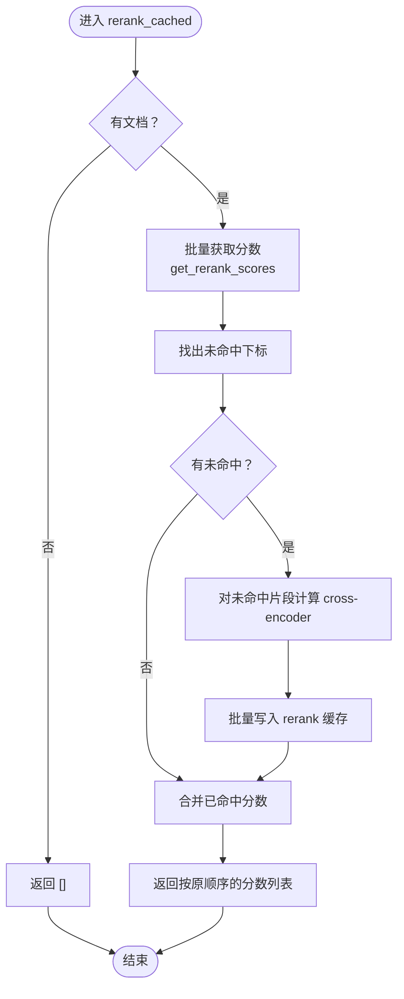
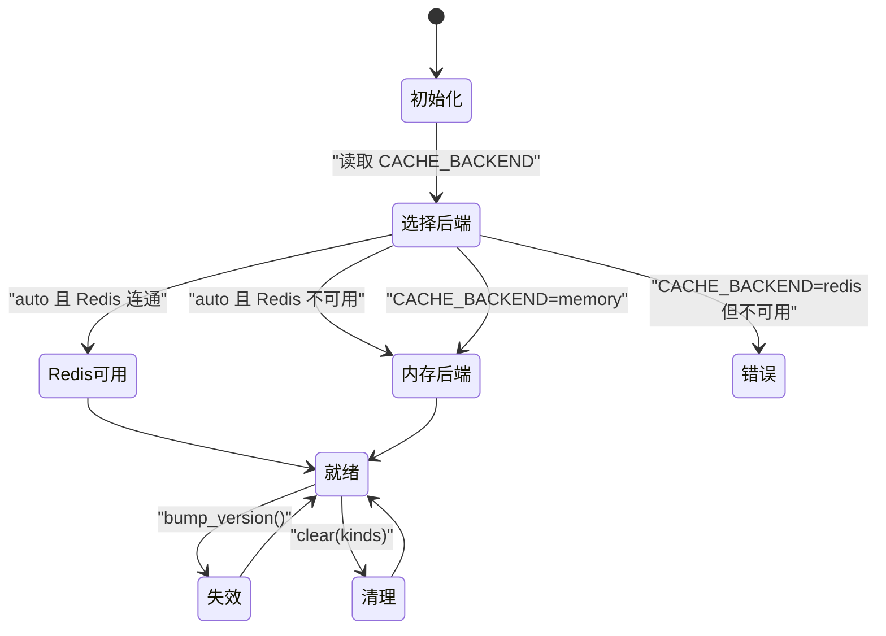
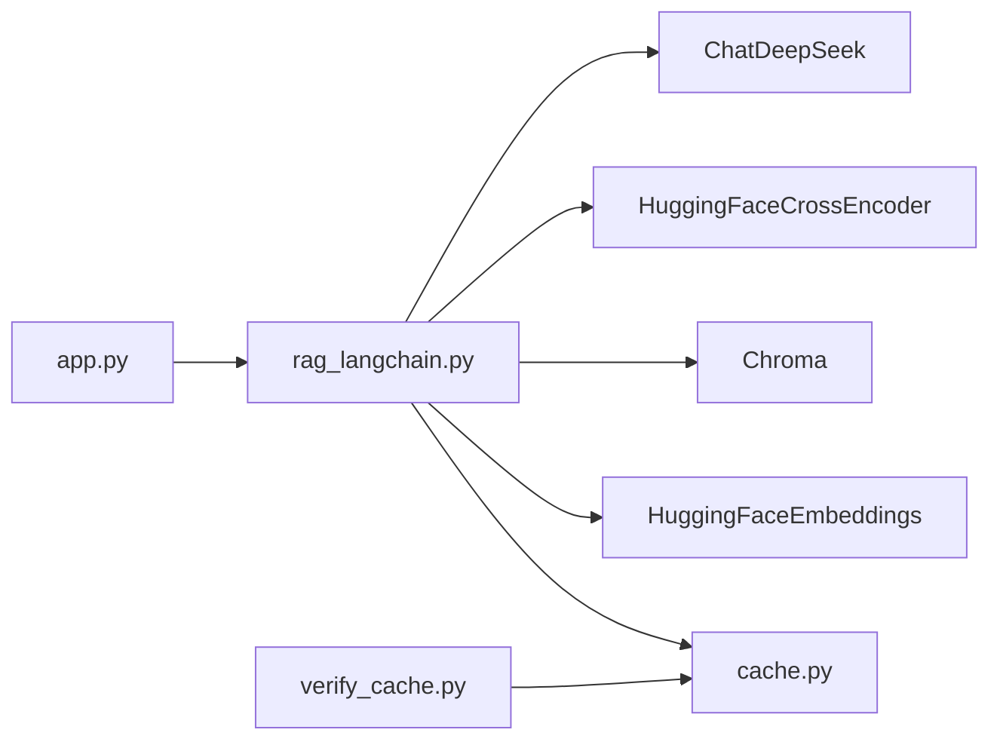

# 三层缓存实现

<cite>
**本文引用的文件**   
- [app.py](file://app.py)
- [rag_langchain.py](file://rag_langchain.py)
- [cache.py](file://cache.py)
- [verify_cache.py](file://verify_cache.py)
</cite>

## 目录
1. [引言](#引言)
2. [项目结构](#项目结构)
3. [核心组件](#核心组件)
4. [架构总览](#架构总览)
5. [详细组件分析](#详细组件分析)
6. [依赖关系分析](#依赖关系分析)
7. [性能与容量特性](#性能与容量特性)
8. [故障排查指南](#故障排查指南)
9. [结论](#结论)
10. [附录：接口与使用示例](#附录接口与使用示例)

## 引言
本仓库实现了一个面向 RAG（检索增强生成）的三层缓存系统，目标是让“重复问题、重复文本、重复交叉编码器打分”尽可能不重复计算。三层缓存分别是：
- 问答缓存（QA Cache）：把“问题 + 检索参数 + 语种 + 缓存版本”映射到最终答案和引用片段，命中后直接返回，跳过完整链路。
- 向量缓存（Embedding Cache）：把“文本哈希 → 向量”做映射，支持按模型隔离，批量写入/读取，避免重复调用 embedding 模型。
- 重排序缓存（Rerank Cache）：把“问题 × 片段”组合的 cross-encoder 评分缓存起来，减少最慢的精排阶段开销。

缓存层对外暴露统一后端抽象，默认优先 Redis，失败时自动降级为进程内内存；所有读/写异常都 fail-open，即“读不到就当作未命中”，保证系统只变慢、不变错。

## 项目结构
从缓存视角看，关键文件职责如下：
- `cache.py`：缓存层实现，包含后端选择、TTL、版本号、统计、三类缓存的业务封装。
- `rag_langchain.py`：RAG 管道，在召回、精排、生成各阶段接入缓存。
- `app.py`：FastAPI Web 服务，负责路由、上传文档、触发失效、暴露缓存统计与健康检查。
- `verify_cache.py`：不加载模型的缓存验证脚本，覆盖读写、TTL、失效、清理、统计等用例。

**图表来源**
- [app.py:53-260](file://app.py#L53-L260)
- [rag_langchain.py:145-467](file://rag_langchain.py#L145-L467)
- [cache.py:1-29](file://cache.py#L1-L29)

**章节来源**
- [app.py:1-53](file://app.py#L1-L53)
- [rag_langchain.py:1-24](file://rag_langchain.py#L1-L24)
- [cache.py:1-29](file://cache.py#L1-L29)

## 核心组件
### 缓存层（cache.py）
- 后端抽象：`_MemoryBackend` 与 `_RedisBackend`，统一提供 `get/set/delete_prefix/incr/ping`。
- 后端选择：`_get_backend()` 根据 `CACHE_BACKEND` 选择 memory / redis / auto，auto 下 Redis 不可用则降级。
- TTL 配置：`ANSWER_TTL`、`EMBEDDING_TTL`、`RERANK_TTL`，可通过环境变量覆盖。
- 版本号：`VERSION_KEY` 记录知识库版本，`bump_version()` 递增使旧答案立即失效。
- Key 生成：`make_key(kind, *parts)` 生成带版本的 key，格式为 `rag:v{版本}:{类型}:{内容hash}`。
- 统计：进程内计数器，按 `qa/embed/rerank` 分别统计 hit/miss/hit_rate。

**章节来源**
- [cache.py:37-49](file://cache.py#L37-L49)
- [cache.py:75-147](file://cache.py#L75-L147)
- [cache.py:176-213](file://cache.py#L176-L213)
- [cache.py:216-268](file://cache.py#L216-L268)

### RAG 管道（rag_langchain.py）
- 语种判断：`detect_lang()` 按汉字占比判定中文或英文，决定走哪个 collection 与 embedding 模型。
- 嵌入模型：`CachedHuggingFaceEmbeddings` 覆写 `embed_documents/embed_query`，内部走 `_embed_documents_cached/_embed_query_cached`，再落到 `cache.get_embeddings/cache.set_embeddings`。
- 向量缓存标签：`cache_tag=f"{lang}|{LANG_MODELS[lang]}|seq{LANG_MAX_SEQ[lang]}"`，确保不同模型、不同最大长度产生的向量不会互相覆盖。
- 精排缓存：`rerank_cached()` 对召回结果调用 cross-encoder，命中分数直接复用，未命中部分计算并回写。
- 问答入口：`query()` 先查 QA 缓存，可选语义缓存，未命中则走真实链路，最后写回 QA 缓存与语义缓存。
- 失效入口：`invalidate_caches()` 清空语义缓存、清 QA 与 rerank 缓存、提升版本号。

**章节来源**
- [rag_langchain.py:118-143](file://rag_langchain.py#L118-L143)
- [rag_langchain.py:145-254](file://rag_langchain.py#L145-L254)
- [rag_langchain.py:416-467](file://rag_langchain.py#L416-L467)
- [rag_langchain.py:579-644](file://rag_langchain.py#L579-L644)

### Web 服务（app.py）
- `/upload`：解析文档、按语种切块、替换对应 collection、调用 `invalidate_caches()` 失效旧缓存。
- `/ask`：按问题语种路由，空库保护，调用 `rag_query()`，返回 `cache_hit/cache_type/elapsed_ms/lang`。
- `/cache/stats`：暴露后端名称、健康状态、版本号、各语种 collection 块数、TTL、统计。
- `/cache/clear`：支持定向清理 `qa/embed/rerank`。

**章节来源**
- [app.py:155-228](file://app.py#L155-L228)
- [app.py:231-260](file://app.py#L231-L260)
- [app.py:263-284](file://app.py#L263-L284)

## 架构总览
下图展示一次问答请求在三层缓存中的流转路径。

**图表来源**
- [app.py:231-260](file://app.py#L231-L260)
- [rag_langchain.py:579-631](file://rag_langchain.py#L579-L631)
- [rag_langchain.py:428-467](file://rag_langchain.py#L428-L467)
- [cache.py:271-367](file://cache.py#L271-L367)

## 详细组件分析

### 问答缓存（QA Cache）
问答缓存的目标是“同一个问题不要重复走完整条 RAG 链路”。它存储的是：
- 输入上下文：语种 `lang`、问题原文 `question`、检索参数 `k`、精排参数 `top_n`、缓存版本。
- 输出结果：`answer`、`sources`、写入时间戳、规范化后的问题文本。

Key 生成规则：
- 业务 key 由 `make_key("qa", lang, question.strip(), str(k), str(top_n))` 生成。
- `make_key` 内部拼接 parts 后用 SHA-256 取前 32 位十六进制作为内容摘要，最终 key 形如 `rag:v{版本}:qa:{摘要}`。
- 版本号参与 key，因此 `bump_version()` 后旧答案即使物理存在也无法命中。

TTL 策略：
- 默认 `ANSWER_TTL`，可通过 `CACHE_ANSWER_TTL` 环境变量覆盖。
- 过期后读不到，视为未命中，继续走真实链路。

失效条件：
- 知识库变更：上传文档后调用 `invalidate_caches()`，会清 QA 与 rerank 缓存并提升版本号。
- 手动清理：`/cache/clear` 可传 `["qa"]` 定向清理。
- 参数变化：`k` 或 `top_n` 变化会改变 key，不会误命中旧口径结果。

**图表来源**
- [cache.py:271-300](file://cache.py#L271-L300)
- [cache.py:264-268](file://cache.py#L264-L268)

**章节来源**
- [cache.py:271-300](file://cache.py#L271-L300)
- [rag_langchain.py:579-631](file://rag_langchain.py#L579-L631)
- [verify_cache.py:85-107](file://verify_cache.py#L85-L107)

### 向量缓存（Embedding Cache）
向量缓存的目标是“同一段文本不要重复做模型前向”。它存储的是：
- Key：文本哈希 `embedding_key(text)`，以及按模型区分的存储 key `_embed_storage_key(text, model_tag)`。
- Value：向量列表。

Key 生成规则：
- `embedding_key(text)` 是对原始文本做 SHA-256，不含模型信息，用于调用方字典查找。
- `_embed_storage_key(text, model_tag)` 是实际存储 key，形如 `rag:embed:{model_tag}:{text_hash}`；当 `model_tag` 为空时退化为兼容旧行为。
- `model_tag` 通常包含语种、模型路径、最大序列长度，例如 `zh|./text2vec-base-chinese|seq512`。

批量操作：
- `get_embeddings(texts, model_tag)` 批量查询，返回 `{text_hash: vector}`，未命中的不在返回值中。
- `set_embeddings(pairs, model_tag)` 批量写入，pairs 为 `(text, vector)`。

多模型隔离：
- 通过 `model_tag` 区分不同 embedding 模型，避免两个语种的向量互相覆盖。
- `CachedHuggingFaceEmbeddings` 构造时传入 `cache_tag`，并在 `embed_documents/embed_query` 中传给缓存层。

TTL 策略：
- 默认 `EMBEDDING_TTL`，可通过 `CACHE_EMBEDDING_TTL` 覆盖。
- 向量本身与知识库内容无关，所以上传新文档不应主动清理向量缓存；只有模型或配置变化才应换 tag。

**图表来源**
- [rag_langchain.py:185-222](file://rag_langchain.py#L185-L222)
- [cache.py:303-346](file://cache.py#L303-L346)

**章节来源**
- [rag_langchain.py:145-254](file://rag_langchain.py#L145-L254)
- [cache.py:303-346](file://cache.py#L303-L346)
- [verify_cache.py:109-125](file://verify_cache.py#L109-L125)

### 重排序缓存（Rerank Cache）
重排序缓存的目标是“避免重复计算 (问题, 片段) 的 cross-encoder 分数”。它存储的是：
- Key：对 `f"{question}||{doc}"` 做 SHA-256，形如 `rag:rerank:{digest}`。
- Value：浮点分数。

Key 生成规则：
- 每个片段独立一个 key，key 同时编码问题和片段内容。
- 同一问题换片段、或同一片段换问题，都会产生不同 key，防止误命中。

批量处理：
- `get_rerank_scores(question, docs)` 返回 `{片段下标: 分数}`，未命中的下标不走缓存。
- `set_rerank_scores(question, docs, scores)` 批量写入。

TTL 策略：
- 默认 `RERANK_TTL`，可通过 `CACHE_RERANK_TTL` 覆盖。

失效条件：
- 知识库变更后，`invalidate_caches()` 会清 rerank 缓存。
- 也可通过 `/cache/clear` 定向清理 `rerank`。

**图表来源**
- [rag_langchain.py:428-449](file://rag_langchain.py#L428-L449)
- [cache.py:349-367](file://cache.py#L349-L367)

**章节来源**
- [rag_langchain.py:416-467](file://rag_langchain.py#L416-L467)
- [cache.py:349-367](file://cache.py#L349-L367)
- [verify_cache.py:127-142](file://verify_cache.py#L127-L142)

### 缓存后端与失效机制
后端选择：
- `CACHE_BACKEND=auto`：尝试 Redis，失败降级为 memory。
- `CACHE_BACKEND=redis`：强制 Redis，连接失败抛错。
- `CACHE_BACKEND=memory`：只用进程内内存。

TTL 与过期：
- Memory 后端惰性过期：读时检查 `expire_at < time.time()`，过期则删除。
- Redis 后端使用原生 TTL。

版本号失效：
- `VERSION_KEY` 自增，所有带版本的 QA key 因版本号变化而失效。
- 清理时使用通配前缀 `rag:v*:qa:` 删除所有历史版本 QA 记录。

**图表来源**
- [cache.py:176-199](file://cache.py#L176-L199)
- [cache.py:216-233](file://cache.py#L216-L233)
- [cache.py:370-390](file://cache.py#L370-L390)

**章节来源**
- [cache.py:176-233](file://cache.py#L176-L233)
- [cache.py:370-390](file://cache.py#L370-L390)

## 依赖关系分析
- `app.py` 依赖 `rag_langchain.py` 提供的 `rag_query`、`invalidate_caches`、`get_retriever`、`get_chain` 等能力。
- `rag_langchain.py` 依赖 `cache.py` 的三类缓存接口，并依赖 HuggingFaceEmbeddings、Chroma、CrossEncoder、ChatDeepSeek。
- `cache.py` 依赖 Redis 或 Python 标准库，提供统一后端抽象。
- `verify_cache.py` 直接测试 `cache.py` 的读写、TTL、失效、清理、统计逻辑，不加载模型。

**图表来源**
- [app.py:43-51](file://app.py#L43-L51)
- [rag_langchain.py:39-48](file://rag_langchain.py#L39-L48)
- [verify_cache.py:29-29](file://verify_cache.py#L29-L29)

**章节来源**
- [app.py:43-51](file://app.py#L43-L51)
- [rag_langchain.py:39-48](file://rag_langchain.py#L39-L48)
- [verify_cache.py:1-29](file://verify_cache.py#L1-L29)

## 性能与容量特性
- 问答缓存命中可跳过 DeepSeek 调用，典型收益是秒级返回。
- 向量缓存命中可跳过 embedding 模型前向，适合重复上传相同内容或重复提问。
- 精排缓存命中可跳过 cross-encoder 打分，召回 20 条时最多省 20 次成对打分。
- 统计指标包括 `qa_hit/qa_miss/qa_hit_rate`、`embed_hit/embed_miss/embed_hit_rate`、`rerank_hit/rerank_miss/rerank_hit_rate`，以及 `backend` 和 `asked_pipeline_saved`。
- 向量缓存 TTL 较长（默认 24 小时），因为向量由文本和模型决定，短期不会变化；问答与精排 TTL 较短（默认 1 小时），更贴近知识时效性。

[本节为通用性能讨论，不直接分析具体代码行]

## 故障排查指南
常见问题与定位方式：
- 缓存未命中：
  - 检查是否关闭了 `use_cache`。
  - 检查 `k` 或 `top_n` 是否与之前不同，导致 key 变化。
  - 检查是否调用了 `invalidate_caches()` 或 `bump_version()`。
- 向量缓存未生效：
  - 确认 `model_tag` 一致；不同模型或不同 `max_seq_length` 会产生不同 tag。
  - 检查 `EMBEDDING_TTL` 是否过短。
- 精排缓存未生效：
  - 确认问题或片段内容变化会导致 key 变化。
  - 检查 `RERANK_TTL` 是否过短。
- Redis 不可用：
  - 查看 `backend_name()` 与 `healthy()`。
  - 若 `CACHE_BACKEND=auto`，会自动降级为 memory；若 `CACHE_BACKEND=redis`，会抛错。
- 文档更新后仍命中旧答案：
  - 确认上传流程调用了 `invalidate_caches()`。
  - 确认版本号已提升，QA key 因版本变化失效。

**章节来源**
- [app.py:263-284](file://app.py#L263-L284)
- [cache.py:202-213](file://cache.py#L202-L213)
- [cache.py:216-233](file://cache.py#L216-L233)
- [verify_cache.py:144-177](file://verify_cache.py#L144-L177)

## 结论
该三层缓存系统在 RAG 管道中实现了明确的职责分离：
- QA 缓存解决“整条链路重复”的问题。
- 向量缓存解决“embedding 重复计算”的问题。
- 精排缓存解决“cross-encoder 重复打分”的问题。

通过统一的缓存后端抽象、TTL 控制、版本号失效、fail-open 设计，系统在加速的同时保持了正确性与鲁棒性。配合 `verify_cache.py` 的自动化验证，可以持续保障缓存行为符合预期。

[本节为总结性内容，不直接分析具体代码行]

## 附录：接口与使用示例

### 问答缓存接口
- 查询：`cache.get_answer(question, top_n, k, lang)`
- 写入：`cache.set_answer(question, top_n, k, answer, sources, lang)`
- 使用场景：
  - 同一问题重复提问，直接返回答案与引用片段。
  - 不同 `k` 或 `top_n` 不会误命中。
  - 不同 `lang` 不会跨语种复用答案。

参考用例路径：
- [verify_cache.py:85-107](file://verify_cache.py#L85-L107)

**章节来源**
- [cache.py:271-300](file://cache.py#L271-L300)
- [verify_cache.py:85-107](file://verify_cache.py#L85-L107)

### 向量缓存接口
- 查询：`cache.get_embeddings(texts, model_tag)`
- 写入：`cache.set_embeddings(pairs, model_tag)`
- Key 工具：`cache.embedding_key(text)`
- 使用场景：
  - 批量嵌入时只计算未命中文本。
  - 不同模型通过 `model_tag` 隔离。
  - 相同文本产生相同 key，不同文本 key 不同。

参考用例路径：
- [verify_cache.py:109-125](file://verify_cache.py#L109-L125)

**章节来源**
- [cache.py:303-346](file://cache.py#L303-L346)
- [verify_cache.py:109-125](file://verify_cache.py#L109-L125)

### 重排序缓存接口
- 查询：`cache.get_rerank_scores(question, docs)`
- 写入：`cache.set_rerank_scores(question, docs, scores)`
- 使用场景：
  - 同一问题对相同片段的分数可复用。
  - 换问题或换片段不会误命中。
  - 返回按片段下标对应的分数。

参考用例路径：
- [verify_cache.py:127-142](file://verify_cache.py#L127-L142)

**章节来源**
- [cache.py:349-367](file://cache.py#L349-L367)
- [verify_cache.py:127-142](file://verify_cache.py#L127-L142)

### 失效与清理
- 知识库变更后：调用 `invalidate_caches()`，清 QA 与 rerank 缓存并提升版本号。
- 手动清理：`cache.clear(kinds)`，`kinds` 可为 `["qa"]`、`["embed"]`、`["rerank"]` 或空表示全部。
- 版本号：`cache.bump_version()` 提升版本，使旧 QA 缓存失效。

参考用例路径：
- [verify_cache.py:144-177](file://verify_cache.py#L144-L177)

**章节来源**
- [rag_langchain.py:634-644](file://rag_langchain.py#L634-L644)
- [cache.py:216-233](file://cache.py#L216-L233)
- [cache.py:370-390](file://cache.py#L370-L390)
- [verify_cache.py:144-177](file://verify_cache.py#L144-L177)