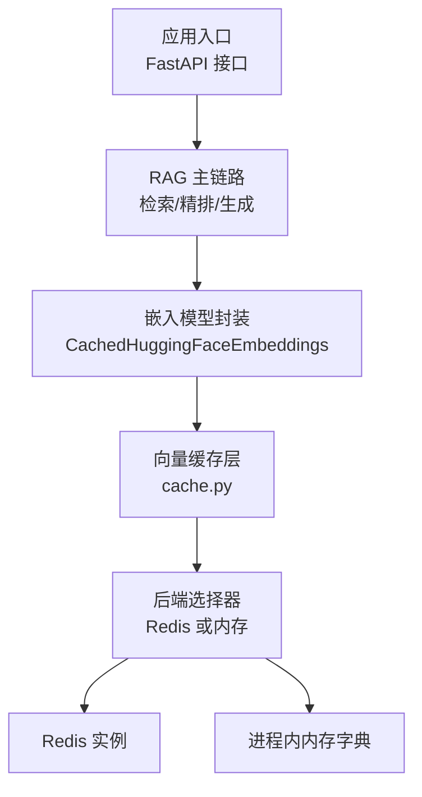
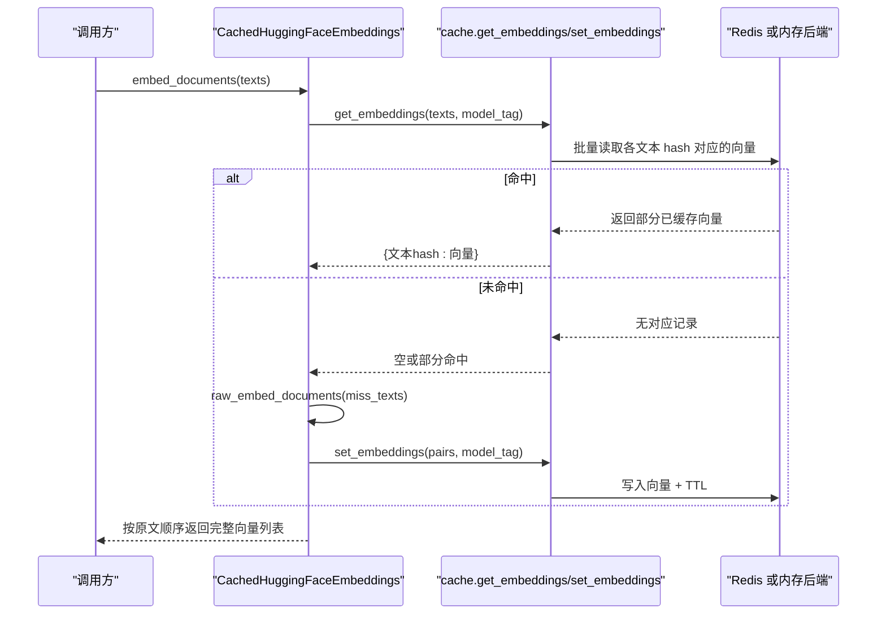
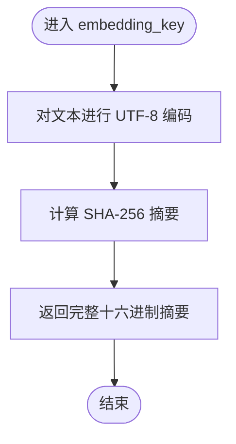
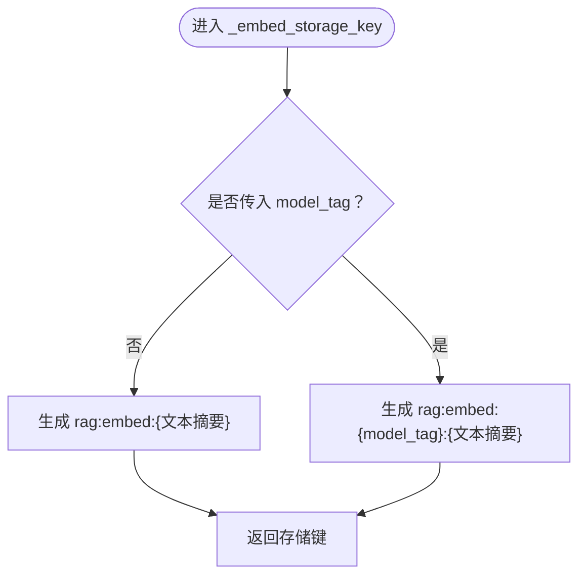
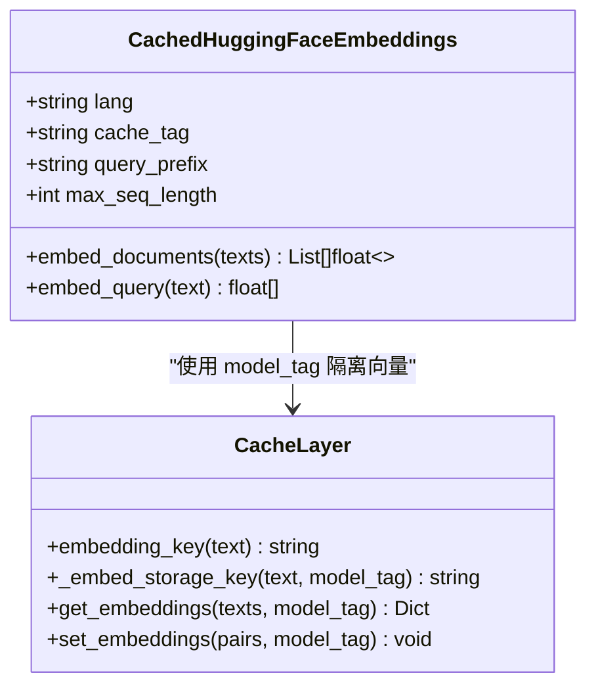
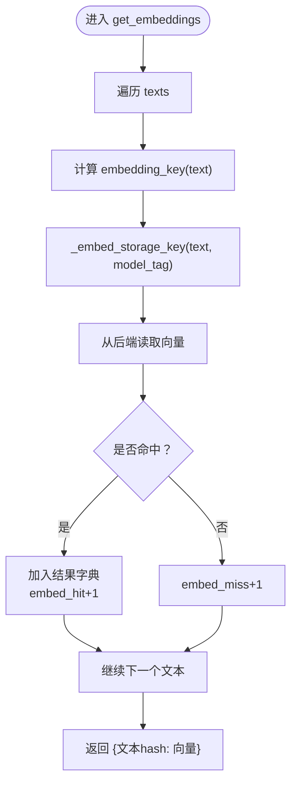
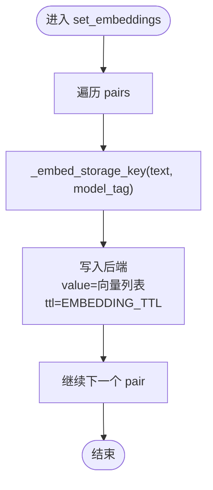
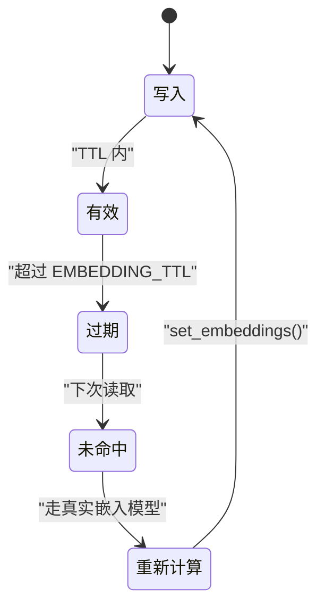
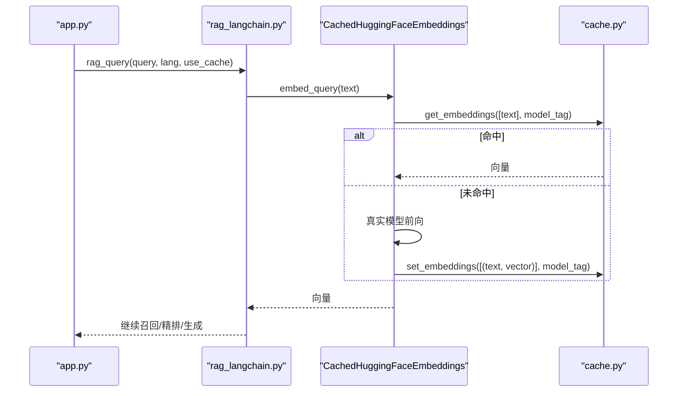
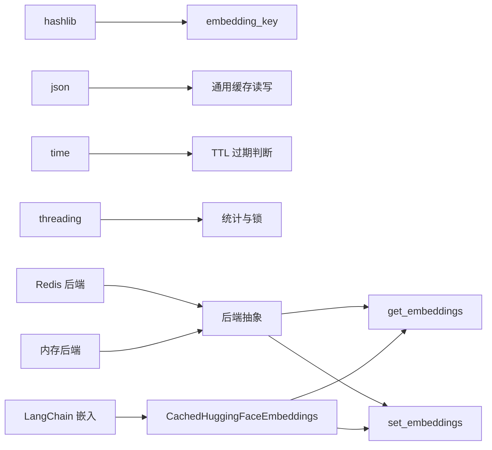

# 向量缓存（Embedding Cache）

<cite>
**本文引用的文件**   
- [cache.py](file://cache.py)
- [rag_langchain.py](file://rag_langchain.py)
- [app.py](file://app.py)
- [verify_cache.py](file://verify_cache.py)
</cite>

## 目录
1. [引言](#引言)
2. [项目结构](#项目结构)
3. [核心组件](#核心组件)
4. [架构总览](#架构总览)
5. [详细组件分析](#详细组件分析)
6. [依赖关系分析](#依赖关系分析)
7. [性能与容量特性](#性能与容量特性)
8. [使用示例与最佳实践](#使用示例与最佳实践)
9. [故障排查指南](#故障排查指南)
10. [结论](#结论)

## 引言
本文件面向“向量缓存”这一子系统，目标是帮助读者理解：
- 文本如何被哈希为稳定的 embedding_key；
- 向量在缓存中的存储键 _embed_storage_key 如何设计；
- model_tag 如何实现多模型隔离；
- 批量接口 get_embeddings() 与 set_embeddings() 的用法；
- TTL 过期策略，尤其是默认 24 小时；
- 与 RAG 主链路、语种路由、知识库版本失效之间的关系。

该向量缓存是三层缓存体系中的一层：问答缓存、向量缓存、精排分数缓存。它不替代数据源，只加速重复计算；任何异常都 fail-open，不会导致答案错误。

**章节来源**
- [cache.py:1-29](file://cache.py#L1-L29)

## 项目结构
与向量缓存直接相关的代码集中在以下文件：
- cache.py：实现缓存后端选择、TTL、版本号、通用 key 生成、以及 embedding_key / _embed_storage_key / get_embeddings / set_embeddings 等 API。
- rag_langchain.py：将 CachedHuggingFaceEmbeddings 包装进 LangChain 嵌入流程，按语种设置 model_tag，并调用缓存读写。
- app.py：对外暴露 FastAPI 接口，并在上传文档时触发知识库版本提升，使旧答案失效。
- verify_cache.py：独立验证脚本，覆盖基础读写、TTL、向量缓存、清理与统计等行为。

**图表来源**
- [app.py:231-260](file://app.py#L231-L260)
- [rag_langchain.py:185-221](file://rag_langchain.py#L185-L221)
- [cache.py:176-199](file://cache.py#L176-L199)

**章节来源**
- [app.py:1-53](file://app.py#L1-L53)
- [rag_langchain.py:185-253](file://rag_langchain.py#L185-L253)
- [cache.py:1-43](file://cache.py#L1-L43)
- [verify_cache.py:1-29](file://verify_cache.py#L1-L29)

## 核心组件
本节聚焦向量缓存的核心能力：
- 文本哈希函数 embedding_key()
- 存储键设计 _embed_storage_key()
- 批量读取 get_embeddings()
- 批量写入 set_embeddings()
- 多模型隔离 model_tag
- TTL 过期策略 EMBEDDING_TTL
- 与知识库版本 bump_version() 的关系

这些能力共同保证：同一段文本在不同模型下得到不同向量，且不会被互相覆盖；重复文本不必重复计算；向量缓存可独立于问答结果存在。

**章节来源**
- [cache.py:303-346](file://cache.py#L303-L346)
- [cache.py:40-42](file://cache.py#L40-L42)
- [cache.py:225-233](file://cache.py#L225-L233)

## 架构总览
向量缓存处于“计算层”和“持久化层”之间。上层通过 LangChain 的嵌入对象发起向量化请求；下层根据配置选择 Redis 或内存作为存储后端。

**图表来源**
- [rag_langchain.py:162-170](file://rag_langchain.py#L162-L170)
- [rag_langchain.py:214-221](file://rag_langchain.py#L214-L221)
- [cache.py:322-346](file://cache.py#L322-L346)
- [cache.py:176-199](file://cache.py#L176-L199)

## 详细组件分析

### embedding_key()：文本哈希算法
embedding_key() 用于把原始文本映射为一个稳定、固定长度的十六进制字符串。其关键性质如下：
- 输入是原始文本字符串；
- 内部使用 SHA-256 对 UTF-8 编码后的文本求摘要；
- 返回值是整个摘要字符串，而不是截断片段；
- 相同文本一定产生相同 key；
- 不同文本大概率产生不同 key；
- 该 key 仅表示“这段文本”，不包含模型信息，因此不能单独作为跨模型的存储键。

这个设计适合做“文本指纹”，便于在 Python 字典中快速查找，也便于测试断言“相同文本 key 相同”。

**图表来源**
- [cache.py:304-306](file://cache.py#L304-L306)

**章节来源**
- [cache.py:304-306](file://cache.py#L304-L306)
- [verify_cache.py:122-125](file://verify_cache.py#L122-L125)

### _embed_storage_key()：向量存储键设计
_embedding storage key 才是真正写入缓存后端的键。它由两部分组成：
- 可选的 model_tag；
- 基于 embedding_key(text) 生成的文本指纹。

当 model_tag 非空时，存储键形如：
- rag:embed:{model_tag}:{文本摘要}

当 model_tag 为空时，存储键退化为：
- rag:embed:{文本摘要}

这种设计的核心目的是“多模型隔离”。不同 embedding 模型会把相同文本映射到不同的向量空间；如果只用文本摘要作为键，中文模型和英文模型、或不同版本的模型会互相覆盖。model_tag 通常来自 langchain 层的 cache_tag，例如包含语种、模型名和最大序列长度等信息。

**图表来源**
- [cache.py:309-319](file://cache.py#L309-L319)

**章节来源**
- [cache.py:309-319](file://cache.py#L309-L319)
- [rag_langchain.py:247-252](file://rag_langchain.py#L247-L252)

### model_tag：多模型隔离机制
model_tag 的作用是把“同一文本在不同模型下的向量”区分开。在本项目中，它通常由 CachedHuggingFaceEmbeddings 的 cache_tag 提供，组合了：
- 语种；
- 具体 embedding 模型名称；
- 最大序列长度。

这样做的意义是：
- 中文库和英文库使用不同模型，向量不可混用；
- 更换模型或调整 max_seq_length 后，旧向量不应继续命中新模型；
- 避免“维度相同但语义空间不同”导致的静默错误。

**图表来源**
- [rag_langchain.py:185-221](file://rag_langchain.py#L185-L221)
- [rag_langchain.py:247-252](file://rag_langchain.py#L247-L252)
- [cache.py:309-319](file://cache.py#L309-L319)

**章节来源**
- [rag_langchain.py:185-253](file://rag_langchain.py#L185-L253)
- [cache.py:309-319](file://cache.py#L309-L319)

### get_embeddings()：批量读取接口
get_embeddings() 接收一个文本列表和一个可选的 model_tag，返回一个字典，键是文本的 embedding_key，值是缓存到的向量。未命中的文本不会出现在返回值中。

处理流程如下：
1. 遍历 texts；
2. 对每个文本计算 embedding_key；
3. 用 _embed_storage_key(text, model_tag) 去后端读取；
4. 命中则累计到结果字典，并增加 embed_hit 计数；
5. 未命中则增加 embed_miss 计数；
6. 最终返回所有命中的 {文本hash: 向量}。

**图表来源**
- [cache.py:322-336](file://cache.py#L322-L336)

**章节来源**
- [cache.py:322-336](file://cache.py#L322-L336)
- [verify_cache.py:112-121](file://verify_cache.py#L112-L121)

### set_embeddings()：批量写入接口
set_embeddings() 接收 pairs 列表，每个元素是 (文本, 向量)，并按 model_tag 写入缓存。

关键点：
- 每条记录都使用 _embed_storage_key(text, model_tag) 作为键；
- 值直接保存向量列表；
- TTL 使用 EMBEDDING_TTL，默认 86400 秒，即 24 小时；
- 写入失败走 fail-open 路径，不影响主流程。

**图表来源**
- [cache.py:339-346](file://cache.py#L339-L346)
- [cache.py:40-42](file://cache.py#L40-L42)

**章节来源**
- [cache.py:339-346](file://cache.py#L339-L346)
- [cache.py:40-42](file://cache.py#L40-L42)

### TTL 策略：默认 24 小时过期
向量缓存的 TTL 由 EMBEDDING_TTL 控制，默认值为 86400 秒，即 24 小时。它通过环境变量 CACHE_EMBEDDING_TTL 覆盖。

TTL 的意义：
- 防止向量无限增长；
- 允许模型升级后，旧向量自然过期；
- 与知识库版本失效配合：上传文档会提升版本号，使问答缓存立即失效；向量缓存本身不随知识库内容变化而失效，因为向量只取决于文本和模型。

**图表来源**
- [cache.py:40-42](file://cache.py#L40-L42)
- [cache.py:339-346](file://cache.py#L339-L346)

**章节来源**
- [cache.py:40-42](file://cache.py#L40-L42)
- [cache.py:339-346](file://cache.py#L339-L346)

### 与 RAG 主链路的集成
CachedHuggingFaceEmbeddings 覆写了 embed_documents 和 embed_query，分别调用 _embed_documents_cached 和 _embed_query_cached。后者先查缓存，未命中再调用底层 HuggingFaceEmbeddings 的真实嵌入方法，并把结果写回缓存。

**图表来源**
- [rag_langchain.py:162-182](file://rag_langchain.py#L162-L182)
- [rag_langchain.py:214-221](file://rag_langchain.py#L214-L221)
- [cache.py:322-346](file://cache.py#L322-L346)

**章节来源**
- [rag_langchain.py:162-182](file://rag_langchain.py#L162-L182)
- [rag_langchain.py:214-221](file://rag_langchain.py#L214-L221)

## 依赖关系分析
向量缓存依赖以下模块和概念：
- hashlib：生成文本摘要；
- json：序列化通用缓存值；
- threading：统计计数器与后端初始化锁；
- time：TTL 判断；
- Redis 或内存后端：实际存储；
- LangChain 嵌入对象：提供真实向量计算；
- 知识库版本：影响问答缓存，间接影响整体一致性。

**图表来源**
- [cache.py:30-48](file://cache.py#L30-L48)
- [cache.py:75-147](file://cache.py#L75-L147)
- [cache.py:303-346](file://cache.py#L303-L346)
- [rag_langchain.py:185-221](file://rag_langchain.py#L185-L221)

**章节来源**
- [cache.py:30-48](file://cache.py#L30-L48)
- [cache.py:75-147](file://cache.py#L75-L147)
- [cache.py:303-346](file://cache.py#L303-L346)
- [rag_langchain.py:185-221](file://rag_langchain.py#L185-L221)

## 性能与容量特性
- 时间复杂度：
  - embedding_key() 是 O(n) 文本编码加常数时间哈希；
  - get_embeddings() 是 O(m) 次后端读取，m 为输入文本数量；
  - set_embeddings() 是 O(p) 次后端写入，p 为 pairs 数量。
- 空间复杂度：
  - 缓存中每个文本对应一个向量列表；
  - 向量维度由具体 embedding 模型决定；
  - 内存后端每条目还保存过期时间戳。
- 并发安全：
  - 统计计数器使用线程锁；
  - 后端初始化使用双检锁；
  - 内存后端使用可重入锁。
- 降级策略：
  - Redis 不可用时自动降级到内存后端；
  - 读失败返回 None，视为未命中；
  - 写失败忽略，不中断主流程。

**章节来源**
- [cache.py:45-72](file://cache.py#L45-L72)
- [cache.py:75-147](file://cache.py#L75-L147)
- [cache.py:176-199](file://cache.py#L176-L199)
- [cache.py:250-261](file://cache.py#L250-L261)

## 使用示例与最佳实践

### 基本用法
- 批量查询向量缓存：
  - 调用 get_embeddings(texts, model_tag)；
  - 返回 {文本hash: 向量}；
  - 未命中的文本不在返回值中。
- 批量写入向量缓存：
  - 调用 set_embeddings(pairs, model_tag)；
  - pairs 是 [(文本, 向量), ...]；
  - 每条记录带 EMBEDDING_TTL。

参考验证用例：
- 首次批量查询全部未命中；
- 写入后能按文本 hash 取回；
- 相同文本产生相同 key；
- 不同文本 key 不同。

**章节来源**
- [cache.py:322-346](file://cache.py#L322-L346)
- [verify_cache.py:112-125](file://verify_cache.py#L112-L125)

### 多模型隔离
- 为不同 embedding 模型设置不同 model_tag；
- 推荐将语种、模型名、max_seq_length 拼入 cache_tag；
- 避免中文模型和英文模型向量互相覆盖；
- 避免换模型后旧向量继续命中。

**章节来源**
- [rag_langchain.py:247-252](file://rag_langchain.py#L247-L252)
- [cache.py:309-319](file://cache.py#L309-L319)

### TTL 管理
- 默认向量缓存 TTL 为 24 小时；
- 可通过环境变量 CACHE_EMBEDDING_TTL 调整；
- 向量缓存不过滤知识库版本，因为向量只取决于文本和模型；
- 问答缓存通过版本号失效，更适合“文档更新后答案必须刷新”的场景。

**章节来源**
- [cache.py:40-42](file://cache.py#L40-L42)
- [cache.py:225-233](file://cache.py#L225-L233)
- [cache.py:370-390](file://cache.py#L370-L390)

### 与知识库版本失效的配合
- 上传文档后调用 bump_version()；
- 版本号提升后，问答缓存立即失效；
- 向量缓存不受版本号影响，除非模型或文本发生变化；
- 这符合“向量是中间结果，不是业务答案”的设计。

**章节来源**
- [cache.py:225-233](file://cache.py#L225-L233)
- [app.py:197-205](file://app.py#L197-L205)

### 最佳实践清单
- 始终为不同 embedding 模型设置不同 model_tag；
- 不要混用不同模型的向量；
- 使用批量接口减少后端往返；
- 监控 embed_hit 和 embed_miss 统计；
- 在 Redis 可用时使用 Redis 后端以获得跨进程共享；
- 本地开发可使用 memory 后端快速验证；
- 向量缓存异常时接受降级，但不要误判为答案错误。

**章节来源**
- [cache.py:45-72](file://cache.py#L45-L72)
- [cache.py:176-199](file://cache.py#L176-L199)
- [verify_cache.py:166-184](file://verify_cache.py#L166-L184)

## 故障排查指南
常见问题及定位方式：
- 向量命中率为零：
  - 检查是否传入了正确的 model_tag；
  - 确认写入和读取使用的是同一个模型标签；
  - 查看 verify_cache.py 中向量缓存相关断言。
- 不同模型向量互相覆盖：
  - 检查 _embed_storage_key 是否包含 model_tag；
  - 检查 CachedHuggingFaceEmbeddings 的 cache_tag 是否正确。
- Redis 不可用：
  - 检查 backend_name() 和 healthy()；
  - 确认 CACHE_BACKEND 配置；
  - 观察是否自动降级到 memory。
- 向量缓存未过期：
  - 检查 EMBEDDING_TTL 配置；
  - 确认后端是否支持 TTL；
  - 注意内存后端重启后失效。
- 清理行为不符合预期：
  - clear(["qa"]) 只清问答缓存；
  - clear(["embed"]) 清理向量缓存；
  - 向量缓存 key 不含版本号，所以不会因知识库版本提升而自动清理。

**章节来源**
- [cache.py:176-199](file://cache.py#L176-L199)
- [cache.py:370-390](file://cache.py#L370-L390)
- [verify_cache.py:166-184](file://verify_cache.py#L166-L184)

## 结论
向量缓存通过 embedding_key() 提供稳定的文本指纹，通过 _embed_storage_key() 将文本指纹与 model_tag 结合，形成多模型隔离的存储键。get_embeddings() 和 set_embeddings() 提供批量接口，配合默认 24 小时的 TTL，既提升性能又控制缓存规模。它与知识库版本失效机制互补：问答缓存关注“答案一致性”，向量缓存关注“向量计算复用”。在生产环境中，建议优先使用 Redis 后端，并为不同 embedding 模型设置明确的 model_tag，以避免向量空间混淆带来的静默错误。