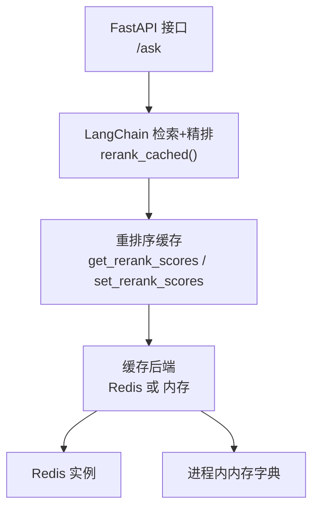
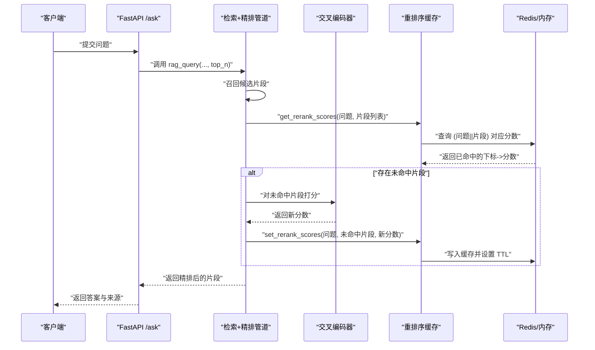
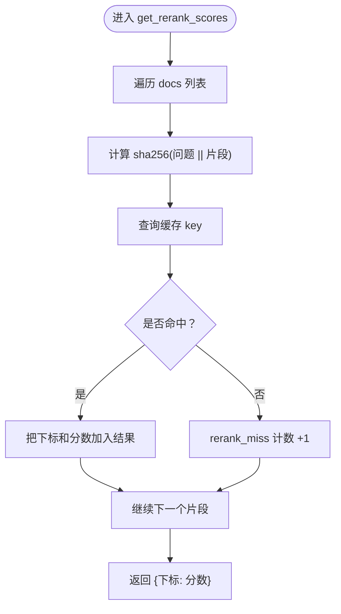
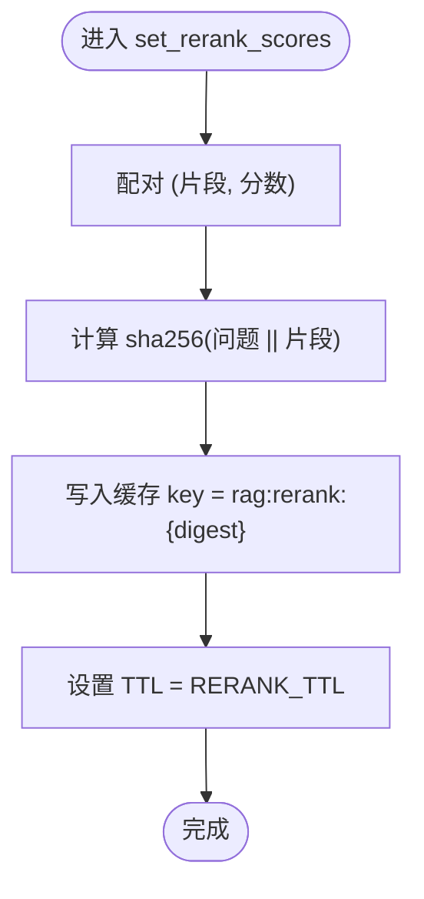
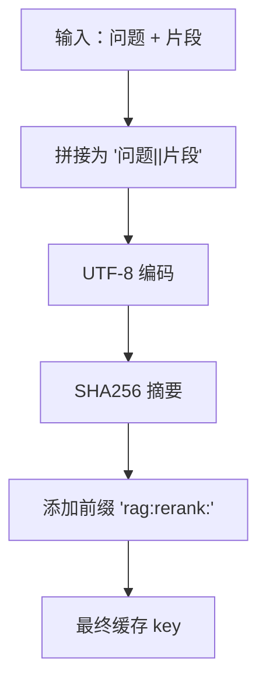
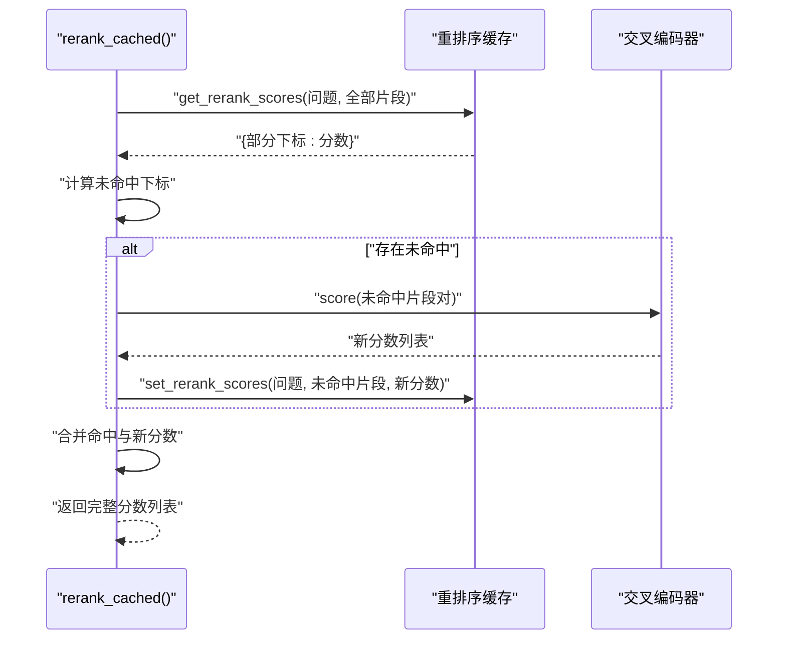
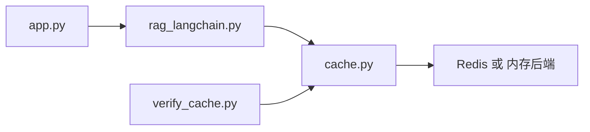

# 重排序缓存（Rerank Cache）

<cite>
**本文引用的文件**   
- [cache.py](file://cache.py)
- [rag_langchain.py](file://rag_langchain.py)
- [app.py](file://app.py)
- [verify_cache.py](file://verify_cache.py)
</cite>

## 目录
1. [引言](#引言)
2. [项目结构定位](#项目结构定位)
3. [核心组件](#核心组件)
4. [架构总览](#架构总览)
5. [详细组件分析](#详细组件分析)
6. [依赖关系分析](#依赖关系分析)
7. [性能与收益](#性能与收益)
8. [使用场景与示例](#使用场景与示例)
9. [错误处理与异常策略](#错误处理与异常策略)
10. [故障排查指南](#故障排查指南)
11. [结论](#结论)

## 引言
本文件围绕“重排序缓存”展开，目标是说明它如何缓存“问题 + 片段”的交叉编码器评分结果，从而避免重复计算昂贵的 cross-encoder 打分。文档重点包括：
- 设计目标与在 RAG 链路中的位置
- 评分缓存 key 生成规则
- `get_rerank_scores()` 与 `set_rerank_scores()` 接口定义、参数与返回值格式
- TTL 过期策略
- 典型使用流程、性能收益
- 错误处理与异常情况

## 项目结构定位
重排序缓存属于整个 RAG Web 服务的“缓存层”，位于业务检索管道与外部存储后端之间：
- 上层：LangChain 检索与精排逻辑调用缓存接口
- 中层：缓存层负责 key 生成、TTL、统计、失效控制
- 下层：Redis 或本地内存后端

**图表来源**
- [app.py:231-260](file://app.py#L231-L260)
- [rag_langchain.py:428-449](file://rag_langchain.py#L428-L449)
- [cache.py:349-367](file://cache.py#L349-L367)

**章节来源**
- [app.py:1-53](file://app.py#L1-L53)
- [cache.py:1-29](file://cache.py#L1-L29)

## 核心组件
重排序缓存的核心由以下部分组成：
- 缓存配置与 TTL
- 重排序分数读写接口
- Key 生成规则
- 统计计数
- 清理与版本控制联动

| 组件 | 职责 | 关键行为 |
|---|---|---|
| 配置与 TTL | 决定重排序缓存默认过期时间 | 默认 1 小时，可通过环境变量覆盖 |
| 读取接口 | 根据问题与片段列表批量查分 | 返回 `{片段下标: 分数}` |
| 写入接口 | 将未命中的片段打分写入缓存 | 按 `(问题||片段)` 哈希作为 key |
| Key 生成 | 保证不同问题、不同片段产生不同 key | 使用 SHA256 对组合字符串取摘要 |
| 统计 | 记录命中与未命中次数 | 用于 `/cache/stats` 暴露命中率 |
| 清理 | 支持按类型清空 rerank 缓存 | 配合上传文档时显式失效 |

**章节来源**
- [cache.py:37-48](file://cache.py#L37-L48)
- [cache.py:349-367](file://cache.py#L349-L367)

## 架构总览
重排序缓存不是独立服务，而是嵌入到 RAG 精排阶段的关键加速点。整体数据流如下：

**图表来源**
- [app.py:231-260](file://app.py#L231-L260)
- [rag_langchain.py:428-449](file://rag_langchain.py#L428-L449)
- [cache.py:349-367](file://cache.py#L349-L367)

## 详细组件分析

### 重排序缓存接口设计

#### `get_rerank_scores(question, docs)`
- **输入**
  - `question`: 用户问题原文
  - `docs`: 待打分的片段列表
- **输出**
  - 类型为 `Dict[int, float]`
  - 键为片段在原始 `docs` 列表中的下标
  - 值为该片段对该问题的重排序分数
- **行为**
  - 对每个片段生成 `(问题||片段)` 的哈希 key
  - 从缓存中读取已有分数
  - 未命中时增加 rerank miss 统计
  - 命中时增加 rerank hit 统计

**图表来源**
- [cache.py:350-361](file://cache.py#L350-L361)

**章节来源**
- [cache.py:349-361](file://cache.py#L349-L361)

#### `set_rerank_scores(question, docs, scores)`
- **输入**
  - `question`: 问题原文
  - `docs`: 需要写入缓存的片段列表
  - `scores`: 与 `docs` 一一对应的分数列表
- **输出**
  - 无返回值
- **行为**
  - 对每个 `(问题, 片段)` 生成相同哈希 key
  - 以浮点数形式写入缓存
  - 使用重排序 TTL 控制过期

**图表来源**
- [cache.py:364-367](file://cache.py#L364-L367)

**章节来源**
- [cache.py:364-367](file://cache.py#L364-L367)

### Key 生成规则
重排序缓存的 key 基于“问题 + 片段”的组合哈希，而不是仅按片段内容生成。原因如下：
- 交叉编码器的相关性评分依赖于问题
- 同一段文本对不同问题的相关度可能完全不同
- 使用组合 key 可以让“同一问题换文档”和“同一文档换问题”都具备复用潜力

Key 生成过程可概括为：
1. 拼接字符串：`问题 || 片段`
2. 使用 UTF-8 编码
3. 计算 SHA256
4. 以 `rag:rerank:` 前缀加上摘要构成最终 key

**图表来源**
- [cache.py:350-367](file://cache.py#L350-L367)

**章节来源**
- [cache.py:349-367](file://cache.py#L349-L367)

### 在 RAG 管道中的使用方式
重排序缓存被集成在 `rerank_cached()` 中，其核心逻辑是：
1. 先调用 `get_rerank_scores()` 获取已缓存分数
2. 找出未命中片段的下标
3. 只对未命中片段调用交叉编码器打分
4. 将新分数通过 `set_rerank_scores()` 写回缓存
5. 合并命中与新打分结果，按原片段顺序返回

**图表来源**
- [rag_langchain.py:428-449](file://rag_langchain.py#L428-L449)
- [cache.py:349-367](file://cache.py#L349-L367)

**章节来源**
- [rag_langchain.py:416-449](file://rag_langchain.py#L416-L449)
- [cache.py:349-367](file://cache.py#L349-L367)

### TTL 策略
重排序缓存默认 TTL 为 1 小时，即 3600 秒。该值来自配置项，并在写入时使用。

| 缓存类型 | 默认 TTL | 含义 |
|---|---:|---|
| 问答缓存 | 3600 秒 | 答案对知识库敏感，文档更新后应失效 |
| 向量缓存 | 86400 秒 | 向量只与模型有关，生命周期更长 |
| 重排序缓存 | 3600 秒 | 分数与问题相关，问题集不会长期不变 |

需要注意的是：
- 重排序缓存的 key 不包含缓存版本号
- 因此上传新文档后，不能仅靠版本号提升让重排序缓存自动失效
- 必须通过显式清理 `rerank` 类型缓存来清除脏数据

**章节来源**
- [cache.py:37-42](file://cache.py#L37-L42)
- [cache.py:364-367](file://cache.py#L364-L367)

## 依赖关系分析
重排序缓存的依赖关系如下：

**图表来源**
- [app.py:43-51](file://app.py#L43-L51)
- [rag_langchain.py:428-449](file://rag_langchain.py#L428-L449)
- [cache.py:349-367](file://cache.py#L349-L367)
- [verify_cache.py:127-142](file://verify_cache.py#L127-L142)

**章节来源**
- [app.py:43-51](file://app.py#L43-L51)
- [rag_langchain.py:428-449](file://rag_langchain.py#L428-L449)
- [cache.py:349-367](file://cache.py#L349-L367)
- [verify_cache.py:127-142](file://verify_cache.py#L127-L142)

## 性能与收益
重排序缓存主要优化的是交叉编码器打分这一环节。其性能收益体现在：

- **减少交叉编码器调用次数**  
  如果多个问题共享相同片段，或同一问题多次召回相同片段，已缓存的 `(问题, 片段)` 分数可以直接复用。

- **降低 CPU 开销**  
  交叉编码器通常比向量检索更慢，尤其在本地 CPU 环境下，重复打分会带来明显延迟。

- **提高吞吐能力**  
  在高并发场景中，命中重排序缓存的请求可以跳过昂贵打分步骤，直接参与后续排序与答案生成。

- **便于观测命中率**  
  缓存层维护 `rerank_hit` 与 `rerank_miss`，可通过统计接口观察重排序缓存效果。

需要注意：
- 重排序缓存的收益取决于“问题与片段组合的重复度”
- 如果每次召回片段都不同，或问题变化频繁，命中率可能较低
- 缓存本身有序列化、哈希、网络等额外开销，不应误认为零成本

**章节来源**
- [rag_langchain.py:428-449](file://rag_langchain.py#L428-L449)
- [cache.py:45-72](file://cache.py#L45-L72)

## 使用场景与示例

### 典型使用流程
1. 用户提交问题
2. 系统召回候选片段
3. 调用 `get_rerank_scores()` 检查是否有已缓存分数
4. 对未命中片段执行交叉编码器打分
5. 调用 `set_rerank_scores()` 写入新分数
6. 合并分数并按相关性排序
7. 返回 Top-N 片段给下游生成模块

### 验证脚本中的行为
验证脚本展示了重排序缓存的典型断言：
- 首次查询返回空字典，表示全部未命中
- 写入分数后再次查询，能按片段下标返回对应分数
- 更换问题时不应复用旧缓存
- 命中次数会正确累加

这些行为体现了：
- 缓存 key 包含问题信息
- 返回值按片段下标映射
- 统计计数器正常工作

**章节来源**
- [verify_cache.py:127-142](file://verify_cache.py#L127-L142)

## 错误处理与异常策略
重排序缓存遵循整个缓存层的 fail-open 原则：

- **读取失败**  
  如果缓存读取出现异常，视为未命中，继续走真实交叉编码器打分路径。

- **写入失败**  
  如果缓存写入出现异常，不阻断主流程，仍返回正常结果。

- **后端不可用**  
  当 Redis 不可用时，系统可降级为本地内存缓存；若强制 Redis 模式则抛出连接错误。

- **清理失败**  
  清理缓存时发生异常会被捕获并打印日志，不影响其他操作。

这种设计确保：
- 缓存只是加速层
- 缓存异常不会导致答案错误或请求失败
- 系统始终可用，只是可能变慢

**章节来源**
- [cache.py:1-9](file://cache.py#L1-L9)
- [cache.py:250-261](file://cache.py#L250-L261)
- [cache.py:371-390](file://cache.py#L371-L390)

## 故障排查指南

### 常见问题与定位方法

| 现象 | 可能原因 | 排查建议 |
|---|---|---|
| 重排序缓存命中率低 | 问题与片段组合重复度低 | 检查召回片段是否稳定、问题是否频繁变化 |
| 上传文档后仍命中旧答案 | 未显式清理 rerank 缓存 | 确认上传流程调用了缓存清理逻辑 |
| 缓存统计不增长 | 缓存后端不可用或降级 | 查看后端名称与健康状态 |
| 跨进程缓存不共享 | 使用了内存后端 | 生产环境启用 Redis 后端 |
| 重排序分数异常 | 交叉编码器打分异常或片段顺序不一致 | 核对传入片段顺序与分数顺序 |

### 推荐操作步骤
1. 查看缓存后端类型与健康状态
2. 查看各层命中率，特别是 `rerank_hit_rate`
3. 确认上传文档后是否触发了缓存清理
4. 如使用 Redis，检查连接地址、协议与权限
5. 如使用内存后端，注意多进程隔离限制

**章节来源**
- [app.py:263-284](file://app.py#L263-L284)
- [cache.py:202-213](file://cache.py#L202-L213)
- [cache.py:371-390](file://cache.py#L371-L390)

## 结论
重排序缓存通过缓存“问题 + 片段”的交叉编码器评分，显著降低了 RAG 链路中最慢的一环的计算开销。其设计要点包括：
- 使用 `(问题||片段)` 组合哈希生成 key
- 提供明确的 `get_rerank_scores()` 与 `set_rerank_scores()` 接口
- 默认 TTL 为 1 小时
- 采用 fail-open 错误处理策略
- 与上传流程配合进行显式缓存清理

在生产环境中，建议结合 Redis 后端、合理 TTL、监控命中率与清理策略，使重排序缓存成为稳定且高效的性能加速层。