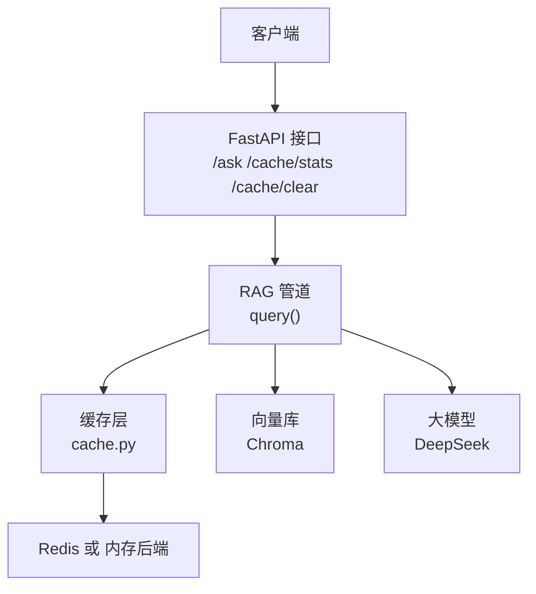
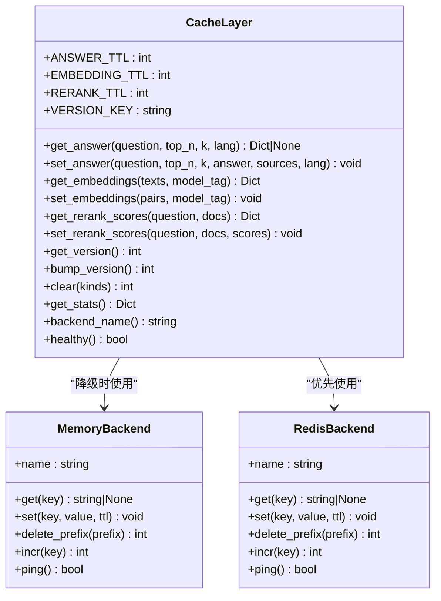
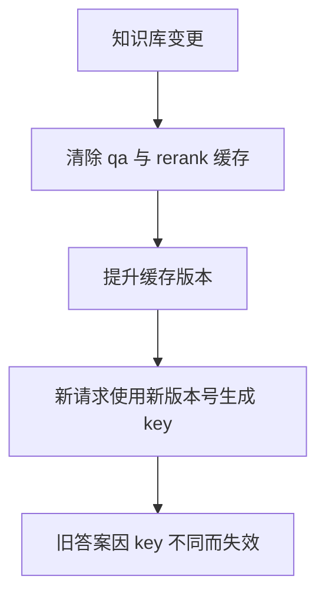
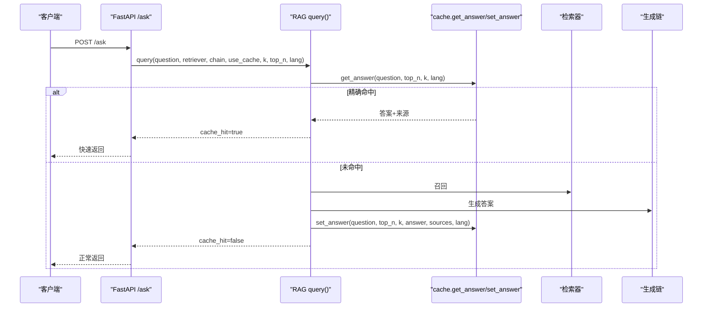
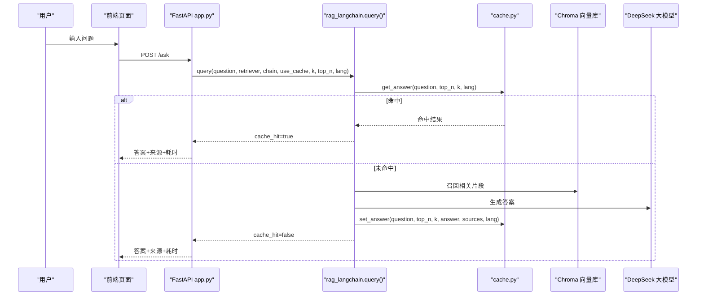

# 问答缓存（QA Cache）

<cite>
**本文引用的文件**   
- [cache.py](file://cache.py)
- [rag_langchain.py](file://rag_langchain.py)
- [app.py](file://app.py)
- [verify_cache.py](file://verify_cache.py)
</cite>

## 目录
1. [简介](#简介)
2. [项目结构中的缓存位置](#项目结构中的缓存位置)
3. [核心功能总览](#核心功能总览)
4. [架构与组件关系](#架构与组件关系)
5. [详细设计：问答缓存](#详细设计问答缓存)
6. [关键流程时序图](#关键流程时序图)
7. [失效机制与版本控制](#失效机制与版本控制)
8. [统计指标与可观测性](#统计指标与可观测性)
9. [性能特征与优化建议](#性能特征与优化建议)
10. [使用示例路径](#使用示例路径)
11. [故障排查](#故障排查)
12. [结论](#结论)

## 简介
本文件面向“问答缓存”这一核心能力，说明它如何把“问题到答案的映射”进行缓存，并携带语种、检索参数等上下文信息。重点包括：
- 缓存目标：避免重复走完整 RAG 链路，减少大模型调用和等待时间。
- Key 生成规则：基于语种、问题原文、k 值和 top_n 参数的组合哈希。
- TTL 策略：默认问答缓存过期时间为 1 小时。
- 失效机制：知识库版本变更时自动提升版本号，使旧缓存立即失效。
- 接口约定：通过 `get_answer()` 与 `set_answer()` 完成命中读取与写入。
- 统计与优化：提供命中率统计、后端健康检查、以及针对生产环境的优化建议。

## 项目结构中的缓存位置
本项目中，问答缓存由独立的缓存层实现，RAG 管道与 Web 服务分别消费该缓存：
- 缓存层：`cache.py` 提供统一的缓存抽象、TTL、版本管理、统计、Redis/内存双后端。
- RAG 管道：`rag_langchain.py` 在问答入口 `query()` 中调用 `cache.get_answer()` 与 `cache.set_answer()`。
- Web 服务：`app.py` 暴露 `/ask`、`/cache/stats`、`/cache/clear` 等接口，间接驱动缓存行为。
- 验证脚本：`verify_cache.py` 演示基础读写、TTL、问答缓存、版本失效等行为。

**图表来源**
- [app.py:231-260](file://app.py#L231-L260)
- [rag_langchain.py:579-631](file://rag_langchain.py#L579-L631)
- [cache.py:271-300](file://cache.py#L271-L300)

**章节来源**
- [app.py:1-53](file://app.py#L1-L53)
- [rag_langchain.py:1-24](file://rag_langchain.py#L1-L24)
- [cache.py:1-29](file://cache.py#L1-L29)

## 核心功能总览
问答缓存属于三层缓存体系中的顶层加速层：
- 问答缓存：缓存“问题 -> 答案 + 引用片段”，跳过召回、精排与大模型生成。
- 嵌入缓存：缓存“文本 -> 向量”，避免重复计算 embedding。
- 精排缓存：缓存“(问题, 片段) -> 分数”，避免重复 cross-encoder 打分。

问答缓存的收益最大：一次命中可以跳过整个 RAG 主链路，通常从数秒级降到毫秒级。

**章节来源**
- [cache.py:10-29](file://cache.py#L10-L29)
- [rag_langchain.py:1-14](file://rag_langchain.py#L1-L14)

## 架构与组件关系
问答缓存的关键组件如下：
- `make_key()`：统一生成带版本号的 key。
- `get_answer()`：按“qa + 语种 + 问题原文 + k + top_n”读取缓存。
- `set_answer()`：将答案与引用片段写入缓存，并附带时间戳和问题原文。
- `get_version()` / `bump_version()`：维护缓存版本，用于整体失效。
- `clear()`：支持按类型清理 qa/embed/rerank。
- `get_stats()`：汇总命中/未命中次数与命中率。

**图表来源**
- [cache.py:76-148](file://cache.py#L76-L148)
- [cache.py:216-268](file://cache.py#L216-L268)
- [cache.py:271-391](file://cache.py#L271-L391)

**章节来源**
- [cache.py:76-148](file://cache.py#L76-L148)
- [cache.py:216-268](file://cache.py#L216-L268)
- [cache.py:271-391](file://cache.py#L271-L391)

## 详细设计：问答缓存

### 缓存键生成规则
问答缓存的 key 由以下要素组成：
- 缓存类型：`qa`
- 语种：`lang`，例如中文为 `zh`，英文为 `en`
- 问题原文：`question.strip()`，去除首尾空白
- 检索参数：`k`，向量召回条数
- 精排参数：`top_n`，精排后保留条数
- 缓存版本：由 `get_version()` 提供，随知识库变更递增

最终 key 格式为：
`rag:v{版本}:qa:{内容哈希}`

其中“内容哈希”是对 `||`.join([lang, question.strip(), str(k), str(top_n)]) 做 SHA-256 摘要的前 32 位十六进制。

这意味着：
- 同一问题不同语种不会误命中。
- 同一问题不同 k/top_n 不会误命中。
- 知识库变更后，版本号变化导致旧 key 不再命中。

**章节来源**
- [cache.py:264-268](file://cache.py#L264-L268)
- [cache.py:271-293](file://cache.py#L271-L293)

### TTL 策略
问答缓存默认 TTL 为 1 小时，即 3600 秒。该值可通过环境变量覆盖：
- `CACHE_ANSWER_TTL`：问答结果过期时间，默认 3600。
- `CACHE_EMBEDDING_TTL`：向量缓存过期时间，默认 86400。
- `CACHE_RERANK_TTL`：精排分数过期时间，默认 3600。

TTL 由底层后端实现：
- Redis 后端：使用 `ex=ttl` 设置过期。
- 内存后端：记录 `(value, expire_at)`，读取时惰性判断是否过期。

**章节来源**
- [cache.py:37-43](file://cache.py#L37-L43)
- [cache.py:97-100](file://cache.py#L97-L100)
- [cache.py:133-134](file://cache.py#L133-L134)

### 失效机制：知识库版本变更
当上传新文档或知识库发生变化时，系统会调用 `invalidate_caches()`，其职责包括：
- 清空语义缓存。
- 清除问答缓存与精排缓存。
- 调用 `cache.bump_version()` 提升缓存版本。

版本号提升后，所有旧问答缓存虽然可能仍存在于存储中，但新请求用新版本号生成的 key 已经不同，因此旧答案立即失效。

**图表来源**
- [rag_langchain.py:634-644](file://rag_langchain.py#L634-L644)
- [cache.py:225-233](file://cache.py#L225-L233)

**章节来源**
- [rag_langchain.py:634-644](file://rag_langchain.py#L634-L644)
- [cache.py:216-233](file://cache.py#L216-L233)

### get_answer() 与 set_answer() 的行为

#### get_answer()
- 输入：问题原文、top_n、k、可选 lang。
- 行为：
  - 生成缓存 key。
  - 尝试读取缓存。
  - 若未命中，增加 `qa_miss` 统计。
  - 若命中，增加 `qa_hit` 统计，并在返回结果中加入 `cache_key`。
- 返回值：命中时返回包含 `answer` 与 `sources` 的字典；未命中返回 `None`。

#### set_answer()
- 输入：问题原文、top_n、k、答案、引用片段列表、可选 lang。
- 行为：
  - 生成缓存 key。
  - 写入 `{answer, sources, ts, question}`。
  - 使用 ANSWER_TTL 作为过期时间。

**章节来源**
- [cache.py:271-300](file://cache.py#L271-L300)

### 与 RAG 管道的集成
RAG 管道在 `query()` 中先查精确缓存，再查语义缓存，最后走真实链路并回写缓存：
1. 如果启用缓存且精确命中，直接返回。
2. 如果启用语义缓存且语义命中，直接返回。
3. 否则执行检索、精排、生成。
4. 如果启用缓存，写入问答缓存与语义缓存。

**图表来源**
- [rag_langchain.py:579-631](file://rag_langchain.py#L579-L631)
- [app.py:231-260](file://app.py#L231-L260)
- [cache.py:271-300](file://cache.py#L271-L300)

**章节来源**
- [rag_langchain.py:579-631](file://rag_langchain.py#L579-L631)
- [app.py:231-260](file://app.py#L231-L260)

## 关键流程时序图

### 问答请求完整流程

**图表来源**
- [app.py:231-260](file://app.py#L231-L260)
- [rag_langchain.py:579-631](file://rag_langchain.py#L579-L631)
- [cache.py:271-300](file://cache.py#L271-L300)

**章节来源**
- [app.py:231-260](file://app.py#L231-L260)
- [rag_langchain.py:579-631](file://rag_langchain.py#L579-L631)

## 失效机制与版本控制

### 版本号的作用
版本号是问答缓存失效的核心机制：
- 每次知识库变更，版本号递增。
- 所有问答缓存 key 都包含版本号。
- 版本号变化后，旧 key 不再匹配新请求，从而失效。

这种方式比逐个删除 key 更可靠，也避免了漏删导致的“旧答案继续命中”。

### 版本提升时机
- 上传文档后，`app.py` 调用 `invalidate_caches()`。
- `invalidate_caches()` 调用 `cache.bump_version()`。
- `bump_version()` 对 `rag:cache_version` 做原子递增。

**章节来源**
- [app.py:204-206](file://app.py#L204-L206)
- [rag_langchain.py:634-644](file://rag_langchain.py#L634-L644)
- [cache.py:216-233](file://cache.py#L216-L233)

## 统计指标与可观测性

### 统计字段
缓存层维护进程内计数器，包含：
- `qa_hit` / `qa_miss`：问答缓存命中与未命中次数。
- `embed_hit` / `embed_miss`：嵌入缓存命中与未命中次数。
- `rerank_hit` / `rerank_miss`：精排缓存命中与未命中次数。
- `qa_hit_rate` / `embed_hit_rate` / `rerank_hit_rate`：命中率。
- `asked_pipeline_saved`：等于 `qa_hit`，表示节省的大模型调用次数。
- `backend`：当前缓存后端名称。

### 查看统计
Web 服务暴露 `/cache/stats`，返回：
- 后端类型与健康状态。
- 当前缓存版本。
- 各语种向量库块数。
- 各类 TTL。
- 缓存统计快照。

**章节来源**
- [cache.py:45-72](file://cache.py#L45-L72)
- [app.py:263-277](file://app.py#L263-L277)

## 性能特征与优化建议

### 性能特征
- 精确命中：毫秒级返回，跳过检索、精排与大模型。
- 未命中：需要走完整 RAG 链路，耗时取决于检索、精排与大模型响应。
- 语义缓存：可选开启，用于近似问题命中，但默认关闭以避免答非所问风险。
- 向量缓存与精排缓存：进一步减少模型前向与 cross-encoder 打分开销。

### 优化建议
1. **优先保证精确缓存命中率**：确保问题原文稳定，避免频繁改写问题导致 key 变化。
2. **合理设置 k 与 top_n**：这两个参数参与 key 生成，修改后会改变缓存口径，应谨慎调整。
3. **关注缓存版本**：知识库变更后务必触发版本提升，避免旧答案污染。
4. **监控命中率**：通过 `/cache/stats` 观察 `qa_hit_rate`，评估缓存收益。
5. **选择合适后端**：
   - 多实例部署：优先使用 Redis。
   - 单进程开发：可使用内存后端，注意重启后失效。
6. **TTL 调优**：
   - 问答缓存默认 1 小时，适合大多数场景。
   - 若知识库更新频繁，可适当缩短 TTL 或依赖版本失效。
7. **fail-open 原则**：缓存异常不应影响正确答案，读失败视为未命中，写失败不影响返回。

**章节来源**
- [cache.py:1-29](file://cache.py#L1-L29)
- [cache.py:250-261](file://cache.py#L250-L261)
- [rag_langchain.py:511-529](file://rag_langchain.py#L511-L529)

## 使用示例路径

### 基础问答缓存读写
参考验证脚本中对 `get_answer()` 与 `set_answer()` 的使用：
- 首次查询未命中。
- 写入答案与来源后再次查询命中。
- 答案与来源完整还原。

**章节来源**
- [verify_cache.py:85-95](file://verify_cache.py#L85-L95)

### 问题首尾空格不敏感
验证脚本确认：
- 问题前后加空格仍能命中。
- 这是因为 `question.strip()` 被纳入 key 生成。

**章节来源**
- [verify_cache.py:98-101](file://verify_cache.py#L98-L101)

### 参数变化不误命中
验证脚本确认：
- 改变 k 不会命中旧答案。
- 改变 top_n 不会命中旧答案。
- 因为 k 与 top_n 参与 key 生成。

**章节来源**
- [verify_cache.py:100-101](file://verify_cache.py#L100-L101)

### 版本失效测试
验证脚本演示：
- 写入旧答案。
- 提升版本后旧答案失效。
- 重新写入新答案后可命中。

**章节来源**
- [verify_cache.py:146-170](file://verify_cache.py#L146-L170)

## 故障排查

### 常见问题
1. **缓存一直未命中**
   - 检查 `use_cache` 是否为 `True`。
   - 检查 `/cache/stats` 中 `qa_hit_rate`。
   - 检查是否频繁改变 k 或 top_n。
   - 检查知识库是否频繁变更导致版本提升。

2. **缓存命中但答案错误**
   - 检查是否更新了知识库但未触发 `invalidate_caches()`。
   - 检查缓存版本是否提升。
   - 检查是否混用了不同语种的缓存。

3. **Redis 不可用**
   - 检查 `REDIS_URL` 配置。
   - 检查 `CACHE_BACKEND` 是否为 `auto` 或 `redis`。
   - 自动模式下会降级到内存缓存，但多进程不共享。

4. **统计清零**
   - `clear()` 会重置统计。
   - 手动清理缓存后需重新观察命中率。

**章节来源**
- [app.py:263-284](file://app.py#L263-L284)
- [cache.py:371-391](file://cache.py#L371-L391)
- [cache.py:176-199](file://cache.py#L176-L199)

## 结论
问答缓存是本项目的关键加速层，通过将“问题到答案的映射”缓存起来，显著降低重复请求的延迟与大模型调用成本。其设计要点包括：
- 以“语种 + 问题原文 + k + top_n + 版本”作为 key，确保语义与参数隔离。
- 默认 1 小时 TTL，配合知识库版本变更实现强一致失效。
- 提供完整的统计与运维接口，便于监控与调优。
- 遵循 fail-open 原则，缓存异常不会导致答案错误。

在生产环境中，建议结合 Redis 后端、合理的 TTL、稳定的检索参数与严格的版本管理，最大化问答缓存的收益。