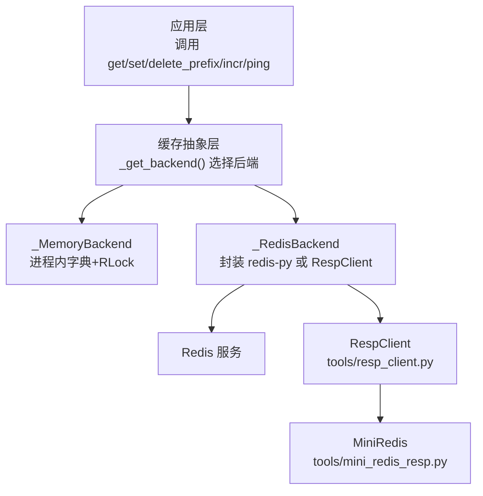
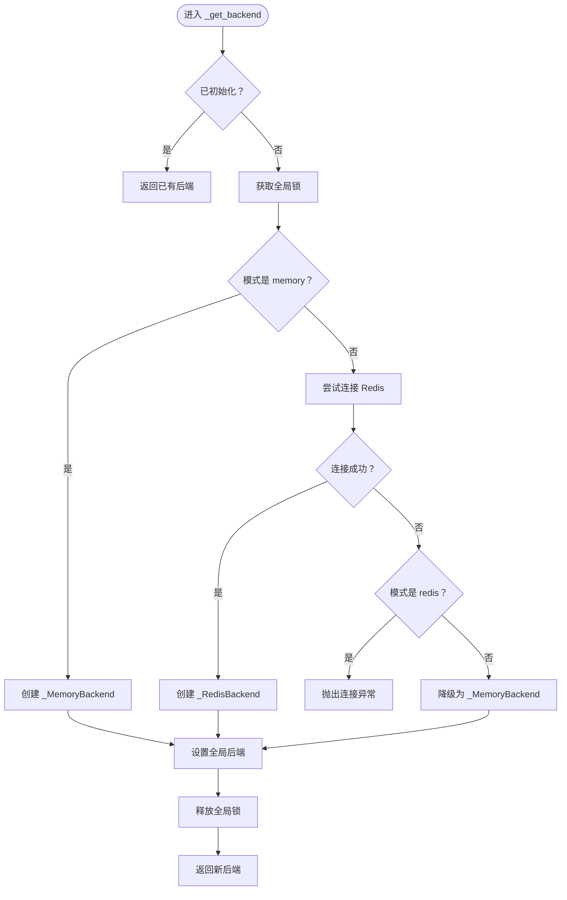
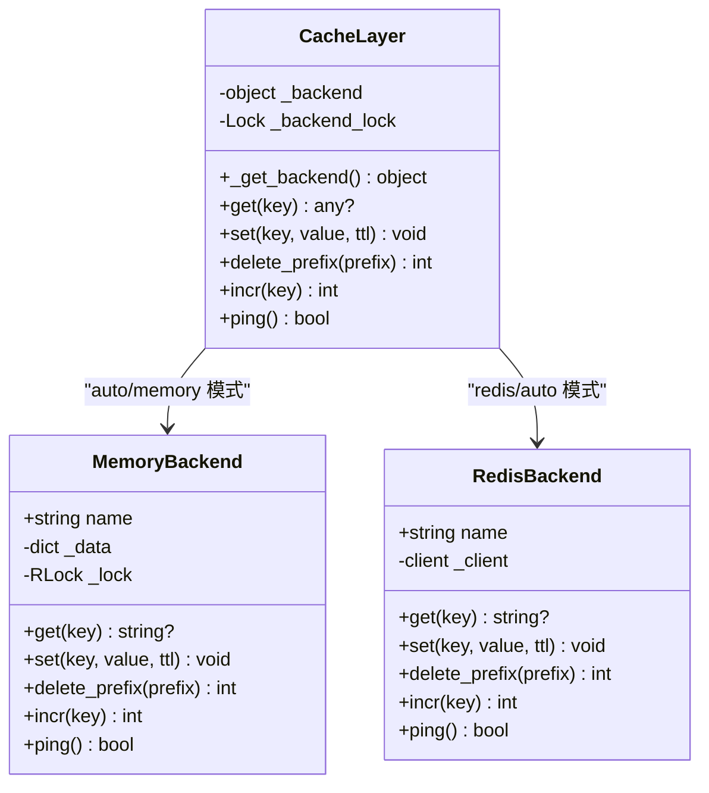
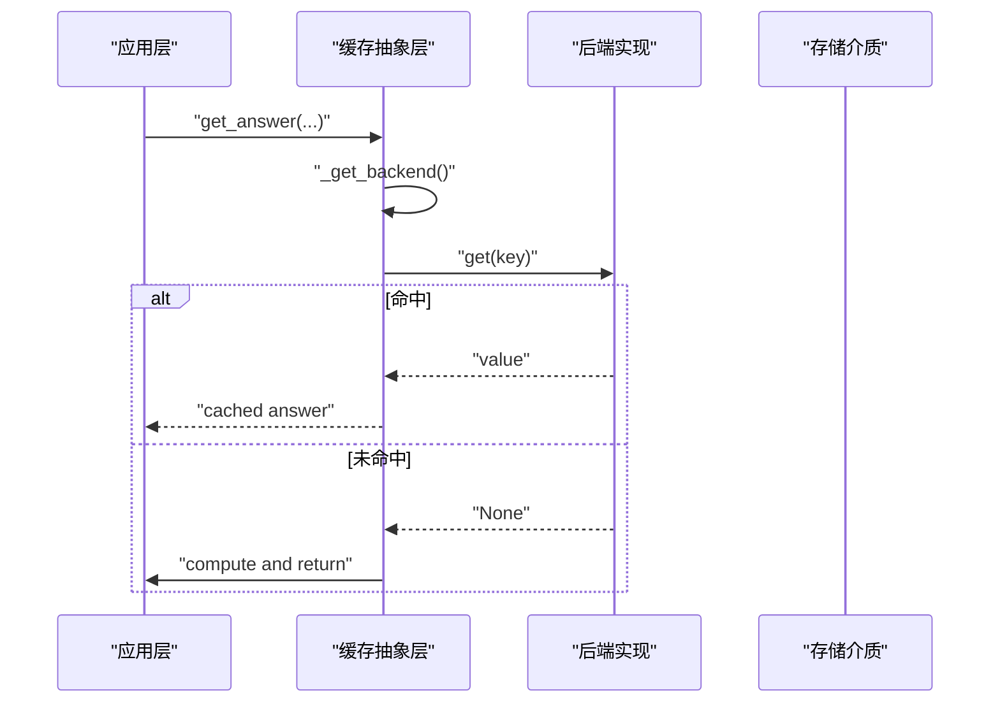
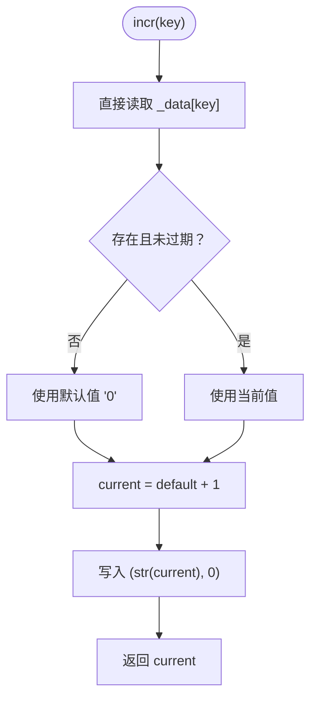
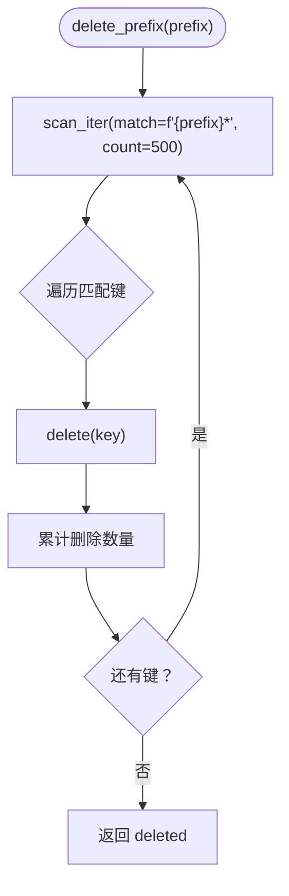
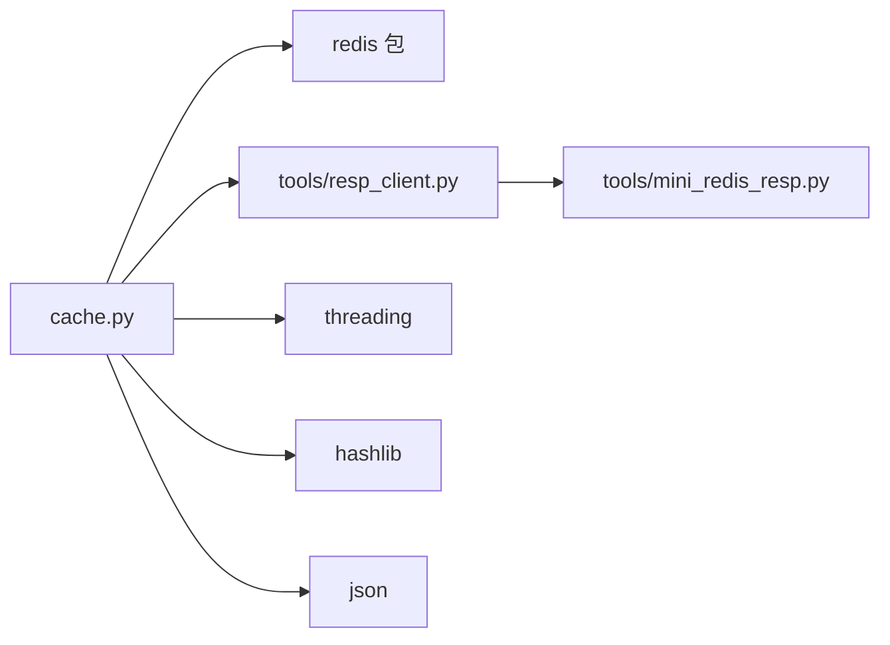

# 后端抽象层

<cite>
**本文引用的文件**   
- [cache.py](file://cache.py)
- [resp_client.py](file://tools/resp_client.py)
- [mini_redis_resp.py](file://tools/mini_redis_resp.py)
- [04-后端抽象与降级.md](file://redis_turorial/04-后端抽象与降级.md)
- [06-生产环境的坑与发现的bug.md](file://redis_turorial/06-生产环境的坑与发现的bug.md)
</cite>

## 目录
1. [引言](#引言)
2. [项目结构](#项目结构)
3. [核心组件](#核心组件)
4. [架构总览](#架构总览)
5. [详细组件分析](#详细组件分析)
6. [依赖关系分析](#依赖关系分析)
7. [性能考量](#性能考量)
8. [故障排查指南](#故障排查指南)
9. [结论](#结论)
10. [附录：配置与部署建议](#附录配置与部署建议)

## 引言
本文件面向“后端抽象层”，聚焦缓存层如何统一暴露 `get`、`set`、`delete_prefix`、`incr`、`ping` 等接口，并支持内存与 Redis 两种实现。文档重点说明：
- 统一接口设计与职责边界
- 自动后端选择与降级策略
- 连接管理、超时与错误处理
- 线程安全保证（全局锁与可重入锁）
- 后端切换配置与生产部署建议
- 性能对比与适用场景

## 项目结构
缓存后端抽象位于 `cache.py`，并提供两个具体后端：
- `_MemoryBackend`：进程内字典 + TTL + 可重入锁
- `_RedisBackend`：封装底层 Redis 客户端调用

此外，仓库还包含用于验证 Redis 代码路径的极简 RESP 客户端与服务端：
- `tools/resp_client.py`：最小化 RESP 客户端，模拟 `redis-py` 的部分接口
- `tools/mini_redis_resp.py`：最小化 RESP 服务端，记录命令以便断言

**图表来源**
- [cache.py:75-148](file://cache.py#L75-L148)
- [resp_client.py:19-132](file://tools/resp_client.py#L19-L132)
- [mini_redis_resp.py:1-157](file://tools/mini_redis_resp.py#L1-L157)

**章节来源**
- [cache.py:1-49](file://cache.py#L1-L49)
- [resp_client.py:1-132](file://tools/resp_client.py#L1-L132)
- [mini_redis_resp.py:1-157](file://tools/mini_redis_resp.py#L1-L157)

## 核心组件
本节从“统一接口”的角度梳理后端抽象层的关键能力。

### 统一接口定义
后端抽象层对外提供以下核心方法（由 `_MemoryBackend` 和 `_RedisBackend` 共同实现）：
- `get(key)`：读取字符串值，未命中返回空
- `set(key, value, ttl)`：写入字符串值，可选过期时间
- `delete_prefix(prefix)`：按前缀批量删除键
- `incr(key)`：原子自增版本号
- `ping()`：健康检查

这些方法屏蔽了内存与 Redis 的差异，上层业务无需关心具体存储实现。

**章节来源**
- [cache.py:75-148](file://cache.py#L75-L148)

### 自动后端选择机制
后端选择逻辑集中在 `_get_backend()`：
- 若 `CACHE_BACKEND=memory`：直接创建内存后端
- 若 `CACHE_BACKEND=redis`：强制连接 Redis，失败则抛错
- 若 `CACHE_BACKEND=auto`（默认）：尝试连接 Redis；失败时静默降级为内存后端

该设计确保：
- 开发演示环境即使没有 Redis 也能运行
- 生产环境通过配置强制使用 Redis，避免“静默降级导致多实例不一致”

**图表来源**
- [cache.py:176-199](file://cache.py#L176-L199)

**章节来源**
- [cache.py:176-199](file://cache.py#L176-L199)
- [04-后端抽象与降级.md:7-47](file://redis_turorial/04-后端抽象与降级.md#L7-L47)

### 连接管理与错误处理
- 连接参数：
  - `decode_responses=True`：自动解码响应
  - `socket_connect_timeout=1`：连接超时 1 秒
  - `socket_timeout=1`：读写超时 1 秒
- 协议兼容：
  - 强制 `protocol=2`，避免新版 `redis-py` 默认 RESP3 与老版本 Redis 不兼容
- 测试钩子：
  - 通过环境变量 `RESP_CLIENT_MODULE` 替换为自定义 RESP 客户端模块，便于在无 `redis` 包环境下验证 Redis 代码路径

错误处理原则：
- 读操作失败：返回空，走真实计算（fail-open）
- 写操作失败：忽略异常，不影响主流程
- 版本号提升失败：打印日志但不阻断主流程
- 清理缓存失败：打印日志并继续

**章节来源**
- [cache.py:154-173](file://cache.py#L154-L173)
- [cache.py:250-261](file://cache.py#L250-L261)
- [cache.py:225-233](file://cache.py#L225-L233)
- [cache.py:371-390](file://cache.py#L371-L390)
- [04-后端抽象与降级.md:187-212](file://redis_turorial/04-后端抽象与降级.md#L187-L212)

### 线程安全保证
- 全局后端初始化：
  - 使用双检锁模式，避免重复初始化与竞态条件
- 内存后端内部：
  - 使用 `threading.RLock`（可重入锁），防止 `incr` 内部再次调用 `get` 造成死锁
- 统计计数器：
  - 使用独立锁保护命中率统计更新

**图表来源**
- [cache.py:75-148](file://cache.py#L75-L148)
- [cache.py:150-151](file://cache.py#L150-L151)
- [cache.py:176-199](file://cache.py#L176-L199)

**章节来源**
- [cache.py:75-148](file://cache.py#L75-L148)
- [cache.py:150-151](file://cache.py#L150-L151)
- [cache.py:176-199](file://cache.py#L176-L199)
- [04-后端抽象与降级.md:61-89](file://redis_turorial/04-后端抽象与降级.md#L61-L89)

## 架构总览
缓存层采用“后端抽象 + 自动选择 + fail-open”的设计：
- 上层只依赖统一接口
- 运行时根据配置选择内存或 Redis
- 任何缓存异常都不影响主流程正确性

**图表来源**
- [cache.py:271-293](file://cache.py#L271-L293)
- [cache.py:176-199](file://cache.py#L176-L199)

## 详细组件分析

### _MemoryBackend 分析
- 数据结构：`Dict[str, tuple]`，值为 `(value, expire_at)`
- 过期策略：惰性过期，仅在读取时检查
- 并发控制：`threading.RLock`，允许同一线程重复获取
- 关键实现细节：
  - `incr` 直接操作底层 `_data`，不走 `get`，避免过期 key 被误判为不存在导致版本号回退
  - `delete_prefix` 支持 glob 通配符，便于清理历史版本

**图表来源**
- [cache.py:110-117](file://cache.py#L110-L117)

**章节来源**
- [cache.py:75-121](file://cache.py#L75-L121)
- [04-后端抽象与降级.md:90-158](file://redis_turorial/04-后端抽象与降级.md#L90-L158)

### _RedisBackend 分析
- 封装底层客户端（`redis-py` 或 `RespClient`）
- 使用 `SCAN` 而非 `KEYS` 进行批量删除，避免阻塞 Redis
- `incr` 调用原生 `INCR`，保证原子性
- `ping` 用于健康检查

**图表来源**
- [cache.py:136-141](file://cache.py#L136-L141)

**章节来源**
- [cache.py:123-148](file://cache.py#L123-L148)
- [06-生产环境的坑与发现的bug.md:6-77](file://redis_turorial/06-生产环境的坑与发现的bug.md#L6-L77)

### 统一接口行为对比
| 方法 | _MemoryBackend | _RedisBackend | 注意事项 |
|------|----------------|---------------|----------|
| `get` | 惰性过期检查 | 直接委托客户端 | 失败返回空 |
| `set` | 写入 `(value, expire_at)` | 带 `ex=ttl` | 失败忽略 |
| `delete_prefix` | 内存中过滤并删除 | 使用 `SCAN` 分批删除 | 避免 `KEYS` |
| `incr` | 直接操作 `_data`，永不过期 | 调用原生 `INCR` | 保证原子性 |
| `ping` | 始终返回真 | 调用客户端 `ping` | 健康检查 |

**章节来源**
- [cache.py:75-148](file://cache.py#L75-L148)

## 依赖关系分析
缓存层依赖以下外部组件：
- `redis` 包（默认）或自定义 RESP 客户端（通过 `RESP_CLIENT_MODULE`）
- Redis 服务（可选，auto 模式下可降级）
- 标准库 `threading`、`hashlib`、`json`、`time`

**图表来源**
- [cache.py:30-35](file://cache.py#L30-L35)
- [resp_client.py:1-132](file://tools/resp_client.py#L1-L132)
- [mini_redis_resp.py:1-157](file://tools/mini_redis_resp.py#L1-L157)

**章节来源**
- [cache.py:30-35](file://cache.py#L30-L35)
- [resp_client.py:1-132](file://tools/resp_client.py#L1-L132)

## 性能考量
- 连接超时设置为 1 秒，避免缓存成为主流程瓶颈
- 内存后端零网络开销，但仅单进程有效
- Redis 后端具备持久化、多进程共享、TTL 管理等优势
- N+1 往返问题：批量嵌入向量查询可能产生多次 GET，建议使用 `MGET` 或 pipeline 优化

**章节来源**
- [04-后端抽象与降级.md:204-212](file://redis_turorial/04-后端抽象与降级.md#L204-L212)
- [06-生产环境的坑与发现的bug.md:100-137](file://redis_turorial/06-生产环境的坑与发现的bug.md#L100-L137)

## 故障排查指南
常见问题与定位思路：
- Redis 连接失败：
  - 检查 `REDIS_URL` 配置
  - 确认 Redis 服务是否运行
  - 查看是否因 RESP3 协议不兼容导致连接失败
- 缓存未命中：
  - 检查版本号是否正确递增
  - 确认 key 生成逻辑是否包含必要上下文（如语种、模型标签）
- 批量删除性能问题：
  - 确认是否使用 `SCAN` 而非 `KEYS`
- 线程安全问题：
  - 检查是否正确使用 `RLock`
  - 避免在持锁状态下调用可能递归获取锁的方法

**章节来源**
- [cache.py:154-173](file://cache.py#L154-L173)
- [cache.py:216-233](file://cache.py#L216-L233)
- [06-生产环境的坑与发现的bug.md:179-231](file://redis_turorial/06-生产环境的坑与发现的bug.md#L179-L231)

## 结论
后端抽象层通过统一接口屏蔽了内存与 Redis 的差异，结合自动选择与降级策略，实现了高可用与易用的平衡。在生产环境中，应优先使用 Redis 后端，并通过监控与告警确保缓存健康。对于单机或离线场景，内存后端可作为快速验证方案。

## 附录：配置与部署建议
- 环境变量：
  - `CACHE_BACKEND`：`auto`（默认）、`redis`、`memory`
  - `REDIS_URL`：Redis 连接地址
  - `RESP_CLIENT_MODULE`：自定义 RESP 客户端模块（仅测试用）
  - `CACHE_ANSWER_TTL`、`CACHE_EMBEDDING_TTL`、`CACHE_RERANK_TTL`：各类缓存 TTL
- 生产部署建议：
  - 使用 `CACHE_BACKEND=redis` 强制启用 Redis
  - 配置合理的 TTL 与随机抖动，避免雪崩
  - 监控 Redis 连接状态与缓存命中率
  - 定期清理历史版本 key，避免数据膨胀

**章节来源**
- [cache.py:37-43](file://cache.py#L37-L43)
- [04-后端抽象与降级.md:7-20](file://redis_turorial/04-后端抽象与降级.md#L7-L20)