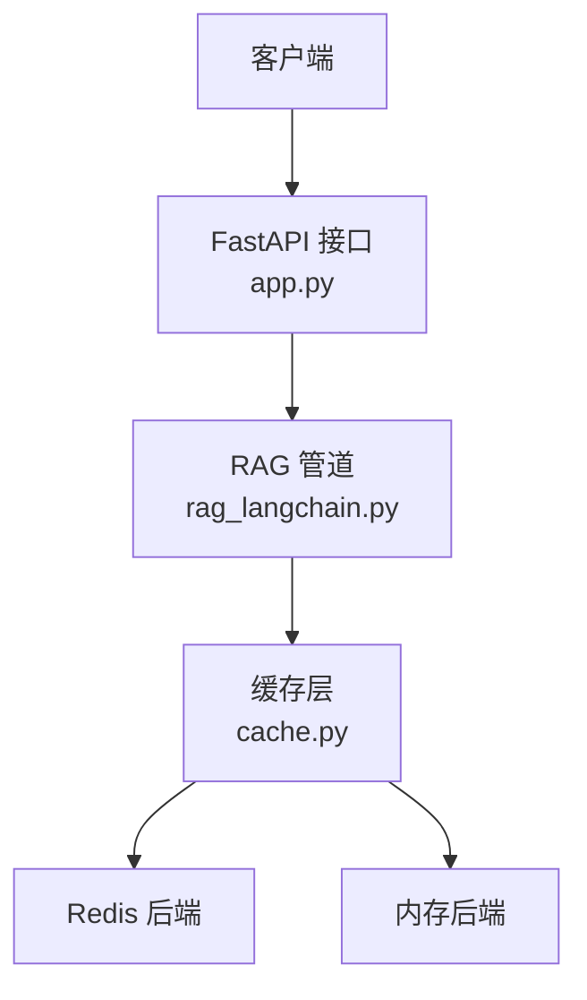
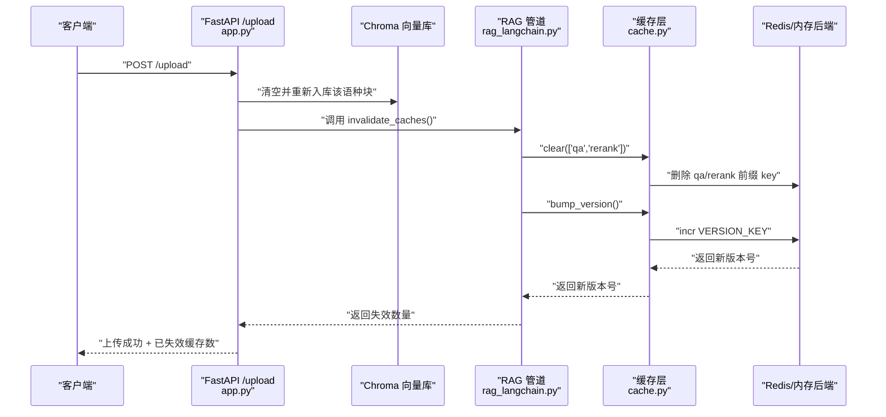
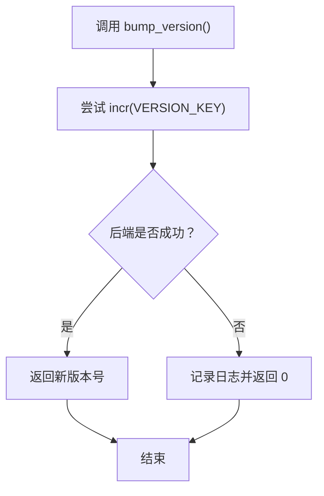
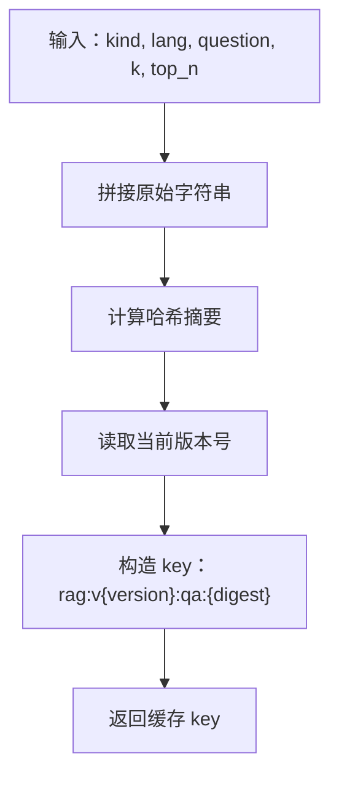
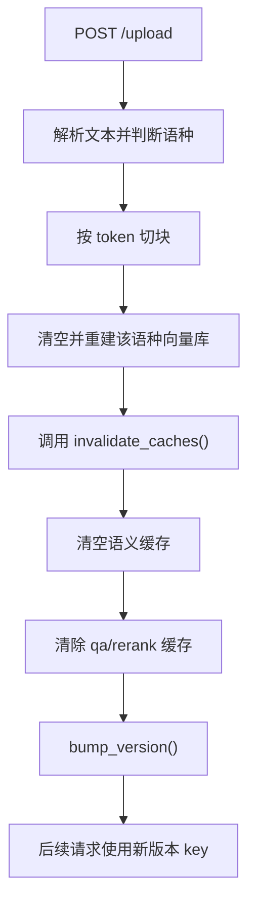
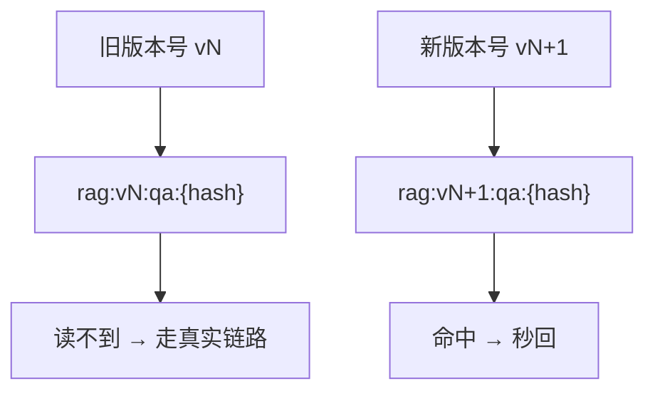
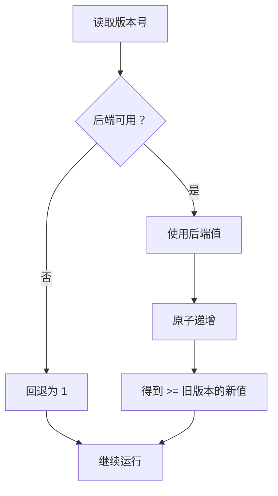
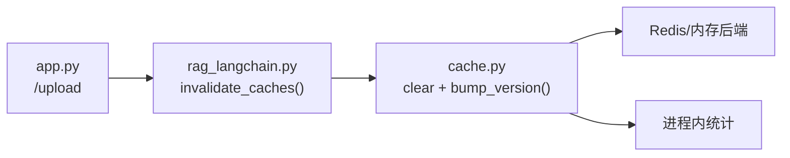

# 版本管理机制

<cite>
**本文引用的文件**   
- [app.py](file://app.py)
- [rag_langchain.py](file://rag_langchain.py)
- [cache.py](file://cache.py)
- [verify_cache.py](file://verify_cache.py)
</cite>

## 目录
1. [引言](#引言)
2. [项目结构中与版本管理相关的部分](#项目结构中与版本管理相关的部分)
3. [核心组件](#核心组件)
4. [架构总览](#架构总览)
5. [详细组件分析](#详细组件分析)
6. [依赖关系分析](#依赖关系分析)
7. [性能与一致性考量](#性能与一致性考量)
8. [故障排查指南](#故障排查指南)
9. [结论](#结论)
10. [附录：监控与调试建议](#附录监控与调试建议)

## 引言
本文件聚焦 RAG 系统的“缓存版本号”机制，解释以下关键问题：
- 版本号如何生成、存储和原子递增；
- `VERSION_KEY` 的作用及生命周期；
- 文档上传、删除等变更如何触发版本提升；
- 版本号如何参与缓存 key 构造，从而实现批量失效；
- 为什么版本号能防止旧缓存被误用；
- 最佳实践、常见问题与监控调试方法。

该机制的核心思想是：**把“知识库当前版本”写进每个业务缓存 key**。当知识库变化时只递增版本号，所有带旧版本的 key 自然不再命中，从而以极低成本实现“全量失效”。

## 项目结构中与版本管理相关的部分
RAG 服务由三层组成：
- Web 接口层：负责接收上传、提问、查看缓存状态等操作；
- RAG 管道层：负责检索、精排、生成答案，并调用缓存；
- 缓存层：提供问答缓存、向量缓存、精排分数缓存，以及统一的版本号管理。

**图示来源**
- [app.py:155-284](file://app.py#L155-L284)
- [rag_langchain.py:579-644](file://rag_langchain.py#L579-L644)
- [cache.py:216-268](file://cache.py#L216-L268)

**章节来源**
- [app.py:1-53](file://app.py#L1-L53)
- [rag_langchain.py:1-24](file://rag_langchain.py#L1-L24)
- [cache.py:1-29](file://cache.py#L1-L29)

## 核心组件
与版本管理直接相关的关键点如下：

| 组件 | 职责 | 与版本的关系 |
|---|---|---|
| `VERSION_KEY` | 全局版本号存储键 | 每次知识库变更后递增，作为所有业务缓存 key 的前缀 |
| `get_version()` | 读取当前版本号 | 默认值为 1，异常时回退为 1 |
| `bump_version()` | 原子递增版本号 | 通过后端 `incr` 保证并发安全 |
| `make_key()` | 构造业务缓存 key | 将版本号拼入 key，使旧 key 自动失效 |
| `invalidate_caches()` | 文档变更后清理语义缓存、问答/精排缓存并提升版本 | 是版本提升的主要入口之一 |
| `/upload` 接口 | 上传文档后替换对应语种库并失效缓存 | 间接触发 `invalidate_caches()` |
| `/cache/stats` 接口 | 暴露当前缓存版本 | 用于监控和调试 |

**章节来源**
- [cache.py:43-43](file://cache.py#L43-L43)
- [cache.py:217-233](file://cache.py#L217-L233)
- [cache.py:264-268](file://cache.py#L264-L268)
- [rag_langchain.py:634-644](file://rag_langchain.py#L634-L644)
- [app.py:155-228](file://app.py#L155-L228)
- [app.py:263-277](file://app.py#L263-L277)

## 架构总览
下图展示一次“文档上传 → 知识库更新 → 版本号提升 → 旧缓存失效”的完整流程。

**图示来源**
- [app.py:155-228](file://app.py#L155-L228)
- [rag_langchain.py:634-644](file://rag_langchain.py#L634-L644)
- [cache.py:225-233](file://cache.py#L225-L233)
- [cache.py:371-390](file://cache.py#L371-L390)

## 详细组件分析

### 版本号存储与原子递增
版本号是一个全局整数，存储在 `VERSION_KEY` 中。它不是某个具体缓存项，而是“整个缓存命名空间”的版本标签。

关键点：
- `VERSION_KEY = "rag:cache_version"` 是版本号在缓存后端中的键名；
- `get_version()` 读取版本号，失败时回退为 1；
- `bump_version()` 调用后端 `incr(VERSION_KEY)`，保证并发下版本号单调递增；
- 本地内存后端使用可重入锁保护版本号写入，避免自死锁；
- Redis 后端使用原生 `INCR`，天然原子且跨进程共享。

**图示来源**
- [cache.py:217-233](file://cache.py#L217-L233)
- [cache.py:110-117](file://cache.py#L110-L117)
- [cache.py:143-144](file://cache.py#L143-L144)

**章节来源**
- [cache.py:43-43](file://cache.py#L43-L43)
- [cache.py:217-233](file://cache.py#L217-L233)
- [cache.py:110-117](file://cache.py#L110-L117)
- [cache.py:143-144](file://cache.py#L143-L144)

### 版本号如何进入缓存 key
业务缓存 key 统一通过 `make_key()` 构造，格式包含版本号、缓存类型和内容摘要：

- 通用格式：`rag:v{版本}:{类型}:{内容hash}`
- 问答缓存 key 参数包括：`qa`、语种、问题原文、召回条数 `k`、精排保留条数 `top_n`
- 这样设计有两个好处：
  1. 版本号变化时，所有旧 key 自然不命中；
  2. 不同检索参数或不同语种不会互相污染。

**图示来源**
- [cache.py:264-268](file://cache.py#L264-L268)
- [cache.py:272-293](file://cache.py#L272-L293)

**章节来源**
- [cache.py:264-268](file://cache.py#L264-L268)
- [cache.py:272-293](file://cache.py#L272-L293)

### 版本提升触发条件
版本提升主要发生在“知识库内容发生变化”的场景。当前代码中，最典型的触发点是文档上传。

#### 文档上传流程
1. 解析文件并按语种切块；
2. 清空目标语种的 Chroma collection 中原有块；
3. 向量化并重新入库；
4. 调用 `invalidate_caches()`；
5. `invalidate_caches()` 会：
   - 清空按语种维护的语义缓存；
   - 清除问答缓存和精排分数缓存；
   - 调用 `cache.bump_version()` 提升版本号。

**图示来源**
- [app.py:155-228](file://app.py#L155-L228)
- [rag_langchain.py:634-644](file://rag_langchain.py#L634-L644)
- [cache.py:225-233](file://cache.py#L225-L233)

**章节来源**
- [app.py:155-228](file://app.py#L155-L228)
- [rag_langchain.py:634-644](file://rag_langchain.py#L634-L644)

### 版本在缓存 key 中的作用与批量失效
版本号的核心价值在于“批量失效”。如果不使用版本号，知识库变更后需要遍历并删除大量历史 key；而使用版本号后，只需要：
- 递增 `VERSION_KEY`；
- 新请求使用新版本号构造 key；
- 旧 key 因版本号不同而自然不命中。

此外，`clear()` 接口支持按类型清理，并对带版本号的 `qa` 和 `rerank` 使用通配前缀，一次性删除所有历史版本，避免残留垃圾 key。

**图示来源**
- [cache.py:264-268](file://cache.py#L264-L268)
- [cache.py:371-390](file://cache.py#L371-L390)

**章节来源**
- [cache.py:264-268](file://cache.py#L264-L268)
- [cache.py:371-390](file://cache.py#L371-L390)

### 版本回退防护机制
版本回退是指：版本号从大变小，导致旧缓存再次命中。这比“缓存未失效”更危险，因为用户可能拿到明显过期的答案。

当前实现通过以下方式降低风险：
- 本地内存后端：
  - `incr()` 直接操作内部字典，而不是先 `get()` 再加一；
  - 注释明确说明：如果通过 `get()` 读取过期版本号，可能导致版本号回退；
  - 版本号本身不设 TTL，避免过期后被重置为 0 再递增。
- Redis 后端：
  - 使用原生 `INCR`，天然单调递增；
  - 即使 Redis 不可用，系统会降级到内存后端，但不会让版本号出现负增长。
- 异常处理：
  - `bump_version()` 捕获异常并返回 0，同时打印日志；
  - `get_version()` 捕获异常并返回 1，避免查询失败导致服务中断。

**图示来源**
- [cache.py:217-233](file://cache.py#L217-L233)
- [cache.py:110-117](file://cache.py#L110-L117)
- [cache.py:143-144](file://cache.py#L143-L144)

**章节来源**
- [cache.py:217-233](file://cache.py#L217-L233)
- [cache.py:110-117](file://cache.py#L110-L117)
- [cache.py:143-144](file://cache.py#L143-L144)

### 版本管理与缓存 key 的类型差异
并非所有缓存都适合用版本号控制失效：

| 缓存类型 | 是否受版本号影响 | 原因 |
|---|---:|---|
| 问答缓存 | 是 | 答案依赖知识库内容，知识库变化必须失效 |
| 精排分数缓存 | 是 | 分数基于 (问题, 片段)，片段来自知识库 |
| 向量缓存 | 否 | 向量只取决于文本和 embedding 模型，与知识库无关 |
| 语义缓存 | 否（由显式 clear） | 按语种独立维护，由 `invalidate_caches()` 主动清空 |

**章节来源**
- [cache.py:303-347](file://cache.py#L303-L347)
- [cache.py:349-367](file://cache.py#L349-L367)
- [rag_langchain.py:634-644](file://rag_langchain.py#L634-L644)

## 依赖关系分析
版本管理的依赖链如下：

**图示来源**
- [app.py:155-228](file://app.py#L155-L228)
- [rag_langchain.py:634-644](file://rag_langchain.py#L634-L644)
- [cache.py:216-268](file://cache.py#L216-L268)
- [cache.py:45-72](file://cache.py#L45-L72)

**章节来源**
- [app.py:155-228](file://app.py#L155-L228)
- [rag_langchain.py:634-644](file://rag_langchain.py#L634-L644)
- [cache.py:45-72](file://cache.py#L45-L72)
- [cache.py:216-268](file://cache.py#L216-L268)

## 性能与一致性考量
- **版本号递增成本极低**：一次 `INCR` 或内存字典写入，远小于逐个删除 key。
- **批量失效优于精确删除**：版本号方案不需要扫描全部业务 key，减少后端压力。
- **fail-open 策略**：缓存读失败当作未命中，不会改变正确答案，只会变慢。
- **并发安全**：
  - Redis 使用原子 `INCR`；
  - 内存后端使用可重入锁，避免 `incr()` 内部嵌套 `get()` 导致的逻辑回退。
- **TTL 与版本号互补**：
  - TTL 解决“长期无人访问的缓存占用空间”；
  - 版本号解决“知识库变更后旧数据仍可能被命中”。

**章节来源**
- [cache.py:1-29](file://cache.py#L1-L29)
- [cache.py:110-117](file://cache.py#L110-L117)
- [cache.py:250-261](file://cache.py#L250-L261)

## 故障排查指南

### 现象：上传文档后旧答案仍然命中
可能原因：
- `invalidate_caches()` 未被调用；
- `bump_version()` 调用失败；
- 版本号未参与 key 构造；
- 使用了不带版本号的缓存 key。

排查步骤：
1. 检查 `/cache/stats` 返回的 `version` 是否在上传后增加；
2. 检查上传接口返回消息中是否包含“已失效 N 条问答/精排缓存”；
3. 确认问答缓存 key 是否包含版本号；
4. 检查缓存后端是否可用，是否降级为内存后端。

**章节来源**
- [app.py:217-228](file://app.py#L217-L228)
- [app.py:263-277](file://app.py#L263-L277)
- [cache.py:225-233](file://cache.py#L225-L233)
- [cache.py:264-268](file://cache.py#L264-L268)

### 现象：版本号没有递增
可能原因：
- Redis 连接失败且未正确降级；
- 内存后端 `incr()` 被绕过；
- 自定义后端未实现 `incr()`。

排查步骤：
1. 查看启动日志中 `[cache]` 输出；
2. 检查 `CACHE_BACKEND` 配置；
3. 如果是内存后端，确认 `VERSION_KEY` 所在字典没有被外部覆盖；
4. 如果是 Redis，确认 `REDIS_URL` 可达。

**章节来源**
- [cache.py:154-199](file://cache.py#L154-L199)
- [cache.py:217-233](file://cache.py#L217-L233)

### 现象：版本号回退导致旧缓存复活
可能原因：
- 内存后端 `incr()` 先 `get()` 再递增，且版本号设置了 TTL；
- 多进程环境下各自维护独立版本号；
- 手动修改了 `VERSION_KEY`。

排查步骤：
1. 确认使用的是内置 `_MemoryBackend.incr()`；
2. 确认版本号未设置 TTL；
3. 生产环境优先使用 Redis；
4. 不要直接操作 `VERSION_KEY`。

**章节来源**
- [cache.py:110-117](file://cache.py#L110-L117)
- [cache.py:217-233](file://cache.py#L217-L233)

### 现象：清缓存后命中率异常
可能原因：
- 清除了向量缓存，导致重复计算；
- 清缓存接口传参错误；
- 统计计数器被 reset。

排查步骤：
1. 确认 `clear()` 传入的 `kinds`；
2. 观察 `get_stats()` 中各类型命中率；
3. 注意向量缓存不应随知识库变更被清理。

**章节来源**
- [cache.py:371-390](file://cache.py#L371-L390)
- [cache.py:45-72](file://cache.py#L45-L72)

## 结论
本项目的版本管理机制以 `VERSION_KEY` 为核心，通过“版本号 + 内容摘要”构造缓存 key，实现：
- 低成本的批量失效；
- 对并发安全的保障；
- 对旧缓存的严格隔离；
- 对 fail-open 的一致性要求。

最佳实践可以概括为：
- 任何知识库变更都应调用 `invalidate_caches()`；
- 不要绕过 `make_key()` 直接构造业务 key；
- 生产环境优先使用 Redis；
- 通过 `/cache/stats` 监控版本号、后端健康度和命中率；
- 不要把向量缓存当作知识库缓存。

## 附录：监控与调试建议

### 常用监控指标
| 指标 | 含义 | 关注点 |
|---|---|---|
| `backend` | 当前缓存后端 | 是否为 redis，还是 memory |
| `healthy` | 后端是否可 ping | 连接是否正常 |
| `version` | 当前缓存版本号 | 上传后是否递增 |
| `qa_hit_rate` | 问答缓存命中率 | 过低可能说明 key 不稳定或频繁失效 |
| `embed_hit_rate` | 向量缓存命中率 | 过低可能是模型 tag 不一致 |
| `rerank_hit_rate` | 精排分数命中率 | 过低可能是 (问题, 片段) 组合变化频繁 |

**章节来源**
- [app.py:263-277](file://app.py#L263-L277)
- [cache.py:45-72](file://cache.py#L45-L72)
- [cache.py:202-213](file://cache.py#L202-L213)

### 验证脚本中的版本测试
`verify_cache.py` 中包含针对版本号的断言用例，可用于验证：
- 版本号能够递增；
- 版本号提升后旧答案立即失效；
- 新版本答案可正常写入并命中；
- 多次提升版本后，上一版答案同样失效。

**章节来源**
- [verify_cache.py:144-164](file://verify_cache.py#L144-L164)