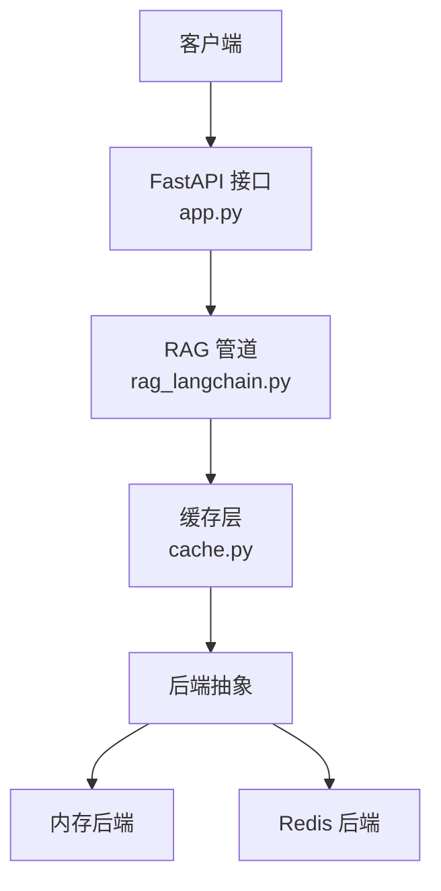
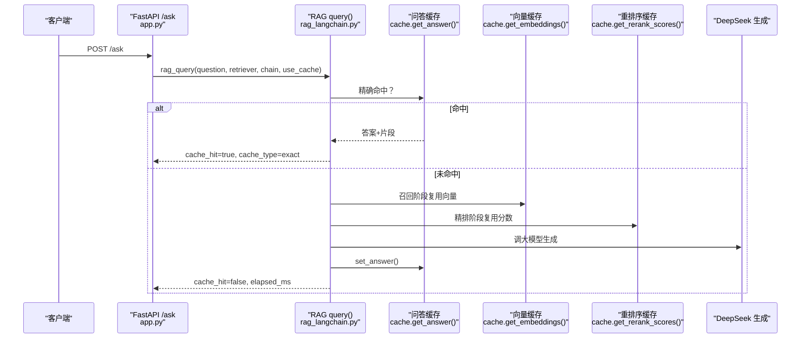
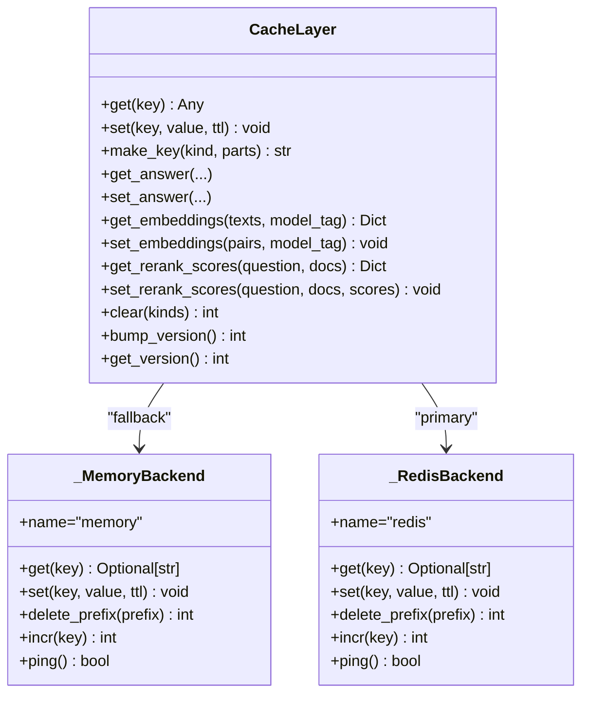
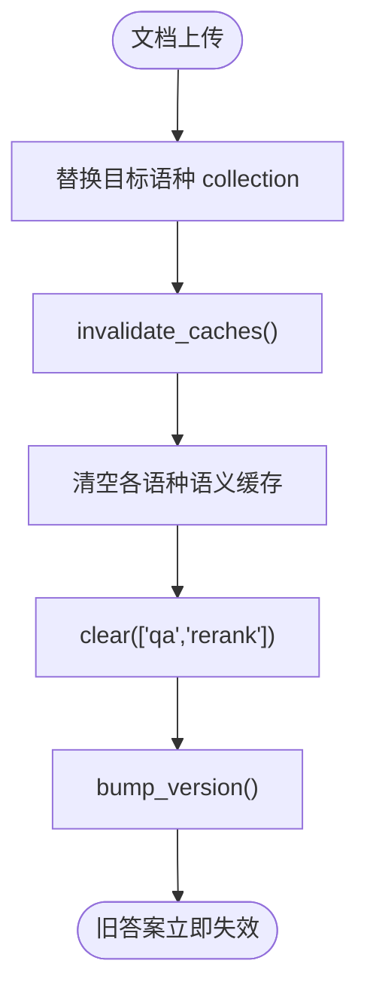
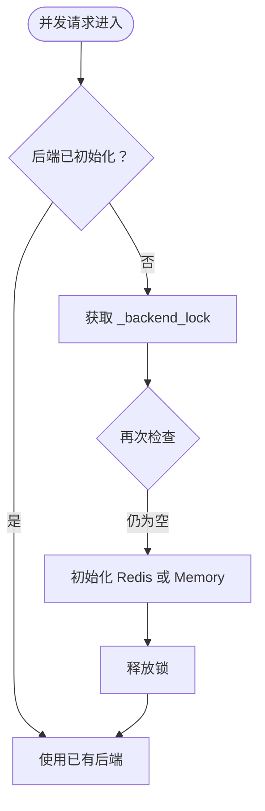
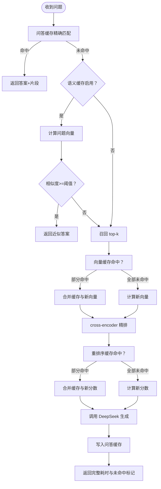
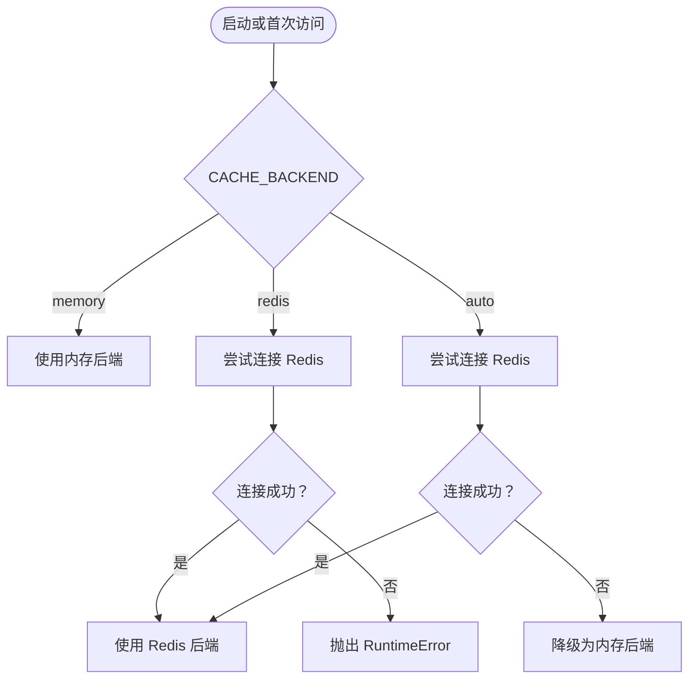
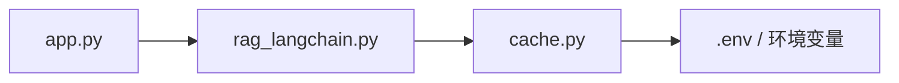

# 缓存层

<cite>
**本文引用的文件**   
- [app.py](file://app.py)
- [cache.py](file://cache.py)
- [rag_langchain.py](file://rag_langchain.py)
- [verify_cache.py](file://verify_cache.py)
- [verify_redis_backend.py](file://verify_redis_backend.py)
</cite>

## 目录
1. [引言](#引言)
2. [项目结构](#项目结构)
3. [核心组件](#核心组件)
4. [架构总览](#架构总览)
5. [详细组件分析](#详细组件分析)
6. [依赖关系分析](#依赖关系分析)
7. [性能与一致性](#性能与一致性)
8. [故障排查指南](#故障排查指南)
9. [结论](#结论)

## 引言
本缓存层为 RAG 问答链路提供三层加速：问答缓存、向量缓存、重排序缓存。它通过统一后端抽象同时支持 Redis 与内存实现，采用“版本号 + TTL”的失效策略，保证文档更新后旧答案立即作废；并发场景下使用锁机制保护单例初始化与统计计数器，并通过 fail-open 设计确保缓存异常不会改变业务结果。

## 项目结构
缓存相关代码主要分布在三个文件中：
- `cache.py`：缓存抽象、Redis/内存后端、版本管理、三类缓存 API 与统计。
- `rag_langchain.py`：RAG 管道，在嵌入、精排和问答入口处接入缓存。
- `app.py`：FastAPI 接口，调用 RAG 查询、上传文档并触发缓存失效。

**图表来源**
- [app.py:231-260](file://app.py#L231-L260)
- [rag_langchain.py:579-644](file://rag_langchain.py#L579-L644)
- [cache.py:75-200](file://cache.py#L75-L200)

**章节来源**
- [app.py:1-53](file://app.py#L1-L53)
- [cache.py:1-43](file://cache.py#L1-L43)
- [rag_langchain.py:1-24](file://rag_langchain.py#L1-L24)

## 核心组件
- 三层缓存
  - 问答缓存：按问题原文、检索参数、语种和缓存版本生成 key，命中则直接返回答案与引用片段。
  - 向量缓存：按文本哈希与模型标签存储向量，避免重复计算 embedding。
  - 重排序缓存：按（问题, 片段）哈希存储 cross-encoder 分数，避免重复打分。
- 后端抽象
  - `_MemoryBackend`：进程内字典 + RLock，带惰性过期与通配前缀删除。
  - `_RedisBackend`：封装 redis-py 或自定义 RESP 客户端，使用 SCAN 批量清理、INCR 原子递增。
- 版本管理
  - `VERSION_KEY` 全局版本号，每次知识库变更时递增，使所有带版本号的 key 自动失效。
- 统计与健康检查
  - 进程内 hit/miss 计数，计算命中率；暴露 `backend_name()`、`healthy()`、`get_stats()`。

**章节来源**
- [cache.py:10-43](file://cache.py#L10-L43)
- [cache.py:75-148](file://cache.py#L75-L148)
- [cache.py:216-268](file://cache.py#L216-L268)
- [cache.py:271-367](file://cache.py#L271-L367)
- [cache.py:370-391](file://cache.py#L370-L391)

## 架构总览
缓存层位于 FastAPI 接口与 RAG 管道之间，作为“加速层”而非数据源。任何缓存读失败都回退到真实链路，写失败也不影响返回结果。

**图表来源**
- [app.py:231-260](file://app.py#L231-L260)
- [rag_langchain.py:579-631](file://rag_langchain.py#L579-L631)
- [cache.py:271-300](file://cache.py#L271-L300)
- [cache.py:322-347](file://cache.py#L322-L347)
- [cache.py:349-367](file://cache.py#L349-L367)

## 详细组件分析

### 后端抽象与统一访问模式
后端抽象定义了统一的 get/set/delete_prefix/incr/ping 接口，屏蔽 Redis 与内存实现的差异。选择逻辑如下：
- `CACHE_BACKEND=memory`：强制内存。
- `CACHE_BACKEND=redis`：强制 Redis，连接失败抛错。
- `CACHE_BACKEND=auto`：优先 Redis，失败降级内存。

**图表来源**
- [cache.py:75-148](file://cache.py#L75-L148)
- [cache.py:176-200](file://cache.py#L176-L200)
- [cache.py:236-268](file://cache.py#L236-L268)
- [cache.py:271-391](file://cache.py#L271-L391)

**章节来源**
- [cache.py:176-200](file://cache.py#L176-L200)
- [cache.py:236-268](file://cache.py#L236-L268)

### 版本管理与失效策略
- 版本号键：`rag:cache_version`。
- 每个业务 key 包含版本号：`rag:v{version}:{kind}:{hash}`。
- 文档上传后调用 `invalidate_caches()`，内部执行：
  - 清空语义缓存。
  - 清除问答与重排序缓存。
  - 提升版本号，使历史 key 全部失效。

**图表来源**
- [app.py:192-205](file://app.py#L192-L205)
- [rag_langchain.py:634-644](file://rag_langchain.py#L634-L644)
- [cache.py:216-233](file://cache.py#L216-L233)
- [cache.py:370-391](file://cache.py#L370-L391)

**章节来源**
- [app.py:192-205](file://app.py#L192-L205)
- [rag_langchain.py:634-644](file://rag_langchain.py#L634-L644)
- [cache.py:216-233](file://cache.py#L216-L233)
- [cache.py:370-391](file://cache.py#L370-L391)

### 线程安全与并发控制
- 后端初始化：双检锁 `_backend_lock` 防止多实例重复创建。
- 统计计数器：`_stats_lock` 保护 hit/miss 计数。
- 内存后端：RLock 保护字典读写，避免自死锁。
- 模型与客户端懒加载：
  - embedding 模型：`_embeddings_by_lang` + `_embeddings_lock`。
  - Chroma 客户端：`_chroma_client` + `_chroma_client_lock`。
  - tokenizer：`_tokenizers` + `_tokenizers_lock`。
  - app 层 store/retriever/chain：`_singleton_lock`。

**图表来源**
- [cache.py:150-200](file://cache.py#L150-L200)
- [cache.py:45-72](file://cache.py#L45-L72)
- [cache.py:75-118](file://cache.py#L75-L118)
- [rag_langchain.py:224-254](file://rag_langchain.py#L224-L254)
- [rag_langchain.py:257-277](file://rag_langchain.py#L257-L277)
- [rag_langchain.py:310-321](file://rag_langchain.py#L310-L321)
- [app.py:63-92](file://app.py#L63-L92)

**章节来源**
- [cache.py:45-72](file://cache.py#L45-L72)
- [cache.py:75-118](file://cache.py#L75-L118)
- [cache.py:150-200](file://cache.py#L150-L200)
- [rag_langchain.py:224-254](file://rag_langchain.py#L224-L254)
- [rag_langchain.py:257-277](file://rag_langchain.py#L257-L277)
- [rag_langchain.py:310-321](file://rag_langchain.py#L310-L321)
- [app.py:63-92](file://app.py#L63-L92)

### 缓存流程图：命中路径与更新策略

**图表来源**
- [rag_langchain.py:579-631](file://rag_langchain.py#L579-L631)
- [cache.py:271-300](file://cache.py#L271-L300)
- [cache.py:322-347](file://cache.py#L322-L347)
- [cache.py:349-367](file://cache.py#L349-L367)

**章节来源**
- [rag_langchain.py:579-631](file://rag_langchain.py#L579-L631)
- [cache.py:271-367](file://cache.py#L271-L367)

### 三类缓存职责与 Key 设计
- 问答缓存
  - Key：`rag:v{version}:qa:{hash(lang, question, k, top_n)}`。
  - 作用：跳过整条 RAG 链路，秒回答案。
  - 失效：版本号提升或 TTL 到期。
- 向量缓存
  - Key：`rag:embed:{model_tag}:{text_hash}`。
  - 作用：跳过 embedding 模型前向。
  - 注意：不同模型必须用不同 `model_tag`，否则向量空间混用导致静默错误。
- 重排序缓存
  - Key：`rag:rerank:{hash(question||doc)}`。
  - 作用：跳过 cross-encoder 打分。
  - 失效：TTL 到期；不随知识库版本变化而整体失效（因为分数只依赖问题与片段内容）。

**章节来源**
- [cache.py:264-268](file://cache.py#L264-L268)
- [cache.py:271-300](file://cache.py#L271-L300)
- [cache.py:303-347](file://cache.py#L303-L347)
- [cache.py:349-367](file://cache.py#L349-L367)

### 后端选择与降级流程

**图表来源**
- [cache.py:176-200](file://cache.py#L176-L200)

**章节来源**
- [cache.py:176-200](file://cache.py#L176-L200)

## 依赖关系分析
- `app.py` 依赖 `cache` 模块进行缓存状态查询与清理，依赖 `rag_langchain.query()` 完成带缓存的问答。
- `rag_langchain.py` 在嵌入、精排与问答入口调用 `cache` 模块。
- `cache.py` 通过环境变量选择后端，并提供统一 API。

**图表来源**
- [app.py:43-51](file://app.py#L43-L51)
- [rag_langchain.py:48-49](file://rag_langchain.py#L48-L49)
- [cache.py:37-43](file://cache.py#L37-L43)

**章节来源**
- [app.py:43-51](file://app.py#L43-L51)
- [rag_langchain.py:48-49](file://rag_langchain.py#L48-L49)
- [cache.py:37-43](file://cache.py#L37-L43)

## 性能与一致性
- 性能收益
  - 问答缓存命中可跳过 DeepSeek 调用与检索精排，显著降低延迟。
  - 向量缓存避免重复 embedding，适合重复上传或重复提问场景。
  - 重排序缓存避免重复 cross-encoder 打分，是链路中最慢环节之一。
- 一致性保障
  - 版本号提升使所有历史问答与重排序 key 失效，避免“文档更新但答案仍旧”。
  - 向量缓存按模型标签隔离，避免跨模型向量污染。
  - fail-open 设计：缓存异常不影响主流程，系统降级为真实计算。
- 并发特性
  - 后端初始化、模型加载、统计计数均加锁保护。
  - Redis 端使用 INCR 原子递增版本号，SCAN 游标遍历清理，避免 KEYS 阻塞。

[本节为通用指导，不直接分析具体文件]

## 故障排查指南
- 无法连接 Redis
  - 若 `CACHE_BACKEND=redis`，连接失败会抛错；若 `auto`，会自动降级内存。
  - 可通过 `/cache/stats` 查看 `backend` 与 `healthy`。
- 缓存未命中
  - 检查是否传入了 `use_cache=false`。
  - 检查问题是否被判定为不同语种（lang 参与 key）。
  - 检查检索参数 `k` 与 `top_n` 是否与缓存写入时一致。
- 文档上传后答案仍旧
  - 确认上传流程调用了 `invalidate_caches()`。
  - 检查版本号是否递增，以及问答/重排序缓存是否被清理。
- 向量缓存污染
  - 确认不同模型使用了不同的 `model_tag`（本项目按语种区分）。
- 统计异常
  - 使用 `reset_stats()` 重置计数器，或通过 `/cache/stats` 查看命中率。

**章节来源**
- [cache.py:176-200](file://cache.py#L176-L200)
- [app.py:263-277](file://app.py#L263-L277)
- [cache.py:271-300](file://cache.py#L271-L300)
- [cache.py:303-347](file://cache.py#L303-L347)
- [cache.py:370-391](file://cache.py#L370-L391)

## 结论
该缓存层以统一后端抽象支撑 Redis 与内存两种实现，通过版本号与 TTL 双重机制保证数据一致性，并在并发场景下提供可靠的锁保护。三层缓存分别覆盖问答、向量与重排序三个阶段，显著提升 RAG 链路性能；fail-open 设计确保缓存异常不会改变业务结果。配合验证脚本，可对缓存行为与 Redis 后端集成进行端到端测试。