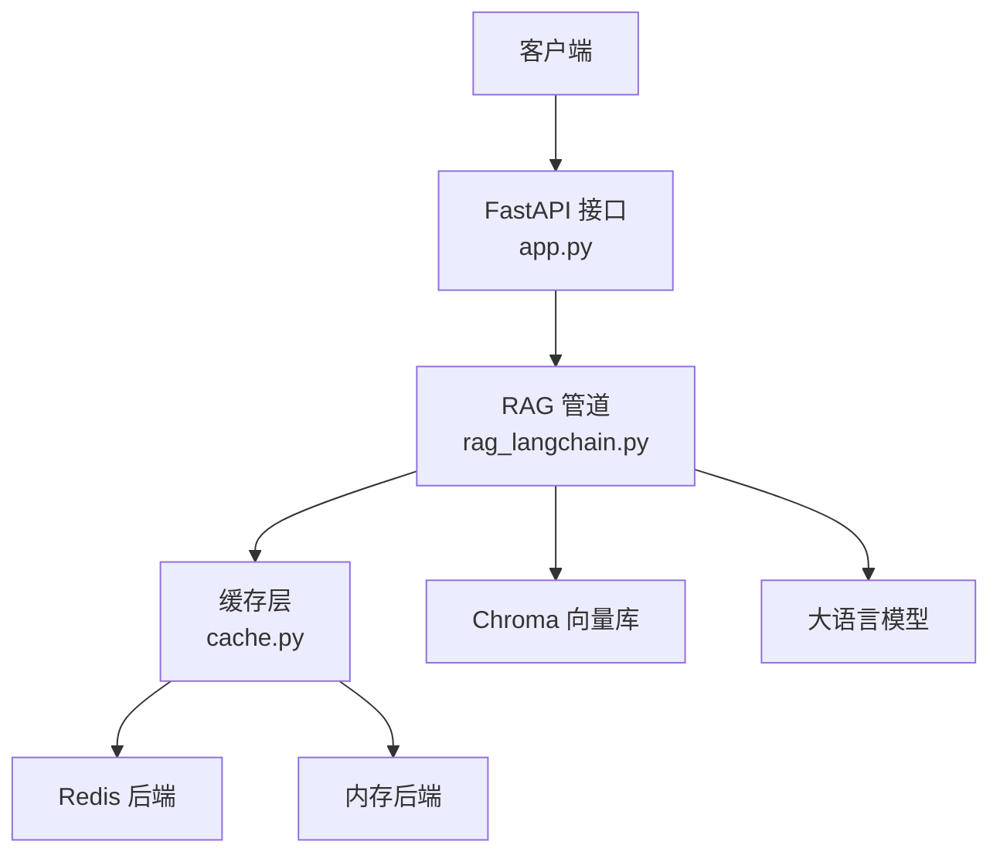
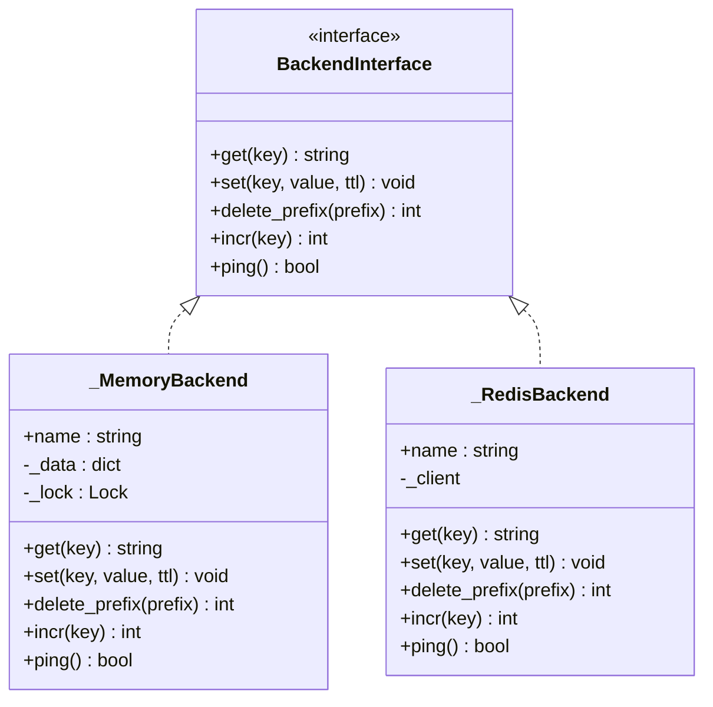
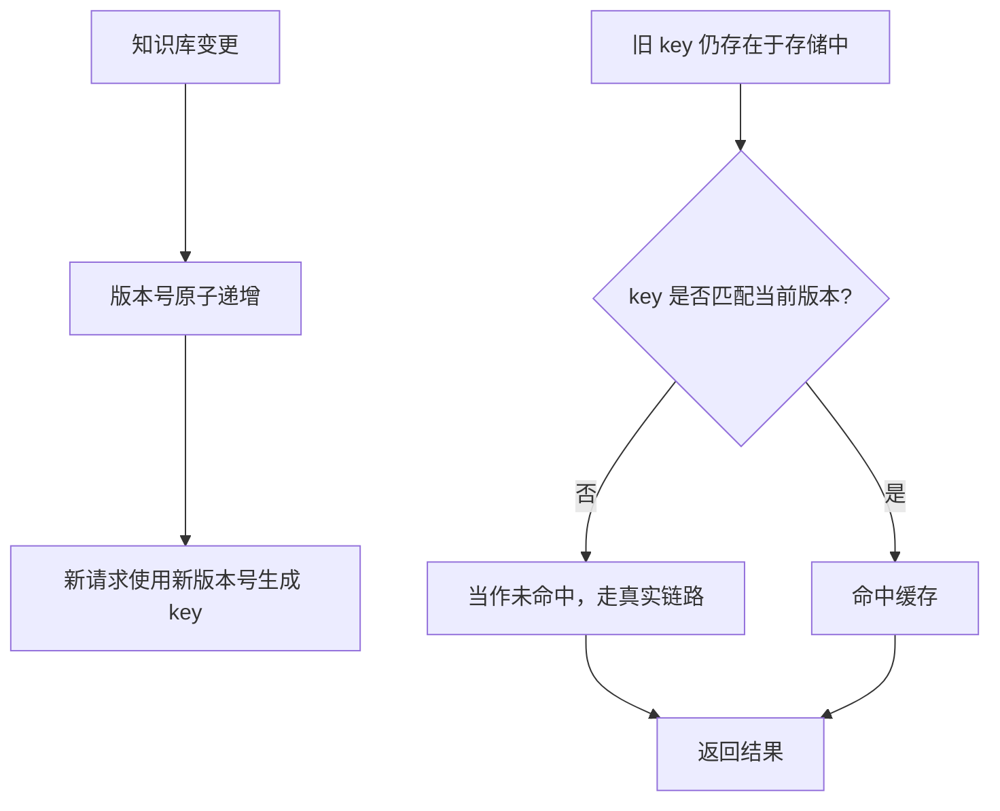
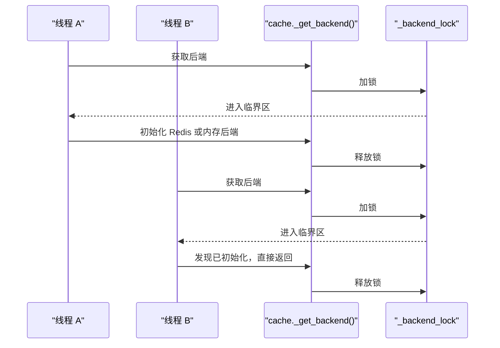
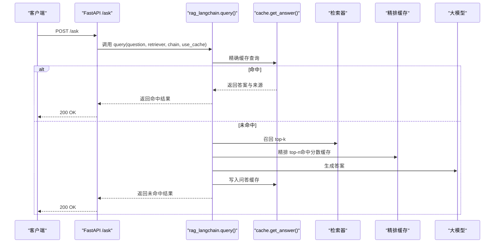
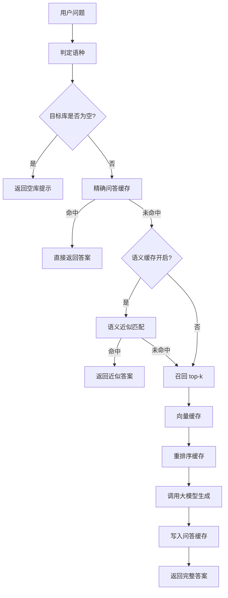
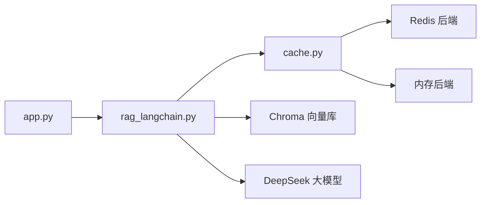

# 缓存架构设计

<cite>
**本文引用的文件**   
- [app.py](file://app.py)
- [cache.py](file://cache.py)
- [rag_langchain.py](file://rag_langchain.py)
- [verify_cache.py](file://verify_cache.py)
</cite>

## 目录
1. [引言](#引言)
2. [项目结构](#项目结构)
3. [核心组件](#核心组件)
4. [架构总览](#架构总览)
5. [详细组件分析](#详细组件分析)
6. [依赖关系分析](#依赖关系分析)
7. [性能与容量特性](#性能与容量特性)
8. [故障排查指南](#故障排查指南)
9. [结论](#结论)
10. [附录：关键流程对照表](#附录关键流程对照表)

## 引言
本项目的缓存层为 RAG 问答链路提供三层加速：问答缓存、向量缓存、重排序缓存。其核心目标是“让重复问题秒回、让重复文本不重复计算、让跨模型和跨语种的向量互不污染”，同时保证“缓存异常不影响主业务流程”。

整体设计理念如下：
- 问答缓存：命中后直接返回答案和引用片段，跳过召回、精排与大模型生成。
- 向量缓存：同一段文本不重复做 embedding 前向，尤其对重复上传或重复提问收益明显。
- 重排序缓存：同一问题与片段组合的 cross-encoder 分数不重复计算，避免最慢的精排环节被反复执行。
- 后端抽象：Redis 优先，自动降级到进程内内存；统一通过接口访问，屏蔽实现差异。
- 版本管理：所有带业务语义的 key 都携带版本号；知识库变更后提升版本号，旧缓存立即失效。
- 并发安全：统计计数器、后端初始化、模型懒加载等关键路径使用锁保护。
- fail-open：任何缓存读/写失败都视为未命中或忽略，主流程继续走真实链路。

## 项目结构
本项目围绕 FastAPI Web 服务、RAG 管道与缓存层组织代码：
- `app.py`：Web 接口入口，负责路由、请求校验、调用 RAG 查询、暴露缓存状态与清理接口。
- `rag_langchain.py`：RAG 核心管道，包含语种判断、嵌入模型、Chroma 向量库、检索与精排、生成链、语义缓存以及带缓存的问答入口。
- `cache.py`：缓存层，定义三层缓存 API、Redis 与内存后端、TTL、版本号、统计与清理。
- `verify_cache.py`：针对缓存行为的验证脚本，覆盖 QA、embedding、rerank 三类缓存的命中与统计逻辑。

**图表来源**
- [app.py:231-260](file://app.py#L231-L260)
- [rag_langchain.py:579-644](file://rag_langchain.py#L579-L644)
- [cache.py:250-391](file://cache.py#L250-L391)

**章节来源**
- [app.py:1-53](file://app.py#L1-L53)
- [rag_langchain.py:1-24](file://rag_langchain.py#L1-L24)
- [cache.py:1-29](file://cache.py#L1-L29)

## 核心组件
缓存层是本次文档的核心，它对外暴露统一的读写接口，对内封装 Redis 与内存两种后端，并维护三类缓存的业务方法。

### 三层缓存职责划分
| 缓存类型 | 存储内容 | 典型收益 | 失效策略 |
|---|---|---|---|
| 问答缓存 | 问题原文 + 检索参数 -> 答案与引用片段 | 跳过整条 RAG 链路，秒级返回 | 知识库变更时版本号提升，旧 key 不再命中 |
| 向量缓存 | 文本哈希 -> 向量 | 跳过 embedding 模型前向 | TTL 过期；不同模型按 model_tag 隔离 |
| 重排序缓存 | (问题, 片段) 哈希 -> 分数 | 跳过 cross-encoder 打分 | TTL 过期；知识库变更不清向量但清 QA 与 rerank |

**章节来源**
- [cache.py:10-28](file://cache.py#L10-L28)
- [cache.py:271-367](file://cache.py#L271-L367)
- [rag_langchain.py:145-182](file://rag_langchain.py#L145-L182)
- [rag_langchain.py:428-449](file://rag_langchain.py#L428-L449)

### 后端抽象接口
缓存层定义统一的 `_get_backend()` 选择器，支持三种模式：
- `auto`：尝试连接 Redis，失败则降级到内存后端。
- `redis`：强制 Redis，连接失败直接抛错。
- `memory`：仅使用进程内内存，零外部依赖。

后端接口包括：
- `get(key)`：读取字符串值。
- `set(key, value, ttl)`：写入字符串值并设置过期时间。
- `delete_prefix(prefix)`：按前缀批量删除。
- `incr(key)`：原子自增版本号。
- `ping()`：健康检查。

**图表来源**
- [cache.py:75-148](file://cache.py#L75-L148)

**章节来源**
- [cache.py:150-214](file://cache.py#L150-L214)
- [cache.py:250-268](file://cache.py#L250-L268)

### 版本管理机制
版本号用于控制缓存失效和数据一致性：
- 每个业务 key 由 `make_key(kind, ...)` 生成，格式包含当前版本号。
- 知识库上传或重建后调用 `bump_version()`，版本号原子递增。
- 旧 key 因版本号不同而自然失效，无需逐个删除。
- 清理接口对 QA 与 rerank 使用通配前缀，一次性清除所有历史版本；向量缓存不含版本号，因此不因文档更新而被误清。

**图表来源**
- [cache.py:216-233](file://cache.py#L216-L233)
- [cache.py:264-268](file://cache.py#L264-L268)
- [cache.py:371-391](file://cache.py#L371-L391)

**章节来源**
- [cache.py:216-233](file://cache.py#L216-L233)
- [cache.py:264-268](file://cache.py#L264-L268)
- [cache.py:371-391](file://cache.py#L371-L391)

### 线程安全与并发控制
缓存层在以下位置使用锁：
- 统计计数器：使用独立锁保护 hit/miss 计数，避免并发写入竞争。
- 后端初始化：双检锁确保只初始化一次后端实例。
- 内存后端：使用可重入锁保护字典操作，防止嵌套调用死锁。

RAG 管道也在多处使用锁：
- 模型懒加载：embedding 模型、tokenizer、cross-encoder、Chroma 客户端均使用双检锁。
- 全局单例：stores、retrievers、chains 使用共享锁避免重复构造。

**图表来源**
- [cache.py:176-199](file://cache.py#L176-L199)
- [cache.py:45-72](file://cache.py#L45-L72)
- [cache.py:75-118](file://cache.py#L75-L118)
- [rag_langchain.py:224-254](file://rag_langchain.py#L224-L254)
- [rag_langchain.py:257-277](file://rag_langchain.py#L257-L277)

**章节来源**
- [cache.py:45-72](file://cache.py#L45-L72)
- [cache.py:75-118](file://cache.py#L75-L118)
- [cache.py:176-199](file://cache.py#L176-L199)
- [rag_langchain.py:224-254](file://rag_langchain.py#L224-L254)
- [rag_langchain.py:257-277](file://rag_langchain.py#L257-L277)

## 架构总览
RAG 查询在 `rag_langchain.query()` 中统一处理缓存命中与真实链路：

**图表来源**
- [app.py:231-260](file://app.py#L231-L260)
- [rag_langchain.py:579-631](file://rag_langchain.py#L579-L631)
- [cache.py:271-300](file://cache.py#L271-L300)

**章节来源**
- [app.py:231-260](file://app.py#L231-L260)
- [rag_langchain.py:579-631](file://rag_langchain.py#L579-L631)

## 详细组件分析

### 问答缓存
问答缓存以“语种 + 问题原文 + 检索参数 + 缓存版本”作为 key，确保：
- 不同语种不会互相污染。
- 不同 k/top_n 不会复用旧口径结果。
- 知识库变更后旧答案立即失效。

写入时附带答案、来源片段、时间戳与原始问题，便于调试与审计。

**章节来源**
- [cache.py:271-300](file://cache.py#L271-L300)
- [rag_langchain.py:594-600](file://rag_langchain.py#L594-L600)
- [rag_langchain.py:621-627](file://rag_langchain.py#L621-L627)

### 向量缓存
向量缓存以“文本哈希”作为查找键，以“文本哈希 + 模型标签”作为存储键。模型标签用于区分不同 embedding 模型，避免两个语种的向量互相覆盖。

批量查询时先取缓存，再只对未命中文本调用模型前向，最后合并结果保持原始顺序。

**章节来源**
- [cache.py:303-346](file://cache.py#L303-L346)
- [rag_langchain.py:147-182](file://rag_langchain.py#L147-L182)
- [rag_langchain.py:185-221](file://rag_langchain.py#L185-L221)
- [rag_langchain.py:228-254](file://rag_langchain.py#L228-L254)

### 重排序缓存
重排序缓存以“(问题, 片段)”哈希作为 key，返回“片段下标 -> 分数”的映射。未命中部分才调用 cross-encoder，命中部分直接复用。

该缓存专门优化 cross-encoder 打分这一最慢环节，显著降低重复问题的整体延迟。

**章节来源**
- [cache.py:349-367](file://cache.py#L349-L367)
- [rag_langchain.py:428-449](file://rag_langchain.py#L428-L449)

### 语义缓存
语义缓存是可选增强层，默认关闭。它保存最近的问题向量与答案负载，对新问题向量进行余弦相似度比较，超过阈值则复用旧答案。

语义缓存按语种隔离，因为不同模型的向量空间不可混用。

**章节来源**
- [rag_langchain.py:511-576](file://rag_langchain.py#L511-L576)
- [rag_langchain.py:602-612](file://rag_langchain.py#L602-L612)
- [rag_langchain.py:623-627](file://rag_langchain.py#L623-L627)

### 缓存流程图
下图展示不同缓存类型的命中路径与更新策略：

**图表来源**
- [app.py:231-260](file://app.py#L231-L260)
- [rag_langchain.py:579-631](file://rag_langchain.py#L579-L631)
- [cache.py:271-367](file://cache.py#L271-L367)

**章节来源**
- [app.py:231-260](file://app.py#L231-L260)
- [rag_langchain.py:579-631](file://rag_langchain.py#L579-L631)

## 依赖关系分析
缓存层与 RAG 管道、Web 接口之间的依赖如下：

**图表来源**
- [app.py:43-51](file://app.py#L43-L51)
- [rag_langchain.py:48-49](file://rag_langchain.py#L48-L49)
- [cache.py:123-173](file://cache.py#L123-L173)
- [cache.py:75-121](file://cache.py#L75-L121)

**章节来源**
- [app.py:43-51](file://app.py#L43-L51)
- [rag_langchain.py:48-49](file://rag_langchain.py#L48-L49)
- [cache.py:123-173](file://cache.py#L123-L173)
- [cache.py:75-121](file://cache.py#L75-L121)

## 性能与容量特性
- 问答缓存命中率直接影响 DeepSeek 调用次数与端到端延迟。
- 向量缓存对重复上传与重复提问有明显收益，尤其当 chunk 重复率高时。
- 重排序缓存对 cross-encoder 打分开销敏感，重复问题可显著减少 CPU 占用。
- 统计指标包含各层 hit/miss 与命中率，便于观察缓存有效性。
- 向量缓存与 rerank 缓存使用 TTL，避免长期驻留导致内存膨胀；问答缓存也受 TTL 限制。
- 多进程场景下，内存后端各自独立；Redis 后端可跨进程共享。

**章节来源**
- [cache.py:45-72](file://cache.py#L45-L72)
- [cache.py:37-42](file://cache.py#L37-L42)
- [verify_cache.py:97-142](file://verify_cache.py#L97-L142)

## 故障排查指南
常见故障与定位方式：
- Redis 不可用：查看后端名称与健康状态；若配置为 `redis` 模式会抛错，`auto` 模式会自动降级到内存。
- 缓存未命中：检查 key 是否包含正确版本号、语种、k/top_n；确认知识库是否刚更新导致版本号提升。
- 向量污染：确认 embedding 缓存是否使用正确的 model_tag；不同模型不能共用同一 key。
- rerank 命中异常：确认问题与片段组合是否一致；换问题或换片段不应复用旧分数。
- 统计异常：确认统计锁未被破坏；重置统计后可重新采集。

建议排查步骤：
1. 调用 `/cache/stats` 查看后端、健康、版本、TTL 与各层命中率。
2. 调用 `/health` 确认服务与缓存后端状态。
3. 使用 `verify_cache.py` 复现缓存行为，验证命中与统计是否符合预期。
4. 若怀疑 Redis 问题，切换 `CACHE_BACKEND=memory` 验证主流程是否正常。

**章节来源**
- [app.py:263-290](file://app.py#L263-L290)
- [cache.py:202-214](file://cache.py#L202-L214)
- [cache.py:371-391](file://cache.py#L371-L391)
- [verify_cache.py:97-142](file://verify_cache.py#L97-L142)

## 结论
本缓存架构通过三层分工、后端抽象、版本管理与 fail-open 机制，在保证数据一致性的前提下显著提升 RAG 问答性能。问答缓存解决“重复问题”的全链路成本，向量缓存解决“重复文本”的模型前向成本，重排序缓存解决“重复片段”的精排成本。Redis 与内存后端统一访问，使系统在开发、测试与生产环境中都能稳定运行。

## 附录：关键流程对照表
| 场景 | 缓存行为 | 返回值关键字段 |
|---|---|---|
| 精确命中 | 直接返回答案与来源 | cache_hit=true, cache_type=exact |
| 语义命中 | 返回近似答案与来源 | cache_hit=true, cache_type=semantic(分数) |
| 真实链路 | 召回、精排、生成后写入缓存 | cache_hit=false, cache_type=miss |
| 空库 | 不走检索，直接提示 | cache_type=empty_collection |
| 上传文档 | 替换该语种库，失效 QA 与 rerank，提升版本号 | cache_invalidated=true |

**章节来源**
- [app.py:129-149](file://app.py#L129-L149)
- [app.py:155-228](file://app.py#L155-L228)
- [rag_langchain.py:579-644](file://rag_langchain.py#L579-L644)