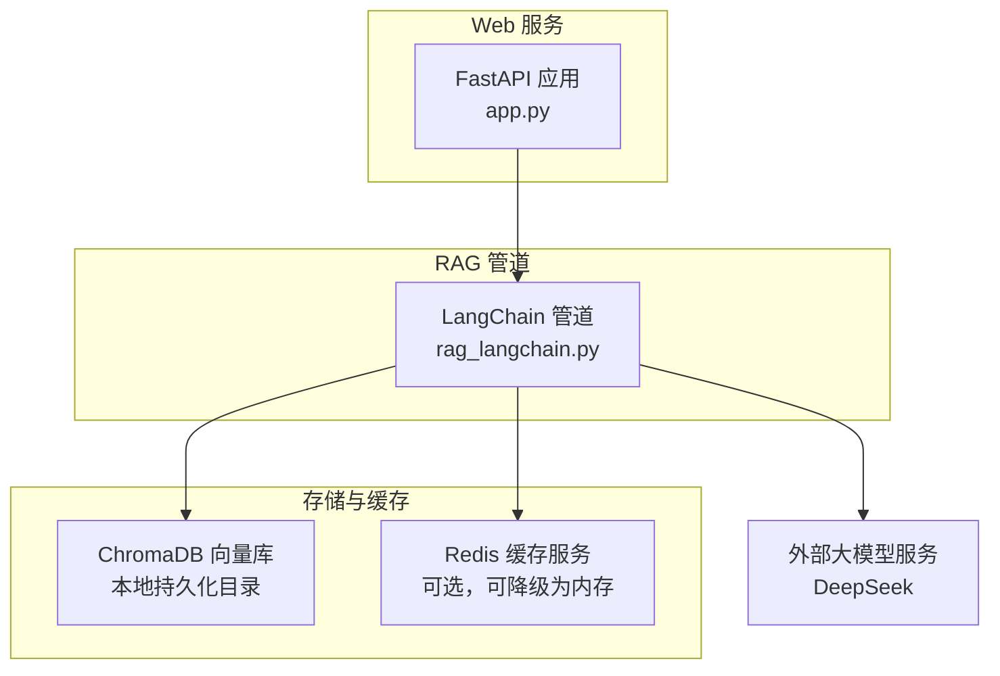
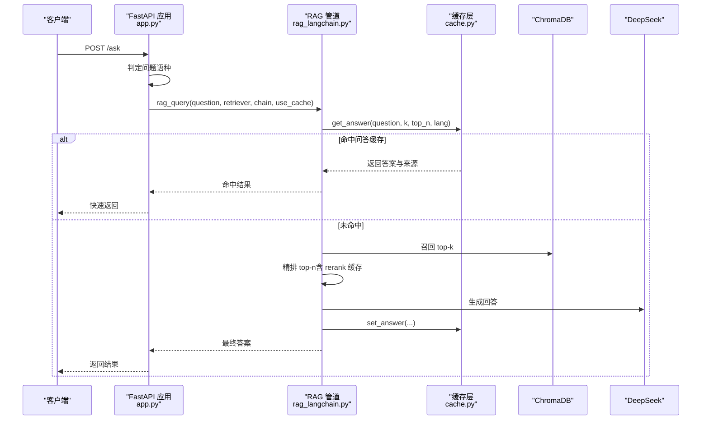
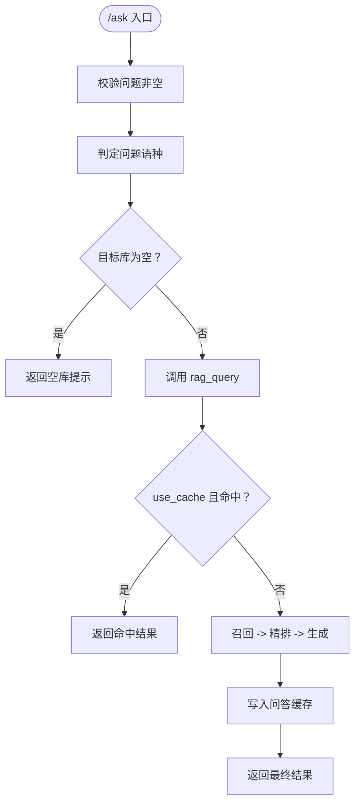
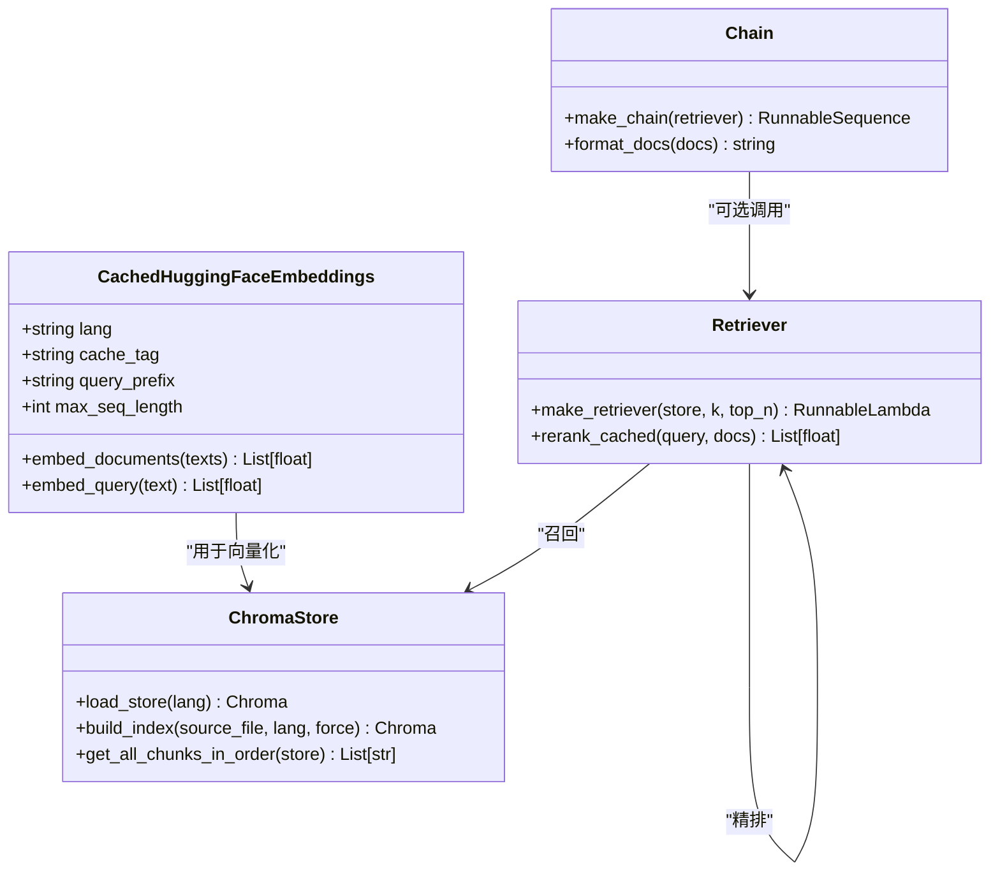
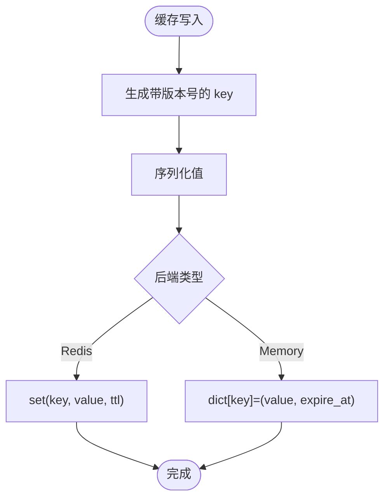
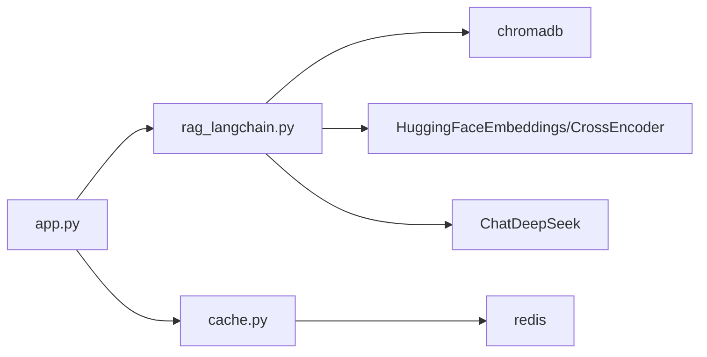
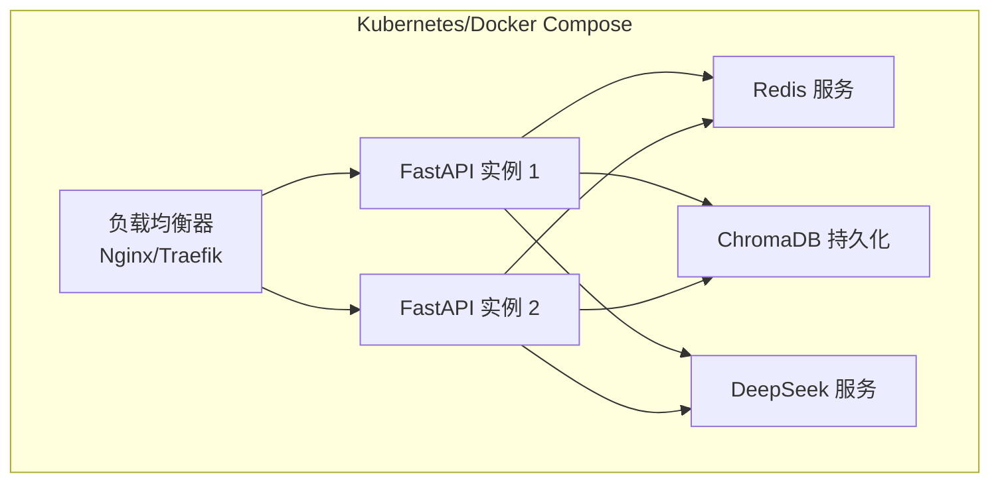

# 部署拓扑

<cite>
**本文引用的文件**   
- [app.py](file://app.py)
- [rag_langchain.py](file://rag_langchain.py)
- [cache.py](file://cache.py)
- [requirements.txt](file://requirements.txt)
</cite>

## 目录
1. [引言](#引言)
2. [项目结构](#项目结构)
3. [核心组件](#核心组件)
4. [架构总览](#架构总览)
5. [详细组件分析](#详细组件分析)
6. [依赖关系分析](#依赖关系分析)
7. [性能与扩展性](#性能与扩展性)
8. [环境差异与配置](#环境差异与配置)
9. [容器化与服务编排](#容器化与服务编排)
10. [故障排查指南](#故障排查指南)
11. [结论](#结论)

## 引言
本文件面向 RAG 系统的部署与运维，目标是明确 FastAPI 应用服务器、ChromaDB 向量数据库、Redis 缓存服务三者的部署方式、网络关系与环境差异，并给出容器化方案、水平扩展与高可用设计建议。系统采用“双库 + 三层缓存”的架构：按语种分别维护 Chroma collection，问答链路包含召回、精排与大模型生成；缓存层提供问答结果、嵌入向量、精排分数三类缓存，默认优先 Redis，不可用时自动降级为进程内内存缓存。

## 项目结构
仓库根目录包含 FastAPI 入口、LangChain RAG 管道、缓存实现、依赖声明以及模板与评测数据等。关键文件职责如下：
- app.py：FastAPI Web 服务，暴露上传、提问、缓存管理、健康检查等接口，负责路由到对应语种的检索与生成链。
- rag_langchain.py：RAG 核心管道，包括语种判断、嵌入模型、Chroma 向量库、召回与精排、Prompt 与 LLM 调用、语义缓存与评测工具。
- cache.py：缓存抽象层，封装 Redis 与内存后端，提供版本化失效、TTL、统计与健康检查。
- requirements.txt：Python 依赖清单，包含 FastAPI、LangChain、Chroma、HuggingFace、DeepSeek、Redis 客户端等。

图表来源
- [app.py:36-53](file://app.py#L36-L53)
- [rag_langchain.py:39-48](file://rag_langchain.py#L39-L48)
- [cache.py:123-199](file://cache.py#L123-L199)

章节来源
- [app.py:1-53](file://app.py#L1-L53)
- [rag_langchain.py:1-50](file://rag_langchain.py#L1-L50)
- [cache.py:1-30](file://cache.py#L1-L30)
- [requirements.txt:1-19](file://requirements.txt#L1-L19)

## 核心组件
- FastAPI 应用服务器（app.py）
  - 暴露 /upload、/ask、/cache/stats、/cache/clear、/health、/ 等接口。
  - 按问题或文档语种选择 Chroma collection 与 embedding 模型。
  - 懒加载 store/retriever/chain，避免重复加载模型与连接。
- LangChain RAG 管道（rag_langchain.py）
  - 语种检测、分块、嵌入、Chroma 集合操作、召回与精排、LLM 生成。
  - 三种缓存：问答、嵌入向量、精排分数；支持可选语义缓存。
  - 共享 Chroma PersistentClient，避免多实例导致的数据不一致。
- 缓存层（cache.py）
  - Redis 后端与内存后端统一抽象，auto 模式自动降级。
  - 版本化 key 与 TTL，知识库变更时整体失效。
  - 统计指标与健康检查，便于监控与诊断。

章节来源
- [app.py:53-123](file://app.py#L53-L123)
- [rag_langchain.py:118-143](file://rag_langchain.py#L118-L143)
- [rag_langchain.py:228-277](file://rag_langchain.py#L228-L277)
- [cache.py:37-49](file://cache.py#L37-L49)
- [cache.py:216-234](file://cache.py#L216-L234)

## 架构总览
下图展示请求从前端到后端的核心流程，包括缓存命中路径与真实链路路径。

图表来源
- [app.py:231-260](file://app.py#L231-L260)
- [rag_langchain.py:579-631](file://rag_langchain.py#L579-L631)
- [cache.py:271-300](file://cache.py#L271-L300)

## 详细组件分析

### FastAPI 应用服务器（app.py）
- 接口设计
  - /upload：解析 PDF/Markdown，按文档语种切块并入库，失效旧缓存，更新 chunks_preview。
  - /ask：按问题语种路由，空库保护，先查缓存再走 RAG 链路，返回 answer/sources/cache_hit/cache_type/elapsed_ms/lang。
  - /cache/stats：返回缓存后端类型、健康状态、版本号、各语种库块数、TTL 与统计。
  - /cache/clear：按类型清空缓存。
  - /health：轻量健康检查。
  - /：返回前端页面。
- 单例与并发安全
  - _stores/_retrievers/_chains 使用双检锁懒加载，避免重复构造 embedding_function 与 retriever。
  - _collection_size 直接查询 Chroma count，避免触发模型加载与 collection 创建。

图表来源
- [app.py:231-260](file://app.py#L231-L260)
- [rag_langchain.py:579-631](file://rag_langchain.py#L579-L631)

章节来源
- [app.py:129-150](file://app.py#L129-L150)
- [app.py:155-228](file://app.py#L155-L228)
- [app.py:231-297](file://app.py#L231-L297)

### LangChain RAG 管道（rag_langchain.py）
- 语种与模型
  - LANG_MODELS：中文 text2vec-base-chinese，英文 bge-base-en-v1.5。
  - LANG_COLLECTIONS：中文 rag_zh，英文 rag_en。
  - detect_lang：基于汉字占比阈值判定语种。
- 嵌入与缓存
  - CachedHuggingFaceEmbeddings：覆写 embed_documents/embed_query，接入向量缓存。
  - model_tag 区分不同模型空间，避免跨模型覆盖。
- 向量库
  - load_store：按语种打开/创建 Chroma collection。
  - build_index：重建索引，清空已有块而非 drop collection，保持实例有效。
  - 共享 PersistentClient，避免多客户端导致的句柄与索引冲突。
- 检索与精排
  - make_retriever：召回 top-k，cross-encoder 精排到 top-n。
  - rerank_cached：(问题, 片段) 打分缓存，显著降低 cross-encoder 开销。
- 生成
  - PromptTemplate + ChatDeepSeek，LCEL 链式组合。
  - make_chain：支持传入 {"question","context"} 跳过二次召回。
- 语义缓存（可选）
  - SemanticCache：基于余弦相似度近似匹配，默认关闭，可通过环境变量开启。

图表来源
- [rag_langchain.py:185-222](file://rag_langchain.py#L185-L222)
- [rag_langchain.py:363-405](file://rag_langchain.py#L363-L405)
- [rag_langchain.py:452-467](file://rag_langchain.py#L452-L467)
- [rag_langchain.py:471-508](file://rag_langchain.py#L471-L508)

章节来源
- [rag_langchain.py:52-116](file://rag_langchain.py#L52-L116)
- [rag_langchain.py:118-143](file://rag_langchain.py#L118-L143)
- [rag_langchain.py:228-277](file://rag_langchain.py#L228-L277)
- [rag_langchain.py:324-359](file://rag_langchain.py#L324-L359)
- [rag_langchain.py:416-467](file://rag_langchain.py#L416-L467)
- [rag_langchain.py:471-508](file://rag_langchain.py#L471-L508)
- [rag_langchain.py:511-576](file://rag_langchain.py#L511-L576)
- [rag_langchain.py:579-644](file://rag_langchain.py#L579-L644)

### 缓存层（cache.py）
- 后端选择
  - CACHE_BACKEND=auto：优先 Redis，失败降级为内存。
  - CACHE_BACKEND=redis：强制 Redis，失败抛错。
  - CACHE_BACKEND=memory：仅内存。
- 数据结构
  - QA 缓存：问题原文 + 参数 + 版本 -> 答案与来源。
  - Embedding 缓存：文本 hash + model_tag -> 向量。
  - Rerank 缓存：(问题, 片段) hash -> 分数。
- 失效策略
  - VERSION_KEY 递增使所有旧 key 失效。
  - clear() 支持按类型清理，qa/rerank 使用通配前缀删除历史版本。
- 统计与健康
  - get_stats() 返回命中率、后端类型、节省的 DeepSeek 调用次数等。
  - healthy() 通过 ping 检查后端可用性。

图表来源
- [cache.py:236-268](file://cache.py#L236-L268)
- [cache.py:271-300](file://cache.py#L271-L300)
- [cache.py:303-347](file://cache.py#L303-L347)
- [cache.py:349-367](file://cache.py#L349-L367)
- [cache.py:370-390](file://cache.py#L370-L390)

章节来源
- [cache.py:1-30](file://cache.py#L1-L30)
- [cache.py:37-49](file://cache.py#L37-L49)
- [cache.py:75-121](file://cache.py#L75-L121)
- [cache.py:123-199](file://cache.py#L123-L199)
- [cache.py:216-234](file://cache.py#L216-L234)
- [cache.py:271-390](file://cache.py#L271-L390)

## 依赖关系分析
- Python 依赖
  - FastAPI、uvicorn：Web 框架与 ASGI 服务器。
  - LangChain 生态：langchain、langchain-community、langchain-chroma、langchain-huggingface、langchain-deepseek、langchain-core。
  - 模型与推理：sentence-transformers、chromadb、pymupdf。
  - 缓存：redis（可选，自动降级）。
- 运行时依赖
  - ChromaDB：本地持久化目录 chroma_db，多个 collection 共享 PersistentClient。
  - Redis：可选缓存后端，支持 RESP2 兼容。
  - DeepSeek：外部 LLM 服务，通过 langchain-deepseek 调用。

图表来源
- [requirements.txt:1-19](file://requirements.txt#L1-L19)
- [rag_langchain.py:39-48](file://rag_langchain.py#L39-L48)
- [cache.py:123-199](file://cache.py#L123-L199)

章节来源
- [requirements.txt:1-19](file://requirements.txt#L1-L19)
- [rag_langchain.py:39-48](file://rag_langchain.py#L39-L48)
- [cache.py:123-199](file://cache.py#L123-L199)

## 性能与扩展性
- 性能特性
  - 三层缓存显著减少重复计算：问答缓存跳过整条链路，嵌入缓存跳过模型前向，精排缓存跳过 cross-encoder。
  - 懒加载与单例：embedding 模型、tokenizer、cross-encoder、Chroma client 均懒加载，避免启动时全量加载。
  - 空库保护：目标库为空时直接返回提示，避免无依据生成。
- 扩展性考虑
  - 水平扩展：FastAPI 无状态，可多实例部署；ChromaDB 本地持久化需共享存储或使用分布式向量库替代；Redis 作为共享缓存后端天然支持多实例。
  - 负载均衡：在 FastAPI 前加反向代理（如 Nginx/Traefik），按会话或随机分发。
  - 高可用：Redis 主从或哨兵；ChromaDB 若替换为分布式向量库（如 Milvus/Pinecone），可实现副本与分区；LLM 服务应提供重试与熔断。
  - 弹性伸缩：根据 QPS 与延迟指标扩缩 FastAPI 实例；对 embedding 与 rerank 模型进行 GPU 加速或批处理优化。

[本节为通用指导，不直接分析具体文件]

## 环境差异与配置
- 开发环境
  - CACHE_BACKEND=memory：无需 Redis，适合单机演示。
  - SEMANTIC_CACHE=0：关闭语义缓存，避免误命中。
  - CHUNK_TOKENS/CHUNK_OVERLAP_TOKENS：可调切块大小与重叠，便于实验。
- 测试环境
  - CACHE_BACKEND=auto：优先 Redis，失败降级内存，便于集成测试。
  - 启用 /health 与 /cache/stats 监控，验证缓存命中率与后端健康。
- 生产环境
  - CACHE_BACKEND=redis：强制 Redis，连接失败抛错，避免静默降级。
  - REDIS_URL：指向高可用 Redis 集群或托管服务。
  - ANSWER_TTL/EMBEDDING_TTL/RERANK_TTL：按业务 SLA 调整 TTL。
  - 日志与监控：采集 /cache/stats 指标，结合 Prometheus/Grafana 可视化。

章节来源
- [cache.py:37-49](file://cache.py#L37-L49)
- [cache.py:154-199](file://cache.py#L154-L199)
- [rag_langchain.py:113-116](file://rag_langchain.py#L113-L116)
- [rag_langchain.py:107-112](file://rag_langchain.py#L107-L112)

## 容器化与服务编排
- Docker 镜像构建
  - 基础镜像：建议使用 python:3.11-slim 或官方镜像，安装系统依赖后复制代码与模型权重。
  - 依赖安装：pip install -r requirements.txt。
  - 模型权重：text2vec-base-chinese、bge-base-en-v1.5、mmarco-mMiniLMv2-L12-H384-v1 可预置或运行时下载（注意许可证与带宽）。
  - 端口暴露：8000（FastAPI）。
  - 环境变量：REDIS_URL、CACHE_BACKEND、ANSWER_TTL、EMBEDDING_TTL、RERANK_TTL、SEMANTIC_CACHE、SEMANTIC_THRESHOLD、BGE_QUERY_PREFIX、CHUNK_TOKENS、CHUNK_OVERLAP_TOKENS。
- 服务编排（示例思路）
  - fastapi-app：运行 app.py，挂载 chroma_db 持久卷，连接 Redis。
  - redis：独立容器，持久化 AOF/RDB，限制内存。
  - chroma-db：若使用内置持久化，将 chroma_db 目录映射到宿主或共享存储；若替换为分布式向量库，则相应调整。
  - nginx/traefik：反向代理，负载均衡，TLS 终止。
  - llm-proxy：可选，封装 DeepSeek 调用，增加重试与限流。

图表来源
- [app.py:300-302](file://app.py#L300-L302)
- [cache.py:154-199](file://cache.py#L154-L199)
- [rag_langchain.py:257-277](file://rag_langchain.py#L257-L277)

[本节为概念性编排说明，不直接分析具体文件]

## 故障排查指南
- 缓存不可用
  - 现象：/health 显示 cache_healthy=false，/cache/stats 中 backend=unavailable。
  - 排查：检查 REDIS_URL、网络连通性、RESP_CLIENT_MODULE 是否误设；确认 CACHE_BACKEND 是否为 auto 或 memory。
  - 参考：cache.py 的连接与降级逻辑。
- 向量库为空
  - 现象：/ask 返回空库提示。
  - 排查：确认 /upload 成功，LANG_COLLECTIONS 与 detect_lang 路由正确；检查 Chroma collection 是否存在。
  - 参考：app.py 的空库保护与 _collection_size。
- 缓存未失效
  - 现象：上传新文档后仍返回旧答案。
  - 排查：确认 invalidate_caches 被调用，VERSION_KEY 已递增；检查 clear() 是否按类型清理。
  - 参考：cache.py 的版本号与清理逻辑。
- 性能退化
  - 现象：QPS 低、延迟高。
  - 排查：查看 /cache/stats 命中率；检查 embedding/rerank 缓存命中；评估是否需要 GPU 或批处理。
  - 参考：rag_langchain.py 的缓存与懒加载逻辑。

章节来源
- [cache.py:154-199](file://cache.py#L154-L199)
- [cache.py:216-234](file://cache.py#L216-L234)
- [cache.py:370-390](file://cache.py#L370-L390)
- [app.py:241-249](file://app.py#L241-L249)
- [app.py:263-290](file://app.py#L263-L290)

## 结论
本 RAG 系统以 FastAPI 为入口，LangChain 管道为核心，ChromaDB 为向量存储，Redis 为可选缓存后端，具备双库隔离、三层缓存、版本化失效与自动降级能力。在生产环境中，建议强制 Redis 缓存、共享持久化存储、前置负载均衡，并结合监控与告警保障稳定性与性能。通过合理的容器化与服务编排，系统可实现水平扩展与高可用，满足多租户与高并发场景需求。