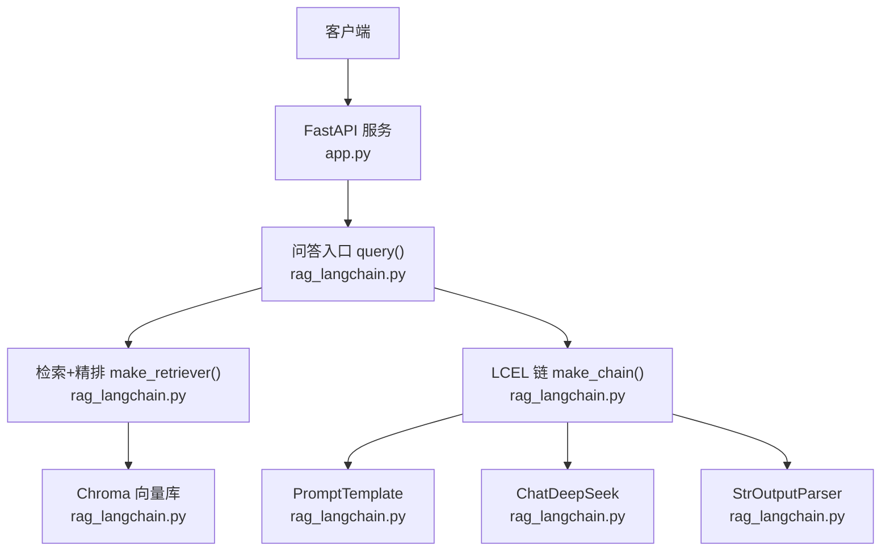
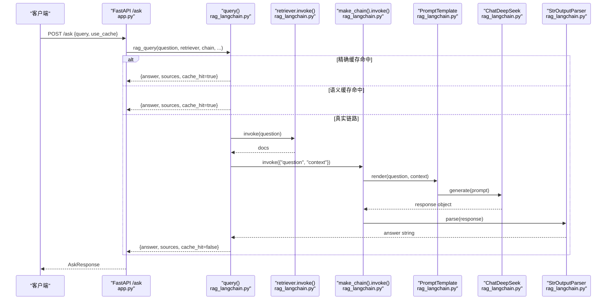
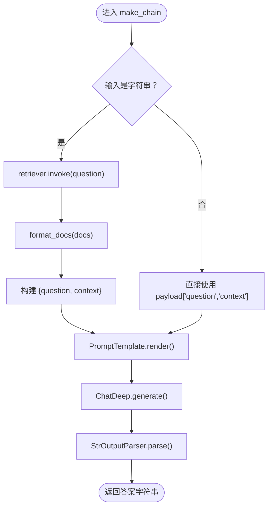
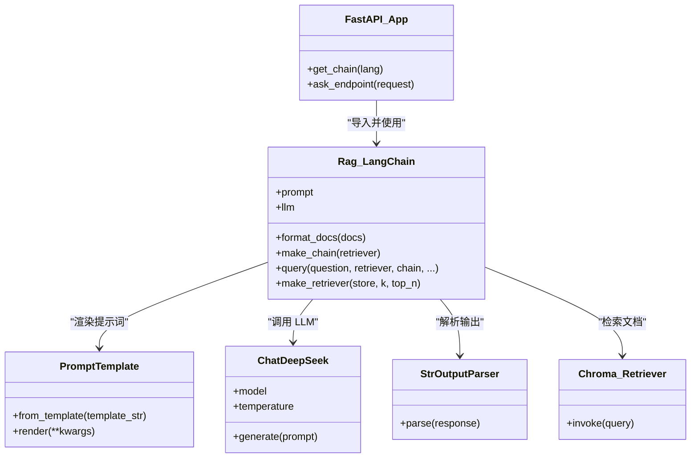

# LLM 生成管道

<cite>
**本文引用的文件**   
- [rag_langchain.py](file://rag_langchain.py)
- [app.py](file://app.py)
</cite>

## 目录
1. [引言](#引言)
2. [项目结构](#项目结构)
3. [核心组件](#核心组件)
4. [架构总览](#架构总览)
5. [详细组件分析](#详细组件分析)
6. [依赖关系分析](#依赖关系分析)
7. [性能与缓存特性](#性能与缓存特性)
8. [异常处理与排错](#异常处理与排错)
9. [Prompt 工程与质量优化建议](#prompt-工程与质量优化建议)
10. [结论](#结论)

## 引言
本技术文档聚焦于 LLM 生成管道的实现，重点解释基于 LangChain Expression Language（LCEL）的 `make_chain()` 链式调用、`PromptTemplate` 的设计与可定制性、`ChatDeepSeek` 的集成方式、`StrOutputParser` 的输出处理，以及 `format_docs()` 的上下文格式化逻辑。同时说明为什么需要支持字符串输入和字典输入两种模式，如何避免重复检索，并给出 API 调用失败、响应格式异常、超时等异常场景的处理思路，最后提供 prompt 工程优化与生成质量提升的建议。

## 项目结构
本项目是一个 RAG Web 服务：
- `rag_langchain.py`：RAG 核心管道，包含语种判断、嵌入模型、向量库、召回与精排、Prompt 模板、LLM 集成、LCEL 链构造、语义缓存、问答入口函数等。
- `app.py`：FastAPI 服务层，封装 `/upload`、`/ask`、`/cache/stats`、`/health` 等接口，按问题语种路由到对应知识库，复用 `rag_langchain` 中的 retriever、chain 等对象。

**图表来源**
- [app.py:86-92](file://app.py#L86-L92)
- [rag_langchain.py:471-508](file://rag_langchain.py#L471-L508)
- [rag_langchain.py:452-467](file://rag_langchain.py#L452-L467)

**章节来源**
- [app.py:1-51](file://app.py#L1-L51)
- [rag_langchain.py:1-49](file://rag_langchain.py#L1-L49)

## 核心组件
- `PromptTemplate`：定义“用户问题 + 相关片段”的结构化提示词，要求模型基于给定内容作答，不编造信息。
- `ChatDeepSeek`：作为 LLM 后端，使用 `deepseek-chat` 模型，温度参数控制随机性。
- `StrOutputParser`：将 LLM 返回的对象解析为纯文本字符串，便于前端直接展示。
- `format_docs()`：把召回的文档列表拼接成一段连续的上下文文本，供 prompt 渲染。
- `make_chain(retriever)`：构建 LCEL 链，支持两种输入模式：
  - 字符串输入：链内自动调用 retriever 进行检索，再走 prompt → LLM → 解析。
  - 字典输入：跳过检索，直接使用传入的 `context`，避免重复检索与类型错误。

**章节来源**
- [rag_langchain.py:471-508](file://rag_langchain.py#L471-L508)

## 架构总览
下图展示了从请求进入 FastAPI 到最终返回答案的完整流程，包括缓存命中、按需检索、prompt 渲染、LLM 调用与输出解析。

**图表来源**
- [app.py:231-260](file://app.py#L231-L260)
- [rag_langchain.py:580-631](file://rag_langchain.py#L580-L631)
- [rag_langchain.py:482-508](file://rag_langchain.py#L482-L508)

## 详细组件分析

### LCEL 链 `make_chain()` 的实现
`make_chain()` 通过 LCEL 将多个步骤串联起来：
1. 输入预处理：根据输入类型决定是否需要检索。
   - 若输入是字符串，则调用 `retriever.invoke(payload)` 获取文档，再用 `format_docs(docs)` 拼接上下文。
   - 若输入是字典且包含 `question` 与 `context`，则直接使用该上下文，跳过检索。
2. 提示词渲染：使用 `PromptTemplate` 将 `{question}` 与 `{context}` 渲染为最终 prompt。
3. LLM 调用：将 prompt 发送给 `ChatDeepSeek`。
4. 输出解析：使用 `StrOutputParser` 将 LLM 返回对象转换为纯文本。

**图表来源**
- [rag_langchain.py:482-508](file://rag_langchain.py#L482-L508)

**章节来源**
- [rag_langchain.py:482-508](file://rag_langchain.py#L482-L508)

### `format_docs()` 的上下文格式化逻辑
`format_docs()` 接收一个文档列表，提取每个文档的 `page_content`，并用双换行符连接成一段连续文本。该函数在以下场景被调用：
- `make_chain()` 中当输入为字符串时，对检索结果进行格式化。
- `query()` 中在真实链路里对检索到的文档进行格式化，再传给 chain。

这种设计保证了 prompt 始终收到一段结构清晰的上下文文本，而不是复杂的文档对象。

**章节来源**
- [rag_langchain.py:478-479](file://rag_langchain.py#L478-L479)
- [rag_langchain.py:617-618](file://rag_langchain.py#L617-L618)

### 为什么需要区分字符串与字典两种输入模式
- **字符串输入**：适合一次性调用，链内自动完成检索、格式化、prompt 渲染、LLM 调用与解析。
- **字典输入**：适合上层已经做过检索的场景（例如 `query()` 先查缓存、未命中才检索），此时传入 `{"question": question, "context": format_docs(sources)}`，让 chain 跳过检索，直接使用已有上下文。

如果不区分这两种模式，会出现两个问题：
1. **重复检索**：上层已检索一次，chain 内部又检索一次，浪费计算资源。
2. **类型错误**：如果直接把整个字典传给 retriever，retriever 会尝试对字典调用 `encode`，导致 `AttributeError: 'dict' object has no attribute 'encode'`。

因此，“按需触发检索”是关键设计点。

**章节来源**
- [rag_langchain.py:482-508](file://rag_langchain.py#L482-L508)
- [rag_langchain.py:614-618](file://rag_langchain.py#L614-L618)

### Prompt 模板结构与可定制性
当前 prompt 模板由 `PromptTemplate.from_template()` 定义，包含：
- 角色设定：知识助手。
- 任务说明：根据用户问题和相关片段生成准确回答。
- 变量占位符：`{question}` 与 `{context}`。
- 约束条件：基于给定内容作答，不要编造信息。

可定制方向包括：
- 调整语气与风格（更正式、更简洁、更口语化）。
- 增加结构化输出要求（例如分点回答、限制字数、指定字段）。
- 增加引用来源要求（例如要求标注片段编号或来源文件名）。
- 增加安全约束（例如禁止泄露隐私、禁止生成违法内容）。

注意：修改 prompt 会影响生成质量与稳定性，建议在评测集上对比不同版本的效果。

**章节来源**
- [rag_langchain.py:471-474](file://rag_langchain.py#L471-L474)

### ChatDeepSeek 集成与输出处理
- `ChatDeepSeek(model="deepseek-chat", temperature=0.7)` 作为 LLM 后端。
- `StrOutputParser()` 负责将 LLM 返回对象解析为纯文本，便于前端直接展示。
- 温度参数 `temperature=0.7` 控制生成随机性；如需更稳定答案可降低温度，如需更多创意可提高温度。

**章节来源**
- [rag_langchain.py:475-475](file://rag_langchain.py#L475-L475)
- [rag_langchain.py:503-508](file://rag_langchain.py#L503-L508)

### 代码示例：字符串输入与字典输入
由于规范不允许直接粘贴代码内容，以下以路径形式给出关键实现位置：
- 字符串输入：见 `make_chain()` 中对字符串分支的处理，以及 `query()` 中直接传字符串给 chain 的场景。
- 字典输入：见 `make_chain()` 中对字典分支的处理，以及 `query()` 中构造 `{"question": question, "context": format_docs(sources)}` 后传给 chain 的场景。

参考路径：
- [rag_langchain.py:497-501](file://rag_langchain.py#L497-L501)
- [rag_langchain.py:617-618](file://rag_langchain.py#L617-L618)

## 依赖关系分析

**图表来源**
- [app.py:44-51](file://app.py#L44-L51)
- [rag_langchain.py:471-508](file://rag_langchain.py#L471-L508)
- [rag_langchain.py:452-467](file://rag_langchain.py#L452-L467)

**章节来源**
- [app.py:44-51](file://app.py#L44-L51)
- [rag_langchain.py:471-508](file://rag_langchain.py#L471-L508)

## 性能与缓存特性
系统实现了三层缓存：
1. **问答缓存**：相同问题直接返回历史答案，避免重复走完整链路。
2. **向量缓存**：同一段文本不重复做嵌入前向，减少模型计算。
3. **精排缓存**：`(问题, 片段)` 的 cross-encoder 分数不重复计算，因为这是最慢的一环。

此外还有可选的**语义缓存**：用嵌入向量比较余弦相似度，近似匹配不同问法的问题。默认关闭，可通过环境变量开启。

这些缓存共同目标是：
- 降低 LLM 调用次数。
- 减少向量模型与 cross-encoder 的计算开销。
- 提高高并发下的响应速度。

**章节来源**
- [rag_langchain.py:1-24](file://rag_langchain.py#L1-L24)
- [rag_langchain.py:514-576](file://rag_langchain.py#L514-L576)
- [rag_langchain.py:580-631](file://rag_langchain.py#L580-L631)

## 异常处理与排错
当前代码对部分异常有明确处理，但对 LLM API 调用失败的覆盖不够全面。以下是常见异常场景与建议处理方式：

| 异常类型 | 当前行为 | 建议处理 |
|---|---|---|
| LLM API 调用失败 | 可能抛出网络或认证异常 | 捕获异常并返回可读错误，记录日志，必要时重试或降级 |
| 响应格式异常 | `StrOutputParser` 可能无法解析非预期结构 | 捕获解析异常，返回错误并提示检查 LLM 输出格式 |
| 超时 | 网络或 LLM 服务超时 | 设置超时参数，捕获超时异常，返回超时提示 |
| 空知识库 | 已处理：直接返回“知识库为空”提示 | 保持现有逻辑，避免模型“凭印象作答” |
| 输入为空 | 已处理：返回“问题不能为空” | 保持现有逻辑 |
| 文件上传失败 | 已处理：返回上传失败消息 | 保持现有逻辑 |

建议补充：
- 在 `make_chain()` 外层包裹 try-except，捕获 LLM 调用异常。
- 在 `query()` 中统一处理缓存异常，采用 fail-open 策略：缓存读不到就当未命中，照常走真实链路。
- 添加重试机制（如指数退避）用于网络抖动场景。
- 记录详细日志，包括问题、上下文长度、LLM 模型、耗时、错误码。

**章节来源**
- [app.py:231-260](file://app.py#L231-L260)
- [rag_langchain.py:580-631](file://rag_langchain.py#L580-L631)

## Prompt 工程与质量优化建议
1. **明确角色与边界**：当前 prompt 已设定“知识助手”，可进一步强调“仅基于给定片段作答”。
2. **结构化输出**：要求模型按“结论、依据、注意事项”等结构回答，便于后续解析与展示。
3. **引用来源**：要求模型标注引用片段编号，增强可追溯性。
4. **长度控制**：限制回答长度，避免冗长。
5. **安全约束**：加入禁止泄露隐私、禁止生成违法内容的约束。
6. **多语言适配**：根据问题语种动态切换 prompt 语言，提升理解效果。
7. **评测驱动迭代**：使用评测集对比不同 prompt 版本的 Hit Rate、MRR、人工评分。

**章节来源**
- [rag_langchain.py:471-474](file://rag_langchain.py#L471-L474)

## 结论
本 LLM 生成管道以 LCEL 为核心，将检索、上下文格式化、prompt 渲染、LLM 调用与输出解析串联成一条高效链路。通过区分字符串与字典两种输入模式，避免了重复检索与类型错误；通过多层缓存显著提升了性能；通过模块化设计便于扩展与定制。未来可在异常处理、prompt 工程、输出结构化等方面进一步优化，以提升系统的稳定性与生成质量。