# RAG 核心管道

<cite>
**本文引用的文件**   
- [rag_langchain.py](file://rag_langchain.py)
- [app.py](file://app.py)
- [cache.py](file://cache.py)
- [requirements.txt](file://requirements.txt)
</cite>

## 目录
1. [引言](#引言)
2. [项目结构](#项目结构)
3. [核心组件](#核心组件)
4. [架构总览](#架构总览)
5. [关键组件详解](#关键组件详解)
6. [依赖关系分析](#依赖关系分析)
7. [性能与缓存特性](#性能与缓存特性)
8. [常见问题与排障](#常见问题与排障)
9. [结论](#结论)
10. [附录：配置项速查](#附录配置项速查)

## 引言
本技术文档围绕仓库中的 RAG 核心管道展开，重点解释以下能力：
- 语言检测：根据文本中 CJK 字符比例判断中文或英文。
- 文档加载与分块：支持 PDF 与 Markdown/文本，按 token 切块并保留原文子串。
- 向量嵌入：基于 HuggingFaceEmbeddings，带模型懒加载、最大序列长度控制与向量缓存。
- 检索与重排序：Chroma 召回 top-k，再用 cross-encoder 精排到 top-n。
- LLM 生成：LangChain LCEL 链调用 DeepSeek，返回纯文本答案。
- 缓存系统：问答缓存、向量缓存、精排分数缓存三层缓存，Redis 优先、内存降级。

目标读者包括刚接触 RAG 的初学者，以及需要深入理解实现细节、参数和缓存行为的开发者。

## 项目结构
仓库中与 RAG 核心管道直接相关的代码集中在三个文件中：
- rag_langchain.py：RAG 管道主逻辑，包含语种判断、嵌入、索引、检索、重排、生成、语义缓存等。
- app.py：FastAPI Web 服务，封装上传、提问、缓存统计与健康检查接口，并按问题语种路由到对应库。
- cache.py：缓存层，提供 Redis 后端与内存降级后端，统一暴露问答、向量、精排三类缓存 API。
- requirements.txt：列出 LangChain、ChromaDB、HuggingFace、DeepSeek、FastAPI、Redis 等依赖。

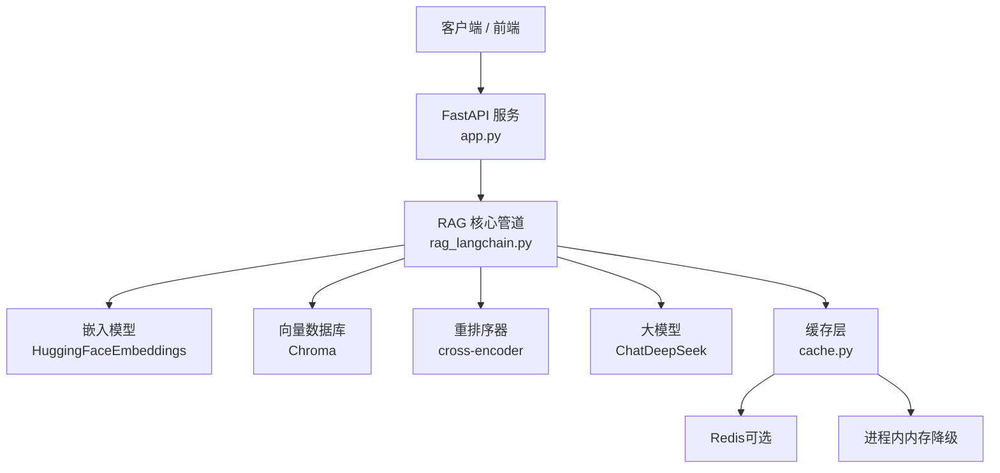

**图表来源**
- [app.py:36-51](file://app.py#L36-L51)
- [rag_langchain.py:39-48](file://rag_langchain.py#L39-L48)
- [cache.py:1-29](file://cache.py#L1-L29)

**章节来源**
- [app.py:1-53](file://app.py#L1-L53)
- [rag_langchain.py:1-50](file://rag_langchain.py#L1-L50)
- [cache.py:1-44](file://cache.py#L1-L44)
- [requirements.txt:1-19](file://requirements.txt#L1-L19)

## 核心组件
本节从“输入 → 处理 → 输出”的角度梳理管道各阶段，并标注关键函数与配置。

| 阶段 | 主要职责 | 关键函数 / 类 | 重要配置 |
|---|---|---|---|
| 语言检测 | 判断中文或英文，决定走哪个 embedding 模型与 collection | detect_lang() | DEFAULT_LANG, LANG_MODELS |
| 文档加载 | 读取 PDF 或 Markdown/文本为纯文本 | load_raw_text() | DEFAULT_SOURCE |
| 文本分块 | 按 token 切块，使用对应语种的 tokenizer | split_by_tokens() | CHUNK_TOKENS, CHUNK_OVERLAP_TOKENS |
| 向量嵌入 | 将文本转为向量，支持缓存与查询前缀 | CachedHuggingFaceEmbeddings, get_embedding_model() | LANG_MAX_SEQ, LANG_QUERY_PREFIX |
| 向量入库 | 创建/打开 Chroma collection，批量 add_texts | load_store(), build_index() | LANG_COLLECTIONS, CHROMA_DB_PATH |
| 检索 | 召回 top-k 相关片段 | make_retriever() | RETRIEVE_K |
| 重排序 | 用 cross-encoder 对候选片段打分并取 top-n | rerank_cached(), make_retriever() | RERANK_TOP_N, RERANK_MODEL |
| 生成 | 拼接 prompt，调用 LLM 生成回答 | make_chain(), format_docs() | llm 配置 |
| 问答入口 | 先查缓存，未命中再走链路并写回缓存 | query() | SEMANTIC_CACHE_ENABLED, SEMANTIC_THRESHOLD |
| 缓存 | 问答、向量、精排分数三类缓存，TTL + 版本号失效 | cache.get_answer/set_answer, get_embeddings/set_embeddings, get_rerank_scores/set_rerank_scores | ANSWER_TTL, EMBEDDING_TTL, RERANK_TTL |

**章节来源**
- [rag_langchain.py:118-142](file://rag_langchain.py#L118-L142)
- [rag_langchain.py:293-307](file://rag_langchain.py#L293-L307)
- [rag_langchain.py:324-359](file://rag_langchain.py#L324-L359)
- [rag_langchain.py:185-254](file://rag_langchain.py#L185-L254)
- [rag_langchain.py:363-405](file://rag_langchain.py#L363-L405)
- [rag_langchain.py:452-467](file://rag_langchain.py#L452-L467)
- [rag_langchain.py:471-508](file://rag_langchain.py#L471-L508)
- [rag_langchain.py:580-631](file://rag_langchain.py#L580-L631)
- [cache.py:271-367](file://cache.py#L271-L367)

## 架构总览
下图展示一次完整问答请求在 Web 服务与核心管道之间的调用流程，以及三种缓存的作用点。

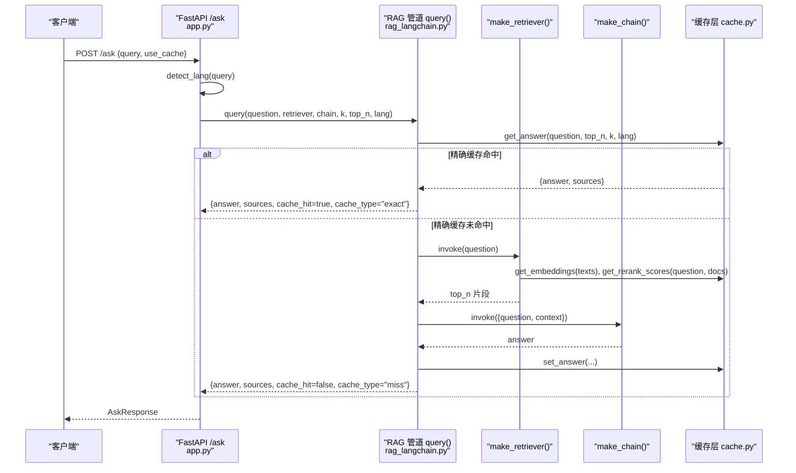

**图表来源**
- [app.py:231-260](file://app.py#L231-L260)
- [rag_langchain.py:452-467](file://rag_langchain.py#L452-L467)
- [rag_langchain.py:482-508](file://rag_langchain.py#L482-L508)
- [rag_langchain.py:580-631](file://rag_langchain.py#L580-L631)
- [cache.py:271-300](file://cache.py#L271-L300)

## 关键组件详解

### 语言检测：detect_lang()
- 功能：判断文本是中文还是英文，返回 "zh" 或 "en"。
- 判据：CJK 字符占非空白字符的比例 ≥ 5% 则判为中文；否则英文。
- 默认行为：空文本返回 DEFAULT_LANG（"zh"）。
- 设计取舍：不引入词典或模型，仅靠字符分布区分中英文；阈值 5% 给中文留余量，能容忍少量混写。
- 返回值：字符串 "zh" 或 "en"。
- 典型用途：决定后续走哪个 embedding 模型、哪个 Chroma collection，以及语义缓存实例。

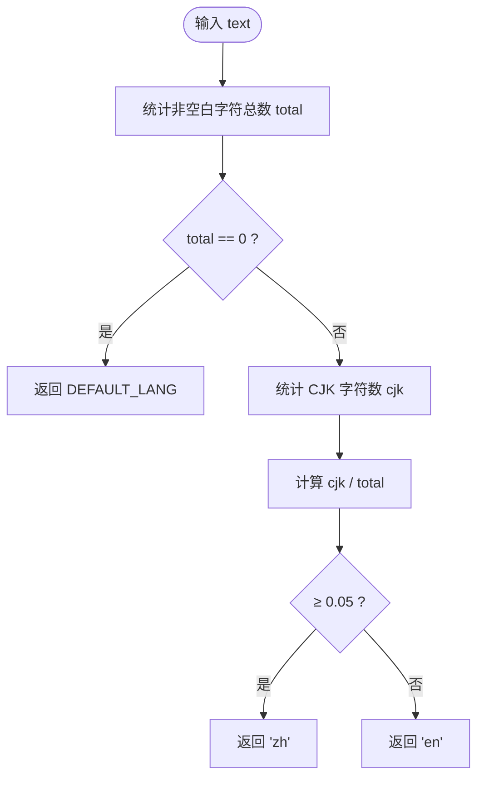

**图表来源**
- [rag_langchain.py:118-142](file://rag_langchain.py#L118-L142)

**章节来源**
- [rag_langchain.py:118-142](file://rag_langchain.py#L118-L142)

### 文档加载与分块：load_raw_text() 与 split_by_tokens()
- load_raw_text(path)：
  - 若路径不是 HTTP(S) 且文件不存在，抛出 FileNotFoundError，并给出当前工作目录与默认 doc.pdf 提示。
  - .pdf 通过 PyMuPDFLoader 读取所有页面内容拼接。
  - 其他格式按 UTF-8 文本读取。
- split_by_tokens(text, lang, chunk_size, overlap)：
  - 使用对应语种的 tokenizer 获取 offset_mapping，按 token 边界切原文，保证每个块都是原文的子串。
  - step = max(chunk_size - overlap, 1)，避免原地打转。
  - 默认 CHUNK_TOKENS=256，CHUNK_OVERLAP_TOKENS=40，留出余量避免换模型后再次静默截断。
  - 返回 List[str]。

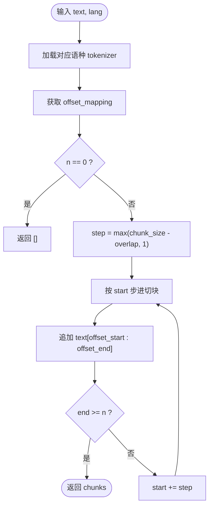

**图表来源**
- [rag_langchain.py:293-307](file://rag_langchain.py#L293-L307)
- [rag_langchain.py:324-359](file://rag_langchain.py#L324-L359)

**章节来源**
- [rag_langchain.py:293-307](file://rag_langchain.py#L293-L307)
- [rag_langchain.py:324-359](file://rag_langchain.py#L324-L359)

### 向量嵌入与模型管理：CachedHuggingFaceEmbeddings 与 get_embedding_model()
- 为什么子类覆写：langchain-huggingface 1.x 起 HuggingFaceEmbeddings 改为 pydantic BaseModel，不能直接 monkey patch embed_documents；子类覆写更稳定。
- 新增字段：
  - lang：用于向量缓存 model_tag，避免中英模型互相覆盖。
  - query_prefix：bge 系列要求 query 加指令、passage 不加。
  - max_seq_length：显式设置最大输入长度，防止 sentence-transformers 静默截断。
- get_embedding_model(lang)：
  - 懒加载，线程安全双检锁，避免并发首次请求重复加载模型。
  - cache_tag 包含 lang、模型路径、max_seq_length，确保换模型或改长度后旧向量失效。
  - encode_kwargs 中 normalize_embeddings=True，与检索相似度一致。

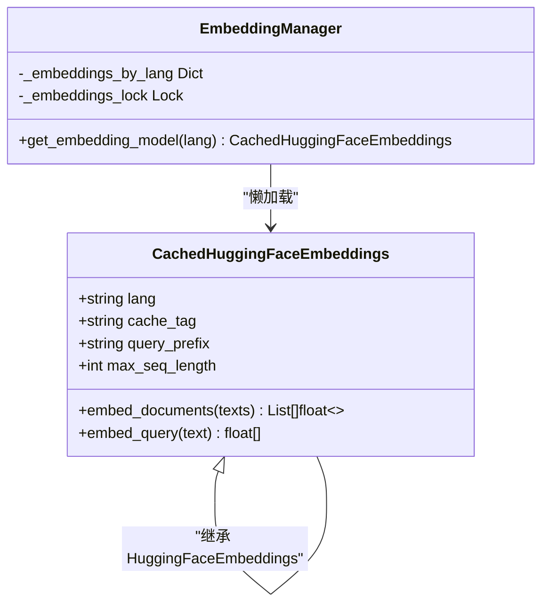

**图表来源**
- [rag_langchain.py:185-254](file://rag_langchain.py#L185-L254)

**章节来源**
- [rag_langchain.py:185-254](file://rag_langchain.py#L185-L254)

### 向量库与索引：load_store() 与 build_index()
- load_store(lang)：
  - 按 LANG_COLLECTIONS[lang] 打开或创建 Chroma collection。
  - 使用 get_embedding_model(lang) 作为 embedding_function。
  - 兼容新旧 langchain-chroma 版本，共享 PersistentClient。
- build_index(source_file, lang=None, force=False)：
  - 自动 detect_lang 文档语种。
  - force=True 时清空已有块（不 drop collection），避免现有 Chroma 实例句柄失效。
  - split_by_tokens -> store.add_texts，元数据记录 index 与 source。
  - 返回 Chroma store。

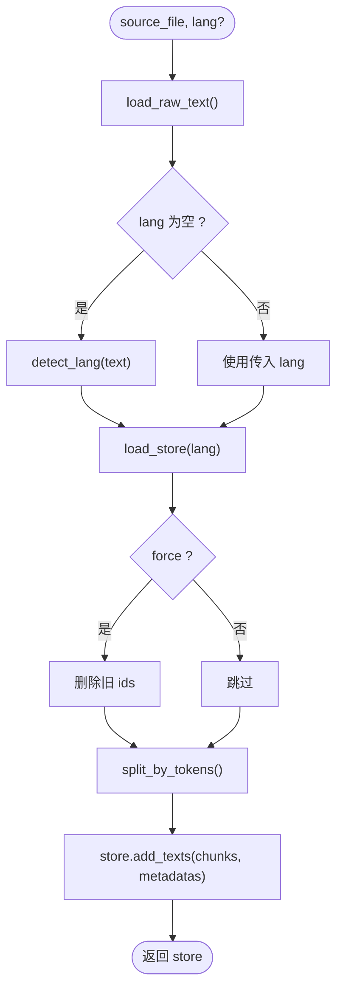

**图表来源**
- [rag_langchain.py:363-405](file://rag_langchain.py#L363-L405)

**章节来源**
- [rag_langchain.py:363-405](file://rag_langchain.py#L363-L405)

### 检索与重排序：make_retriever() 与 rerank_cached()
- make_retriever(store, k=RETRIEVE_K, top_n=RERANK_TOP_N)：
  - 使用 store.as_retriever(search_kwargs={"k": k}) 做向量召回。
  - 对召回结果调用 rerank_cached() 得到分数，按分数降序取 top_n。
  - 返回 RunnableLambda，可被 LCEL 链调用。
- rerank_cached(query, docs)：
  - 先查缓存 get_rerank_scores，只计算未命中的 (query, doc) 对。
  - 使用 HuggingFaceCrossEncoder.score() 打分，写入缓存。
  - 返回与原顺序对齐的分数列表。

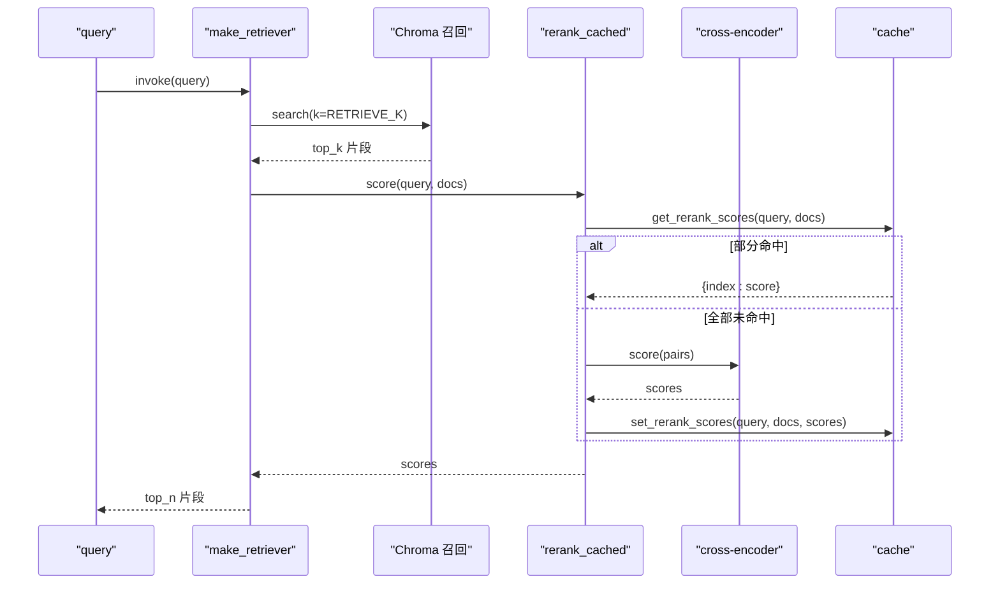

**图表来源**
- [rag_langchain.py:420-467](file://rag_langchain.py#L420-L467)
- [cache.py:349-367](file://cache.py#L349-L367)

**章节来源**
- [rag_langchain.py:417-467](file://rag_langchain.py#L417-L467)
- [cache.py:349-367](file://cache.py#L349-L367)

### LLM 生成：make_chain() 与 format_docs()
- format_docs(docs)：将多个 Document 的 page_content 用换行拼接成上下文。
- make_chain(retriever)：
  - 支持两种输入：
    - 字符串：链内自己调用 retriever.invoke(payload)。
    - 字典 {"question", "context"}：跳过召回，直接使用给定 context。
  - 使用 PromptTemplate 拼 prompt，调用 ChatDeepSeek，StrOutputParser 输出纯文本。
  - 支持传 {"question","context"} 的原因：query() 已拿到 sources，再调 retriever 会重复检索，且会把 dict 当 query 送进 embedding 报错。

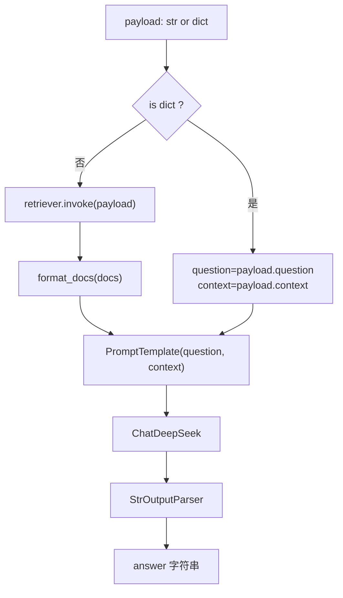

**图表来源**
- [rag_langchain.py:471-508](file://rag_langchain.py#L471-L508)

**章节来源**
- [rag_langchain.py:471-508](file://rag_langchain.py#L471-L508)

### 问答入口：query()
- 功能：一次问答的完整入口，先查缓存，未命中再走 RAG 链路并写回缓存。
- 参数：
  - question：用户问题。
  - retriever：已构建好的 retriever。
  - chain：已构建好的 LCEL 链。
  - use_cache：是否启用缓存。
  - k：向量召回条数，默认 RETRIEVE_K。
  - top_n：精排后保留条数，默认 RERANK_TOP_N。
  - lang：用于语义缓存与 QA 缓存 key。
- 返回：
  - answer：LLM 生成的答案。
  - sources：相关片段列表。
  - cache_hit：是否命中缓存。
  - cache_type：exact / semantic(score) / miss / empty_collection。
  - elapsed_ms：耗时毫秒。
- 语义缓存（可选）：
  - 开启 SEMANTIC_CACHE=1 后，先用 get_embedding_model(lang).embed_query(question) 算向量，再在按语种隔离的 SemanticCache 中查找余弦相似度超过阈值的旧答案。
  - 默认关闭，因为近似匹配可能误命中，RAG 场景下“答错”比“慢一点”更严重。

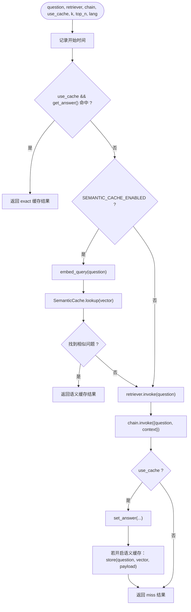

**图表来源**
- [rag_langchain.py:514-576](file://rag_langchain.py#L514-L576)
- [rag_langchain.py:580-631](file://rag_langchain.py#L580-L631)

**章节来源**
- [rag_langchain.py:514-576](file://rag_langchain.py#L514-L576)
- [rag_langchain.py:580-631](file://rag_langchain.py#L580-L631)

### Web 服务集成：app.py
- /upload：
  - 解析 PDF 或 Markdown/文本，detect_lang 判定文档语种。
  - split_by_tokens 切块，只替换该语种的 collection。
  - invalidate_caches() 使旧缓存失效，更新 chunks_preview_{lang}.md。
- /ask：
  - detect_lang 判定问题语种。
  - 若目标语种 collection 为空，直接返回空库提示，不走检索。
  - 调用 rag_query()，返回 AskResponse。
- /cache/stats、/cache/clear、/health：
  - 暴露缓存后端类型、健康状态、版本、集合块数等运维信息。

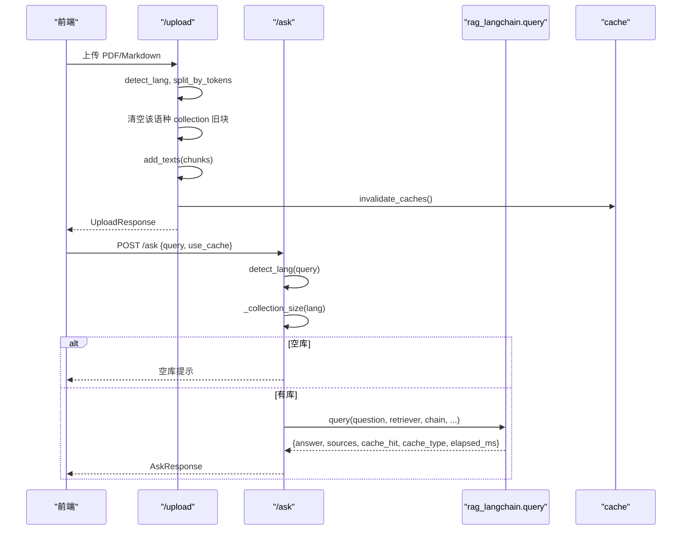

**图表来源**
- [app.py:155-228](file://app.py#L155-L228)
- [app.py:231-260](file://app.py#L231-L260)
- [rag_langchain.py:580-631](file://rag_langchain.py#L580-L631)

**章节来源**
- [app.py:155-228](file://app.py#L155-L228)
- [app.py:231-260](file://app.py#L231-L260)

## 依赖关系分析
- rag_langchain.py 依赖：
  - langchain_chroma.Chroma：向量库客户端。
  - langchain_huggingface.HuggingFaceEmbeddings：嵌入模型封装。
  - langchain_deepseek.ChatDeepSeek：LLM 调用。
  - langchain_community.document_loaders.PyMuPDFLoader：PDF 加载。
  - langchain_community.cross_encoders.HuggingFaceCrossEncoder：重排序。
  - cache：本地模块，提供三类缓存 API。
- app.py 依赖：
  - FastAPI、Pydantic：Web 框架与数据模型。
  - rag_langchain：导入管道函数与常量。
  - cache：缓存统计与清理。
- cache.py 依赖：
  - redis（可选）：生产缓存后端。
  - 内置内存后端：开发或 Redis 不可用时的降级方案。

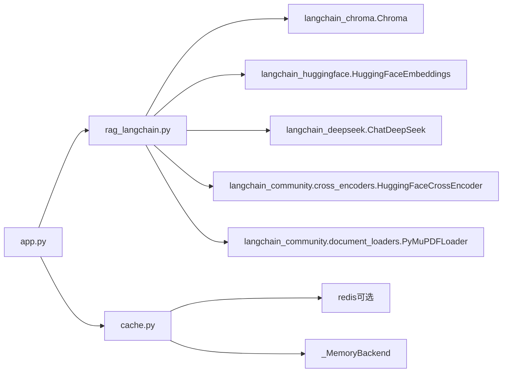

**图表来源**
- [rag_langchain.py:39-48](file://rag_langchain.py#L39-L48)
- [app.py:36-51](file://app.py#L36-L51)
- [cache.py:123-199](file://cache.py#L123-L199)

**章节来源**
- [rag_langchain.py:39-48](file://rag_langchain.py#L39-L48)
- [app.py:36-51](file://app.py#L36-L51)
- [cache.py:123-199](file://cache.py#L123-L199)

## 性能与缓存特性
- 模型懒加载：
  - embedding 模型、cross-encoder、tokenizer 均懒加载，避免启动时一次性加载多个大模型。
  - 并发保护：双检锁避免多次重复加载。
- 向量缓存：
  - 同一段文本在不同模型下向量不同，key 含 model_tag，避免中英模型互相覆盖。
  - cache_tag 包含 lang、模型路径、max_seq_length，确保换模型或改长度后旧向量失效。
- 精排缓存：
  - 以 (问题, 片段) 哈希为 key，跨问题或跨文档复用分数，显著降低 cross-encoder 调用次数。
- 问答缓存：
  - key 含 lang、question.strip()、k、top_n 与缓存版本，确保不同检索口径与知识库变更不会命中旧答案。
- 语义缓存（可选）：
  - 按语种隔离，比较嵌入向量余弦相似度，默认关闭以避免误命中。
- 缓存后端：
  - Redis 优先，连不上自动降级为内存后端；CACHE_BACKEND=redis 时连不上抛错。
  - 版本号机制：知识库变更后 bump_version()，旧缓存立即失效。

**章节来源**
- [rag_langchain.py:228-254](file://rag_langchain.py#L228-L254)
- [rag_langchain.py:420-449](file://rag_langchain.py#L420-L449)
- [rag_langchain.py:514-576](file://rag_langchain.py#L514-L576)
- [cache.py:176-199](file://cache.py#L176-L199)
- [cache.py:216-233](file://cache.py#L216-L233)
- [cache.py:271-367](file://cache.py#L271-L367)

## 常见问题与排障
- 模型截断导致召回质量下降：
  - 现象：sentence-transformers 对超长输入静默截断，你以为整块进了向量，实际只读了前半段。
  - 原因：LANG_MAX_SEQ 未显式设置，模型自带默认值过小。
  - 解决：显式设置 LANG_MAX_SEQ，并确保 CHUNK_TOKENS 不超过上限的一半，留余量。
  - 参考位置：[rag_langchain.py:64-77](file://rag_langchain.py#L64-L77)、[rag_langchain.py:241-252](file://rag_langchain.py#L241-L252)。
- 语种误判：
  - 现象：英文句子夹少量中文词被判为中文。
  - 原因：CJK 占比 ≥ 5% 即判中文，阈值较低是为中文留余量。
  - 影响：这类混写在真实提问中少见，且响应中会返回 lang 字段便于排查。
  - 参考位置：[rag_langchain.py:118-142](file://rag_langchain.py#L118-L142)。
- 向量空间混用导致检索噪声：
  - 现象：两个不同 embedding 模型的向量放进同一个 collection，相似度变成噪声。
  - 原因：不同模型向量属于不同空间，即使维度相同也不能混用。
  - 解决：按语种分 collection，LANG_COLLECTIONS 与 LANG_MODELS 一一对应。
  - 参考位置：[rag_langchain.py:55-80](file://rag_langchain.py#L55-L80)、[app.py:4-9](file://app.py#L4-L9)。
- 上传文档后仍返回旧答案：
  - 原因：缓存未失效。
  - 解决：调用 invalidate_caches() 或 /cache/clear，确保 bump_version() 提升版本号。
  - 参考位置：[rag_langchain.py:634-644](file://rag_langchain.py#L634-L644)、[cache.py:225-233](file://cache.py#L225-L233)。
- 空库导致模型“凭印象作答”：
  - 现象：目标语种 collection 为空时，检索结果为空或无关，LLM 编造答案。
  - 解决：app.py 中 _collection_size(lang)==0 时直接返回空库提示，不走检索。
  - 参考位置：[app.py:241-249](file://app.py#L241-L249)。
- 缓存读失败不影响主流程：
  - 设计：cache.get()/set() 异常时 fail-open，当作未命中或忽略写失败，保证系统可用性。
  - 参考位置：[cache.py:250-261](file://cache.py#L250-L261)。

**章节来源**
- [rag_langchain.py:55-80](file://rag_langchain.py#L55-L80)
- [rag_langchain.py:118-142](file://rag_langchain.py#L118-L142)
- [rag_langchain.py:241-252](file://rag_langchain.py#L241-L252)
- [rag_langchain.py:634-644](file://rag_langchain.py#L634-L644)
- [app.py:4-9](file://app.py#L4-L9)
- [app.py:241-249](file://app.py#L241-L249)
- [cache.py:250-261](file://cache.py#L250-L261)
- [cache.py:225-233](file://cache.py#L225-L233)

## 结论
该 RAG 核心管道以“语言检测 → 文档加载与分块 → 向量嵌入 → 检索与重排序 → LLM 生成”为主线，并通过三层缓存显著提升性能与稳定性。关键设计要点包括：
- 按语种分离 embedding 模型与 Chroma collection，避免向量空间混用。
- 显式控制 max_seq_length 与 CHUNK_TOKENS，防止静默截断。
- 使用 cross-encoder 精排提升召回质量。
- 缓存层以 Redis 为主、内存降级为辅，问答/向量/精排三类缓存各司其职，并通过版本号机制保证知识库变更后旧答案失效。
- Web 服务对空库进行保护，避免 LLM 编造无依据答案。

对于初学者，建议先从 /upload 与 /ask 接口入手，观察缓存命中率与耗时变化；对于有经验开发者，可关注 LANG_MODELS、LANG_MAX_SEQ、CHUNK_TOKENS、RETRIEVE_K、RERANK_TOP_N、SEMANTIC_CACHE 等配置对召回与生成质量的影响。

## 附录：配置项速查
- 语言与模型：
  - LANG_MODELS：{"zh": "./text2vec-base-chinese", "en": "./bge-base-en-v1.5"}
  - LANG_MAX_SEQ：{"zh": 512, "en": 512}
  - LANG_COLLECTIONS：{"zh": "rag_zh", "en": "rag_en"}
  - DEFAULT_LANG："zh"
  - LANG_QUERY_PREFIX：{"en": "Represent this sentence for searching relevant passages: "}
- 检索与重排序：
  - RETRIEVE_K：20
  - RERANK_TOP_N：5
  - RERANK_MODEL："./mmarco-mMiniLMv2-L12-H384-v1"
- 分块：
  - CHUNK_TOKENS：默认 256，可由环境变量覆盖
  - CHUNK_OVERLAP_TOKENS：默认 40，可由环境变量覆盖
- 语义缓存：
  - SEMANTIC_CACHE_ENABLED：由 SEMANTIC_CACHE 环境变量控制
  - SEMANTIC_THRESHOLD：默认 0.95
- 缓存 TTL：
  - ANSWER_TTL：3600 秒
  - EMBEDDING_TTL：86400 秒
  - RERANK_TTL：3600 秒
- 后端选择：
  - CACHE_BACKEND：auto / redis / memory
  - REDIS_URL：默认 redis://127.0.0.1:6379/0

**章节来源**
- [rag_langchain.py:59-115](file://rag_langchain.py#L59-L115)
- [cache.py:37-43](file://cache.py#L37-L43)