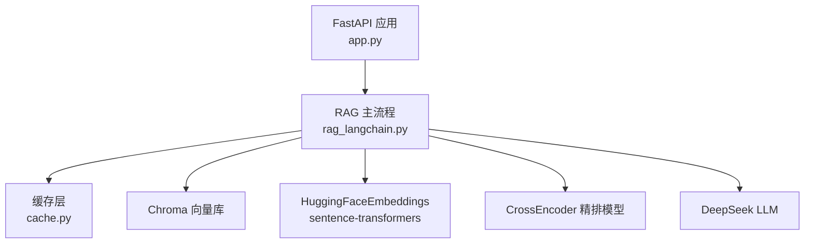
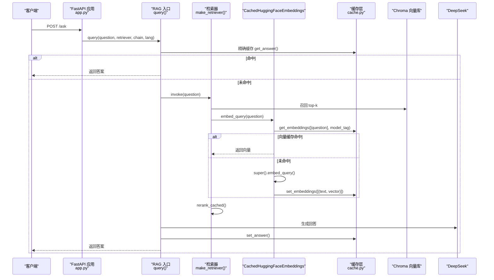
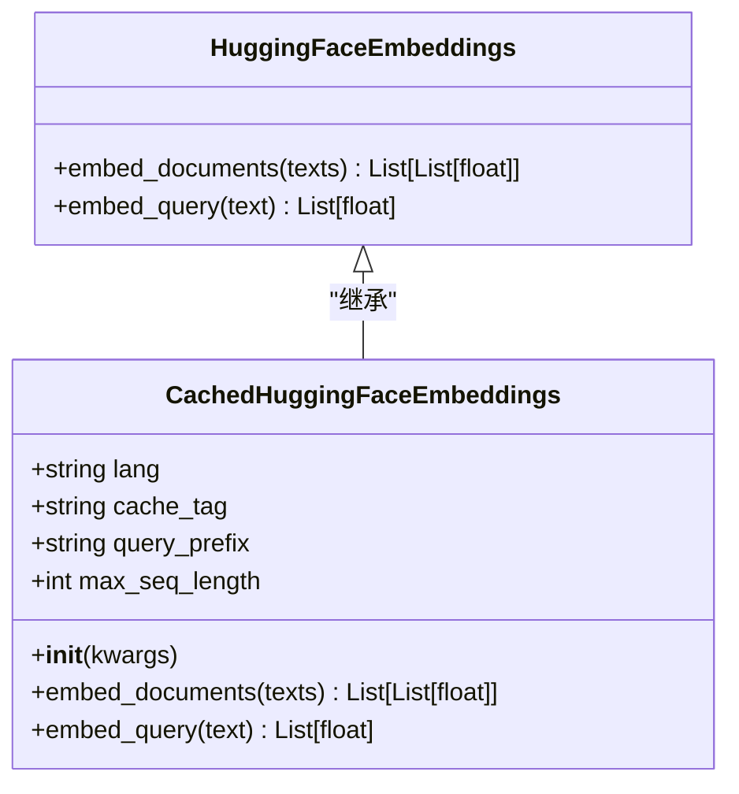
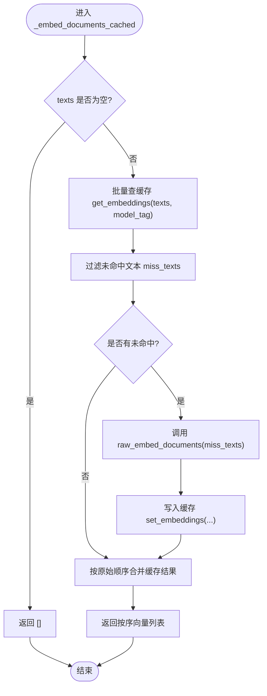
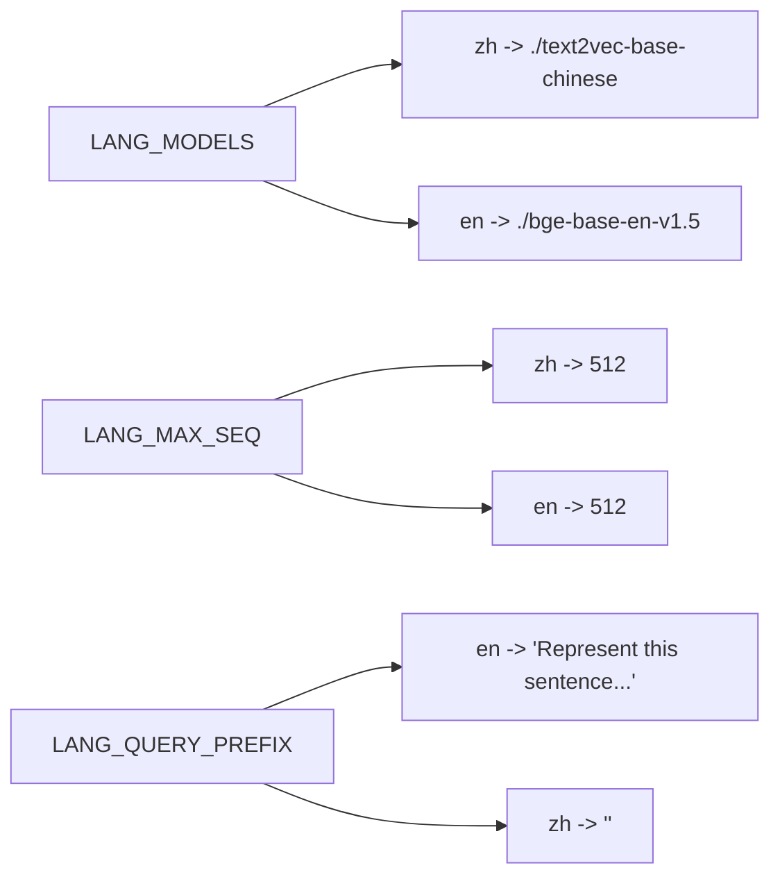
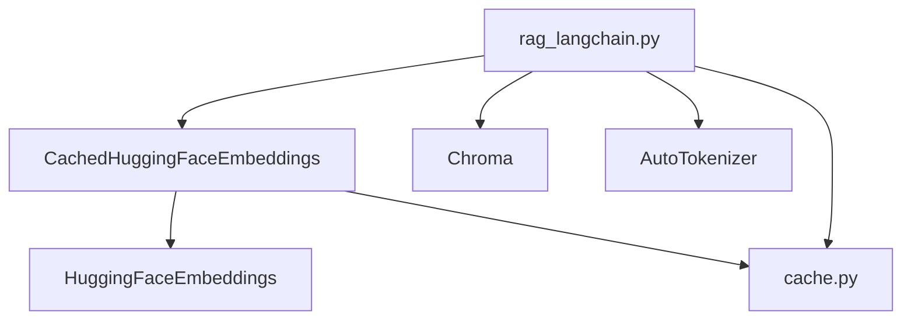

# 向量嵌入与缓存

<cite>
**本文引用的文件**   
- [rag_langchain.py](file://rag_langchain.py)
- [cache.py](file://cache.py)
- [app.py](file://app.py)
</cite>

## 目录
1. [引言](#引言)
2. [项目结构](#项目结构)
3. [核心组件](#核心组件)
4. [架构总览](#架构总览)
5. [详细组件分析](#详细组件分析)
6. [依赖关系分析](#依赖关系分析)
7. [性能考量](#性能考量)
8. [故障排除指南](#故障排除指南)
9. [结论](#结论)

## 引言
本技术文档聚焦“向量嵌入与缓存”模块，目标是帮助读者理解：
- 为什么使用 `CachedHuggingFaceEmbeddings` 继承并覆写 `embed_documents` / `embed_query`。
- `_embed_documents_cached()` 与 `_embed_query_cached()` 的缓存逻辑、键生成、批量处理与顺序保持。
- `LANG_MODELS`、`LANG_MAX_SEQ`、`LANG_QUERY_PREFIX` 等配置项的作用与设置方式。
- 中英文模型为何分离，以及跨模型向量的不可比性。
- 模型加载失败、缓存失效、内存管理等异常处理策略。
- 性能调优与排障建议。

## 项目结构
本项目围绕 RAG 管道构建，其中与“向量嵌入与缓存”直接相关的代码主要分布在两个文件：
- `rag_langchain.py`：RAG 主流程、语种路由、嵌入模型封装、缓存包装、检索与重排。
- `cache.py`：统一缓存层（Redis 优先，自动降级本地内存），提供问答、embedding、rerank 三类缓存。
- `app.py`：FastAPI Web 服务，负责接口、上传、健康检查、缓存统计等，复用上述模块。

**图示来源**
- [app.py:44-51](file://app.py#L44-L51)
- [rag_langchain.py:39-48](file://rag_langchain.py#L39-L48)
- [rag_langchain.py:417-425](file://rag_langchain.py#L417-L425)
- [rag_langchain.py:471-475](file://rag_langchain.py#L471-L475)

**章节来源**
- [app.py:1-26](file://app.py#L1-L26)
- [rag_langchain.py:1-24](file://rag_langchain.py#L1-L24)

## 核心组件
本节重点解释以下组件及其职责：
- `CachedHuggingFaceEmbeddings`：带缓存的 HuggingFace 嵌入类，覆写文档与查询嵌入方法。
- `_embed_documents_cached()`：批量文本嵌入 + 向量缓存。
- `_embed_query_cached()`：单条查询嵌入 + 向量缓存。
- `get_embedding_model()`：按语种懒加载 embedding 模型，构造 `CachedHuggingFaceEmbeddings`。
- `cache.py` 中的 embedding 缓存 API：`embedding_key()`、`get_embeddings()`、`set_embeddings()`。

这些组件共同实现“同一段文本不重复计算向量”，同时保证不同语种的向量空间隔离。

**章节来源**
- [rag_langchain.py:147-221](file://rag_langchain.py#L147-L221)
- [rag_langchain.py:224-254](file://rag_langchain.py#L224-L254)
- [cache.py:303-347](file://cache.py#L303-L347)

## 架构总览
下图展示一次问答请求中，向量嵌入与缓存如何参与整体链路：

**图示来源**
- [app.py:231-260](file://app.py#L231-L260)
- [rag_langchain.py:579-631](file://rag_langchain.py#L579-L631)
- [rag_langchain.py:452-467](file://rag_langchain.py#L452-L467)
- [rag_langchain.py:214-221](file://rag_langchain.py#L214-L221)
- [cache.py:271-300](file://cache.py#L271-L300)
- [cache.py:322-347](file://cache.py#L322-L347)

## 详细组件分析

### `CachedHuggingFaceEmbeddings` 类设计
该类继承自 `langchain_huggingface.HuggingFaceEmbeddings`，目的是在保留原有嵌入能力的基础上，增加向量缓存与查询前缀控制。

关键设计点：
- 继承原因：langchain-huggingface 1.x 起 `HuggingFaceEmbeddings` 改为 pydantic BaseModel，无法通过实例属性动态替换 `embed_documents`；子类覆写是稳定方案。
- 新增字段：
  - `lang`：语种标识，作为向量缓存的 `model_tag`，避免中英文模型互相覆盖。
  - `cache_tag`：缓存标签，包含语种、模型路径、最大序列长度，确保换模型或改配置后旧向量不会误命中。
  - `query_prefix`：仅对查询侧添加指令前缀（bge 系列官方要求）。
  - `max_seq_length`：显式设置最大输入长度，避免 sentence-transformers 静默截断。
- 覆写方法：
  - `embed_documents()`：委托给 `_embed_documents_cached()`。
  - `embed_query()`：先拼接查询前缀，再委托给 `_embed_query_cached()`。

**图示来源**
- [rag_langchain.py:185-221](file://rag_langchain.py#L185-L221)

**章节来源**
- [rag_langchain.py:185-221](file://rag_langchain.py#L185-L221)

### `_embed_documents_cached()` 与 `_embed_query_cached()` 缓存逻辑
这两个函数是向量缓存的核心实现：

- 缓存键生成：
  - 文本哈希：`cache.embedding_key(text)` 基于 SHA-256，不含模型信息。
  - 存储键：`rag:embed:{model_tag}:{digest}`，`model_tag` 区分不同模型（如 zh/en）。
- 批量处理：
  - 先批量查缓存，得到已命中文本集合。
  - 对未命中文本调用底层 `raw_embed_documents()` 计算向量。
  - 将新计算结果写入缓存。
- 顺序保持：
  - 合并缓存与新结果后，按原始 `texts` 顺序输出向量列表，确保下游排序与元数据对齐。
- 查询缓存：
  - 单条查询时，先查缓存，未命中则调用底层 `raw_embed_query()` 并写入缓存。

**图示来源**
- [rag_langchain.py:147-170](file://rag_langchain.py#L147-L170)
- [cache.py:303-347](file://cache.py#L303-L347)

**章节来源**
- [rag_langchain.py:147-182](file://rag_langchain.py#L147-L182)
- [cache.py:303-347](file://cache.py#L303-L347)

### 配置项说明：`LANG_MODELS`、`LANG_MAX_SEQ`、`LANG_QUERY_PREFIX`
这些配置项决定嵌入模型的选型、输入长度限制与查询前缀：

- `LANG_MODELS`：按语种映射到本地模型路径。
  - 中文：`./text2vec-base-chinese`
  - 英文：`./bge-base-en-v1.5`
- `LANG_MAX_SEQ`：各语种模型的最大输入长度（token）。
  - 设置为 512，避免 sentence-transformers 静默截断。
  - 该值参与 `cache_tag`，确保换配置后旧向量失效。
- `LANG_QUERY_PREFIX`：仅对英文查询添加检索指令前缀（bge 官方建议）。
  - 可通过环境变量 `BGE_QUERY_PREFIX` 覆盖。
  - 中文无默认前缀。

**图示来源**
- [rag_langchain.py:59-89](file://rag_langchain.py#L59-L89)

**章节来源**
- [rag_langchain.py:59-89](file://rag_langchain.py#L59-L89)

### 中英文模型差异化处理示例
虽然代码中未直接展示完整示例，但可从配置与调用链推导：

- 中文文档/问题：
  - 使用 `text2vec-base-chinese` 模型。
  - 无查询前缀。
  - 向量存入 `rag_zh` collection。
- 英文文档/问题：
  - 使用 `bge-base-en-v1.5` 模型。
  - 查询前缀为 `"Represent this sentence for searching relevant passages: "`。
  - 向量存入 `rag_en` collection。

这种差异由 `detect_lang()` 判定语种，再由 `get_embedding_model(lang)` 选择对应模型与 collection。

**章节来源**
- [rag_langchain.py:118-142](file://rag_langchain.py#L118-L142)
- [rag_langchain.py:228-254](file://rag_langchain.py#L228-L254)
- [rag_langchain.py:363-372](file://rag_langchain.py#L363-L372)

### 为什么按语种分离 embedding 模型？
不同 embedding 模型的向量属于**不同的向量空间**。即使维度相同（如都是 768 维），跨模型计算的余弦相似度没有语义意义，会导致检索“静默出错”。因此：
- 每个语种使用独立模型。
- 每个语种使用独立 Chroma collection。
- 缓存键包含 `model_tag`，防止不同模型向量互相覆盖。

**章节来源**
- [rag_langchain.py:52-58](file://rag_langchain.py#L52-L58)
- [cache.py:309-319](file://cache.py#L309-L319)

## 依赖关系分析
嵌入与缓存模块依赖以下外部组件：
- `langchain_huggingface.HuggingFaceEmbeddings`：提供底层嵌入能力。
- `chromadb`：持久化向量库。
- `transformers.AutoTokenizer`：按语种分块。
- `cache.py`：统一缓存后端（Redis 或内存）。

**图示来源**
- [rag_langchain.py:39-48](file://rag_langchain.py#L39-L48)
- [rag_langchain.py:314-321](file://rag_langchain.py#L314-L321)
- [cache.py:1-29](file://cache.py#L1-L29)

**章节来源**
- [rag_langchain.py:39-48](file://rag_langchain.py#L39-L48)
- [cache.py:1-29](file://cache.py#L1-L29)

## 性能考量
- 模型懒加载：`get_embedding_model()` 使用双检锁，避免并发首次请求重复加载模型。
- 向量缓存：同一段文本不重复计算向量，显著降低 CPU/GPU 负载。
- 查询前缀：仅对英文查询添加前缀，减少不必要的字符串拼接。
- 切块策略：按 token 切块，中英两侧信息量可比，避免英文块过短。
- 缓存 TTL：
  - 问答缓存：1 小时。
  - 向量缓存：24 小时。
  - 精排缓存：1 小时。
- 内存管理：
  - 共享 Chroma 客户端，避免多实例重复占用资源。
  - 统计计数使用进程内字典，零开销。

**章节来源**
- [rag_langchain.py:228-254](file://rag_langchain.py#L228-L254)
- [rag_langchain.py:324-359](file://rag_langchain.py#L324-L359)
- [cache.py:37-42](file://cache.py#L37-L42)
- [cache.py:45-72](file://cache.py#L45-L72)

## 故障排除指南

### 模型加载失败
- 现象：启动时报错或首次请求超时。
- 可能原因：
  - 模型路径不存在或权限不足。
  - 网络问题导致远程模型下载失败。
- 排查步骤：
  - 确认 `LANG_MODELS` 指向的本地模型目录存在。
  - 检查磁盘空间与权限。
  - 若使用远程模型，检查网络连接与代理设置。

**章节来源**
- [rag_langchain.py:228-254](file://rag_langchain.py#L228-L254)

### 缓存失效
- 现象：上传新文档后，旧答案仍被返回。
- 可能原因：
  - 未调用 `invalidate_caches()`。
  - 缓存版本未提升。
- 解决方式：
  - 上传文档后调用 `invalidate_caches()`。
  - 确认 `cache.bump_version()` 成功执行。

**章节来源**
- [rag_langchain.py:634-644](file://rag_langchain.py#L634-L644)
- [cache.py:225-233](file://cache.py#L225-L233)

### 内存管理问题
- 现象：服务启动后内存持续增长。
- 可能原因：
  - 多个 embedding 模型同时加载。
  - Chroma 客户端未共享。
- 解决方式：
  - 使用 `get_embedding_model()` 懒加载。
  - 使用 `_get_chroma_client()` 共享客户端。

**章节来源**
- [rag_langchain.py:224-254](file://rag_langchain.py#L224-L254)
- [rag_langchain.py:257-277](file://rag_langchain.py#L257-L277)

### 向量不可比问题
- 现象：中英文混合入库后检索质量下降。
- 可能原因：
  - 不同模型向量混入同一 collection。
  - 缓存键未包含 `model_tag`。
- 解决方式：
  - 按语种分离 collection。
  - 确保 `cache_tag` 包含语种、模型路径、最大序列长度。

**章节来源**
- [rag_langchain.py:52-58](file://rag_langchain.py#L52-L58)
- [cache.py:309-319](file://cache.py#L309-L319)

## 结论
`CachedHuggingFaceEmbeddings` 通过继承与覆写，在不破坏 LangChain 集成前提下实现了高效的向量缓存。配合 `cache.py` 的统一缓存层，系统能够在保证正确性的前提下显著提升性能。按语种分离模型与 collection 的设计，避免了跨模型向量不可比的问题。通过合理的配置项与异常处理策略，系统在模型加载、缓存失效、内存管理等方面具备较强的鲁棒性。