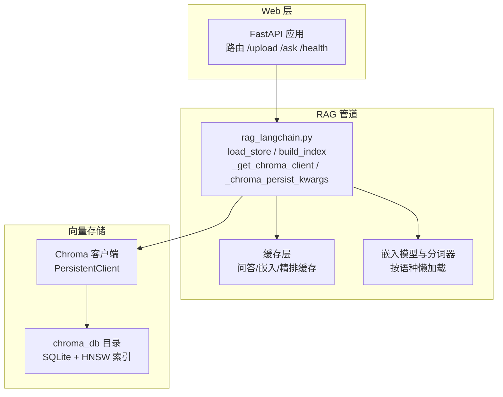
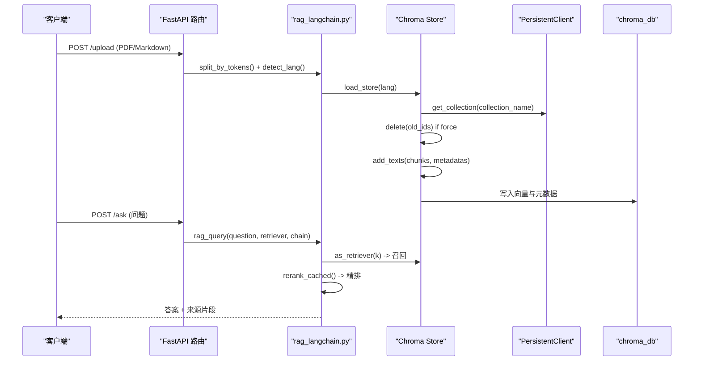
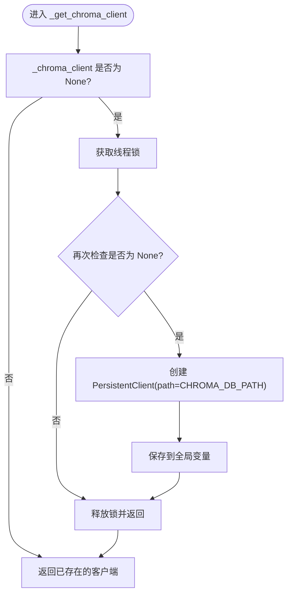
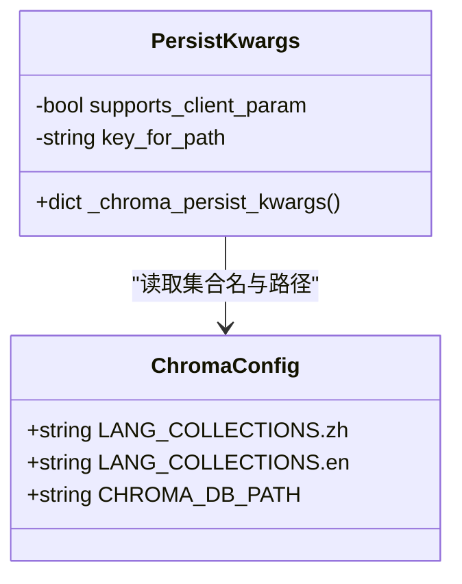
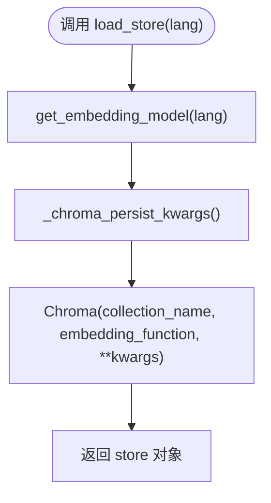
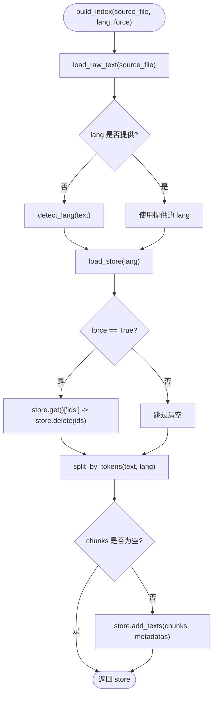
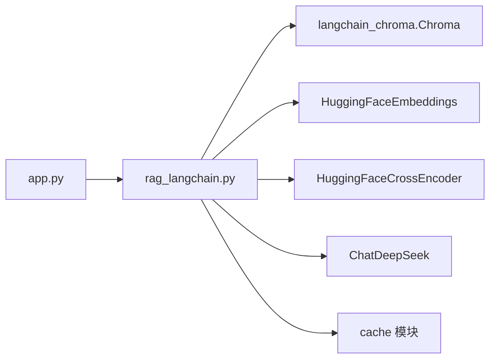

# 向量数据库操作

<cite>
**本文引用的文件**   
- [rag_langchain.py](file://rag_langchain.py)
- [app.py](file://app.py)
</cite>

## 目录
1. [引言](#引言)
2. [项目结构](#项目结构)
3. [核心组件](#核心组件)
4. [架构总览](#架构总览)
5. [详细组件分析](#详细组件分析)
6. [依赖关系分析](#依赖关系分析)
7. [性能与并发特性](#性能与并发特性)
8. [故障排查指南](#故障排查指南)
9. [结论](#结论)
10. [附录：常用操作示例](#附录常用操作示例)

## 引言
本技术文档聚焦于 RAG 系统中的“向量数据库操作模块”，围绕 Chroma 客户端的懒加载、单例与线程安全设计，以及 collection 管理、索引构建、数据持久化等核心能力展开。文档同时解释 LANG_COLLECTIONS 配置与命名规范，说明为何使用绝对路径存储 chroma_db，并给出多进程环境下的注意事项、并发访问策略、数据一致性保障、存储空间管理与维护迁移的最佳实践。

## 项目结构
RAG 服务由 FastAPI Web 层与 LangChain 管道组成，向量库相关逻辑集中在 rag_langchain.py，Web 接口在 app.py 中调用这些能力。

图表来源
- [app.py:53-122](file://app.py#L53-L122)
- [rag_langchain.py:257-289](file://rag_langchain.py#L257-L289)
- [rag_langchain.py:363-405](file://rag_langchain.py#L363-L405)

章节来源
- [app.py:1-122](file://app.py#L1-L122)
- [rag_langchain.py:1-116](file://rag_langchain.py#L1-L116)

## 核心组件
- Chroma 客户端懒加载与单例：通过全局变量与线程锁实现双检锁，确保同一进程内只存在一个 PersistentClient，避免重复打开 SQLite 连接与索引句柄。
- 持久化参数兼容：根据 langchain-chroma 版本动态选择 client= 或 path/persist_directory，保证两个 collection 共享同一个底层客户端。
- Collection 管理：按语种分离 collection（中文 rag_zh、英文 rag_en），每个 collection 绑定对应 embedding 模型，防止跨模型向量空间混用导致检索噪声。
- 索引构建与追加：build_index() 支持重建（清空已有块）与追加（直接 add_texts），split_by_tokens() 按 token 切块，避免中英文信息量差异导致的检索偏差。
- 数据持久化：chroma_db 使用绝对路径，避免相对路径在不同工作目录下被识别为不同实例，从而引发数据不一致。

章节来源
- [rag_langchain.py:52-96](file://rag_langchain.py#L52-L96)
- [rag_langchain.py:257-289](file://rag_langchain.py#L257-L289)
- [rag_langchain.py:363-405](file://rag_langchain.py#L363-L405)

## 架构总览
下图展示一次上传与查询请求如何经过 Web 层、RAG 管道与 Chroma 向量库完成数据入库与检索。

图表来源
- [app.py:155-228](file://app.py#L155-L228)
- [app.py:231-260](file://app.py#L231-L260)
- [rag_langchain.py:363-405](file://rag_langchain.py#L363-L405)
- [rag_langchain.py:452-467](file://rag_langchain.py#L452-L467)

## 详细组件分析

### Chroma 客户端懒加载与线程安全
- 单例模式：全局变量 _chroma_client 保存 PersistentClient 实例；首次访问时创建，后续复用。
- 线程安全：使用 _chroma_client_lock 保护初始化过程，采用双检锁避免多线程并发下重复创建。
- 共享语义：两个语种的 collection 共享同一个客户端，避免同目录下多开客户端带来的并发与句柄问题。
- 禁止 close：注释明确提醒不要对共享出去的 client 调 close()，因为 SharedSystemClient 引用计数归零会关闭底层系统，影响其他持有者。

图表来源
- [rag_langchain.py:257-277](file://rag_langchain.py#L257-L277)

章节来源
- [rag_langchain.py:257-289](file://rag_langchain.py#L257-L289)

### 持久化参数兼容与 collection 命名
- 兼容新旧版本：_chroma_persist_kwargs() 检测 Chroma.__init__ 是否支持 client= 参数；若支持则传入共享客户端，否则回退到 path/persist_directory。
- collection 命名约束：LANG_COLLECTIONS 使用 "rag_zh" 与 "rag_en"，满足 Chroma 对名称长度与字符集的要求（3~512 字符，仅字母数字及 ._-，首尾必须字母数字）。

图表来源
- [rag_langchain.py:280-289](file://rag_langchain.py#L280-L289)
- [rag_langchain.py:78-80](file://rag_langchain.py#L78-L80)
- [rag_langchain.py:92-96](file://rag_langchain.py#L92-L96)

章节来源
- [rag_langchain.py:78-96](file://rag_langchain.py#L78-L96)
- [rag_langchain.py:280-289](file://rag_langchain.py#L280-L289)

### load_store() 与 collection 管理
- 功能：打开或创建指定语种的持久化向量库，绑定对应 embedding 模型与 collection 名称。
- 设计要点：每个语种一个 collection，避免跨模型向量空间混用；embedding_function 来自 get_embedding_model(lang)，该函数也带懒加载与线程安全。

图表来源
- [rag_langchain.py:363-372](file://rag_langchain.py#L363-L372)
- [rag_langchain.py:228-254](file://rag_langchain.py#L228-L254)
- [rag_langchain.py:280-289](file://rag_langchain.py#L280-L289)

章节来源
- [rag_langchain.py:363-372](file://rag_langchain.py#L363-L372)

### build_index() 索引构建与数据追加
- 功能：从源文件读取文本，按语种自动判断或显式指定，切块后嵌入并入库；支持 force 参数进行重建（清空已有块）。
- 重建策略：优先删除已有 ids 而非 drop collection，避免使已存在的 Chroma 实例句柄失效，保持 app 中缓存的 _stores/_retrievers/_chains 有效。
- 追加策略：直接 add_texts()，批量嵌入并写入向量缓存，减少重复计算。

图表来源
- [rag_langchain.py:375-405](file://rag_langchain.py#L375-L405)
- [rag_langchain.py:324-359](file://rag_langchain.py#L324-L359)

章节来源
- [rag_langchain.py:375-405](file://rag_langchain.py#L375-L405)

### 为什么使用绝对路径存储 chroma_db
- 原因：chromadb 的 SharedSystemClient 按 persist_directory 的字符串做进程内实例注册；相对路径在不同 CWD 下会被视为不同库，导致多个 SQLite 连接与 HNSW 索引叠加在同一目录，轻则设置冲突报错，重则数据不一致。
- 解决方案：使用 os.path.join(os.path.dirname(os.path.abspath(__file__)), "chroma_db") 生成绝对路径，确保所有实例指向同一物理目录。

章节来源
- [rag_langchain.py:92-96](file://rag_langchain.py#L92-L96)

### 多进程环境与并发访问注意事项
- 进程内单例：_chroma_client 是进程级全局变量，适合单进程或多进程各自独立运行；跨进程共享需依赖操作系统文件系统与 Chroma 内部锁机制。
- 线程安全：双检锁保护客户端与 embedding 模型的初始化，避免并发重复加载。
- 句柄与引用计数：不要对共享 client 调用 close()，否则会关闭底层系统，影响其它持有者。
- 建议部署方式：生产环境建议使用进程外缓存与数据库（如 Redis、外部向量库），并通过 API 暴露统一入口，避免多进程直接竞争本地 chroma_db。

章节来源
- [rag_langchain.py:257-277](file://rag_langchain.py#L257-L277)
- [rag_langchain.py:228-254](file://rag_langchain.py#L228-L254)

### 数据一致性与存储空间管理
- 数据一致性：collection 按语种分离，避免跨模型向量空间混用；重建时使用 delete(ids) 而非 drop collection，保持实例有效性。
- 存储空间：chroma_db 包含 SQLite 与 HNSW 索引；当更换不同维度模型时需停服并手动清理 chroma_db 再重建，因为仅删块无法改变 collection 维度。
- 监控与统计：_collection_size() 直接调用 Chroma 的 count()，避免触发 embedding_function 加载，降低健康检查开销。

章节来源
- [rag_langchain.py:375-405](file://rag_langchain.py#L375-L405)
- [app.py:95-117](file://app.py#L95-L117)

## 依赖关系分析
- Web 层依赖：app.py 导入 rag_langchain 中的 load_store、make_retriever、make_chain、query、invalidate_caches、LANG_COLLECTIONS、DEFAULT_LANG、_get_chroma_client 等。
- 向量库依赖：rag_langchain.py 使用 langchain_chroma.Chroma、HuggingFaceEmbeddings、HuggingFaceCrossEncoder、ChatDeepSeek 等。
- 缓存依赖：cache 模块用于问答、嵌入、精排缓存，提升整体吞吐。

图表来源
- [app.py:44-51](file://app.py#L44-L51)
- [rag_langchain.py:39-48](file://rag_langchain.py#L39-L48)

章节来源
- [app.py:44-51](file://app.py#L44-L51)
- [rag_langchain.py:39-48](file://rag_langchain.py#L39-L48)

## 性能与并发特性
- 懒加载：embedding 模型、tokenizer、cross-encoder 均按需加载，避免启动时全量占用内存。
- 向量缓存：重复文本不重复计算向量，显著降低上传与重复提问的耗时。
- 精排缓存：(问题, 片段) 的 cross-encoder 分数缓存，避免重复打分。
- 并发优化：双检锁保护关键初始化路径；FastAPI 同步端点放入线程池，单例构造避免重复加载。
- 健康检查优化：_collection_size() 直接走 SQL 计数，不触发 embedding_function 加载。

章节来源
- [rag_langchain.py:228-254](file://rag_langchain.py#L228-L254)
- [rag_langchain.py:147-182](file://rag_langchain.py#L147-L182)
- [rag_langchain.py:428-449](file://rag_langchain.py#L428-L449)
- [app.py:95-117](file://app.py#L95-L117)

## 故障排查指南
- 上传失败：确认文件类型支持 PDF/Markdown/TXT；内容为空会返回错误提示。
- 知识库为空：目标语种 collection 无内容时，直接返回提示，不走检索，避免模型“凭印象作答”。
- 重建后缓存未更新：调用 invalidate_caches() 以失效问答与精排缓存，并提升版本号。
- 预览文件更新失败：save_chunks_to_file() 失败不影响上传本身，但评测脚本可能因正文不一致而误判。
- 多进程数据不一致：确保使用绝对路径 CHROMA_DB_PATH，避免相对路径导致多实例叠加。

章节来源
- [app.py:155-228](file://app.py#L155-L228)
- [app.py:231-260](file://app.py#L231-L260)
- [rag_langchain.py:634-644](file://rag_langchain.py#L634-L644)
- [rag_langchain.py:692-705](file://rag_langchain.py#L692-L705)
- [rag_langchain.py:92-96](file://rag_langchain.py#L92-L96)

## 结论
本模块通过 Chroma 客户端懒加载与单例设计，结合按语种分离的 collection 与严格的命名规范，实现了稳定、可维护的向量库管理。绝对路径存储 chroma_db 避免了多进程环境下的数据不一致风险；双检锁与缓存机制提升了并发性能与吞吐。在生产环境中，建议配合进程外缓存与数据库，完善监控与运维流程，确保数据一致性与系统稳定性。

## 附录：常用操作示例
以下示例以“代码片段路径”形式给出，便于快速定位实现位置。

- 索引重建（清空已有块并重新入库）
  - 路径：[rag_langchain.py:375-405](file://rag_langchain.py#L375-L405)
  - 说明：调用 build_index(source_file, lang="zh", force=True) 可重建中文库；英文同理。

- 数据追加（增量入库）
  - 路径：[rag_langchain.py:397-403](file://rag_langchain.py#L397-L403)
  - 说明：调用 build_index(source_file, lang="en") 不传 force，将直接 add_texts() 追加新块。

- 查询与检索（问答链路）
  - 路径：[app.py:231-260](file://app.py#L231-L260)
  - 说明：POST /ask 接收问题，按语种路由到对应库，先查缓存再走检索+精排+生成。

- 查看各语种 collection 块数（健康检查）
  - 路径：[app.py:95-117](file://app.py#L95-L117)
  - 说明：_collection_size() 直接调用 Chroma 的 count()，避免加载 embedding_function。

- 失效缓存（文档变更后）
  - 路径：[rag_langchain.py:634-644](file://rag_langchain.py#L634-L644)
  - 说明：invalidate_caches() 清空问答与精排缓存，并提升版本号。

- 导出文本块预览（用于标注与评测）
  - 路径：[rag_langchain.py:692-705](file://rag_langchain.py#L692-L705)
  - 说明：save_chunks_to_file() 输出 chunks_preview_{lang}.md，供人工标注与评测脚本使用。