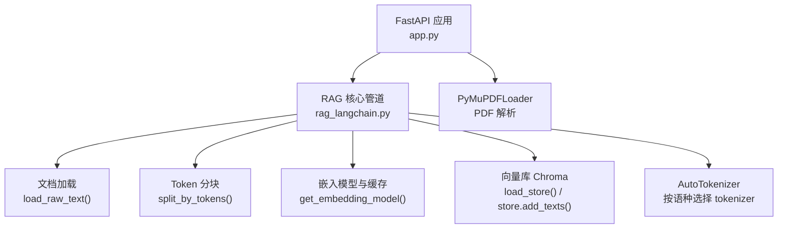
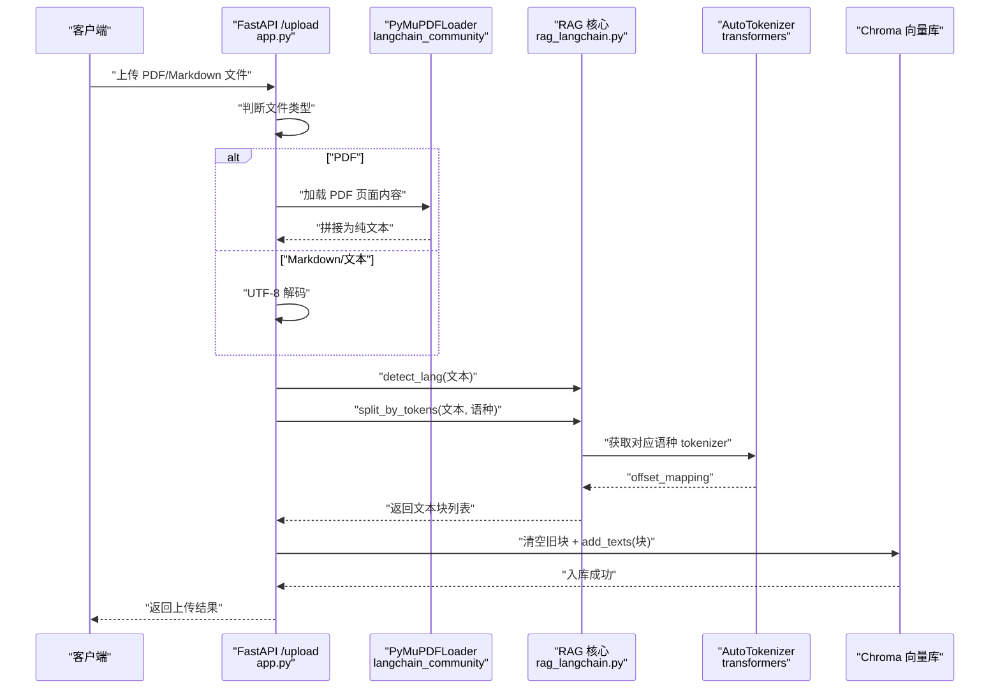
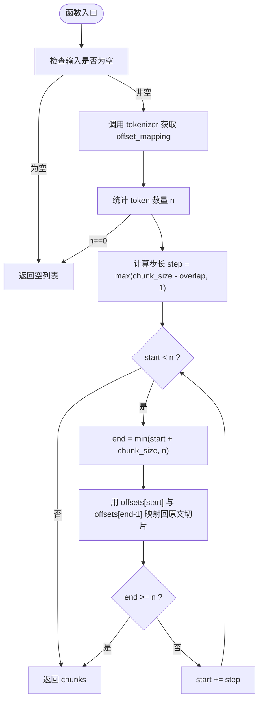
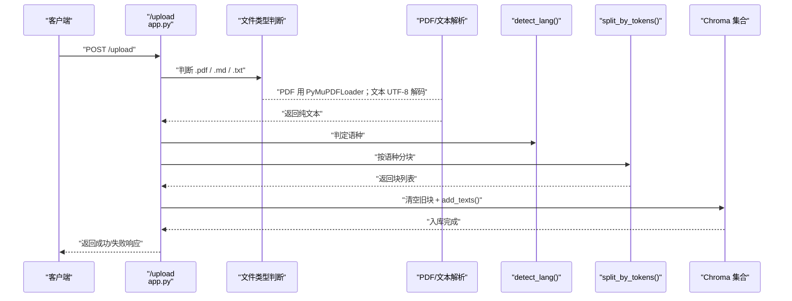
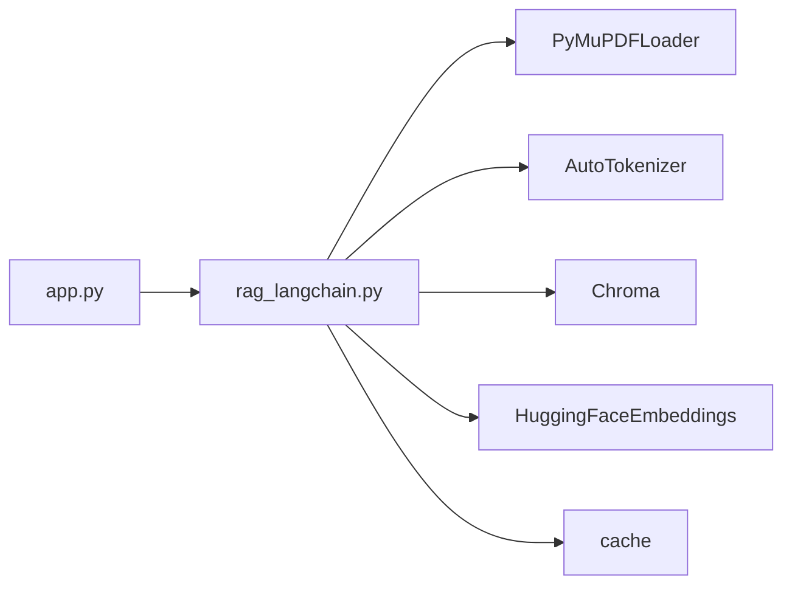

# 文档处理与分块

<cite>
**本文引用的文件**   
- [app.py](file://app.py)
- [rag_langchain.py](file://rag_langchain.py)
</cite>

## 目录
1. [引言](#引言)
2. [项目结构](#项目结构)
3. [核心组件](#核心组件)
4. [架构总览](#架构总览)
5. [详细组件分析](#详细组件分析)
6. [依赖关系分析](#依赖关系分析)
7. [性能考虑](#性能考虑)
8. [故障排查指南](#故障排查指南)
9. [结论](#结论)
10. [附录：配置与调优建议](#附录配置与调优建议)

## 引言
本技术文档聚焦于“文档处理与分块”模块，目标是帮助开发者理解并正确使用以下能力：
- 从 PDF 和 Markdown/文本文件中加载原始文本。
- 使用 token 级别的分块算法将长文档切分为适合检索的片段。
- 理解 `load_raw_text()` 与 `split_by_tokens()` 的实现细节、错误处理和边界情况。
- 掌握 `CHUNK_TOKENS` 与 `CHUNK_OVERLAP_TOKENS` 的配置含义与调优方法。
- 了解从字符切分迁移到 token 切分的动机及其对检索精度的影响。
- 针对文件不存在、编码异常、超大文档等场景给出稳健的处理策略。
- 获得可落地的性能优化建议和最佳实践。

## 项目结构
本项目采用 FastAPI 提供 Web 接口，核心 RAG 管道封装在 `rag_langchain.py`，Web 路由与上传逻辑在 `app.py`。文档处理与分块的关键代码集中在 `rag_langchain.py`，并通过 `app.py` 的 `/upload` 接口暴露给前端调用。

图表来源
- [app.py:155-228](file://app.py#L155-L228)
- [rag_langchain.py:292-359](file://rag_langchain.py#L292-L359)
- [rag_langchain.py:314-321](file://rag_langchain.py#L314-L321)
- [rag_langchain.py:362-405](file://rag_langchain.py#L362-L405)

章节来源
- [app.py:1-53](file://app.py#L1-L53)
- [rag_langchain.py:1-24](file://rag_langchain.py#L1-L24)

## 核心组件
本节梳理与文档处理与分块直接相关的核心函数与常量：
- `load_raw_text(path)`：读取 PDF 或 Markdown/文本文件，返回整篇纯文本。
- `_get_tokenizer(lang)`：懒加载对应语种的 tokenizer（仅加载词表，不加载权重）。
- `split_by_tokens(text, lang, chunk_size, overlap)`：基于 token 的分块算法。
- `CHUNK_TOKENS`、`CHUNK_OVERLAP_TOKENS`：控制分块大小与重叠量的全局配置。
- `build_index(source_file, lang, force)`：离线构建索引时调用上述函数完成“加载 -> 分块 -> 入库”。

章节来源
- [rag_langchain.py:292-359](file://rag_langchain.py#L292-L359)
- [rag_langchain.py:314-321](file://rag_langchain.py#L314-L321)
- [rag_langchain.py:375-405](file://rag_langchain.py#L375-L405)
- [rag_langchain.py:107-111](file://rag_langchain.py#L107-L111)

## 架构总览
下图展示一次文档上传后进入向量库的完整流程，重点标注文档加载与分块环节。

图表来源
- [app.py:155-228](file://app.py#L155-L228)
- [rag_langchain.py:292-359](file://rag_langchain.py#L292-L359)
- [rag_langchain.py:314-321](file://rag_langchain.py#L314-L321)

## 详细组件分析

### 文档加载：`load_raw_text()`
职责
- 统一入口读取 PDF 或 Markdown/文本文件，返回整篇纯文本。
- 对“文件不存在”进行前置检查，抛出更友好的 `FileNotFoundError`。
- PDF 通过 `PyMuPDFLoader` 解析；非 PDF 以 UTF-8 打开读取。

实现要点
- 路径校验：若不是 HTTP/HTTPS 且本地不存在，立即抛出带上下文提示的错误。
- PDF 分支：调用 `PyMuPDFLoader(path).load()`，并将每页 `page_content` 拼接成完整文本。
- 文本分支：以 `encoding="utf-8"` 打开文件并读取全文。

错误处理
- 文件不存在：提前检测并抛出 `FileNotFoundError`，避免下游 PyMuPDF 报出模糊错误。
- 编码问题：文本分支固定使用 UTF-8，若文件非 UTF-8 会抛编码异常，应在上层捕获并提示用户转换编码。
- URL 支持：当前实现只允许本地路径或显式 http/https 前缀跳过本地存在性检查；但实际 PDF 分支仍走本地文件路径，URL 场景需在上层做额外处理。

适用场景
- 离线脚本中直接加载本地 PDF/Markdown。
- 作为 `build_index()` 的前置步骤，先得到纯文本再分块入库。

章节来源
- [rag_langchain.py:292-307](file://rag_langchain.py#L292-L307)

### Token 分块：`split_by_tokens()`
职责
- 将长文本按 token 粒度切分为多个块，保证中英双语下“块的信息量”可比。
- 使用 offset 对齐技术，确保每个块是原文的子串，便于评测脚本做逐字节比对。

关键设计
- tokenizer 选择：根据传入语种 `lang` 懒加载对应模型的 `AutoTokenizer`，避免重复加载。
- offset 对齐：调用 tokenizer 时设置 `return_offsets_mapping=True` 与 `add_special_tokens=False`，得到每个 token 在原字符串中的起止位置。
- 步长计算：`step = max(chunk_size - overlap, 1)`，防止 `overlap >= chunk_size` 导致原地打转。
- 切片策略：每次取 `[start, start+chunk_size)` 个 token，用其首尾 offset 映射回原文切片，追加到结果列表。

复杂度分析
- 时间复杂度：O(n)，其中 n 为 token 数量；主要开销来自一次 tokenizer 调用与线性扫描 offsets。
- 空间复杂度：O(n)，用于存储 offsets 与最终 chunks。

为什么从字符切分改为 token 切分
- 同样 300 个字符，中文约 250 token，英文约 52 token，差异近 5 倍。
- 若按字符切，同一“块大小”在中英两侧承载信息量不可比，英文块过薄，影响检索精度与 LLM 上下文质量。
- 按 token 切，两个语种的“块”在同一量级，有利于跨语言检索一致性。

为什么用 offset 对齐而不是 decode 回文本
- 实测 `tokenizer.decode(ids)` 不能还原原文：中文会被规整、英文可能丢字符。
- 因此只用 tokenizer 算 token 的字符边界，再按字符位置切原文，保证块是原文子串。

默认参数说明
- `chunk_size` 默认 `CHUNK_TOKENS=256`，而非模型上限 512，留足余量避免静默截断。
- `overlap` 默认 `CHUNK_OVERLAP_TOKENS=40`，约 16% 重叠，有助于跨块语义连续性。

图表来源
- [rag_langchain.py:324-359](file://rag_langchain.py#L324-L359)

章节来源
- [rag_langchain.py:314-321](file://rag_langchain.py#L314-L321)
- [rag_langchain.py:324-359](file://rag_langchain.py#L324-L359)

### Web 上传流程中的文档处理
`/upload` 接口负责接收文件、解析文本、判定语种、分块并入库。

处理逻辑
- 文件类型判断：`.pdf` 走 PyMuPDFLoader；`.md/.markdown/.txt` 走 UTF-8 解码。
- 空内容保护：若文本去除空白后为空，直接返回失败。
- 语种判定：调用 `detect_lang(text)`，决定走哪个 collection 与 tokenizer。
- 分块：调用 `split_by_tokens(text, lang)`，若结果为空则返回失败。
- 入库：清空该语种集合的旧块，再以 index 0 起重新编号入库。
- 缓存失效：更新知识库后调用 `invalidate_caches()`，使旧问答/精排缓存失效。
- 预览同步：尝试保存该语种的 `chunks_preview_{lang}.md`，失败不影响上传主流程。

异常处理
- 不支持的文件类型：返回明确错误消息。
- 上传整体异常：外层 try/except 捕获并返回失败响应。

图表来源
- [app.py:155-228](file://app.py#L155-L228)

章节来源
- [app.py:155-228](file://app.py#L155-L228)

## 依赖关系分析
- `app.py` 依赖 `rag_langchain.py` 提供的 `split_by_tokens`、`detect_lang`、`load_store`、`make_retriever`、`make_chain`、`query`、`invalidate_caches`、`get_all_chunks_in_order`、`save_chunks_to_file` 等能力。
- `rag_langchain.py` 依赖：
  - `langchain_community.document_loaders.PyMuPDFLoader`：PDF 解析。
  - `transformers.AutoTokenizer`：按语种加载 tokenizer。
  - `langchain_chroma.Chroma`：向量库封装。
  - `langchain_huggingface.HuggingFaceEmbeddings`：嵌入模型。
  - `cache`：向量/精排/问答缓存。

图表来源
- [app.py:40-51](file://app.py#L40-L51)
- [rag_langchain.py:39-48](file://rag_langchain.py#L39-L48)
- [rag_langchain.py:292-359](file://rag_langchain.py#L292-L359)

章节来源
- [app.py:40-51](file://app.py#L40-L51)
- [rag_langchain.py:39-48](file://rag_langchain.py#L39-L48)

## 性能考虑
- 分块阶段
  - 单次 tokenizer 调用开销可控，主要成本在内存中线性扫描 offsets。
  - 大文档建议分批处理或流式写入，避免一次性加载超长文本造成内存峰值。
- 嵌入阶段
  - 已内置向量缓存：同一段文本不会重复计算向量，重复上传或重复提问收益明显。
  - 嵌入模型懒加载：首次使用时才加载，避免启动即占满内存。
- 检索与精排
  - 召回 k=20，精排 top_n=5，精排分数也做了缓存，减少 cross-encoder 调用次数。
- 缓存策略
  - 问答缓存、向量缓存、精排缓存三者分工明确，命中后可显著降低延迟。
  - 文档变更后调用 `invalidate_caches()` 保证答案一致性。

[本节为通用性能讨论，不直接分析具体文件]

## 故障排查指南
常见问题与定位建议
- 文件不存在
  - 现象：调用 `load_raw_text()` 抛出 `FileNotFoundError`。
  - 原因：路径非 http/https 且本地不存在。
  - 解决：确认路径正确，或使用绝对路径；若使用默认值，请确认默认文件存在。
- 编码问题
  - 现象：文本分支读取时报 UnicodeDecodeError。
  - 原因：文件非 UTF-8 编码。
  - 解决：预处理文件为 UTF-8，或在调用方捕获异常并提示用户转换编码。
- 超大文档
  - 现象：内存占用高、分块耗时增加。
  - 原因：一次性加载整篇 PDF/Markdown 并生成全部 offsets。
  - 解决：拆分大文档为多份小文档；或在上层实现分页/流式处理；调整 `CHUNK_TOKENS` 减小块大小以降低单块内存压力。
- 分块后无内容
  - 现象：`split_by_tokens()` 返回空列表。
  - 原因：输入文本为空或 tokenizer 无法识别任何 token。
  - 解决：检查源文件是否包含有效文本；确认语种与 tokenizer 匹配。
- 不支持的文件类型
  - 现象：`/upload` 返回“不支持的文件类型”。
  - 原因：扩展名不在 `.pdf/.md/.markdown/.txt` 范围内。
  - 解决：上传正确类型的文件。

章节来源
- [rag_langchain.py:292-307](file://rag_langchain.py#L292-L307)
- [app.py:155-187](file://app.py#L155-L187)

## 结论
- `load_raw_text()` 提供了统一的 PDF/Markdown 文本加载入口，并对“文件不存在”进行友好报错。
- `split_by_tokens()` 通过 offset 对齐与 token 粒度切分，解决了中英双语下“块信息量不可比”的问题，提升检索一致性与精度。
- `CHUNK_TOKENS` 与 `CHUNK_OVERLAP_TOKENS` 是可配置的核心参数，建议结合业务数据分布与模型上限进行 A/B 测试调优。
- 在生产环境中，应重视文件不存在、编码异常、超大文档等异常路径，并在上层做好容错与提示。
- 配合向量缓存、精排缓存与问答缓存，系统可在保证正确性的前提下显著提升吞吐与响应速度。

[本节为总结性内容，不直接分析具体文件]

## 附录：配置与调优建议
- `CHUNK_TOKENS`
  - 作用：控制每个块的 token 数量。
  - 默认值：256，约为模型最大输入长度 512 的一半，留足余量避免静默截断。
  - 调优建议：
    - 中文文档可适当增大至 300~384，以提升上下文连贯性。
    - 英文文档可保持 256 或略降，避免块过长稀释关键词密度。
    - 若模型更换或 max_seq_length 变化，需重新评估该值。
- `CHUNK_OVERLAP_TOKENS`
  - 作用：控制相邻块之间的重叠 token 数，提升跨块语义连续性。
  - 默认值：40，约占 16%。
  - 调优建议：
    - 短文档或查询较短时，可适当提高重叠比例至 20%~25%。
    - 长文档且检索颗粒度较细时，可降低至 10%~15%，减少冗余。
- 环境变量覆盖
  - 可通过环境变量 `CHUNK_TOKENS` 与 `CHUNK_OVERLAP_TOKENS` 覆盖默认值，便于 A/B 对比。
- 最佳实践
  - 上传前先清洗文档：去除无关水印、页眉页脚、乱码。
  - 对超大文档进行逻辑分段：按章节/段落拆分为多个文件，分别入库。
  - 定期刷新预览文件：确保 `chunks_preview_{lang}.md` 与向量库一致，便于人工标注与评测。
  - 监控缓存命中率：通过 `/cache/stats` 观察缓存后端健康状态与命中率，必要时清理缓存。

章节来源
- [rag_langchain.py:107-111](file://rag_langchain.py#L107-L111)
- [rag_langchain.py:324-359](file://rag_langchain.py#L324-L359)