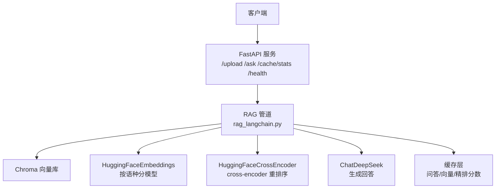
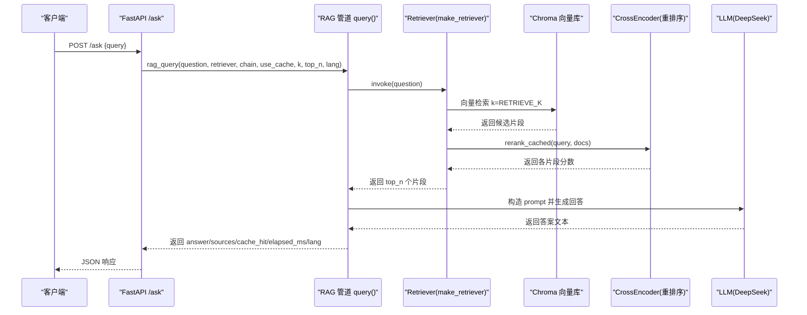
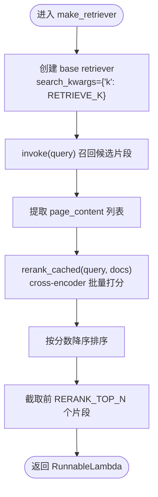
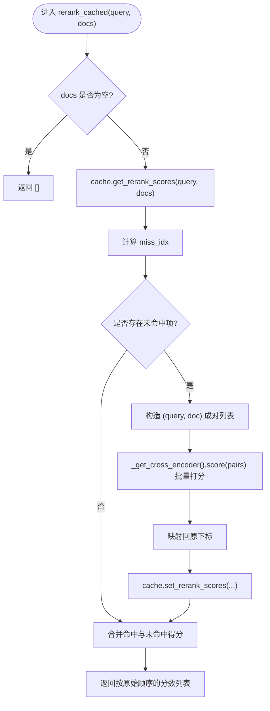
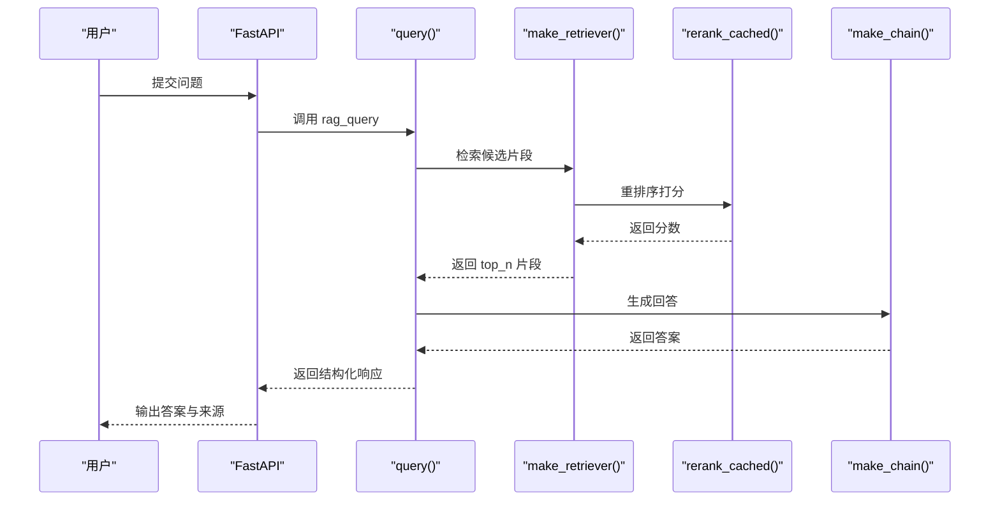
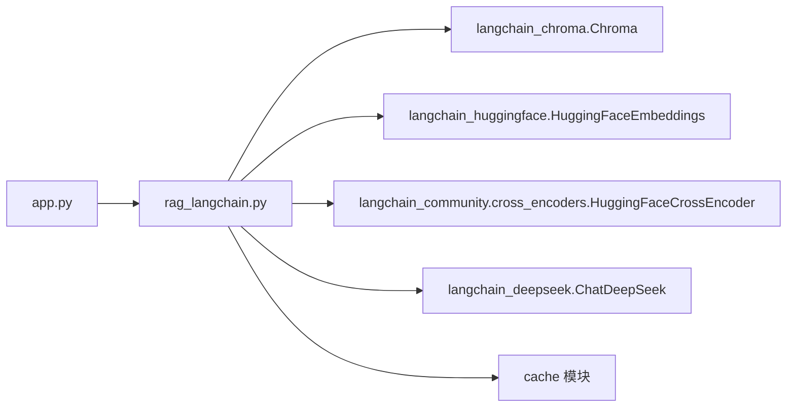

# 检索与重排序

<cite>
**本文引用的文件**   
- [rag_langchain.py](file://rag_langchain.py)
- [app.py](file://app.py)
- [verify_cache.py](file://verify_cache.py)
</cite>

## 目录
1. [引言](#引言)
2. [项目结构](#项目结构)
3. [核心组件](#核心组件)
4. [架构总览](#架构总览)
5. [详细组件分析](#详细组件分析)
6. [依赖关系分析](#依赖关系分析)
7. [性能考量](#性能考量)
8. [故障排查指南](#故障排查指南)
9. [结论](#结论)
10. [附录：参数调优与评估建议](#附录参数调优与评估建议)

## 引言
本技术文档聚焦检索与重排序模块，围绕以下目标展开：
- 深入解释 `make_retriever()` 的实现，包括 LangChain retriever 的集成方式以及 cross-encoder 重排序调用逻辑。
- 详细说明 `rerank_cached()` 的分数缓存机制，包括 `(query, doc)` 对的缓存键设计、批量打分优化。
- 记录 `RETRIEVE_K` 与 `RERANK_TOP_N` 参数的含义与调优策略。
- 给出“检索→重排序→筛选”的完整流程示例说明。
- 解释两阶段检索架构的设计动机，以及 cross-encoder 相比双塔模型的优势与性能权衡。
- 覆盖模型加载、超时、结果排序等异常处理要点。
- 提供检索质量评估与性能优化的实用建议。

## 项目结构
本项目采用“Web 服务 + RAG 管道”的分层组织：
- Web 服务层（FastAPI）负责接口暴露、语种路由、空库保护、缓存状态查询与健康检查。
- RAG 管道层（LangChain 版）实现文档加载、切块、嵌入、向量库、检索、重排序、生成与缓存。
- 辅助验证脚本用于校验缓存行为与跨端一致性。

**图表来源**
- [app.py:155-260](file://app.py#L155-L260)
- [rag_langchain.py:363-467](file://rag_langchain.py#L363-L467)

**章节来源**
- [app.py:1-52](file://app.py#L1-L52)
- [rag_langchain.py:1-50](file://rag_langchain.py#L1-L50)

## 核心组件
- 检索器构建器 `make_retriever(store, k, top_n)`：封装 LangChain retriever 召回与 cross-encoder 精排，返回可被 LCEL 链调用的 RunnableLambda。
- 重排序缓存 `rerank_cached(query, docs)`：对候选片段进行 cross-encoder 打分，并对未命中项批量计算并写入缓存。
- 跨编码器懒加载 `_get_cross_encoder()`：避免启动时加载 ~470MB 模型，首次使用时才实例化。
- 参数常量 `RETRIEVE_K`、`RERANK_TOP_N`：控制初筛召回数量与精排后保留数量。
- 语种与模型路由：按中文/英文分别选择 embedding 模型与 Chroma collection，避免不同向量空间混用。

**章节来源**
- [rag_langchain.py:91-111](file://rag_langchain.py#L91-L111)
- [rag_langchain.py:420-467](file://rag_langchain.py#L420-L467)

## 架构总览
下图展示一次问答请求在检索与重排序阶段的端到端流程：

**图表来源**
- [app.py:231-260](file://app.py#L231-L260)
- [rag_langchain.py:579-631](file://rag_langchain.py#L579-L631)
- [rag_langchain.py:452-467](file://rag_langchain.py#L452-L467)

## 详细组件分析

### make_retriever() 实现与 LangChain 集成
`make_retriever()` 的核心职责是：
- 使用 `store.as_retriever(search_kwargs={"k": k})` 创建基于 Chroma 的检索器，默认召回 `RETRIEVE_K` 条候选。
- 定义内部函数 `_retrieve_and_rerank(query)`：
  - 调用 base retriever 获取候选片段列表。
  - 将片段内容传给 `rerank_cached(query, docs)` 得到每个片段的 cross-encoder 分数。
  - 按分数降序排序，取前 `top_n` 个片段作为最终结果。
- 返回 `RunnableLambda(_retrieve_and_rerank)`，以便直接接入 LangChain LCEL 链。

该实现等价于先做向量召回再做 cross-encoder 精排的两阶段流程；由于 LangChain 1.x 已将压缩检索器与交叉编码器组件移出主包，代码直接调用 `HuggingFaceCrossEncoder.score()` 完成精排，保证与原实现逐行等价，同时引入 `rerank_cached()` 以复用已计算的分数。

**图表来源**
- [rag_langchain.py:452-467](file://rag_langchain.py#L452-L467)

**章节来源**
- [rag_langchain.py:452-467](file://rag_langchain.py#L452-L467)

### rerank_cached() 分数缓存机制
`rerank_cached(query, docs)` 的工作流程如下：
- 若输入为空，直接返回空列表。
- 通过 `cache.get_rerank_scores(query, docs)` 尝试命中已有分数，返回 `{下标: 分数}`。
- 计算未命中的片段索引集合 `miss_idx`。
- 对未命中项构造 `(query, doc)` 成对列表，调用 `_get_cross_encoder().score(pairs)` 批量打分。
- 将新得分映射回原下标，并通过 `cache.set_rerank_scores(query, docs_subset, scores)` 写入缓存。
- 合并命中与未命中得分，按原始顺序返回分数列表。

关键点：
- 缓存键由 `(query, doc)` 的内容哈希构成，确保同一问题换文档、或同一文档换问题都能正确复用或区分。
- 批量打分显著减少 cross-encoder 的前向次数，尤其当召回 20 条时，能避免重复计算。
- 仅对未命中项调用模型，最大化缓存命中率带来的收益。

**图表来源**
- [rag_langchain.py:428-449](file://rag_langchain.py#L428-L449)

**章节来源**
- [rag_langchain.py:420-449](file://rag_langchain.py#L420-L449)
- [verify_cache.py:127-142](file://verify_cache.py#L127-L142)

### 为什么采用两阶段检索架构？
两阶段架构包含：
- 第一阶段：向量召回（双塔式语义相似度），快速从大规模文档中筛选候选集。
- 第二阶段：cross-encoder 精排，对候选集进行更精细的相关性打分。

优势：
- 召回阶段成本低、可扩展性强，适合海量文档的快速初筛。
- 精排阶段精度高，能捕捉 query 与 passage 之间的细粒度交互信息。
- 结合缓存后，重复问题与重复片段可大幅降低 cross-encoder 的计算开销。

权衡：
- 两阶段带来额外延迟，但可通过缓存与批量化缓解。
- cross-encoder 比双塔模型更慢，但通常能提升排序质量，尤其在复杂语义匹配场景。

[本节为概念性说明，不直接分析具体文件]

### cross-encoder 相比双塔模型的优势与性能权衡
- 优势：
  - 显式建模 query 与 passage 的交互，能更好捕捉语义细节与上下文依赖。
  - 在评测指标（如 Hit Rate、MRR）上通常优于纯向量相似度排序。
- 性能：
  - 单次打分成本高于双塔模型，尤其是候选集较大时。
  - 通过 `rerank_cached()` 的分数缓存与批量打分，可显著降低重复计算。
  - 模型懒加载避免启动时占用大量内存，仅在首次需要时加载。

**章节来源**
- [rag_langchain.py:420-449](file://rag_langchain.py#L420-L449)

### 检索→重排序→筛选的完整流程示例
以下示例描述一次典型问答的完整流程，不涉及具体代码内容：
- 用户提交问题。
- FastAPI 路由到 RAG 管道，按问题语种选择对应检索器与生成链。
- 检索器执行向量召回，得到 `RETRIEVE_K` 条候选片段。
- 重排序阶段调用 `rerank_cached()`，对候选片段进行 cross-encoder 打分。
- 按分数降序排序，取前 `RERANK_TOP_N` 个片段作为上下文。
- 将上下文与问题拼接进 prompt，调用 DeepSeek 生成回答。
- 返回答案、来源片段、缓存命中信息与耗时。

**图表来源**
- [app.py:231-260](file://app.py#L231-L260)
- [rag_langchain.py:579-631](file://rag_langchain.py#L579-L631)
- [rag_langchain.py:452-467](file://rag_langchain.py#L452-L467)

**章节来源**
- [app.py:231-260](file://app.py#L231-L260)
- [rag_langchain.py:579-631](file://rag_langchain.py#L579-L631)

## 依赖关系分析
- FastAPI 服务依赖 RAG 管道提供的 `load_store`、`make_retriever`、`make_chain`、`query`、`invalidate_caches` 等能力。
- RAG 管道依赖：
  - Chroma 向量库（持久化存储）。
  - HuggingFaceEmbeddings（按语种分模型）。
  - HuggingFaceCrossEncoder（cross-encoder 重排序）。
  - ChatDeepSeek（生成回答）。
  - 缓存层（问答、向量、精排分数）。

**图表来源**
- [app.py:44-51](file://app.py#L44-L51)
- [rag_langchain.py:39-47](file://rag_langchain.py#L39-L47)

**章节来源**
- [app.py:44-51](file://app.py#L44-L51)
- [rag_langchain.py:39-47](file://rag_langchain.py#L39-L47)

## 性能考量
- 模型懒加载：embedding 与 cross-encoder 均采用懒加载，避免启动时占用过多内存。
- 向量缓存：同一段文本不重复计算向量，上传重复内容或重复提问时收益明显。
- 精排缓存：`(query, doc)` 对的分数缓存避免重复 cross-encoder 打分，显著提升重复问题下的吞吐。
- 批量打分：对未命中项统一调用 `score(pairs)`，减少模型调用次数。
- 并发安全：embedding 与 tokenzier 懒加载使用双检锁，防止并发首次请求重复加载模型。

[本节为通用性能讨论，不直接分析具体文件]

## 故障排查指南
- 模型加载异常：
  - 确认 cross-encoder 与 embedding 模型路径存在且可访问。
  - 注意懒加载只在首次使用时触发，若进程内多次并发请求可能短暂峰值内存升高。
- 超时问题：
  - cross-encoder 打分较慢，建议在缓存开启的情况下评估命中率。
  - 若需强制走真实链路对比耗时，可在 `/ask` 传入 `use_cache=false`。
- 结果排序异常：
  - 检查 `make_retriever()` 中是否按分数降序排序并截取 `top_n`。
  - 确认 `rerank_cached()` 返回的分数顺序与原始片段顺序一致。
- 空库保护：
  - 目标语种库为空时，服务直接返回提示，避免模型“凭印象作答”。
- 缓存失效：
  - 文档变更后调用 `invalidate_caches()` 清空问答与精排缓存，并提升版本号。
  - 更新 chunks_preview 文件以确保评测脚本基准一致。

**章节来源**
- [app.py:241-249](file://app.py#L241-L249)
- [rag_langchain.py:634-644](file://rag_langchain.py#L634-L644)

## 结论
本模块通过两阶段检索架构与 cross-encoder 精排，在保证检索质量的同时，借助多层缓存显著降低重复计算开销。`make_retriever()` 与 `rerank_cached()` 的组合实现了高效、可维护的检索与重排序流程，配合 FastAPI 服务提供稳定的问答接口。参数 `RETRIEVE_K` 与 `RERANK_TOP_N` 可根据业务需求与资源约束进行调优，以实现精度与性能的平衡。

[本节为总结性内容，不直接分析具体文件]

## 附录：参数调优与评估建议

### RETRIEVE_K 与 RERANK_TOP_N 的含义
- `RETRIEVE_K`：向量召回条数，默认 20。
- `RERANK_TOP_N`：精排后保留条数，默认 5。

这两个参数参与缓存 key 计算，修改后不应命中旧口径的答案。

**章节来源**
- [rag_langchain.py:104-105](file://rag_langchain.py#L104-L105)
- [rag_langchain.py:452-467](file://rag_langchain.py#L452-L467)

### 调优策略
- 提高 `RETRIEVE_K`：
  - 优点：增加候选集，提升召回概率。
  - 缺点：增加 cross-encoder 打分成本，可能引入更多噪声片段。
- 调整 `RERANK_TOP_N`：
  - 优点：控制送入 LLM 的上下文长度，影响生成质量与成本。
  - 缺点：过小可能丢失关键信息，过大可能稀释重点。
- 结合缓存命中率：
  - 观察精排缓存命中率，若较低，考虑增大 `RETRIEVE_K` 以提升多样性，或优化切块策略。
- 结合评测指标：
  - 使用 `evaluate_retrieval()` 计算 Hit Rate 与 MRR，对比不同参数组合的效果。

**章节来源**
- [rag_langchain.py:647-689](file://rag_langchain.py#L647-L689)

### 检索质量评估
- 准备测试问题与标准答案索引（针对特定文档）。
- 运行离线主流程，获取重排序结果。
- 调用 `evaluate_retrieval()` 计算 Hit Rate 与 MRR。
- 对比第一次与第二次运行，观察精排缓存命中带来的耗时下降。

**章节来源**
- [rag_langchain.py:711-779](file://rag_langchain.py#L711-L779)

### 性能优化建议
- 启用语义缓存（可选）：
  - 环境变量 `SEMANTIC_CACHE=1`、`SEMANTIC_THRESHOLD=0.95`。
  - 注意阈值调低可能误命中，需谨慎评估。
- 优化切块策略：
  - 调整 `CHUNK_TOKENS` 与 `CHUNK_OVERLAP_TOKENS`，平衡上下文完整性与检索精度。
- 监控缓存后端健康状态：
  - 通过 `/cache/stats` 查看后端类型、命中率、TTL 与版本。
- 定期清理缓存：
  - 通过 `/cache/clear` 手动清空指定类型缓存，避免陈旧数据影响。

**章节来源**
- [rag_langchain.py:113-115](file://rag_langchain.py#L113-L115)
- [app.py:263-284](file://app.py#L263-L284)