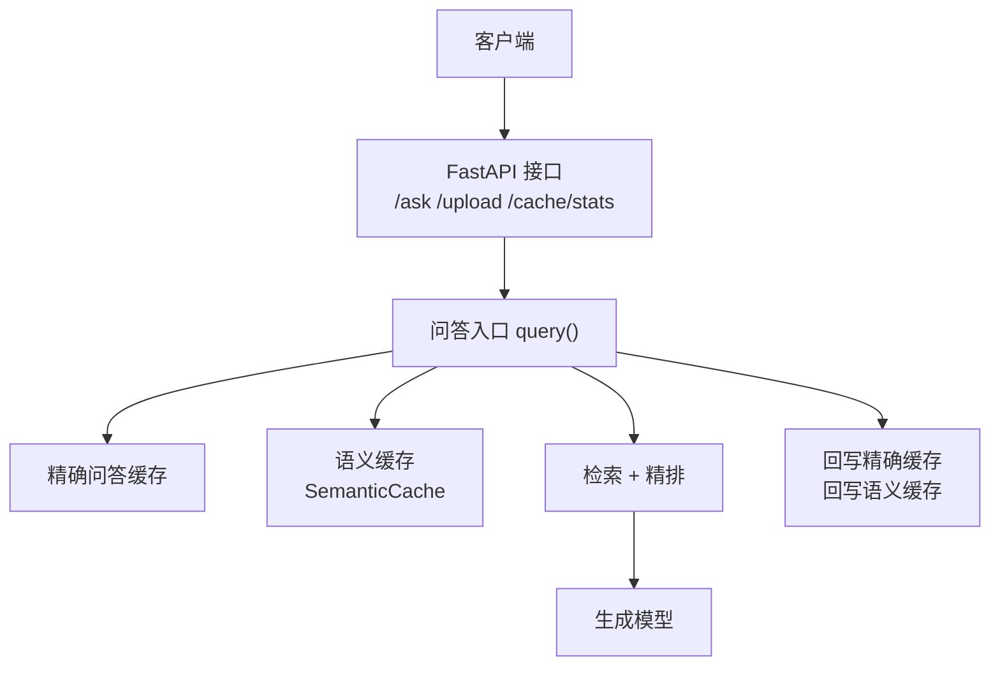
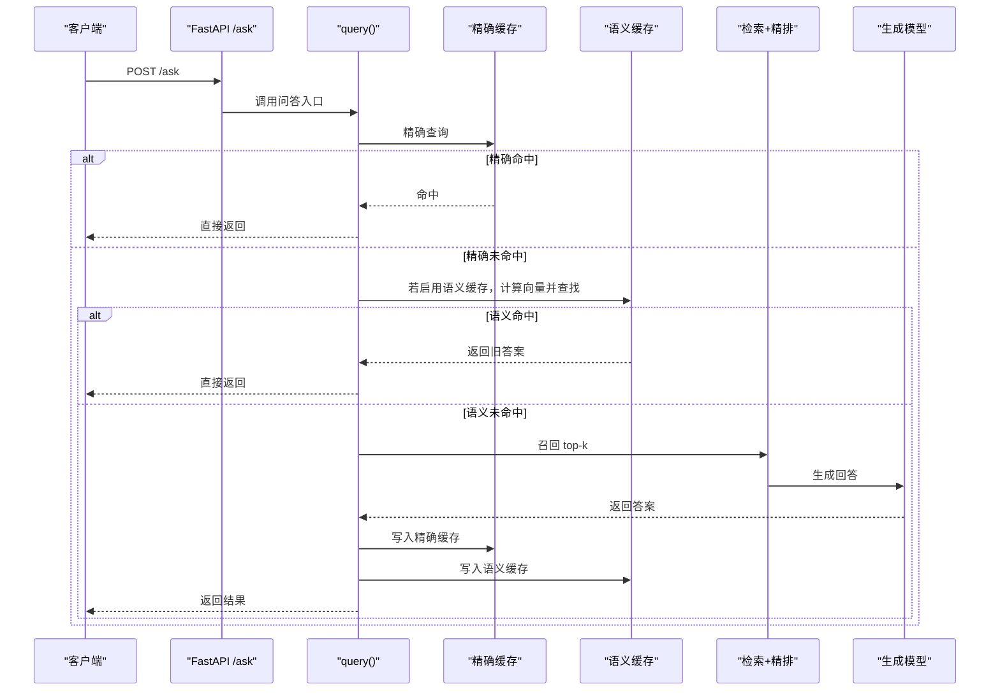
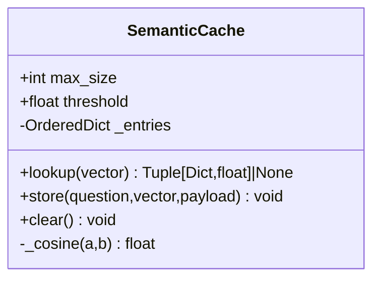
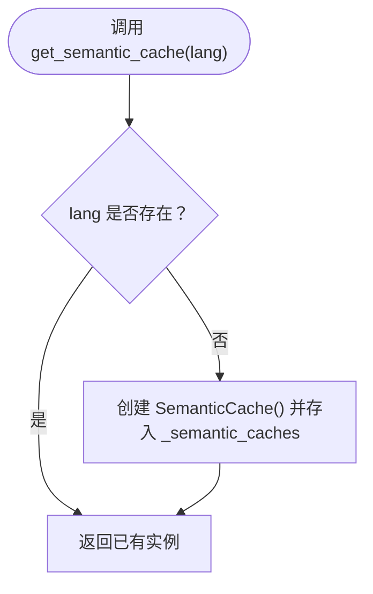
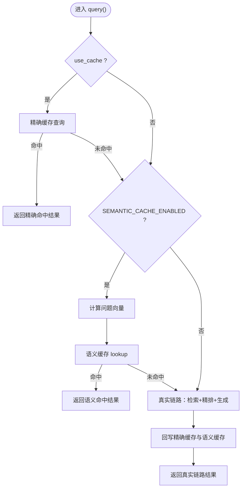
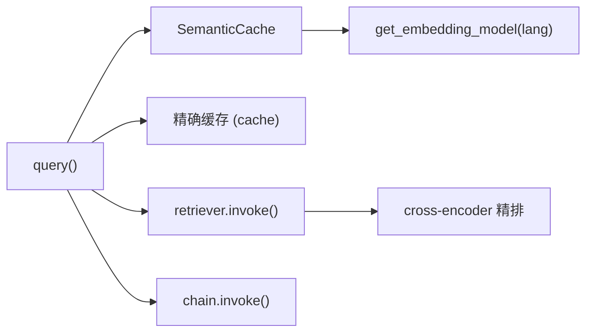

# 语义缓存系统

<cite>
**本文引用的文件**   
- [app.py](file://app.py)
- [rag_langchain.py](file://rag_langchain.py)
</cite>

## 目录
1. [引言](#引言)
2. [项目结构](#项目结构)
3. [核心组件](#核心组件)
4. [架构总览](#架构总览)
5. [详细组件分析](#详细组件分析)
6. [依赖关系分析](#依赖关系分析)
7. [性能与容量规划](#性能与容量规划)
8. [故障排查指南](#故障排查指南)
9. [结论](#结论)
10. [附录：配置与最佳实践](#附录配置与最佳实践)

## 引言
本技术文档聚焦于仓库中的“语义缓存”子系统，目标是帮助读者理解 SemanticCache 类的设计动机、余弦相似度计算、LRU 淘汰策略、按语种隔离的实现方式，以及 get_semantic_cache() 的单例管理。同时说明 SEMANTIC_CACHE_ENABLED 与 SEMANTIC_THRESHOLD 两个配置项的作用与安全考虑，给出语义匹配工作流和阈值调优建议，并覆盖向量维度不匹配、相似度误判、内存溢出等异常处理思路。最后提供语义缓存的配置最佳实践与性能监控建议。

## 项目结构
该仓库是一个基于 LangChain 的 RAG Web 服务，包含 FastAPI 接口层（app.py）与核心管道/缓存逻辑（rag_langchain.py）。语义缓存作为可选加速层，嵌入在问答入口 query() 中，与精确问答缓存、向量缓存、精排分数缓存共同构成多层缓存体系。

图示来源
- [app.py:231-260](file://app.py#L231-L260)
- [rag_langchain.py:580-631](file://rag_langchain.py#L580-L631)

章节来源
- [app.py:1-303](file://app.py#L1-L303)
- [rag_langchain.py:1-779](file://rag_langchain.py#L1-L779)

## 核心组件
- SemanticCache：基于有序字典的近似问题匹配缓存，使用余弦相似度比较向量，支持 LRU 淘汰。
- get_semantic_cache(lang)：按语种返回单例语义缓存实例，避免不同 embedding 空间的向量混用。
- query(question, ... , lang)：问答主流程，先查精确缓存，再查语义缓存，未命中则走真实链路并回写缓存。
- SEMANTIC_CACHE_ENABLED / SEMANTIC_THRESHOLD：控制是否启用语义缓存及相似度阈值。

章节来源
- [rag_langchain.py:514-576](file://rag_langchain.py#L514-L576)
- [rag_langchain.py:580-631](file://rag_langchain.py#L580-L631)
- [rag_langchain.py:114-115](file://rag_langchain.py#L114-L115)

## 架构总览
语义缓存位于“精确问答缓存”之后、“真实检索链路”之前。其设计原则是“可失败、不可出错”：即使语义缓存失效或异常，系统仍应回到真实链路，保证答案正确性优先于速度。

图示来源
- [app.py:231-260](file://app.py#L231-L260)
- [rag_langchain.py:580-631](file://rag_langchain.py#L580-L631)

## 详细组件分析

### SemanticCache 类
SemanticCache 使用 Python 标准库 OrderedDict 维护历史问题的向量与负载（answer/sources），并提供以下能力：
- 余弦相似度计算：对当前问题向量与缓存中所有历史向量逐一比较，取最高分。
- LRU 淘汰：每次 store 后若超过 max_size，弹出最久未使用的条目。
- 按语种隔离：通过 get_semantic_cache(lang) 为每个语种维护独立实例，避免不同 embedding 空间混用。

图示来源
- [rag_langchain.py:514-561](file://rag_langchain.py#L514-L561)

实现要点
- 余弦相似度：点积除以两向量模长乘积；任一向量为零向量时返回 0.0。
- lookup：线性扫描全部条目，时间复杂度 O(n·d)，n 为缓存条目数，d 为向量维度。
- store：插入或更新键，移动至末尾表示最近使用；循环删除最旧条目直到不超过 max_size。
- clear：清空所有条目。

章节来源
- [rag_langchain.py:514-561](file://rag_langchain.py#L514-L561)

### get_semantic_cache() 单例与语种隔离
get_semantic_cache(lang) 维护一个模块级字典 _semantic_caches，按语种懒加载并复用 SemanticCache 实例。这样做的关键原因是：
- 中文与英文分别使用不同的 embedding 模型，向量属于不同空间，不能跨语种比较相似度。
- 与“把两个模型的向量塞进同一个 collection”的错误同理，混用会导致噪声相似度。

图示来源
- [rag_langchain.py:564-576](file://rag_langchain.py#L564-L576)

线程安全说明
- 当前 get_semantic_cache() 没有加锁，存在并发首次访问时重复构造的风险。
- 建议采用双检锁模式，与 app.py 中 _singleton_lock 的写法保持一致，确保多线程环境下的单例一致性。

章节来源
- [rag_langchain.py:564-576](file://rag_langchain.py#L564-L576)
- [app.py:63-65](file://app.py#L63-L65)

### 语义缓存在主流程中的位置
query() 函数负责一次完整的问答流程：
1. 精确缓存：question 原文一致直接命中。
2. 语义缓存：若启用，计算问题向量并与历史向量比较，超过阈值即复用旧答案。
3. 真实链路：召回 top-k，精排到 top_n，调用生成模型，然后回写精确缓存与语义缓存。

图示来源
- [rag_langchain.py:580-631](file://rag_langchain.py#L580-L631)

章节来源
- [rag_langchain.py:580-631](file://rag_langchain.py#L580-L631)

### 配置参数：SEMANTIC_CACHE_ENABLED 与 SEMANTIC_THRESHOLD
- SEMANTIC_CACHE_ENABLED：从环境变量 SEMANTIC_CACHE 读取，值为 "1" 时启用语义缓存。默认关闭，因为近似匹配存在误判风险，RAG 场景下“答错”比“慢一点”更严重。
- SEMANTIC_THRESHOLD：从环境变量 SEMANTIC_THRESHOLD 读取，默认 0.95。阈值越高越保守，收益有限；阈值越低越激进，误命中风险上升。

安全考虑
- 默认关闭语义缓存，遵循“缓存可以加速，但绝不能改变正确答案”的原则。
- 打开语义缓存需明确权衡：在高保真要求的生产环境中，建议仅在严格测试与灰度验证后开启。

章节来源
- [rag_langchain.py:114-115](file://rag_langchain.py#L114-L115)
- [rag_langchain.py:522-529](file://rag_langchain.py#L522-L529)

## 依赖关系分析
语义缓存依赖以下组件：
- 嵌入模型：get_embedding_model(lang) 提供按语种的 HuggingFaceEmbeddings 实例，负责将文本转为向量。
- 缓存后端：精确问答缓存、向量缓存、精排分数缓存由 cache 模块提供。
- 检索与重排：retriever.invoke() 与 chain.invoke() 用于真实链路。

图示来源
- [rag_langchain.py:514-576](file://rag_langchain.py#L514-L576)
- [rag_langchain.py:580-631](file://rag_langchain.py#L580-L631)
- [rag_langchain.py:428-467](file://rag_langchain.py#L428-L467)

章节来源
- [rag_langchain.py:428-467](file://rag_langchain.py#L428-L467)
- [rag_langchain.py:514-576](file://rag_langchain.py#L514-L576)
- [rag_langchain.py:580-631](file://rag_langchain.py#L580-L631)

## 性能与容量规划
- 时间复杂度：SemanticCache.lookup() 为 O(n·d)，其中 n 为缓存条目数，d 为向量维度（本项目为 768）。当 n 较大时，逐条余弦相似度计算会成为瓶颈。
- 空间复杂度：每个条目存储完整向量与负载，内存占用约为 n × d × 8 字节（浮点数组）加上负载对象开销。max_size=256 时，仅向量部分约 256×768×8≈1.5MB，实际还需考虑负载与 Python 对象开销。
- 优化方向：
  - 限制 max_size，避免无限增长导致内存压力。
  - 在大规模场景考虑外部向量检索（如 Redis Vector、FAISS、Milvus），以替代进程内线性扫描。
  - 结合业务特征，调整 threshold 与采样策略（例如只对高频问题做语义缓存）。

章节来源
- [rag_langchain.py:514-561](file://rag_langchain.py#L514-L561)

## 故障排查指南
常见问题与处理建议：
- 向量维度不匹配：
  - 现象：不同 embedding 模型产生的向量混用，导致相似度无意义。
  - 原因：跨语种共用同一语义缓存实例。
  - 处理：确保 get_semantic_cache(lang) 按语种隔离；不要混用 LANG_MODELS 中的不同模型。
- 相似度误判：
  - 现象：阈值过低导致错误命中，返回无关答案。
  - 原因：SEMANTIC_THRESHOLD 设置过宽松。
  - 处理：提高阈值（如 0.95~0.98），并在评测集上验证命中率与准确率。
- 内存溢出：
  - 现象：语义缓存条目过多，进程内存持续增长。
  - 原因：max_size 过大或未生效。
  - 处理：降低 max_size，监控进程内存；必要时引入外部向量存储。
- 并发单例不一致：
  - 现象：多线程首次访问 get_semantic_cache() 可能重复构造实例。
  - 处理：为 get_semantic_cache() 增加双检锁，参考 app.py 中 _singleton_lock 的用法。
- 空库保护：
  - 现象：目标语种库为空时仍走检索，模型可能“凭印象作答”。
  - 处理：在 /ask 中检测 _collection_size(lang)==0 时直接返回提示，不走检索。

章节来源
- [app.py:241-249](file://app.py#L241-L249)
- [rag_langchain.py:564-576](file://rag_langchain.py#L564-L576)

## 结论
语义缓存通过近似匹配提升重复问法或换说法问题的响应速度，但其本质是“加速层”，不应影响答案正确性。默认关闭语义缓存体现了“宁可慢，不可错”的安全原则。生产环境启用时需严格控制阈值、容量与监控指标，并结合评测数据持续调优。

## 附录：配置与最佳实践
- 启用语义缓存：
  - 设置 SEMANTIC_CACHE=1 以启用。
  - 设置 SEMANTIC_THRESHOLD=0.95（或更高）以保守匹配。
- 容量规划：
  - 根据 QPS 与内存预算设定 max_size，避免线性扫描成为瓶颈。
  - 监控进程内存与缓存命中率，必要时引入外部向量检索。
- 监控建议：
  - 暴露 /cache/stats 查看后端类型、健康状态、版本号与各语种库块数。
  - 记录 semantic 命中比例与平均相似度分数，评估阈值合理性。
- 安全与稳定性：
  - 保持“fail-open”策略：语义缓存异常不影响真实链路。
  - 文档变更后调用 invalidate_caches() 清空语义缓存，避免旧答案污染。

章节来源
- [app.py:263-277](file://app.py#L263-L277)
- [rag_langchain.py:634-644](file://rag_langchain.py#L634-L644)