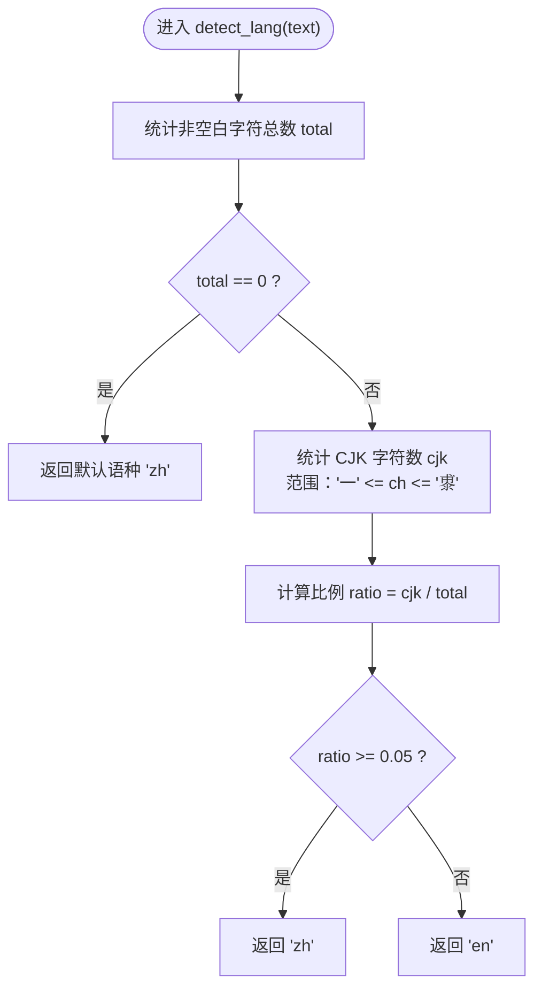
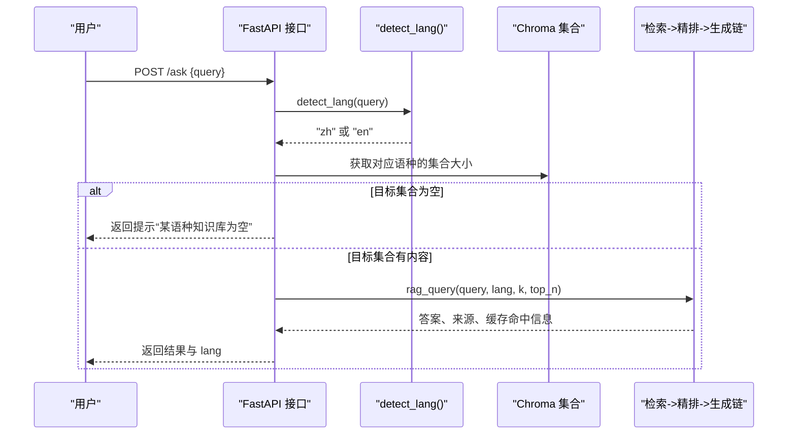
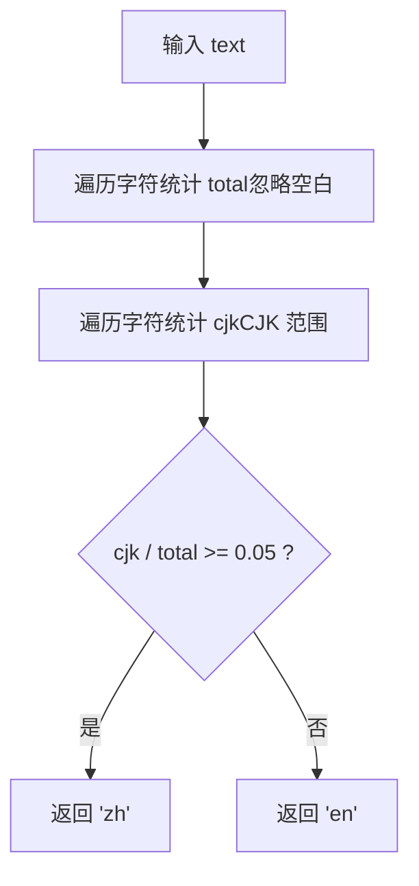
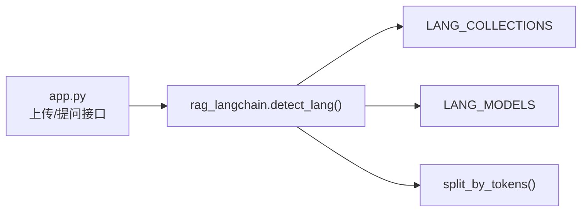

# 语言检测模块

<cite>
**本文引用的文件**   
- [app.py](file://app.py)
- [rag_langchain.py](file://rag_langchain.py)
</cite>

## 目录
1. [引言](#引言)
2. [项目结构中的定位](#项目结构中的定位)
3. [核心组件：detect_lang()](#核心组件detect_lang)
4. [架构总览：语种判断如何驱动检索路由](#架构总览语种判断如何驱动检索路由)
5. [详细实现分析](#详细实现分析)
6. [依赖关系与调用链](#依赖关系与调用链)
7. [性能特征与设计取舍](#性能特征与设计取舍)
8. [边界情况与混合文本处理](#边界情况与混合文本处理)
9. [配置项说明](#配置项说明)
10. [常见问题与排错](#常见问题与排错)
11. [结论](#结论)

## 引言
本章节面向“语言检测模块”，聚焦 detect_lang() 函数的实现原理、参数与返回值、中英文混合文本的处理策略，以及该函数在 RAG 服务中的关键作用。该模块通过简单的字符统计方法（CJK 汉字占比）快速判定输入是中文还是英文，从而决定后续走哪个向量库、使用哪个嵌入模型和分词器。

## 项目结构中的定位
RAG Web 服务采用 FastAPI 暴露接口，核心业务逻辑集中在 rag_langchain.py；app.py 负责 HTTP 层、缓存、集合大小检查、前端页面等。语言检测位于 rag_langchain.py，被 app.py 的上传与提问接口直接调用，用于按文档/问题的语种选择对应的知识库与模型。

```mermaid
graph TB
Client["客户端"] --> API["FastAPI 接口<br/>app.py"]
API --> LangDetect["语言检测<br/>rag_langchain.detect_lang()"]
API --> Store["向量存储<br/>Chroma collection"]
API --> Cache["语义缓存层"]
API --> LLM["大模型推理链"]
LangDetect --> |返回 "zh" 或 "en"| API
API --> |选择对应 collection| Store
API --> |选择对应 embedding 模型| LLM
```

**图表来源**
- [app.py:155-228](file://app.py#L155-L228)
- [app.py:231-260](file://app.py#L231-L260)
- [rag_langchain.py:118-142](file://rag_langchain.py#L118-L142)

**章节来源**
- [app.py:1-53](file://app.py#L1-L53)
- [rag_langchain.py:64-116](file://rag_langchain.py#L64-L116)

## 核心组件：detect_lang()
detect_lang() 是一个轻量级、无外部依赖的语言判断函数，仅返回 "zh" 或 "en"。其核心判据是“非空白字符中 CJK 汉字的比例是否达到阈值”。

### 函数签名与行为
- 输入：text（字符串）
- 输出：str，取值为 "zh" 或 "en"
- 默认行为：当输入为空或全为空白时，返回默认语种 "zh"

### 算法要点
- 统计非空白字符总数 total
- 统计 CJK 字符数 cjk，范围从 "一" 到 "鿿"
- 若 cjk / total >= 0.05，则判定为中文；否则为英文



**图表来源**
- [rag_langchain.py:118-142](file://rag_langchain.py#L118-L142)

**章节来源**
- [rag_langchain.py:118-142](file://rag_langchain.py#L118-L142)

## 架构总览：语种判断如何驱动检索路由
在 RAG 服务中，语言检测结果直接决定：
- 上传文档时，将切块后的内容存入对应语种的 Chroma collection
- 提问时，根据问题语种选择对应 retriever 与 chain，避免跨语种噪声



**图表来源**
- [app.py:231-260](file://app.py#L231-L260)
- [rag_langchain.py:118-142](file://rag_langchain.py#L118-L142)

**章节来源**
- [app.py:231-260](file://app.py#L231-L260)
- [rag_langchain.py:118-142](file://rag_langchain.py#L118-L142)

## 详细实现分析

### 基于汉字占比的语种判断算法
- CJK 字符范围检测：使用 Unicode 区间 "一" 到 "鿿" 覆盖常用中日韩文字符集，作为“汉字”近似判断依据
- 阈值设定：5% 的非空白字符占比阈值，兼顾中文文档中混入大量英文术语与英文文档中偶发中文作者名的场景
- 复杂度：O(n)，n 为文本长度；两次线性扫描分别统计 total 与 cjk



**图表来源**
- [rag_langchain.py:118-142](file://rag_langchain.py#L118-L142)

**章节来源**
- [rag_langchain.py:118-142](file://rag_langchain.py#L118-L142)

### 参数与返回值
- 参数
  - text：待检测的字符串，支持中英文混合
- 返回值
  - str："zh" 表示中文，"en" 表示英文
  - 空输入或纯空白输入返回默认值 "zh"

**章节来源**
- [rag_langchain.py:118-142](file://rag_langchain.py#L118-L142)

### 中英文混合文本处理逻辑
- 中文文档中混入英文术语（如 ReAct、LLM、ICLR）：由于整体 CJK 占比远高于 5%，仍判定为中文
- 英文文档中偶见中文作者名或引用术语：CJK 占比远低于 5%，判定为英文
- 极端混合句（例如英文句式夹少量中文词）：可能因 CJK 占比超过 5% 而被判定为中文；此类情况在真实提问中较少，且响应会携带 lang 字段便于排查

**章节来源**
- [rag_langchain.py:118-142](file://rag_langchain.py#L118-L142)

## 依赖关系与调用链
- app.py 在上传与提问接口中调用 detect_lang()
- detect_lang() 不依赖其他模块，保持极简实现
- 语言检测结果影响：
  - 选择 LANG_COLLECTIONS 中的对应 collection
  - 选择 LANG_MODELS 中的对应 embedding 模型
  - 选择 split_by_tokens() 使用的 tokenizer



**图表来源**
- [app.py:155-228](file://app.py#L155-L228)
- [app.py:231-260](file://app.py#L231-L260)
- [rag_langchain.py:64-116](file://rag_langchain.py#L64-L116)
- [rag_langchain.py:118-142](file://rag_langchain.py#L118-L142)
- [rag_langchain.py:324-333](file://rag_langchain.py#L324-L333)

**章节来源**
- [app.py:155-228](file://app.py#L155-L228)
- [app.py:231-260](file://app.py#L231-L260)
- [rag_langchain.py:64-116](file://rag_langchain.py#L64-L116)
- [rag_langchain.py:118-142](file://rag_langchain.py#L118-L142)
- [rag_langchain.py:324-333](file://rag_langchain.py#L324-L333)

## 性能特征与设计取舍
- 时间复杂度：O(n)，仅两次线性扫描，适合高频请求
- 空间复杂度：O(1)，无需额外数据结构
- 设计优势
  - 零外部依赖，避免引入 NLP 模型的启动与推理开销
  - 对中英文在字符层面的区分足够有效，满足本项目“只分中英两类”的需求
  - 与缓存、模型懒加载等机制配合良好，不会成为瓶颈
- 局限性
  - 无法识别更细粒度语种（如日文、韩文、法文等）
  - 对极短文本或特殊符号较多的文本可能不够稳健
  - 对“英文为主但夹杂较多中文术语”的边界情况存在误判风险

[本节为通用性能讨论，不直接分析具体代码行]

## 边界情况与混合文本处理
- 纯英文文档中的中文作者名：CJK 占比通常极低，不影响英文判定
- 中文文档中的英文术语：CJK 占比仍高，维持中文判定
- 纯空白或空输入：返回默认 "zh"
- 英文句式夹少量中文词：可能被判为中文；建议结合响应中的 lang 字段进行人工校验

**章节来源**
- [rag_langchain.py:118-142](file://rag_langchain.py#L118-L142)

## 配置项说明
- 默认语种 DEFAULT_LANG：当输入为空或全空白时使用
- 阈值 5%：当前硬编码，未提供环境变量开关
- 相关常量（与语言检测间接相关）
  - LANG_COLLECTIONS：定义各语种的 collection 名称
  - LANG_MODELS：定义各语种的 embedding 模型路径
  - CHUNK_TOKENS、CHUNK_OVERLAP_TOKENS：影响分块与后续检索质量

**章节来源**
- [rag_langchain.py:64-116](file://rag_langchain.py#L64-L116)
- [rag_langchain.py:118-142](file://rag_langchain.py#L118-L142)

## 常见问题与排错
- 问：为什么不用复杂的 NLP 模型做语言检测？
  - 答：本项目只需区分中文与英文，字符统计已足够；NLP 模型会增加启动与推理成本，且在本场景下收益有限。
- 问：为什么阈值设为 5%？
  - 答：实测中文文档即使混入大量英文术语，CJK 占比仍远高于 5%；英文文档偶见中文作者名也不会超过 5%。取 5% 给中文一侧留最大余量。
- 问：遇到英文句子夹少量中文词被误判怎么办？
  - 答：这类情况较少；可通过响应中的 lang 字段确认路由结果，必要时调整阈值或扩展规则。
- 问：如何验证语言检测是否正确？
  - 答：观察上传与提问接口的响应中的 lang 字段；同时可检查对应 collection 的块数与健康状态。

**章节来源**
- [app.py:155-228](file://app.py#L155-L228)
- [app.py:231-260](file://app.py#L231-L260)
- [rag_langchain.py:118-142](file://rag_langchain.py#L118-L142)

## 结论
detect_lang() 以极简的字符统计方法实现了稳定、高效的中文/英文判定，契合本项目“双库双模型”的架构需求。它避免了引入复杂 NLP 模型带来的性能开销，同时在常见场景中具备足够的准确性。对于边界情况，系统通过响应中的 lang 字段提供可观测性，便于运维与调优。未来如需支持更多语种或更高精度，可在保持现有接口不变的前提下扩展规则或替换为轻量级分类器。