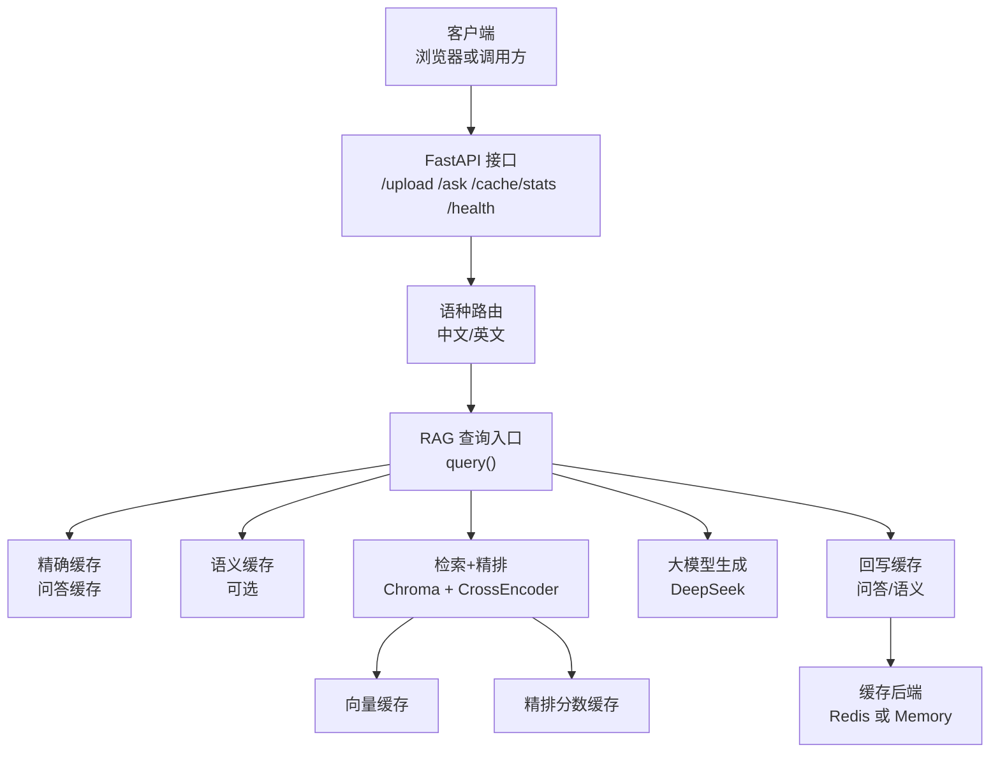
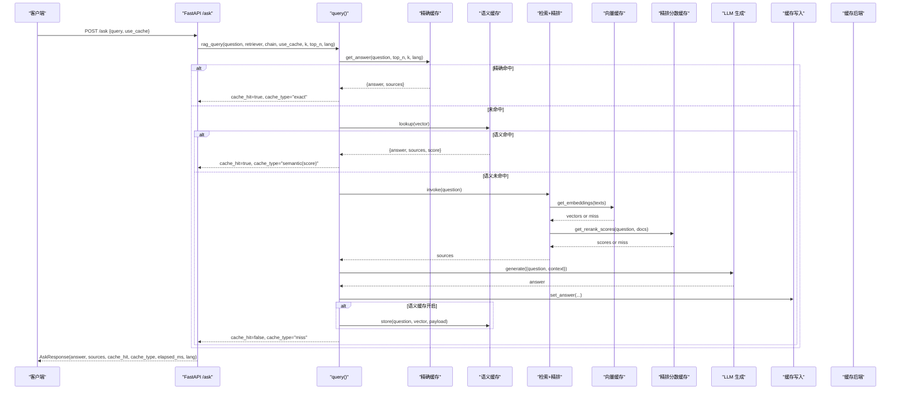
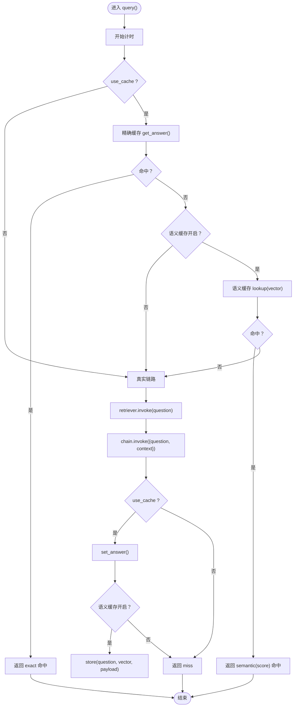
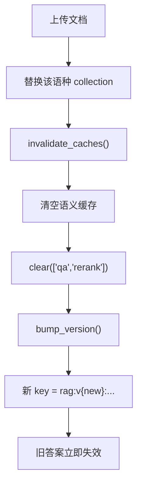
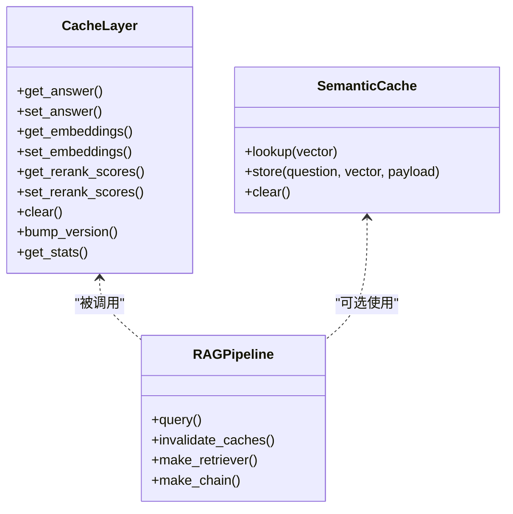
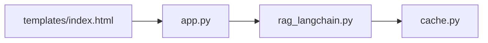

# 问答接口与缓存集成

<cite>
**本文引用的文件**   
- [app.py](file://app.py)
- [rag_langchain.py](file://rag_langchain.py)
- [cache.py](file://cache.py)
- [verify_cache.py](file://verify_cache.py)
- [index.html](file://templates/index.html)
</cite>

## 目录
1. [引言](#引言)
2. [项目结构](#项目结构)
3. [核心组件](#核心组件)
4. [架构总览](#架构总览)
5. [详细组件分析](#详细组件分析)
6. [依赖关系分析](#依赖关系分析)
7. [性能与容量特性](#性能与容量特性)
8. [故障诊断指南](#故障诊断指南)
9. [结论](#结论)
10. [附录：缓存命中场景示例](#附录缓存命中场景示例)

## 引言
本技术文档围绕“问答接口与缓存集成”展开，重点解释以下目标：
- `query()` 函数的完整工作流程，包括精确缓存、语义缓存、真实链路的三级处理逻辑。
- 返回数据结构的设计，包括 `answer`、`sources`、`cache_hit`、`cache_type`、`elapsed_ms` 等字段含义。
- `invalidate_caches()` 的缓存清理机制与版本管理。
- 缓存策略的整体设计思路与各层职责分工。
- 缓存不一致、并发冲突、性能监控等复杂场景的处理方式。
- 缓存策略调优与问题诊断的实用指南。

该项目采用 FastAPI 暴露 `/ask` 接口，内部通过 LangChain 管道完成检索、精排与大模型生成；同时引入三层缓存（问答缓存、向量缓存、精排分数缓存）以及可选的进程内语义缓存，目标是“加速而不改变正确答案”，并在知识库更新时保证旧答案失效。

## 项目结构
仓库中与问答和缓存直接相关的核心文件如下：
- `app.py`：FastAPI 服务入口，定义上传、问答、缓存统计与健康检查接口，并负责按语种路由到对应检索器和 LCEL 链。
- `rag_langchain.py`：LangChain RAG 管道实现，包含嵌入模型、Chroma 向量库、召回与精排、LCEL 生成链，以及带缓存的 `query()` 入口和 `invalidate_caches()`。
- `cache.py`：统一缓存层，提供 Redis 优先、内存降级的后端，封装问答/向量/精排三类缓存、TTL、版本号、统计与健康检查。
- `verify_cache.py`：不加载模型的缓存层验证脚本，覆盖读写、TTL、问答/向量/精排缓存、版本号、清理与统计等用例。
- `templates/index.html`：前端页面，展示问答结果、引用来源、缓存状态与统计面板。

**图表来源**
- [app.py:231-260](file://app.py#L231-L260)
- [rag_langchain.py:580-631](file://rag_langchain.py#L580-L631)
- [cache.py:271-390](file://cache.py#L271-L390)

**章节来源**
- [app.py:1-53](file://app.py#L1-L53)
- [rag_langchain.py:1-24](file://rag_langchain.py#L1-L24)
- [cache.py:1-29](file://cache.py#L1-L29)

## 核心组件
### 问答接口层（FastAPI）
- `/upload`：解析 PDF/Markdown，按文档语种切块入库 Chroma，替换该语种 collection，调用 `invalidate_caches()` 失效旧缓存，并刷新对应语种的 chunks 预览文件。
- `/ask`：接收问题，按问题语种选择 retriever 与 chain，调用 `rag_query()`，最终包装为 `AskResponse`，包含 `answer`、`sources`、`cache_hit`、`cache_type`、`elapsed_ms`、`lang`。
- `/cache/stats`：暴露缓存后端类型、健康状态、当前版本号、各语种 collection 块数、TTL 配置与缓存统计。
- `/cache/clear`：支持定向清空 qa/embed/rerank 或全量清空。
- `/health`：轻量健康检查，含缓存后端与 collection 块数。

**章节来源**
- [app.py:129-153](file://app.py#L129-L153)
- [app.py:155-228](file://app.py#L155-L228)
- [app.py:231-260](file://app.py#L231-L260)
- [app.py:263-290](file://app.py#L263-L290)

### RAG 管道与缓存入口
- `detect_lang()`：按汉字占比判断中英文，决定走哪个 collection 与 embedding 模型。
- `get_embedding_model()`：懒加载并按语种区分 embedding 模型，设置 `cache_tag` 避免不同模型向量互相覆盖。
- `make_retriever()`：召回 top-k，再用 cross-encoder 精排到 top-n，打分过程走 `rerank_cached()`。
- `make_chain()`：LCEL 链，支持传入字符串自动召回，也支持传入 `{question, context}` 跳过召回。
- `query()`：三级缓存入口，先查精确缓存，再查语义缓存，最后走真实链路并回写缓存。
- `invalidate_caches()`：清空语义缓存、qa 与 rerank 缓存，提升缓存版本号。

**章节来源**
- [rag_langchain.py:118-143](file://rag_langchain.py#L118-L143)
- [rag_langchain.py:228-254](file://rag_langchain.py#L228-L254)
- [rag_langchain.py:452-467](file://rag_langchain.py#L452-L467)
- [rag_langchain.py:482-508](file://rag_langchain.py#L482-L508)
- [rag_langchain.py:580-631](file://rag_langchain.py#L580-L631)
- [rag_langchain.py:634-644](file://rag_langchain.py#L634-L644)

### 缓存层（cache.py）
- 后端选择：`auto` 优先 Redis，失败降级 memory；`redis` 强制 Redis；`memory` 仅本地内存。
- TTL：问答默认 1 小时，向量默认 24 小时，精排默认 1 小时。
- 版本号：`rag:cache_version`，每次上传后递增，使旧答案立即失效。
- 三类缓存：
  - 问答缓存：`(lang, question.strip(), k, top_n)` 作为 key 的一部分，存储 `answer` 与 `sources`。
  - 向量缓存：按文本 hash 与 `model_tag` 存储向量，避免不同模型覆盖。
  - 精排分数缓存：按 `(question, doc)` 哈希存储分数。
- 统计：进程内计数器，记录 hit/miss 与命中率，供 `/cache/stats` 使用。

**章节来源**
- [cache.py:1-29](file://cache.py#L1-L29)
- [cache.py:37-49](file://cache.py#L37-L49)
- [cache.py:75-121](file://cache.py#L75-L121)
- [cache.py:123-199](file://cache.py#L123-L199)
- [cache.py:216-233](file://cache.py#L216-L233)
- [cache.py:271-390](file://cache.py#L271-L390)

## 架构总览
下图展示了从请求进入 FastAPI 到最终返回结果的完整流程，包括三级缓存与真实链路。

**图表来源**
- [app.py:231-260](file://app.py#L231-L260)
- [rag_langchain.py:580-631](file://rag_langchain.py#L580-L631)
- [rag_langchain.py:428-449](file://rag_langchain.py#L428-L449)
- [cache.py:271-390](file://cache.py#L271-L390)

## 详细组件分析

### query() 函数工作流程
`query()` 是带缓存的问答入口，其核心逻辑如下：
1. 计时开始。
2. 若启用缓存：
   - 精确缓存：用 `(lang, question.strip(), k, top_n)` 计算 key，命中则直接返回。
   - 语义缓存：若开启，则用对应语种的 embedding 模型算出问题向量，在进程内语义缓存中查找余弦相似度超过阈值的条目，命中则返回。
3. 若未命中任何缓存：
   - 调用 retriever 获取相关片段。
   - 将 `{question, context}` 传给 chain，避免重复召回。
   - 生成答案，提取 source texts。
   - 若启用缓存：
     - 写入问答缓存。
     - 若开启语义缓存：计算问题向量并写入语义缓存。
4. 返回统一结构，包含 `answer`、`sources`、`cache_hit`、`cache_type`、`elapsed_ms`。

**图表来源**
- [rag_langchain.py:580-631](file://rag_langchain.py#L580-L631)
- [rag_langchain.py:514-576](file://rag_langchain.py#L514-L576)
- [cache.py:271-300](file://cache.py#L271-L300)

**章节来源**
- [rag_langchain.py:580-631](file://rag_langchain.py#L580-L631)

### 返回数据结构设计
`AskResponse` 字段说明：
- `answer`：最终生成的回答文本。
- `sources`：用于生成回答的相关片段列表。
- `cache_hit`：是否命中缓存（精确或语义）。
- `cache_type`：缓存类型，可能值为：
  - `"exact"`：精确缓存命中。
  - `"semantic(...)"`：语义缓存命中，括号内为相似度分数。
  - `"miss"`：未命中，走真实链路。
  - `"empty"`：问题为空。
  - `"empty_collection"`：目标语种知识库为空。
- `elapsed_ms`：本次请求耗时（毫秒），便于前端展示与性能分析。
- `lang`：问题判定语种，决定走哪个 collection。

**章节来源**
- [app.py:129-149](file://app.py#L129-L149)
- [app.py:231-260](file://app.py#L231-L260)
- [rag_langchain.py:580-631](file://rag_langchain.py#L580-L631)

### invalidate_caches() 清理机制与版本管理
`invalidate_caches()` 在文档上传后被调用，作用包括：
- 清空所有语种的进程内语义缓存。
- 清空 qa 与 rerank 两类缓存。
- 提升缓存版本号，使旧答案立即失效。

版本号机制由 `cache.bump_version()` 实现，key 格式为 `rag:v{version}:{kind}:{digest}`，每次递增都会让旧 key 不再命中，从而保证“文档已更新、答案不会还是旧的”。

**图表来源**
- [app.py:155-228](file://app.py#L155-L228)
- [rag_langchain.py:634-644](file://rag_langchain.py#L634-L644)
- [cache.py:216-233](file://cache.py#L216-L233)
- [cache.py:371-390](file://cache.py#L371-L390)

**章节来源**
- [rag_langchain.py:634-644](file://rag_langchain.py#L634-L644)
- [cache.py:216-233](file://cache.py#L216-L233)
- [cache.py:371-390](file://cache.py#L371-L390)

### 缓存策略整体设计与职责分工
- 问答缓存：解决“同一问题不重复走完整链路”，收益最大，可跳过 DeepSeek 调用与长等待。
- 向量缓存：解决“同一段文本不重复做模型前向”，在重复上传或重复提问时显著节省 CPU/GPU。
- 精排分数缓存：解决“(问题, 片段) 成对打分不重复计算”，cross-encoder 是最慢的一环。
- 语义缓存：解决“问法不同但意思相同”的问题近似匹配，默认关闭以避免误命中风险。

**图表来源**
- [cache.py:271-390](file://cache.py#L271-L390)
- [rag_langchain.py:514-576](file://rag_langchain.py#L514-L576)
- [rag_langchain.py:580-644](file://rag_langchain.py#L580-L644)

**章节来源**
- [cache.py:1-29](file://cache.py#L1-L29)
- [rag_langchain.py:1-24](file://rag_langchain.py#L1-L24)

## 依赖关系分析
- `app.py` 依赖 `rag_langchain.py` 提供的 `query()`、`invalidate_caches()`、`get_retriever()`、`get_chain()` 等。
- `rag_langchain.py` 依赖 `cache.py` 提供的三类缓存接口与版本管理。
- `cache.py` 提供 Redis 与 Memory 两种后端，并通过 `_get_backend()` 单例化。
- 前端 `index.html` 消费 `/ask` 与 `/cache/stats` 返回的数据，展示缓存命中状态与统计面板。

**图表来源**
- [app.py:43-51](file://app.py#L43-L51)
- [rag_langchain.py:48-49](file://rag_langchain.py#L48-L49)
- [cache.py:176-199](file://cache.py#L176-L199)
- [index.html:142-181](file://templates/index.html#L142-L181)

**章节来源**
- [app.py:43-51](file://app.py#L43-L51)
- [rag_langchain.py:48-49](file://rag_langchain.py#L48-L49)
- [cache.py:176-199](file://cache.py#L176-L199)
- [index.html:142-181](file://templates/index.html#L142-L181)

## 性能与容量特性
- 问答缓存命中可跳过整个 RAG 链路，典型收益是秒级返回。
- 向量缓存避免重复 embedding 计算，适合重复上传或重复提问场景。
- 精排分数缓存避免重复 cross-encoder 打分，是本地 CPU 最慢的一环。
- 语义缓存默认关闭，阈值过高收益有限，过低可能误命中；开启时需权衡准确率与延迟。
- 统计指标可通过 `/cache/stats` 查看，包括各层 hit/miss 与命中率。

[本节为通用性能讨论，不直接分析具体文件]

## 故障诊断指南
### 常见问题与排查步骤
1. **缓存未生效**
   - 检查 `use_cache` 是否为 `True`。
   - 检查 `/cache/stats` 中对应层的 hit/miss 计数。
   - 确认知识库未刚更新导致版本号提升。

2. **答案错误但显示缓存命中**
   - 检查是否启用了语义缓存且阈值过低。
   - 检查 `cache_type` 是否为 `semantic(...)`，若是，考虑提高阈值或关闭语义缓存。

3. **Redis 不可用**
   - 检查 `CACHE_BACKEND` 配置。
   - 若设为 `redis` 但连接失败，会抛错；若设为 `auto`，会降级到 memory。
   - 使用 `verify_cache.py` 验证缓存后端可用性。

4. **上传后旧答案仍命中**
   - 确认 `invalidate_caches()` 已被调用。
   - 检查版本号是否递增。
   - 检查 `/cache/stats` 中的 `version` 字段。

5. **并发下模型加载重复**
   - 确认使用了双检锁懒加载（embedding 模型、chroma client、tokenizers 等）。
   - 观察首次并发请求是否出现内存峰值翻倍。

**章节来源**
- [verify_cache.py:61-185](file://verify_cache.py#L61-L185)
- [cache.py:176-199](file://cache.py#L176-L199)
- [rag_langchain.py:228-254](file://rag_langchain.py#L228-L254)
- [rag_langchain.py:314-321](file://rag_langchain.py#L314-L321)

## 结论
本项目通过三层缓存与可选语义缓存，构建了“加速而不改变正确答案”的问答系统。`query()` 函数实现了精确→语义→真实的三级处理逻辑，`invalidate_caches()` 通过版本号机制确保知识库更新后旧答案失效。缓存层提供 Redis 优先、内存降级的后端，并附带统计与健康检查接口，便于运维监控与问题诊断。在实际使用中，建议根据业务场景调整语义缓存阈值与 TTL，并结合 `/cache/stats` 与 `verify_cache.py` 进行持续优化与回归测试。

[本节为总结性内容，不直接分析具体文件]

## 附录：缓存命中场景示例
以下为不同缓存命中场景的预期返回结构说明（不直接展示代码内容，仅描述行为）：

### 精确缓存命中
- 条件：同一问题、相同 `k`、相同 `top_n`、相同 `lang`。
- 返回：
  - `cache_hit`: `True`
  - `cache_type`: `"exact"`
  - `elapsed_ms`: 较小值（仅缓存读取）
  - `answer` 与 `sources`：来自缓存

**章节来源**
- [rag_langchain.py:594-600](file://rag_langchain.py#L594-L600)
- [cache.py:271-300](file://cache.py#L271-L300)

### 语义缓存命中
- 条件：语义缓存开启，新问题向量与历史问题向量余弦相似度 ≥ 阈值。
- 返回：
  - `cache_hit`: `True`
  - `cache_type`: `"semantic(相似度)"`
  - `elapsed_ms`: 较小值（向量比较）
  - `answer` 与 `sources`：来自语义缓存

**章节来源**
- [rag_langchain.py:602-612](file://rag_langchain.py#L602-L612)
- [rag_langchain.py:514-576](file://rag_langchain.py#L514-L576)

### 真实链路未命中
- 条件：精确与语义均未命中。
- 返回：
  - `cache_hit`: `False`
  - `cache_type`: `"miss"`
  - `elapsed_ms`: 较大值（检索+精排+LLM）
  - `answer` 与 `sources`：来自真实链路
  - 若启用缓存：回写问答缓存与语义缓存

**章节来源**
- [rag_langchain.py:614-631](file://rag_langchain.py#L614-L631)
- [cache.py:271-300](file://cache.py#L271-L300)

### 空问题或空知识库
- 空问题：
  - 返回 `cache_type`: `"empty"`
- 空知识库：
  - 返回 `cache_type`: `"empty_collection"`

**章节来源**
- [app.py:231-249](file://app.py#L231-L249)