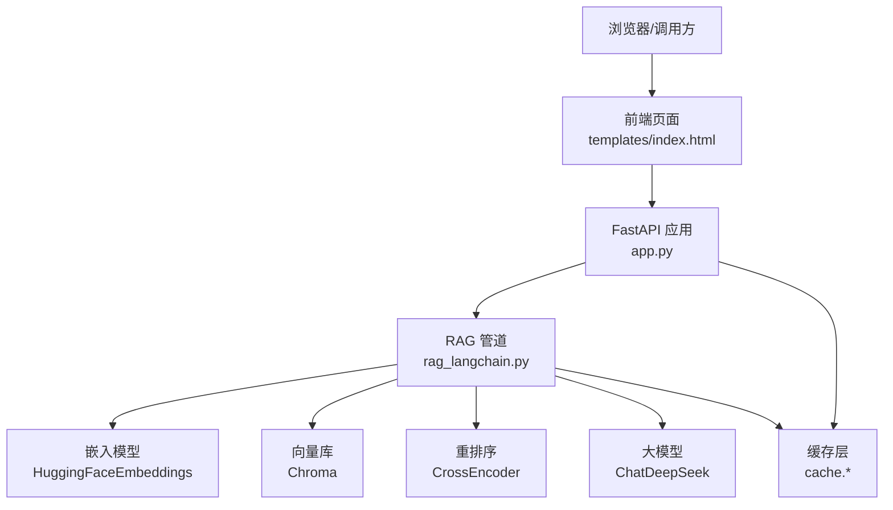
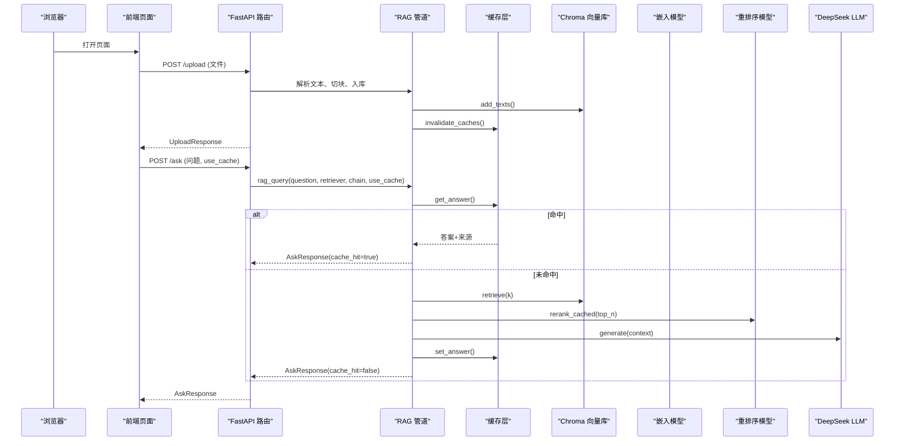
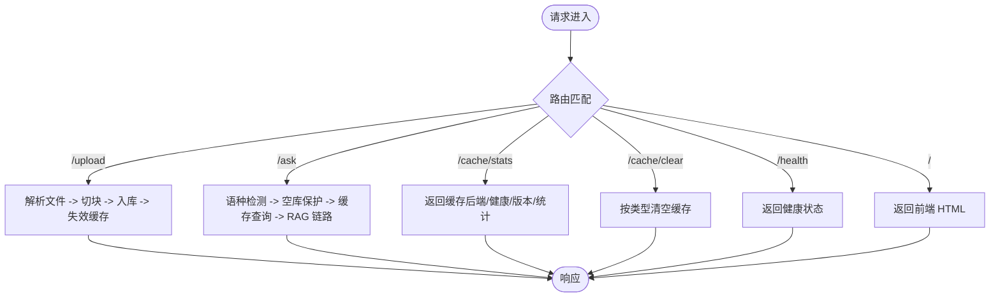
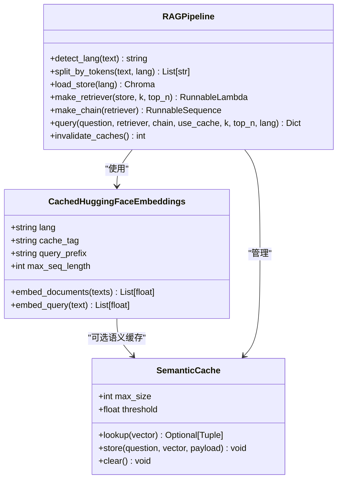
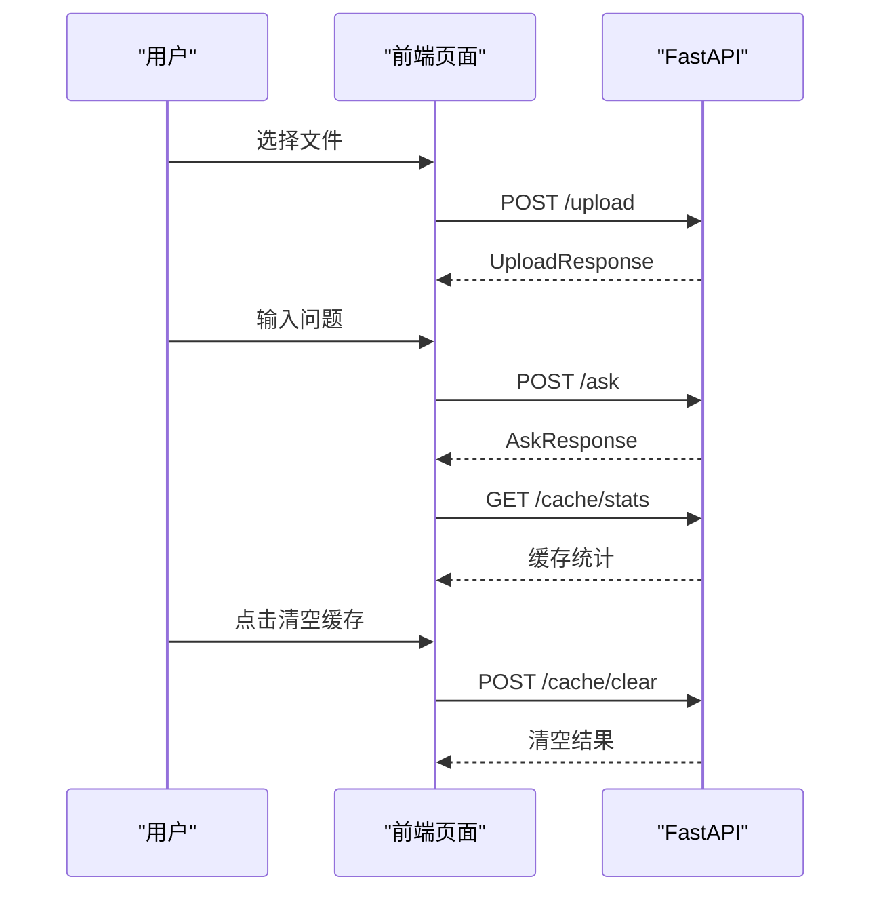
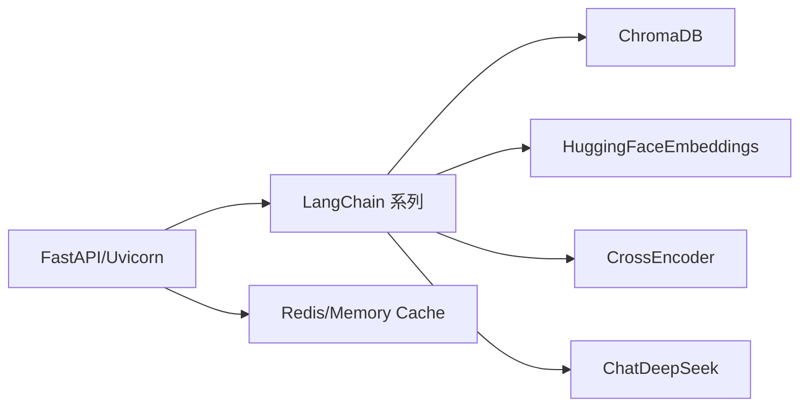

# Web API 服务

<cite>
**本文引用的文件**   
- [app.py](file://app.py)
- [rag_langchain.py](file://rag_langchain.py)
- [requirements.txt](file://requirements.txt)
- [templates/index.html](file://templates/index.html)
- [verify_cache.py](file://verify_cache.py)
</cite>

## 目录
1. [简介](#简介)
2. [项目结构](#项目结构)
3. [核心组件](#核心组件)
4. [架构总览](#架构总览)
5. [详细组件分析](#详细组件分析)
6. [依赖关系分析](#依赖关系分析)
7. [性能与并发特性](#性能与并发特性)
8. [部署、运维与安全](#部署运维与安全)
9. [故障排查指南](#故障排查指南)
10. [结论](#结论)

## 简介
本项目是一个基于 FastAPI 的 RAG（检索增强生成）Web API 服务，支持中文与英文双知识库、三层缓存（问答、向量、精排分数）、可选语义近似匹配缓存，并提供前端页面用于上传文档、提问和查看缓存状态。后端通过 LangChain 组合 Chroma 向量库、HuggingFace 嵌入模型、CrossEncoder 重排序以及 DeepSeek LLM，形成“召回 → 精排 → 生成”的完整链路。

该服务的设计目标是：
- 中英双语隔离：不同语种的文档和问题分别路由到对应 collection 与 embedding 模型，避免跨空间相似度噪声。
- 可观测与可控：提供健康检查、缓存统计、手动清理接口；前端直观展示命中状态、耗时与引用来源。
- 高可用与容错：缓存层 fail-open，异常不会改变正确答案；空库保护避免模型“凭印象作答”。
- 可扩展与可评测：保留离线主流程、评测函数与验证脚本，便于回归测试与效果评估。

## 项目结构
仓库采用“应用入口 + 业务逻辑 + 前端模板 + 工具/验证脚本”的组织方式：
- `app.py`：FastAPI 应用、路由处理器、请求/响应模型、全局对象懒加载与线程安全单例。
- `rag_langchain.py`：RAG 管道核心，包括语种判断、嵌入模型、Chroma 客户端、切块、检索、重排、LLM 链、缓存集成、离线主流程与评测函数。
- `templates/index.html`：内置前端页面，负责文件上传、提问、结果渲染与缓存状态面板。
- `requirements.txt`：Python 依赖清单，包含 FastAPI、LangChain、ChromaDB、HuggingFace、DeepSeek、Redis 等。
- `verify_cache.py`：不加载模型的缓存层验证脚本，覆盖读写、TTL、统计、失效、降级路径。

**图表来源**
- [app.py:36-53](file://app.py#L36-L53)
- [rag_langchain.py:39-48](file://rag_langchain.py#L39-L48)
- [templates/index.html:101-233](file://templates/index.html#L101-L233)

**章节来源**
- [app.py:1-53](file://app.py#L1-L53)
- [rag_langchain.py:1-50](file://rag_langchain.py#L1-L50)
- [templates/index.html:1-100](file://templates/index.html#L1-L100)
- [requirements.txt:1-19](file://requirements.txt#L1-L19)

## 核心组件
- FastAPI 应用与路由：定义 `/upload`、`/ask`、`/cache/stats`、`/cache/clear`、`/health`、`/` 端点，统一使用 Pydantic 模型进行参数校验与响应序列化。
- RAG 管道：按语种选择 embedding 模型与 collection，执行检索、精排、生成，并接入三层缓存。
- 缓存层：问答缓存、向量缓存、精排分数缓存，支持 Redis 或内存后端，具备 TTL、版本号失效、命中率统计。
- 前端页面：实现上传、提问、结果展示、缓存状态可视化与清空操作。

关键设计要点：
- 双检锁单例：embedding 模型、Chroma 客户端、retriever、chain 均懒加载并使用线程锁保证并发安全。
- 空库保护：目标语种 collection 为空时直接返回提示，不走检索，避免无依据回答。
- 版本化失效：文档更新后提升缓存版本，旧答案立即失效，防止“文档已更新但答案仍旧”。

**章节来源**
- [app.py:53-155](file://app.py#L53-L155)
- [rag_langchain.py:118-143](file://rag_langchain.py#L118-L143)
- [rag_langchain.py:185-254](file://rag_langchain.py#L185-L254)
- [rag_langchain.py:257-289](file://rag_langchain.py#L257-L289)
- [rag_langchain.py:417-467](file://rag_langchain.py#L417-L467)
- [rag_langchain.py:579-644](file://rag_langchain.py#L579-L644)

## 架构总览
下图展示了从前端到后端、再到外部依赖的完整调用链，以及缓存在各环节的作用位置。

**图表来源**
- [app.py:155-260](file://app.py#L155-L260)
- [rag_langchain.py:452-508](file://rag_langchain.py#L452-L508)
- [rag_langchain.py:579-631](file://rag_langchain.py#L579-L631)

## 详细组件分析

### FastAPI 应用与路由
- 应用初始化：标题、全局懒加载字典、线程锁、前端模板路径。
- 全局对象：`_stores`、`_retrievers`、`_chains` 按语种懒加载，双检锁保证并发安全。
- 集合大小查询：直接走 Chroma 的 count，避免触发 embedding 模型加载与 collection 创建。
- 请求/响应模型：`AskRequest`、`AskResponse`、`UploadResponse`、`CacheClearRequest`。
- 路由处理器：
  - `POST /upload`：解析 PDF/Markdown/TXT，按文档语种切块、替换对应 collection、失效缓存、更新预览文件。
  - `POST /ask`：按问题语种路由，空库保护，调用 `rag_query`，返回答案、来源、缓存命中信息、耗时、语种。
  - `GET /cache/stats`：返回缓存后端类型、健康状态、版本号、各语种库块数、TTL、统计指标。
  - `POST /cache/clear`：按类型清空缓存。
  - `GET /health`：轻量健康检查。
  - `GET /`：返回前端页面。

**图表来源**
- [app.py:155-297](file://app.py#L155-L297)

**章节来源**
- [app.py:53-155](file://app.py#L53-L155)
- [app.py:155-297](file://app.py#L155-L297)

### RAG 管道核心
- 语种判断：基于 CJK 字符占比阈值判定中文/英文，简单高效且稳定。
- 嵌入模型：`CachedHuggingFaceEmbeddings` 子类覆写 `embed_documents`/`embed_query`，接入向量缓存；按语种懒加载，设置最大序列长度与查询前缀。
- Chroma 客户端：共享 `PersistentClient`，兼容新旧版本 `client=`/`path=`/`persist_directory=`。
- 文档加载与切块：PDF 用 PyMuPDFLoader，Markdown/TXT 直接读取；按 token 切块，使用语种对应的 tokenizer，offset 对齐原文。
- 检索与重排：`make_retriever` 封装召回 top-k 与 cross-encoder 精排 top-n，精排分数走缓存。
- LLM 链：PromptTemplate + ChatDeepSeek + StrOutputParser，支持传入字符串或带 context 的 dict，避免重复召回。
- 语义缓存：可选开启，按语种维护 LRU 表，余弦相似度阈值命中，默认关闭以防误命中。
- 问答入口：`query` 函数串联精确缓存、语义缓存、真实链路，并回写缓存。
- 失效机制：`invalidate_caches` 清空语义缓存、问答与精排缓存，提升版本号。

**图表来源**
- [rag_langchain.py:185-254](file://rag_langchain.py#L185-L254)
- [rag_langchain.py:324-359](file://rag_langchain.py#L324-L359)
- [rag_langchain.py:363-405](file://rag_langchain.py#L363-L405)
- [rag_langchain.py:452-508](file://rag_langchain.py#L452-L508)
- [rag_langchain.py:514-576](file://rag_langchain.py#L514-L576)
- [rag_langchain.py:579-644](file://rag_langchain.py#L579-L644)

**章节来源**
- [rag_langchain.py:118-143](file://rag_langchain.py#L118-L143)
- [rag_langchain.py:185-254](file://rag_langchain.py#L185-L254)
- [rag_langchain.py:292-359](file://rag_langchain.py#L292-L359)
- [rag_langchain.py:363-405](file://rag_langchain.py#L363-L405)
- [rag_langchain.py:417-508](file://rag_langchain.py#L417-L508)
- [rag_langchain.py:514-644](file://rag_langchain.py#L514-L644)

### 前端页面交互
- 文件上传：选择 PDF/Markdown/TXT，调用 `/upload`，显示成功/失败消息，自动刷新缓存统计。
- 提问：提交 JSON `{query, use_cache}`，根据 `cache_hit` 显示徽标（命中/真实计算），展示答案与引用来源。
- 缓存状态：调用 `/cache/stats`，展示后端类型、健康状态、版本号、各语种库块数、命中率、TTL、节省的 LLM 调用次数。
- 清空缓存：调用 `/cache/clear`，确认后刷新统计。

**图表来源**
- [templates/index.html:101-233](file://templates/index.html#L101-L233)
- [app.py:155-297](file://app.py#L155-L297)

**章节来源**
- [templates/index.html:1-237](file://templates/index.html#L1-L237)

## 依赖关系分析
- FastAPI 与 Uvicorn：提供异步 Web 框架与 ASGI 服务器。
- LangChain 生态：`langchain-core`、`langchain-community`、`langchain-chroma`、`langchain-huggingface`、`langchain-deepseek`。
- 向量库与嵌入：ChromaDB、HuggingFaceEmbeddings、sentence-transformers。
- 重排序：HuggingFaceCrossEncoder。
- 大模型：ChatDeepSeek。
- 缓存：Redis 客户端（可选，连不上自动降级为内存）。
- 其他：PyMuPDF（PDF 解析）、python-dotenv（环境变量）。

**图表来源**
- [requirements.txt:1-19](file://requirements.txt#L1-L19)

**章节来源**
- [requirements.txt:1-19](file://requirements.txt#L1-L19)

## 性能与并发特性
- 懒加载与单例：embedding 模型、Chroma 客户端、retriever、chain 均在首次使用时构造，并用线程锁保护，避免重复加载导致内存峰值翻倍。
- 三层缓存：
  - 问答缓存：同一问题不重复走完整链路，显著减少 LLM 调用与等待时间。
  - 向量缓存：同一段文本不重复做模型前向，上传重复内容或重复提问收益明显。
  - 精排分数缓存：(问题, 片段) 的 cross-encoder 打分不重复计算，缓解最慢环节。
- 语义缓存（可选）：对问法不同但语义相近的问题进行近似匹配，默认关闭以避免误命中。
- 空库保护：目标语种 collection 为空时直接返回提示，避免无效检索与模型幻觉。
- 版本化失效：文档更新后提升版本号，旧答案立即失效，确保答案与文档一致性。

优化建议：
- 调整 `RETRIEVE_K` 与 `RERANK_TOP_N` 平衡召回质量与延迟。
- 调整 `CHUNK_TOKENS` 与 `CHUNK_OVERLAP_TOKENS` 控制切块粒度与重叠率。
- 启用语义缓存时需调高阈值，避免答非所问。
- 监控缓存命中率与 TTL，合理配置 Redis 持久化与淘汰策略。

[本节为通用性能讨论，不直接分析具体文件]

## 部署、运维与安全
- 启动方式：`uvicorn.run(app, host="0.0.0.0", port=8000)`，生产环境建议使用多进程 worker 与反向代理（如 Nginx）。
- 环境变量：
  - `BGE_QUERY_PREFIX`：控制 bge 系列 query 前缀开关。
  - `CHUNK_TOKENS`、`CHUNK_OVERLAP_TOKENS`：切块参数。
  - `SEMANTIC_CACHE`、`SEMANTIC_THRESHOLD`：语义缓存开关与阈值。
  - `CACHE_BACKEND`：缓存后端（redis/memory/auto）。
  - `RESP_CLIENT_MODULE`：替换 redis 客户端模块（用于测试）。
- 健康检查：`/health` 返回缓存后端与健康状态，适合容器编排探针。
- 缓存统计：`/cache/stats` 暴露后端类型、健康、版本、TTL、命中率，便于监控告警。
- 安全考虑：
  - 前端对输出进行 HTML 转义，防止 XSS。
  - 上传文件类型限制为 PDF/Markdown/TXT，避免恶意文件。
  - 缓存层 fail-open，异常不影响正确答案，但需关注 Redis 连接失败时的降级行为。

**章节来源**
- [app.py:300-303](file://app.py#L300-L303)
- [rag_langchain.py:83-115](file://rag_langchain.py#L83-L115)
- [templates/index.html:183-187](file://templates/index.html#L183-L187)

## 故障排查指南
- 上传失败：
  - 检查文件类型是否受支持（PDF/Markdown/TXT）。
  - 检查文件内容是否为空。
  - 检查临时文件写入权限与磁盘空间。
- 问答为空库：
  - 确认目标语种 collection 是否有数据。
  - 先上传对应语种文档再提问。
- 缓存未命中：
  - 检查 `use_cache` 参数是否被前端勾选“跳过缓存”。
  - 检查缓存后端是否健康（`/cache/stats`）。
  - 检查版本号是否因文档更新而提升。
- 模型加载缓慢：
  - 确认懒加载机制生效，避免启动时同时加载两个 embedding 模型。
  - 检查是否重复构造 retriever/chain。
- 缓存验证：
  - 运行 `verify_cache.py`，无需模型与 LLM Key，秒级验证缓存读写、TTL、统计、失效、降级路径。

**章节来源**
- [app.py:155-228](file://app.py#L155-L228)
- [app.py:231-260](file://app.py#L231-L260)
- [verify_cache.py:61-202](file://verify_cache.py#L61-L202)

## 结论
本 Web API 服务以 FastAPI 为核心，结合 LangChain 生态实现了中英双语 RAG 检索增强生成，并通过三层缓存显著提升性能与稳定性。设计上强调语种隔离、空库保护、版本化失效与 fail-open 容错，前端提供直观的交互与监控能力。对于初学者，可从上传文档与提问入手理解整体流程；对于有经验的开发者，可深入调整检索参数、缓存策略与部署配置，以获得更优的性能与效果。

[本节为总结性内容，不直接分析具体文件]