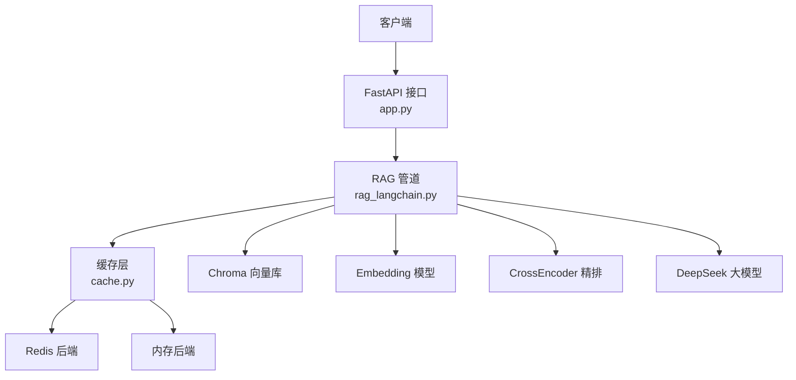
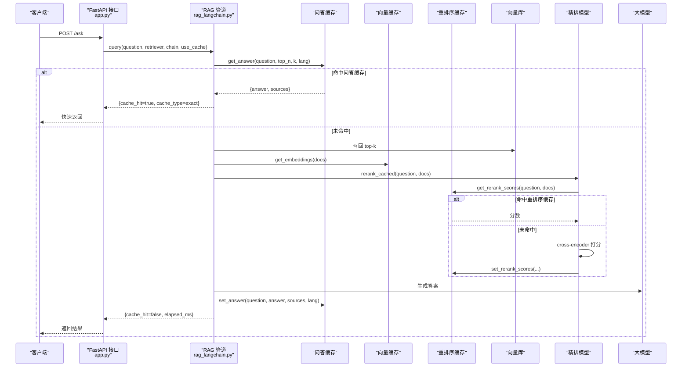
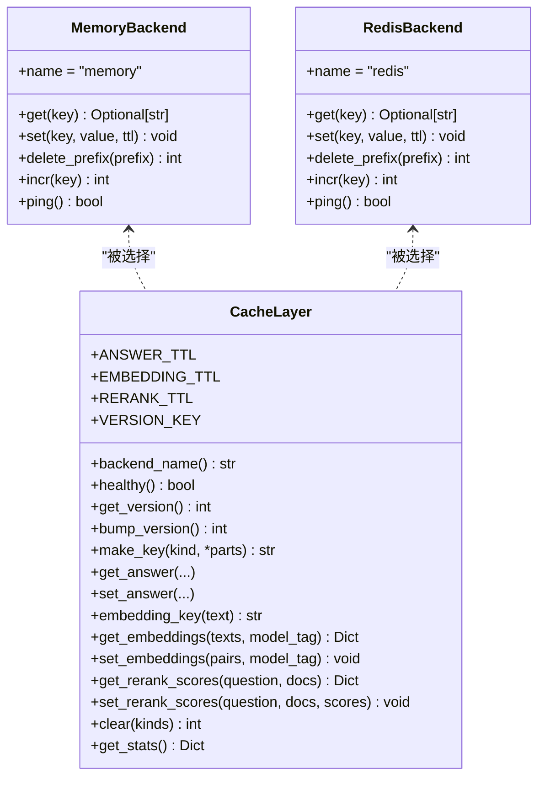
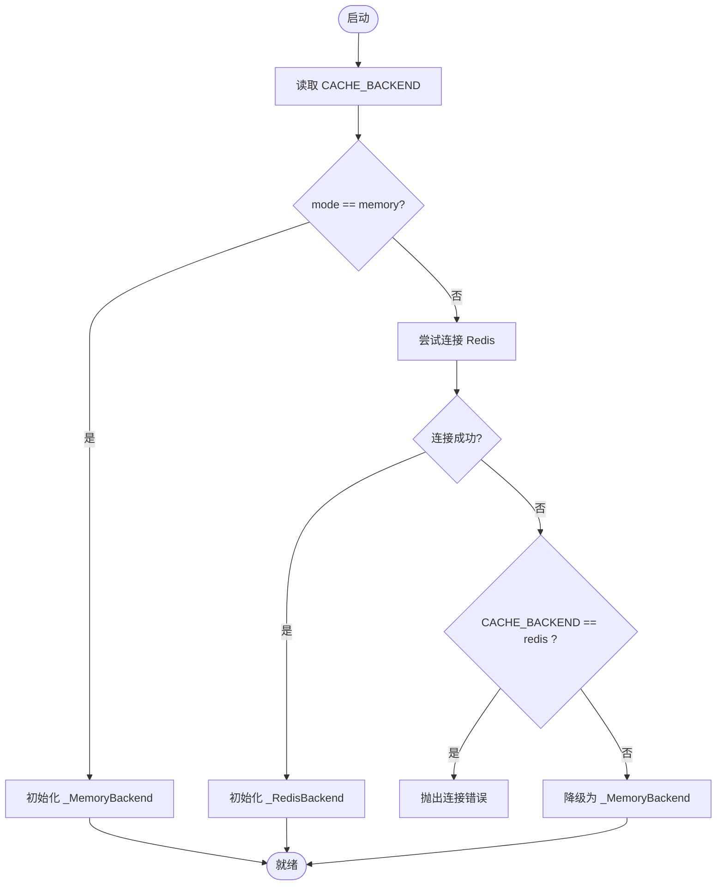
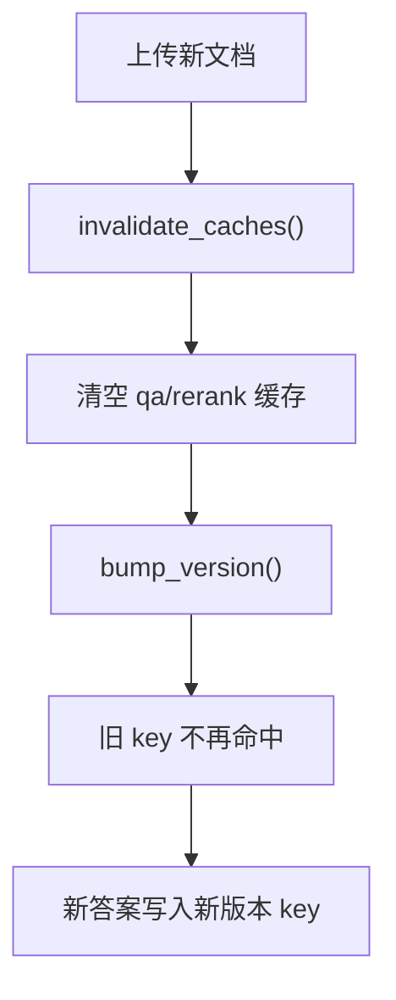
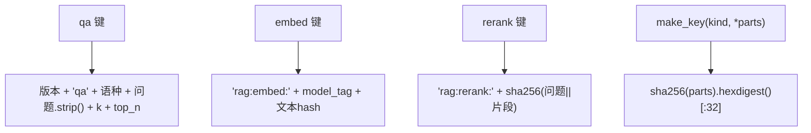
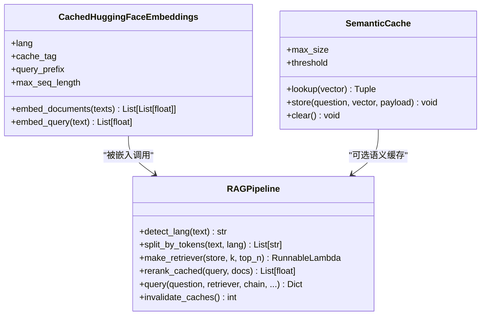
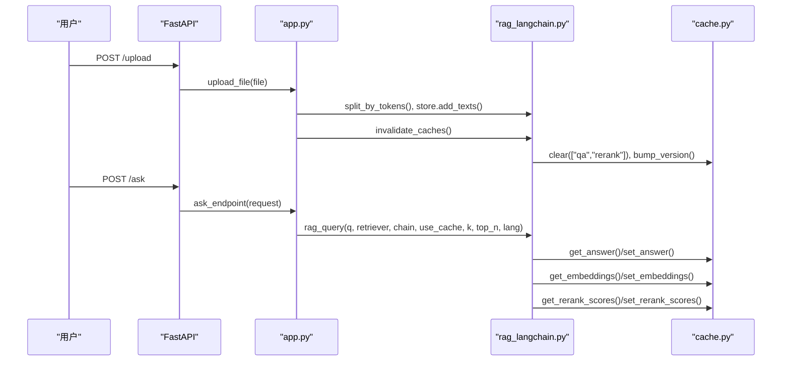
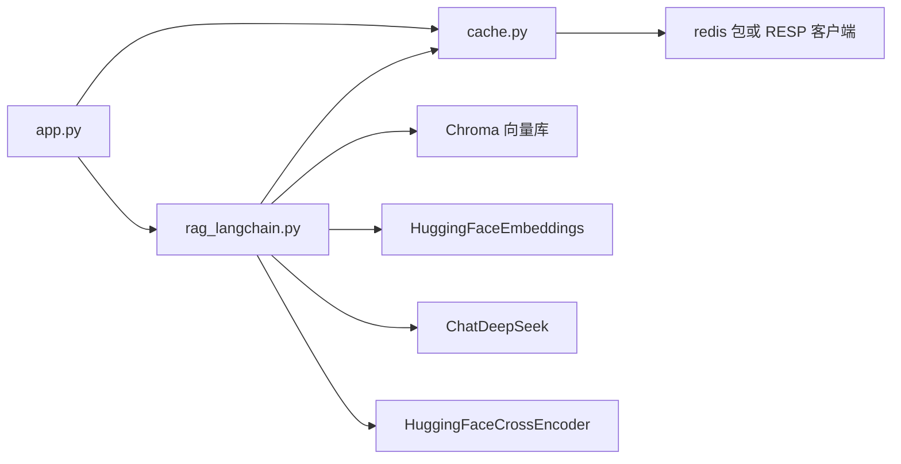

# 多层缓存系统

<cite>
**本文引用的文件**   
- [app.py](file://app.py)
- [rag_langchain.py](file://rag_langchain.py)
- [cache.py](file://cache.py)
- [verify_cache.py](file://verify_cache.py)
- [tools/mini_redis_resp.py](file://tools/mini_redis_resp.py)
- [tools/resp_client.py](file://tools/resp_client.py)
</cite>

## 目录
1. [引言](#引言)
2. [项目结构](#项目结构)
3. [核心组件](#核心组件)
4. [架构总览](#架构总览)
5. [详细组件分析](#详细组件分析)
6. [依赖关系分析](#依赖关系分析)
7. [性能与优化](#性能与优化)
8. [故障排除指南](#故障排除指南)
9. [结论](#结论)
10. [附录：配置与使用示例](#附录配置与使用示例)

## 引言
本仓库实现了一个面向 RAG（检索增强生成）的多层缓存系统，目标是在不改变业务正确性的前提下显著降低重复计算和外部调用成本。系统提供三层缓存：
- 问答缓存：命中后直接返回答案与引用片段，跳过召回、精排与大模型生成。
- 向量缓存：命中后跳过 embedding 模型前向，避免重复计算文本向量。
- 重排序缓存：命中后跳过 cross-encoder 打分，避免重复计算 (问题, 片段) 分数。

后端支持 Redis 与进程内内存两种实现，默认自动选择：能连上 Redis 则优先使用 Redis；否则降级到内存。所有缓存异常都采用 fail-open 策略：读不到或写失败时，系统继续走真实链路，保证“缓存丢了只会变慢，不会变错”。

## 项目结构
本项目围绕 FastAPI Web 服务、LangChain RAG 管道与独立缓存模块组织：
- app.py：FastAPI 接口层，负责上传文档、提问、查看/清理缓存与健康检查。
- rag_langchain.py：RAG 主流程，包含语种路由、嵌入、向量库、召回、精排、生成以及语义缓存开关。
- cache.py：缓存抽象与实现，封装 Redis/内存后端、TTL、版本号、统计与三类缓存 API。
- verify_cache.py：纯缓存验证脚本，无需加载模型即可校验读写、TTL、失效、统计等逻辑。
- tools/mini_redis_resp.py 与 tools/resp_client.py：用于在无 redis-py 环境下验证 Redis 代码路径的极简 RESP 服务器与客户端。

**图表来源** 
- [app.py:155-284](file://app.py#L155-L284)
- [rag_langchain.py:416-508](file://rag_langchain.py#L416-L508)
- [cache.py:75-200](file://cache.py#L75-L200)

**章节来源**
- [app.py:1-53](file://app.py#L1-L53)
- [rag_langchain.py:1-24](file://rag_langchain.py#L1-L24)
- [cache.py:1-29](file://cache.py#L1-L29)

## 核心组件
- 缓存层（cache.py）
  - 后端选择：auto / redis / memory，支持连接失败自动降级。
  - 通用能力：TTL、版本号、统计、键生成、通用 get/set。
  - 三类缓存 API：问答、向量、重排序。
- RAG 管道（rag_langchain.py）
  - 语种判断与双库隔离。
  - 带缓存的嵌入、召回 + 精排、生成链。
  - 语义缓存（可选）。
- Web 接口（app.py）
  - 上传、提问、缓存统计、缓存清理、健康检查。

**章节来源**
- [cache.py:37-72](file://cache.py#L37-L72)
- [rag_langchain.py:118-143](file://rag_langchain.py#L118-L143)
- [app.py:129-153](file://app.py#L129-L153)

## 架构总览
下图展示一次提问从接口到缓存、再到 RAG 管道的完整调用序列。若命中问答缓存，则直接返回；否则依次执行向量缓存、精排缓存、最终写入问答缓存。

**图表来源** 
- [rag_langchain.py:579-631](file://rag_langchain.py#L579-L631)
- [rag_langchain.py:428-467](file://rag_langchain.py#L428-L467)
- [cache.py:271-367](file://cache.py#L271-L367)

## 详细组件分析

### 缓存层设计与实现（cache.py）
缓存层是系统的加速中枢，承担以下职责：
- 后端选择与降级：根据环境变量 CACHE_BACKEND 决定 auto / redis / memory。auto 模式下连接失败会静默降级为内存。
- TTL 管理：问答、向量、重排序分别有独立 TTL，可通过环境变量覆盖。
- 版本控制：通过版本号 key 让知识库更新后旧答案立即失效。
- 统计：进程内计数器记录命中/未命中次数与命中率。
- 键生成：统一 make_key 与前缀策略，确保不同缓存类型、不同模型、不同参数可区分。

**图表来源** 
- [cache.py:75-148](file://cache.py#L75-L148)
- [cache.py:176-233](file://cache.py#L176-L233)
- [cache.py:250-391](file://cache.py#L250-L391)

#### 后端选择机制
- 环境变量：
  - CACHE_BACKEND：auto / redis / memory。
  - REDIS_URL：Redis 连接地址。
  - RESP_CLIENT_MODULE：测试钩子，允许用自定义 RESP 客户端替换 redis 包。
- 行为：
  - memory：直接使用 _MemoryBackend。
  - redis：尝试连接 Redis，失败时若为强制模式则抛错，否则降级为 memory。
  - auto：优先 Redis，失败则降级 memory。

**图表来源** 
- [cache.py:176-199](file://cache.py#L176-L199)

**章节来源**
- [cache.py:37-44](file://cache.py#L37-L44)
- [cache.py:154-199](file://cache.py#L154-L199)

#### 失效策略与版本控制
- 每条缓存记录带 TTL，过期后自然失效。
- 知识库变更时调用 bump_version()，版本号递增使旧答案 key 变化，从而整体失效。
- clear() 支持按类型定向清理，问答与重排序缓存使用前缀匹配删除历史版本，向量缓存不清理（因为向量只取决于文本与模型，与知识库内容无关）。

**图表来源** 
- [rag_langchain.py:634-644](file://rag_langchain.py#L634-L644)
- [cache.py:216-233](file://cache.py#L216-L233)
- [cache.py:371-391](file://cache.py#L371-L391)

**章节来源**
- [cache.py:216-233](file://cache.py#L216-L233)
- [cache.py:371-391](file://cache.py#L371-L391)
- [rag_langchain.py:634-644](file://rag_langchain.py#L634-L644)

#### 缓存键生成规则
- 问答缓存键：包含缓存版本、类型、语种、问题原文、k、top_n。
- 向量缓存键：包含 embed 前缀、model_tag（通常为语种）、文本哈希。
- 重排序缓存键：包含 rerank 前缀、(问题||片段) 哈希。
- 通用键：make_key(kind, *parts) 将 parts 拼接并取 sha256 前 32 位作为内容摘要。

**图表来源** 
- [cache.py:264-268](file://cache.py#L264-L268)
- [cache.py:271-300](file://cache.py#L271-L300)
- [cache.py:304-319](file://cache.py#L304-L319)
- [cache.py:349-367](file://cache.py#L349-L367)

**章节来源**
- [cache.py:264-319](file://cache.py#L264-L319)
- [cache.py:349-367](file://cache.py#L349-L367)

### RAG 管道中的缓存集成（rag_langchain.py）
- 向量缓存：
  - CachedHuggingFaceEmbeddings 覆写 embed_documents/embed_query，内部调用 _embed_documents_cached/_embed_query_cached，命中则跳过模型前向。
  - model_tag 由 get_embedding_model(lang) 构造，包含语种、模型路径、最大序列长度，防止不同模型向量互相覆盖。
- 重排序缓存：
  - rerank_cached 对 (问题, 片段) 打分进行缓存，减少 cross-encoder 调用次数。
- 问答缓存：
  - query() 先查精确缓存，再可选语义缓存，最后走真实链路并回写问答缓存。
- 语义缓存（可选）：
  - SemanticCache 基于内存 OrderedDict 做近似匹配，默认关闭以避免误命中风险。

**图表来源** 
- [rag_langchain.py:185-222](file://rag_langchain.py#L185-L222)
- [rag_langchain.py:514-576](file://rag_langchain.py#L514-L576)
- [rag_langchain.py:428-467](file://rag_langchain.py#L428-L467)
- [rag_langchain.py:579-631](file://rag_langchain.py#L579-L631)

**章节来源**
- [rag_langchain.py:145-222](file://rag_langchain.py#L145-L222)
- [rag_langchain.py:428-467](file://rag_langchain.py#L428-L467)
- [rag_langchain.py:514-576](file://rag_langchain.py#L514-L576)
- [rag_langchain.py:579-631](file://rag_langchain.py#L579-L631)

### Web 接口与缓存交互（app.py）
- /upload：解析文档、切块、入库、失效缓存、刷新预览文件。
- /ask：按问题语种路由，调用 rag_query，返回 cache_hit/cache_type/elapsed_ms/lang。
- /cache/stats：返回后端名称、健康状态、版本号、各语种库块数、TTL、统计。
- /cache/clear：支持定向清理 qa/embed/rerank。
- /health：轻量健康检查。

**图表来源** 
- [app.py:155-228](file://app.py#L155-L228)
- [app.py:231-260](file://app.py#L231-L260)
- [app.py:263-284](file://app.py#L263-L284)
- [rag_langchain.py:634-644](file://rag_langchain.py#L634-L644)

**章节来源**
- [app.py:155-228](file://app.py#L155-L228)
- [app.py:231-260](file://app.py#L231-L260)
- [app.py:263-284](file://app.py#L263-L284)

## 依赖关系分析
- app.py 依赖：
  - FastAPI、Pydantic、LangChain 相关组件。
  - cache 模块与 rag_langchain 模块。
- rag_langchain.py 依赖：
  - LangChain Chroma、HuggingFaceEmbeddings、ChatDeepSeek、CrossEncoder。
  - cache 模块。
- cache.py 依赖：
  - 标准库 hashlib/json/time/threading。
  - 可选 redis 包或通过 RESP_CLIENT_MODULE 注入的自定义客户端。

**图表来源** 
- [app.py:36-51](file://app.py#L36-L51)
- [rag_langchain.py:39-48](file://rag_langchain.py#L39-L48)
- [cache.py:154-173](file://cache.py#L154-L173)

**章节来源**
- [app.py:36-51](file://app.py#L36-L51)
- [rag_langchain.py:39-48](file://rag_langchain.py#L39-L48)
- [cache.py:154-173](file://cache.py#L154-L173)

## 性能与优化
- 分层缓存收益：
  - 问答缓存：跳过整条链路，适合高频重复问题。
  - 向量缓存：跳过 embedding 前向，适合重复上传或重复提问。
  - 重排序缓存：跳过 cross-encoder 打分，适合召回结果重复或问题重复。
- 并发与单例：
  - 模型与客户端懒加载并使用双检锁，避免重复加载与内存峰值。
- TTL 与版本：
  - 合理设置 TTL 平衡命中率与一致性；知识库变更后提升版本号保证一致性。
- 统计与观测：
  - 通过 /cache/stats 观察命中率、后端类型、版本号与各语种库块数。

[本节为通用指导，不直接分析具体文件]

## 故障排除指南
- 缓存穿透
  - 现象：大量不存在的问题导致频繁走真实链路。
  - 建议：对空结果也写入短 TTL 的占位值；结合语义缓存阈值谨慎开启。
- 缓存雪崩
  - 现象：大批量 TTL 同时到期导致瞬时压力。
  - 建议：为不同 key 添加随机抖动 TTL；监控 /cache/stats 命中率与后端健康。
- Redis 不可用
  - 现象：auto 模式降级为 memory，多进程不共享。
  - 建议：检查 REDIS_URL 与网络；生产环境使用 CACHE_BACKEND=redis 以在连接失败时直接报错。
- 向量空间污染
  - 现象：不同模型向量互相覆盖导致检索质量下降。
  - 建议：确保 model_tag 包含模型路径与 max_seq_length；保持中英文分库。
- 版本不一致
  - 现象：上传文档后仍命中旧答案。
  - 建议：确保上传流程调用 invalidate_caches() 与 bump_version()；检查 /cache/stats 版本号是否递增。

**章节来源**
- [cache.py:176-199](file://cache.py#L176-L199)
- [cache.py:216-233](file://cache.py#L216-L233)
- [rag_langchain.py:634-644](file://rag_langchain.py#L634-L644)

## 结论
本多层缓存系统在 RAG 管道中提供了高价值的加速点：问答、向量与重排序三个层次分别针对最昂贵的步骤进行缓存。通过 Redis/内存双后端、TTL 与版本号机制，系统在可用性与一致性之间取得平衡。配合 /cache/stats 与 verify_cache.py，运维与开发者可以方便地观测与验证缓存行为。对于初学者，建议先从 memory 后端开始理解缓存键、TTL 与失效流程；对于有经验者，可结合 Redis 部署与语义缓存开关进一步优化吞吐与延迟。

[本节为总结性内容，不直接分析具体文件]

## 附录：配置与使用示例

### 环境变量与配置
- REDIS_URL：Redis 连接地址，默认 redis://127.0.0.1:6379/0。
- CACHE_BACKEND：auto / redis / memory。
- CACHE_ANSWER_TTL / CACHE_EMBEDDING_TTL / CACHE_RERANK_TTL：各类缓存 TTL（秒）。
- SEMANTIC_CACHE / SEMANTIC_THRESHOLD：语义缓存开关与相似度阈值。
- RESP_CLIENT_MODULE：测试钩子，指定自定义 RESP 客户端模块名。

**章节来源**
- [cache.py:37-44](file://cache.py#L37-L44)
- [rag_langchain.py:113-116](file://rag_langchain.py#L113-L116)

### 运行与验证
- 启动服务：python app.py（默认端口 8000）。
- 上传文档：POST /upload，支持 PDF 与 Markdown。
- 提问：POST /ask，返回 answer/sources/cache_hit/cache_type/elapsed_ms/lang。
- 查看缓存状态：GET /cache/stats。
- 清理缓存：POST /cache/clear，支持 kinds=["qa","embed","rerank"]。
- 健康检查：GET /health。
- 缓存验证：python verify_cache.py，支持 CACHE_BACKEND 与 RESP_CLIENT_MODULE。

**章节来源**
- [app.py:155-284](file://app.py#L155-L284)
- [verify_cache.py:61-197](file://verify_cache.py#L61-L197)

### 使用示例（接口层面）
- 上传中文文档：
  - 请求：POST /upload，文件为中文 PDF。
  - 响应：chunk_count、cache_invalidated、lang="zh"。
- 提问英文问题：
  - 请求：POST /ask，use_cache=true。
  - 响应：cache_hit=true/false、cache_type="exact"/"semantic(...)"/"miss"、elapsed_ms、lang="en"。
- 查看缓存后端与命中率：
  - 请求：GET /cache/stats。
  - 响应：backend、healthy、version、collections、ttl_seconds、stats。

**章节来源**
- [app.py:155-228](file://app.py#L155-L228)
- [app.py:231-260](file://app.py#L231-L260)
- [app.py:263-284](file://app.py#L263-L284)