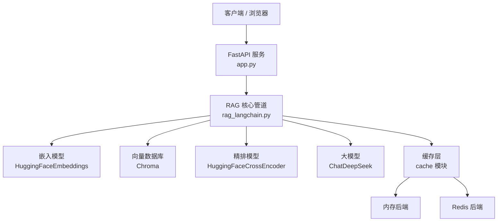
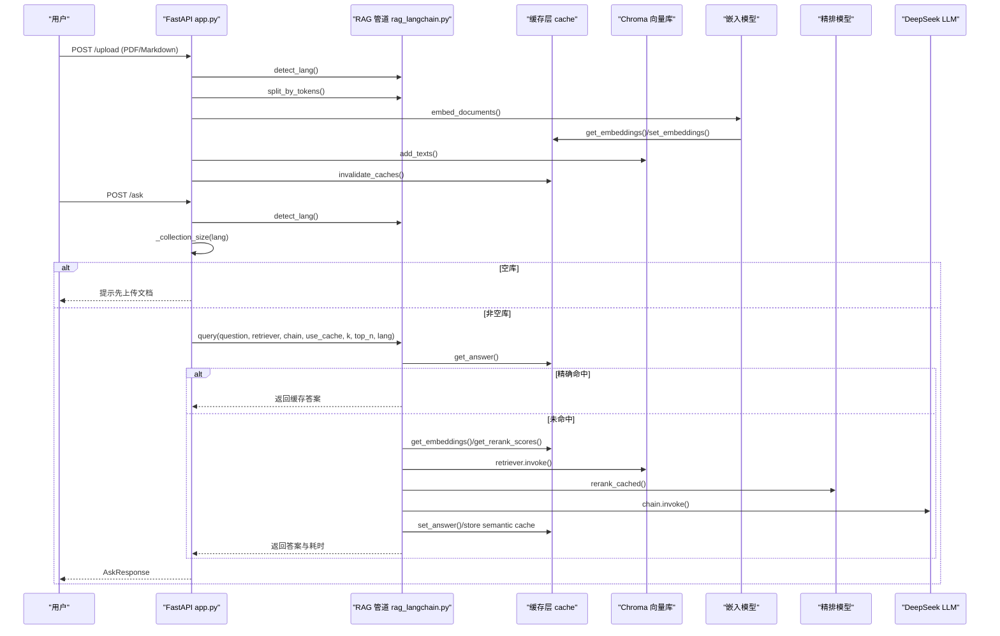
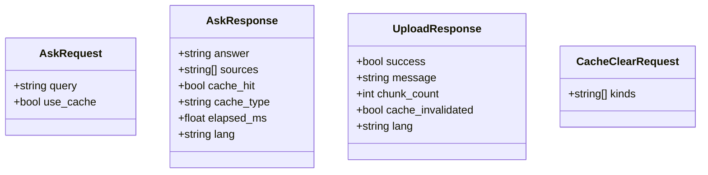
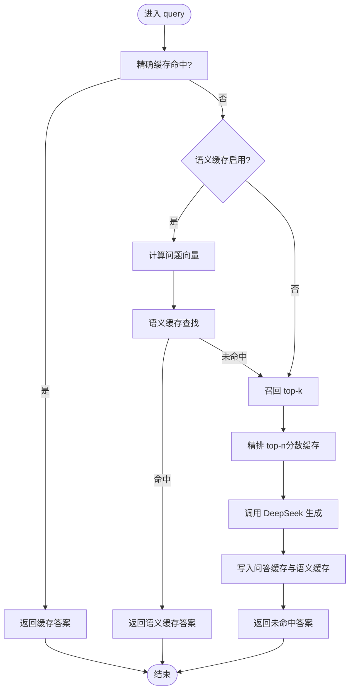
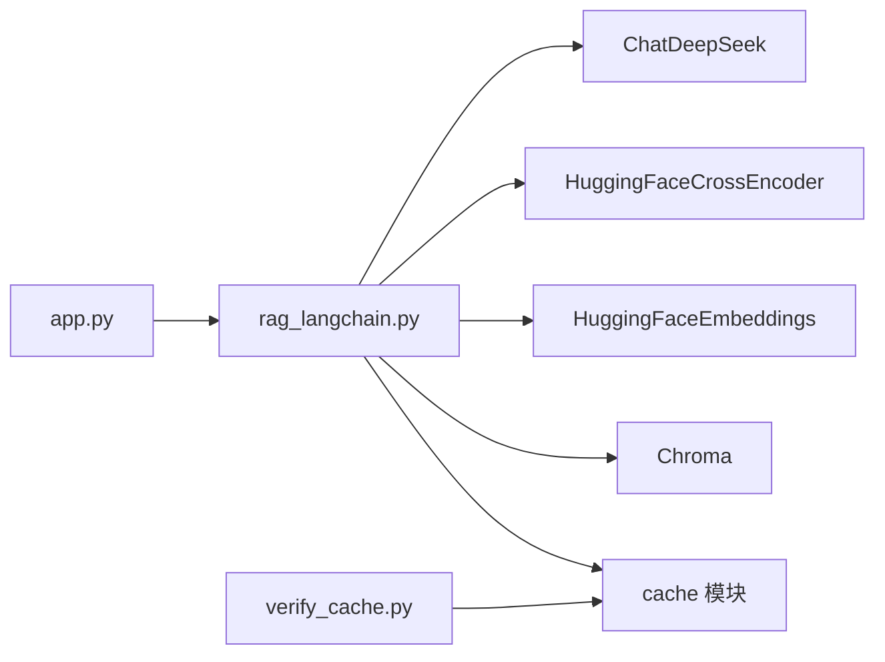

# 核心模块

<cite>
**本文引用的文件**   
- [app.py](file://app.py)
- [rag_langchain.py](file://rag_langchain.py)
- [requirements.txt](file://requirements.txt)
- [verify_cache.py](file://verify_cache.py)
- [resp_client.py](file://tools/resp_client.py)
- [mini_redis_resp.py](file://tools/mini_redis_resp.py)
</cite>

## 目录
1. [引言](#引言)
2. [项目结构](#项目结构)
3. [核心组件](#核心组件)
4. [架构总览](#架构总览)
5. [详细组件分析](#详细组件分析)
6. [依赖关系分析](#依赖关系分析)
7. [性能与缓存特性](#性能与缓存特性)
8. [配置与环境变量](#配置与环境变量)
9. [接口设计](#接口设计)
10. [常见问题与排错](#常见问题与排错)
11. [结论](#结论)

## 引言
本技术文档聚焦 RAG 系统的核心模块，包括：
- RAG 核心管道（检索、精排、生成）
- 多层缓存系统（问答缓存、向量缓存、精排分数缓存、语义缓存）
- Web API 服务（FastAPI 路由、请求模型、健康检查）
- 领域模型（语种路由、知识库 collection、文本块、检索结果、缓存统计）

目标是让初学者能理解整体流程，同时为有经验的开发者提供足够的实现细节、调用关系、接口契约和可操作建议。

## 项目结构
仓库采用“Web 服务 + 核心管道 + 工具脚本”的扁平组织方式：
- `app.py`：FastAPI Web 服务入口，负责上传、提问、缓存管理、健康检查与前端页面。
- `rag_langchain.py`：RAG 核心管道，包含语种判断、嵌入模型、Chroma 向量库、召回与精排、LLM 生成、缓存集成、评测与离线主流程。
- `verify_cache.py`：不加载模型的缓存层验证脚本，覆盖读写、TTL、失效、清理、降级等路径。
- `tools/resp_client.py`：极简 RESP 客户端，用于在无 `redis` 包时验证 Redis 代码路径。
- `tools/mini_redis_resp.py`：极简 RESP 测试服务器，配合 resp_client 验证 cache 的 Redis 行为。
- `requirements.txt`：依赖声明，含 LangChain、Chroma、HuggingFace、DeepSeek、FastAPI、Redis 客户端等。

**图表来源**
- [app.py:53-303](file://app.py#L53-L303)
- [rag_langchain.py:39-47](file://rag_langchain.py#L39-L47)
- [rag_langchain.py:185-254](file://rag_langchain.py#L185-L254)
- [rag_langchain.py:452-467](file://rag_langchain.py#L452-L467)
- [rag_langchain.py:471-508](file://rag_langchain.py#L471-L508)
- [rag_langchain.py:580-631](file://rag_langchain.py#L580-L631)

**章节来源**
- [app.py:1-303](file://app.py#L1-L303)
- [rag_langchain.py:1-779](file://rag_langchain.py#L1-L779)
- [requirements.txt:1-19](file://requirements.txt#L1-L19)

## 核心组件
- Web 服务层（FastAPI）
  - 路由：`/upload`、`/ask`、`/cache/stats`、`/cache/clear`、`/health`、`/`
  - 请求/响应模型：`AskRequest`、`AskResponse`、`UploadResponse`、`CacheClearRequest`
  - 全局单例：按语种懒加载 store、retriever、chain，使用双检锁避免并发重复构造
- RAG 核心管道（LangChain）
  - 语种判断：基于汉字占比快速区分中文/英文
  - 嵌入模型：按语种懒加载，带向量缓存；支持查询前缀
  - 向量库：每个语种一个 Chroma collection，共享 PersistentClient
  - 召回与精排：先向量召回 top-k，再用 cross-encoder 精排到 top-n
  - 生成：PromptTemplate + ChatDeepSeek + StrOutputParser
  - 缓存集成：问答缓存、向量缓存、精排分数缓存、可选语义缓存
  - 版本失效：文档更新后提升版本号，使旧答案失效
- 缓存层（cache 模块）
  - 多后端：Redis 或进程内内存，自动降级
  - 三类缓存键空间：问答、向量、精排分数
  - TTL、命中率、清理、版本控制
- 工具脚本
  - `verify_cache.py`：独立验证缓存逻辑
  - `tools/resp_client.py`：RESP 客户端
  - `tools/mini_redis_resp.py`：RESP 测试服务器

**章节来源**
- [app.py:129-153](file://app.py#L129-L153)
- [app.py:155-297](file://app.py#L155-L297)
- [rag_langchain.py:118-143](file://rag_langchain.py#L118-L143)
- [rag_langchain.py:185-254](file://rag_langchain.py#L185-L254)
- [rag_langchain.py:363-413](file://rag_langchain.py#L363-L413)
- [rag_langchain.py:428-467](file://rag_langchain.py#L428-L467)
- [rag_langchain.py:471-508](file://rag_langchain.py#L471-L508)
- [rag_langchain.py:514-576](file://rag_langchain.py#L514-L576)
- [rag_langchain.py:580-644](file://rag_langchain.py#L580-L644)
- [verify_cache.py:1-202](file://verify_cache.py#L1-L202)

## 架构总览
RAG 的核心数据流如下：
- 上传文档：检测语种 → 切块 → 向量化（走向量缓存）→ 入库对应语种的 Chroma collection → 失效问答与精排缓存 → 刷新该语种 chunks_preview
- 提问：检测问题语种 → 空库保护 → 精确缓存命中？→ 语义缓存命中？→ 召回 → 精排（走精排分数缓存）→ 生成（DeepSeek）→ 写入问答缓存与语义缓存

**图表来源**
- [app.py:155-260](file://app.py#L155-L260)
- [rag_langchain.py:118-143](file://rag_langchain.py#L118-L143)
- [rag_langchain.py:324-359](file://rag_langchain.py#L324-L359)
- [rag_langchain.py:428-467](file://rag_langchain.py#L428-L467)
- [rag_langchain.py:580-631](file://rag_langchain.py#L580-L631)

## 详细组件分析

### Web API 服务（FastAPI）
- 路由职责
  - `/upload`：解析 PDF/Markdown，按文档语种分库入库，失效相关缓存，刷新预览文件
  - `/ask`：按问题语种路由，空库保护，调用 RAG 管道并返回结构化结果
  - `/cache/stats`：暴露缓存后端类型、健康状态、版本号、各语种库块数、TTL、统计
  - `/cache/clear`：按类型清空缓存
  - `/health`：轻量健康检查
  - `/`：返回前端页面
- 关键数据结构
  - `AskRequest`：query、use_cache
  - `AskResponse`：answer、sources、cache_hit、cache_type、elapsed_ms、lang
  - `UploadResponse`：success、message、chunk_count、cache_invalidated、lang
  - `CacheClearRequest`：kinds（可选列表）
- 全局对象与并发安全
  - `_stores`、`_retrievers`、`_chains` 按语种懒加载，使用双检锁保证线程安全
  - `_collection_size` 直接通过 Chroma count 获取块数，避免触发 embedding 模型加载

**图表来源**
- [app.py:129-153](file://app.py#L129-L153)

**章节来源**
- [app.py:53-127](file://app.py#L53-L127)
- [app.py:155-297](file://app.py#L155-L297)

### RAG 核心管道（LangChain）
- 语种判断
  - 基于汉字字符占比阈值（≥5% 判中文），简单高效且对混写场景鲁棒
- 嵌入模型与向量缓存
  - `CachedHuggingFaceEmbeddings` 覆写 `embed_documents` 与 `embed_query`，接入向量缓存
  - 按语种懒加载模型，设置 `max_seq_length` 避免静默截断
  - 查询前缀仅作用于英文 bge 系列 query
- 向量库
  - 每个语种一个 Chroma collection，共享 `PersistentClient`
  - 构建索引时优先删除已有块而非 drop collection，保持实例有效
- 召回与精排
  - 召回 top-k，再使用 cross-encoder 打分精排到 top-n
  - 精排分数缓存以 `(question, doc)` 为键，显著减少最慢环节开销
- 生成链路
  - PromptTemplate + ChatDeepSeek + StrOutputParser
  - 链支持两种输入：字符串（内部召回）或字典（跳过召回，直接使用上下文）
- 语义缓存（可选）
  - 基于余弦相似度近似匹配不同问法，默认关闭以避免误命中
- 问答入口
  - `query()` 统一入口：精确缓存 → 语义缓存 → 真实链路 → 回写缓存
  - 返回结构化 dict，供 API 层包装

**图表来源**
- [rag_langchain.py:580-631](file://rag_langchain.py#L580-L631)
- [rag_langchain.py:514-576](file://rag_langchain.py#L514-L576)
- [rag_langchain.py:428-467](file://rag_langchain.py#L428-L467)
- [rag_langchain.py:471-508](file://rag_langchain.py#L471-L508)

**章节来源**
- [rag_langchain.py:118-143](file://rag_langchain.py#L118-L143)
- [rag_langchain.py:185-254](file://rag_langchain.py#L185-L254)
- [rag_langchain.py:363-413](file://rag_langchain.py#L363-L413)
- [rag_langchain.py:428-467](file://rag_langchain.py#L428-L467)
- [rag_langchain.py:471-508](file://rag_langchain.py#L471-L508)
- [rag_langchain.py:514-576](file://rag_langchain.py#L514-L576)
- [rag_langchain.py:580-644](file://rag_langchain.py#L580-L644)

### 缓存层（cache 模块）
说明：虽然仓库中未直接列出 `cache.py`，但多处代码引用了 `cache` 模块，并在 `verify_cache.py` 中对其进行完整验证。其职责包括：
- 后端选择：Redis 或内存，自动降级
- 三类缓存：问答、向量、精排分数
- TTL、命中率、清理、版本控制
- 键空间隔离：embedding_key、rerank key 前缀区分

验证脚本覆盖了：
- 基础读写与 TTL
- 问答缓存命中/未命中、参数变更不复用
- 向量缓存批量命中、key 一致性
- 精排分数缓存按片段下标对应、换问题不复用
- 版本号递增导致旧答案失效
- 定向清理与全量清理
- 后端健康与降级

**章节来源**
- [verify_cache.py:1-202](file://verify_cache.py#L1-L202)
- [app.py:263-284](file://app.py#L263-L284)
- [rag_langchain.py:147-182](file://rag_langchain.py#L147-L182)
- [rag_langchain.py:428-449](file://rag_langchain.py#L428-L449)
- [rag_langchain.py:621-644](file://rag_langchain.py#L621-L644)

### 工具脚本与测试辅助
- `verify_cache.py`：独立运行，无需模型与联网，验证缓存逻辑
- `tools/resp_client.py`：纯 socket RESP 客户端，模拟 redis-py 接口
- `tools/mini_redis_resp.py`：RESP 测试服务器，记录命令便于断言

这些工具帮助在不安装 Redis 服务端的情况下验证 Redis 代码路径，确保缓存层健壮性。

**章节来源**
- [verify_cache.py:1-202](file://verify_cache.py#L1-L202)
- [resp_client.py:1-132](file://tools/resp_client.py#L1-L132)
- [mini_redis_resp.py:1-222](file://tools/mini_redis_resp.py#L1-L222)

## 依赖关系分析
- 外部依赖
  - LangChain 生态：langchain、langchain-community、langchain-chroma、langchain-huggingface、langchain-deepseek、langchain-core
  - 模型与推理：sentence-transformers、chromadb、pymupdf
  - Web 框架：fastapi、uvicorn
  - 环境变量：python-dotenv
  - 缓存后端：redis（可选，连不上自动降级）
- 模块耦合
  - `app.py` 依赖 `rag_langchain.py` 与 `cache` 模块
  - `rag_langchain.py` 依赖 `cache`、Chroma、HuggingFaceEmbeddings、HuggingFaceCrossEncoder、ChatDeepSeek
  - `verify_cache.py` 仅依赖 `cache`，解耦模型与网络

**图表来源**
- [requirements.txt:1-19](file://requirements.txt#L1-L19)
- [app.py:43-51](file://app.py#L43-L51)
- [rag_langchain.py:39-47](file://rag_langchain.py#L39-L47)

**章节来源**
- [requirements.txt:1-19](file://requirements.txt#L1-L19)
- [app.py:43-51](file://app.py#L43-L51)
- [rag_langchain.py:39-47](file://rag_langchain.py#L39-L47)

## 性能与缓存特性
- 三层缓存收益
  - 问答缓存：避免重复走完整链路，节省 LLM 调用与等待时间
  - 向量缓存：避免重复模型前向，尤其对重复上传或重复提问明显
  - 精排分数缓存：cross-encoder 是最慢环节，成对打分缓存收益显著
- 语义缓存（可选）
  - 近似匹配不同问法，默认关闭以避免误命中风险
- 并发与资源
  - 模型与连接懒加载，双检锁避免重复构造
  - 共享 Chroma PersistentClient，避免多实例冲突
- 指标与监控
  - `/cache/stats` 暴露后端类型、健康状态、版本号、TTL、命中率
  - `AskResponse.elapsed_ms` 提供单次请求耗时

[本节为通用性能讨论，不直接分析具体文件]

## 配置与环境变量
- 语言与模型
  - `LANG_MODELS`：中英各自 embedding 模型路径
  - `LANG_MAX_SEQ`：最大序列长度（避免静默截断）
  - `LANG_QUERY_PREFIX`：bge 系列查询前缀（英文默认开启）
- 检索与切块
  - `RETRIEVE_K`：向量召回条数
  - `RERANK_TOP_N`：精排保留条数
  - `CHUNK_TOKENS`：按 token 切块大小
  - `CHUNK_OVERLAP_TOKENS`：重叠 token 数
- 缓存与语义缓存
  - `SEMANTIC_CACHE`：是否启用语义缓存
  - `SEMANTIC_THRESHOLD`：语义缓存相似度阈值
  - `CACHE_BACKEND`：缓存后端（auto/memory/redis）
  - `REDIS_URL`：Redis 连接 URL
- 其他
  - `BGE_QUERY_PREFIX`：覆盖英文查询前缀
  - `VERIFY_LOG`：缓存验证日志输出路径

**章节来源**
- [rag_langchain.py:59-115](file://rag_langchain.py#L59-L115)
- [verify_cache.py:10-18](file://verify_cache.py#L10-L18)

## 接口设计
- 上传接口
  - 方法：POST
  - 路径：/upload
  - 请求体：multipart/form-data，字段 file
  - 响应：UploadResponse
  - 行为：按文档语种分库入库，失效相关缓存，刷新预览文件
- 提问接口
  - 方法：POST
  - 路径：/ask
  - 请求体：AskRequest（query、use_cache）
  - 响应：AskResponse（answer、sources、cache_hit、cache_type、elapsed_ms、lang）
  - 行为：按问题语种路由，空库保护，先查缓存再走真实链路
- 缓存统计
  - 方法：GET
  - 路径：/cache/stats
  - 响应：backend、healthy、version、collections、ttl_seconds、stats
- 缓存清理
  - 方法：POST
  - 路径：/cache/clear
  - 请求体：CacheClearRequest（kinds 可选）
  - 响应：success、deleted、kinds
- 健康检查
  - 方法：GET
  - 路径：/health
  - 响应：status、cache_backend、cache_healthy、collections
- 前端页面
  - 方法：GET
  - 路径：/
  - 响应：HTMLResponse

**章节来源**
- [app.py:155-297](file://app.py#L155-L297)

## 常见问题与排错
- 问题：上传后回答仍基于旧文档
  - 原因：缓存未失效
  - 解决：上传流程会调用 `invalidate_caches()` 提升版本号；确认缓存版本已递增
- 问题：空库时得到看似正常但无依据的回答
  - 原因：未做空库保护
  - 解决：`/ask` 在目标语种库为空时直接返回提示，不走检索
- 问题：中英文向量混用导致检索噪声
  - 原因：不同 embedding 模型向量空间不同
  - 解决：按语种分 collection，严格分离
- 问题：超长文本被静默截断
  - 原因：模型自带 max_seq_length 过小
  - 解决：显式设置 `LANG_MAX_SEQ`，并确保切块不超过上限
- 问题：Redis 不可用时服务崩溃
  - 原因：未正确降级
  - 解决：自动降级为内存后端；可通过 `CACHE_BACKEND=memory` 强制使用内存
- 问题：缓存验证失败
  - 原因：Redis 客户端或服务端异常
  - 解决：使用 `tools/mini_redis_resp.py` 与 `tools/resp_client.py` 验证 RESP 路径；检查 `verify_cache.py` 输出

**章节来源**
- [app.py:231-260](file://app.py#L231-L260)
- [rag_langchain.py:634-644](file://rag_langchain.py#L634-L644)
- [verify_cache.py:179-202](file://verify_cache.py#L179-L202)

## 结论
本核心模块以 FastAPI 为入口，结合 LangChain 管道与多层缓存，实现了稳定、可观测、可扩展的 RAG 服务。通过语种分库、空库保护、版本失效与多种缓存策略，系统在性能与准确性之间取得平衡。工具脚本与验证用例确保了缓存层的健壮性与可维护性。对于初学者，建议从 `/health` 与 `/cache/stats` 入手理解系统状态；对于高级用户，可调整检索与精排参数、启用语义缓存并进行 A/B 对比。

[本节为总结性内容，不直接分析具体文件]