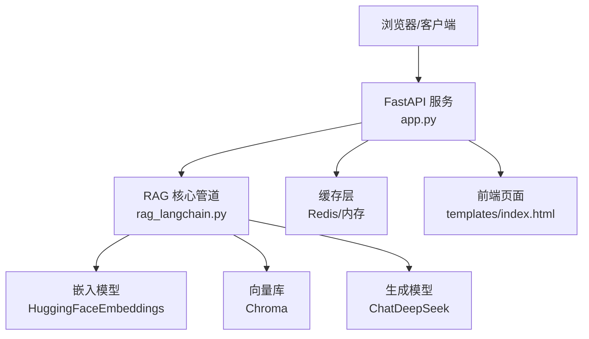
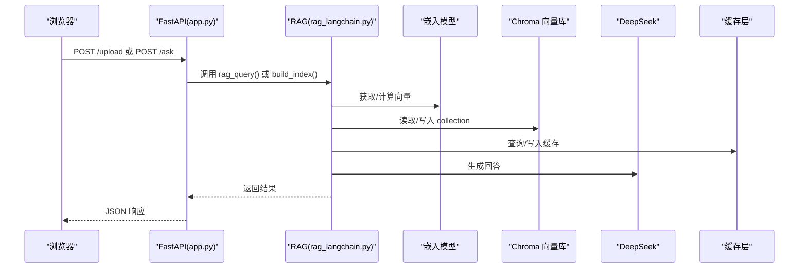
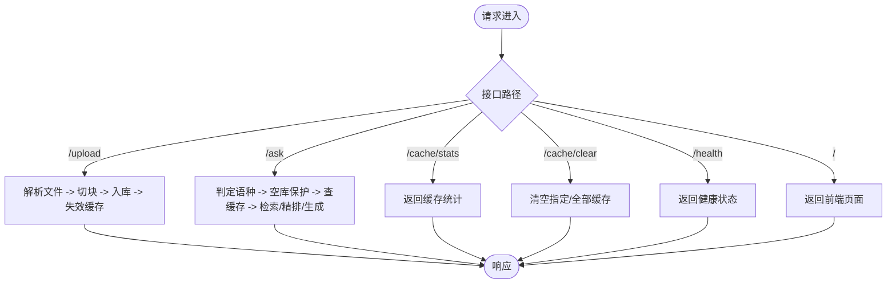
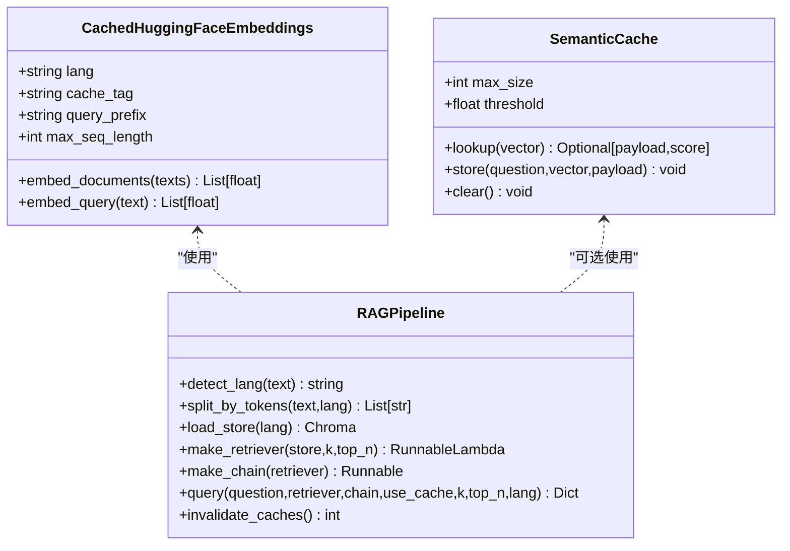
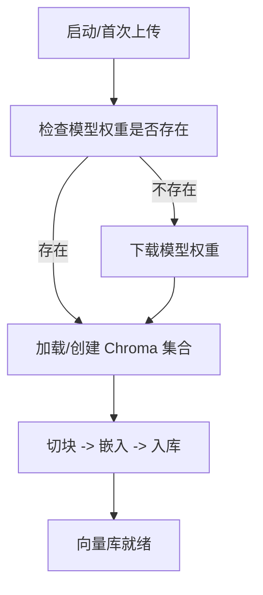

# 部署与配置

<cite>
**本文引用的文件**   
- [app.py](file://app.py)
- [rag_langchain.py](file://rag_langchain.py)
- [requirements.txt](file://requirements.txt)
- [.gitignore](file://.gitignore)
- [index.html](file://templates/index.html)
</cite>

## 目录
1. [简介](#简介)
2. [项目结构](#项目结构)
3. [核心组件](#核心组件)
4. [架构总览](#架构总览)
5. [详细组件分析](#详细组件分析)
6. [依赖与环境搭建](#依赖与环境搭建)
7. [环境变量与配置项](#环境变量与配置项)
8. [数据库与向量库初始化](#数据库与向量库初始化)
9. [服务启动流程](#服务启动流程)
10. [不同部署场景的配置示例](#不同部署场景的配置示例)
11. [性能调优参数](#性能调优参数)
12. [监控、日志与健康检查](#监控日志与健康检查)
13. [故障排除指南](#故障排除指南)
14. [结论](#结论)

## 简介
本指南面向需要在本地、测试环境或生产环境中部署 RAG Web 服务的工程师。系统基于 FastAPI + LangChain，使用 Chroma 作为向量库，DeepSeek 作为生成模型，并提供三层缓存（问答、向量、精排分数）以及可选的语义缓存。文档会覆盖环境准备、依赖安装、配置文件说明、数据库初始化、服务启动、多场景部署、性能调优、监控日志和常见问题处理。

## 项目结构
仓库根目录包含应用入口、RAG 核心逻辑、前端模板、依赖声明和忽略规则等关键文件：
- `app.py`：FastAPI Web 服务入口，提供上传、提问、缓存管理、健康检查等接口。
- `rag_langchain.py`：RAG 管道实现，包括语种判断、嵌入模型、分块、Chroma 向量库、检索与重排、生成链、缓存集成、评测脚本等。
- `templates/index.html`：内置前端页面，用于上传文档、提问、查看缓存状态。
- `requirements.txt`：Python 依赖清单。
- `.gitignore`：忽略密钥、本地配置、模型权重、运行产物等。

**图表来源**
- [app.py:36-53](file://app.py#L36-L53)
- [rag_langchain.py:39-47](file://rag_langchain.py#L39-L47)
- [rag_langchain.py:471-508](file://rag_langchain.py#L471-L508)

**章节来源**
- [app.py:1-53](file://app.py#L1-L53)
- [rag_langchain.py:1-50](file://rag_langchain.py#L1-L50)
- [requirements.txt:1-19](file://requirements.txt#L1-L19)
- [.gitignore:1-61](file://.gitignore#L1-L61)

## 核心组件
- FastAPI 应用与路由：提供 `/upload`、`/ask`、`/cache/stats`、`/cache/clear`、`/health`、`/` 等接口。
- RAG 管道：按语种选择 embedding 模型与 collection，执行召回、精排、生成。
- 缓存层：问答缓存、向量缓存、精排分数缓存；可选语义缓存。
- 前端页面：上传、提问、查看缓存统计、清空缓存。

**章节来源**
- [app.py:155-297](file://app.py#L155-L297)
- [rag_langchain.py:118-143](file://rag_langchain.py#L118-L143)
- [rag_langchain.py:145-254](file://rag_langchain.py#L145-L254)
- [rag_langchain.py:416-467](file://rag_langchain.py#L416-L467)
- [rag_langchain.py:471-508](file://rag_langchain.py#L471-L508)
- [rag_langchain.py:511-644](file://rag_langchain.py#L511-L644)
- [index.html:1-237](file://templates/index.html#L1-L237)

## 架构总览
下图展示请求从前端到后端、再到 RAG 管道、向量库、LLM 与缓存的整体交互。

**图表来源**
- [app.py:155-260](file://app.py#L155-L260)
- [rag_langchain.py:363-405](file://rag_langchain.py#L363-L405)
- [rag_langchain.py:452-467](file://rag_langchain.py#L452-L467)
- [rag_langchain.py:471-508](file://rag_langchain.py#L471-L508)
- [rag_langchain.py:580-631](file://rag_langchain.py#L580-L631)

## 详细组件分析

### FastAPI 应用与接口
- `/upload`：解析 PDF/Markdown/TXT，按文档语种切块并入库，失效相关缓存，更新对应语种的 chunks_preview 文件。
- `/ask`：按问题语种路由，空库保护，先查缓存再走检索→精排→生成链路。
- `/cache/stats`：返回缓存后端类型、健康状态、版本号、各语种库块数、TTL 与统计。
- `/cache/clear`：支持按类型清空缓存。
- `/health`：轻量健康检查。
- `/`：返回前端页面。

**图表来源**
- [app.py:155-297](file://app.py#L155-L297)

**章节来源**
- [app.py:155-297](file://app.py#L155-L297)

### RAG 核心管道
- 语种判断：基于汉字占比阈值区分中文与英文。
- 嵌入模型：按语种懒加载，带向量缓存；支持 bge 查询前缀。
- 分块：按 token 切块，避免跨语言信息量不一致；可配置大小与重叠。
- 向量库：每个语种一个 Chroma collection，共享 PersistentClient。
- 检索与重排：召回 top-k，cross-encoder 精排 top-n，分数缓存。
- 生成链：PromptTemplate + ChatDeepSeek + StrOutputParser。
- 语义缓存：可选，默认关闭；按语种独立存储。
- 问答入口：精确缓存 → 语义缓存 → 真实链路 → 写回缓存。

**图表来源**
- [rag_langchain.py:185-254](file://rag_langchain.py#L185-L254)
- [rag_langchain.py:324-359](file://rag_langchain.py#L324-L359)
- [rag_langchain.py:363-405](file://rag_langchain.py#L363-L405)
- [rag_langchain.py:452-467](file://rag_langchain.py#L452-L467)
- [rag_langchain.py:471-508](file://rag_langchain.py#L471-L508)
- [rag_langchain.py:511-644](file://rag_langchain.py#L511-L644)

**章节来源**
- [rag_langchain.py:118-143](file://rag_langchain.py#L118-L143)
- [rag_langchain.py:145-254](file://rag_langchain.py#L145-L254)
- [rag_langchain.py:324-359](file://rag_langchain.py#L324-L359)
- [rag_langchain.py:363-405](file://rag_langchain.py#L363-L405)
- [rag_langchain.py:416-467](file://rag_langchain.py#L416-L467)
- [rag_langchain.py:471-508](file://rag_langchain.py#L471-L508)
- [rag_langchain.py:511-644](file://rag_langchain.py#L511-L644)

## 依赖与环境搭建
- Python 版本建议：3.10+（根据 FastAPI/LangChain 生态要求）。
- 虚拟环境：建议使用 venv 或 conda 隔离依赖。
- 依赖安装：
  - 基础依赖：FastAPI、Uvicorn、LangChain 系列、Chroma、PyMuPDF、HuggingFace Embeddings、DeepSeek 客户端、dotenv。
  - 缓存依赖：Redis 客户端（可选），未安装时自动降级为进程内内存缓存。

安装步骤：
1. 创建并激活虚拟环境。
2. 安装依赖：`pip install -r requirements.txt`。
3. 准备本地模型权重目录（见“模型权重”部分）。
4. 准备 Redis（可选）：若启用 Redis 缓存，需确保 Redis 服务可用。

**章节来源**
- [requirements.txt:1-19](file://requirements.txt#L1-L19)

## 环境变量与配置项
以下环境变量控制 RAG 行为与缓存策略：

- `BGE_QUERY_PREFIX`：英文检索时给 query 加指令前缀（bge 官方建议），默认值在代码中定义，可通过环境变量覆盖。
- `CHUNK_TOKENS`：按 token 切块的大小，默认 256。
- `CHUNK_OVERLAP_TOKENS`：切块重叠 token 数，默认 40。
- `SEMANTIC_CACHE`：是否启用语义缓存，默认关闭（值为 "1" 才开启）。
- `SEMANTIC_THRESHOLD`：语义缓存相似度阈值，默认 0.95。
- `VERIFY_LOG`：缓存验证脚本日志输出路径（用于测试）。
- `RESP_CLIENT_MODULE`：缓存验证脚本中替换 redis 包的模块名（用于测试）。

注意：
- 所有模型路径、集合名称、检索参数等在代码中以常量形式定义，也可通过环境变量调整部分行为（如切块大小、语义缓存开关）。
- `.env` 文件会被 dotenv 加载，但已被 `.gitignore` 忽略，请勿提交敏感信息。

**章节来源**
- [rag_langchain.py:83-115](file://rag_langchain.py#L83-L115)
- [.gitignore:9-12](file://.gitignore#L9-L12)

## 数据库与向量库初始化
- 向量库：Chroma 持久化目录为 `chroma_db`，由代码自动创建与管理。
- 集合命名：中文集合 `rag_zh`，英文集合 `rag_en`。
- 模型权重：
  - 中文嵌入：`text2vec-base-chinese`
  - 英文嵌入：`bge-base-en-v1.5`
  - 精排模型：`mmarco-mMiniLMv2-L12-H384-v1`
- 初始化流程：
  1. 首次运行 `/upload` 或离线构建脚本时，会自动创建集合并向量化文档。
  2. 若更换 embedding 模型或维度，需要停止服务后手动删除 `chroma_db` 再重建。
  3. 上传文档会清空该语种集合中的旧块并按 index 重新编号入库。

**图表来源**
- [rag_langchain.py:91-96](file://rag_langchain.py#L91-L96)
- [rag_langchain.py:363-405](file://rag_langchain.py#L363-L405)
- [.gitignore:25-33](file://.gitignore#L25-L33)

**章节来源**
- [rag_langchain.py:91-96](file://rag_langchain.py#L91-L96)
- [rag_langchain.py:363-405](file://rag_langchain.py#L363-L405)
- [.gitignore:25-33](file://.gitignore#L25-L33)

## 服务启动流程
- 开发模式：直接运行 `python app.py`，默认监听 `0.0.0.0:8000`。
- 生产模式：建议使用 Uvicorn 或 Gunicorn + Uvicorn Worker 启动，并配合反向代理（Nginx/Caddy）。
- 前端页面：访问根路径 `/` 即可打开内置前端。

启动命令示例：
- 开发：`uvicorn app:app --host 0.0.0.0 --port 8000`
- 生产：`gunicorn app:app -w 4 -k uvicorn.workers.UvicornWorker --bind 0.0.0.0:8000`

**章节来源**
- [app.py:300-302](file://app.py#L300-L302)

## 不同部署场景的配置示例

### 开发环境
- 目标：快速验证功能，最小依赖。
- 配置要点：
  - 不强制安装 Redis，使用内存缓存。
  - 关闭语义缓存。
  - 使用默认切块大小与重叠。
- 启动方式：`python app.py` 或 `uvicorn app:app`。

### 测试环境
- 目标：模拟生产行为，验证缓存与性能。
- 配置要点：
  - 可选启用 Redis 缓存，设置连接信息（由缓存层负责）。
  - 可开启语义缓存并调整阈值进行 A/B 对比。
  - 使用固定切块参数便于回归测试。
- 启动方式：同开发，但可注入环境变量以切换行为。

### 生产环境
- 目标：高可用、高性能、可观测。
- 配置要点：
  - 使用 Redis 作为缓存后端，确保高吞吐与持久化。
  - 关闭语义缓存以避免误命中风险。
  - 调整切块大小与重叠以平衡召回质量与延迟。
  - 使用进程管理器（Gunicorn/Systemd）与反向代理。
  - 配置日志采集与指标上报（Prometheus/Grafana）。
- 启动方式：生产级进程管理 + 反向代理。

**章节来源**
- [rag_langchain.py:110-115](file://rag_langchain.py#L110-L115)
- [app.py:300-302](file://app.py#L300-L302)

## 性能调优参数
- 检索参数：
  - `RETRIEVE_K`：向量召回条数，默认 20。
  - `RERANK_TOP_N`：精排后保留条数，默认 5。
- 切块参数：
  - `CHUNK_TOKENS`：切块 token 数，默认 256。
  - `CHUNK_OVERLAP_TOKENS`：重叠 token 数，默认 40。
- 语义缓存：
  - `SEMANTIC_CACHE`：开关，默认关闭。
  - `SEMANTIC_THRESHOLD`：相似度阈值，默认 0.95。
- 嵌入模型：
  - `LANG_MAX_SEQ`：最大输入长度，默认 512。
  - `LANG_QUERY_PREFIX`：英文 query 前缀，可关闭。

调优建议：
- 提高 `RETRIEVE_K` 可提升召回率但增加精排开销。
- 增大 `CHUNK_TOKENS` 可能提升上下文完整性，但需注意模型上限与缓存键变化。
- 语义缓存需谨慎调低阈值，避免答非所问。

**章节来源**
- [rag_langchain.py:103-115](file://rag_langchain.py#L103-L115)
- [rag_langchain.py:64-77](file://rag_langchain.py#L64-L77)

## 监控、日志与健康检查
- 健康检查：`/health` 返回服务状态、缓存后端、健康状态与各语种库块数。
- 缓存统计：`/cache/stats` 返回后端类型、命中率、版本号、TTL 与统计明细。
- 前端统计：内置页面展示缓存命中率、TTL、节省的 DeepSeek 调用次数等。
- 日志：
  - 应用日志：由 Uvicorn/Gunicorn 输出。
  - 缓存验证日志：通过 `VERIFY_LOG` 环境变量输出到文件。

最佳实践：
- 将 `/health` 接入负载均衡器健康检查。
- 定期抓取 `/cache/stats` 并上报指标。
- 对错误日志进行集中采集与分析。

**章节来源**
- [app.py:263-290](file://app.py#L263-L290)
- [index.html:189-220](file://templates/index.html#L189-L220)

## 故障排除指南

### 常见问题
- 模型权重缺失：
  - 现象：导入或构建索引时报找不到模型路径。
  - 解决：下载所需模型权重到本地目录，并确保路径与代码一致。
- 向量库损坏或维度不一致：
  - 现象：重启后报错或检索异常。
  - 解决：停止服务，删除 `chroma_db` 目录后重新构建。
- 缓存不可用：
  - 现象：Redis 连接失败，缓存命中率低。
  - 解决：检查 Redis 服务状态；未安装 Redis 客户端时自动降级为内存缓存。
- 空库提问：
  - 现象：返回“知识库为空”提示。
  - 解决：先上传对应语种的文档。
- 语义缓存误命中：
  - 现象：答案不准确但命中缓存。
  - 解决：降低 `SEMANTIC_THRESHOLD` 或关闭语义缓存。

### 调试步骤
1. 检查 `/health` 与 `/cache/stats` 返回状态。
2. 查看应用日志与缓存验证日志（`VERIFY_LOG`）。
3. 确认模型权重与向量库目录权限。
4. 逐步禁用缓存（`use_cache=false`）定位问题。

**章节来源**
- [app.py:231-260](file://app.py#L231-L260)
- [rag_langchain.py:293-307](file://rag_langchain.py#L293-L307)
- [rag_langchain.py:383-405](file://rag_langchain.py#L383-L405)

## 结论
本指南提供了 RAG 系统的完整部署与配置说明，涵盖环境搭建、依赖安装、向量库初始化、服务启动、多场景配置、性能调优、监控日志与故障排除。通过合理配置环境变量与缓存策略，可在不同环境中平衡性能与准确性。生产环境建议启用 Redis 缓存、关闭语义缓存，并结合进程管理与反向代理提升稳定性与可观测性。