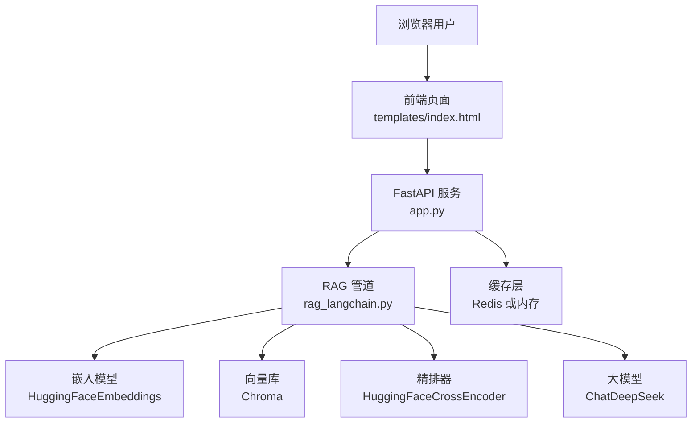
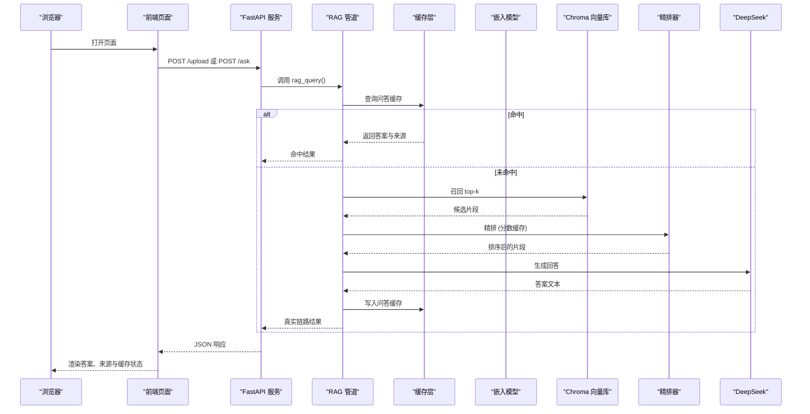
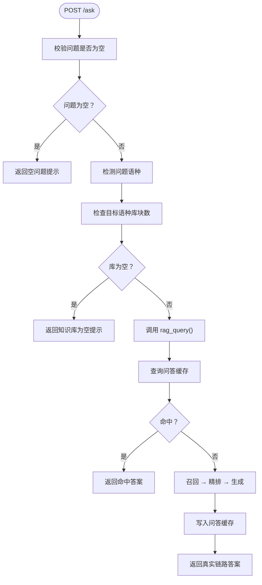
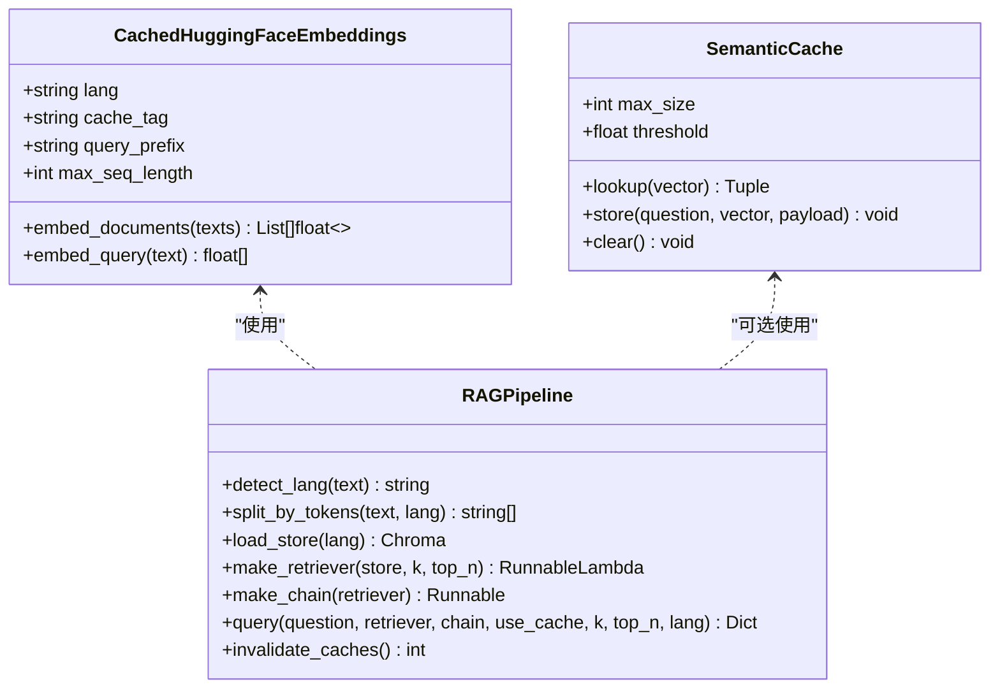
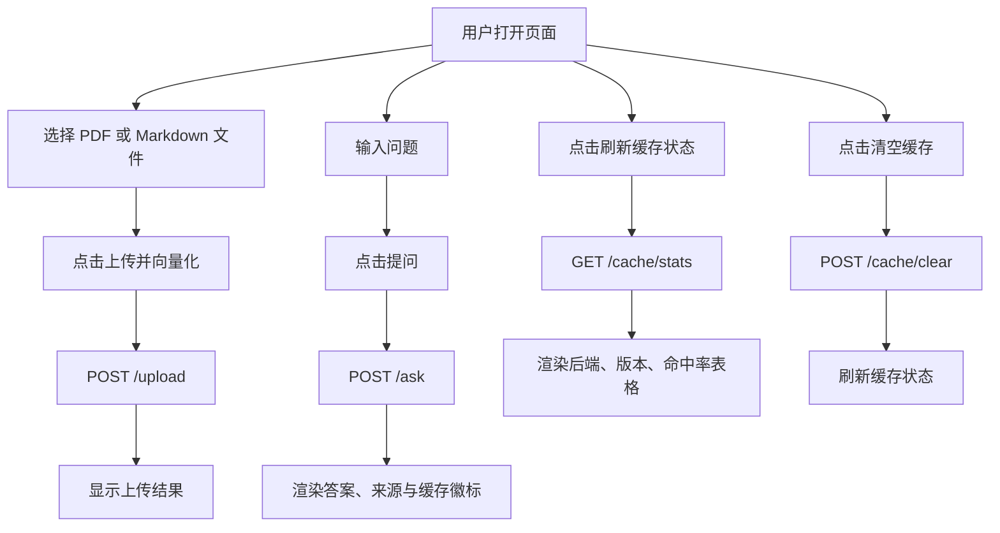
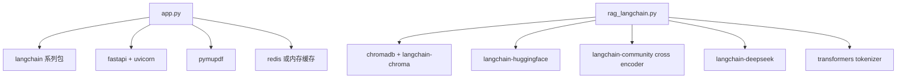

# 项目概述

<cite>
**本文引用的文件**   
- [app.py](file://app.py)
- [rag_langchain.py](file://rag_langchain.py)
- [requirements.txt](file://requirements.txt)
- [templates/index.html](file://templates/index.html)
- [verify_cache.py](file://verify_cache.py)
</cite>

## 目录
1. [引言](#引言)
2. [项目结构](#项目结构)
3. [核心组件](#核心组件)
4. [架构总览](#架构总览)
5. [详细组件分析](#详细组件分析)
6. [依赖与耦合分析](#依赖与耦合分析)
7. [性能与缓存特性](#性能与缓存特性)
8. [快速开始指南](#快速开始指南)
9. [故障排查](#故障排查)
10. [结论](#结论)

## 引言
本项目是一个面向中英双语场景的检索增强生成系统。它把“文档入库 → 向量检索 → 精排 → 大模型生成”这条 RAG 链路做成 Web API，并在关键路径上叠加三层缓存：问答缓存、向量缓存和精排分数缓存。系统支持上传 PDF 或 Markdown 文档，自动判断语种并进入对应的中文或英文知识库；提问时再按问题语种路由到对应库，最终由 DeepSeek 生成回答。前端页面提供上传、提问、查看缓存统计和清空缓存等交互能力。

设计目标包括：
- 中英双库隔离：中文和英文分别使用不同的 embedding 模型与 Chroma collection，避免跨模型向量空间混用导致检索噪声。
- 三层缓存加速：问答级、向量化级、cross-encoder 精排级分别命中，减少重复计算和大模型调用。
- 可观测与可控：通过健康检查、缓存统计、版本失效和手动清理接口，让运维和评测更透明。
- 轻量启动：FastAPI + Uvicorn 直接运行，配合本地向量库和可选 Redis 后端。

## 项目结构
仓库采用“服务入口 + RAG 管道 + 前端模板 + 工具脚本”的组织方式：
- `app.py`：FastAPI 服务入口，定义上传、提问、缓存管理、健康检查和前端页面路由。
- `rag_langchain.py`：RAG 核心管道，包含语种判断、嵌入模型、Chroma 向量库、召回与精排、Prompt 与 LLM 链、语义缓存、评测与预览输出等。
- `templates/index.html`：浏览器端界面，负责文件选择、上传、提问、结果展示和缓存状态面板。
- `requirements.txt`：Python 依赖清单，包含 LangChain 生态、Chroma、PyMuPDF、FastAPI、Uvicorn 以及可选 Redis 客户端。
- `verify_cache.py`：不加载任何模型的缓存层验证脚本，用于快速确认缓存读写、TTL、失效、统计和降级行为。
- `chunks_preview_zh.md` / `chunks_preview_en.md`：按语种生成的文本块预览文件，便于人工标注标准答案和评测对齐。

**图表来源**
- [app.py:36-53](file://app.py#L36-L53)
- [rag_langchain.py:39-48](file://rag_langchain.py#L39-L48)
- [templates/index.html:101-233](file://templates/index.html#L101-L233)

**章节来源**
- [app.py:1-53](file://app.py#L1-L53)
- [rag_langchain.py:1-50](file://rag_langchain.py#L1-L50)
- [templates/index.html:1-100](file://templates/index.html#L1-L100)
- [requirements.txt:1-19](file://requirements.txt#L1-L19)

## 核心组件
- **Web API 服务**：基于 FastAPI，暴露 `/upload`、`/ask`、`/cache/stats`、`/cache/clear`、`/health`、`/` 等接口，统一处理请求校验、语种判定、空库保护、缓存开关和响应封装。
- **RAG 管道**：以 LangChain 为核心，组合 Chroma 向量检索、cross-encoder 精排、PromptTemplate 与 ChatDeepSeek 生成，并通过 LCEL 串联成一条可复用的链。
- **中英双语知识库**：中文使用 `text2vec-base-chinese`，英文使用 `bge-base-en-v1.5`，各自维护独立的 Chroma collection，避免不同 embedding 空间的向量互相污染。
- **三层缓存系统**：
  - 问答缓存：同一问题、相同检索参数命中后直接返回答案与引用片段。
  - 向量缓存：同一段文本不重复做 embedding，上传重复内容或重复提问时收益明显。
  - 精排分数缓存：`(问题, 片段)` 的 cross-encoder 分数不重复计算，缓解最慢环节。
- **智能问答流程**：先精确匹配问题，再可选语义近似匹配，未命中则走“召回 → 精排 → 生成”，并把结果写回缓存。
- **前端交互**：提供文件上传、问题输入、是否跳过缓存的选项、结果展示、引用来源列表和缓存统计面板。

**章节来源**
- [app.py:155-297](file://app.py#L155-L297)
- [rag_langchain.py:118-143](file://rag_langchain.py#L118-L143)
- [rag_langchain.py:145-254](file://rag_langchain.py#L145-L254)
- [rag_langchain.py:416-467](file://rag_langchain.py#L416-L467)
- [rag_langchain.py:470-508](file://rag_langchain.py#L470-L508)
- [rag_langchain.py:511-644](file://rag_langchain.py#L511-L644)
- [templates/index.html:71-99](file://templates/index.html#L71-L99)

## 架构总览
下图展示了从浏览器到后端服务的完整调用关系，以及 RAG 管道内部的关键模块。

**图表来源**
- [app.py:231-260](file://app.py#L231-L260)
- [rag_langchain.py:579-631](file://rag_langchain.py#L579-L631)
- [rag_langchain.py:452-467](file://rag_langchain.py#L452-L467)
- [rag_langchain.py:470-508](file://rag_langchain.py#L470-L508)

## 详细组件分析

### Web API 服务（FastAPI）
FastAPI 服务承担以下职责：
- 接收文件上传并按语种解析、切块、入库，同时失效受影响的缓存并更新该语种的 chunks 预览文件。
- 接收问题，按问题语种路由到对应知识库，先查缓存，再走 RAG 链路，最后返回答案、来源、缓存命中信息和耗时。
- 提供缓存统计、手动清理和健康检查接口，方便运维观察后端类型、命中率、版本号和各语种库块数。
- 提供前端页面，供用户在浏览器中完成上传、提问和查看缓存状态。

关键实现要点：
- 全局懒加载 store、retriever、chain，避免重复加载本地模型和连接。
- 空库保护：目标语种库为空时直接提示，不走检索，防止模型“凭印象作答”。
- 上传接口只替换该语种 collection，不 drop 集合，保持 Chroma 实例和 retriever 有效。
- 所有缓存异常 fail-open：读不到就当未命中，照常走真实链路，保证可用性优先。

**图表来源**
- [app.py:231-260](file://app.py#L231-L260)
- [app.py:95-122](file://app.py#L95-L122)
- [rag_langchain.py:579-631](file://rag_langchain.py#L579-L631)

**章节来源**
- [app.py:155-297](file://app.py#L155-L297)

### RAG 管道（LangChain 版）
RAG 管道在“无缓存版”基础上增加缓存层，但管道本身逐行不变：
- 无缓存版：问题 → 召回 20 → 精排 5 → 调 DeepSeek。
- 缓存版：问题 → 问答缓存命中？是 → 直接返回；否则 → 召回 20（向量缓存）→ 精排 5（分数缓存）→ 调 DeepSeek → 写入问答缓存。

主要模块：
- 语种判断：根据汉字占比阈值区分中文与英文，决定后续模型与 collection。
- 嵌入模型：按语种懒加载 HuggingFaceEmbeddings，并包装为带向量缓存的子类。
- 向量库：每个语种一个 Chroma collection，共享 PersistentClient，避免多实例冲突。
- 召回与精排：先用 Chroma 召回 top-k，再用 cross-encoder 精排到 top-n。
- Prompt 与 LLM：PromptTemplate + StrOutputParser 组成 LCEL 链，调用 ChatDeepSeek。
- 语义缓存：可选开启，用嵌入向量余弦相似度近似匹配相似问题。
- 问答入口：统一入口函数 query，封装缓存命中、真实链路和缓存写入。

**图表来源**
- [rag_langchain.py:185-254](file://rag_langchain.py#L185-L254)
- [rag_langchain.py:324-359](file://rag_langchain.py#L324-L359)
- [rag_langchain.py:362-405](file://rag_langchain.py#L362-L405)
- [rag_langchain.py:416-467](file://rag_langchain.py#L416-L467)
- [rag_langchain.py:470-508](file://rag_langchain.py#L470-L508)
- [rag_langchain.py:511-644](file://rag_langchain.py#L511-L644)

**章节来源**
- [rag_langchain.py:1-116](file://rag_langchain.py#L1-L116)
- [rag_langchain.py:118-143](file://rag_langchain.py#L118-L143)
- [rag_langchain.py:145-254](file://rag_langchain.py#L145-L254)
- [rag_langchain.py:292-405](file://rag_langchain.py#L292-L405)
- [rag_langchain.py:416-508](file://rag_langchain.py#L416-L508)
- [rag_langchain.py:511-644](file://rag_langchain.py#L511-L644)

### 前端页面（HTML + JavaScript）
前端页面提供：
- 文件选择与上传按钮，调用 `/upload` 接口，显示上传状态和消息。
- 问题输入框与“跳过缓存”复选框，调用 `/ask` 接口，展示答案、引用来源和缓存命中徽标。
- 缓存状态面板，调用 `/cache/stats` 展示后端类型、健康状态、缓存版本、各语种库块数和命中率统计。
- 清空缓存按钮，调用 `/cache/clear` 清空全部缓存并刷新统计。

**图表来源**
- [templates/index.html:101-233](file://templates/index.html#L101-L233)

**章节来源**
- [templates/index.html:1-237](file://templates/index.html#L1-L237)

### 缓存层验证脚本
`verify_cache.py` 在不加载任何模型的情况下验证缓存层行为，包括：
- 基础读写与 TTL。
- 问答缓存命中与参数变更不误命中。
- 向量缓存按文本 hash 存取。
- 精排分数缓存按 `(问题, 片段)` 存取。
- 版本号递增导致旧答案失效。
- 定向清理与全量清理。
- 后端健康与降级路径。

该脚本适合快速回归缓存逻辑，无需联网或配置 DeepSeek Key。

**章节来源**
- [verify_cache.py:1-19](file://verify_cache.py#L1-L19)
- [verify_cache.py:61-197](file://verify_cache.py#L61-L197)

## 依赖与耦合分析
技术栈选择理由：
- LangChain 生态：提供统一的 Prompt、Retriever、LLM 抽象，便于组合 RAG 流水线。
- Chroma：本地持久化向量数据库，适合单机演示与开发，且支持按 collection 隔离中英文数据。
- HuggingFaceEmbeddings 与 HuggingFaceCrossEncoder：分别承担向量化与精排任务，模型可本地加载，便于离线评测。
- PyMuPDFLoader：读取 PDF 文本，配合 Markdown/TXT 直接读取，覆盖常见文档格式。
- FastAPI + Uvicorn：高性能异步 Web 框架，适合 RAG 这种可能涉及 I/O 和模型调用的服务。
- Redis（可选）：作为缓存后端，连不上时自动降级为进程内内存缓存，兼顾生产可用性与本地易用性。

依赖关系图：

**图表来源**
- [requirements.txt:1-19](file://requirements.txt#L1-L19)
- [app.py:36-53](file://app.py#L36-L53)
- [rag_langchain.py:39-48](file://rag_langchain.py#L39-L48)

**章节来源**
- [requirements.txt:1-19](file://requirements.txt#L1-L19)
- [app.py:36-53](file://app.py#L36-L53)
- [rag_langchain.py:39-48](file://rag_langchain.py#L39-L48)

## 性能与缓存特性
- 三层缓存分别解决不同瓶颈：
  - 问答缓存：避免重复走完整链路，节省 DeepSeek 调用与 5~15 秒等待。
  - 向量缓存：避免重复 embedding，对重复上传和重复提问收益明显。
  - 精排分数缓存：避免重复 cross-encoder 打分，缓解最慢环节。
- 语义缓存可选开启：通过嵌入向量余弦相似度近似匹配相似问题，默认关闭以避免误命中风险。
- 版本失效机制：文档变更后提升缓存版本，使旧答案失效，避免用户拿到基于旧文档的回答。
- 空库保护：目标语种库为空时直接提示，不走检索，防止模型“凭印象作答”。
- 并发安全：embedding 模型、Chroma client、tokenizers 等均采用懒加载与双检锁，避免重复加载和并发竞争。

**章节来源**
- [rag_langchain.py:10-14](file://rag_langchain.py#L10-L14)
- [rag_langchain.py:113-116](file://rag_langchain.py#L113-L116)
- [rag_langchain.py:228-254](file://rag_langchain.py#L228-L254)
- [rag_langchain.py:428-449](file://rag_langchain.py#L428-L449)
- [rag_langchain.py:511-644](file://rag_langchain.py#L511-L644)
- [app.py:238-249](file://app.py#L238-L249)

## 快速开始指南
以下步骤帮助开发者快速搭建并运行系统：

1. 安装依赖
   - 使用 Python 环境，安装 `requirements.txt` 中的依赖。
   - 如需 Redis 缓存，请确保本机已安装 Redis 服务；若未安装，系统将自动降级为内存缓存。

2. 准备文档
   - 将 PDF 或 Markdown 文档放入项目目录，或通过前端页面上传。
   - 系统会根据文档内容自动判断语种，并进入对应的中文或英文知识库。

3. 启动服务
   - 运行 `app.py`，默认监听 `0.0.0.0:8000`。
   - 打开浏览器访问 `http://localhost:8000`，进入前端页面。

4. 上传文档
   - 在前端选择 PDF 或 Markdown 文件，点击“上传并向量化”。
   - 系统会解析文本、按 token 切块、向量化并入库，同时失效相关缓存。

5. 提问
   - 在前端输入问题，可选择是否跳过缓存以对比真实链路耗时。
   - 系统会按问题语种路由到对应知识库，先查缓存，再走 RAG 链路，返回答案与引用来源。

6. 查看缓存状态
   - 在前端点击“刷新”查看缓存后端、健康状态、版本号和命中率统计。
   - 可通过 `/cache/stats` 接口获取结构化缓存信息。

7. 清空缓存
   - 在前端点击“清空缓存”，或调用 `/cache/clear` 接口。
   - 清空后问答、向量、精排缓存会被清除，下次提问会重新计算。

8. 验证缓存层
   - 运行 `verify_cache.py`，无需模型和 DeepSeek Key，即可验证缓存读写、TTL、失效和统计逻辑。

注意事项：
- 首次运行可能需要下载本地 embedding 模型和 cross-encoder 模型，请耐心等待。
- 如果 Redis 不可用，缓存会自动降级为内存缓存，功能不受影响，但跨进程共享能力受限。
- 更换文档后务必失效缓存，避免旧答案继续命中。

**章节来源**
- [requirements.txt:1-19](file://requirements.txt#L1-L19)
- [app.py:300-303](file://app.py#L300-L303)
- [templates/index.html:110-140](file://templates/index.html#L110-L140)
- [templates/index.html:142-181](file://templates/index.html#L142-L181)
- [templates/index.html:189-233](file://templates/index.html#L189-L233)
- [verify_cache.py:10-18](file://verify_cache.py#L10-L18)

## 故障排查
常见问题与处理建议：
- 上传失败：检查文件格式是否支持 PDF、Markdown 或 TXT；确认文件内容不为空。
- 知识库为空：目标语种库尚未上传文档，请先上传对应语种文档后再提问。
- 缓存未命中：检查是否勾选“跳过缓存”，或尝试调用 `/cache/stats` 查看命中率。
- 缓存后端不可用：若 Redis 不可用，系统会降级为内存缓存；如需 Redis，请检查服务状态和网络连通性。
- 模型加载缓慢：首次运行需要下载本地模型，耐心等待；也可通过环境变量调整 chunk 大小和重叠比例进行 A/B 测试。
- 缓存版本不一致：文档变更后需失效缓存，确保新文档的答案能正确命中。

**章节来源**
- [app.py:155-228](file://app.py#L155-L228)
- [app.py:231-260](file://app.py#L231-L260)
- [app.py:263-290](file://app.py#L263-L290)
- [verify_cache.py:61-197](file://verify_cache.py#L61-L197)

## 结论
本项目以 LangChain 为核心，结合 Chroma 向量库、cross-encoder 精排和 DeepSeek 生成，构建了一个中英双语 RAG 系统。通过三层缓存和版本失效机制，系统在性能与准确性之间取得平衡；通过 FastAPI 和前端页面，提供了易用的 Web 服务体验。对于开发者而言，该项目既可作为 RAG 学习示例，也可作为可扩展的生产原型，支持按需接入 Redis、调整模型参数和优化检索策略。