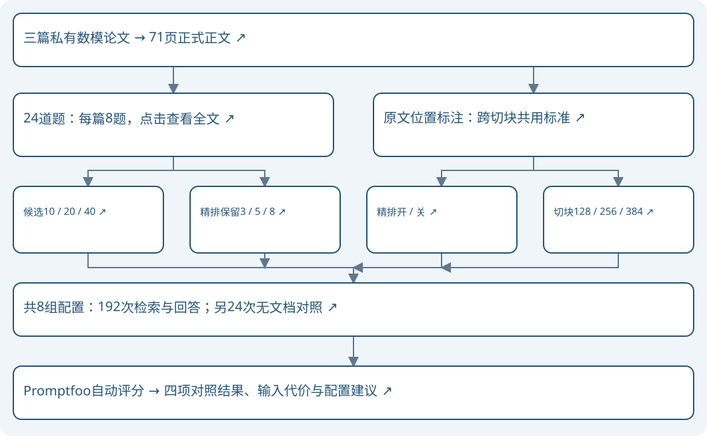

# 数模论文RAG评测：四项检索实验

已完成 · 2026-11-06 · Promptfoo 0.125.1。本轮只比较候选数量、精排保留数量、精排开关和切块大小。24道题运行8组配置，并增加无文档对照；不进行额外调参。

主要结论：本题库保留精排、保留5块更合适；384-token切块提高证据完整性，但增加输入量；候选40比20多找齐1题，检索更慢。四项分别比较，没有验证这些取值组合后的效果。

## 1. 用什么资料、怎样比较

三篇论文原文件共130页，正式纳入71页、70,452字符。排除目录、空白页及代码、问卷、图像表格附录。三个文档混合检索，用来源标签区分；每篇8题，共21道有答案题、3道无答案题。全部用于条件比较，没有独立保留检验。

| 论文 | 原PDF页数 | 正式范围 |
| --- | --- | --- |
| B题省一论文.pdf | 69 | 第1—27页 |
| C题省三论文.pdf | 26 | 第1—17页 |
| 统计建模论文.pdf | 35 | 第1—2、5—29页 |

表头说明：“原PDF页数”含附录；“正式范围”是参与所有实验的同一批页面。题目考察本文采用的数据、设置、数值和结论，不评价原论文数学模型本身是否正确。

| 论文 | 每块最多128 token | 每块最多256 token（基准） | 每块最多384 token |
| --- | --- | --- | --- |
| B题省一论文.pdf | 247块 | 110块 | 72块 |
| C题省三论文.pdf | 126块 | 58块 | 39块 |
| 统计建模论文.pdf | 162块 | 74块 | 52块 |
| 切块总数 | 535块 | 242块 | 163块 |

表头说明：三列是同一批71页正文按不同块大小切分后的数量，每套都按PDF页分别切分、相邻块重叠40 token，页尾不足上限的内容保留。基准资料库共242块；除chunk128使用535块、chunk384使用163块外，其他配置均使用这套242块的资料库。这里是资料库的总块数，不是单次问答的输入块数；基准问答从242块中检索20块，精排后只交给生成模型5块。

图文版流程节点可点击：题目、各实验、指标解释及结论均在同一HTML文件内。

## 2. 具体改了哪些参数

| 配置 | 切块token | 候选数top_k | 保留数top_n | 精排 |
| --- | --- | --- | --- | --- |
| base | 256 | 20 | 5 | 开 |
| k10 | 256 | 10 | 5 | 开 |
| k40 | 256 | 40 | 5 | 开 |
| n3 | 256 | 20 | 3 | 开 |
| n8 | 256 | 20 | 8 | 开 |
| no-rerank | 256 | 20 | 5 | 关 |
| chunk128 | 128 | 20 | 5 | 开 |
| chunk384 | 384 | 20 | 5 | 开 |

表头说明：配置是记录名称；切块token是每块正文长度上限；top_k是检索候选数量；top_n是最终交给生成模型的片段数；精排表示是否重新按问题与片段相关性排序。以上参数均发生在生成前。base是共用基准；各项实验只改变表中一个设置。

共同条件：向量与BM25等权RRF融合；向量模型text2vec-base-chinese，精排模型mmarco-mMiniLMv2-L12-H384-v1；相邻块扩充关闭，重叠40 token，按页切块。生成使用deepseek-chat、legacy提示词、温度0.7、最多512输出token，自动裁判温度0。切块大小不同会改变输入字数；保持片段数量相同，单列输入量，不宣称等输入预算比较。

关闭精排时保留同一融合候选顺序的前5块；相同切块与候选数的两组候选身份已核对。配置顺序逐题轮换，检索模型预热，每次清理应用向量／精排缓存；生成不复用旧答案，每条件采样一次。索引独立，原论文索引文件身份前后保持一致。

## 3. 结果表怎么读

“检索片段中找全答案依据的题数”：检查最初检索出的10、20或40个片段，统计其中包含全部已标注答案依据的题目数量。例如19/21表示：21道有答案的题中，有19道题所需的标注原文都进入了初步检索结果。统计单位是题，不是片段。

“最终交给模型的片段中，找全答案依据的题数”：检查最后实际交给生成模型的片段，统计其中有多少道题的标注答案依据是完整的。开启精排时，检查重新排序后保留的3、5或8块；关闭精排时，检查按原检索顺序直接保留的前5块。例如，关闭精排的9/21表示直接选出的前5块找全了9道题的标注原文；开启精排的基准组18/21表示精排选出的前5块找全了18道题的标注原文。

两项都只检查资料有没有找全，不检查模型是否答对。程序按论文、PDF页码与原文位置核对证据，更换切块大小后仍检查同一段原文；证据分布在多个片段中时，可以合起来检查。3道无答案题不计入这两项，分母均为21。

“事实锚点覆盖率”：每题已覆盖锚点数除以该题总锚点数，再对21题平均；“MRR”：最终片段中第一条独自完整覆盖任一锚点的片段排第1得1、第2得1/2，未找到得0，再对21题平均。它不衡量全部证据完整性。

“语义通过/24”：逐题检查正确性、依据、行为、语言是否全部为2分，并确认没有被裁判标记的来源错误；满足条件的题数记入这一列。四项分数可在HTML题目附录的“正确/依据/行为/语言”表头下查看。

“严格通过/24”的标准：同一道有答案题，既要语义通过，又要在最后保留的片段中找全全部标注答案依据，即这道题自己的证据覆盖率为100%。逐题检查这两个条件，同时满足才计1题，最后累加为严格通过题数。对应表头及要求如下：

| 对应表头 | 哪项数据要达到什么条件 | 与严格通过的关系 |
| --- | --- | --- |
| 语义通过/24；附录“正确/依据/行为/语言” | 同一道题的四项分数均为2，且没有来源错误 | 必须满足 |
| 最终交给模型的片段中，找全答案依据的题数 | 同一道题的标注答案依据全部找全，即该题证据覆盖率100% | 有答案题必须同时满足；按该组实际交给模型的片段判断，不要求一定经过精排 |
| 事实锚点覆盖率 | 主结果表显示21道有答案题的平均值 | 不用整组平均值作门槛；严格通过要求的是该题覆盖率100% |
| 检索片段中找全答案依据的题数、MRR、输入token、检索ms | 没有严格通过阈值 | 不直接参与严格通过判定 |

表头说明：“对应表头”指报告中可查看的数据；“哪项数据要达到什么条件”说明逐题门槛；“与严格通过的关系”区分必需条件与仅供比较的指标。3道无答案题只要求语义通过，不要求找全证据。整组语义通过不必为24/24，整组平均覆盖率也不必为100%；严格通过统计的是其中同时满足条件的题数。

“输入token”是24次生成API记录的输入合计，含问题、正文和来源标签；“检索ms”是24次检索＋精排中位耗时，不含答案生成或评分。二者反映输入量与速度，不影响通过与否。

| 评分项 | 2分 | 1分 | 0分 |
| --- | --- | --- | --- |
| 正确性 | 所问事实完整正确／按无答案参考恰当拒答 | 部分正确或遗漏必要事实 | 核心错误或未回答 |
| 依据 | 事实均有当前片段支持 | 核心有依据，附加信息支持不足 | 核心解释无依据或冲突 |
| 行为 | 有据回答、准确指出缺失、纠正错误前提 | 边界模糊或混入猜测 | 编造缺失信息或接受错误前提 |
| 语言 | 主体中文 | 混杂但中文为主 | 主体不是中文 |

表头说明：四项独立评分，2分为满足要求，1分为部分满足，0分为未满足。回答诚实说明片段缺失可让依据与行为满分，但原书有答案时正确性仍可失分。语言检查语言选择，不评文采；引用可省略，写出的来源必须正确。裁判与生成来自同模型系列，结果属于辅助自动评分。

## 4. 候选数量：10、20、40

| 配置 | 检索片段中找全答案依据的题数 | 最终交给模型的片段中，找全答案依据的题数 | 事实锚点覆盖率 | MRR | 语义通过/24 | 严格通过/24 | 输入token | 检索ms |
| --- | --- | --- | --- | --- | --- | --- | --- | --- |
| k10 | 15/21 | 14/21 | 78.6% | 0.802 | 20/24 | 17/24 | 24,929 | 666 |
| base | 19/21 | 18/21 | 92.9% | 0.837 | 23/24 | 21/24 | 25,333 | 1331 |
| k40 | 20/21 | 19/21 | 95.2% | 0.837 | 23/24 | 22/24 | 25,401 | 2295 |

表头说明沿用第3节：证据指标分母21，语义与严格通过分母24；输入为24题合计，耗时为单次观测的中位值。配置的参数值见第2节。

本组按严格通过数优先、同分比较语义通过与证据数量、再比较输入量，k40表现较优：严格22/24，找齐19/21，生成输入25,401 token。

判断：10候选相对20候选少找齐4题；40候选多找齐1题，但中位检索耗时从1.33秒增至2.30秒。证据优先可选40，时延优先保留20；本轮未测更大的候选数。

k10相对base：新增找齐0题（无）；丢失4题（paper-b-03, paper-c-02, paper-c-03, statistics-05）。

k40相对base：新增找齐1题（paper-b-04）；丢失0题（无）。

## 5. 精排保留数量：3、5、8

| 配置 | 检索片段中找全答案依据的题数 | 最终交给模型的片段中，找全答案依据的题数 | 事实锚点覆盖率 | MRR | 语义通过/24 | 严格通过/24 | 输入token | 检索ms |
| --- | --- | --- | --- | --- | --- | --- | --- | --- |
| n3 | 19/21 | 14/21 | 81.7% | 0.825 | 22/24 | 17/24 | 15,591 | 1147 |
| base | 19/21 | 18/21 | 92.9% | 0.837 | 23/24 | 21/24 | 25,333 | 1331 |
| n8 | 19/21 | 18/21 | 92.9% | 0.837 | 23/24 | 21/24 | 38,960 | 1066 |

表头说明沿用第3节：证据指标分母21，语义与严格通过分母24；输入为24题合计，耗时为单次观测的中位值。配置的参数值见第2节。

本组按严格通过数优先、同分比较语义通过与证据数量、再比较输入量，base表现较优：严格21/24，找齐18/21，生成输入25,333 token。

判断：保留8块相对5块没有增加完整证据题数，严格通过也相同，生成输入增加53.8%。本轮优先保留5块。三组都对20个候选打分，检索耗时的波动不能解释为保留8块本身更快。

n3相对base：新增找齐0题（无）；丢失4题（paper-c-02, paper-c-03, paper-c-07, statistics-02）。

n8相对base：新增找齐0题（无）；丢失0题（无）。

## 6. 精排开关

| 配置 | 检索片段中找全答案依据的题数 | 最终交给模型的片段中，找全答案依据的题数 | 事实锚点覆盖率 | MRR | 语义通过/24 | 严格通过/24 | 输入token | 检索ms |
| --- | --- | --- | --- | --- | --- | --- | --- | --- |
| no-rerank | 19/21 | 9/21 | 61.1% | 0.492 | 17/24 | 12/24 | 24,192 | 71 |
| base | 19/21 | 18/21 | 92.9% | 0.837 | 23/24 | 21/24 | 25,333 | 1331 |

表头说明沿用第3节：证据指标分母21，语义与严格通过分母24；输入为24题合计，耗时为单次观测的中位值。配置的参数值见第2节。

本组按严格通过数优先、同分比较语义通过与证据数量、再比较输入量，base表现较优：严格21/24，找齐18/21，生成输入25,333 token。

判断：关闭精排明显减少本地检索阶段的计算，但完整证据从18题降至9题，严格通过从21题降至12题。本题库以质量为目标时保留精排；单次耗时观测不作统计显著性结论。

实际例子paper-b-02：问题要求第9页的“平均抽样次数”。开启精排的输入包含第9页，回答222.303与122.246；关闭精排的回答使用摘要中的最少次数221与122，并误称它们来自第9页。这说明相关词命中并不足以区分“最少”与“平均”。

| 配置 | 实际输入中的短原文 | 实际回答 |
| --- | --- | --- |
| no-rerank | PDF第1页：结论：情形一的最少需检测样本为221次；情形二的平最少需检测样本为122次。针对问题二，本文综合检测和购买零件成本、成品检测成本、成品装配成本以及次品处理方式成本构造目标函数，得到最小化生产总成本模型 | 根据提供的片段，生产决策论文第9页正文报告的情形一平均抽样次数为**221次**，情形二平均抽样次数为**122次**。    （来源：chunk-2 提到“情形一的最少需检测样本为221次；情形二的平最少需检测样本为122次”。） |
| base | PDF第9页：数据之后，得到情形一结论：在95%的信度下平均抽取样本数量:222.303，平均似然比:22.169，平均次品率为0.176。此时拒绝零假设，接受备择假设，即接受“在90%的信度下认定零配件次品率不超过标称值，则接收这批零配件。” | 根据片段内容，生产决策论文第9页正文报告中：  - **情形一**平均抽取样本数量为 **222.303**（尽可能少的抽样检测方案为221次）。 - **情形二**平均抽取样本数量为 **122.246**（尽可能少的抽样检测方案为122次）。 |

表头说明：短原文只取自该组当时实际收到的片段；回答保持原样。完整片段、来源和评分在本地逐题档案中，题目附录可以展开两组的实际回答与评分理由。

## 7. 切块大小：128、256、384 token

| 配置 | 检索片段中找全答案依据的题数 | 最终交给模型的片段中，找全答案依据的题数 | 事实锚点覆盖率 | MRR | 语义通过/24 | 严格通过/24 | 输入token | 检索ms |
| --- | --- | --- | --- | --- | --- | --- | --- | --- |
| chunk128 | 16/21 | 11/21 | 71.0% | 0.726 | 18/24 | 14/24 | 15,743 | 676 |
| base | 19/21 | 18/21 | 92.9% | 0.837 | 23/24 | 21/24 | 25,333 | 1331 |
| chunk384 | 21/21 | 20/21 | 95.2% | 0.787 | 24/24 | 23/24 | 34,780 | 1627 |

表头说明沿用第3节：证据指标分母21，语义与严格通过分母24；输入为24题合计，耗时为单次观测的中位值。配置的参数值见第2节。

本组按严格通过数优先、同分比较语义通过与证据数量、再比较输入量，chunk384表现较优：严格23/24，找齐20/21，生成输入34,780 token。

判断：384-token块相对256-token块多找齐2题，严格通过由21题增至23题，但生成输入增加37.3%。质量优先可选384；输入量优先保留256。这里只比较块大小，未比较段落或语义切块算法。

chunk128相对base：新增找齐0题（无）；丢失7题（paper-b-02, paper-b-03, paper-b-06, paper-b-07, paper-c-01, paper-c-07, statistics-05）。

chunk384相对base：新增找齐2题（paper-b-04, statistics-07）；丢失0题（无）。

## 8. 不提供论文时，原问答提示词的表现

| 检查 | 结果 |
| --- | --- |
| 有答案题正确性满分 | 0/21 |
| 无答案题 | 另外3题，不计入论文事实命中数 |
| 无文档生成次数 | 24 |

表头说明：只看21道有答案题的正确性是否为2，不使用无文档情况下的依据分判定知识命中。无文档组沿用同一legacy提示词，只把片段置空；该提示词仍要求基于片段且不编造，因此拒答不能证明模型没有相关知识。这是上下文移除对照，不是独立的闭卷知识测验，也不能证明训练语料归属。部分问题含限定或数值线索，单次猜中同样会计入。

## 9. 本轮结论与边界

候选数量：10、20、40：本组按严格通过数优先、同分比较语义通过与证据数量、再比较输入量，k40表现较优：严格22/24，找齐19/21，生成输入25,401 token。

精排保留数量：3、5、8：本组按严格通过数优先、同分比较语义通过与证据数量、再比较输入量，base表现较优：严格21/24，找齐18/21，生成输入25,333 token。

精排开关：本组按严格通过数优先、同分比较语义通过与证据数量、再比较输入量，base表现较优：严格21/24，找齐18/21，生成输入25,333 token。

切块大小：128、256、384 token：本组按严格通过数优先、同分比较语义通过与证据数量、再比较输入量，chunk384表现较优：严格23/24，找齐20/21，生成输入34,780 token。

四项是共享基准的单因素比较，没有执行所有参数组合。不能把各项较优值拼接后当成已验证的最佳组合；生产默认设置未修改。全部24题用于比较，没有独立保留测试；单次采样不宣称统计显著或任意数学建模论文问答准确率。

共保存216份回答，完成216份有效评分；评分尝试220次，其中无效4次；输出达到长度上限0份，达到上限的输出不计通过。生成总token 226,781，已记录裁判总token 465,022。只重评无效评分对应的原答案，不重新生成挑选结果。

首次Promptfoo HTTP适配将完整对象直接作为响应，缺少工具所需的output字段，导致216项被工具记为“No output”；216份回答及模型评分实际均已保存。修正汇总路径后，使用本地文件provider重放同一批记录，得到150通过、66未通过、0工具错误，未再次调用模型。150/216混合了192份RAG严格检查和24份无文档正确性检查，不作为总体回答准确率。首次档案和离线重放档案均保留。

原PDF部分公式、表格和图片在文本提取中有缺失，本题库只选择可核对的文字证据，并抽查了原始页面；不据此评价图表问答能力。统计论文摘要与正文的测试案例数等口径存在差异，本轮问题避开未限定的冲突数字；按指定来源回答，不进行原研究有效性审查。题目与标注由AI整理，独立人工复核未完成。

完整题目与参考答案见[题库](QUESTIONS.md)，各组实际回答见[图文版附录](FINAL_EVALUATION.html#questions)。
