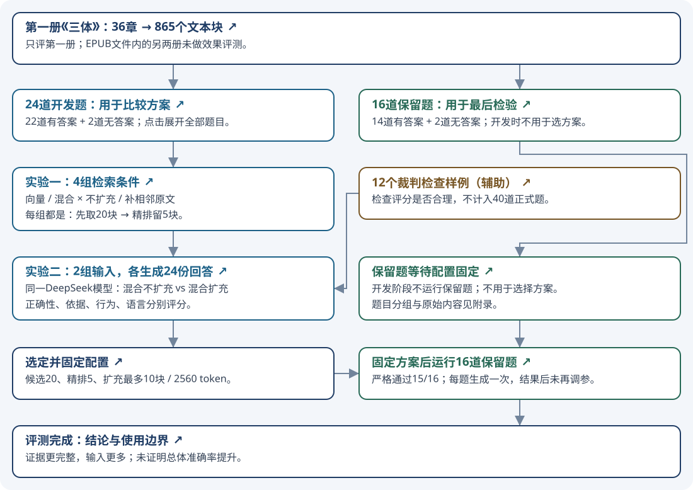
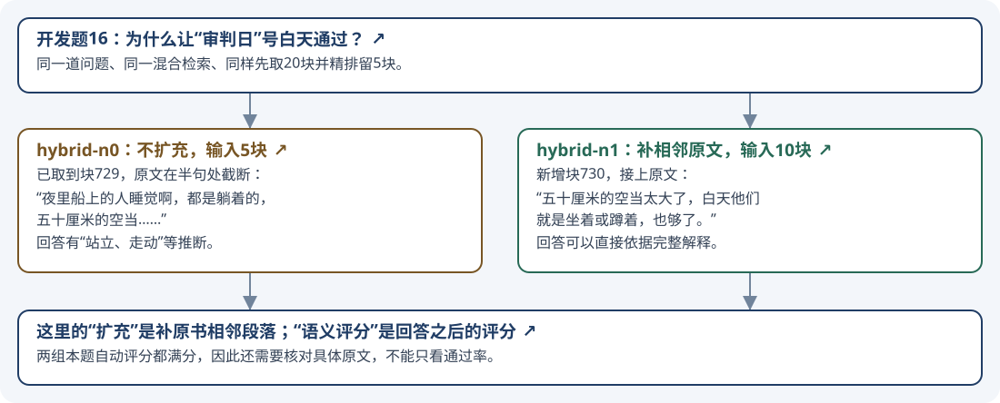

# 《三体》第一册 RAG 评测报告

**已完成 · 2026-11-06 · Promptfoo 编排**

本轮回答两个问题：**怎样更完整地找到原文证据？补上相邻原文后，回答有什么变化、输入增加多少？** 最终采用“混合检索 + 相邻原文扩充”，固定配置后16道保留题严格通过15题。这个数字是本题库的自动评测结果，尚未经独立人工审核。

[打开可点击图文版](FINAL_EVALUATION.html) · [全部40道题及参考答案](QUESTIONS.md) · [12个裁判检查样例](JUDGE_CONTROLS.md)

## 1. 评测范围与流程

正式语料是第一册《三体》：36章、187,784字符、865个文本块。EPUB文件实际包含三册，本轮只评第一册。正式题共40道：24道开发题用于比较方案；16道保留题在方案固定后检验，不再用于调参。早期8道试运行题包含在24题内；12个裁判检查样例另计。

图中每个方框均有详情链接。**在HTML图文版中点击方框即可跳转**；Markdown内嵌图片的节点点击取决于阅读器，可使用本文的文字链接。

## 2. 具体比较了什么、改了什么

| 实验 | 比较方法 | 实际改变 | 保持相同 |
|---|---|---|---|
| 一：检索对照 | 向量不扩充、向量扩充、混合不扩充、混合扩充，共4组 | 检索方式；是否补同节相邻原文 | 24题、语料、切块、向量模型、精排模型；候选20块、精排留5块 |
| 二：生成对照 | `hybrid-n0` vs `hybrid-n1`，各24份回答 | 给生成模型的原文片段：5个精排块 vs 补邻居后的最多10块 | 问题、模型、提示词、温度、来源标签、评分规则；直接使用实验一保存的片段 |
| 三：保留检验 | 固定最终配置后回答16题 | 换成未用于选方案的16道题 | 只用混合检索并扩充；不再比较或调整配置 |

**表头说明：**“比较方法”是同批问题分别运行的方案；“实际改变”是实验变量；“保持相同”是控制条件。第三项检验选定方案，不是新增一组调参对照。

**向量检索**按意思相近查找；**混合检索**把向量结果与BM25关键词结果等权融合后取候选。`n0`表示不补邻居；`n1`表示允许补精排块前后各一块原文，限同一节，受总量上限约束。扩充读取原书文字。

| 参数或设置 | 本轮取值 | 是否比较过不同值 |
|---|---|---|
| 检索候选数 `top_k` | 20块 | 否 |
| 精排保留数 `top_n` | 5块 | 否 |
| 相邻块半径 `neighbors` | 对比0与1；最终为1 | 是 |
| 最终上下文上限 | 10块、正文合计2560 token | 否 |
| 切块大小 / 重叠 | 256 / 40 token | 否 |
| 向量模型 / 精排模型 | text2vec-base-chinese / mmarco-mMiniLMv2-L12-H384-v1 | 否 |
| 生成模型 / 温度 / 模板 | deepseek-chat / 0.7 / legacy | 否 |
| 自动裁判模型 / 温度 | deepseek-chat / 0 | 否 |

**表头说明：**“本轮取值”是运行时采用的设置，“是否比较过不同值”表示有没有通过对照验证该数值。**本轮没有寻找最优top_k或top_n，也没有比较不同生成模型或生成采样top_k。** 上表top_k属于检索候选数，top_n属于精排，都在生成之前。来源标签格式用于实验，未替换普通问答接口的默认格式。

## 3. 实验一：原文证据有没有找全

24道开发题中22道有答案；下面证据指标只统计这22道。四组共96次检索观测。

| 检索方案 | 候选20块找齐 | 精排5块找齐 | 最终输入找齐 | 必要事实覆盖率 | 首条证据排名分MRR | 平均正文token | 检索中位耗时 |
|---|---:|---:|---:|---:|---:|---:|---:|
| 向量，不扩充（`vector-n0`） | 17/22 | 16/22 | 16/22 | 75.8% | 0.705 | 1,280 | 747 ms |
| 向量，补相邻原文（`vector-n1`） | 17/22 | 16/22 | 18/22 | 85.6% | 0.705 | 2,481 | 804 ms |
| 混合，不扩充（`hybrid-n0`） | 21/22 | 18/22 | 18/22 | 88.6% | 0.830 | 1,278 | 903 ms |
| 混合，补相邻原文（`hybrid-n1`） | 21/22 | 18/22 | 21/22 | 95.5% | 0.830 | 2,496 | 980 ms |

**表头说明：**

- **检索方案：**向量或混合检索，以及扩充开关。括号内是原始记录的配置名。
- **候选20块找齐 / 精排5块找齐 / 最终输入找齐：**分别在三个阶段数有多少题找到了全部已标注必要事实的证据。每个事实有多个可接受位置时，找到其中一个即可。比如18/22表示22道有答案题中，18题的标注证据齐全。
- **必要事实覆盖率：**每题“找到的必要事实数 ÷ 该题必要事实总数”，再对22题取平均。若题目需两个事实、只找到一个，该题是50%；它不算“找齐”。此指标不是检索了全书多少文字，也不直接等于回答正确率。
- **首条证据排名分MRR：**精排5块中，第一条标注相关证据排第1得1分、排第2得1/2、排第3得1/3，没找到得0；对22题取平均。越大表示第一条证据越靠前，不代表多项证据都齐全。
- **平均正文token：**24题最终交给模型的原文片段长度均值，用向量模型的分词器计算，不含来源标签和提示词，不是API计费输入量。
- **检索中位耗时：**24题检索、精排及扩充耗时的中间值，不含答案生成和评分。

**结果：**关闭扩充时，混合检索比向量检索多找齐2题（18 vs 16）；在混合检索基础上补相邻原文，又多找齐3题（21 vs 18）。代价是正文输入接近翻倍。模型预热、逐次清理应用检索缓存并轮换顺序；每题每条件只测一次，耗时不作显著性结论。扩充可读取候选20块之外的邻居。

## 4. 一个真实例子：扩充到底补了什么

[开发题16](QUESTIONS.md#tb-dev-16)要求解释：为什么让“审判日”号白天经过，且必须联系纳米丝最小间距。

块729有“拉丝的间距最小就是五十厘米，再小材料不够了”，但后面的解释截断在“夜里船上的人睡觉啊，都是躺着的，五十厘米的空当”。新增块730接上：“五十厘米的空当太大了，白天他们就是坐着或蹲着，也够了。”

不扩充时实际输入块为734、733、742、729、728；扩充后再加735、732、741、743、730。两组本题自动评分都满分，但扩充后有直接的完整原文支持；不扩充回答中的“站立、走动”带有推断。**补证据的效果，不能只用自动满分来判断。**

## 5. 实验二：同一个模型，换输入片段

只比较“混合不扩充”和“混合扩充”。各使用实验一保存的片段生成24份答案，合计48份，不重新检索。没有“语义扩充”步骤；**语义评分是回答生成之后，按意思检查答案。**

| 指标 | 混合不扩充 hybrid-n0 | 混合扩充 hybrid-n1 |
|---|---:|---:|
| 自动语义通过 | 23/24 | 24/24 |
| 严格通过 | 20/24 | 23/24 |
| 找齐标注证据 | 18/22 | 21/22 |
| 生成输入 token | 30,705 | 57,021 |
| 生成输出 token | 2,410 | 2,380 |
| 生成总 token | 33,115 | 59,401 |
| 生成中位耗时 | 1.52 s | 1.63 s |

**表头与指标说明：**两列分别是相同24题、相同生成条件下的两套输入。自动语义通过要求正确性、依据、行为、语言四项均为2分，且没有被裁判标记的来源错误；严格通过还要求找齐全部标注证据，无答案题不要求证据块。“找齐标注证据”只统计22道有答案题。输入、输出、总token是24份生成的API用量合计，总量为输入加输出，不含裁判；生成中位耗时只含生成，不含检索与评分。

**结果：**扩充后输入token增加85.7%，生成总token增加79.4%，严格通过从20题变成23题。自动语义分仅第6题有差异，但原文复核发现裁判存在来源归属判断不一致，因此不据此认定总体回答准确率提高。第16题的完整原文补充则可直接核对。

有1次裁判输出无效，只重评已保存答案，没有再生成；异常前记录保留。该次无效评分用量缺失，因此不汇总全部费用。来源标签另有补充实验，但评分规则也发生变化，不作为本表的单变量结论，见[来源实验](SOURCE_ATTRIBUTION.md)。

### 四项评分分别查什么

| 项目 | 2分 | 1分 | 0分 |
|---|---|---|---|
| 正确性 correctness | 答对参考答案所需事实，符合纠错或拒答要求 | 只答对一部分，或遗漏必要事实 | 核心错误，或没有回答该答的事实 |
| 依据 grounding | 每个事实断言都有当前输入片段支持 | 核心有依据，但附加细节、因果或来源支持不足 | 核心解释无依据或与原文冲突 |
| 行为 behavior | 有依据就回答；缺什么明确说；错误前提明确纠正 | 笼统说不确定，或部分作答混入猜测 | 编造缺失信息，或接受错误前提 |
| 语言 language | 主体按要求用中文，术语与引文可保留原语言 | 中外文混杂，但中文仍为主 | 主体没有用要求的语言 |

**表头说明：**“项目”是互相独立的检查维度，后三列是0、1、2分的判定含义。语言项检查语言选择，不评文采。引用可省略，但一旦标明章节或块号就必须正确；来源标错按[来源规则](../../threebody/source-grading-rules.txt)限制相关得分。例如原书有答案、检索却漏了一半时，诚实说明缺失可以让依据和行为得2分，正确性仍只有1分。原始标准见[评分规则](../../promptfoo/semantic-rubric.txt)。

## 6. 最后检验：16道保留题

固定“混合检索 + 相邻原文扩充”后，每题生成一次；查看答案后没有再改配置、改题或补标。

| 检查项 | 结果 |
|---|---:|
| 回答及有效评分完成 | 16/16 |
| 自动语义通过 | 15/16（93.75%） |
| 严格通过 | 15/16（93.75%） |
| 有答案题找齐标注证据 | 13/14 |
| 无答案题恰当拒答并语义通过 | 2/2 |
| 无效评分次数 | 0 |
| 生成总token / 裁判总token | 38,448 / 68,010 |

**表头说明：**“检查项”列出完成数量、答案质量、证据完整性与用量，“结果”为对应计数或合计。自动语义与严格通过沿用上节定义；证据项分母为14道有答案题，拒答项分母为2道无答案题，两类分开计算。生成token用于回答，裁判token用于评分，分别列出。

未通过的是[保留题01](QUESTIONS.md#tb-test-01)：问脱水原因和恢复生产条件。检索找到了严寒和脱水，却漏掉“当较长的恒纪元到来时，再集体浸泡复活，生产和建设”的块119/120。回答只完成前半问，并说明当前片段不足以回答后半问。**原书有答案，是检索没找齐；如实说明不足仍然会失去正确性分。** [16题逐项结果及复核](HOLDOUT.md)保留全部成绩与问题说明。

## 7. 结论：本轮给出的配置建议

- **证据完整优先：**在本题库中采用混合检索、开启同节相邻原文扩充。相对混合不扩充，开发题完整证据由18/22增至21/22。
- **输入量优先：**保留混合不扩充作为较低输入的候选。两组生成输入分别为30,705与57,021 token；不能只看通过数而忽略输入增长。
- **参数结论的边界：**20个候选、精排5块是本轮采用值，未证明是最优值；没有不同top_k、top_n、切块大小或生成模型的比较结果。

16题保留检验严格通过15题，不能外推为全书任意问题准确率93.75%。题目、参考答案与原文复核由AI完成，独立人工审核未完成；同模型系列生成和评分、每条件单次采样及小样本都会限制结论。已记录第9题附加表述范围偏窄、第15题参考漏记店名等问题，未事后改分。评测已结束。

## 8. 术语与证据入口

**相邻原文扩充：**找到块729后，允许补同一节的728与730；有重复则去重，并受10块、2560正文token上限约束。没有改写问题或生成新内容。

**语义评分：**模型读问题、参考答案、当前片段和当前回答，按意思评分。发生在生成之后；不是第二次扩充资料，也不是Promptfoo必须默认执行的固定步骤，而是本项目配置的评分检查。

**召回 → 精排 → 上下文：**先从865块中取20个候选，再按问题与片段的相关性重新排序并留5块；可补邻居，得到最终给生成模型阅读的资料。BM25按词匹配，向量按语义相似；混合使用RRF合并两套排名。[具体实现与实验](RETRIEVAL_COMPARISON.md)。

**开发题 / 保留题：**开发题可用于比较和选方案；保留题在方案固定后才运行，只报告最终效果。本轮24+16合计40题；最初8题属于开发组子集。12个裁判检查样例用已知好坏回答检查评分器，不计入40题。

题目全文与标准：[40题及参考答案](QUESTIONS.md)；[12个裁判检查样例](JUDGE_CONTROLS.md)。实验档案：[检索](RETRIEVAL_COMPARISON.md)、[生成](GENERATION_COMPARISON.md)、[原文复核](SOURCE_REVIEW_AND_FREEZE.md)、[保留结果](HOLDOUT.md)、[固定配置](../../threebody/frozen_profile_v1.json)、[方法与命令](../../threebody/README.md)。完整电子书、索引及原始输出保存在本地忽略目录，不随报告提交。
